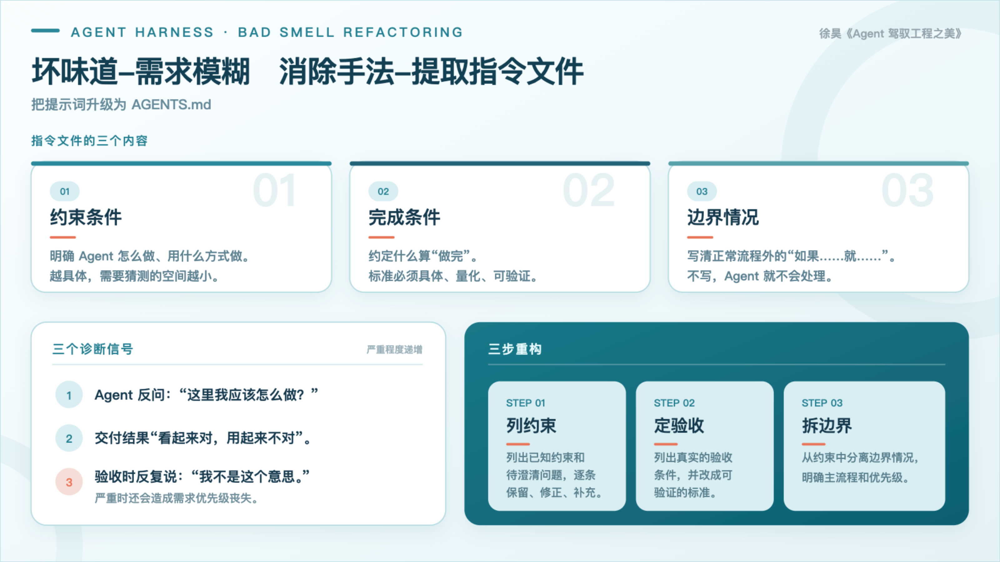

# 07 | 需求模糊：Agent不知道“好”长什么样

你好，我是徐昊，欢迎继续学习驾驭工程。

上一讲我们讨论了知识固化，也就是把对话中的临时知识，通过有针对性的提示，将知识逐步固化到不同的子系统中。我们看到了在 AI 时代，认知的提升是第一位的，技巧的差距可以通过 AI 大模型填补。

那么接下来的章节，我们将借鉴重构（Refactoring）的经典结构，通过坏味道（Bad Smell）与解决方案的形式，逐步提高我们构建 Harness 的认知。今天我们来看一下“需求模糊”这个坏味道。

## Bad Smell：需求模糊

当我们围绕 Agent 构建 Harness 时，总会倾向于使用简单的一次性提示（One-shotprompting）。比如，给 Agent 一句话：“我要做一个西班牙语背单词的系统”，然后把所有设计工作都交给了 Agent 去自行处理。

那么 Agent 大概率会给你一个非常简单的结果。可能是在对话中随机抽问单词。没有学习计划、没有记忆曲线、也没有进度追踪。这不是 Agent 的能力不够，而是需求太模糊，它只能猜，然后猜错了而已。

出现这个问题，大模型厂商要承担主要责任。每当有大模型发布时，他们总会强调这一次升级，大模型在 one-shot prompting 上有了多少提高。最近的一个例子，就是 Anthropic 新发布的 Claude Fable 5。现在我们可以搜索到很多例子，都在强调它有多么出色的 one-shotprompting 能力。

久而久之，我们头脑中有个印象，仿佛 one-shot prompting 才是大模型真正的用法，或者总有一天，当模型足够强大的时候，one-shot prompting 就能够工作。你期望给 Agent 一句话，它就能交付一个完整、正确的系统。

然而我们会发现，展示模型强大能力的 one-shot prompting，大部分都是成熟的已知系统，比如，构造一个贪吃蛇游戏；或者是成熟的已知系统的变体，比如，构造一个 3D 版本的贪吃蛇游戏。但事实是，你脑子里的“背单词系统”可能包含了特定需求，周计划、记忆曲线、复习节奏、三个技能（背单词、动词变位、数字表达）等等。而你说出口的只有“背单词”三个字。当你把所有信息压缩在一句话里，遗漏是必然的，猜对才是偶然。

## Solution：提取指令文件

消除这个坏味道的手法叫提取指令文件（Extract Instruction File），也就是把提示词升级为AGENTS.md。也就是把需求从对话框里的零散描述，提取为一个结构化的指令文件。这个文件不追求长篇大论，但必须包含三个内容。

第一，约束条件。就是你期望 Agent 怎么做，用什么方式做。不写“背西班牙语单词”，写“200个单词分 4 周推进，每天 10 个新词，学完即测。按造句拼写的方式学习，测试时用户看到中文含义，需要写出包含该单词的完整西语句子”。约束条件写得越具体，Agent 需要猜测的空间就越小。

第二，完成条件。约定什么算“做完了”。要写具体的量化标准，比如“三个工具的掌握率都超过90%，且没有到期的复习卡片，才算完成”。完成条件必须是可验证的，不能是主观判断。当你把完成条件从“感觉差不多了”变为“数据达标了”，Agent 就知道自己做完后该检查什么，不需要你盯着验收。

第三，边界情况。 正常流程之外的那些“如果……就……”的情况。比如“如果连续答错 3 次以上，就降低当日新词配额；如果复习卡片未到期，就不安排新的学习内容；如果所有单词都超过 90% 掌握率，就切换到纯复习模式”。边界情况不写，Agent 就不会处理。

这三个内容合在一起，就是把一句话的需求，变成了一个 Agent 不需要猜就能执行的指令文件。另外说一句，如果你去看看那些 one-shot prompting 结果非常好的提示词，绝大部分也都包含上面提到的三部分。差别在于，Agent 系统会在 Harness 的指令系统提示下，反复执行。而一次性任务，比如，通过 Agent 写代码，在任务结束后就不再需要 one-shot prompting了。

## 什么时候该做这个重构

需求模糊的诊断信号很明显。

第一个迹象是 Agent 会反问“这里我应该怎么做？”，因为你的指令里留下了太多言外之意。Agent 的逻辑推理会先填补未知的地方，但当有不同选择的时候，Agent 自己也不确定，所以会来问你；

第二个迹象是 Agent 交付的东西“看起来对，用起来不对”，它猜对了表面没猜对本质。Agent并不会每次都向你寻找反馈，它有时候会按照通用方案或常识来填补未知的部分。而这部分可能和你的需求不完全重合。比如你说“背西班牙语单词”，Agent 的理解是“随机抽问”，而你需要的是“按周计划加记忆曲线”。这样构造的系统，看起来能用，但是用起来不对。

第三个迹象是你经常在验收时说“我不是这个意思”，要在对话中反复修正需求。这个迹象比前两个更严重，因为它不仅仅是信息缺失的问题，还可能是因为优先级丧失引起的。当你在对话中修正需求时，你说的一切对 Agent 来说权重是一样的。Agent 分不清哪个是核心约束、哪个是锦上添花、哪个是随口一说。它只能假设你说的每句话都同等重要。于是 Agent 试图同时满足你所有的修正要求，最后顾此失彼。

当出现上面三个信号时，就意味着需要重构我们的指令系统了。

## 如何重构

当然你可以通过手工编写 AGENTS.md 的方式构造指令系统。也可以按照知识固化的方法来逐步提取知识。我推荐你用知识固化的办法，毕竟这容易很多，过程也很简单。

首先，列出现在所有已知的约束条件。你可以直接问：

- 基于我们之前的讨论，你理解的需求约束条件有哪些？逐条列出来。

Agent 会给出一个清单。你可以逐条对对看。对的留下，不对的修正，遗漏的补上。这个过程本身就能暴露大量你“以为说了但其实没写清楚”的东西。Agent 列出来的条件越少，说明你的需求越模糊。除此之外，你还可以让 AI 再问你一些问题，以避免你没有想到的情况：

- 基于我们之前的讨论，你还有哪些需要澄清的地方，以问题的形式逐条列出。

最后要记得把约束条件写入 AGENTS.md 文件。

第二步是列出验收条件。你可以问：

- 针对当前的任务，你怎么知道做完了？你的验收标准是什么？

Agent 的回答通常有两种情况。一种是它说“你告诉我没问题就算完了”，这属于完全没有标准。另一种是它列出了一套标准，但跟你脑子里的不一样，这是验收条件有歧义。不管是哪种，你都需要把真实的验收条件列出来，并要求 Agent 写入 AGENTS.md 文件。

第三步从约束条件中拆分出边界情况。约束条件和边界情况经常混在一起。比如“每天 10 个新词，连续答错 3 次降低次日新单词比例”。这里前半句是约束条件，后半句是边界情况。最好是把约束条件和边界情况分离出来单独写。

这么做有三个好处。一是 Agent 不会把边界情况当作常规流程来执行，会让主流程或外层循环更明显；二是明确告诉 Agent 不同流程之间的优先级；三是边界情况单独列出来之后，对人类也更友好，更容易发现自己漏掉了哪些。

当然，永远不要忘了让 AI 给你反馈，比如“针对刚才的约束条件，你觉得有哪些边界情况我还没提到？” Agent 会基于常识补充一些合理的边界情况，你再根据自己的实际需求裁剪或修改。

通常在做完上面三步，你就有了一个相对清晰的指令系统来解释你的需求。如果仍然出现需求不清晰的信号，那么只需要重复上述步骤，直到坏味道消除即可。

## 小结

- 模糊需求的本质是把需要大量上下文的系统需求压进一句话里，猜对是偶然，遗漏是必然；

- 模型厂商对 one-shot 能力的宣传加剧了这个错觉，但演示中的提示词与真实系统需求是两回事——前者是成熟已知系统，后者是你脑子里的特定需求；

- 诊断信号有三个，严重程度递增：Agent 反问、看起来对用起来不对、验收时反复说“我不是这个意思”。第三个信号往往伴随着优先级丧失；

- 模糊需求问题的重构手法是提取指令文件，把提示词升级为 AGENTS.md。这是知识固化的第一轮实践；

- 文件必须包含三部分：约束条件、完成条件、边界情况。缺任何一部分 Agent 都会猜错；

- 重构的三步法利用 Agent 帮你梳理需求：先列约束条件，再列验收条件，最后拆分出边界情况。每一步都可以让 Agent 反问来暴露遗漏。

## 思考题

把你最近用过的一个提示词拆开检查，约束条件、完成条件、边界情况缺了哪一部分？补全之后，再让 Agent 做一次同样的任务，对比前后交付的差别。

期待你在留言区积极发言。也欢迎你把课程分享给有需要的朋友。
