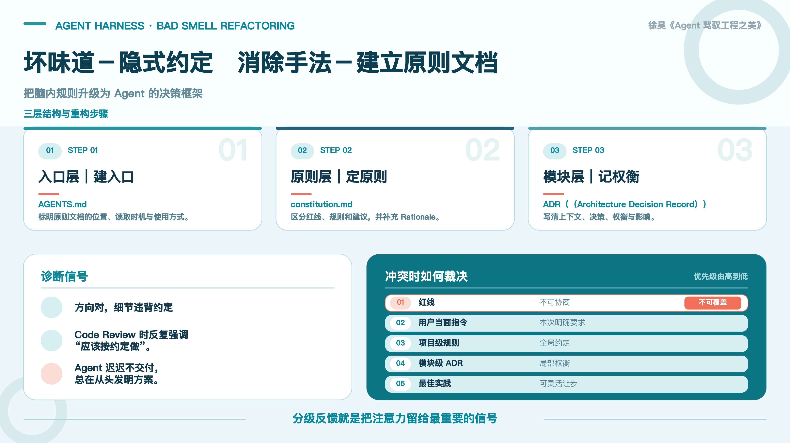

# 08 | 隐式约定：规则只存在于人的脑子里

你好，我是徐昊，欢迎继续学习驾驭工程。

今天我们来看一下驾驭工程（Harness Engineering）中常见的坏味道（Bad Smell），以及对应的重构手法。

我们构建了指令系统后，Agent 可以理解需求，但是给出的解决方案仍然偏差很大，不是因为它没读懂你的需求，而是它对于解决问题的约束存在不同的理解。造成这个问题的原因就是隐式约定。

隐式约定这个坏味道，通常出现在相对复杂的解决方案中，比如多模块的软件系统的研发。在简单项目中坏味道不太明显。因此在这章中，我会采用软件开发中的例子。如果没有软件开发背景的读者，也可以参考其中提及的关键原则。

## Bad Smell：隐式约定

当你消除了模糊需求，Agent 不再反问也不再猜错需求了，但是验收时还是发现，大方向虽然对了，但是细节有很大偏差。比如 Agent 处理 A 模块时用了数据库直连，但实际的约定是 A模块的所有数据必须通过 B 服务的中介层获取。再比如，Agent 修改 C 模块时没想到要同步更新 D 模块的接口。

这不是 Agent 猜错了需求，而是 Agent 不了解不同模块实现方式的约定。这就是坏味道隐式约定。

当然我们第一反应是，这不是换汤不换药吗？需求不清楚澄清需求就好，那实现方式不清楚也照着上一篇模糊需求的方法，进行澄清不就好了？

与单纯的需求澄清不同，实现方式的澄清需要处理不同的优先级。在项目中，除了项目本身的约定之外，不同的模块有自己的上下文和权衡，模块之间可能会存在不同的抉择。A 模块走中介层而不是直连，可能是两年前出过一次因为直连导致的数据一致性问题，团队在“性能优先”和“一致性优先”之间选择了后者。B 模块使用 XML 接口是因为要兼容一个已经停产的第三方系统，在“换接口”和“保留兼容”之间选择了后者。

## Solution：建立原则文档

消除隐式约定这个坏味道的手法叫建立原则文档（Establish Principles）。但要注意，原则文档不是规则清单。规则清单告诉你“怎么做”，原则文档告诉你“当 X 和 Y 冲突时，优先选哪个”。它不是给 Agent 一本“每个模块该怎么做”的操作手册，而是给它一套决策框架。

Agent 理解了这个框架之后，到了一个模块先问自己：这个模块的核心约束是什么？是数据一致性优先还是可用性优先？是兼容性优先还是功能演进优先？然后基于这个模块的上下文推导出正确的行为。

在具体的实现上，可以按照优先层级，依次建立不同的文档。目前的最佳实践一般有这么几个层级（从高到低）：

- 不可协商的红线：安全合规、数据保护、法律要求。任何情况下不能违反，用户当面要求也不行。例如：用户数据必须加密存储；任何时候不得使用明文密码。

- 用户当面的指令：用户在对话中给出的明确指示。能够覆盖项目级规则和模块级权衡，但不能覆盖红线。比如，用户说这里必须使用某某 API。

- 项目级约定：AGENTS.md 和原则文档中写明的全局规则。适用于所有模块，所有 Agent会话。

- 模块级约定：不同模块根据自身上下文做出的不同选择。每个选择背后都有原因，以及当时权衡依据的记录，可以看作是模块级别的 ADR（Architecture Decision Record）。比如，A模块走中介层（一致性优先），B 模块直连（性能优先）。

- 最佳实践：通用建议，上下文冲突时可以灵活让步。

## 什么时候该做这个重构

隐式约定比模糊需求更难诊断。Agent 不会反问，因为它不知道自己在违反规则。需要从侧面观察。最常见的就是在代码审查（Code Review）环节，当 Agent 完成代码编写，你看到代码时反复说“这里应该用我们约定的方式”，说明它不是偶然失误，是隐式约定没写下来。

此外，当 Agent 迟迟无法完成功能时，也需要考虑是不是隐式约定没写下来，导致 Agent 尝试从头发明解决方案。

## 如何重构

首先要建立的是原则文档的文件结构。原则文档不是一个文件，而是一组文件，根据层级的不同分散在不同的位置。目前常见的做法如下：

```
project/
├── AGENTS.md ← 入口文件：引用原则文档，说明使用方式
├── docs/
│ └── constitution.md ← 原则文档：红线 + 规则 + 建议，带 Rationale
│ └── decisions/
│ ├── adr-001.md ← 模块级 ADR：记录特定模块的权衡
```

这个结构分为三层。

AGENTS.md 是入口层，它的职责不是写原则，而是告诉 Agent 原则文档在哪里、什么时候该读它。

AGENTS.md 里声明“有宪法存在”，但宪法本身的内容在单独的文件里。这样一来AGENTS.md 能保持简洁，不会因为原则越来越多而膨胀。

constitution.md 是原则层，存放全局性的红线、规则和建议。每条带原因（Rationale）。它的结构可以是这样的：

```
# 项目名称 - 原则文档
## 红线（不可协商）
### 1. 所有数据查询必须使用参数化查询
Rationale: 防止 SQL 注入。参数化查询是公认的最佳实践。
即使"快速上线"也要遵守这条红线。
## 规则（通常遵守）
### 2. 优先使用项目约定的技术栈
Rationale: 统一技术栈降低维护成本。除非有充分理由，
```

- 否则不得引入新的技术依赖。用户明确要求时可以覆盖。

```
## 建议（灵活处理）
### 3. 命名优先使用完整单词而非缩写
```

docs/decisions/adr-\*.md 是模块层，存放模块级别的权衡记录（Architecture DecisionRecord）。每个 ADR 记录：

```
# ADR-001：A 模块通过 B 服务中介层访问数据
## 上下文
A 模块需要读取用户数据。直接访问数据库最快，
但两年前因直连导致数据一致性问题。
## 决策
A 模块所有数据必须经过 B 服务的中介层获取。
## 权衡
选择了"一致性优先"而非"性能优先"。
代价是增加了一次网络调用。
## 影响
B 服务的中介层成为数据访问的唯一入口，
```

- 所有新模块的数据访问也需要遵循此路径。

在建立好文件结构之后，在 AGENTS.md 中说明如何使用：

```
# AGENTS.md
## 原则文档
本项目的核心原则定义在 docs/constitution.md 中。
在开始任何模块的工作之前，请先阅读 constitution.md，
理解本项目的红线、规则和建议。
## 模块级决策记录
模块级别的权衡记录在 docs/decisions/ 目录下。
当处理特定模块时，如果该模块有 ADR 文件，请在修改前阅读。
ADR 文件的命名规则：adr-<编号>-<主题>.md
## 优先级
当原则之间发生冲突时，按以下顺序裁决：
1. 红线（不可协商）—— constitution.md 中标注为红线的规则
2. 用户当面的指令——用户明确说"这次例外"
3. 项目级规则—— constitution.md 中的规则
4. 模块级 ADR—— docs/decisions/ 中的记录
5. 最佳实践—— constitution.md 中的建议
```

通过这样的方式，我们就可以确立项目的原则，并记录模块内的架构决策，从而指导 Agent 采取最合理的实现策略。

## 最佳实践

你可能觉得建立原则文档的工作量很大，特别是对于存量系统。要分析代码库、提取模式、写Rationale、分层级等等。好消息是这是 AI 时代。

对于存量代码可以使用类似 Spec Kit 这样的工具，在初始化项目时，会生成一份 constitutiontemplate.md。它已经准备好了核心结构：

```
# [项目名称] - Constitution
## 核心原则
### [原则1名称]
[原则1描述]
### [原则2名称]
[原则2描述]
...
## 治理
[修改规则]
版本号：[版本] | 批准日期：[日期]
```

接下来就可以让 Spec Kit 通过多轮分析自己的源码、测试套件、CI 流水线后提取出项目的宪章。

DeepSeek TUI 更彻底，它的宪法（七条条款 + 九层法律层级）已经内建在框架中，每个Agent 会话都会自动加载。框架已经定义了什么是红线（真相优先、验证纪律），什么是层级（用户指令高于项目规则）。你不用去写这份宪法，而是直接活在它的约束下。你只需要在AGENTS.md 中补充项目特有的原则，框架层面的宪法已经替你处理好了。

如果你没有使用 Spec Kit 或 DeepSeek TUI 这样的框架，你也可以参考上面的 constitution-template.md，

然后通过让 Agent 阅读代码不断将知识固化，形成对应的宪章。

## 小结



- 隐式约定和模糊需求不同。模糊需求是你没说清楚需求导致 Agent 猜错；隐式约定是Agent 不了解不同模块的实现方式约定，它在拿通用方案套你的项目特有上下文。

- 核心难度不是知识本身，而是优先级。不同模块因为历史原因有不同的权衡，Agent 需要知道每个模块的优先级是什么。

- 诊断信号：Code Review 时反复说“这里应该用我们约定的方式”、Agent 迟迟无法完成功能因为在从头发明方案。

- 重构手法是建立原则文档：不是规则清单，而是决策框架。告诉 Agent “当 X 和 Y 冲突时优先选哪个”。

- 文件结构：AGENTS.md 是入口层（引用原则文档的位置和用法）、constitution.md 是原则层（红线 / 规则 / 建议 + Rationale）、docs / decisions / 是模块层（ADR 记录模块级权衡）。

- 利用工具降低门槛：Spec Kit 提供宪法模板自动从代码库提取原则，DeepSeek TUI 的宪法已内建在框架中无需手写。

## 思考题

原则文档不是规则清单，它回答“当 X 和 Y 冲突时优先选哪个”。试着把你项目里最常见的一个两难选择（比如性能优先还是一致性优先）写成一份 ADR：上下文、决策、权衡、影响。

期待你在留言区积极发言。也欢迎你把课程分享给有需要的朋友。
