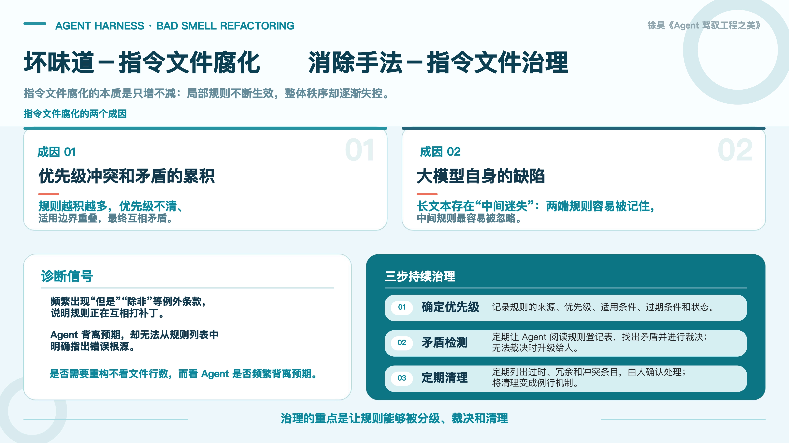

# 11 | 指令文件腐化：AGENTS.md越来越长，Agent反而变笨了

你好，我是徐昊，欢迎继续学习驾驭工程。

在构造 Agent 系统时，我们经常遇到这样的一个现象。最开始给 Agent 几条规则，它都能很好地遵守。然而在使用了一段时间之后，我们遇到了 Agent 系统无法处理的特殊情况，于是我们增加专门的规则来处理它们。在增加了新规则后，Agent 的响应的确变好了。

于是，遇到新的情况时，我们会继续增加规则。直到有一天，Agent 的行为突然变得难以捉摸，完全没有按照我们的构想来执行任务，能力发生了巨大的退化。这就是坏味道指令文件腐化（Instruction File Rot）。

## Bad Smell：指令文件腐化

为什么会发生这样的现象呢？

必须要承认，每一条规则加进去的时候，都是有效的。Agent 犯了一个错，加一条规则，它下次就不犯这个错了，这是真实的改进，不是错觉。问题不出在“加规则”这个动作本身，而出在规则累积之后发生的事情。

第一是因为优先级冲突和矛盾的累积。规则是一条一条写的，写的时候只面对一个场景，觉得每条都很清晰。但 Agent 执行时是同时面对全部规则的，自然语言里的不确定性，比如“尽快”“适当”“必要的时候”这类词，放在不同规则里可能指向相反的行为。这些都会影响 Agent 对于规则的理解。

此外，规则越多，Agent 越难抓住重点。一本只有 5 条规则的手册，每条都重要；一本 300条规则的手册，重要的规则都被淹没在无关规则里。Agent 分不清轻重，只能靠猜，行为自然偏离你的构想。

第二是大模型自身的缺陷。大模型对长文本中间部分的信息利用效率显著低于两端，这个效应被称为中间迷失（Lost in the Middle）。开头的规则记得牢，结尾的规则也记得住，埋在中间的规则最容易忽略。指令文件膨胀到几百条之后，那些写在中间位置的规则，Agent 的注意力权重会下降，执行时就会失效。最典型的例子是安全约束，它往往写在文件中部，被日常规则淹没。

所以规则越多，不仅规则之间会互相矛盾，连单条规则都可能因为位置而被漏读或是忽略。前者是规则之间的冲突，后者是模型注意力本身的局限，两者叠加，Agent 的行为自然越来越难以捉摸。

## Solution：指令文件治理

消除这个坏味道的手法叫指令文件治理（Instruction File Governance）。治理这个词意味着两件事：先把结构建好，然后持续维护。

那么一个好的指令文件是什么样子的呢？良好的指令文件应该是一个分层结构：入口文件只做说明，保持简洁，细节放在专门的文档里，按需读取。对于规则而言，我们可以使用决策记录（Decision Record），在其中详细描述规则以及规则适用的场景。比如，我们在隐式约定这个坏味道中，就给过一个利用分层结构索引决策记录的例子：

```
project/
├── AGENTS.md ← 入口文件：引用原则文档，说明使用方式
├── docs/
│ └── constitution.md ← 原则文档：红线 + 规则 + 建议，带 Rationale
│ └── decisions/
│ ├── adr-001.md ← 模块级 ADR：记录特定模块的权衡
│ └── adr-002.md
```

其中模块级的 ADR（Architecture Decision Record）就是针对具体模块的架构决策记录。当然，如果是简单的场景，一张规则登记表（Rules Inventory）也够用。比如可以使用下面的格式：

```
编号: R001
内容: 规则一句话描述
来源: 为什么加这条规则
优先级: 硬约束 / 规则 / 建议
适用条件: 什么时候需要这条规则
过期条件: 什么情况下可以删除
状态: active
----
编号: R002
内容: 规则一句话描述
来源: 为什么加这条规则
优先级: 硬约束 / 规则 / 建议
适用条件: 什么时候需要这条规则
过期条件: 什么情况下可以删除
状态: active
----
编号: R003
内容: 规则一句话描述
来源: 为什么加这条规则
优先级: 硬约束 / 规则 / 建议
适用条件: 什么时候需要这条规则
过期条件: 什么情况下可以删除
状态: superseded
```

构建良好的指令文件并不复杂。但是建好之后如果疏于治理，文件会再次膨胀，规则会再次互相矛盾。所以治理的重点在持续维护，而非一次性构建。维护的核心是三件事：优先级确定、矛盾检测以及定期清理。

第一是优先级确定（Priority Assignment）。针对每条规则都要有明确的优先级。比如我们在建立原则文档（Establish Principles）这个重构手法中给出过不同优先级的设计。可以根据需要自主选择。优先级是整个维护机制的基础：矛盾检测时靠它裁决哪条胜出，定期清理时靠它决定先删哪条。没有优先级的规则列表，和散落在文件里的文字没有区别。

第二是矛盾检测（Contradiction Detection）。规则多了难免有矛盾的地方，定期让 Agent 阅读登记表找出矛盾之处。找到之后不是全部删掉，而是裁决：先看优先级高低，同级的看哪条更接近当前现实，裁决不了的升级给人。矛盾本身不可怕，可怕的是矛盾一直隐藏着，让 Agent每次随机选一条。显式的矛盾可以处理，隐式的矛盾只能靠运气。

第三是定期清理（Regular Cleanup）。登记表里的过期条件，就是为清理准备的：没有过期条件的规则永远不会被删。清理时让 Agent 定期检查登记表，把过时的、冗余的、矛盾的条目列出来，人来确认删除。清理可以做成例行机制：配置成定时任务，或者每次会话开始时检查一遍，而不是靠人想起来。

## 什么时候该做这个重构

最直接的信号是，在指令文件里频繁出现“但是”“除非”这样的例外条款。规则在互相打补丁，说明文件已经失去了秩序。另一个非常明显的信号是，当 Agent 没有按照你的构想执行任务时，你对着长长的规则列表，却无法明确指出 Agent 的错误根源。

总体而言，什么时候该重构，不是看文件行数。50 到 200 行的指令文件都是健康的。当Agent 频繁出现背离你预期的行为时，可能指令系统已经腐化了。

## 如何重构

这个重构的关键在于建立维护机制。也就是明确怎么确定优先级，何时进行矛盾检测和定期清理。至于构建分层结构，那是非常容易的。

对于优先级的建立，建议采用建立原则文档（Establish Principles）这个重构手法。虽然对于简单场景来说，这么做稍显复杂。但以我的经验来看，这点额外的投入，在 AI 时代并不会有什么额外的开销。

确定了优先级之后，第二步是建立矛盾检测的节奏。构造为 skill 是最简单的方式，比如：

```
name: rule-conflict-audit
description: 定期检查规则登记表，找出互相矛盾的规则对，并给出裁决建议。当指令文件或规则登记表发
rule-conflict-audit —— 规则矛盾检测
读取规则登记表 /docs/rules.md，找出其中互相矛盾的规则对，按优先级给出裁决建议，输出冲突报告。
Guides：获取登记表中的全部规则条目。每条规则包含：编号、内容、来源、优先级、适用条件、过期条件、
Action：逐对检查规则的适用条件是否有重叠，只有适用条件重叠的规则才可能产生矛盾。对每一对重叠规则
Sensors：对每个发现的矛盾对，输出：涉及规则及各自的优先级、冲突点描述、裁决建议（优先级高的胜出
Steering：生成冲突报告。对标记「待人工」的矛盾对，向用户列出冲突双方，请用户决定保留哪条、修改哪
```

可以配置成定时任务，让 Agent 定期阅读规则登记表，找出互相矛盾的规则对；也可以在AGENTS.md 中声明，每次会话开始时顺带检查一遍。关键是让检测成为一个固定动作，而不是想起来才做。检测本身不复杂，复杂的是让它持续发生。

第三步是让定期清理运转起来。清理的流程是：Agent 列出过时的、冗余的、矛盾的条目，标注建议状态，人来确认删除。删除要留痕，被清理的规则标记为 deprecated 而不是直接消失，这样以后审计时还能看到曾经有过这条规则，以及它为什么被删。清理的节奏可以跟随矛盾检测一起设定，比如每周一次，或者每次会话开始时。

## 小结



- 指令文件腐化的本质是“只增不减”：每一条规则加进去时都解决了当下的问题，但规则累积之后，优先级冲突、矛盾累积和模型自身的注意力局限会让 Agent 的行为越来越难以捉摸。

- 何时该重构？不是看文件行数，而是看行为：指令文件里频繁出现“但是”“除非”的例外条款，或 Agent 背离预期时你无法指出错误根源，说明指令系统已经腐化了。

- 一个好的指令文件是分层结构：入口文件只做说明，保持简洁，细节放在专门的文档里按需读取。规则可以用决策记录详细描述，简单场景用一张规则登记表就够。

- 治理重点在持续维护，而非一次性构建。维护的核心是三件事：优先级确定、矛盾检测、定期清理。

- 优先级是整个维护机制的基础：矛盾检测时靠它裁决哪条胜出，定期清理时靠它决定先删哪条。

## 思考题

如果你已遇到“指令文件腐化”现象，用这一讲的三步法（优先级确定 → 矛盾检测 → 定期清理）描述你计划如何修复，并预测最可能遇到的阻力。

期待你在留言区记录思考或疑问。也欢迎你把课程分享给有需要的朋友。
