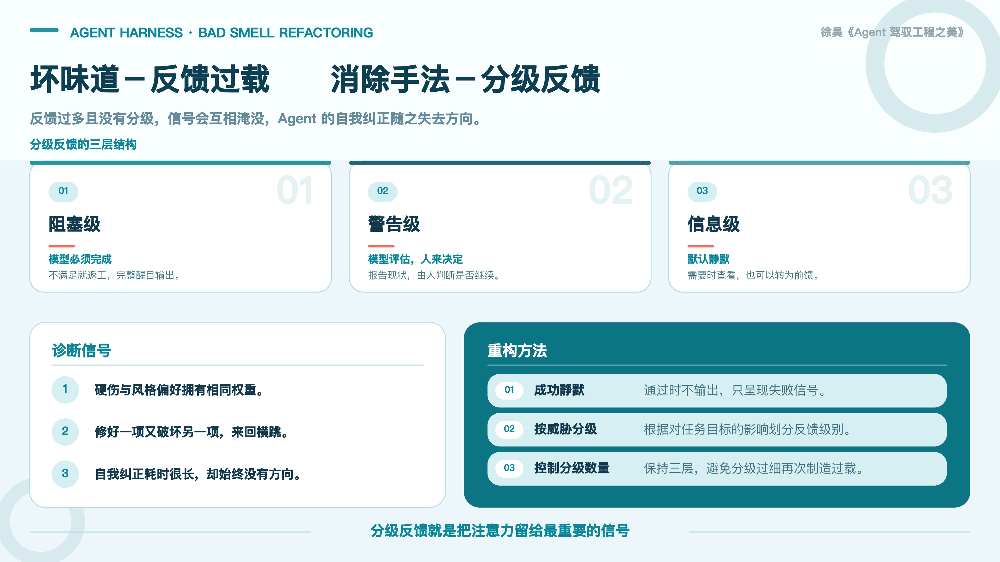

# 13 | 反馈过载：Sensors太多，Agent不知道哪个信号重要？

你好，我是徐昊，欢迎继续学习驾驭工程。

今天我们来看一下驾驭工程（Harness Engineering）中常见的坏味道（Bad Smell），以及对应的重构手法。

如果你看过之前的前馈痴迷，就知道这个坏味道的本质是我们倾向于写前馈，而不写反馈。但反馈要求一多，也容易引发问题，这就是今天要说的坏味道——反馈过载。

## Bad Smell：反馈过载

当我们对于大模型（LLM）的输出结果有明确且细致的验收要求时，我们会倾向于给出完整的验收清单，把能想到的要求都写进去。但大模型很难一次性满足所有的要求，要在自我纠正（self-correction）中逐步矫正，可一旦验收要求过多且没有分级，这个逐步矫正的过程就会失去方向。

比如你让 Agent 写一份产品介绍文案，验收要求列了七八条：字数八百到一千、突出三个核心卖点、语气活泼、数据准确、结尾要有行动号召、不能用术语。Agent 写好之后，发现卖点齐了但字数超了一半，语气像说明书。然后它开始自我修正，但通常改好了这条、破坏了那条。来来回回反反复复。

再比如在编码场景中。你让 Agent 修改一个功能，它改完之后跑验证：测试失败 23 个、lint报错 47 处、类型检查失败 12 个。Agent 开始随机修。它先修了一个 lint 错误，又去改一个测试，然后发现类型错误比刚才更多了。它来回横跳，修一会儿这个，修一会儿那个，任务目标早就忘了。你看着它的操作记录，感觉它在动，但没有方向。

这就是坏味道反馈过载（Feedback Overload）。反馈过载指的是：反馈（Sensors）太多，反馈信号互相淹没。测试、lint、类型检查全失败，Agent 无法确定优先修复哪个；大量输出灌满上下文，Agent 丢失任务目标。

造成反馈过载的主要原因是反馈信号没有分级。所有反馈一视同仁地输出。一个“数据引错了”的硬伤和一个“语气不够活泼”的风格偏好，在修改意见里看起来差不多。Agent 拿到的是平铺的清单，不是分级后的信号，它没有可靠的依据判断“先修哪个”。于是它随机选一个修，修完发现还有更重要的，再换一个，来回横跳。

反馈信号之所以没有分级，是因为分级一直存在我们心里，却没有写出来。写验收要求的时候，我们心里其实有数：哪些是硬性要求，不满足就必须返工；哪些差不多就行，满足个七八成也能接受。数据引错必须改，语气不够活泼，改不改都行。这份判断我们心里清楚，但从没想过要把它告诉 Agent。

Agent 无法判断“足够好”。它不知道哪条要求允许打折扣、哪条必须严格满足。在它看来，清单上的每条要求都是同等的“必须”：“语气活泼”和“数据准确”权重一样。于是它只能把每条都当成硬标准来对待，要么每条都用力做，结果注意力被摊薄，每条都做不彻底；要么随机挑几条认真做，其余的应付过去。无论哪种，结果都是来回返工。

分级这件事，本来应该由我们完成，而不是留给 Agent 去猜。反馈信号没有分级，不是工具的问题，也不是模型的问题，而是我们把自己心里的分级当成了理所当然，以为不说 Agent 也知道。

## Solution：分级反馈

消除反馈过载的手法叫分级反馈（Grade Feedback）。核心思想不是减少 Sensors，而是给反馈分级：不同严重程度的信号用不同的呈现方式，让 Agent 一眼看出“先修哪个”。

第一原则是：成功静默，失败才输出。全部通过时不输出任何东西，或者只输出一句“全部通过”；只有失败时才输出信号。这避免了用大量“通过”的噪声稀释失败信号。想象一下，如果23 个测试里 20 个通过 3 个失败，而输出里 20 条“通过”的消息占了大部分空间，那 3 个失败信号就被淹没了。成功静默之后，输出里只有那 3 个失败，Agent 一眼就能看到。

第二是按严重程度分级。反馈分成三级：

- 阻塞级（Blocking）：不修就无法工作的错误，比如编译失败、测试挂掉。这是最高优先级，输出完整信息，最醒目。

- 警告级（Warning）：应该修但不阻塞的，比如 lint 风格问题、潜在风险。次之，摘要输出。

- 信息级（Info）：可忽略的，比如成功消息、普通日志。默认静默，需要时才看。

你可能会问，分级的依据是什么？反馈的级别反映它对任务目标的威胁程度。可能导致线上事故的失败最高优先级，风格问题最低。阻塞级对应“不修就不能交付”，警告级对应“应该修但不影响交付”，信息级对应“不影响结果”。

分级反馈的落脚点是注意力。上下文是有限的，信号越多，每条信号分到的注意力越少，这正是反馈过载的伤害路径。分级反馈让 Agent 学会“不值得处理的信号就不处理”，把注意力留给真正重要的信号。说到底，Agent 最宝贵的资源是注意力，分级反馈就是把注意力留给最重要的信号。

## 什么时候该做这个重构

诊断信号主要是 Agent 耗费很长的时间，尝试让最终结果符合全部的反馈要求。如果仔细去看Agent 的修改行为，“看起来在动，但没有方向”时，多半就是反馈过载。

## 如何重构

重构的核心是把反馈分级，明确告诉 Agent 不同反馈之间的优先级差异。比如我们要求 Agent写产品文案，有很多的验收要求，那么它对应 AGENTS.md 可能是这样的：

```
...
```

- 要求：

```
- 字数八百到一千
- 突出三个核心卖点
- 语气活泼，避免书面腔
- 数据准确，所有数字和功能描述必须真实
- 结尾要有行动号召
- 不能使用术语，普通用户能看懂
...
```

这就很容易引发反馈过载，那么我们需要改写这个 AGENTS.md，明确表示不同反馈的优先级：

```
...
```

- 要求（按优先级分组）：

```
- 阻塞级（不满足就返工）：
 - 数据准确，所有数字和功能描述必须真实
 - 突出三个核心卖点
 - 结尾要有行动号召
- 警告级（应该做到，允许打折扣，但需要告知具体情况）：
 - 字数八百到一千
 - 不能使用术语，普通用户能看懂
- 信息级（尽量做到，不影响交付）：
 - 语气活泼，避免书面腔
 ...
```

这样改写之后，Agent 的自我矫正就有了方向：先检查阻塞级，再检查警告级，信息级顺手做。即使一次生成不能全部满足，Agent 也知道先保住什么，不再为了满足全部要求而来回横跳。

反馈分级还有一个额外的好处，就是节约 token。当 Agent 没有明确的优先级时，它会尝试满足全部要求，如果无法一次满足，就要很多轮自我改进，时间浪费了，token 也浪费了。分级之后，Agent 首要目标只有满足阻塞级的要求。先把最重要的要求守住，警告级、信息级不必每轮都验证。收敛需要的轮次变少，每轮处理的信号也变少，在长任务的循环里，这个差别会累积成明显的成本差距。

## 最佳实践

针对反馈的分级，也不需要分成很多等级，分几层并不会让 Agent 执行得更好。分级的关键差异，不是严重程度本身，而是两类责任的分界：哪些是大模型必须完成的，哪些可以由人来判断是否值得继续花费力气完善。

阻塞级就是“大模型必须完成”的部分，通常只有一两条，不满足就返工，比如数据必须准确。这是大模型必须完成的，也是最重要的。

而由人来判断是否值得继续花费力气完善的部分，比如字数、语气、风格等等，又可以根据是否需要大模型提供评估分成两级。警告级是需要模型评估的，信息级则不用。比如在前面的例子里，警告级里有字数 800 到 1000，一个产品介绍，写了 650 字，那么大模型只需要告诉我们，目前字数是 650 字。然后我们可以看完目前的文本，根据质量决定是再多写一点，还是目前就够了。而不是让大模型盲目扩写，以满足字数要求。

至于“语气活泼，避免书面腔”就不需要大模型提供判断了，总不能让大模型统计用了多少书面语用词吧。

所以三层已经够了。阻塞级划出必须完成的线，警告级是需要大模型给予评估和反馈的，而信息级可以转化为前馈，通常也是比较模糊的验收和反馈。分更多级并不会让 Agent 执行得更好，Agent 还要花力气区分级别，反馈过载就换了一种形式回来了。

## 小结



- 反馈过载坏味道的本质：验收要求过多过细且没有分级，全部以同等权重交给模型，期望一次生成全部满足。信号互相淹没，自我纠正失去方向。

- 根源不在模型：分级一直存在我们心里，却没有写出来。Agent 无法判断“足够好”，只能把每条要求都当成硬标准，要么用力过猛，要么随机取舍。

- 诊断信号：Agent 耗费很长的时间调教最终输出，修改行为“看起来在动，但没有方向”，多半就是反馈过载。

- 重构手法是分级反馈：第一原则是“成功静默，失败才输出”，按阻塞级 / 警告级 / 信息级呈现信号，收敛轮次变少，也节约 token。

- 分级的实质是责任分界：阻塞级是模型必须完成的；警告级由模型评估后，人来决定是否继续完善；信息级通常可以转化为前馈。三层足够，分更多级只是把反馈过载换成另一种形式。

## 思考题

请为你当前的一个 Agent 项目写一份“分级反馈规范”。

期待你在留言区记录思考或疑问。也欢迎你把课程分享给有需要的朋友。
