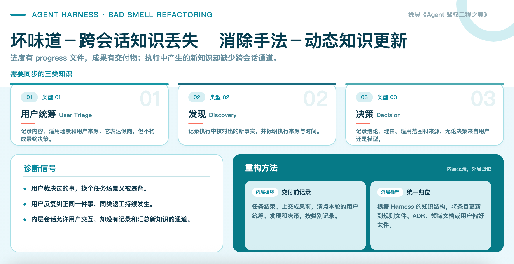

# 16 | 跨会话知识丢失：每次对话Agent都不记得上次的事

你好，我是徐昊，欢迎继续学习驾驭工程。

今天我们来看一下驾驭工程（Harness Engineering）中常见的坏味道（Bad Smell），以及对应的重构手法。

## Bad Smell：跨会话知识丢失

在双层循环架构里，一个任务通常被拆成多个子任务，由不同的技能执行，技能又常常派出子Agent（SubAgent）去跑独立的子会话。多会话并行与接力是常态，状态同步就成了绕不开的问题。

在前面的课程中，我们已经花了大量的篇幅来讲状态同步。

- 用于控制进度的 progress 文件，由外层循环负责读取与调度；

- 内层执行的成果交付物，内层干完交回外层，用以检查执行状态、调整计划，并将最终结果呈现给用户。

想必这两个内容大家已经非常熟悉了。但是除此之外，子会话在执行中用户发现了什么新知识、对任务形成了什么判断、做了什么决策。这些内容往往被忽略了，没有同步通道，子会话一结束就丢了。

比如在背单词的 Harness 中，用户在词汇练习中说：“这个词我已经掌握了，不用再练了”。词汇翻译练习可能会把这句话当成一次判断，记录在自己的状态中，之后不再安排这个词的练习。但是，如果这个词是个动词，那么在变位练习中，这个词仍然会出现。再比如在编码的场景中，用户在编码环节反馈说，不要使用某某特定类库，然后可能在后续的测试环节中，又继续使用了该类库。

这就是坏味道跨会话知识丢失（Cross-Session Knowledge Loss）。跨会话知识丢失指的是，在多会话的场景下，执行中发现的新知识（discovery）、用户通过对话产生的判断（usertriage）和决策（decision），没有同步到其他会话当中，当前会话结束之后，这些知识就丢失了。

所谓多会话场景，不是指我们多次打开同一个聊天窗口，而是 Harness 的结构本身就造出了多个独立的大模型会话。每个会话都有自己的上下文窗口、自己的对话历史、自己的生命周期。

多会话是常态架构，不是偶发操作。双层循环本身就是多会话的，外层循环的会话负责任务分解与进度管理，内层循环会话每次执行一个子任务。多 Skill 协同时，往往也会让不同子Agent（SubAgent）去执行不同的 skill。也正因为如此，会话边界无处不在。外层和内层之间，skill 和 skill 之间等等。跨会话知识丢失也是一个频发的坏味道。

跨会话知识丢失产生的原因其实很简单：这些知识、判断和决策，既不属于进度控制，也不属于任务执行后的交付物，无法根据现有的渠道汇总。

现有的两条同步通道是按产物类型设计的，各自有明确的主人。进度控制记录执行状态，由外层循环负责读取与调度；交付物记录任务成果，由内层交回外层。一个会话产生的所有内容，只有能归入这两类的，才有渠道汇总到会话之外。

而执行中发现的新知识、对用户和任务形成的判断、做过的决策，恰好不属于任何一类。它们不是驱动调度的执行状态，也不是交给用户的任务成果。归不了类，就没有渠道；没有渠道，会话一结束，这些内容就随上下文一起消失了。

## Solution：动态知识更新

消除跨会话知识丢失的手法叫动态知识更新（Dynamic Knowledge Update）。核心思路是给知识补上缺失的汇总渠道，与进度更新和交付物更新一样，也需要在双层循环间，把发现的新知识进行记录与汇总。

与进度控制和交付结果不同的是，新知识的产生可能依赖于用户交互。进度是执行的自然产物，任务做一步，进度就往前走一步；交付物也一样，活干完了，结果就在那里。但是知识不是这样，先给需要同步的知识分类，因为不同类别的知识来源不同，什么时候会产生也就不一样。

第一类是用户统筹（user triage），它依赖用户输入，表达的是用户对优先级与偏好的态度，但不构成定论。比如用户在翻译练习中说“翻译例句的时候，多给一些虚拟态的练习”，这是在表达练习内容的偏好——希望例句更侧重虚拟式，而不是陈述式为主；用户说“例句里的词用简单一点的”，是在表达难度的偏好。这类知识没有执行层面的来源，只存在于用户的对话里，交互一结束，除了那句话没有任何载体，所以它的丢失窗口在交互之后；

第二类是发现（discovery），它是大模型自己发现的，比如在开发过程中发现接口与文档中给定的不同。没有人告诉过它这件事，它是执行中自己对照出来的，属于执行层面的来源。这类知识不需要用户交互，任务本身就会产生。执行过程中大模型发现了差异，并且基于真实行为把任务做完了。任务交付，会话结束，这个发现就跟着上下文一起消失；

第三类是决策（decision），它既可以是模型自主做出的，也可以是由用户裁决的。模型自主的决策，比如审查技能在执行中定下“这个模块不允许反向依赖”，这是它基于代码实际情况自己得出的结论；用户裁决的决策，比如用户说“这个词我已经掌握了，不用再练了”，是用户对自己学习状态的定案，用户说“不要用某某类库”，是对技术选型的定案。任务交付，会话结束，这个决定也会消失。

那么我们就需要根据不同的知识种类，记录这些知识。也就是在操控循环中，任务结束后，增加一个知识记录环节。

操控循环原本的任务收尾是交付结果：内层把任务成果交回外层，本轮执行就结束了。现在在收尾时多一步。在结果上交之前，先清点本轮产生的知识，按类别分别记录。

1. 用户统筹记下用户在这次任务里表达过的偏好，带适用场景，来源是用户；

2. 发现记下模型在执行中对照出来的事实，来源是执行过程，带上时间；

3. 决策记下本轮做出或接受的裁决，无论它是用户给出的还是模型自己定下的，都要带结论、理由和适用范围。

然后回到外层循环，它需要做的就是知识更新，把这些条目归位到它们该去的地方。

为什么更新必须在外层循环做？因为只有外层循环知道“知识应该住在哪里”。决策要放进决策记录（ADR）目录还是规则文件，领域知识对应的 wiki 或知识文档在什么位置，用户的偏好该归入哪个文件，这些全局信息只有外层循环掌握。内层循环只知道自己这轮任务发生了什么，不知道知识在整个 Harness 里的布局。如果让每个内层会话自行决定往哪里写，那么内层循环的逻辑就过于复杂了，不如在外层循环统一触发来得方便。

## 什么时候该做这个重构

最明显的信号，是不同任务产出的结果严重不一致。用户已经裁决过的事，换个任务场景又冒出来了：说过“不要使用某某类库”，换一个任务，这个类库又被引入；说过“这个单词我已经掌握了，不用再练了”，换一个练习场景，这个词又作为新内容出现。用户反复纠正同一件事、同类返工反复发生，都是它的表现形式。

另一个信号是结构性的：只要内层循环存在用户交互，这个重构就应该做，不管现在有没有出现不一致。原因是无法控制用户会在内层给出什么。用户可能在任何一次子任务执行中表达偏好。因为用户交互是即兴的，用户什么时候说、说什么，都不受控制。内层循环一旦开了用户交互的口子，知识产生的可能性就存在，而且不可预测；等不一致出现再补记录，中间丢失的知识已经造成了返工。

## 如何重构

重构分两步。第一步，先在内层循环的指令里加上知识记录的要求，比如使用以下提示词。

- 任务收尾：知识记录

- 每次任务结束、交付结果之前，先清点本轮产生的知识，按类别记录：

```
1. 用户统筹：用户在本任务中表达的偏好或优先级
  记录：内容 + 适用场景 + 来源（用户）
2. 发现：执行中发现的事实（文档与现实不符、踩过的坑、约束）
  记录：内容 + 来源（执行）+ 时间
3. 决策：本轮做出或接受的裁决
  记录：结论 + 理由 + 适用范围 + 来源（用户/模型）
```

当然，发现和决策内容要根据具体的业务场景设计。

第二步，在外层循环中做知识更新。这一步没有统一模板，因为外层循环受限于系统已有的知识结构：决策记录（ADR）放在哪个目录、领域知识对应哪份文档或 wiki、用户偏好归入哪个文件，每个系统都不一样。所以外层更新要结合具体系统分析。

## 小结



- 跨会话知识丢失坏味道的本质：双层循环与 SubAgent 架构下，知识没有同步通道。进度走progress、成果走交付物，执行中发现的新知识、用户通过对话产生的判断与决策却无处可去，随会话结束一起消失。

- 产生原因：这些知识既不属于进度控制、也不属于交付物，无法按现有渠道汇总。归不了类就没有渠道，没有渠道，会话一结束内容就随上下文清零。

- 知识按来源分三类：用户统筹依赖用户输入，是优先级与偏好的表达，不是定论；发现是模型执行中自己对照出来的事实；决策既可以是模型自主做出的，也可以是用户裁决的，是最需要同步、也最需要带理由与适用范围的一类。

- 重构手法是动态知识更新：内层操控循环在任务收尾增加知识记录环节，按三类清点本轮知识（用户统筹带适用场景、发现带来源与时间、决策带结论理由与适用范围）；外层循环做知识更新，因为只有它知道知识该住在哪里，把条目归位到系统的知识载体中。

- 什么时候该做：内层循环存在用户交互就该做（用户输入不可控，知识随时可能在产生），这是事前判据；不同任务结果严重不一致，说明知识已经在丢失，这是事后信号。

## 思考题

如果用户先说“不要用某某类库”，后来又说“这个场景可以用某某类库”，动态知识更新应该如何处理？请设计冲突解决策略。

期待你在留言区积极发言，踊跃分享。也欢迎你把课程分享给有需要的朋友。
