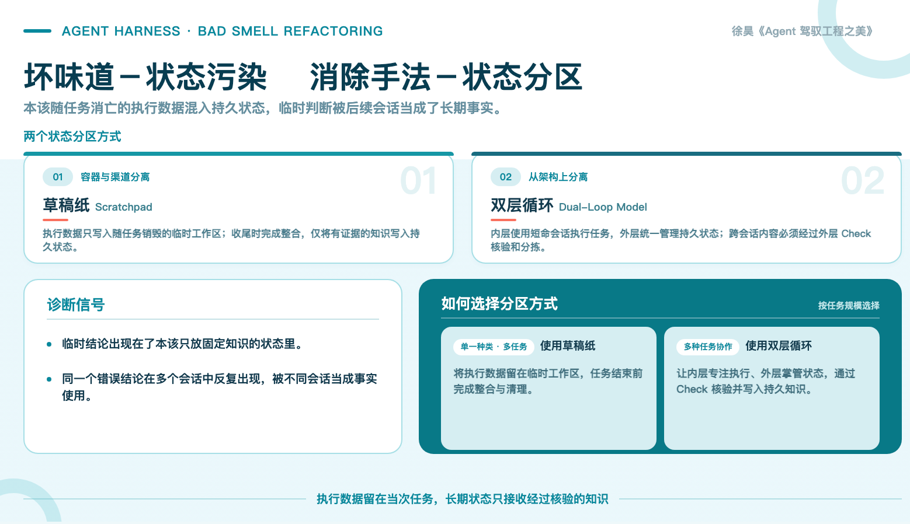

# 17 | 状态污染：状态存在但不可信

你好，我是徐昊，欢迎继续学习驾驭工程。

今天我们来看一下驾驭工程（Harness Engineering）中常见的坏味道（Bad Smell），以及对应的重构手法。

## Bad Smell：状态污染

当我们构建 Harness 时，首先考虑让一个 Agent 把任务从头到尾做完，跑通了再考虑如何拆分它。然而 Agent 从头跑到尾，在执行过程中，它会不断产生各种数据、中间产物、工具返回的结果、自己临时下的判断。这些数据可能被随手写进了状态。

比如在西班牙语背单词的场景下，如果我们仅仅使用一个 Agent 完成所有练习，那么可能在翻译句子时，用户使用了虚拟式做出了翻译。大模型可能由此认定，用户已经掌握了虚拟式，从而在后续出题或者是时态练习时，就不再给出虚拟式的练习了。

再比如，Agent 按当天的复习计划抽词出题。但是计划里的筛选条件出了问题，工具一个词都没匹配到，也没有报错，照样返回“本轮练习完成”。Agent 看到“完成”，就把“今天的复习已完成、这些词全部掌握”写进了状态。下一个会话读到状态，以为这些词已经练过，就不再安排它们的复习。然而实际上用户这一天一个词都没复习到。

这就是坏味道状态污染（State Pollution）。它指的是，本该随任务结束一起消亡的执行数据，混进了要跨会话复用的状态里；读取方无法分辨，就把这些执行数据当成固定知识来用。于是，临时内容被当成了长期事实，状态失去了它本应具有的可信度。

为什么会出现状态污染？根源在单 Agent 架构本身。一个会话既要执行，又要记录执行过程，两者共享同一个上下文。执行过程中的调试痕迹、中间产物、临时判断、产生的幻觉，和要长期保留的进度、决策、知识，没有一道边界隔开，全都挤在一起。一旦发生上下文压缩，或是注意力偏移，这些一次性数据就可能被混入长期状态中。

## Solution：状态分区

消除状态污染的手法叫状态分区（State Separation）。核心思路是，把状态按生命周期分成两类，随任务消亡的临时状态，和跨会话复用的持久状态。执行过程中产生的数据，只许落在临时状态里，到不了持久状态。分区之后，执行数据和固定知识各归各的区，污染就没了入口。

常用的分区方式有两种，一个是容器和渠道上分离，一个是结构上分离。

### 草稿纸（Scratchpad）

在容器和渠道上，分离临时状态与跨会话复用状态的方法叫草稿纸。

它给执行数据单独划一个区域，一块随任务消亡的临时工作区。执行过程中的草稿、中间产物、调试观察、工具返回的原始结果、还没验证的结论，都写进草稿纸。这些内容不进持久状态，不参与跨会话复用，任务结束就随草稿纸一起销毁。

也可以单独划一条渠道，执行数据只许写进草稿纸，经过提炼的内容才允许进持久状态。因为草稿纸里不全是垃圾，也可能混着值得跨会话保留的东西：用户在任务里表达的偏好、执行中对照出的事实、做出的决策。

所以草稿纸不能简单销毁，收尾时要先做一次整合（consolidation）。把值得保留的内容从草稿纸里提炼出来，整理成带来源的知识条目，剩下的才连同草稿纸一起销毁。

整合对于草稿纸非常重要。只销毁不整合，值得保留的知识也跟着草稿纸一起丢了。而整合让“哪些该进持久状态”成为一道显式的判断，而不是靠模型随手决定。这就是容器和渠道上的分离。

整合具体怎么做？它不是在草稿纸里挑挑拣拣，把“看起来有用的”抄进状态，而是对每一条内容重新做一次判断。这条到底是知识，还是执行数据；如果是知识，它的依据是什么。

比如之前那个背单词的例子，工具返回“本轮练习完成”。整合时对照真实情况，让 Agent 去检查单词背诵的进度表，就能够发现，其实这一轮并没有任何单词复习的记录，于是这条“本轮练习完成”就成了可疑的执行记录。我们不仅仅能够避免状态污染，还能够发现其实没有完成任何复习。所以整合不只是挡污染，也是对于进度执行的复查。

类似的，对于模型的幻觉，整合也能给出有效的判别。显然一次偶然的使用虚拟式，并不能证明用户实际掌握了虚拟式的用法。模型的过度推断也不能污染持久状态。幻觉不是被“识别”出来的，而是被“打回证据”这个动作拦住，整合不看它说得多自信，只看它背后有没有对应的依据。一次使用就是一次使用，不会因为模型写成了“已掌握”就变成掌握。

### 双层循环

草稿纸模式之所以能够成功，是因为整合这一步实际上是在不受上下文影响的前提下，重新审查草稿区记录的执行中产生的数据，并对进度状态和长期知识进行合并和整理。

那么，为了有效地隔离上下文影响，使用独立的 Agent 是一个更好的选择。而如果使用了独立的 Agent 负责进度控制，那么实际上，我们就得到了我们反复讲解的双层循环架构。

双层循环能天然避免状态污染，是因为它在前面章节里反复出现的那几个设计，恰好都指向同一件事，把执行数据和固定知识分开。

第一，会话边界。双层循环里，内层循环每执行一个子任务就开一个短命会话，任务结束，会话销毁。执行过程中产生的数据，只能活在这个短命会话里，随会话消亡。这是架构自带的，不靠任何额外约定，执行数据从结构上就到不了持久状态。

第二，状态的主人是外层。前面讲过，进度由外层循环的 progress 文件负责，内层干完只把交付物交回外层。内层没有直接写持久状态的通道，它产生的任何东西要进状态，都得先经过外层。污染的两个例子，“已掌握虚拟式”“复习已完成”，都是执行环节直接写状态造成的；在双层循环里，这条直写通路根本不存在。

第三，审视者与执行者是分开的。外层循环承担 PDCA 里的 Check，它对照真实情况核验内层的产出，而不是照单全收。这正是草稿纸整合要做的判断，而双层循环把“审视者”这个角色固定给了外层，一个不背执行包袱的独立会话。工具说“完成”，内层可以相信，但外层对照进度表一核，就发现问题。

第四，Check 环节是天然的整合点。前面讲 checkpoint 时说过，外层循环的 Check 环节要验证、落盘。这个环节现在多承担一件事：把内层交上来的内容，按“执行数据还是固定知识”分拣一遍，只把通过核验的写进持久状态。整合不是新加的步骤，而是 Check 环节本来就在做的事，只是现在明确了它要挡污染。

总结来看，这些就是双层循环天然避免状态污染的原因：会话边界把执行数据关在短命会话里，状态唯一主人断开了内层直写状态的通道，审视者与执行者分离避免了 Agent “自说自话”，Check 环节把整合嵌进了循环本身。状态污染在双层循环的结构里就难以存在了。

## 什么时候该做这个重构

最直接的信号，是状态里出现了“这一次执行”留下的痕迹：某一次练习的正确率、某一次工具返回的中间结果、某一次会话里下的临时结论，出现在了本该只放固定知识的状态里。

另一个信号，是同一个错误结论在多个会话里反复出现。某条被污染的知识被不同会话轮番当成事实使用。

需要注意的是，一旦出现状态污染，实际表明当前要处理的问题，其复杂度已经超过目前Harness 的架构能处理的范围了。

通常对于简单任务，我们会采用单 Agent 加上指令系统帮助我们完成。而一旦需要进度追踪，或是跨会话知识留存，单 Agent 架构就可能会出现状态污染的情况，这是因为执行和记录同在一个上下文，污染是大概率的事件。所以与其着眼于解决状态污染，不如思考一下当前任务是否与 Harness 架构匹配，这才是更重要的问题。

## 如何重构

如果 Agent 只需要处理单一种类的多任务，我们仍然能够使用草稿纸（Scratchpad）模式，但是如果问题规模在进一步扩大，比如存在多种任务协作的情况，那么直接使用双层循环是一个更好的解决方案。如何构造双层循环，之前我们已经讲解过了，这里就不再赘述了。

## 小结

- 状态污染坏味道：单 Agent 架构下，执行过程中产生的数据——中间产物、工具返回的结果、临时判断、幻觉——没有边界，被随手写进状态，和固定知识混在一起，被后续会话当成长期事实复用。

- 两个典型来源：工具给出误导的结果（看似“练习完成”，其实是 0 个词），模型自己过度推断（一次用了虚拟式就认定“已掌握”）。

- 根源在单 Agent 架构：执行和记录共享同一个上下文，没有边界；一旦上下文压缩或注意力偏移，执行数据就被混进长期状态。

- 重构手法是状态分区：草稿纸在容器和渠道上分离（临时工作区 + 收尾整合提炼），双层循环在结构上分离（会话边界 + 外层管状态 + 审视者与执行者分离）。

- 关键判断：出现状态污染，往往说明任务复杂度已经超过当前 Harness 架构能处理的范围——与其只想着治污染，不如检查架构与任务是否匹配。

## 思考题

同一个错误结论反复跨会话出现，说明状态污染还是 Harness 架构不匹配？要如何排查？

期待你在留言区积极发言，踊跃分享。也欢迎你把课程分享给有需要的朋友。
