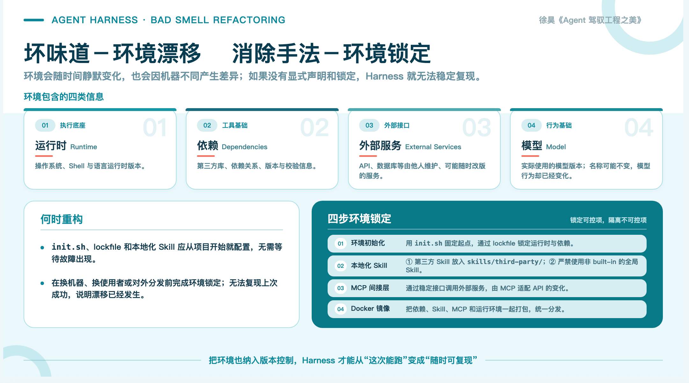

# 18 | 环境漂移：为什么Agent昨天能跑，今天就不行了

你好，我是徐昊，欢迎继续学习驾驭工程。

今天我们来看一下驾驭工程（Harness Engineering）中常见的坏味道（Bad Smell），以及对应的重构手法。

## Bad Smell：环境漂移

在构建 Agent Harness 时，经常会碰到一个现象，昨天还能跑的 Harness，今天就不行了。代码没有改，提示词没有动，状态也没变，但它就是突然开始出错。再或者，同一个调试任务跑两次，两次结果不一样，想复现上次的成功来定位这次的问题，却发现根本复现不出来。

这时排查的人会先去查代码、查提示词、查状态，因为这些都是“看得见”的东西。但真正的问题，常常藏在看不见的地方，也就是 Harness 的执行环境。

环境包含的是 Agent 运行所依赖的，又不在它自己控制范围内的一切外部条件，大致分这几类：

- 运行时（Runtime）。Agent 跑在什么操作系统、工具使用什么语言运行时（Python 还是Node、什么版本）、什么 shell 上。这些是底座，版本不同，Agent 执行命令的结果就可能不同；

- 依赖（Dependencies）。Agent 用的第三方库和它们的精确版本。库升级会改接口、改行为，Agent 按旧版本写的东西，在新版本上可能就跑不通了；

- 外部服务。Agent 调用的 API、数据库这些别人维护的东西。它们会改版、会返回不同的结果，而且改版通常不通知你；

- 模型（Model）。模型本身的版本，厂商可能会使用同一个名字提供不同的模型，名字没变，行为已经变了。比如，最近 DeepSeek 就把 deepseek-v4-flash 换成了 4.1 版本；

环境的改变影响 Agent 的行为，这就是坏味道环境漂移（Environment Drift）。它指的是，Agent 运行所依赖的条件没有被显式声明和锁定，却在悄悄变化，依赖升级、外部服务改版、模型版本静默滚动。于是每次运行的条件都不一样，行为不可复现、错误无法定位。

环境漂移发生在两个不同的场景。一种是时间上的漂移，发生在 API、模型这类会随时间变化的东西上。它们改版、升级、在同一个名字后面静默滚动，Harness 却还停在原来的假设上。于是同一个机器上，代码没动、提示词没动，Harness 的行为却悄悄变了，因为外部世界在动。这就是“昨天能跑今天不行”的来源。

另一种是空间上的漂移，发生在依赖、shell、操作系统这些，它们虽然不随时间变，但换一台机器可能就会存在细微的差异。Harness 在一台机器上调试通过，换到另一台机器，就跑不起来了。这就是“在我机器上跑得很好”的来源，它影响的不是行为，而是部署和传播，Harness换个人、换台机器就失效。

环境漂移对 Harness 的部署和分发，是一个实打实的阻碍。一个 Harness 在自己机器上打磨得再好，只要环境没有管理，换一台机器、换一个人，就可能整个失效。对希望将 Harness分发给别人使用的人来说，环境漂移是首先需要解决的问题。

不过好消息是，这个问题在软件开发领域早就被解决过了。环境管理和依赖管理，是软件工程里积累了几十年的成熟领域：锁定依赖版本、声明式配置、容器、虚拟环境、构建脚本，这一整套工具和方法都是现成的，经过了无数项目的检验。驾驭工程要做的，不是发明新东西，而是把这些已经久经检验的方案，搬进驾驭工程里。

## Solution：环境锁定

消除环境漂移的手法叫环境锁定（Lock Environment for Agent Harness）。核心思路，是把隐式的、会漂移的环境，变成锁定的、可复现的环境。在软件工程中，治理依赖常用的方式是lockfile。一个文件记录所有依赖的精确版本和校验和，环境从此可复现。我们现在需要做的是利用同样的方法，来管理 Agent 依赖的环境。

### 环境初始化

首先需要解决的是环境初始化，也就是把运行环境固定下来。正如我们前面讲过的，可以使用

```
init.sh 入口脚本，初始化精确的文件夹结构、配置文件和初始状态，让环境从一个确定的
```

状态开始，而不是从“这台机器当前的系统状态”开始。

然后使用 lockfile 锁定 runtime 和依赖。当然这取决于工具（tools）所使用的语言，如果是Node，可以用 .nvmrc、package-lock.json 锁版本，而 Python 则会用 requirements.txt 或pyproject.toml 锁依赖。这样就可以把工具的运行时版本和依赖的精确版本都锁死。

### 控制 Agent 能执行的 Skill

除了运行环境之外，另一个容易被忽略的情况是第三方 Skill。毕竟除了我们自己构造的 Skill之外，利用现成的 Skill 完成既定功能，是 Agent 生态的核心优势。但这恰恰也是目前（2026年 9 月）业界普遍缺失的能力之一，Claude Code、Cursor、Codex 等这些 Harness 基本都缺乏对于 Skill 的锁定策略，无法控制并锁定全局 Skill 的版本。OpenClaw 的 ClawHub 做得稍微好一点，是少有的带真锁定的 Skill 注册表。可以通过局部的 lockfile，锁定某个技能的特定版本，或是 git 的标签（tag）。

那么我们的解决办法，是不依赖全局的 Skill 注册表，在 Harness 中使用本地化的 Skill。具体做法，是在项目里建一个 skills 目录，让所有第三方 Skill 都落地到项目内部，而不是装进Harness 的全局目录。

比如在项目根目录建一个 skills/ 文件夹，结构大致是这样：

```
my-harness/
├── skills/
│   ├── third-party/
│   │   ├── skill-a/          ← 从 marketplace 拉下来、pin 到 v1.2.0 的第三方 skill
│   │   └── skill-b/.         ← 另一个第三方 skill，pin 到某个 commit
│   └── skill-c/              ← 自己写的 skill
└── AGENTS.md
```

然后立两条规矩，写进 AGENTS.md：

1. 所有第三方 skill 必须安装到项目的 skills/third-party/ 目录，锁定版本（tag 或 commit），和项目一起进版本控制。

2. 严禁使用非 built-in 的全局 Skill：harness 只许加载项目 skills/ 里的 skill，以及自己 built-in的那部分；凡是装在全局目录（比如 ~/.claude/skills/）里的第三方 Skill，一律不认。

这样做的效果，是把这个项目用到的每一个 Skill，从“全局的、会漂移的”变成“自有的、锁定的”。换一台机器、换一个人，clone 下这个仓库、跑一遍初始化，skills 目录就是完整且版本一致的，和代码一样。作者改了 Skill、marketplace 更新了版本，都影响不到这个项目，因为它用的版本已经冻结在项目里了。全局目录里装了什么、更新成什么样，跟这个 Harness 没有关系。

### 通过 MCP 引入间接层

运行环境和 Agent 能够使用的 Skill 是能够锁定的部分，而第三方 API 是别人维护的，我们没有办法锁定它，而这里的变更恰恰是生产环境里最容易让 Agent 崩溃或失控的东西。那么我们要做的事情，就是将三方 API 做隔离。目前已知的方法中 MCP（Model Context Protocol，模型上下文协议）是最常见的方案。

Agent 不直接调用外部 API，而是通过 MCP 服务器来调用。MCP 服务器对内封装实际的API，对外为 Agent 提供一个稳定的接口。外部服务改版时，改的是 MCP 服务器这一层的适配，Agent 的调用逻辑不用改动。外部 API 的漂移就被这个间接层吸收了。这和软件工程里“面向接口编程”是同一个思想，调用方依赖稳定的接口，不依赖易变的实现，只是 MCP 把这个老办法搬到了 Agent 和外部服务之间。

当然，还有一种更激进的做法，也就是通过 Agent 的自我纠正机制（Self-Correction），通过错误信息和新的 API 规范尝试自愈。也就是当第三方 API 返回新结构导致调用失败时，将错误日志、当前的 tools 的源代码，重新交给大模型，由模型自己去分析新报文并尝试重新编写临时工具完成同样的功能。

我充分相信大模型有能力完成这种自愈，但是对于一个几十年从事软件开发的人来说，我天然排斥在生产环境下当猴子（Monkey patching），也请各位自重。

## 什么时候该做这个重构

```
init.sh 和局部化 skill，建议作为默认实践，而不是等症状出现再补。原因在于，它们防的
```

是“随时可能发生、而且一旦发生就很难排查”的漂移。

环境漂移没有预警：API 改版、Skill 被作者改动，都是静默的，等发现“昨天能跑今天不行”的时候，再想找回“昨天到底用了哪个版本”是件非常痛苦的事情。而这两件事的成本都很低，特别是局部化 Skill 只是把 Skill 拷进项目、锁一个版本号。用这么低的成本，买断“环境永远可复现、skill 永远是自己锁定的那个版本”，怎么算都划算。

## 如何重构

```
最容易的是 init.sh 脚本，在知识固化和构造工具和 Skill 的过程中，我们会自然而然提取
```

出他们的依赖声明（package.json、requirements.txt、pyproject.toml，pom.xml 等等）。这个在前面的章节中有所展示，我们就不再赘述了。

然后是把第三方 skill 搬进项目。建立 skills/third-party/ 目录，把目前在用的第三方 skill 逐个复制进去，pin 到 tag 或 commit，提交。然后做两件配套的事：一是把前面那两条规矩写进AGENTS.md；二是加一道检查，跑初始化脚本时，顺便校验 skills/third-party/ 下每个 skill 的实际内容和锁定的版本是否一致，不一致就报错停下来。

然后是 MCP。同样可以参考第三方 skill 的方式，在当前目录下做局部化。MCP 服务器也是别人维护的代码，也装到项目内部。固定住版本和 harness 一起进版本控制，而不是依赖全局的 MCP 配置。这样一次 clone 拿到的是完整的一套，MCP 服务器的版本和 Harness 是绑在一起的。

最后，在完成局部化之后，如果希望分发统一，那把整个 Harness 构造成 Docker image 也是非常好的实践。前面做的那些事，锁定依赖、局部化 Skill、局部化 MCP，都是在项目内部把环境固定下来；把它们打进一个镜像，就是把固定好的环境整个打包成可搬运的产物。分发的时候不再是一个仓库加一堆安装说明，而是一个镜像，换台机器、换个人，跑起来就是相同的环境、相同的 Harness。

## 小结



- 坏味道“环境漂移”：Agent 运行依赖的条件（运行时、依赖、外部服务、模型）没有被显式声明和锁定，却在悄悄变化，于是每次运行的条件都不一样，行为不可复现、错误无法定位。

- 漂移发生在两个场景：时间上的（API、模型随时间改版升级，同一个机器上行为就变了）和空间上的（依赖、shell、操作系统因机器而异，换台机器就失效，影响的是部署和分

- 发）。

- 重构手法是环境锁定：把隐式的、会漂移的环境变成锁定的、可复现的环境，用的是软件工程里成熟的 lockfile 范式。init.sh 固定运行环境，lockfile 锁定运行时与依赖。

- 自己控制不了的部分靠隔离：第三方 Skill 局部化到项目内部、pin 住版本，外部服务的改版交给 MCP 间接层吸收，Harness 的调用逻辑不动。

- 完成局部化之后，把整个 Harness 构造成 Docker image 也是非常好的实践，分发时换台机器、换个人，跑起来就是相同的环境和相同的 Harness。

## 思考题

请设计一个环境锁定重构顺序：init.sh、lockfile、Skill 局部化、MCP 局部化、Docker 镜像。它们各自解决哪一层问题？为什么 Docker 适合放在最后？

期待你在留言区记录思考或疑问。也欢迎你把课程分享给有需要的朋友。
