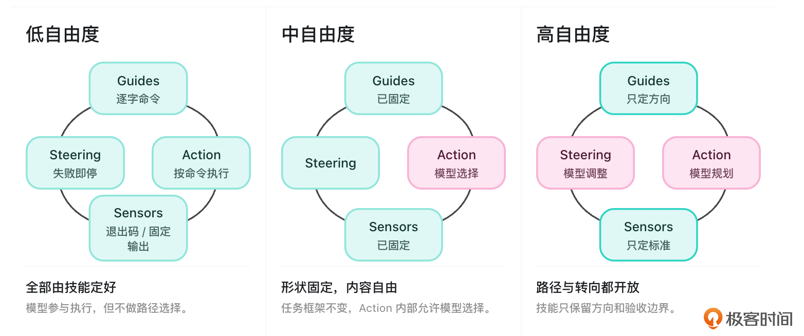

# 20 | Skills最佳实践：如何高效编写和优化技能写法？

你好，我是徐昊，欢迎继续学习驾驭工程。

技能（Skill）是一份可执行的指令文档，用于明确告诉模型，在什么条件下，按照哪些步骤，产出什么结果。在双层循环模型下，外层循环负担了计划与管理的职责，封装成技能的内层循环承载了专业诀窍（Know-how）的实施。因而，高效地编写技能就变得非常重要了。

那么我们怎么判断一个技能写的是好是坏呢？重点在于可预测（Predictability）。

技能存在的意义，是从一个随机的系统里挤出确定性。这里说的确定性，指的是每次跑出类似的过程，而不是相同的输出。一个整理会议纪要的技能，产出的结果每次都不一样，但它的行为应该是类似的，先做什么、后做什么、什么算做完，都是稳定的。反过来，一个技能这次帮你列提纲，下次直接写全文，第三次又跑去改格式，哪怕每次结果都还过得去，它也是不可预测的，也就没法交给别人用。

我们前面的章节里，通过内层循环，已经掌握了如何在技能中描述流程。又通过前面列举的各种坏味道和其对应的重构手段，保证了流程的执行一致性。那么现在我们编写的技能，其流程的一致性应该有了基本的保障。但是除此之外，触发一致性也是非常重要的一环。

## 明确触发

所谓触发一致性，是指技能需要在该被用到的时候被用到，可预测在这里的含义很简单：该用的时候用，不该用的时候不用。而想要做到这一点，有几个关键实践。

技能元数据里的 description 就是触发器。description 是唯一常驻在上下文里的字段，也是唯一的竞争位。一个技能只有一个 description，而它可能要在几十甚至一百多个可用技能里被选中。大模型做的事，就是拿这段描述和当前请求比对，所以描述必须提供足够的细节，让它判断该不该选这个技能。

description 同时承担两件事：说清这个技能做什么，以及说清什么时候该用它。但是我们应该重点强调什么时候用，而不是这个技能能干什么。过度注重描述这个技能能干什么，是写 Skill时最常犯的一个错误。

比如，我们有一个写周报的技能，description 很容易写成这样：

```
description: 根据之前存在的周报，以及本周活动，帮助用户写周报。
```

这样的写法就不如这么写有效：

```
description: 当用户提到"本周做了什么""写周报""汇总一下进展"，或者到了周五需要交周报时使用。
```

类似反例还有：

```
description: 分析 Excel 文件。
```

不如写成：

```
description: 当用户发来 .xlsx 文件、要求做数据透视表、画图，或者提到"表格里的数据"时使用。
```

还有一个更容易犯的错：一个 Harness 里两个技能的描述几乎一样，模型不知道该选哪个。

```
description（技能一）: 帮助分析数据。
description（技能二）: 帮助处理数据。
```

用户说“帮我看看这份销售数据”，两个描述都沾边，它只能随便挑一个。改法是把边界写进描述，尤其是“不该用在哪儿”这一句：

```
description（技能一）: 当用户要判断趋势、找异常、得出结论时使用，
```

- 产出结论和图表。不要用于数据清洗和格式转换。

```
description（技能二）: 当用户要清洗、去重、合并或转换数据格式时使用，
```

- 不要用于趋势分析和出结论。

两个描述各自被“该用”和“不该用”限定住，选择就清楚了。

这类问题平时不容易被发现。只有当两个技能装进同一个 Harness，或者你自己装到十几个技能的时候，才会看到它总在这两个之间摇摆，或者干脆两个都不选。

包含 description 的技能叫模型调用（Model-Invoked）技能。技能提供 description，Agent可以根据上下文推断来触发它。

但是在另外一些场景中，我们不希望通过模型推测触发技能，而是由我们明确说明希望使用哪个技能。这时候我们就会把 description 摘掉。这样这个技能对 Agent 就不可见了。只有依赖用户输入技能名字，或在别的技能中明确指定技能才能触发。我们把这种技能叫做用户调用（User-Invoked）技能。

比如，我们前面那个分析 excel 文件的技能。我们可以这样调用它：

```
使用 /analysis-excel 分析 @an-excel.xlsx
```

这么做的好处是消除了模糊性，完全使用我们希望的技能完成对应的操作。但是坏处是限制了技能自由度。

## 恰当的自由度

技能不是程序代码，大模型需要一定的灵活性来适应用户的具体语境和环境配置。过度限制自由度实际是拿写代码的思路在写技能。这会造成不必要的限制。

比如，我们现在要用 Agent 生产一个 AI 短剧。那么就需要用到一个生成分镜图的技能。而通常生成分镜图的技能只负责根据剧情产生对应的分镜提示词，然后再交给 Harness 内其他技能完成最后图片的生成。比如：

```
...
使用 /generate-image 完成分镜生成
...
但这样实际也是把 Harness 的流程写死了。实际情况可能是，用户无法访问 /generate-
image 中的模型（比如 ChatGPT），也可能用户在他的 Harness 中安装了其他技能，由第三
```

方提供了不同的美术风格。那么如果我们换一种写法，实际可以通过模型调用完成更好的能力整合与替换。

```
...
根据 分镜提示词 生成图片
...
```

按照 Anthropic 的最佳实践，技能可以有三种不同的自由度：

- 低自由度，特定脚本，参数很少或没有

- 中等自由度，伪代码或带参数的脚本

- 高自由度，基于文本的指令

具体可以参考 Agent Skill 最佳实践。

但是我们是在双层循环架构下来思考自由度，实际我们的建议会更为具体。内层循环是Guides → Action → Sensors → Steering 四个环节，而自由度这个刻度，量的其实是这四个环节里有多少交给模型。



- 低自由度：四个环节全都由技能定好，模型只负责把 Action 执行掉。Guides 是逐字命令，Sensors 是确定的信号（退出码、固定输出），Steering 是失败就停。

- 中自由度：Guides 和 Sensors 定好，Action 里的选择交给模型。形状固定，内容自由。

- 高自由度：只定 Guides 的方向和 Sensors 的标准，Action 怎么走、Steering 怎么转，都交给模型。

我们可以根据任务的种类来灵活选择。这里强调一点，虽然 Harness 的重点是保证 Agent 的确定性，但不同的任务对确定性的要求不同。恰当的自由度能为我们满足不同要求提供必要的支持。

## 体积控制与拆分

技能会自己变胖，这是通常的趋势。虽然可以看到类似于“技能不要超过 500 行”之类的最佳实践，但是这并不是最好的控制方法。按照内层循环的四个环节过一遍，问题的位置和应对方法都会清楚得多。

首先是看四个环节有没有缺失。缺失比臃肿更常见，比如我们之前在坏味道里就介绍过反馈的缺失。

然后再看看膨胀的是哪一环。前馈膨胀是不是出现了前馈痴迷的坏味道。而反馈膨胀是不是有反馈过载的问题。

Action 膨胀，通常是每一步都写成了逐字命令，本该给方向的地方也钉死了。这不只是长度问题，同时是自由度问题，压缩之前要先问一句这一步该不该定这么死。反过来，Action 里那些反复出现的机械操作，应该从一大段说明收敛成一个脚本调用，既简短又稳定。

Steering 膨胀，通常是异常分支被铺成了一棵决策树。解决办法是只留几条关键转向，什么情况停下、什么情况重试、什么情况升级给人。剩下的交给模型判断。

在确定结构没问题之后，再看数字。数字量的是总量，不是分布。正文控制在五百行、五千词元（token）以内，这是实测出来的拐点，超了要处理。这时候要考虑的问题是，当前这个技能要不要拆分。

这时候判断的主要依据是，能否提取一个独立的触发器。比如前面 AI 短片分镜图的例子，我们可以提取出编写分镜提示词以及根据提示词生成图片两个不同的触发器。那么自然不应该把它们俩合并在同一个技能中。

当然，按照内层循环的结构判断，依据会更清楚。拆出来的技能，必须自己有完整的四个环节。如果拆出来的只是有 action，那它不算一个新技能，只是一段被挪走的行为说明。同样，如果拆出来只有反馈，那就说明这应该是反馈分级中的一步，而不是独立的技能。

## 内层循环

现在我们可以在网上找到大量如何写技能的文档和资料，但是如果我们遵守双层循环的模式，内层循环本身就已经是一种最佳实践了。在此之上，我们再结合这一讲介绍的几个实践，配合知识固化，高效编写技能也并不是什么难事了。

## 小结

- 判断技能好坏的重点是可预测：技能的意义是从一个随机的系统里挤出确定性，而这里的确定性指每次跑出类似的过程，不是相同的输出。结果每次可以不一样，但先做什么、后做什么、什么算做完必须稳定。

- 触发一致性的抓手是 description：它是唯一常驻上下文、也是唯一参与竞争的字段，要在几十上百个技能里被选中，所以重点写“什么时候用”，而不是“这个技能能干什么”。两个技能的描述撞车时，把“不该用在哪儿”也写进去。

- 有 description 的技能是模型调用，模型可以自己推断触发；需要人明确指定才能触发时把description 摘掉，就成了用户调用。摘掉的收益是消除模糊性，代价是认知负载全压在人身上，而且别的技能也叫不动它。

- 恰当的自由度量的是内层循环四个环节里有多少交给模型：低自由度四环节全定死，只留模型执行 Action；中自由度定住 Guides 和 Sensors，Action 里的选择交给模型；高自由度只给方向和标准。不同任务对确定性的要求不同，选哪一档看这一步做错了能不能倒回来。

- 体积控制先看结构再看数字：先查四个环节缺不缺（缺失比臃肿更常见），再看是哪一环膨胀（前馈膨胀是前馈痴迷，反馈膨胀是反馈过载），结构没问题之后才看行数与词元。数字量的是总量，不是分布。

- 超过拐点才需要拆分，主要依据是能否提取一个独立的触发词；拆出来的技能还必须自己有完整的四个环节，只有 Action 的只是被挪走的一段说明，只有反馈的则说明它应该是分级反馈里的一步。内层循环本身就已经是一种最佳实践，本章这几个实践都落在同一个循环结构上，配合知识固化，写技能就不再是难事。

## 思考题

为“代码评审”设计一个中自由度技能。写出 description，并说明 Guides、Sensors、Action、Steering 分别定到什么程度。为什么不是低自由度或高自由度？

期待你在留言区积极发言，踊跃分享。也欢迎把今天所学转发给身边朋友一起交流。
