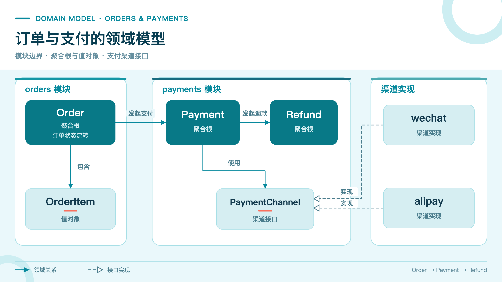

# 21 | 示例驱动与锚定：用具体例子约束Agent的输出

你好，我是徐昊，欢迎继续学习驾驭工程。

前面的章节里，我们主要从 Harness 的架构出发，讲解了如何通过双层循环，以及四个子系统来架构 Harness。然而除了 Harness 的架构之外，我们还需要从问题域出发，分清并理解我们要解决的问题。除了传统的业务建模、需求分析之外，针对大模型和构建 Harness，我们还可以从四个角度去考虑：输出、过程、风格、结构。

输出，是最终需要什么样的产出物；过程，是为了得到相应的产出物必需的流程；风格，是产出物表达的样子；结构，是产出物如何组织。

以软件开发的 Harness 为例。如果我们现在构建一个后台 API 系统，那么我们需要的输出是领域模型、对应的数据库结构、业务逻辑以及 API 接口。而得到这些输出的流程，可能是测试驱动开发，也可能是功能配合回归测试。风格则是命名、错误处理方式以及 API 接口风格（/orders/{id} RESTful 风格而不是 getOrderById 这样 RPC 的形式）。结构就是代码的分层与模块边界，还有每一层的职责划分等等。

对于这样的 Harness 系统，我们需要大模型能够稳定地复现给定的模式。也就是针对输出、过程、风格、结构，能够稳定地以给定的模式为参考，完成我们需要的功能。前面我们讲过坏味道模式复制漂移，以及它的对应重构手法模式基线化（Pattern Baseline）。

那么，在构造复杂 Harness 的时候，我们通常需要分别为输出、过程、风格、结构建立对应的模式基线，也就是我们所谓的锚定（Anchor），从而依靠锚定规范 Harness 的行为。针对输出、过程、风格、结构四个不同的方面，锚定的方式也不尽相同。

## 构造锚定

构造锚定最简单的方法是模板（template）和示例（example）。通常我们可以把模板与示例封装在技能（Skill）当中：

```
my-skill/
├── SKILL.md
├── *-template.md      # 模板
├── examples/
│   └── sample.md      # 样例，展示期望格式
└── scripts/
```

模板是约束大模型输出最简单的方式，比如我们要规范代码评审的输出内容，可以使用这样的模板：

```
位置    <文件>:<行号>
级别    blocker / major / minor
类型    正确性 / 可读性 / 性能 / 安全
问题    一句话说清哪里不对
建议    怎么改，能贴代码就贴
```

然后在 SKILL.md 中引用对应模板即可：

```
...
评审代码时，每发现一处问题，按`review-comment-template.md`的五个字段写一条评论。
...
```

而示例可以用于建立更复杂的基线。比如在构造 UI 功能测试时，需要使用 Page Object 对象，与测试代码配合，那么我们可以给出一个相对完整的示例：

```
my-skill/
├── SKILL.md
├── *-template.md      # 模板
├── examples/
│   ├── page-object.sample.ts
│   └── test-case.sample.ts
└── scripts/
```

然后给定对应的样例，比如后面这样。

```bash
export class LoginPage {
 constructor(private page: Page) {}
 async goto() {
   await this.page.goto('/login');
 }
 async login(username: string, password: string) {
   await this.page.fill('#username', username);
   await this.page.fill('#password', password);
   await this.page.click('button[type="submit"]');
 }
}
```

```python
import { test, expect } from '@playwright/test';
import { LoginPage } from '../page-objects/LoginPage';
test('用正确凭证登录，跳转到首页', async ({ page }) => {
 const loginPage = new LoginPage(page);
 await loginPage.goto();
 await loginPage.login('user@example.com', 'password123');
 await expect(page).toHaveURL('/dashboard');
});
```

## 流程锚定

对于输出锚定和风格锚定，通过模版和样例通常就足够了。但是对于过程锚定则要复杂一些。

通常我们有两种做法，第一种是继续使用双层循环结构，通过内外循环的方式构造希望的流程。但是这么做的弊端在于，双层循环依赖 PDCA 以及子任务分解，它主要解决的问题是如何启发式（Heuristic）地解决一个庞杂问题，而不是精准地依照某个特定流程执行。虽然也能对流程起到约束的作用，但如果仅仅是想遵循某个固定的流程的话，那么双层循环还是稍显复杂。

- PS：关于什么是庞杂问题，可以看我上一季《 AI 时代的软件工程》第 2 讲内容。

第二种做法就是流程锚定，通常我们会使用 Mermaid 画出明确的流程图，然后再为每一步提供前馈与反馈。比如，你想要 Agent 以测试驱动的方式编写代码，那么可以把测试驱动的流程写成流程图，再对每一步进行描述，类似 Superpower 里关于 TDD 部分的描述：

```
digraph tdd_cycle {
   rankdir=LR;
   red [label="RED\nWrite failing test", shape=box, style=filled, fillcolor="#ff
   verify_red [label="Verify fails\ncorrectly", shape=diamond];
   green [label="GREEN\nMinimal code", shape=box, style=filled, fillcolor="#ccff
   verify_green [label="Verify passes\nAll green", shape=diamond];
   refactor [label="REFACTOR\nClean up", shape=box, style=filled, fillcolor="#cc
   next [label="Next", shape=ellipse];
   red -> verify_red;
   verify_red -> green [label="yes"];
   verify_red -> red [label="wrong\nfailure"];
   green -> verify_green;
   verify_green -> refactor [label="yes"];
   verify_green -> green [label="no"];
   refactor -> verify_green [label="stay\ngreen"];
   verify_green -> next;
   next -> red;
}
## RED: 写一个失败的测试
```

- 写一个最小的测试，展示应该发生什么。

- 好例子：

```javascript
typescript
test('retries failed operations 3 times', async () => {
 let attempts = 0;
 const operation = () => {
   attempts++;
   if (attempts < 3) throw new Error('fail');
   return 'success';
 };
 const result = await retryOperation(operation);
 expect(result).toBe('success');
 expect(attempts).toBe(3);
});
```

- 名字清晰，测的是真实行为，一次只测一件事。

- 坏例子：

```javascript
typescript
test('retry works', async () => {
 const mock = jest.fn()
   .mockRejectedValueOnce(new Error())
   .mockRejectedValueOnce(new Error())
   .mockResolvedValueOnce('success');
 await retryOperation(mock);
 expect(mock).toHaveBeenCalledTimes(3);
});
名字含糊，测的是 mock 不是代码。
要求：一个行为；名字清晰；真实代码（万不得已不用 mock）。
## Verify RED：看着它失败
```

- 必须做。永远不许跳过。

```
`npm test path/to/test.test.ts`
```

- 确认：测试失败（不是报错）；失败信息符合预期；是因为功能缺失而失败（不是拼写错误）。

```
- 测试通过了？ 你在测已有行为。改测试。
- 测试报错？ 修掉错误，重跑，直到它正确地失败。
## GREEN: 最小代码
```

- 写最简代码让测试通过。

- 好例子：

```javascript
typescript
async function retryOperation<t>(fn: () => Promise<t>): Promise<t> {
 for (let i = 0; i < 3; i++) {
   try {
     return await fn();
   } catch (e) {
     if (i === 2) throw e;
   }
 }
 throw new Error('unreachable');
}
```

- 刚好够通过。

- 坏例子：

```javascript
typescript
async function retryOperation<t>(
 fn: () => Promise<t>,
 options?: {
   maxRetries?: number;
   backoff?: 'linear' | 'exponential';
   onRetry?: (attempt: number) => void;
 }
): Promise<t> {
 // YAGNI
}
```

- 过度设计。

```
不加功能、不重构别的代码、不做超出这条测试的"改进"。
## Verify GREEN: 看着它通过
```

- 必须做。

```
`npm test path/to/test.test.ts`
```

- 确认：测试通过；其他测试还通过；输出干净（没有报错、警告）。

```
- 测试失败？ 改代码，不改测试。
- 其他测试失败？ 现在就修。
"其他测试"指的是整个项目的测试套件，不只是你写的那个文件。你写的那条测试绿了，不等于整套绿了。在宣
## REFACTOR: 清理
只在绿了之后：去除重复；改进命名；抽出 helper。
```

- 保持测试全绿。不加行为。

- 重复上述步骤

```
为下一个功能写下一个失败的测试。</t></t></t></t></t></t>
```

同样是流程控制，我们对比一下流程锚定和双层循环，就能发现它们的差异。

第一，双层循环是启发式流程，每轮都在想下一步做什么，流程锚定要的是照着图走。双层循环靠 PDCA 和子任务分解，每一轮都是一次新的规划：上一轮干到什么地方了，这一轮要干什么、干到哪算完、下一步往哪走。

对一个没有标准解法的庞杂问题（关于什么是庞杂问题可以看上个专栏第 2 讲），这是对的，因为路径本身要边做边探。但对 TDD 这种路径早就画好的流程，还让它每轮重新规划，就是拿一台做启发式搜索的机器去背一篇写好的流程，既贵又不准。

第二，流程锚定把自由度收得只剩“在检查点做判断”。流程图里的菱形，就是模型仅剩的自由度：验证失败原因对不对、验证全绿没？其余地方没有发挥空间。双层循环里，内层循环的Action 环节自由度大得多，模型自己决定下一步做什么，换来的是灵活，代价是不确定。

第三，成本差得远。双层循环每轮都要把计划、分解、下一步重新生成一遍，词元（token）和时间都花在反复规划上。流程锚定的路径是死的，模型花一次读图的开销，之后就是按图走，每步只剩执行加那一个判断。

第四，可审计。流程图是静态的，你能一眼看出流程漏没漏、判断点全不全、哪一步没配反馈。双层循环的动态规划过程，你只能看到结果，看不到它当初为什么那么走。

因此，对于小范围有明确定义的流程，使用流程锚定是更简洁的做法。当然，流程锚定和双层循环并不是互相排斥的，流程锚定可以嵌进双层循环，外层循环的某个环节，本身也可以是一张画好的固定流程。

## 结构锚定

结构锚定锚的是分层、模块边界、依赖方向。流程锚定管的是“怎么一步步走”，结构锚定管的是“新东西该长在哪、和谁发生关系”。和流程锚定一样，光靠一句“业务逻辑放 service、controller 只做校验”不够，模型能复述，写出来还是乱放。所以也要用画图的办法，用领域模型（domain model）或者系统分层图，把边界和依赖方向画死，再为每一块配上前馈与反馈。

结构复杂的时候，图就要跟着复杂。开篇那个后台 API 系统，复杂度不在分层，而在模块之间：订单、支付、渠道，各有各的边界。这种结构就得画一张领域模型图，把模块边界、聚合根、接口隔离一起画出来：



```
flowchart TB
   subgraph orders[orders 模块]
       ORDER[Order 聚合根
订单状态流转]
       ITEM[OrderItem 值对象]
   end
   subgraph payments[payments 模块]
       PAYMENT[Payment 聚合根]
       REFUND[Refund 聚合根]
       CH[PaymentChannel 渠道接口]
   end
   subgraph channels[渠道实现]
       WECHAT[wechat 渠道]
       ALIPAY[alipay 渠道]
   end
   ORDER --> ITEM
   ORDER -- 发起支付 --> PAYMENT
   PAYMENT -- 发起退款 --> REFUND
   PAYMENT --> CH
   WECHAT -- 实现 --> CH
   ALIPAY -- 实现 --> CH
```

这张图里画了三类边界：模块边界（orders、payments、channels 三个框，谁依赖谁）、聚合边界（Order 是聚合根，OrderItem 只能挂在它下面，状态只能经 Order 改）、接口边界（渠道实现只能通过 PaymentChannel 接口被业务调用）。

然后每个边界配上前馈和反馈：

```
orders 模块
 前馈  订单状态流转都归 Order 管，外部只能调它的领域方法，不许直接改字段
 反馈  不能包含修改订单状态的逻辑。结构测试：发现别处直接改了订单字段，失败
payments 模块
 前馈  支付、退款是各自独立的聚合，各自通过聚合根操作；
       渠道差异都藏在 PaymentChannel 接口后面
 反馈  不能包含绕过接口直接调具体渠道的逻辑。结构测试：发现业务代码直接调 wechat，失败
渠道实现（wechat / alipay）
 前馈  只实现 PaymentChannel，不依赖订单，不依赖别的渠道
 反馈  不能包含依赖订单或依赖其他渠道的逻辑。结构测试：发现渠道代码反向依赖 orders，失败
```

和流程锚定同构，图管“形状”（边界和方向），每块的前馈管职责，反馈管越界没有。差别在反馈的手段：流程锚定的反馈靠验证命令，是动态的、要跑；结构锚定的反馈靠结构测试，是静态的、扫一遍代码就能判断。所以结构锚定比流程锚定更省，也更适合卡死“不许反着来”这类硬边界。

## 小结

至此，我们可以看到，针对大规模 Harness，输出和风格靠模板（template）加示例（example）把形状钉死，流程靠流程图加每一步的前馈与反馈把路径钉死，结构靠领域模型图加每一块的前馈与反馈把边界钉死。把这三种方式用到四个角度上，就把“长什么样、怎么走、落在哪”都钉住了，模型才能照着这些基线稳定地复现给定的模式。

- 除了 Harness 的架构之外，问题域的分界可以从四个角度去考虑：输出是最终要什么样的产出物，过程是得到产出物必需的流程，风格是产出物表达的样子，结构是产出物如何组织。为这四个角度分别建立模式基线，就是锚定（Anchor）。

- 输出锚定和风格锚定，靠模板（template）和示例（example）就足够。模板是空壳，把形状钉死；示例是填好的样板，把"好到什么程度"立起来。两者封装在技能里：SKILL.md 引用模板，examples 目录放样例。

- 流程锚定更复杂，靠 Mermaid 流程图加每一步的前馈与反馈：图把路径和岔路画死，前馈管做什么，反馈管这一步到没到、走哪条岔路。庞杂问题用双层循环，固定流程用流程锚定，两者不互斥。

- 结构锚定靠领域模型图或分层图加每一块的前馈与反馈，把模块边界、聚合根、接口隔离画死。反馈靠结构测试，静态扫一遍就能判越界，比流程锚定的动态验证更省。

- 把这几种方式用到四个角度上，就把“长什么样、怎么走、落在哪”都钉住了，模型才能照着这些基线稳定地复现给定的模式。

## 思考题

如果四个角度的锚定互相冲突，比如 TDD 过程、快速原型输出、严格分层结构、统一 API 风格，你如何排序、协商并暴露冲突？

期待你在留言区记录思考或疑问。也欢迎你把课程分享给有需要的朋友。
