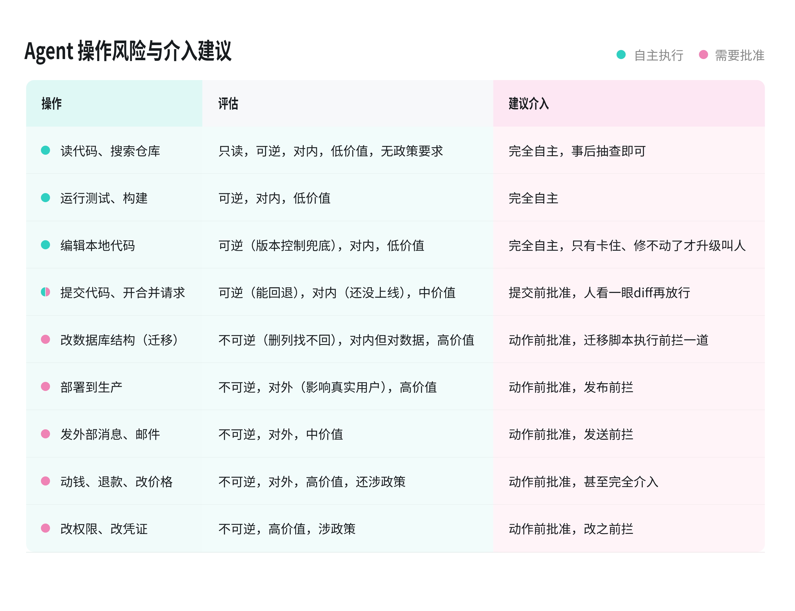
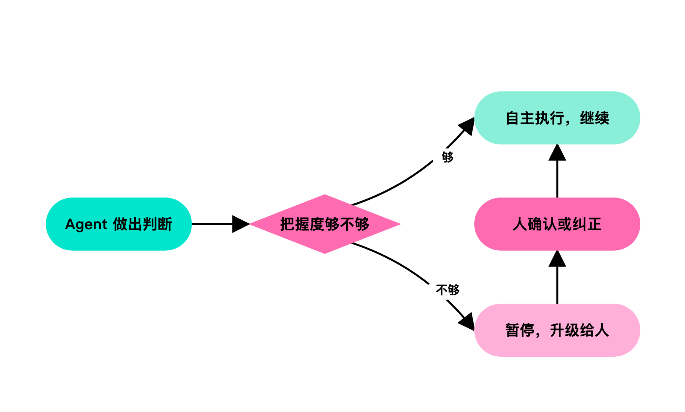

# 22 | 内建质量：把验收做进循环里

你好，我是徐昊，欢迎继续学习驾驭工程。

对 Harness 而言，双层循环本身已经是一套自动化的质量机制，内层循环的前馈（Guides）和反馈（Sensors）贴着任务的每一步自动检查进度，并及时修正；外层循环的检查（Check）环节，按照计划（Plan）追踪任务的整体进度。这些机制的存在，已经把能自动化的质量都自动化了。

可是对于大模型而言，还有一类质量判断，是仅靠双层循环无法覆盖的，那就是方向和标准。“要解决什么问题？”“怎么算成功？”之类的问题机器判不了，也不该交给机器判。

对于 Harness 的内建质量，最后一块拼图是人。双层循环负责“做对”，就是在既定的方向和标准之下，内层一步步做对，外层一圈圈盯对。

而人负责判定“什么是对的”，方向选得对不对，标准定得对不对。这两样，是双层循环全部自动化的前提下，唯一必须留给人的判断，也是质量的上限所在。今天我们讨论的问题就是，人在哪一点、以什么方式进入这套自动化系统。

## 五种不同的介入方式

首先要明确的是，对于不同的任务种类，人的介入方式也会有所不同。大致而言分为后面五种。

- 完全介入：人直接指挥每一步。比如我们常说的氛围编程（vibe coding），或是通过提示词与大模型交互，都可以看作是由人完全介入，通过提示词驱动大模型运转的模式。

- 动作前批准：有后果的动作先批，常规动作自动流转。比如一个能发邮件的 Agent，写周报、整理数据都是 Agent 自己跑，但要给客户发邮件之前，先把收件人、主题、正文摆出来，你点头它才发。拦的不是它干活，是“对外”这一下。

- 提交前批准：Agent 先干活，但成果变持久、变可见之前要人批准。比如代码 Agent 自己写代码、自己跑测试、自己改，但到了要提交合并请求那一步，停下来让你看一遍 diff，你确认它才 push。草稿阶段随便它折腾，落地那一下需要你批准。

- 异常升级：只在策略、风险或者校准过的置信度越过阈值时才介入。比如一个自动给工单打标签的 Agent，平时几千条自己分，遇到它没把握的、或者标签和已有规则打架的，才把这一条拎出来给你定。大部分时候不打扰你，只把拿不准的送上来。

- 完全自主：事后审计，不中途拦截。比如一个每天处理几千条日志分类的 Agent，全部自己跑，你每周抽一批看结果对不对，错了就回头调规则。适合有界、可逆、低风险、大量的动作，错一次代价小，事后抽查就够了。

通常我们不会选择一种统一的介入方式，而是需要根据不同的任务种类，选择相应的介入方法。对于大模型能自主处理、自动化程度很高的任务，而且风险不大的任务，我们可能会选择更少的介入方式。

拿工单自动分类说，一个支持系统每天进来几千条工单，让 Agent 给每条打上“退款”“改地址”“查物流”“投诉”这类标签，再路由到对应的处理人。这件事量大，错一次代价又小。打错标签大不了转错人，人再转一次，所以它应该全自主地跑，不用每条都等人批。

而对于风险较大、对外部可能产生影响的任务，就会选择更加紧密的介入方式。同样用支持系统举例，给工单打标签，Agent 可以全自主地跑，错了大不了内部转错人。但到了“给客户退款”这一步，就要停下来。它把要回复的客户、拟好的回复内容、退款金额摆出来，你看一眼，确认没问题它才继续执行。

出于风险的考量，在现阶段（2026 年 9 月），我们往往倾向于更多的人为介入。但是需要说明的是，介入不是越多越好，人工审核最常见的失败模式叫橡皮图章。即审批请求太频繁、太含糊，而且几乎总被批准的时候，人就不再仔细看了，盲目地点选“同意”（比如我们在使用Agent 编码时，大模型反复需要请示是否执行某些命令行指令时，大部分人都不会仔细检查，而是直接选择 Allow）。

当橡皮图章模式发生时，虽然这些审核在流程上都是人工批准，但真正有价值的判断一次都没发生，只能给我们一种虚假的、在掌控质量的感觉。有一个被反复引用的数字：一个评审者每小时看到超过二十个审批请求，就会开始在超过九成五的请求上不看就批。所以介入的目标从来不是“更多监督”，而是“更少、更高价值的介入”。把人的注意力省下来，用在那几个真正需要判断的动作上。

## 用于衡量介入的维度

介入不是越多越好，那怎么判断哪些动作真正需要人、哪些可以放手？我们有四个维度，可以帮助我们衡量每一次介入的价值。

- 可逆性：能不能撤销，撤销的代价多大。比如让 Agent 改生产数据库的表结构：删掉一列，数据当场就没了，恢复要花钱花时间、还可能找不回来；而改一个本地草稿文件，错了随手就改回来。两个动作，一个几乎不可逆，一个几乎零成本可逆。

- 外部性：会不会影响 Agent 控制范围之外的人或系统。比如 Agent 给客户发一封“您的订单已取消”的邮件：一旦发出，就是公司对外说了话，客户会来问、会来投诉，收不回来；而改一个本地草稿，只有你自己看得到。一个对外，一个对内，性质完全不同。

- 价值：多少钱、多少时间、多少信任押在上面。比如让 Agent 处理退款：退一笔五万块的款项，和订一支三块钱的笔，金额差了四个数量级，错了的后果天差地别。前者错了要追回、要对账、还要赔上信任，后者错了无非重订一次。

- 政策：法律、合同、安全规则要不要人过目。比如让 Agent 做一个涉及个人征信的自动决策：法律要求必须有人签字、留审计记录，Agent 自己说了不算；而一个内部变量怎么命名，没有任何人管。一个受监管，一个不受监管，介入的程度必须不一样。

之后我们就可以按照这四个维度，来评估要用什么样的介入手段了。拿软件开发里最常见的几类操作，我们可以这样评估：



这里有一条通用原则，授权内的、有界的、可逆的、低风险的动作，放手；不可逆的、外部可见的、高价值的、涉及政策的动作，拦下来等人。也就是说，人只在认定为高风险、或是高影响的任务上介入。确保每一次介入，人都会仔细阅读上下文，并给出有效的评估。从而避免橡皮图章模式。

再多说一句，需要提防两个陷阱。

一是可逆性不是免死金牌：一条删掉的记录也许能恢复，但一个泄露的密钥、一封发出去的消息，收不回来，所以判断时先看政策、价值、外部性，最后才轮到可逆性。

二是风险要算总账。比如，单笔五十块的小额动作单个看都是低风险，但要防止 Agent 把它拆成几十笔绕开阈值，所以判断的应该是“一段时间内的合计风险”，而不仅仅是单次动作。

## 如何实现动作前批准

五种介入模式里，完全介入和完全自主不需要我们多花心思。提交前介入可以通过 Git 的钩子（hook）实现。而动作前批准是最需要小心实现的一种。它拦的是最危险的动作，却最容易做错。

最容易犯的错，是把审批写在提示词里：“发邮件之前先问用户”。这个写法看起来有了审批，其实没有。我们前面讲过那么多坏味道，有一条反复出现：大模型会忽略规则、会忘记规则。

一句写在提示词里的“要先问人”，和“业务逻辑放 service”没什么两样：它都能复述，也可能照做，但在推理到某个岔路口时，完全可能把那句规则放在一边，直接动手。而动作前批准是“错了代价最大”的那一类，恰恰最不能被忽略。

所以保证动作前批准不被忽略，只有一个办法：把审批从提示词里挪出来，放到工具边界上。提示词是商量，商量可以被忽略；工具边界是拦，拦就是拦。具体做法是加一层工具网关（tool gateway）：所有工具调用都经过它，工具自己声明审批等级，网关统一拦截。

```python
# 工具声明自己的审批等级：allow 放行 / ask 问人 / deny 拦死
class Tool:
   name = "send_email"
   approval = "ask"
# 所有工具调用都走这一个入口，agent 不直接调工具
def dispatch(tool, args):
   if tool.approval == "allow":
       return tool.run(args)
   if tool.approval == "deny":
       return block(args)
   # ask：打包成提案，展示给人，等人拍板
   proposal = build_proposal(tool, args)   # 做什么、为什么、代价、风险、过期时间
   decision = present_and_wait(proposal)   # CLI 确认 / Slack 消息 / dashboard 卡片
   if decision == "approve":
       return tool.run(args)
   return rejected(decision)               # 拒了就把结果回给 agent，它另想办法
```

这层网关有三个要点。

```
第一，审批是声明式的，不是写进 Agent 逻辑的。send_email 标一个 approval =
"ask"，网关统一处理。审批规则不在提示词里，也不散落在每个工具的实现里，而是 Agent
```

无法修改、无法绕过的一层固定检查。

```
第二，单一咽喉，没有旁路。只要保证所有工具调用都经过 dispatch，Agent 就没有绕过审
批的路；反过来，只要有一个工具绕过了 dispatch 直接执行，整个门禁就形同虚设。
第三，三态决策。deny 是硬拦，危险命令直接挡死，连问都不问，比如 rm -rf、DROP
TABLE；ask 是问人，有后果但要看情况；allow 是放行，低风险动作直接过。这样人的注
意力只花在 ask 那一类上，deny 和 allow 都不占人。
```

最后说一句为什么偏偏用工具网关：对工具调用的拦截，目前并没有通用的实现方式，完全取决于你的 Harness 跑在哪个框架上。同样是“发邮件前拦一道”，OpenAI 的 Agents SDK 是在

```
工具上挂 needs_approval=True 装饰器，Claude Code 是用 PreToolUse hook 加权限配
```

置，两个框架给了两套完全不同的 API，你从 OpenAI 换到 Claude，拦截逻辑就得重写一遍。

工具网关做的事，就是把这层从框架里抽出来：不管底层是 OpenAI、Claude 还是自研，所有

```
工具调用都先经过你自己写的 dispatch，审批逻辑只写一遍，换 Harness 也不用动。所以
```

它是目前既不依赖特定 Agent Harness、又能保证拦截不被模型忽略的实现方式。

## 如何实现异常升级

异常升级是最省人力的一种介入方式：大部分动作全自主，只在越过某个临界值时，才把人叫进来。实现它的关键，就是把这个临界值和转向画清楚。

21 讲里我们讲过流程锚定：用流程图把流程和岔路都画死。异常升级的实现，正好是流程锚定的一个应用。画一张图，把“自主执行”和“升级给人”两条路，以及中间那个判断，都标出来：



这张图的核心是中间那个菱形：是否越过临界值。越过了，就转另一条流程，升级给人；没越过，就继续自主。

那这个临界值用什么？最常用的一种，是 AI 的把握度，也就是置信度：它有多大自信，这件事不需要人为介入。

前面讲维度的时候说过置信度怎么来：模型做判断时，是在一堆候选答案上给概率。比如给工单打标签，它算出“退款 0.92”“改地址 0.05”，这个 0.92、0.05 就是它对自己判断的把握。把握度高，放它自己走；把握度低，说明它拿不准，拎出来给人决断。

所以异常升级的落地就是三件事：第一，让模型在给出判断的同时，给出一个把握度；第二，定一个临界值，把握度高于它自主、低于它升级；第三，升级时把它的判断、把握度、拿不准的点一起带上，人一眼就能定。

这里要提醒一句：模型给的把握度普遍偏高，它经常很自信地错。所以临界值不能拍脑袋定，要先拿一批有标准答案的样本校准，看它说“九成把握”的时候实际对了几成，再把阈值定在错误率可接受的那条线上。

## 小结

- 内建质量对 Harness 而言，双层循环已经把能自动化的质量都自动化了，剩下首要的问题是人的介入。方向对不对、标准对不对，只能靠人判。

- 介入有五种方式，从完全介入到完全自主：完全介入、动作前批准、提交前批准、异常升级、完全自主。没有全局的介入方法，是按任务选的。

- 介入不是越多越好：橡皮图章是头号失败模式，审批超过大约每小时二十个，人就不看就批。目标是更少、更高价值的介入。

- 用四个维度衡量一个动作该配哪种介入：可逆性、外部性、价值、政策。可逆对内的往自主放，不可逆对外高价值涉政策的拦下来等人。可逆性不是免死金牌，风险要算总账。

- 动作前批准要放在工具边界，用工具网关（tool gateway）实现：工具声明审批等级，所有调用经过统一的 dispatch 入口，审批逻辑不写进提示词，模型无法忽略也无法绕过。

- 异常升级用流程图实现：画清“自主执行”和“升级给人”两条路，核心是临界值。最常用的是AI 把握度（置信度），但要先校准再定阈值，因为模型把握度普遍偏高。

## 思考题

为客服系统设计一张介入矩阵，覆盖：打标签、查物流、改地址、退款、发外部邮件、改权限。

每项给出：四维度评估、审批等级、异常升级条件、事后审计策略。

要求：不能全部 ask，也不能全部自主。

期待你在留言区踊跃发言，积极思考有助于提升学习效果。如果这节课对你有启发，别忘了分享给更多同样关注内建质量的朋友。
