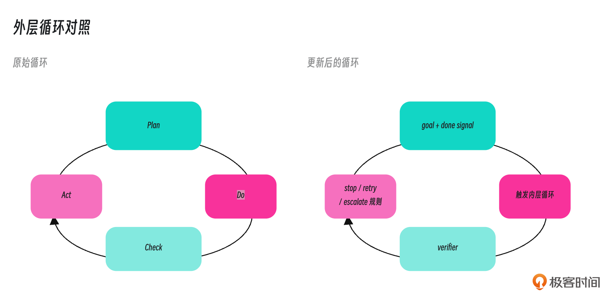

# 24 | LoopEngineering：设计高效的控制循环

你好，我是徐昊，欢迎继续学习驾驭工程。

今天我们要讲的主题是循环工程（Loop Engineering）。循环工程是指，你不再决定 Agent 下一步做什么，而是设计一个替它做决定的系统。这个系统由计划或事件触发，反复调用Agent，每次运行都用一个可检查的停止条件收尾。换句话说，你从逐句写提示词的人，变成设计那个会自己行动、观察结果、调整方向、直到目标达成的系统的人。

我们的角色从“跟模型对话的人”，变成了“设计那个会自己跑下去的系统的人”。写提示词是在手动触发一个轮次的行动，而设计循环是让一个系统替你做这件事。

那么 Loop Engineering 是如何实现的呢？它和一般的 Harness 有什么不同呢？

其实早期的 Loop Engineering 非常的粗糙。2025 年 7 月 Geoffrey Huntley 分享了一个叫做“Ralph Wiggum”的技巧，这被认为是 Loop Engineering 最早的雏形。这个技巧的核心是一个 bash 循环：

```
while :; do cat PROMPT.md | claude-code; done
```

这一行做的事情很朴素，由于 Agent 的上下文窗口有限，在长期任务中上下文窗口很快就会被占满。Geoffrey Huntley 的解法不是去压缩上下文，而是干脆让 Agent 每轮都用全新的上下文重启，这一轮要做什么、已经做到哪了、下一步是什么，全部写进一个 PROMPT.md 文件；每轮循环开始，把这个文件重新喂给 Agent，Agent 干完活，再把进度写回同一个文件。于是这形成了一个最初的循环（Loop）：模型的记忆每轮清零，进度却不丢。由进度构成的提示词，驱动模型进行下一步操作。

然后在 2025 年 9 月，Simon Willison 做了另一个实验，他有个跑在 Fly.io 上的应用，这个应用采用 scale-to-zero 模式，没有请求时实例缩到零，来一个请求再冷启动。

他要排查的是冷启动速度太慢的问题。这类问题很难通过一次 prompt 问出答案，因为“改配置、部署、测启动耗时”要反复试很多次。于是他把三个关键能力变成了技能（Skill）：直接改Dockerfile、部署到 Fly 账号、以及测每次启动花了多久。然后，他就写了一个循环（loop），让 Claude 自己通过组合这些技能，完成对于启动时间的优化。

Simon 的关键突破，在于利用了大模型的内建的自我纠正循环（Self-correction），通过自主计划和自主检测，在不需要由人指定实现步骤的前提下，完成了整个任务。

```
随后，2026 年的 4 月起，Claude Code 加入了 /loop 以及 /goal 任务，把这两种模式构建
```

成 Harness 内建的标准模式，随后其他的 Harness 也纷纷跟进。从而产生了所谓的循环工程（Loop Engineering）。

## 双层循环的外层就是 loop

我们不难发现，所谓循环工程，主要是通过状态子系统记录执行过程，然后反复触发核心任务，直到达成最终结果。

那么我们前面章节介绍的双层循环模型的外层循环实际上就是一个 Loop。它通过 Plan-Do-Check—Action，反复调整计划与执行，直到目标达成。这与循环工程中的循环实际发挥的作用是完全一样的，只要在外层循环的写法上稍加修改，就能得到一个非常标准的循环工程。



- Plan（计划）→ goal 加完成信号（done signal） 把“要达成什么”写成一个可观察的完成判据，比如“测试全绿”“每个链接都能打开”。相当于通过反馈实现循环终止信号；

- Do（执行）→ 触发内层循环。 内层操控循环照旧，那是 Agent 干活的循环，不用动；

- Check（检查）→ verifier。 把需要人为介入的换成客观检查：exit code、测试结果、阈值。机器判，不靠你看。这里需要注意的是，由于循环工程往往更加注重自动化执行。因此，有陷入死循环的可能。需要在状态系统中记录循环轮次，以避免死循环的发生；

- Act（调整）→ stop / retry / escalate 规则。预算或是最大轮次耗尽就停、无进展就停、搞不定就升级给人，如果可以继续则继续重试。

我们可以遵循以下的模板，把外层循环按照循环工程的方式来重构：

```
{项目名}
你是{角色描述}。你的工作是反复执行一个核心任务，直到完成信号成立，或者触发下面的停止规则。
```

- 项目结构

```
{项目名}/
├── plans/     ← 计划与完成判据（plan.md 或 plan.json）
├── skills/    ← 你能调用的技能/工具（每个的用法写在自己的 SKILL.md 里）
├── state/     ← 进度与轮次记录（loop.md 或 loop.json）
└── ...
目标（Plan）
{要达成的目标，写清楚，不要写「把这事做好」}
完成信号（done signal，可检查的条件）：
- {条件一：比如「npm test 退出码为 0」}
- {条件二：比如「lint 无报错」}
执行（Do）
用你的内层循环反复干活：{读 → 改 → 检查 → 看结果}，重复到完成信号成立，或触发下面的停止规则。内
检查（Check）
```

- 每一步之后，用命令和客观标准检查，不要自己判断「差不多了」：

```
| 检查什么   | 命令 / 标准 | 通过是什么样 |
|------------|-------------|--------------|
| {检查项 1} | {命令 1}    | {通过标准 1} |
| {检查项 2} | {命令 2}    | {通过标准 2} |
每一轮把进展追加写进 state/loop.md，轮次只追加、不覆盖：
第 N 轮
```

- 做了什么：检查结果：下一步：

```
这是防死循环用的：连续 {N} 轮「检查结果」和「下一步」都和上一轮完全一样，说明在空转，立即停。
停止 / 重试 / 升级（Act）
```

- 满足下面任何一条就停，不要继续：

```
- 完成信号成立 → 停，标记完成。
- 轮到第 {上限} 轮还没完成 → 停，写清卡在哪，升级给人。
- 连续 {N} 轮无进展 → 停，升级给人。
- {范围外动作，比如「要改测试本身」} → 停，问人。
- 权限 / 认证 / 安全类错误 → 停，升级给人，绝不重试。
只有满足 {重试条件，比如「测试失败、错误明确是代码问题、且还没到轮次上限」} 时才重试。
```

我们并不需要把每一个 Harness 的外层循环都按照循环工程的方式改写，但是有两个场景特别适合这种编写风格。

首先，就是长任务。任务越长，区别越明显。一个要跑几十轮、几小时甚至过夜的任务，如果外层循环需要手动介入，那么人就需要坐在那儿盯几十轮、看每一轮的检查结果。改写成循环之后，我们只需要在开始前定好目标、判据和边界，然后放它去跑，人离开也行。

其次是希望给 Agent 更多自主性的场景。手动的外层循环里，“检查 → 决定下一步”每一轮都是你在做，Agent 干一步就得停下来等你。改写成循环之后，这个决定权交给了 verifier 和停止规则：它自己判断这一步成没成、下一步干什么、还要不要继续。Agent 不再一步一停，而是一口气跑下去，直到完成信号成立或者撞上边界。

## 使用 /goal 简化外层循环

```
当我们理解了循环工程和外层循环的关系之后，就可以利用 Agent 内置的 /goal 来简化外层
```

循环的编写。我们只需要把外层循环 PDCA 里 Check 提炼出来，Plan 和 Action 交给 Agent自己，然后 Do 的部分交给技能就好了。

让我们来看一个真实的例子，比如我们希望使用 Claude 或是 Hermes 修复代码库中的错误：

```
/goal 让 test/auth 里的测试全部通过、lint 无报错，最多 10 轮
```

这一句里你只写了 Check：把“完成”提炼成两个可检查的条件，测试全绿以及 lint 无报错，外

```
加一个轮次上限。剩下的三环，/goal 自动就帮你分好了。
```

```
所以用 /goal 简化外层循环，实际就是把关注的重点全部放在 Check 上。而把 Plan 和
```

Action 交还给 Agent，让它自己计划、自己调整。你手里真正要写、也唯一值得写好的，就只剩那句 Check，也就是完成条件（done signal）写得越清楚，evaluator 越能替你判断，Agent 越能自己跑完。

注意，目前这样的做法只适合于简单的任务，而像背单词这样，需要复杂的进度控制的

```
Harness，/goal 提供的帮助有限，还是需要我们自己编写外层循环。
```

## 小结

- 循环工程是：你不再决定 Agent 下一步做什么，而是设计一个替它做决定的系统。这个系统由计划或事件触发，反复调用 Agent，每次运行用一个可检查的停止条件收尾。

- 双层循环的外层 PDCA 本质就是一个 Loop。把它改写成循环工程，四环节对号入座：Plan写成目标 + 完成信号（done signal），Do 触发内层循环，Check 换成客观检查（verifier）并在状态里记录轮次防死循环，Act 写成 stop / retry / escalate 规则。

- 两个场景特别适合改写：长任务（人不用坐在那儿盯几十轮），以及要给 Agent 更多自主性的场景（决定权交给 verifier 和停止规则，人只留定目标、处理升级、验收结果三个点）。

- /goal 能进一步简化：把 PDCA 里的 Check 提炼成一句可验证的完成条件交给内置evaluator，Plan 和 Action 交还 Agent 自己，Do 交给技能。你唯一要写好的，就是那句done signal，它越清楚，循环越能自己跑完。

## 思考题

请为“修复某个开源项目文档里的所有失效链接”设计一个循环工程。要求写出：‌

• 目标；

• 完成信号（done signal）；

• 检查命令或客观标准；

• state/loop.md 的记录格式；

• stop / retry / escalate 规则；

• 如何防止 Agent 通过删链接、改测试、隐藏失败来“作弊”。

期待你在留言区踊跃发言，积极思考有助于提升学习效果。如果这节课对你有启发，别忘了分享给更多同样关注内建质量的朋友。
