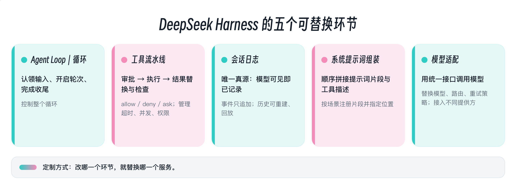

# 26 | 构造内部Harness

你好，我是徐昊，欢迎继续学习驾驭工程。

今天我们要讲的主题是构造内部 Harness（internal harness）。

首先我们需要重申的是，当我们通过 Harness 构造应用的时候，Harness 既是软件的设计也是软件架构。在前面的章节里，我们花费了大量的篇幅，强调了如何通过双层循环和四个子系统，表达软件的设计。而双层循环和四个子系统之所以能够发挥作用，则是因为在所有的Agent 系统中，其内部核心都是自我纠正循环（Self-Correction Loop）。通过自我纠正循环的运作，驱动 Agent 的不同部分协调工作。而自我纠正循环也就是我们所说的内部 Harness。

内部 Harness 主要起到了软件架构的作用。我们会发现在 Agent 的时代，软件架构是高度趋同的。这个可能跟我们之前的经历是不太一样的。在 Agent 之前的这个时代，软件架构都是多样的，无论是三层架构、或是流式架构、甚至黑板或者其他各种各样的架构模式。但是在Agent 的时代，它的整个架构就变成了同一个架构模式。也就是自我纠正循环。

所以构造内部 Harness 的第一原则是：不要构造内部 Harness，你不需要重复去创造那个相同的架构，你的关注点应该在外部 Harness 上。也就是如何通过四个子系统，表达你所需的软件设计。

## 什么情况才需要自建

当然，趋同不等于完全一样。剩下的差异，集中在几个行为点上，也就是内置循环里那些厂商替你做的决定。

- 第一个是循环的行为：什么时候停下来、失败时怎么重试、上下文快占满时怎么压缩、多个任务怎么调度。比如，Claude Code 在交互模式下没有轮次上限，靠人随时喊停，如果需

```
要自动化处理，则需要通过 --max-turns（最多跑几轮）和 --max-budget-usd（最多
花多少钱）设定。而 Hermes 用 agent.max_turns（默认 90 轮）给循环设硬上限，同
```

- 时把“上下文快满”做成自动压缩，到点自己触发，不用人盯着。

- 第二个是上下文的取舍：什么东西进上下文、什么东西压缩掉、什么东西长期保留。Codex的原则是“库即规格”，所有该知道的都编码进仓库。Claude Code 用两层机制，CLAUDE.md 是“压缩后仍保留”的项目记忆，另外有一块 Auto-Memory，自动把项目上下文存到本地文件（每个项目上限约 25 KB），跨会话延续；Hermes 的压缩是参数化的，上下文占用到窗口的 50% 就自动压缩，压到 20% 左右。

- 第三个是工具的执行策略：哪些调用要审批、超时多久、能不能并行。Claude Code 把权限做成一套可编程的规则：allow、ask、deny 三个层级，Codex 的选择是沙箱分层，而Hermes 则是审批模式。

同一个决定，不同的 Agent 给出的行为模式完全不同。

那么，只有当这三件事里的某一件，和你手头的任务明显冲突时，才值得去改内置机制。比如，你在做一个要跑好几天的长期研究，Agent 要反复读一批文件、写进度、再接着读。内置循环默认的策略是“上下文快满就压缩”，它会挑一段历史做摘要，好腾出空间。

问题在于，它不知道哪段历史对你重要，很可能把你还需要的细节压掉了，导致后面几步的推理建立在残缺的信息上。这时候你需要的是一个“先压工具输出、保留决策理由”的压缩策略。这时候，你才需要考虑是不是要自己构建内部 Harness。

## 选择轻量的工具

一旦选择自建内部 Harness，我们也不需要从零开始。当然不可否认，从头构建一个内部Harness，是一个有趣又有挑战的工作。但其实真的没有这个必要。我们可以选择更轻量化的工具，帮助我们完成必要的工作。比如 DeepSeek Harness。

DeepSeek Harness 是 DeepSeek 开源的一个 Agent Harness，它的设计原则是一切皆插件。模型适配器是插件，工具注册表是插件，会话日志是插件，连 agent loop 本身都是插件，每一个都能从配置里替换，想扩展它，就构造一个插件替换现有的部分即可。

它把“改内部机制”从“改源码”降级成了“挂一个插件”。DeepSeek Harness 用 Cordis 插件框架做到这一点，它的核心是五个概念：插件是一个实现服务的对象；上下文是服务的仓库；依赖用 inject 声明；通信靠类型化事件；注册是可逆的副作用。具体细节我们这里就不展开了，请自行阅读相应的文档。

DeepSeek Harness 为我们提供了五个可定制的替换环节，每一个环节都对应一个挂在上下文上的服务，改哪一个，就替换哪一个。



- 第一个是 agent loop，也就是循环本身。它决定怎么认领输入、怎么开一个轮次、怎么收尾。这是最核心的一环，下面单独讲。

- 第二个是工具流水线。它决定一个工具调用进来之后，经过哪些关卡：先是一道 allow 或deny 或 ask 的审批关，再是真正的执行，最后是结果替换和检查。超时、并发、权限，都在这一环里管。你希望某个危险命令一律要人批准，就挂一个监听器到这条流水线的审批关。

- 第三个是会话日志。这是状态的唯一真源，有一条铁律叫“模型可见即已记录”：模型看到的每一条消息，都必须能从日志重建出来。换句话说，日志不是额外记录一份，日志就是模型记忆本身。它只追加、不覆盖，模型的历史是从日志派生出来的，而不是另外存一份。回放一个会话，就是从同一组事件重新派生出模型历史，所以不存在“日志和实际不一致”的问题，这也是它能当唯一真源的原因。

- 第四个是系统提示词的组装。模型每次请求开头那段指令，不是一个写死的字符串，而是由一个个提示词片段按顺序拼起来的。工具的描述也在这一步被组装进请求。想给某个场景加一段专属指令，就是注册一个片段，指定它的位置。

- 第五个是模型适配。换模型、换路由、换重试策略，都发生在这一环。它把“调哪个模型”这件事抽象成一个接口，底下可以挂不同的提供方。

这五个环节能够满足我们绝大部分的定制需求，从而简化内部 Harness 开发的工作量。

五个环节里，agent loop 最特殊：另外四个都是可以拆换的部件，只有它是循环本身，模型请求、工具调用、结果回送，全都要靠它一轮一轮地转。

所以绝大多数时候，改 agent loop 也不用从头重写整个循环，只需要在它预留的几个扩展点上改行为。关键的扩展点有三个。

第一个是 pre-step，在每一步开始前。它可以放行这一步的输入，也可以拒绝，或者改写之后再放行。比如，你要做一个代码审查 Agent，它只能读仓库、给意见，不能改一行代码。与其在提示词里反复叮嘱“不要修改文件”，不如在 pre-step 挂一个监听器：检查这一步要调用的工具里有没有写操作，有就拒绝，这个 step 直接空转关闭。改的是 loop 的入口——哪些输入能进得来。模型再怎么“一时手滑”，第一步就进不了门，“只读”就从软性叮嘱变成了硬性闸门。

第二个是 request，在请求发给模型之前。它决定这次请求走哪条路由、带上哪些提示词片段。比如，一个客服 Agent 要处理成百上千条工单，绝大多数是查物流到哪了、改收货地址，用便宜快速的模型就能答好。但偶尔会冒出“我要投诉，你们必须赔我”的工单，涉及金额和赔付政策。

你在 request 挂一条判断：每次请求发出去之前，先扫一眼这步的输入，如果出现“投诉”“赔偿”“退款”，就把请求路由到更强更贵的模型，同时塞进一段提示词片段：

```
“赔付前先核对订单金额和七天无理由条款；超过 500 元的退款必须走人工审批；回复里不准承诺任何具体赔
```

改的是 loop 每一轮的配置——同一套循环，不同的请求拿到不同的模型和指令。平时又快又省，碰到要赔钱的单子才需要上强配置。

第三个是 turn-stopping，在一个轮次快要收尾的时候。模型已经没有要继续的动作、轮次即将关闭，你还可以在这里拦一下，再塞一个引导，让它多跑一步。比如，一个帮你改代码的Agent，经常改完就宣布“完成了”，其实测试还没跑，导致坏代码直接提交。

你在 turn-stopping 挂一个引导：轮次快要收尾时，检查这一步有没有动过 .py 或 .ts 文件；动过，就塞一条“先跑一遍相关测试，绿了再收尾”。改的是 loop 的收尾条件——模型本来已经觉得“没有要继续的动作了”，被这一拦，就多跑一步去执行测试，测出失败还能回来修。这样“改代码必跑测试”就成了一道收尾前必过的关，不靠模型自觉。

除了三个扩展点之外，你还可以往 agent loop 里加自我纠正循环之外的步骤，不是改现有的环节，而是给循环本身添一段新环节。Hermes 的自我改进（self-improving）就是一个现成的例子，也就是自动技能提取。这一步跟自我纠正不是一回事。自我纠正循环是任务内部在转，做错一步改一步。而“提取 skill”是任务完成之后补的一步，它改的不是这一次怎么纠错，而是下一次怎么开始。它的实现方式就是扩展 agent loop，在收尾前挂一个“回顾这次过程、把可复用的部分沉淀成 skill”的环节。

## 自定义 agent loop 是外层循环的固化

还有一种场景，我们可以把外层循环固化为 agent loop。在前面我们讲解双层循环的时候，外层循环是写在 AGENTS.md 里的，需要靠模型每轮重新读懂。这套规则要达成什么、什么时候停、卡住怎么办，全用自然语言描述。

当这套规则足够稳定、足够高频，就出现了另一个选择，把它固化进内部 Harness 的 agentloop，也就是把循环从提示词挪进代码，更高效地实现外层循环。

比如，“连续三轮没有任何进展，就停下来、升级给人”。写在提示词里，它是自然语言描述，模型这一轮可能记着，下一轮上下文被压过之后可能就忘了，于是 Agent 在一个没有进展的方向上多空转了好几轮。把它固化进 agent loop 的 turn-stopping 扩展点，它就变成每次轮次收尾都会执行的硬逻辑，程序数一下最近的进展记录，够了就放行，连续三轮没进展就直接停。这条规则从此不依赖模型记住，也不怕被压缩掉。

这样换来两样东西。第一是更准确：规则不再靠模型读懂，而是由程序保证。第二是更高效：省掉每轮重复解释规则的开销，也省掉模型误解规则带来的空转轮次。

但固化的前提是，内部 Harness 已经不满足需求，频繁出错。如果内置循环本来就能执行好你的外层循环，就别去固化，留在提示词里，随时能改。只有当你发现模型反复在同一个循环规则上出错、或者这条规则已经稳定到不再需要调整时，才值得把它写进 agent loop。

总而言之，内部 Harness 是一块你应该默认不动的底盘。大多数情况下，对于它的改动既无必要也不值得。一旦你有了要改内部 Harness 的想法，请三思。

## 小结

- Harness 既是软件设计，也是软件架构。内部 Harness 对应架构，也就是所有 Agent 共有的自我纠正循环，它高度趋同，所以第一原则是不要构造内部 Harness，把差异放到外部Harness。

- 趋同不等于完全一样，剩余差异集中在三个行为点上：循环行为、上下文取舍、工具执行策略。只有当其中某一项与你的任务明显冲突时，才考虑自建；为一点差异重造整个循环是过度工程。

- 自建不必从零开始。DeepSeek Harness 用“一切皆插件”，把改内部机制从改源码降级成挂插件，五个环节（agent loop、工具流水线、会话日志、系统提示词组装、模型适配）都能替换。

- 改 agent loop 靠三个扩展点：pre-step 拦入口、request 换配置、turn-stopping 改收尾；还可以加自我改进（self-improving，自动提取 skill）这类循环之外的新步骤。

- 自定义 agent loop 的实质，是把外层循环从提示词固化进代码，换来更准确和更高效，前提是默认循环确实不满足、频繁出错。

## 思考题

以下三个需求，分别是否值得自建或修改内部 Harness？请说明理由。

A. 你希望 Agent 在回答前语气更礼貌、格式更统一。

B. 你要做一个持续数天的研究 Agent，内置压缩策略经常压掉关键决策理由。

C. 你希望某个危险命令必须人工审批后才能执行。

期待你在留言区踊跃发言，积极思考有助于提升学习效果。如果这节课对你有启发，别忘了分享给身边更多朋友。
