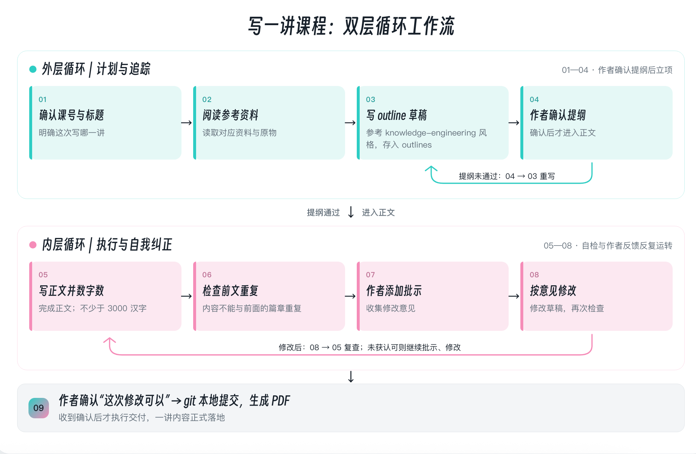

# 28 | 这门课的Harness如何构建

你好，我是徐昊，欢迎继续学习驾驭工程。

前面我们讲了 Agent First Workspace。它从一个思考实验出发，推出了第一原则，然后一路讲到知识库的四个来源、工作流、下发任务的五步流程。但是上一讲并没有给出实际的例子，那么今天我们就给一个具体的例子，看看 Agent First Workspace 是如何工作的。

选用的例子就是我们这门课所使用的 Harness。对的，你没看错。我们这门课的内容，也是在大模型辅助下完成的。这句话可能和很多人的直觉冲突。大家认为大模型写东西只会照本宣科，写点套话，套个模板还行。一套有结构、有观点的课程怎么充分利用大模型呢？那还不是因为有 Harness 嘛！

所以这一讲，我拿自己的实践做例子：你正在读的这门课，就是在一套 Agent FirstWorkspace 里，一讲一讲被写出来的。拆开它，你就看见 Harness 是怎么把一个只会照本宣科的大模型，变成一门课的合作者的。

## 仓库结构

所有 Agent First Workspace 的目录结构都差不多，都是由知识库、技能、产出物这些构成的。这个 Workspace 也不例外，结构如下所示：

```
course/
├── AGENTS.md                ← 地图、约定、意图
├── toc.md                   ← 课程目录
├── knowledge-engineering/   ← 风格参考
├── docs/                    ← 知识库
├── skills/                  ← 技能
├── outlines/                ← 每讲提纲
├── lessons/                 ← 定稿正文
│   └── output/              ← 生成的 PDF 等交付物
└── scripts/                 ← 临时脚本
不难看出，knowledge-engineering 和 docs 是知识库的部分，其中 knowledge-
engineering 是我前一门课程《AI 时代的软件工程》原稿，这并不仅是因为我们这门课
```

和知识工程有着千丝万缕的联系，同时它也作为风格的锚定范例，规范着 LLM 的写作风格。

```
outlines 和 lessons 分别是提纲和正文。对于写课而言，outlines 相当于原始需求或
```

者是任务说明，列出了我的主要观点和逻辑链路。然后交由 Agent 根据逻辑链路，找寻例子并

```
书写内容。最终的产出物放在 lessons 当中。把提纲和正文分开是刻意的，提纲随时会被推
```

翻修改，不能让它被正在编写的正文污染。

```
最后，AGENTS.md 和 skills 是 Harness，负责控制整个写作的流程。当然，我们这里的工
```

作流并不复杂，主要就是提纲 → 初稿 → 我来通读 → 按照段落做批示 → 再修改这样一个过程。下面让我们具体来看一下。

## 构建知识库

对于所有 Agent First Workspace，知识库的构建都是重中之重。

首先要回答的问题是，知识库对于我们这门课的作用是什么？大家读到这一章应该会发现，我们课程中有非常多的原创内容和工作实践的总结。因此，我们的知识库并不是让我用来洗稿的（作为课程作者，职业操守还是有的）。

知识库的首要作用是对我提出的解决方案做交叉验证。而且 Harness 发展日新月异，在我编写这门课的过程中，新的工具、新的技巧、新的模式还在不停地涌现。那么，我给出的答案是否还是最优的解决方案？这个需要验证。

其次，因为我所采用的实践是从工作中得来，而我又不方便直接把工作的内容写出来。所以，我需要知道行业内类似，或接近的案例都有什么，然后再根据这些例子，替换掉我所使用的实际例子。比如，在讲多 Agent 的章节时，我们选择了 TradingAgents 来讲解，我工作中所用的是一个类似的架构，但是所处理的领域却是完全不同。

明确了知识在当前 Workspace 发挥的作用，我们来看看知识库里都有什么。

```
docs/
├── CodeWhale/                    ← 原始资料：开源 Agent 项目源码
├── awesome-harness-engineering/  ← 原始资料：Harness 清单集
├── hermes-agent/                 ← 原始资料：Hermes Agent 源码/文档
├── learn-harness-engineering/    ← 原始资料：WalkingLab 的 Learning Harness 参考课程
├── mattpocock-skills/            ← 原始资料：Mattpocock 的 Skill
├── openwiki/                     ← 原始资料：OpenWiki 项目
├── spec-kit/                     ← 原始资料：Spec-Kit 项目
├── papers/                       ← 原始论文（PDF + 转出的文本）
├── others/                       ← 零散原始资料（推文、演讲记录等）
└── summaries/                    ← 知识提炼的产物（约几百篇摘要）
在知识库里，最重要的一个知识来源是 awesome-harness-engineering 项目，这个项目
```

在持续收集与 Harness Engineering 有关的文章、讨论与工具。它实际只有一个页面，里面汇总了所有相关资料的链接。与其盲目搜索网络，经过人为筛选的文章可信度更好。因此，这是一个我获取行业动态与沉淀的主要入口。

每天，我都会检查这个项目的更新情况，如果有新的资料，我就会下载对应的论文或是网页。当然，你应该想到了，我肯定有一个 skill 帮我完成这个事情，而不是手动去做。

随着资料累计得越来越多，我们就要对知识进行索引，否则 LLM 对于知识库的利用率就会变

```
得很低。所以我构建了一个 summaries 目录，以摘要和引用的形式帮助 LLM 索引所有的内
```

容。当然，这个我也有一个 skill 帮我执行任务。

摘要除了对 LLM 有用，对我来说也是非常必要的。我必须知道新增的内容里，是介绍了某个模式？还是分析了某个坏味道？新的材料提出的观点，与我现在的课程体系是否存在冲突。那么我就需要对于新资料的提炼与总结，列出其中的关键信息，以供我判断。比如一个名叫

```
progress-mirage.md 的摘要开始部分是这样的：
# 进度幻象：Agent 循环把停滞误认为进展
> 原文：[When Do Agent Loops Mistake Stagnation for Progress? Self-Evaluation Bias
> 作者：Hyundoo Park, Byungho Choi（AsyncSite）
> 摘要整理日期：2026-08-02
---
## 核心概念：进度幻象（Progress Mirage）
长期运行的自主 Agent 越来越多地自己规划、行动、判断完成——没有持续的人类干预。但当 Agent 给自己
## 实验设置（控制测量）
- 测试台（loop-engineering-lab）在所有条件下**固定 Agent 和工具面不变**，只操纵评估者（eva
- 世界状态预言机（world-state oracle）：用容器和网络隔离强制实现「原则上不可伪造」的合成用户模
- 对真实前沿 Agent 在三种评估者安排下反复运行
....
```

如果翻看我们的课程，会发现并没有进度幻象这个坏味道。这是因为在我阅读之后，觉得这个坏味道和我讲解的其他坏味道有重合，不值得单独提炼出来讲解，所以就没有采用这个坏味道。

在知识库建立完成之后，我的 Agent 对于 Harness Engineering 就有了相当的理解。并且能够紧跟时事，了解前沿的改变。

## 写作流程

知识库解决了“知识从哪来”，但知识不会自己变成一篇课。因此需要设计一条写作工作流。

1. 确认当前要写的课程编号和标题；

2. 阅读对应的参考资料；

3. 参考 knowledge-engineering 的风格写出 outline 草稿，存入 outlines

4. 与作者交流，确认 outline 无误后再写正文；

5. 写完确认汉字数不少于三千。

6. 检查正文中的内容，不能与前面的篇章重复。

7. 作者在正文草稿中添加批示和修改意见。

8. 按照修改意见修改草稿。

9. 当作者确认“这次修改可以”时，执行 git 本地提交并生成 PDF。

这九步不是一条直线，而是套着双层循环。

外层循环是前四步，管的是计划和追踪。确认写哪一讲，读参考资料，把读到的和风格揉成提纲，提纲交给作者确认。这一步的产出是提纲，作者点了头，任务才算正式立项；提纲没过，就退回第三步重写，不进正文。

内层循环是第五步到第八步，管的是执行和自我纠正。写完正文，先自己数字数、查重复，再交给作者批示，按批示修改，改完再查。这一圈能反复运转：作者不满意，就再批示、再改，直到不再提出新的修改意见为止。这正是操控循环里的前馈、反馈、转向，只不过这里把它固化成了写课这件事的具体步骤。第九步是收尾，也是交付。作者说“这次修改可以”，才提交到git 、生成 PDF，一讲内容才算真正落地。



这些过程你们肯定已经了解了，毕竟我们前面花了大量的篇幅来讲解。需要说明的是，在写作这件事上，我们无法让 Agent 完全自主化，而是需要大量的 human in the loop。

这听起来像在给 Agent First Workspace 拆台：一个以“最大化自主性”为出发点的模式，落到自己的例子上，却承认“需要大量人工介入”。但事实恰恰相反，我们已经在能自主的地方完全让 Agent 自主了。

- 自动获取知识的更新；

- 按照知识的更新重新审阅完稿部分，有无冲突；

- 根据目录，建议新的写作主题；

- 按照提纲，寻找支持的例子与反面的例子；

- 根据写好的稿子，判断新章节是否有内容重复，保持一贯高密度讲解的风格。

但是写作这件事，也只能自主化到此了，要真是全自主，不是洗稿骗稿费的话，也是拾人牙慧毫无创见了。我认为恰恰是写作这种“人的判断贯穿始终”的任务，才最能显出 Agent FirstWorkspace 的威力：它从 Agent 优先出发，把能做的都做了，然后把人不可替代的判断，安放在了成本最低、价值最高的那几个点上。

## 小结

- 这门课本身就是一个 Agent First Workspace：大模型辅助写成，靠 Harness 把一个只会照本宣科的模型变成合作者。目录分三份——知识库（knowledge-engineering 风格锚定 +docs 原料）、产出物（outlines 提纲 + lessons 正文）、Harness（AGENTS.md + skills 控制流程）。

- 提纲和正文分开是刻意的：提纲相当于原始需求，随时会被推翻修改，不能让它污染正在编写的正文。

- 知识库的作用不是洗稿，而是交叉验证和替换实例：验证自己的方案是否仍然最优，并把工作案例替换成行业公开案例。awesome-harness-engineering 是获取行业动态的主要入口，summaries 目录用摘要做索引，供作者判断哪些模式、坏味道值得采用。

- 写作流程是九步，套着双层循环：外层前四步做计划与追踪（确认编号、读资料、写提纲、作者确认），内层五到八步做执行与自我纠正（写、自查、批示、修改），第九步收尾交付。这条流程固化成了 Harness。

- 写作无法让 Agent 完全自主完成，需要大量 human in the loop，但这恰恰是 Agent FirstWorkspace 价值最大的地方：它把背景全部前置，让人每次介入只做不可替代的判断，介入从“线状全程盯着”变成“点状高价值判断”。

## 思考题

选择一项你熟悉、需要反复与 Agent 协作的任务，例如写作、编程或方案设计：哪些介入是在重复交代背景，哪些介入是在做不可替代的判断？你会如何设计知识库和工作流，让人更专注于后者？

期待你在留言区积极发言，踊跃分享。也欢迎你把课程分享给有需要的朋友。
