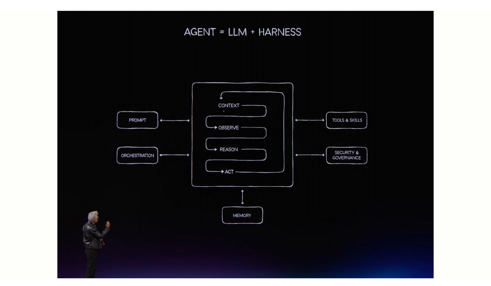
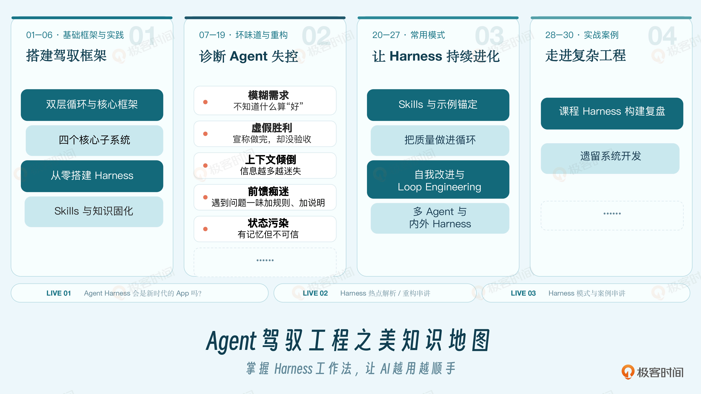
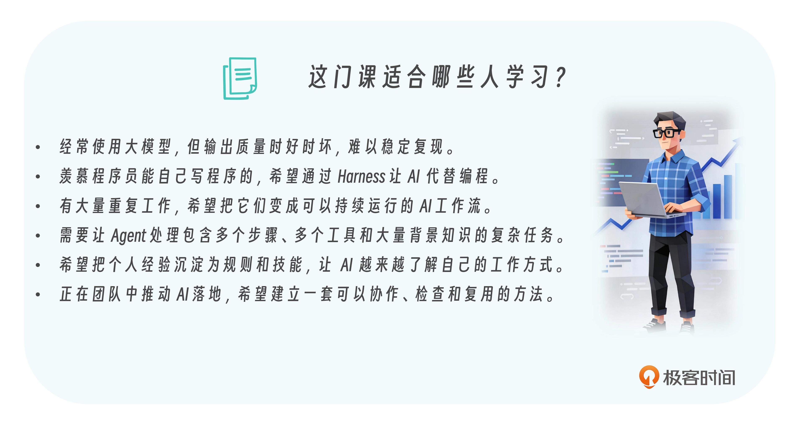

# 开篇词 | 驾驭工程：Agent时代必修课

你好，我是徐昊。欢迎和我一起学习《Agent 驾驭工程之美》。

多年以后，当你仅靠操作系统内置的 Agent，无需任何应用（App）便点好晚饭时，你将会回想起英伟达的黄仁勋为你介绍 Harness 的那个下午。那是 2026 年 6 月 1 日的台北，黄仁勋在向全世界宣布，个人电脑的操作系统将经历一次根本性的改变：存在了三十多年的“操作系统 + App” 架构将会被“操作系统 + Agent” 的全新结构取代。



这意味着你不再需要为每个功能安装一个专门的 App。想点外卖，不需要打开外卖软件、不需要注册账号、不需要学习它的界面。只要告诉操作系统内置的 Agent 你想吃什么，它就会调用必要的工具帮你下单。过去我们打开应用、点击输入，现在我们用自然语言告诉 Agent 我们的意图，Agent 生成代码或调用工具来产生结果。

而在整个新模式中，Agent 是一切的核心。它由四部分组成：大语言模型（LLM，LargeLanguage Model）、Harness、工具（Tools）和运行时（Runtime）。黄仁勋把大语言模型比作“大脑”，把 Harness 比作“身体”。大脑负责思考，Harness 负责连接一切，协调信息路由、管理记忆、调用工具。没有 Harness，大模型只是一颗会思考的头颅，无法真正行动。

这就是你第一次真正注意到 Harness，这个听起来有点奇怪的概念！

## Harness 真的有用吗？

或许时至今日，你对 Harness 也依旧懵懂，依然不知道它为什么能有如此魔力。

Harness 本意是马具。缰绳、马鞍、马镫、笼头，这些东西加起来叫 Harness。一匹马哪怕是的卢赤兔，它也不会知道你要去哪、该加速还是减速、在哪停下来。你得给它装上马具，得学会怎么用缰绳控制它。大语言模型就是这匹马。它越来越能跑。但它永远不知道你的意图、你的边界、你的标准。这些要靠你来告诉它，靠你来检查它，靠你来调整它。这就是 Harness。

那什么是 Harness 呢？先看一个简单的例子。比如你每周都需要写周报，你当然可以直接使用大模型：

```
帮我写周报，这是我这周做的事：上线了用户反馈功能、跟销售团队开了两次会讨论需求优先级、修复了 3 个
```

然后大模型洋洋洒洒回复了一篇。但你打开一看，上周还是一段流畅的文字，这周就变成了干巴巴的列表，风格完全不同。而且它完全不知道上周做了什么，每个项目都像是从零开始。来回折腾了半小时，最后还是自己动手了。

而构造 Harness 的话，则需要创建一个目录，在里面编写一个 AGENTS.md（这里面会包含很多你现在不了解的内容，但没关系，这不影响你复制它然后体验一下效果）：

```
## 周报编写
### 项目结构
reports/ ← 存放所有历史周报，按周归档
├── 2026-W01.md ← 第 1 周周报
├── 2026-W02.md ← 第 2 周周报
└── ...
### 工作流程
1.用户提供本周的工作要点
2.**阅读 reports/ 目录下最近 8 周的周报**，了解进展和风格
3.按规定的结构生成周报
4.**自动检查**：是否有至少 2 个亮点？亮点是否有数据？阻塞项是否有责任人？
5.以 Markdown 表格输出并存入 reports/ 目录，按周命名
6.如果没有之前的周报，则需要用户给出大致的项目背景和说明
### 结构
1.本周亮点（列出 2-3 个具体的成果，每个附带数据）
2.完成事项（列表，每行一个事项）
3.阻塞项（如有，注明责任人和原因）
4.下周计划（列表）
### 风格要求
使用客观陈述语气，避免"扎实推进""锐意进取"等套话
每个亮点必须有具体结果：什么、效果、数据
```

接下来可以通过 OpenClaw，Claude 或者 Hermes 这样的 Agent，将工作目录设置到这个目录。与 Agent 互动一下，就能感受到 Harness 带来的不同。特别是连续写几周周报的话，连贯性和一致性都会变得很好。

这就是最简单的 Harness，我们把一次性的提示词改成了可重复的 AI 项目。我们使用了几个基本手段：

- 项目仓库（Repository）：工作内容不仅仅存在于大模型中，也存在于文件系统中；

- 前馈（Feedforward / Guides）：周报的结构和风格要求；

- 反馈（Feedback / Sensors）：对周报结果的检查，几个亮点、有没有数据、阻塞项有没有责任人；

- 状态管理（State）：通过文件自动留存过往信息和上下文，在不同周报之间保持一致。

还描述了一个可重复的工作流，通过这样的描述，我们就能在重复的任务中驾驭 AI 生成周报的质量。当然，它背后的原理我们暂不展开，后面课程会细聊。

2025 年 Anthropic 做了一个更严格的对照实验。同一个模型，同一个任务，同一个提示词：“做一个 2D 复古游戏编辑器”。

- 第一轮，模型直接上，20 分钟模型认为做完了，核心功能完全不能用。

- 第二轮，给模型配了一个多 Agent 的 Harness：一个负责规划，一个负责生成，一个负责验收。6 小时，功能完全可用。

他们没有换模型，没有修改提示词。唯一改变的是为模型添加了 Harness。当然，词元（token）成本也多花了不少。

在无数个实际应用中，我们反复发现：再好的模型，对于复杂任务裸跑依然失败。Harness不是过渡期的权宜之计，它是伴随 AI 长期存在的基础设施。当然，现在我们知道，它除了是基础设施，更是模型的操作系统。

## 为什么所有人都要学驾驭工程？

驾驭工程就是构建 Harness 的能力，也就是驾驭 Agent 的能力。为什么要学呢？当然，最明显的理由是为了 AI PC，但是那要到 2026 年 12 月底才会真正推出，也需要一段时间才能让所有人都买得起。

但是，AI PC 的诞生向我们展示了一种趋势性：模型不再稀缺，真正稀缺的是能高效利用大模型的人。今天我们需要付费才用到大模型，未来直接会运行在我们的台式机、笔记本电脑甚至手机上。相当于人手一台法拉利，那么，问题就变成你能开到多快？

你可能会问：AI 不是要赋能每一个人吗？不是说有了 AI，大家的效率和能力差距会变小吗？

对于一次性任务，比如让 AI 去写一封邮件、润色一段文字、生成一张图，的确是这样的。提示词写得好不好会影响结果，但因为只用一次，花大力气打磨提示词的性价比不高。但真正的差距不在一次性任务，而在重复性工作。周报每周都要写，汇报每月都要做，每次接手新项目都要搭一套环境。如果 AI 可以持续稳定地提高效率，那么最终使用 AI 的效率差异就很明显了。

重复性工作的价值是累积的。为重复性工作搭好的 Harness，收益是每次执行都在累加。正是这种累积效应催生了一种新的工作形态：一人团队（One Person Team，OPT）。一个人借助AI 完成过去一整个团队的工作：搭好 Harness，Agent 负责执行，人负责检查和调整。一个人从具体任务到数据分析、项目跟进全部覆盖。

这样的改变在软件开发行业正在悄然发生，最近就有人亲身经历了从传统的 Pod 到一人团队的过程。

他的团队原有 8 人：前端、后端、基础设施、QA、产品经理、设计师。90 天内缩减到 3 个人。QA 的职能被自动化套件代替，产品经理和设计师变成多个团队共享。剩下的 3 个工程师每人覆盖过去 2-3 个角色。他们写代码的时间变少了，“驾驭 Agent 输出”成了主要的工作内容。他的公司在评估后认定，三个善于驾驭 AI 的工程师可以做之前六个工程师的事。

无独有偶，Meta 也围绕 Agent 对研发团队进行了重组。重组之后，员工与管理人员的比例达到了 50:1，而过去十年的标准是 8:1。

除了这些例子，我们看到越来越多的创业公司采用 OPT 模式，一些愿意尝鲜的企业也在积极推进这样的工作模式转变。也就是说，驾驭工程除了能够让我们更有效地操作 AI PC，有很大的几率，将会是我们未来的主要工作模式。这也是为什么我觉得，所有人都需要学习驾驭工程。

对于程序员，驾驭工程有一层更深远的意义。随着特定应用程序的消失，为 Agent 构造工具以及构造 Harness 系统，可能是为数不多的，留给程序员的工作了。

## 如何学习驾驭工程

驾驭工程不是写提示词的技巧，也不是编程能力，而是一种思维模式和工作习惯。

具体来说，就是当 AI 产出不满意时，不会再说“模型不行”或者“再改改 Prompt 试试”。停下一秒，问自己三个问题：问题出在哪一环节，是没提前说清楚（前馈不够），是没检查对（反馈不够），还是前一轮的结果没有被记住（状态丢了）？然后动手改的，不是 Prompt，而是对应的那个环节的 Harness。

对于非程序员的读者来说，可能有一个隐形的门槛。程序员的职业习惯，比如设计项目目录结构、版本控制、写测试，这些都是驾驭工程的基础。而非技术人员往往缺少这些习惯，用 AI更像是在碰运气。越早学会驾驭工程，就越早从“碰运气”切换到“有方法”。也就能比别人更高效地使用 AI 大语言模型，更早地适应未来的改变。

养成驾驭 AI 的思维模式和工作习惯。这门课就是围绕这个目的设计的。

整门课分成四个主要部分：先了解 Harness 的基本构造，再识别常见坏味道与重构手法，然后掌握常用模式，最后结合实战案例加深体会。



第一部分是基础框架与实践。我们会从双层操控循环和四个子系统开始，通过背单词Harness，一步步完成你的第一个可运行、可复用的 AI 工作系统。你将掌握如何把一次对话沉淀成文件、规则和技能，让有效经验不再随着对话结束而消失，而是能够内化为 Agent 的行事原则。

第二部分坏味道与重构手法，集中处理 Harness 的“坏味道”。从需求模糊、约定只存在于人的脑子里，到 Agent 假装完成、指令文件腐化、上下文倾倒、状态污染和环境缺失，我们会逐一拆解 13 类常见问题。学完之后，当 Agent 输出不稳定时，我们除了吐槽“模型不行”，终于有了可行策略，定位究竟是哪一环出了问题，并且针对性重构。

第三部分给出驾驭工程常用模式。我们会探讨 Skills、示例锚定、内部质量、自我改进、控制循环和多 Agent 编排，也会比较外部 Harness 与内部 Harness。到这里，你会逐渐形成一套自己的模式库，高效驾驭大模型。

第四部分进入综合实战。我选了两个经典案例做复盘和演示，分别是知识工程构建和遗留系统开发。你将看到一套 Harness 如何从需求、知识、工具和验证逐步建立起来，并掌握让Harness 持续演化、产生复利的思路。

这门课最终要教给你的，不是某个工具的操作方法，而是把意图、知识、检查标准和工作状态组织成一套可重复运行的系统。无论你是不是程序员，这都是与 Agent 长期协作时最重要的能力。

好，我们开始。


