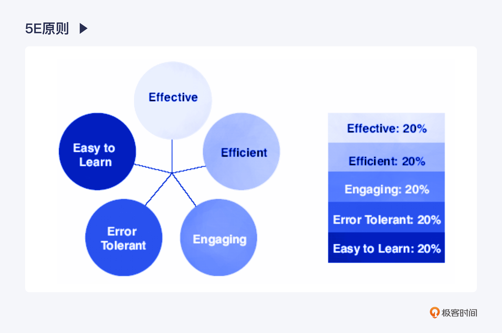
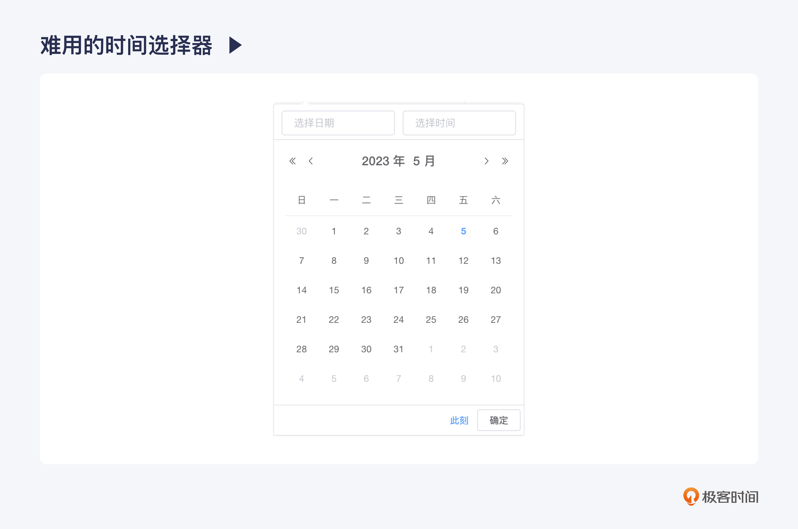
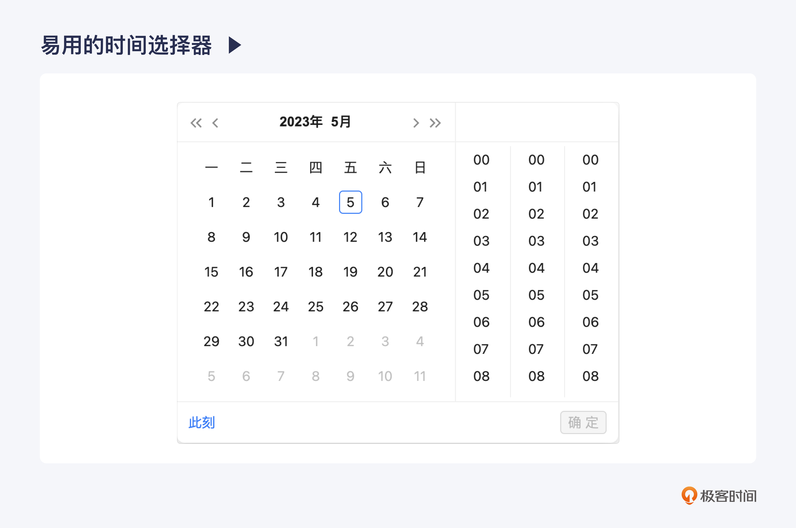
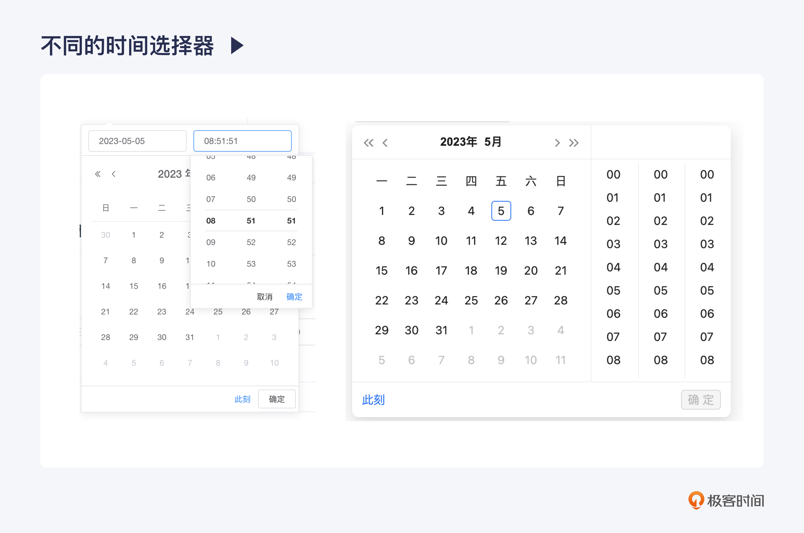
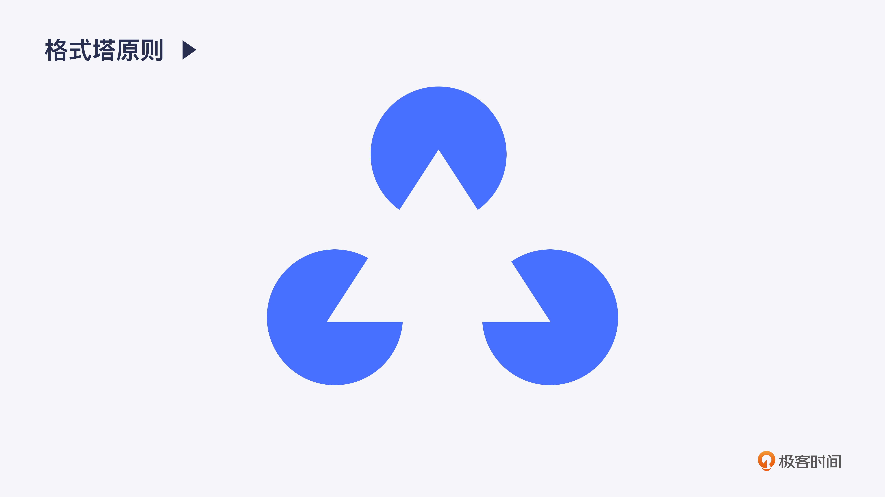
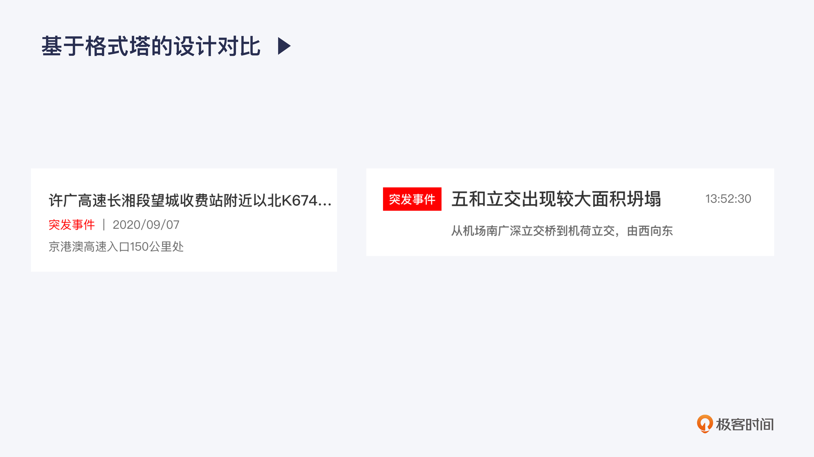
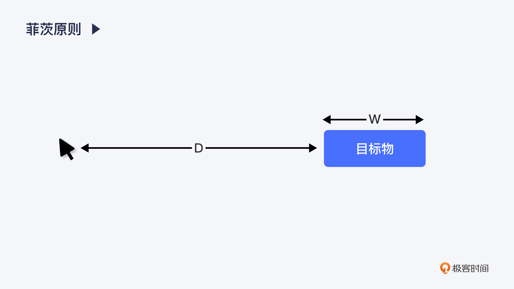
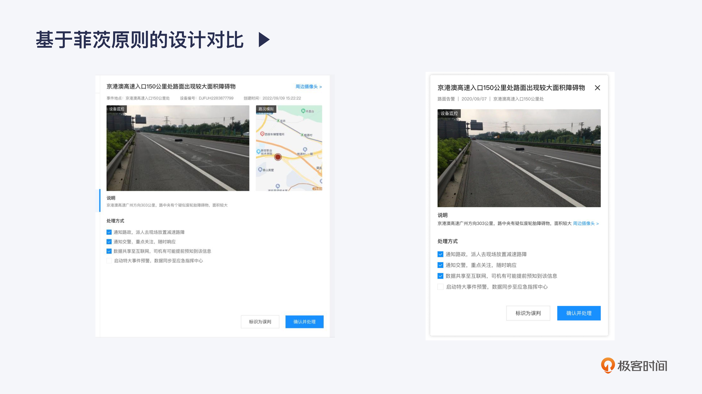
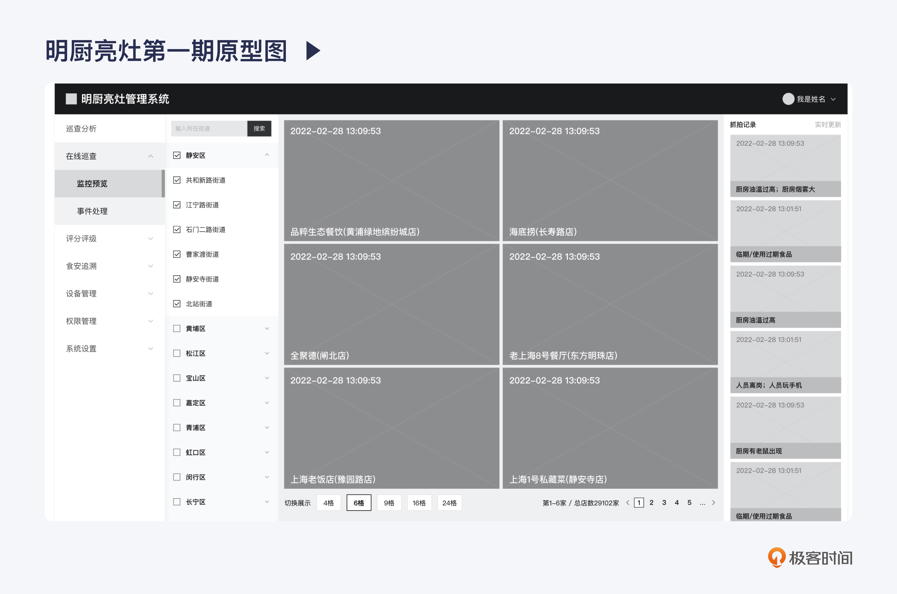
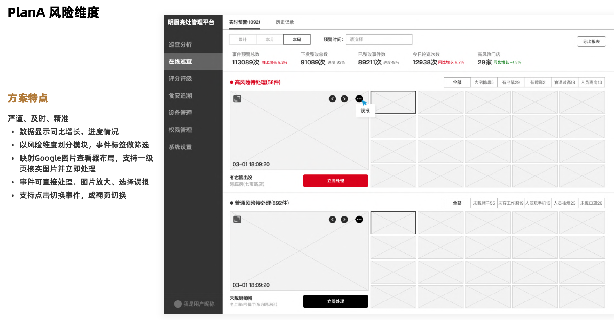

# 10 | 关键界面设计：被吐槽交互体验太差怎么办？

你好，我是汤圆。今天给你分享一个 B 端体验设计领域的经典问题：被客户吐槽体验太差。

很多做过 B 端体验的设计师都遇到过这样的问题，不管是做交互设计的，还是视觉设计的。我们在以前也遇到过很多次被客户吐槽体验太差的情况，后来总结出来一个结论：

不管你产品功能有问题，还是网络有问题，客户都会吐槽你产品体验很差。

也就是说，这里不一定是体验设计师设计的界面不够好，而是客户只管自己使用时的感受，只要感受不好，就吐槽体验差，只要看着不舒服，就吐槽视觉不好看。这就导致了体验设计师很容易成为“背锅侠”。

那么，怎么才能解决这个问题呢？今天我把这么多年积累的核心方法讲给你，相信对你入行 B端，或者在 B 端领域进行提升都能有所帮助。

这个方法核心可以分为两个方面。

1. 所有功能不要犯基础错误，保障在 6 分以上，不出现特别明显会被吐槽的地方。

2. 聚焦核心竞争力，打造体验亮点。这个亮点要做到 9 分以上，有了这个亮点，客户记忆中就只会记住好的，而忽视普通的地方。

## 第一，保障所有功能不犯基础错误

在界面的体验设计中，大部分被客户吐槽的地方，其实都是出现了一些基本错误。

想要保障基本不出问题，是有一些方法与原理的，其中最核心的有四个，分别是 5E 原则、格式塔原则、菲茨定律、多尔蒂门槛。

只要你在基于这四个方法原理进行体验走查，保障不出现相关问题，那么基本就不会出现被吐槽的情况。当然，在应用这些原理之前，你必须要按照用户的习惯来进行主要内容的设计，这部分在前面几章已经讲过，记得回顾哦。

### 5E 原则

我们先说说 B 端体验设计师必懂的原则：5E 原则。5E 原则是由尼尔森在可用性工程中给出的影响产品用户体验的五个关键要素，分别是易学性（Easy to learn）、效率（Efficient） 、容错性（Error tolerant）、有效性（Effective）、吸引力（Engaging） ，我分别给你介绍下五个属性相关的内容。

易学性（Easy to learn）是最重要的一个用户体验要素。

特别是 B 端的核心界面，对于企业中的执行者客户来说基本就是一个办业务的工具。凡是工具，都是需要学习的。比如我们作为设计师，不管是 Figma 还是 Photoshop，都是要学习后才能高效率使用。

所以在应用 5E 原则检查 B 端产品核心界面体验的过程中，第一重要的是易学性，必须要保障用户可以很轻松地学会，你的产品才不会被吐槽太复杂。

举个例子，在很多 B 端产品中，都会涉及选择日期与具体时间的功能，常见的一些日期与时间组件的设计，是先要点开日期，再在里面选择具体时间的，这个步骤很繁琐，并且很多人找不到在哪里选择时间，所以易学性很低。

而另一些组件设计师对这个功能进行设计优化，把时间选择放出来，并且和手机选择时间的形式类似，这样大家一看就能明白在哪里选择时间，整个组件变得简单易学很多。

效率（Efficient）。操作效率，对于 B 端核心界面的体验设计是第二重要的影响要素。

前面我讲解了 B 端组织结构的内容，在执行者或管理者层面，快速完成每天的工作，让自己有空闲的时间是所有行业的人都有的需求。

所以当你在设计 B 端产品的核心界面时，第二重要的就是界面布局的内容能不能让客户在执行业务的过程中效率更高。除非你的产品核心目标是帮助客户提高准确度或一致性，那么就可以相对忽视效率要素。但如果效率没有更高，甚至还降低了原有效率，那么你很可能就会被吐槽体验很差。

同样还是前面选择日期与时间控件的案例。当你把时间选择器隐藏起来的时候，选择的过程会多一步，效率自然就更低了。而放出来的形式，不仅更易学，效率也同样会更高，这就是一个一举两得的设计方案。

容错性（Error tolerant）。

B 端产品其实很多都是企业数字化转型过程中的产物，所以在这个过程，很多客户都是在使用新的工具去解决老的业务问题。而在这个过程中，客户都需要学习新工具。只要学习新工具，就可能会在使用的过程中犯错。

所以你在负责产品体验的时候，一定要保障客户如果误删了一些内容，或添加了不需要的内容，一定要有明确的撤销或回退功能，让客户在这个过程中不会因为用错了功能，而在业务中犯大错。

比如你要是不小心删除了 Photoshop 的文件，那么可能很难再找回来，而在 Figma 中，你误删了一些内容，都有历史版本的存档，随时可以找回来，不影响任何设计业务的处理。所以大家自然就会认为 Figma 的体验更好了。

有效性（Effective）要素在 B 端的核心界面中也比较重要。

作为体验设计师，你需要考虑的是用户打开界面想要看到的是哪些信息。比如做 CRM 的产品，在客户管理界面，客户希望快速看到与业务相关的信息。如果你设计的界面没有重点呈现这些内容，就可以说是呈现了无效的信息，这也非常容易导致客户觉得你的产品体验很差。

吸引力（Engaging）是最后一个考虑的要素。

在给管理者与执行者的界面中，这个要素不是非常重要，因为企业采购后他们必须使用，但在面对决策者设计的核心界面中却是非常重要的。特别是在一些展厅、展会中呈现的界面上，这些场景中展示的界面是影响决策者最终关注你产品的重要因素。特别是 B 端产品中经常提到的数据报表界面、数字大屏界面等内容，吸引力要素都需要排到最前面。

当你在设计 B 端产品的核心界面时，5E 原则是最基础的自我检查标准。保障这五个要素都没有问题时，你的界面体验就不会出现大的错误。但很多人不知道，还有另外三个原则，对 B端产品核心界面的体验也是非常影响的。

### 格式塔原则

格式塔原则是一个非常经典的设计原则。它是基于格式塔心理学发展出的描述人类感知的规则或原则。

在格式塔心理学说中，认为人类在本能上会把彼此相邻（接近性分组）、看起来像（相似性分组）或具有结构经济性（良好的连续性）的元素视为属于一起的自然倾向，从而促成了某些格式化的形成。这个假设就是格式塔原则的基础。

所以你在做 B 端产品界面的时候，也要考虑这个原则对于界面内容的影响，特别是在内容较多的情况下，就应该让相似的内容离得更近，无关的内容离得更远，用户体验才能得到提升。

比如我们之前的交通管理项目中设计的一些信息卡片。第一版设计只是信息的罗列，看着比较混乱，无法快速提取有效信息，不符合格式塔原则。之后的版本依据格式塔原则进行了优化，把事件名称、事发地点放到了一起，时间与优先级这类独立信息单独罗列，整个信息就会清晰很多，加快了客户的浏览效率。

### 菲茨原则

菲茨原则是 1954 年由 Paul Morris Fitts 根据信息类比提出的一个假设，该假设能够量化“移动到目标选择任务”这个操作的难度“1”。虽然这个假设还未涉及人机交互中的具体参数，却给了后来的交互研究人员极大的启发。

简单理解，就是你的按钮越大，后续点击要移动鼠标或手指的距离越短，你就会觉得越舒服。本质上就是人在操作工具的过程中都希望更省力，所以更短的距离、更大的按钮，能够更好地满足你省力的本能需求，自然就会觉得很爽。

而 B 端设计中，就经常需要应用这个原理。比如你会发现，很多界面的按钮越大越大，并且和相关内容的位置也越来越近，这就是基于菲茨原则发展出来的现象与结果。

比如我们在交通管理项目中也同样涉及了这类问题。在确定一些关键告警信息的弹窗中，第一版设计的“确定处理”按钮距离内容信息非常远，点击起来比较费劲。依据菲茨原则优化后的版本，缩短了确定按钮与信息之间的距离，提高了用户操作效率，也让界面变得更加紧凑、清晰。

### 多尔蒂门槛原则

最后，还必须要补充一个多尔蒂门槛的原理，这个是 B 端体验中经常被忽视，但非常影响客户体验的重要原理。

多尔蒂门槛，是 IBM 的研究员 Walter Doherty 在 1979 年进行了一系列研究来评估算力的增长对生产力的影响后得出的一个结论。这个结论的核心是系统需要在 400ms 内对使用者的操作做出响应，这样才能够让使用者保持专注，并提高生产效率。

简单来说，就是客户点击了你产品可操作的任何一个地方，都不要没有反应，并且要在400ms 中做出反应，不然客户就会觉得你这产品特别卡顿，感觉很糟糕。

这是 B 端产品界面的加载过程中经常出现的问题。因为 B 端产品的数据量相对较大，所以加载需要时间。你千万不要因为这个是技术问题就不管了，这实际上是一个体验问题，你需要用设计的方法去解决。

比如，在加载过程中应该马上出现 loading，并且 loading 还要不停地有动画，这样客户才会觉得产品有“反应”，不会感到很迟钝。如果在一定的时间里还没加载出来，你就要考虑加入新的引导来缓解这个问题了。

你看，设计是可以解决很多技术难题的，这也需要作为 B 端体验设计师的我们重点去关注。

只要满足了这些原则，你的产品基本就不会被客户吐槽了。但作为 B 端体验设计师，仅仅做到这些还是不够的，你的任务不是避免被客户吐槽，而是做出客户喜爱的界面体验内容。所以，你还要找到一个关键点，做出体验亮点。

## 第二，聚焦核心竞争力，打造体验亮点

在这里，你必须回顾产业链分析与时间链分析中得出的核心竞争点。有些项目是在效率上竞争，有些是在管控风险上竞争，还有些是在管理标准上竞争，每个业务的核心需求都有所不同，而你的体验，必须要聚焦到最核心的一个进行设计，而大部分 B 端产品都会聚焦到效率。

这里有一个误区：效率只和架构有关。其实不是的。我以明厨亮灶为例，给你讲解下通过聚焦核心竞争力打造体验亮点的方法。

大部分设计师在设计 B 端界面的时候，刚开始都会觉得是在做后台界面，很少会去想创新的事情。所以你会发现国内大部分 B 端产品的产品的界面，不是列表就是卡片，没有新意。

在我们进行明厨亮灶项目时，第一期的原型图也是非常中规中矩的，没有太多问题，也没有太多新意。

当然，这个事情的背景是大部分人没有看到 B 端产品做创新的价值，所以本质上没有动力去做这件事。

不过我在前面的课程已经给你分享了，B 端产品，特别是 SaaS 的核心在于复购率，而核心界面的体验设计就是复购率的重要来源。所以你必须要在关键界面的体验上做出创新，才有提高复购率的可能性。

在理解到了核心界面体验的价值后，我们团队在这里进行了大量的反复研讨，基于前期的分析，明确了明厨亮灶客户群中，“在线巡查”这个界面的使用是最高频的，并且在这个过程中，客户追求的是“快速处理完这些问题”。

复盘第一次的原型设计，我们发现把监控预览放在默认显示的位置，虽然当时市面上大部分产品都是这么做的，但预览的内容对于执行者实质上没有任何意义，而客户都追求效率，所以应该大胆去除这些信息，聚焦到处理业务的关键内容，也就是事件处理上。

于是我们就将监控预览与事件处理合并在了一起，并且聚焦到处理业务效率的方向上，对界面进行了新的内容布局设计。

在新改版的设计中，以业务目标为出发点，直接呈现了事件预警的结果。并且在界面中，以执行业务人员最关心的信息为核心内容呈现点，突出了系统检测到的事件发生时的照片，直接呈现了画面结果。在优化后，还可以呈现出更多业务人员在确定事件信息中需要的图片信息。

这样的界面信息布局，更好地为业务人员处理业务提升了效率，从而带来了整体的体验亮点。

所以，当你在设计 B 端产品体验的时候，要聚焦到业务人员本身的业务流程上，并且把处理业务需要的信息都集中到界面中，通过这样的界面体验设计，才能真正做出打动业务人员的体验亮点。

## 总结时刻

在 B 端产品的核心界面体验中，一定不要在基础的问题上出现错误。在你完成设计之后，要从 5E 原则中提出的易学性、效率、防错、有效性、吸引力五个方面进行检查，并且要注意 3个基础设计原则——格式塔原则、菲茨原则、多尔蒂门槛是否可能会出问题。

在这些基础问题都解决了的情况下，你的工作还没有完成，必须要在界面中做出一个体验亮点，才能真正做出打动客户的界面体验设计。注意，这个亮点一定要聚焦在客户处理业务的流程中，并且要更好地呈现出客户处理业务需要的信息，才能真正实现你的目标。

好了，今天的内容就到这里，希望你在以后的界面体验设计中，也能从被客户吐槽体验糟糕，转变成客户为你的界面体验设计点赞分享。

### 解惑 ToB 体验设计

你可以基于 5E 原则，举出一个 B 端产品界面犯的相关问题吗？

欢迎你在留言区和我分享，如果你觉得有所收获，也可以把课程分享给更多的朋友一起学习。我们下节课见！
