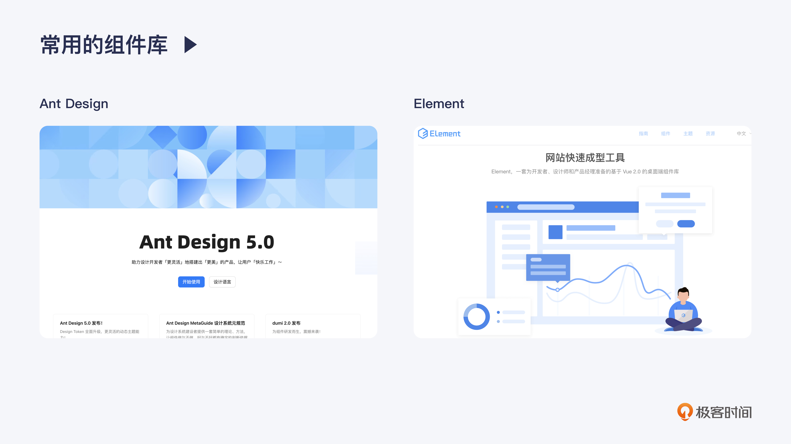
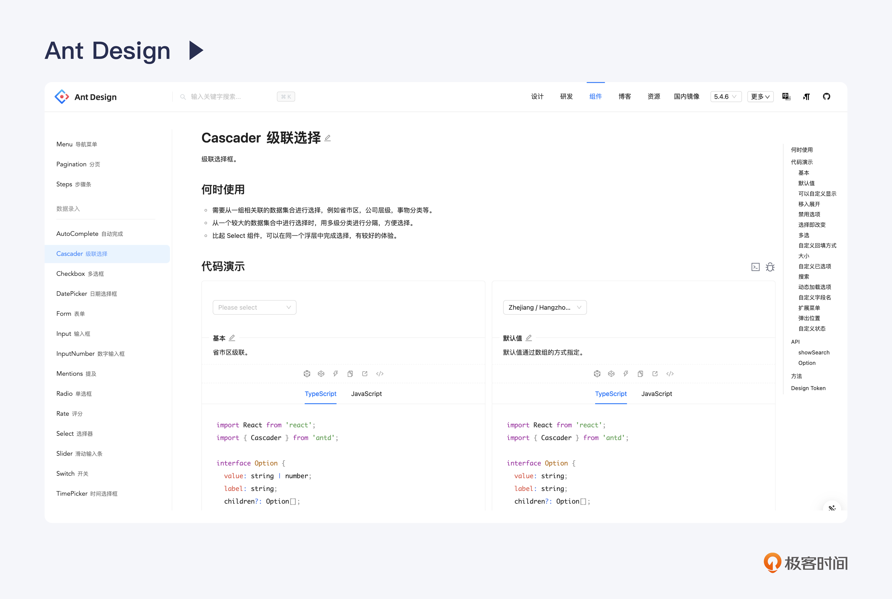
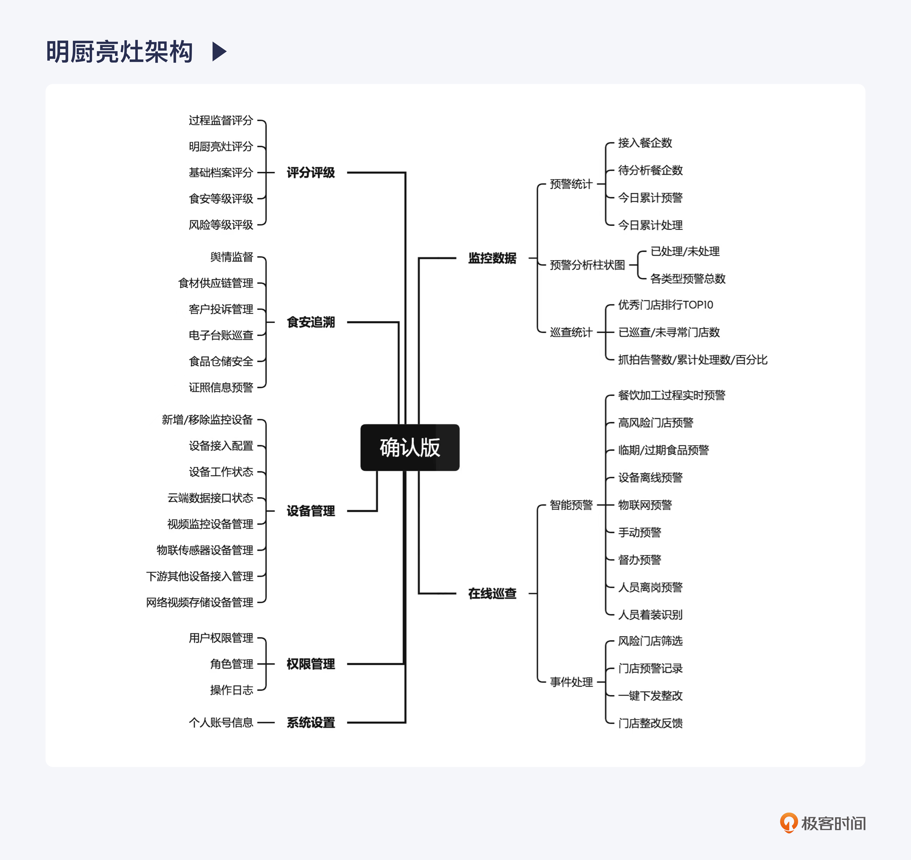
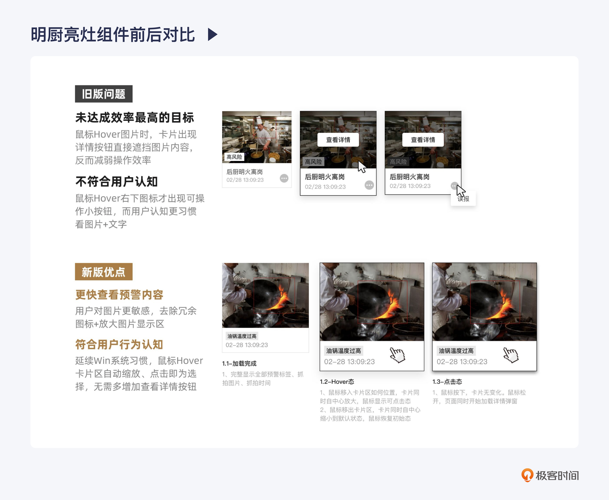
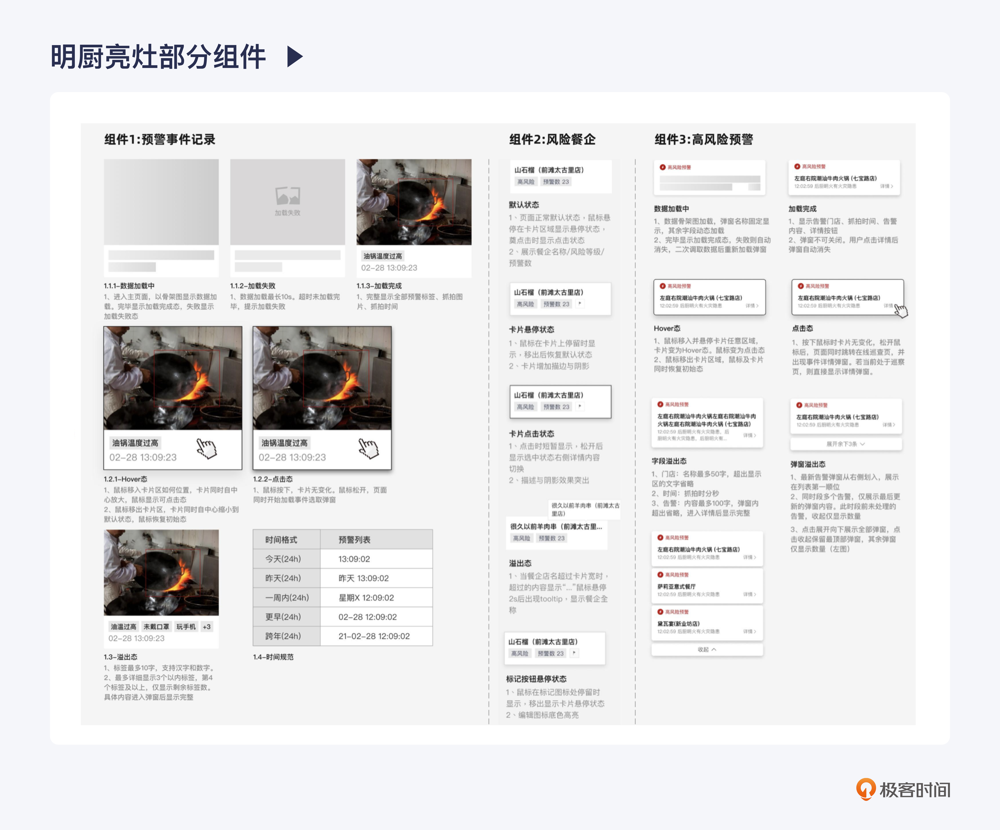

# 12 | 组件设计：定制化项目太多，不加班怎么做出好体验？

你好，我是汤圆。今天给你分享一个 B 端体验设计非常重要的内容，组件设计。

前面提到过，B 端产品的体验设计中会涉及大量的界面，少的有两三百个，多的上千个都是有可能的。但很多公司的设计师数量并不多，还有一些团队只有 2、3 个人。

这就让很多小伙伴在真正的设计过程中遇到一个问题：产品每半年要进行一次迭代优化，每次要改几十个甚至几百个界面，还都是改个颜色、改个按钮、改个文字内容这些琐碎的杂事，转眼半年过去了，除了改这些零碎的内容，真正的设计却没做几个，让自己感觉在 B 端体验设计的工作中毫无价值，浪费青春。

这是 B 端体验设计中非常典型的情况，大部分团队都有这个问题。虽然很多人都觉得 B 端体验设计非常重要，但在真正的情况下，根本没有时间来做体验设计，全在改细节的内容。

要解决这个问题，组件化是一个非常有效的方法。

接下来，我给你分享一下什么是组件以及组件化，以及 B 端体验设计中搞定有效组件的一些方法。

### 什么是组件、组件化？

先说什么是组件。组件最开始是开发人员在写代码时候，为了方便开发、节省代码空间而使用的一种方式。不同的语言中，叫法也不一样，在C++ Builder中叫组件，而在 Visual BASIC中叫控件。

你看，组件本身不只是设计人员使用的，更是开发人员一起配合使用的，所以这里面除了设计人员涉及的外观样式以外，还包含开发人员需要的数据源、对应交互以及相关动画等等内容。但设计师通常只关注组件的外观以及交互动画即可。

在体验设计的行业中，也经常有组件、控件的这些叫法。行业中有一些平台进行了标准的定义，但很难实际应用。这里我分享一下自己的理解，希望能帮你快速熟悉这些概念。

我习惯按照从小到大的颗粒度进行划分，来界定控件、组件这两个内容。

控件，通常指的是按钮、单选框这一类只有单个内容的控制内容。

组件，可以通俗地理解为多个控件组合在一起，比如你经常看到删除信息时弹出的二次确认弹窗，里面包含了确定按钮、取消按钮，有一些还有输入密码的文本框，这些组合在一起的控件，可以简单理解为组件。

前面提到，组件本身是开发人员为了节省工作而产生的，实际上，除了工作减负以外，对于设计同学，组件还可以非常好地保障产品的一致性。

虽然我们设计一个 B 端产品可能会有上千个界面，但实际上用到的组件可能也就三、四十个，并且里面有很多都是非常基础的，比如时间选择器等等。除非它在我们产品中非常重要，否则都不需要我们再次进行设计。

所谓的组件化，指的就是将很多设计内容组合在一起，统一进行设计的一种思维方式与开发方式。它将我们产品中像时间选择器、填写信息的弹窗这些复杂的、更独立的模块，都设计为一个个的组件，并且明确定义出每个组件的清晰功能，让这些内容在不同的功能中可以重复使用，从而提高设计与代码的可维护性、可重用性和可扩展性。

但是组件在落地的过程中却经常“变形”，成了为组件化而设计，而不是为业务赋能与提升体验而设计组件体系，方向跑偏了。

在 B 端行业发展的这十年时间中，有很多公司已经意识到了这个问题，并且为开发者与设计师提供了很多不错的基础内容。

这里给你分享两个开发与设计师都最常用的组件库，一个是蚂蚁金融旗下的Ant design，另一个是饿了么旗下的Element design。

对开发者来说，两个平台最早的差异在于使用的代码语言不同，但现在基本都一样了。而对设计师来说，大部分小伙伴更喜欢使用 Ant design，因为 Ant design 的设计说明、外观样式要丰富一些，便于设计师查看和阅读。

如果你准备入门 B 端体验设计，或者是刚入门不久的伙伴，我建议你一定要把这两个平台的组件设计内容全部看一遍，特别是其中展示的组件对应的效果。

你要熟悉这些基础规范中对组件使用场景的界定，以及组件对应的一些状态。这样就可以在真正设计 B 端产品的时候，直接应用很多成体系的组件，快速搭建出来一个体验不错的界面，不用每一次都自己再去想每个细节到底应该怎么设计才会更好，而是把时间都节省出来，去设计最重要的地方。

但是，熟悉这些内容只是 B 端体验组件设计的起点，真正重要的是如何在这些基础之上设计出有效的 B 端组件体系。

### 如何搭建有效组件体系？

在 B 端组件的落地过程中，一定要注意把组件看成一个体系，而不是一个个单独的内容。你需要在 Ant design 这类基础组件的基础上建立真正适合目前产品，甚至多个产品的组件体系。

这里也普及一下组件体系的概念，组件体系指的是由多个组件构成的一个整体组件库，像 Antdesign 这样的库，实际上就是一个组件体系。

很多 B 端产品都会随着时间的推移形成自己独有的组件库。因为每个 B 端产品都有自己的行业特性，而每个行业都有自己独特的内容。比如明厨亮灶，我们针对这个系统，就需要在 Antdesign 这样的基础组件库的基础上，搭建卫生监管相关的组件库，比如告警处理组件、事件查看历史组件等等。随着时间的推移，我们就逐渐形成了自己在卫生监管与视频识别领域的独特组件体系。

通常行业特有的组件体系，都是客户高频使用的功能内容. 因为行业组件都是基于业务专门设计的，而客户使用你的产品就是为了更好地解决业务问题。所以，你搭建起针对行业的组件体系时，就等于找到了影响客户体验 80% 的产品内容，而这个关键的组件体系，就是你要不停打磨好的体验设计内容了。只要把它们做好了，你的产品体验就能得到非常大的提升。

建立 B 端实用的组件体系可以分为两步。

第一，基于产品最核心的业务，通过前面 3C 分析得到结论，找到最高频使用的功能。

大部分 B 端产品，最高频的功能中最常用的那个组件，都是需要重要重点设计的。比如明厨亮灶的案例中，处理预警信息就是最重要的业务，所以对于预警信息的组件，需要进行最细致的设计。

并且需要对组件内容进行不断地优化，因为你的客户有 80% 的时间，都在主要使用这个功能，通过优化这个高频组件，可以保障你的产品体验在行业中一直处于领先的地位

第二，你要从信息架构开始检查，哪些地方的组件是经常复用的。

在前面的课程中，我给你分享了 MECE 的架构设计思维，我们就是以这个架构为基础去检查的。

比如在明厨亮灶的案例里面，从信息构架上看，在线巡查的模块中有智能预警等内容，那么必定会产生很多的预警记录，而在评分管理中，厨房的评分有一部分因素是与预警的次数相关的。所以在评分评级的模块中，也需要查看预警记录的信息。这个“预警”就是复用的部分。

所以，通过对构架的分析与观察，你可以初步了解有哪些地方会重复使用同样的信息，如果重复次数较多，那么你就要考虑将它进行组件化，这样就可以有效地节省工作时间，保持产品体验上的一致性。

在建立组件体系的时候，要记住二八原则。真正影响客户体验的内容通常只有 20%。找到高频使用与复用较多的组件后，要以这些组件为核心内容进行设计，不要去把所有组件都做一遍，最后做成了一个大而全的组件体系。

大而全是没有意义的，你只会得到一个平庸的结果。一定要聚焦到高复用度、高使用频率的组件上，才能真正做出有业务价值的组件设计。

### 如何设计出体验优秀的组件？

在明确了你要做哪些组件后，还需要对客户高频使用的组件进行非常细致的设计。一定要结合前面给你分享的 3C 分析得到的业务目标，以及客户认知分析中了解到的客户偏好，才能把组件设计做的到位。

举个例子，在明厨亮灶项目中，旧的版本就是没有将效率导向的业务目标作为核心设计方向，出现了“查看详情”按钮与信息标签出现在图片上这样的设计，而在新版的设计中就行了对应的优化。

在完成了设计的基础之上，你还需要对组件进行详尽地状态描述，输出对应的交互文档。这里给你分享一个书写文档非常有效的步骤，参考这个步骤，可以保障你输出的内容万无一失。

步骤是按照计算机对信息梳理的顺序来书写的。当你在书写的组件状态的文档时，要从没有组件的状态开始，也就是我们经常说的“加载态”，到组件与内容信息加载出现后，按照未选择（常态）、鼠标移入（hover 态）、鼠标按下（点按态）、选中态的顺序书写。

这样的顺序书写加上相应的视觉、交互效果，就能保证你的组件文档非常全面了。再给你分享一个明厨亮灶项目的内容，作为参考。

### 总结时刻

这节课，我给你分享了 B 端体验设计落地中最重要的一个环节：组件设计。

要记住，在你开始做 B 端体验设计工作之前，一定要熟悉市面上常用的组件库，比如Antdesign、Element design 这些库的内容，要注意了解组件库中描述的每一个组件的适用场景，并且熟悉每一个组件的对应状态。这样你在做 B 端体验设计的时候，脑海中就能快速反应出来哪些地方应该用什么样的组件是最合适的，从而节省设计时间，避免很多错误。

不过，了解组件库只是一个开始。你需要基于自己的产品，洞察业务中高频、高复用度的组件内容，才能搭建出来真正合适你产品或产品系列的组件库。在落地自己组件库的环节中，也一定要记得二八原则，找出真正影响大部分体验的 20% 的组件内容，去细细打磨。

打磨的方法，其实就是基于前面给你分享的 3C 分析找到的业务目标，以及客户认知分析中得出的客户使用习惯与审美习惯偏好，不断地进行优化，才能保障你产品的体验设计一直处于领先地位。

### 解惑 ToB 体验设计

你认为 Ant design、Element design 这样的组件库中，有哪些组件设计得不合理吗？为什么？

期待你的分享，如果觉得有所收获，也可以把课程分享给更多的朋友一起学习。我们下节课见！
