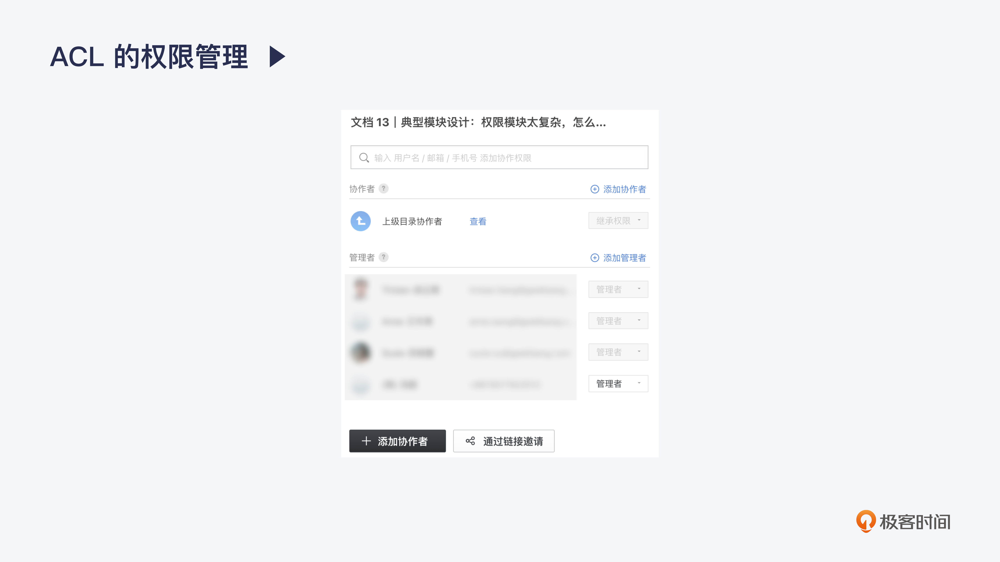
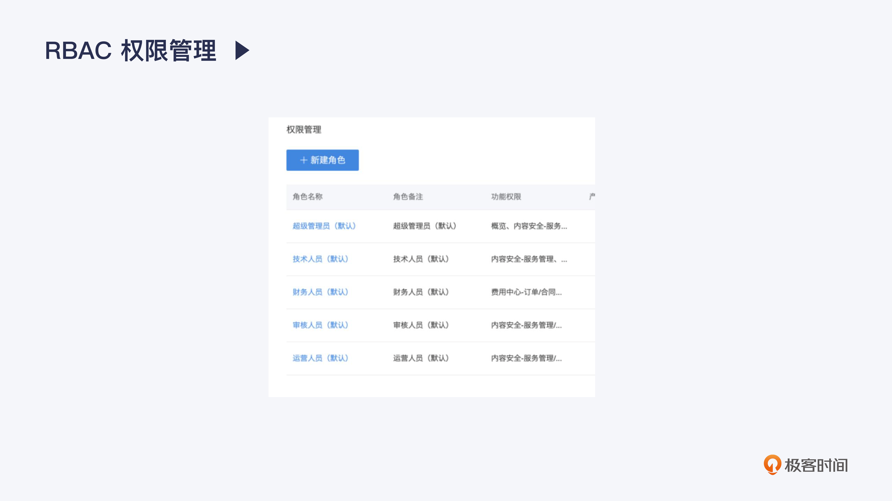
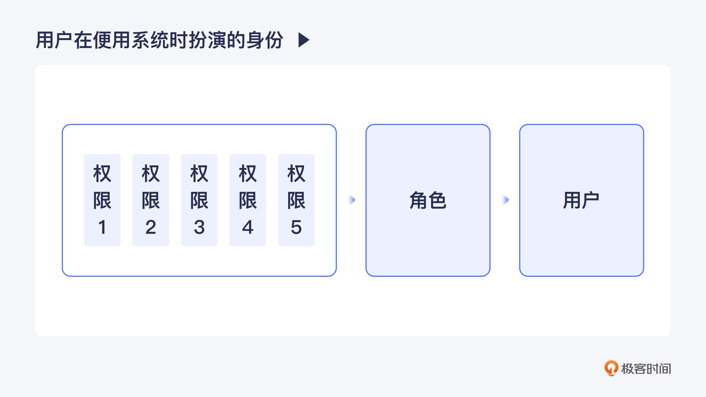
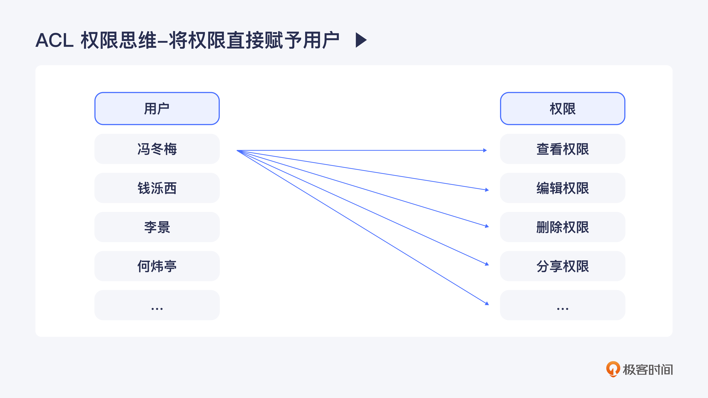
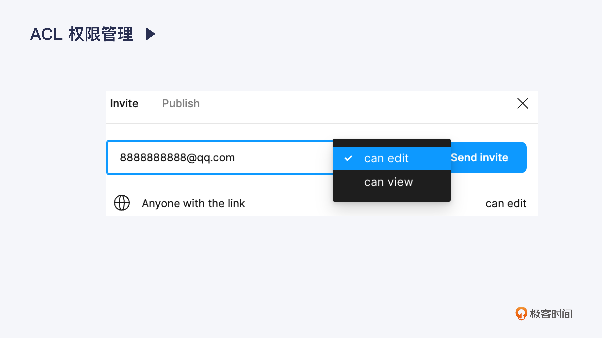
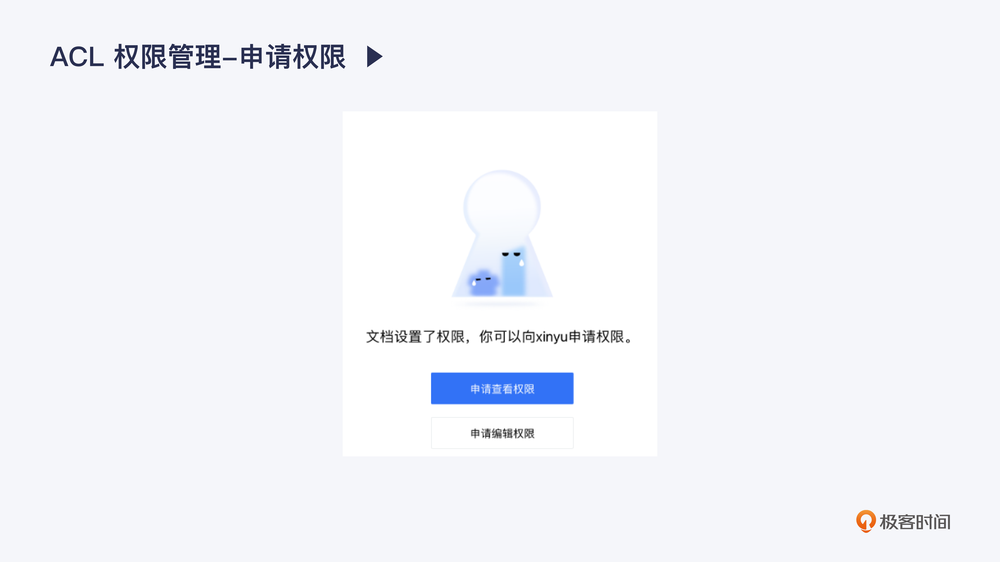
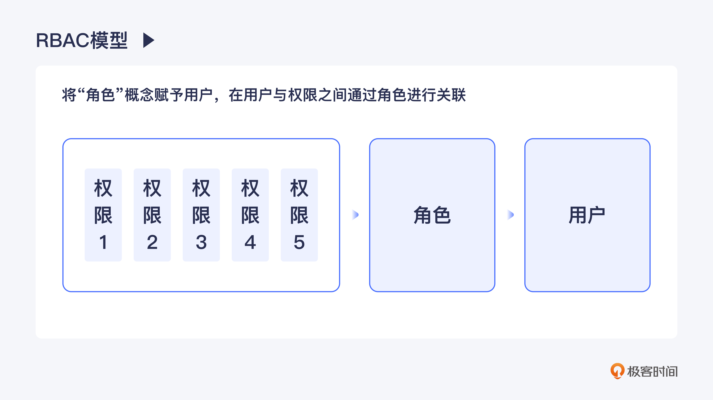
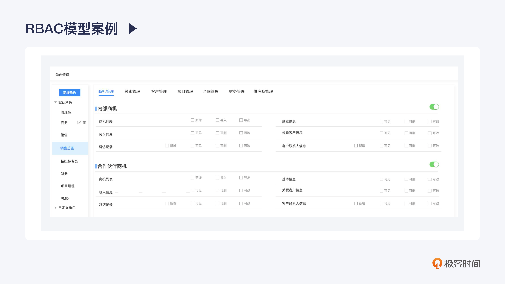
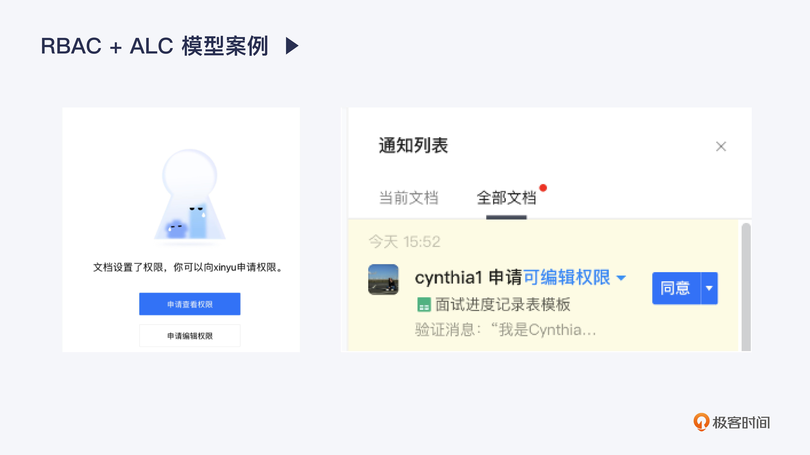

# 13 | 典型模块设计：权限模块太复杂，怎么才能做出好体验？

你好，我是汤圆。今天给你分享 B 端体验设计一定会涉及的功能，权限模块的设计。

前面给你分享过我对 B 端设计的定义，是基于产品是否具备组织结构来定的。而产品一旦匹配了组织结构这个关键因素，就一定需要一个面向组织内部的权限管理模块。

我们要理解的是，一个组织是涉及多个人、多个级别、多个职责的，组织中的信息也都是非常重要的资产，不是每个人都能看到的。只有做好人员相关信息与功能的对应管理，才能让 B端产品在企业中真正顺利地用起来，而不用担心信息安全这样的基础问题。

可以说，做 B 端产品体验的设计一定会涉及对权限功能的设计。

问题来了。一方面，B 端产品的功能较多，里面的数据信息又通常比较繁杂；另一方面，设计的过程中基本无法参考竞品的功能，因为权限功能必须基于产品已有的内容。这就要求我们相对熟悉整个产品的功能，才能真正理解权限发挥的作用到底是什么。所以很多以前只做过 C端的伙伴在做权限模块的时候，就不知道应该怎么做才合适了。

不过不用担心，我总结了一些权限设计的通用方法，加上典型案例的辅助，一定能够帮助你快速解决权限设计中的体验问题，帮助你跨过从 0 到 1 这个最关键的门槛。

## 权限模块的两种常用思路

权限模块在行业中常用的思路有 2 种，分别是 ACL（Access Control List，基于访问权限管理）、RBAC（Role-Based Access Control，基于角色管理），其中 RBAC 是最常用的一种，这里先给你做一个思维的普及。

### ACL 权限管理思路

ACL（Access Control List）指的是基于访问控制列表的权限管理方式。这种方法是将权限分配给特定用户或用户组，允许或禁止对应权限的账号访问特定的资源。

比较经常见到的就是我们常用的腾讯文档、figma、石墨文档这类软件。比如我正在写文章用的石墨文档中，就是 ACL 的权限管理方式。

这种方式比较简单好学。它比较适合组织结构较为简单的团队，通常用在一些对权限管理要求较低，并且业务中通常只需要直接对单个人员进行权限管理的产品中。相反地，对于大型系统来说，这种方式就会显得难以维护了。

### RBAC 权限管理思路

大部分 B 端产品常用的是 RBAC 的管理方式。RBAC（Role-Based Access Control）是基于角色的、控制访问的权限管理方式。这种方法是相对复杂一些的 B 端产品最常用的方法，也是做 B 端体验设计师必须要掌握的权限设计方法。

RBAC 的关键是在权限管理体系中建立了“角色（Role）”这个概念。与组织结构中你所在公司扮演的角色对应起来，这个“角色”非常灵活，可以完全按照客户组织内部的部门、职级、职责等方式归类。

比如你经常看到 B 端产品里面有“超级管理员”“高级管理员”“普通用户”“外部用户”等等这些“角色”。这些超级管理员、普通用户的角色分别能用什么功能、能看哪些级别的数据等等都可以先设置好。只要新建了账号，就给你的账号设置好角色，那么对应的功能、信息都会一次性开通，省去了大量的时间。

如果你的组织有一万名员工，组织有所变动的话，那么只需要对角色进行设置，就能统一管理这个角色下几百甚至上千员工的权限了，省去了很多繁琐的工作，避免了遗漏与错误。

RBAC 的核心思路，就是将权限分配给用户的角色，而不是直接分配给用户本身。这使得权限管理更加灵活，因为可以将角色分配给多个用户，从而更容易管理权限。当然，角色的设置非常灵活，所以相对来说是复杂的，但因为灵活的角色设置可以适配大部分复杂的 B 端企业需求，所以 RBAC 成为了 B 端产品非常常用的一种思维方式。

## 权限设计的三个要素：人、功能、信息

在了解了角色这个概念之后，还有三个关联的信息是做权限体验设计必须了解的，也就是人、功能、信息相关的权限设置概念。

人、功能、信息，这三个内容，基本就涵盖了做权限设计所需要的全部信息。我们还是基于ACL 和 RBAC 两种方式来看。

### 基于 ACL 的人、功能及信息设计

ACL 是一种相对直接、简洁的方法，是对人和功能进行限制，而信息权限和人（也就是账号）绑定在了一起。如果你的账号对一些信息（文件）有权限，那么你就一定可以看。但是这里要注意，一定是只可以看，而不能对文件内容进行编辑与删除甚至新增。

所谓的编辑与删除，甚至新增，都是“功能”的范畴。所以在 ACL 的形式下，客户还需要对已经有访问权限的账号（也就是人），进行功能权限的单独设置。如果不设置可以编辑或删除的权限，通常这个账号就是只能查看文件内容的。

相信讲到这里，你的脑海中也想起了很多产品。比如腾讯文档、Figma、石墨文档等等，都是这样的权限设置方式。甚至很多伙伴都遇见过一些尴尬时刻，就是在给领导分享在线文档的时候，忘记开查看权限或者编辑权限，导致领导反过来要你申请权限，搞得气氛很尴尬。

### 基于 RBAC 的人、信息及功能设计

在更加复杂的 B 端产品中，如果我们使用了 RBAC 的形式，会对人、信息、功能产生什么样的影响，又该怎么做出优质的体验呢？

首先，RBAC 需要设置角色，角色里面一定会包含对功能的设置。

举个例子，一些 ERP 系统（Enterprise Resource Planning， 企业资源规划系统）中可以划分出销售、销售总监这样的角色。那么在设置角色的时候，就可以对销售总监所具备的角色设置对应的功能。

比如对内部，商机是可以导出的。而普通销售人员因为流动性比较大，商机也是公司重要的资产，所以导出功能就不能轻易开放给普通销售人员，那么在设置权限的时候，给普通销售人员配置的角色，就要注意去掉导出功能的权限。

这样，随着客户公司中的销售人员级别的上升，权限也就随之上升，但管理员操作起来非常简便。不然，想象一下一家有上千人，甚至上万人的公司，每天都有很多人员变动和职级变动，如果要一个个设置，那一定就会耗费大量的时间。而基于角色进行设置，只需要对相关的账号（人）修改一下角色就可以了，非常高效。

但是这个方法也有个缺点。在下面的图片示意中你可以看到，在设置角色时，前期需要做非常多，非常精细的工作，把角色和公司的组织结构对应上，然后还要在 B 端产品中把每个角色的功能权限一一对应，才能让后面处理人员的级别、部门变动非常高效。

在通过角色（人）将功能打包设置完之后，还有一个内容需要你关注，就是信息的权限。

通常在大型的企业中，信息安全都是件非常重要的事儿，需要严格地进行管理。前面说到了角色可以帮助上千人甚至上万人的大型企业提高效率，但这也只是对功能的设置进行效率提升，对于信息方面还没有明显的帮助。所以，体验设计师也需要重点考虑对于信息的设置。

通常企业的信息管理还是跟着账号走的，这个逻辑与 ACL 的基本类似，所以可以采用 ACL的形式单独给账号设置信息的权限。

比如前面提到的商机管理功能。对于销售人员来说，因为角色中已经提前设置好了这个功能，所以他可以看到商机管理这个功能。但是，商机管理功能中会包含很多的商机信息，其中不乏一些非常重要的商机，这些不一定是所有人都有级别看到的，所以，还需要对不同的信息进行级别划分。一些重要的信息，可能销售人员可以在商机列表中看到它的名字，但点击进去就会显示无法查看，需要申请权限之类的提示。

这个时候，作为体验设计师的你既要考虑企业对于信息安全性的诉求，又要考虑业务效率与产品体验。那么就要去思考如何做体验才能更佳了。

这里有两种常用的方式。

一种是参考 ACL 的方式。在无权限的提示下，直接给出申请按钮，提高操作效率。这里要同时考虑到组织中申请流程的情况，在对应的管理员侧设计出相关的、明显的通知，提升业务的处理效率。

另一种方式是公司侧会把信息划分为非常保密、普通保密、公开三个级别，这些也是和公司组织结构中的职级对应上的。那么在做角色配置的时候，就可以将角色所属级别具备的信息权限给匹配上，这样就可以快速解决大部分情况下公司成员阅读信息的问题。

## 总结时刻

B 端产品中设计的权限有人员、功能、信息三类内容。

对于几十人或上百人这类小型企业的 B 端产品，在设计权限的时候更适合使用 ACL 的方式来提升体验。ACL 是对每个成员直接进行权限设置的一种逻辑。这种逻辑在对单个人员设置权限的时候具备更高的效率，但却不适用于成员较多的情况。

RBAC 的方式更加适合针对上千人甚至是上万人打造的 B 端产品。它的核心是具备角色的概念，通过设置不同的角色，将功能和信息权限进行“打包”，然后直接给多名成员分配对应的角色；这对组织人员较多，而且职能、职级经常变化的客户来说，可以很好地提升业务效率。

如果你所做的 B 端产品，客户公司一般只有二、三十人，那么 RBAC 这种方式是非常不合适的。它会给客户带来大量的前期工作，但因为人少，后期也不会太高频的去修改角色，所以会造成很多工作时间的浪费。

最后你可能想问，不是说做好体验吗？为什么一直在说权限设置的逻辑？

这是因为，权限体验的设计，最核心的是选择对应的方式，而不是局限在某个界面的布局上。这需要你依据产品所面对的客户中员工的人数、对信息安全的要求严格程度等来选择不同的方法。

ACL、RBAC 只是两种最常用的方法。如果你在做产品的时候发现这两种方法都不能有效地提升业务效率，从而提升产品体验，那么就应该基于产品和业务本身的特性再进行优化，找到一种更好的权限配置形式，从而提升产品的体验。

## 解惑 ToB 体验设计

你觉得像悟空、销售易这类 CRM 产品，应该使用 ACL 还是 RBAC 的方式呢？为什么？

欢迎你在留言区和我互动。如果觉得有所收获，也可以把课程分享给更多的朋友一起学习。我们下节课见！
