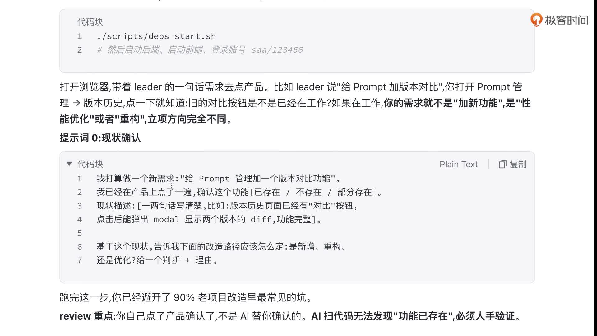

# 21 | 实操课：一次完整改造的全流程演示+验收复盘

你好，我是 Robert。

这一讲是第四部分的收尾。前面 17-20 讲每一讲做一段，这一讲把“接到一句话需求”到“前端跑通可提 PR”的所有动作连起来跑一遍。从“leader 给你一句话”到“需求文档 + 改造方案 + 后端代码 + 测试 + 前端跑通 + docs/ 全部同步更新”。

这是一节实操课，视频演示。提示词都在下面，你可以打开 Claude Code 照着跑。跑完你的项目里就有一次完整的改造闭环。



还有一件事必须开篇提示：20 讲我做过一次复盘，确认我和 AI 一起做了一个本来不需要做的功能（项目里其实已经有版本对比了）。这个翻车留下了一条新的硬约束：任何改造开始之前，先打开产品点几下确认现状。

## 准备

17-20 讲的准备工作都做完了：项目跑通（13 讲）、护栏到位（14-16 讲）、CLAUDE.md 写好（10 讲）、docs/ 资产齐全（08-09 讲）。

如果你跳过了前面直接看这一讲，先回到 16 讲跑一遍实操，确保有一个跑通且测试覆盖到位的项目。否则后面所有提示词的“基于 docs/…”都没有素材。

```bash
cd spring-ai-alibaba/spring-ai-alibaba-admin
```

在项目根目录启动 Claude Code，所有提示词都在这里跑。

## 改造前的硬约束：先点产品确认现状

这一步是 20 讲复盘留下的硬约束，比所有提示词都重要。

任何改造任务开始之前，先打开生产环境点几下，确认你以为要做的功能是不是真的不存在。

```
./scripts/deps-start.sh
# 然后启动后端、启动前端、登录账号 saa/123456
```

打开浏览器，带着 leader 的一句话需求去点产品。比如 leader 说“给 Prompt 加版本对比”，你打开 Prompt 管理 → 版本历史，点一下就知道：旧的对比按钮是不是已经在工作？如果在工作，你的需求就不是“加新功能”，是“性能优化”或者“重构”，立项方向完全不同。

提示词 0：现状确认

```
我打算做一个新需求："给 Prompt 管理加一个版本对比功能"。
我已经在产品上点了一遍，确认这个功能[已存在 / 不存在 / 部分存在]。
现状描述：[一两句话写清楚，比如：版本历史页面已经有"对比"按钮，
点击后能弹出 modal 显示两个版本的 diff，功能完整]。
```

- 基于这个现状，告诉我下面的改造路径应该怎么定：是新增、重构、还是优化？

```
给一个判断 + 理由。
```

跑完这一步，你已经避开了一个老项目改造里最常见的坑。

review 重点：你自己点了产品确认了，不是 AI 替你确认的。AI 扫代码无法发现“功能已存在”，必须人手验证。

## 场景一：把一句话需求拆成需求文档

```
对应 17 讲。产出 docs/requirements/prompt-version-diff.md。
```

提示词 1：六维拆解

```
我有一个新需求：给 Prompt 管理加版本对比功能。
GET /api/prompt/version/diff？promptKey=xxx&versionA=v3&versionB=v5
返回两个版本的 diff 结果。
读 docs/ 下所有资产 + CLAUDE.md，再扫一下代码里现有 Prompt 版本
相关的实现(PromptVersionController、PromptService、PromptVersionEntity)，
```

- 按以下六维写需求文档草稿：

```
1. 业务目标(一句话)
2. 用户场景(典型场景 + 痛点)
3. 接口契约(方法、路径、入参、返回、错误码，对齐项目现有风格)
4. 边界场景清单(至少 8 条 edge case，每条标"基于代码推断"或"待产品决策")
5. 老项目约束(CLAUDE.md 禁区和历史包袱里相关的，每条标 CLAUDE.md 来源)
6. 不在这次范围里的事(先列候选)
输出 markdown，保存到 docs/requirements/prompt-version-diff.md。
```

产出：六维草稿，覆盖 70% 内容。

review 重点：六维都填上了、边界场景至少 8 条、老项目约束都有 CLAUDE.md 来源、“不在这次范围里”有候选清单。

提示词 2：人审核三个判断 + 让 AI 出定稿

review 三件事：业务目标方向、边界场景的产品决策、不在这次范围里的事。其他维度（接口契约、老项目约束、技术边界）AI 写的直接用。

review 完把三个判断打包反馈：

```
我对 docs/requirements/prompt-version-diff.md 做了三个判断：
业务目标修正：从"工程师 review 自己的修改"改成"团队多人协作下的
Prompt 演进追溯"。diff 结果要返回 versionA/versionB 的元信息
(创建时间、状态)不只是内容。
```

- 边界场景的产品决策：

```
- E04(template 为 null)：null 视同空字符串
- E07(已软删除)：允许查 diff
- E08(LONGTEXT 超大)：本期不做大小限制
- E09(版本号大小写)：不在应用层 toLowerCase
- E10(高并发)：本期不加缓存
```

- 不在这次范围里的事最终决策：

```
- 砍掉：后端生成 unified diff、跨 promptKey 对比、N 版本对比、
 diff 缓存、versionDescription diff、权限控制
- 留到下期：diff 导出、一键比对上一版
按以上判断更新文档，整理为正式 PRD 格式，保存到原文件。
```

产出：定稿的需求文档。

跑完场景一，需求文档定稿。20 分钟。

## 场景二：把需求文档拆成改造方案

```
对应 18 讲。产出 docs/requirements/prompt-version-diff-solution.md。
```

七个提示词跑完。

提示词 3：摸链路（含前端）

```
基于 docs/requirements/prompt-version-diff.md 的需求，扫一下代码：
- 找出这次改造涉及的完整链路(HTTP 入口到 DB)
- 每个节点说明：文件、状态(现有/新增/修改)、关键逻辑
- 不要漏前端节点(页面、组件、API、类型声明)
输出表格 + 链路图，保存到 docs/requirements/prompt-version-diff-impact.md。
```

review 重点：前端节点列得对不对、链路完整性。

提示词 4：列改造点

```
基于上一步的链路，把改造拆成具体改造点列表(P01， P02， ...)。
后端 / 前端 / 测试 / 文档都列出来，每条标类型 + 文件路径 + 一
句话改什么。追加到 prompt-version-diff-impact.md。
```

review 重点：前端列得齐不齐、测试有没有列。

提示词 5：画改造流程图

```
基于改造点，画一张改造流程图(mermaid sequence diagram)。
要展示：用户从前端发起请求的完整调用链 + 数据流。
保存到 docs/requirements/prompt-version-diff-flow(mermaid 代码块)。
```

review 重点：前端到后端的调用链完整、数据流画清楚。

提示词 6：说影响范围

```
基于改造点和流程图，说明影响范围(每条标"高/中/低"风险)：
1. 现有接口受不受影响
2. 现有调用链路受不受影响
3. 测试影响
4. 文档影响
5. 前端兼容性
6. 性能影响
```

- 输出表格。

review 重点：风险等级合理吗、有没有漏的影响项。

提示词 7：说改造步骤和顺序

- 基于改造点和影响范围，给出改造步骤和顺序：

```
- 按依赖关系排序，后端在前、前端跟上、测试穿插
- 每步说明：做什么、依赖、工作量、关键决策点
- 没有方案分歧的步骤直接给一个方案，不要硬凑多方案
```

- 输出表格。

review 重点：关键决策点准、前端步骤的“前置依赖”对（前端不需要等后端全部完成，有mock 就能并行）。

提示词 8：整合成方案文档（关键决策单独抽出来）

- 把前面五步的产出整合成完整方案文档：

```
1. 一句话概要
2. 涉及链路
3. 改造点清单
4. 改造流程图
5. 影响范围与风险
6. 改造步骤与顺序
7. 待审核的关键决策点(单独抽出来，方便人 review)
第 7 节是关键：把前面散落的所有"需要人决策"的点集中列出来。
保存到 docs/requirements/prompt-version-diff-solution.md。
```

review 重点：第 7 节决策点提取得齐、结构清晰。

提示词 9：人审核反馈调整

打开方案文档，先看第 7 节“待审核的关键决策点”，每条给出判断。把所有 review 发现汇总反馈：

- 我审核了方案文档，以下需要调整：

```
- P10 补充细节：用户在版本列表选中两条后，要禁用其他版本的勾选
- 影响范围漏了：Spring Security 配置中需要把 GET diff 接口加白名单
- 第 7 节决策全部拍板：
 - D1 null 视同空字符串
 - D2 直接改 props，同步更新调用方
 - D3 加 loading 状态
 - D4 加 latency 监控
更新 prompt-version-diff-solution.md。
第 7 节决策全部从"待审核"改成最终决策。
```

跑完场景二，改造方案定稿。60 分钟。

## 场景三：跑通后端改造

对应 19 讲。产出后端代码 + 测试 + commit。

提示词 10：锁住改造前的行为

```
我要改造 PromptVersionServiceImpl 复用 getByPromptKeyAndVersion，
改之前先用 Characterization Test 锁住该方法现有行为。
```

- 要求：

```
- 不要凭"应该是什么"写断言，凭"实际跑出来是什么"写
- 用 Mockito mock PromptVersionMapper，覆盖正常返回 + 版本不存在
 抛 StudioException 两种场景
- 测试加在 server-start 模块下(实现类在这个模块)
 路径：src/test/java/.../admin/service/impl/PromptVersionServiceImplTest.java
- 跑通汇报每个测试断言基于的实际值
```

review 重点（最关键）：断言凭“实际”写、测试能跑通。

提示词 11：建 DTO（按 P 编号）

```
基于 prompt-version-diff-solution.md 的 P01-P03，建对应的 DTO 类
(PromptVersionDiffResult、VersionMeta、DiffItem)。严格按 solution.md 决策，
对齐项目现有风格(lombok 注解、字段命名、null 处理)，不要顺手改其他文件。
只做这三个 DTO，不要继续做下一批。
review 重点：字段和 solution.md 对得上、git status 只有新建文件。
```

提示词 12：实现 Service

```
基于 prompt-version-diff-solution.md 的 P04-P05，给 PromptVersionService
加 diffVersions 方法 + 在 PromptVersionServiceImpl 里实现。
- 复用 getByPromptKeyAndVersion(影响范围已确认无 metrics 副作用)
- 不要重构 getByPromptKeyAndVersion 任何细节，只调用它
- null 处理用 a != null ？ a ： "" 后再 Objects.equals 比较(对应 D1 决策)
- 异常用 StudioException + INVALID_PARAM / NOT_FOUND 错误码
跑 mvn test 确认 Step 10 的 Characterization Test 全过(行为不偏移)。
失败就 stop，告诉我具体哪个测试。
只做 P04-P05，不要做 P06。
```

review 重点：没动现有方法、null 处理对、Characterization Test 全过。

提示词 13：加 Controller

```
基于 prompt-version-diff-solution.md 的 P06，给 PromptController
加 GET /api/prompt/version/diff 接口。
异常走全局 GlobalExceptionHandler，不要在 Controller 里 try-catch。
不要重构 PromptController 现有的其他接口。
跑通 mvn test 确认全过。
```

review 重点：接口签名对、没重构其他接口。

提示词 14：补单元测试

```
给 diffVersions 方法补单元测试。测试加在 server-start 模块下：
PromptVersionServiceDiffTest.java(如果不存在就新建)。
用 @ExtendWith(MockitoExtension.class) + Mockito mock PromptVersionMapper
和 PromptMapper(diffVersions 内部调了两个 Mapper，两个都要 mock)。
覆盖需求文档 prompt-version-diff.md 第 4 节的关键边界：
- E01 versionA == versionB → 抛 StudioException(INVALID_PARAM)
- E02 versionA 不存在 → 抛 StudioException(NOT_FOUND)
- E04 template 为 null → valueA/valueB 返回 ""、changed=false
- happy path：两版本 template 不同 → changed=true
断言凭"实际跑出来是什么"写，不凭"应该是什么"。
```

review 重点：断言基于实际行为、边界场景齐全。

提示词 15：人来 curl 验证 JSON 结构

启动应用，手动 curl 一下新接口看实际返回的 JSON 结构和 solution.md 接口契约对得上：

```bash
TOKEN=$(curl -s -X POST http：//localhost：8080/api/account/login \
 -H "Content-Type： application/json" \
 -d '{"username"："saa"，"password"："123456"}' | jq -r '.data.access_token')
curl -s -H "Authorization： Bearer $TOKEN" \
 "http：//localhost：8080/api/prompt/version/diff？promptKey=xxx&versionA=v1&vers
 | jq .
```

review 重点：data 不是 null、嵌套字段都有、字段类型正确。这一步人来做，AI 报告“接口跑通了”不可信。

提示词 16：跑通 mvn test 全套

```
跑完整测试，输出测试结果(通过 / 失败 / 跳过 各多少)。
```

- 失败的列出来不要试图修。

review 重点：失败数为 0、Characterization Test 全过、总测试数 = 改造前 + 新增。

跑完场景三，后端改造收尾。1-2 小时。

## 场景四：跑通前端改造 + 资产同步

对应 20 讲。产出前端代码 + 浏览器跑通 + docs/ 全部更新。

提示词 17：让 AI 告诉你前端改造在哪里

```
基于 prompt-version-diff-solution.md，告诉我这次改造的前端入口在哪里
(菜单路径 + UI 位置)，方便我截图看现状。
```

照着点一遍，把现状截屏存下来。这是改造前的截图，后面对照用。

提示词 18：让 AI 概述要改什么 + 改完前端

```
基于 prompt-version-diff-solution.md，简单说一下前端要改哪些点、
```

- 改完应该是什么效果。

确认效果符合预期，让 AI 直接改完：

- 按上面说的改完前端，对齐项目风格，改完跑前端构建确认无报错。

```
跑通后 git diff 扫一眼改动范围、构建无报错。
```

人来预览：浏览器重新加载，按改造目标操作一遍。把改造后的状态截屏，对照前面的截图。

提示词 19：回灌 docs/

前端跑通后，改造闭环完成。最后一步把这一轮的所有新发现回灌到 docs/：

```
17-20 讲的改造跑完了。把这一轮的所有新发现回灌到 docs/：
1. docs/api-list.md：把新接口标"已上线"，入参返回校对一遍
2. docs/data-model.md：加新增的 DTO(注意嵌套关系)
3. docs/requirements/prompt-version-diff.md：补审核新发现的边界
4. CLAUDE.md：加项目级新约束(如有)
  判断标准：影响所有未来类似改造的写进 CLAUDE.md，
  只这一次的特殊处理留在 solution.md
输出每份文件改动 diff。
```

跑完场景四，前端改造收尾 + docs/ 资产被这一轮深度思考反向丰富了一圈。前端改造 30-40分钟，文档同步 10 分钟。

## 一键跑完整流程：让 Claude Code 自主执行

前面四个场景一个个跑是为了让你看清每一步的产出和 review 点。真正上手之后，你会希望一次粘贴、Claude Code 自主跑完整流程、关键决策点停下来等你判断。

下面这段提示词就是干这个的。整段粘贴到 Claude Code，关键决策点会停下来等你输入。

```
我刚拿到一个新需求：[把 leader 的一句话需求填这里]
```

- 完整跑通改造流程，全程自主推进，遇到关键决策点停下来等我，不要每一步都问我。请按以下顺序执行：

```
第零步：现状确认(必做，不能跳)
- 提醒我打开浏览器、按需求路径点一下产品看现状
- 等我确认"功能不存在"才能进下一步
- 如果功能已存在，停下来让我重新评估改造方向(新增 vs 重构 vs 优化)
```

- 第一步：拆需求

```
- 读 docs/ + CLAUDE.md + 现有代码
- 按六维写需求文档草稿到 docs/requirements/<feature>.md
- 列出所有"待产品决策"的边界场景和"不在这次范围里"的候选
- 停下来等我反馈业务目标修正、边界场景决策、范围决策
```

- 我反馈完后：

```
- 整理为正式 PRD 文档定稿
```

- 第二步：拆方案

```
- 摸链路(含前端)+ 列改造点 + 画流程图 + 说影响 + 说步骤
- 整合成 solution.md，第 7 节"待审核的关键决策点"单独抽出来
- 停下来等我审核 solution.md 第 7 节 + 反馈调整
```

- 我反馈完后：

```
- 更新 solution.md 把决策落定
```

- 第三步：后端改造

```
- 锁现有行为 Characterization Test 先跑
- 按 P01-P03、P04-P05、P06 三批小步执行，每批跑通后才下一批
- 任何 Characterization Test 失败立刻 stop
- 补单元测试覆盖关键边界
- 跑 mvn test 全套，告诉我总测试数 + 失败数
第四步：前端改造(先停下来让我截图改造前)
- 告诉我前端入口位置(菜单路径)，等我截图改造前
- 改完前端，跑构建确认无报错
- 等我浏览器验证
```

- 第五步：文档自动更新

```
- api-list.md / data-model.md / requirements/<feature>.md / CLAUDE.md
 全部同步更新
```

- 自主原则：

```
- 每步跑完自己 review 输出质量，不合格自己重跑
- 失败自己 debug 自己修(除非连续 3 次同一错误)
- 测试断言凭实际不凭应该
- 不要重构现有方法，只调用
- 关键决策点停下来等我，不要替我拍板
跑完输出 summary.md，列每个产出文件 + 我应该重点 review 的地方。
```

粘贴完等 Claude Code 跑。整个流程 3-4 小时（含你的几次 review）。你不在的时候它在跑，你回来的时候它停在那里等你判断。

为什么这段提示词这么写？

1. 第零步“现状确认”摆在第一位且强制等待人确认。20 讲翻车的教训：跳过这一步可能会让你白跑 4 小时。这一条是这次工作流相比 16 讲护栏脚本最关键的新增。

2. 关键决策点显式让 AI 停下来。需求方向、边界决策、范围决策、方案 review、前端截图，这五个决策点 AI 不能替你做，必须停。其他时间它自主跑。

3. 所有硬约束都明确写进去。Characterization Test、断言凭实际、不重构现有方法、3 次同错才停。这些约束散落在 17-20 讲，一键流程里要全部明确写出来。

4. summary.md 集中暴露 review 点。AI 不可能完全替你思考，但可以把“我不确定的地方”集中到 summary 让你重点看。

## 小结

第四部分到这里结束。从 17 讲拆需求、到 18 讲拆方案、到 19 讲后端改造、到 20 讲前端改造和复盘，整个“老项目改造”的方法论全部跑完。

第二、三、四部分加起来一句话：理解了项目（脑图）、跑通了项目（环境）、护住了项目（测试 + CI）、改造了项目（一次完整闭环）。这四件事做完，你已经具备在任何老项目上独立做改造的能力。

这次改造还留下了一条最值钱的教训：改造前先点产品看现状，AI 扫代码不能替代。这条教训已经写进 CLAUDE.md，下次类似改造 AI 会主动提醒你做。这一讲开头的“改造前的硬约束”和一键工作流里“第零步现状确认”也是这次教训的产物。

第五部分，我们会做整个改造的大复盘，把方法论再深一层。

## 思考题

1. 跑完整套流程大约花了你多少时间？最卡你的是哪一步：现状确认、拆需求、拆方案、后端改造、还是前端改造？

2. 这一讲的 19 个提示词 + 一键工作流里，“现状确认”是 20 讲翻车后新加的硬约束。回想你的工作里，有没有类似“踩了一次坑、留下一条规则”的经历？这条规则后来真的避免了再次踩坑吗？

欢迎在评论区把你的答案写出来。如果今天的课程让你有所收获，也欢迎转发给有需要的朋友，邀请他来一起学习，我们下节课再见！
