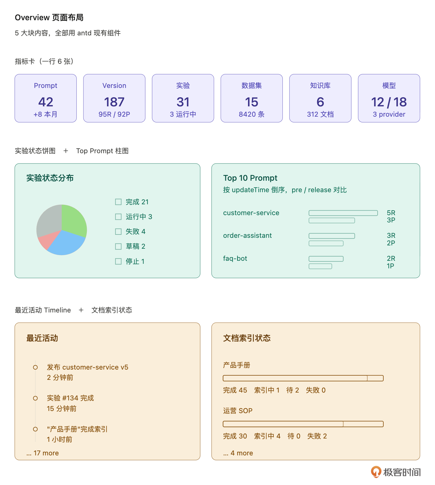
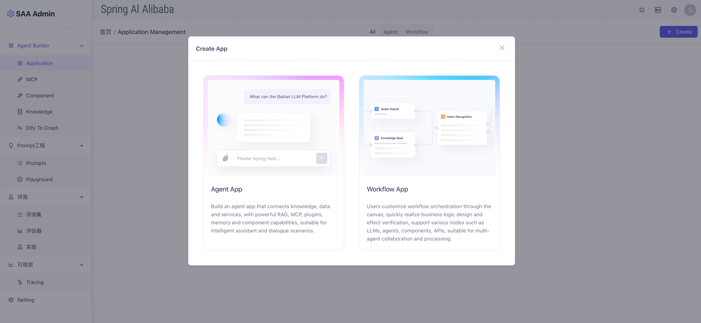
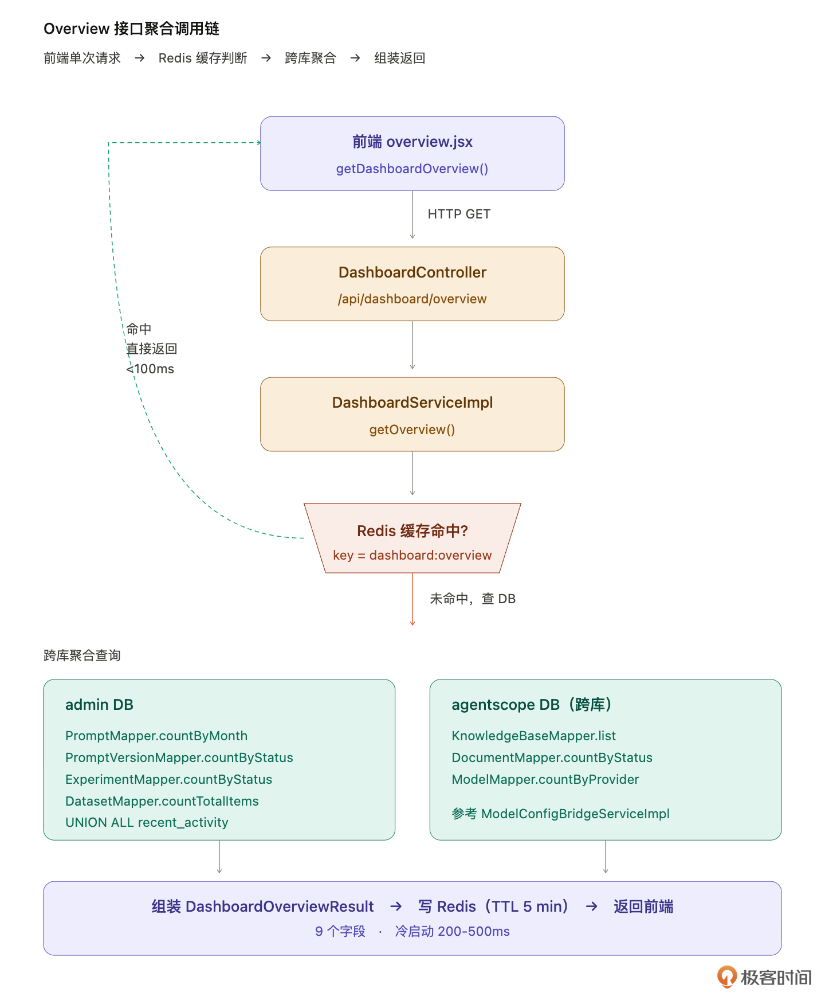
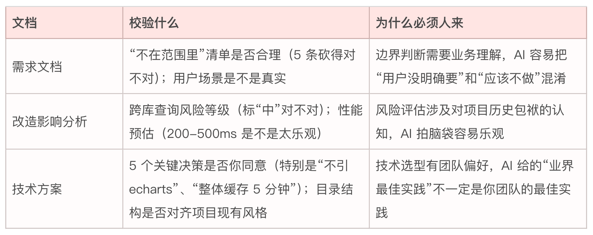
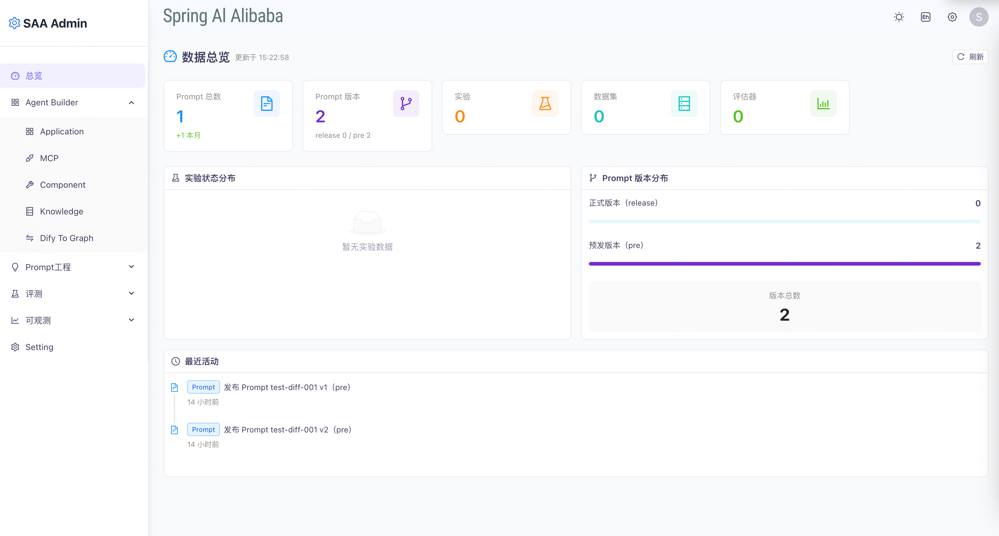
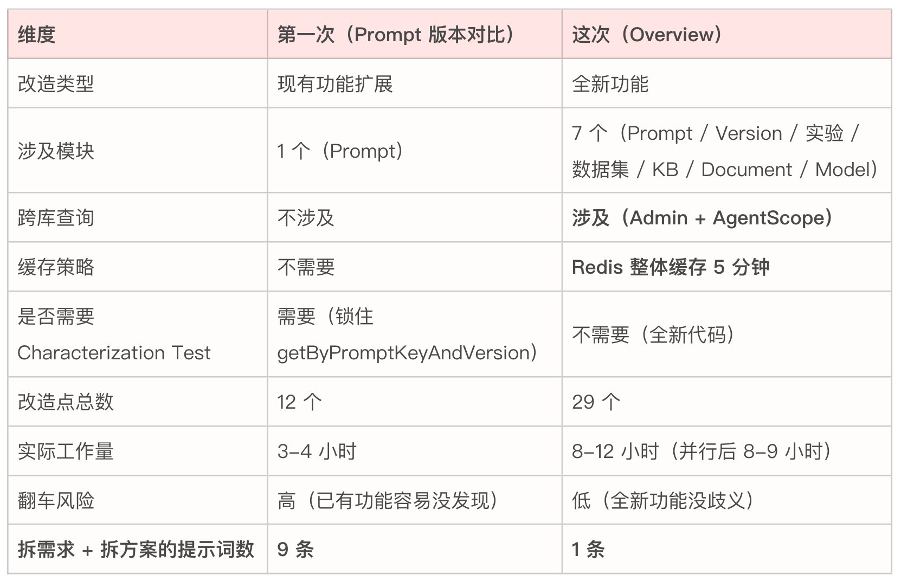

# 23 | 换个功能再跑一遍：从0到1加一个Overview页面

你好，我是 Robert。

22 讲复盘了五个常见疑问，最关键的一句话是：老项目改造，AI 是加速，不是兜底。你看完可能会想问一个问题：你说这套流程可复现，那换个功能能不能跑通？

这一讲就回答这个问题。不重复方法论，只给图、提示词、点评。你跟着扫一遍，应该会有这样一个体感：哦～原来这套流程在另一个功能上也是这么跑、产出物长这样。

那么二次演练会更复杂吗？正好相反。这次反而是整门课提示词最少、节奏最轻的一讲。

## 为什么这次可以比较轻松？

不是因为 Overview 这个功能简单。Overview 涉及 7 个模块、跨 Admin 和 AgentScope 两个数据库、需要 Redis 缓存、29 个改造点（17 后端 + 10 前端 + 2 文档）。比 17-21 讲那次（Prompt 版本对比，单模块 12 个改造点）还重。

但写起来轻，原因有四个：

1. docs/ 已经有项目的完整脑图：架构图、模块依赖、API 清单、数据模型。08-09 讲攒下的资产，AI 在这次拆需求时直接读、不用重新扫代码。

2. CLAUDE.md 已经有项目级约束：哪些是禁区、哪些是历史包袱、哪些是项目代码风格。10 讲攒下的常识，AI 在这次写方案时自动遵守。

3. 第一次改造已经留下了完整的提示词模板。这次跑同样的工序，提示词不需要再设计、直接复用。

4. AI 已经理解这个项目了。Anthropic 上下文 + 代码库扫描 + docs/ 阅读，三件事叠加之后 AI对 SAA Admin 的熟悉度已经接近一个新入职两周的工程师。再让它做一次类似的功能，自然顺。

这就是这门课从第二部分到第四部分一直在攒的资产在第五部分发挥作用的具体形态。前面跑得越扎实，后面越轻松。这就是我一直说的，慢就是快。

- Tips：你在这里是不是感受到了需要使用 Skill 的即视感。

下面跑一遍六个场景。

## 这次改什么：给 SAA Admin 加一个 Overview 页面

我看了一下 SAA Admin 现在的功能：Application 管理、Prompt 工程、评测、可观测、MCP，都很全，但没有一个全局首页。用户登录后默认跳进 Application Management，要看其他模块的状态得一个一个点过去。

这是几乎所有 Admin 系统都该有的标准功能。给它加一个，正好。我们可以让 Claude Code帮我们画 PRD，比如可以使用如下提示词：

```
顶部 6 张指标卡：Prompt / Version / 实验 / 数据集 / 知识库 / 模型
中部左：实验状态饼图（DRAFT / RUNNING / COMPLETED / FAILED / STOPPED）
中部右：Top 10 Prompt 版本柱图（pre / release 对比）
底部左：最近活动 Timeline（UNION 三张表，最近 20 条）
底部右：文档索引状态（按知识库分组，进度条 + 数量）
```

Overview 页面长这样：



## 场景一：现状确认

为了避免踩坑，做出一个重复的功能，所以我们先打开浏览器、登录账号 saa/123456。点一遍左侧菜单：Agent Builder（Application / MCP / Component / Knowledge）、Prompt 工程、评测、可观测。确认所有模块都没有“全局概览”入口，默认登录跳 ApplicationManagement。



这一步的提示词省了，确认就是确认，不需要 AI。这正是 20 讲翻车后留下的硬约束：改造前必须自己点一遍产品。

## 场景二：一个提示词出三份文档

原本 17 讲拆需求 + 18 讲拆方案要跑九个提示词，这次合并成一个简短的提示词：

```
我加一个 overview 页面。你规划一下 overview 放什么、有什么、
```

- 数据怎么统计、接口怎么定义、前端页面怎么展示。全流程。

```
然后根据之前的流程 docs 里面出需求文档、技术方案、改造点文档。能做到吗？
```

就这一个提示词，AI 跑出来三份完整文档：

```
docs/requirements/overview-dashboard.md（需求）
docs/requirements/overview-dashboard-impact.md（改造影响分析）
docs/requirements/overview-dashboard-solution.md（技术方案）
```

三份文档加起来超过 800 行：6 维需求拆解、29 个改造点列表、跨库查询风险分析、5 个关键决策（不引图表库 / 整体缓存 5 分钟 / MySQL UNION 不引 ES / 不做实时刷新 / 不做时间筛选）、详细 SQL、目录结构、实施顺序、关键 SQL 片段、mock 方案。

为什么这么简单的一句提示词就可以呢？因为我们前面已经把上下文跑了一遍，也跑了一遍完成的改造流程。这些在最后我们都提醒了文档自动更新。慢就是快，所以别急，只要项目改造的齿轮跑起来，就会越来越快。

链路图：



点评：跟上次改造比，这次拆需求、拆方案的提示词从 9 条压缩到 1 条。这就是积累的力量。AI 之所以能凭一句话产出三份高质量文档，是因为它已经从 docs/、CLAUDE.md、第一次改造模板里拿到了所有它需要的上下文。如果是新项目第一次跑，这一步还是要拆成 9 个提示词。积累在前、轻松在后。

## 场景三：人工校验三份文档

然后在这里你要刹车，停下来。

虽然会越来越快，Claude Code 的改造效果会很好，甚至可能完美，不需要你做任何更改，但这一步绝对不能省。AI 一次出三份文档很爽，但你不能直接进下一步动代码。必须人工校验三份文档的关键内容：



校验完发现需要调整的，反馈给 AI 让它更新文档，比如如下格式：

- 我审核了三份文档，以下需要调整：

```
- [问题 1]
- [问题 2]
- 5 个决策全部拍板：[逐条最终决策]
按上面更新文档。所有"待审核"标识改成最终决策。
```

点评：这一步是必须凸显的关键。22 讲讲过的“工作量下来 ≠ 思考量下来”在这里有最直接的落地。AI 帮你压缩了 90% 的工作量，省下来的时间必须用在校验上。如果偷懒、直接用 AI出的文档进入开发，你就把“快”变成“快错”。这一步的校验质量决定了后面三天的代码方向。

- Tips：这步千万别偷懒，不能偷懒。

## 场景四：执行后端改造

提示词也是一句：

```
按 docs/requirements/overview-dashboard-solution.md 完成后端改造。
按 19 讲的小步执行原则跑：分批做（DTO 一批、Service 一批、Controller
一批、Mapper 新增 COUNT 方法一批）、每批跑通 mvn test 才进下一批、
不重构现有 Mapper、跨库 Mapper 注入参考 ModelConfigBridgeServiceImpl。
跑通后告诉我总测试数 + 失败数。
```

为什么这么短？因为所有具体约束（字段对齐、Redis 缓存、跨库注入、SQL 写法）都已经在solution.md 里了，AI 读这份文档就能拿到所有信息。重复说一遍是浪费 token，更是浪费你的注意力。

后端代码长什么样、SQL 怎么拼，跟上次的工作流一致，这一讲不展开（19 讲已经讲透了）。

点评：跟上次比，这次后端改造的核心难点变了。上次是 null 处理、复用判断；这次是跨库Mapper 注入、Redis 缓存、SQL 聚合性能。同样的工作流，但落到具体代码上的关注点完全不同，这就是工作流可迁移的真实意思。如果你今天在自己项目上做类似的聚合首页，技术细节会和这次不一样（你们可能用 ehcache 不是 Redisson、可能不需要跨库），但工作流的关键节点完全一样：先确定决策点、再小步实现、再补测试、最后回灌资产。

## 场景五：执行前端改造

```
按 docs/requirements/overview-dashboard-solution.md 完成前端改造。
不引入 echarts，全用 antd 现有组件。改完跑前端构建确认无报错。
```

点评：跟上次比，这次是新建页面、不是改现有组件，所以前端改造的整体节奏比上次更顺。没有 props 破坏性变更、没有现有调用方需要同步更新。直接按设计稿建组件就行。



但有一处需要特别注意：菜单配置文件位置不是凭直觉能猜对的，必须自己点一遍产品 + 让AI 扫代码确认。Overview 入口加在哪、用什么 icon，这些是 17 讲老项目约束的具体形态，AI 默认会“建一个新菜单组件”，但项目里可能用配置数组管菜单，那就改配置数组就行。

## 场景六：文档自动更新

```
Overview 改造跑完了。把这一轮新发现回灌到 docs/：
1. api-list.md：加 GET /api/dashboard/overview
2. data-model.md：加 DashboardOverviewResult 顶层 + 10 个子 DTO
3. overview-dashboard.md：补审核中新发现的边界
4. CLAUDE.md：加项目级新约束。候选：
  - "聚合多模块的接口默认整体缓存（Redis），按卡片细粒度缓存需要明确理由"
  - "跨 admin / agentscope 库查询的 Service 必须放在 server-start
    模块，参考 ModelConfigBridgeServiceImpl 先例"
判断哪些是项目级 → 写进 CLAUDE.md，哪些是这一次特殊处理 → 留在 solution.md。
输出每份文件的改动 diff。
```

点评：跟上次比，这次回灌到 CLAUDE.md 的新约束更通用。“跨库 Service 放 server-start”这条是项目级的：下次再有类似 Overview 的功能（比如运营 Dashboard、成本概览、健康度报表），AI 会主动提醒“跨库查询走 server-start，参考 ModelConfigBridgeServiceImpl”。docs/ 资产越改造越厚，方法论才会真正长在项目里。

## 跟第一次改造的差异点

跑完之后回头看，这次和上次（17-21 讲的 Prompt 版本对比）形成清晰对照：



最后一行是这一讲最重要的对比。功能更复杂、改造点翻倍、工作量翻倍，但提示词反而少了8 条。这看起来很矛盾，但完全合理：第一次跑是在搭脚手架，第二次跑是在用脚手架。

## 小结

这一讲总结来说一句话：积累在前、轻松在后。

变的是这个改造的具体技术细节，不变的是“理解 + 开发”的工作流本质。但这次还多了一层：前面攒下的资产真正发挥了作用。docs/ 让 AI 不用重新扫代码、CLAUDE.md 让 AI 自动遵守项目约束、第一次改造的模板让这次的提示词从繁到简。这些不是花哨的功能，是踏踏实实的工程积累。

23 讲到这里结束。你学到这里应该已经有一种感觉，这套流程不依赖于具体功能、只依赖于改造类型，而且越用越省事。跨库查询、Redis 缓存、5 个 Section 组件、29 个改造点，这些都是新的复杂度，但没有一个让工作流偏离原本的节奏。

第六部分开始，我们换一个语言（Python / Hermes Agent）跑同样的工作流，验证一次跨技术栈的可迁移性。Java 项目能跑通的工作流，换到 Python 项目还能不能稳？等到第六部分跑完你心里会有答案。

## 思考题

1. 这一讲让你最有感的一点是什么？是“一个提示词出三份文档”的轻快，还是“必须人工校验三份文档”的提醒？

2. 假设你今天在自己的项目上做一个类似 Overview 的功能，你能像这一讲一样用一个提示词搞定拆需求 + 拆方案吗？如果不能，差在哪？是 docs/ 资产不够全，还是 CLAUDE.md 没攒够，还是没做过类似的改造、没留下模板？

欢迎在评论区把你的答案写出来。如果今天的课程让你有所收获，也欢迎转发给有需要的朋友，邀请他来一起学习，我们下节课再见！
