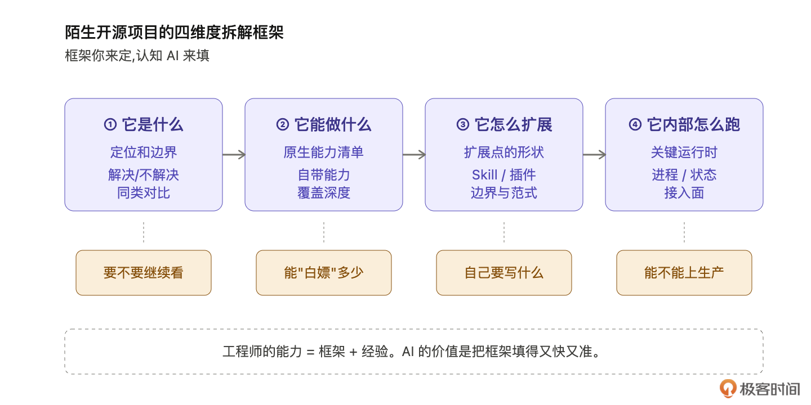
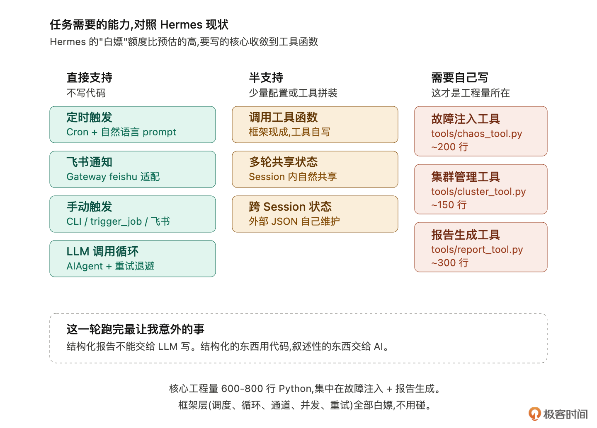
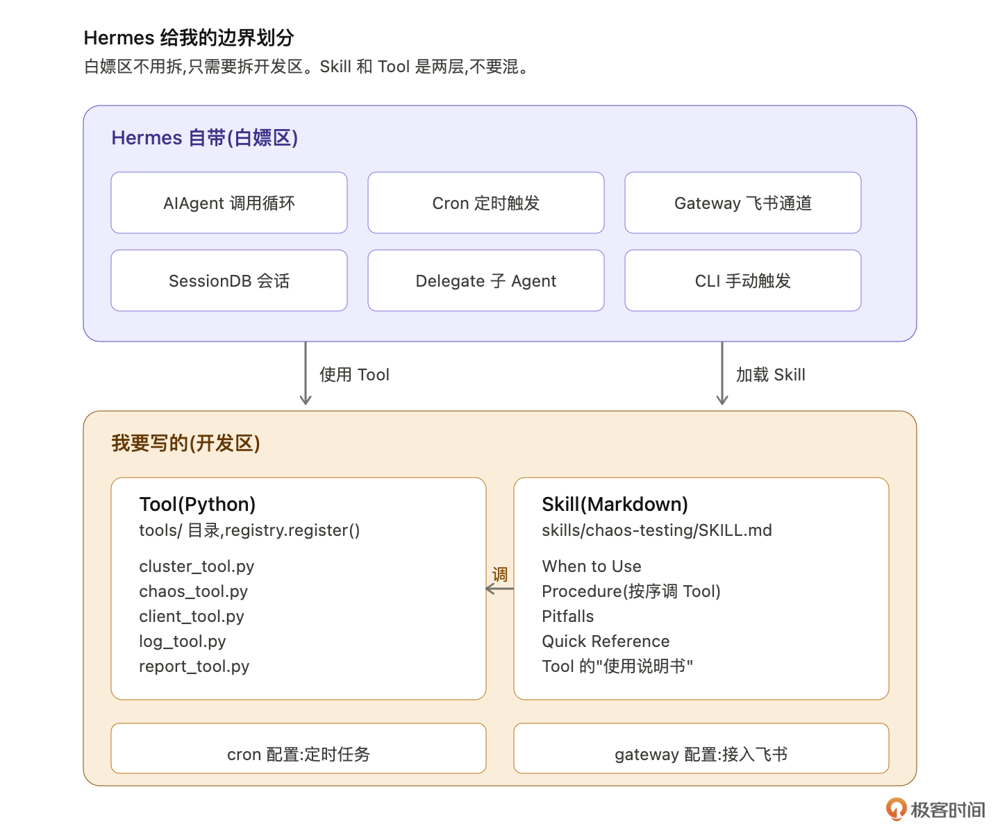

# 24 | 建立学习框架：用AI快速拆解学习HermesAgent

你好，我是 Robert。

从这一讲开始，我们进入第六部分。这一部分要做的事情和前面几部分都不太一样。前面我们改造的是公司内部维护的老项目，代码是我们的、bug 是我们的、方向也是我们定的。但还有另一种同样常见的场景：接到一个需求，要基于一个开源项目去实现。比如运维同学做内部巡检平台，先看 Prometheus 生态有什么现成的；后端同学给业务接工作流引擎，先看Temporal、Airflow 哪个能用；算法同学做 RAG 应用，先看 LlamaIndex 还是 Dify 更合适……都是先看看开源里有没有现成的，再基于它二次开发，这是工程师的标准动作。

所以在第六部分，我会用给一个开源项目添加“基于 Hermes Agent 实现的 7×24 不间断跑混沌测试的 AI 系统”的例子，来讲解如何通过 Claude Code 对开源的老项目进行二次开发（添加功能）。这个自动化测试系统的功能主要包括：自动起集群、自动注入故障、自动调多语言SDK 跑测试、自动收集日志、自动出报告。

- 这个项目有两篇关于「基于 AI 的自动化测试」的资料你可以看一下：https://robustmq.com/zh/Blogs/95https://robustmq.com/zh/Blogs/84

当然，我们依旧假设我们对 Hermes Agent 一点都不了解，下面开始。

Hermes Agent 是一个开源的自托管 AI Agent 控制平面，我之前听过这个项目，但没有真正用过。这就是我们的任务的起点。顺带说一句，Hermes 还很新，你公开搜不到太多企业落地案例，这恰好是这一部分的价值，我们一起摸出一条路。AI 时代最值钱的能力之一，就是在没有现成先例的时候，基于 AI 快速摸出一条能走通的路。

## 方法论：让 AI 帮你建立顶层认知

### 学习前的一些想法

我接到这个任务的第一反应是：Hermes Agent 是什么？我要怎么用它来实现我们这个 7×24不间断跑混沌测试的 AI 系统？所以我准备先去学习一下 Hermes Agent。

学习方式，我有两个选择:

1. 通过 Claude Code 辅助学习。我近期已经习惯了让 Claude Code 帮我总结，但我个人的经验是，从头学一个大的东西（比如 OpenClaw 原理、Hermes Agent 等），用 ClaudeCode 学下来并不是那么好。这里说的“好”是系统性，AI 给你的认知是片段化的，不够成体系。

2. 系统化学习。直接找官方系统化的资料来学。我让 Claude Code 给我推荐了系统化的学习资料，找到了 hermesagent.org.cn/docs 这一份，内容很系统，挺合适。

所以我个人的习惯是这样：Claude Code 帮我快速建立认知、总结核心要点，然后通过系统化资料沉下去学。

学新东西时，我还有两个自己摸出来的经验。一是要有自己的学习框架，二是学习是带着任务去的、不是大而全的学习。下面分别说说这两点。

### 顶层认知，要有自己的拆解框架

在我看来，让 AI 帮你建立认知，前提是你得先有一个拆解框架。

很多人用 AI 学开源项目，做法是“Claude，告诉我 Hermes 是什么”，然后拿到一坨官方话术：它是 AI Agent 平台、它支持多种扩展、它有完整的工具链。看完之后，依然不知道能拿它干什么。

问题不在 AI，在你没给 AI 一个拆解框架。工程师拿到一个陌生开源项目要建立的顶层认知，不是 AI 自己能猜出来的，它是过去十年踩坑沉淀出来的判断维度。这个框架是你的能力，不是 AI 的能力。AI 的能力是，你给好框架之后，它能把框架填得又快又准。

我自己的拆解框架是这四个维度:



1. 它是什么，定位和边界。它解决什么问题、不解决什么问题、和我熟悉的同类工具是什么关系。这一条决定我要不要继续往下看。

2. 它能做什么，原生能力清单。自带哪些能力、不写一行代码就能用的有哪些、覆盖范围多深。这一条决定我能白嫖多少。

3. 它怎么扩展，扩展点的形状。它的扩展机制是什么（插件、Skill、Hook 还是别的）、扩展的边界在哪、扩展的开发范式长什么样。这一条决定我自己要写的部分长什么样。

4. 它的内部机制，关键运行时。它怎么跑起来、状态怎么管、对外的接入面有哪些。这一条决定我能不能预判它在生产环境的表现。

这四个维度组合起来，就是一个工程师对陌生开源项目应该建立的最小完备认知。少了哪一块，要么用不起来，要么用错。

### 带着任务去问，而不是裸问

光有框架还不够。同样是问 “Hermes 怎么扩展”，不带任务问和带着任务问，得到的答案完全不一样。

不带任务问，AI 会给你一份 Hermes 扩展机制大全，所有扩展点、所有 API、所有可能的玩法，看完之后你依然不知道哪个对你有用。带着任务问，AI 会过滤掉和你任务无关的部分，只告诉你“对你这个场景，应该用哪个扩展点，因为……”。这才是工程师真正需要的认知。

所以下面三个提示词，每一个都要带着“自动化测试 Agent”这个具体任务。让 AI 拿着这个任务去过滤资料、去筛选回答、去给出建议。

## 三个提示词，摸清楚 Hermes 大体框架

下面三个提示词，对应前面四个维度。我把“它是什么”和“它的内部机制”合在一个提示词里了，因为这两块在 Hermes 这种项目里连着讲清楚最自然。

三个提示词都丢给 Claude Code，让它在 Hermes 仓库里跑。

### 提示词一：它是什么 + 它的内部机制

```
你现在在 Hermes 这个开源项目的目录下。我刚接到一个公司内的任务:
要基于 Hermes 做一个 7×24 跑混沌测试的 AI Agent，功能包括:
自动起集群、注入故障、调多语言 SDK 跑测试、收集日志、生成报告、
```

- 通过飞书通知团队。

```
请你读 README、docs/architecture.md 和 src 顶层目录结构，告诉我:
1. Hermes 的核心定位是什么。一句话说清楚。
2. Hermes 的核心抽象有哪些。每个抽象用一句话解释它的作用。
3. Hermes 不解决什么问题。它的设计边界在哪。
4. Hermes 是怎么跑起来的。进程模型、配置加载、状态管理大致是什么样。
5. 结合我接到的任务，Hermes 的定位是不是和我的需求方向一致。有没有明显的不匹配。
```

- 不要复述官方话术。用你判断后的结论来回答。

读完这个提示词的输出，我应该能回答这几个问题：Hermes 是不是适合做我这个任务，它的核心抽象有哪些是我会直接用到的，它的运行时模型对我的部署方案有什么影响。

Claude Code 跑完这个提示词，我拿到这些关键信息。

1. 核心定位：有学习能力的通用 AI 工作台，把 LLM、工具调用、跨平台消息、定时任务封装成可以长期运行的 Agent 基础设施。

2. 核心抽象：AI Agent（对话循环）、SessionDB（SQLite + FTS5 会话存储）、Tools（自动发现的工具注册表）、Skills（Markdown 写的过程记忆）、Delegate（子 Agent 隔离调度）、Cron（定时触发）、Gateway（多平台消息路由）、Terminal Backends（本地 / Docker /SSH / Modal 等执行环境）。

```
运行时：通常两个长期进程（hermes CLI 和 hermes gateway 网关），通过 SQLite
WAL 共享状态；子 Agent 是同进程线程；配置走 ~/.hermes/config.yaml，API Key
单独放 .env。
```

更让我意外的是：

4. 不解决什么问题：不是测试框架（没有 assertion / fixture / test suite 概念）；不是可观测性

```
平台（日志只到 agent.log，没有结构化指标和告警）；不是集群编排器（Terminal
```

- backend 只是给你一个 shell）；不是报告生成引擎（没有结构化报告模板）；也没有任何故

```
障注入能力（tools/ 里没有 chaos engineering 相关实现）；默认还是 human-in-the-loop
```

- 模式（7×24 无人值守需要大量 allowlist 配置）。

在我看来，它不解决什么问题，比它能做什么更值钱。这一段告诉我，我接下来要写的核心，正好填在这些“它不做”的位置上：故障注入、结构化报告、跨会话状态、无人值守的 allowlist配置。

结论：方向是对的，但 Hermes 是骨架，不是答案。我要做的是在它给我的扩展点上，把它不做的那些事补齐。

### 提示词二：它能做什么

```
继续。我的任务需要这些能力，请对照 Hermes 现有功能，
告诉我每一项能不能直接用、用哪个特性、还需要我自己实现什么:
1. 定时触发(每 2 小时跑一次基础场景、每天凌晨跑全量场景)
2. 调用工具函数(起集群、注入故障、跑客户端、收日志、出报告)
3. 在多轮调用之间共享状态(集群信息、测试进度)
4. 生成结构化报告(JSON + Markdown)
5. 通过飞书发通知(测试失败、报告生成完毕)
6. 手动触发(开发期间针对性验证某个场景)
7. LLM 调用循环(多轮 tool use、错误重试、token 管理)
输出格式:每一项分别说，Hermes 直接支持哪些、半支持哪些(需要简单配置)、
完全不支持哪些(需要我自己写)。
```

- 最后给我一个总结，我自己要写的工程量大概有多大。

这个提示词的关键设计是，我把任务里需要的能力一条一条列出来，让 AI 拿着我的清单去对照 Hermes 的能力。

不带这个清单去问 Hermes 能做什么，得到的会是它所有能力的罗列；带着这个清单去问，得到的是对我有用的能力筛选。

跑完之后我大概拿到这样的判断：



结论：我自己要写的核心收敛到几个工具函数。Hermes 的白嫖额度比我预估的高，真正的工程量大概 600-800 行 Python，集中在故障注入和报告生成两件事。

这一轮跑完，有一件让我意外的事：结构化报告这件事，不能交给 LLM 写。Claude Code 直接告诉我，如果让 LLM 直接生成 JSON，字段名会飘、嵌套层级会乱，任何下游程序解析都会踩坑。结构化的东西用代码生成，叙述性的东西交给 LLM，这个分工是我接下来设计 Tool时的一条硬规则。

这个判断非常重要。它直接决定了 25 讲拆需求的时候，我要拆到的颗粒度只到工具函数级别就够了，不用从零规划一个 Agent 框架。

### 提示词三：它怎么扩展

```
继续。如果我决定用 Hermes 做这个系统，我自己要写的核心是 Skill 吗？
如果是，请深入读 docs/skills.md 和 examples/ 下的几个示例 Skill，告诉我:
1. Skill 是什么形状。目录结构、关键文件、一个最小 Skill 包含哪几样。
2. Skill 里的 Tool 怎么定义。函数签名、参数类型、返回值约定。
3. Skill 之间怎么共享状态。Memory 系统的使用范式是什么。
4. SKILL.md 这个文件是给谁看的、写什么内容、有没有写法约定。
5. 给我一个最小可行的 Skill 骨架，假设这个 Skill 只做一件事:
  返回当前时间。让我能判断扩展一个 Skill 的工程量大概多大。
```

- 不要泛泛而谈，我要的是能直接用来评估开发量的具体认知。

这个提示词的核心是让 AI 给我“扩展点的形状”，而不是讲“扩展机制有哪些”。

注意提示词第一句的措辞：“我自己要写的核心是 Skill 吗？如果是，请告诉我……”。我特意没有把“核心是 Skill”写成肯定句，而是留出反问的空间。带任务问还不够，带任务问 + 给 AI 留反问的余地，才是更高级的姿势。AI 拿到一个肯定句会顺着你说，拿到一个疑问句才有空间纠正你的预设。

事实证明这个余地留对了。Claude Code 跑完后给我一个反认知的纠正：我以为我要写的核心是 Skill，实际上我要写的核心是 Tool。

Skill 不能定义新的 Tool，Skill 只是 Tool 的“使用说明书”。三者的分工长这样：

```
Tool 在 tools/*.py 用 Python 写，通过 registry.register() 注册。
Skill 在 skills/*/SKILL.md 用 Markdown 写，告诉 LLM 什么时候调哪个 Tool、按什么
```

- 顺序调。

```
Skill 目录下的 scripts/*.py 是普通辅助脚本，不是 Tool，Agent 通过 Terminal 工具调
```

- 用它们。

这个纠正改变了我对工程量的判断。Skill 写一份 Markdown 几小时就够，真正的工作量在Tool 的 Python 实现。如果我一开始就按“写一个大的 Skill”去拆需求，最后会发现 Skill 里没法装下任何业务逻辑，绕一圈才回到 Tool 上。这种走回头路在工程上是可以避免的，前提是你要在问 AI 时留出反问的余地。

## 跑完之后我对 Hermes 的认知

三个提示词跑完，我对 Hermes 的认知大概是这样：

1. 它的定位：自托管的 AI Agent 控制平面。LLM 调用、多通道接入、定时触发、跨会话记忆、Skill 扩展，这些通用能力它都给你解决了。它的核心价值是把 Agent 工程里所有“重复的脏活”打包好，让你只关心你的业务逻辑。

2. 它能给我什么：Cron 触发、Gateway 多通道（飞书原生支持）、Memory 跨会话状态、CLI手动触发、Delegate 子 Agent 并发、AI Agent 的工具调用循环和重试退避，这六样我直接拿来用，不写一行代码。

```
我要写什么：几个 Tool（Python，注册到 tools/），包括起集群、注入故障、跑客户端、
收日志、出报告这几个工具函数；一份 SKILL.md（Markdown，放在 skills/chaos-
testing/），告诉 LLM 什么时候按什么顺序调这些 Tool；一份 Cron 配置定义两条定时任
```

- 务；一份 Gateway 配置接入飞书。

4. 工程量：核心 600-800 行 Python，集中在 chaos_tool / cluster_tool / report_tool 三个工具上。Skill 是 Markdown，几小时就够；Cron 和 Gateway 是配置，纯参数。

把这份认知画成一张边界图，左右一目了然。



这张图就是接下来 25 讲拆需求的起点。白嫖区不用拆，只需要拆开发区。原本一句话需求里那些模糊的“自动跑”、“自动通知”、“自动收集”全都被 Hermes 接走了，我真正要拆的是开发区里那几个 Tool 怎么写、SKILL.md 怎么把它们串起来。

## 先停一下，回到官方文档

在 Claude Code 的帮助下，我们对 Hermes Agent 已经有了一个基础的框架认识。按我的经验，这时候就不应该再依赖 Claude Code 来学了，应该回头去看官方资料，系统化地补一遍。原因有两个：

1. AI 给你的都是经过总结后的内容。如果一直只看这种被总结过的内容，是没法真正学会一个东西的（至少我是不行）。总结的过程会丢东西，而那些被丢掉的东西，往往就是你建立

- 体系化认知最需要的部分。

2. 这时候去看文档，不需要把每一篇都搞懂。而是要带着前面建立起来的认知框架，加上“做一个自动化测试 Agent”的具体任务，两样一起去过文档。看的标准是大概看懂、大概知道有什么东西就行。

为什么这个标准就够了？因为下一讲我们会拆解“自动化测试 Agent”的需求，然后带着拆出来的需求，再回头看本节的认知框架和官方文档。这样三轮叠加下来，效果是最好的。

## 小结

接到一个基于开源项目做需求的任务，第一件事不是动手，是先把工具摸透。

摸透不是把项目读到能提 PR 的程度，而是建立一个够用于下一步拆需求的顶层认知。这个认知有四层：它是什么、它能做什么、它怎么扩展、它内部怎么跑。

让 AI 帮你建立认知的关键是两点：你要有自己的拆解框架，你要带着任务去问。框架决定问什么，任务决定怎么问。两个都到位，认知建立的速度会比你想象的快。

跑完今天这一讲，我手上已经有了一份对 Hermes 够用的认知。但还差一步，我还没拿这份认知去对照那句“做一个自动化测试 Agent”的需求。下一讲，我们就来做这件事，把一句话需求拆成能交付的方案。

这一套打法不是 Hermes 专用的，下次你接到任何“用某某开源项目实现某某需求”的任务，这套四维度框架和带任务问的姿势，都能直接套上去。

## 思考题

回想你最近一次基于开源项目做二次开发的经历，如果重新来一次，你的“拆解框架”应该是哪几个维度？你接到任务时问 AI 的第一个问题，有没有带“任务视角”？

欢迎在评论区把你的答案写出来。如果今天的课程让你有所收获，也欢迎转发给有需要的朋友，邀请他来一起学习，我们下节课再见！
