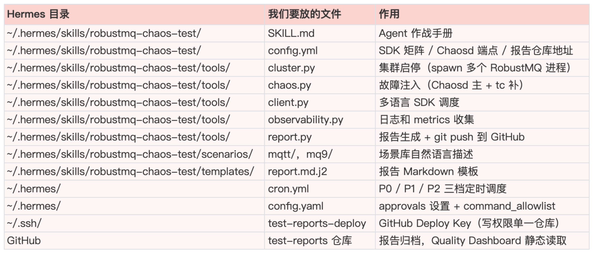

# 26 | 跑通HermesAgent：HelloWorld之后再回看方案

你好，我是 Robert。

上一讲我们把一句话需求翻译成了完整设计文档和完整方案文档，手上拿着两份评审级文档。但纸面上的方案再清晰，在工具上跑不通就只是 PPT。这一讲就是把 Hermes 真正跑起来，验证那份方案里的每个扩展点都活着。

## 别全读文档，先跑通

接到一个新工具，大多数人的第一反应是把官方文档从头读一遍。这是慢路。

慢在哪？读完整套文档，你脑子里全是抽象概念，没一个动作落到键盘上。等真要动手，你又得回头翻文档，因为读的时候没有具体问题，记不住。

正确的姿势是反过来：先跑通最小闭环，然后带着具体问题去读对应章节。跑通的过程会自然把你卡在一些点上，这些点就是你最该读的地方，读起来效率比裸读高十倍。

这一讲就按这个姿势走四步：装上，跟它聊一聊 → 自己写一个 Hello World → 跑通 → 把它对应到我们的项目里。

## 装上，跟它聊一聊

安装这件事我不展开。Hermes 中文社区把命令行版的一键安装脚本写得很清楚:

```bash
curl -fsSL https://res1.hermesagent.org.cn/install.sh | bash
```

完整的安装、模型配置、网络问题处理，直接看 hermesagent.org.cn 的快速入门。文档比我能讲得详细。

我说一点文档之外的：安装本身不是这一讲的重点，装完能跑就行。如果中间踩坑（Python版本、网络、依赖），花一两个小时解决就够了，不要为了把环境搞到完美而耗一整天。装到能跑的程度立刻进下一步，后面遇到问题再回来调。

装完之后最重要的一步，是先跟它聊一聊，感受这个工具在你手里是什么手感。

```
$ hermes
```

进入交互界面，扔几个真实指令试试：

```
> 你能帮我做什么?
> 帮我看看磁盘空间占用，列出最大的 5 个目录
> 现在几点了
```

第一条让它解释自己，第二条让它跑 shell，第三条看看简单查询它怎么处理。这三个指令五分钟就能跑完，但你会迅速建立对这个工具的“手感”：

- 它怎么决定要不要调工具

- 调工具的时候它会不会先确认

- 返回的格式长什么样

- 慢不慢

第一次对话的目的不是验证 LLM 能用，这件事 ChatGPT 早就证明过了。目的是验证你接下来要扩展的这个东西真的活着，知道它的工具调用循环是怎么跑的。建立这个感觉之后，后面写 Tool 时才知道 Tool 在 Agent 那一侧是怎么被看到的。

```
花十分钟玩玩斜杠命令也值得，/help 看所有命令、/tools 看当前可用工具、/model 切
```

模型。这些用一遍，你大概知道 Hermes 给了你哪些“开关”。

## 自己写一个 Hello World

体验完该动手了。这一步的目标不是做个有用的东西，是用最简任务验证最复杂机制。

Hermes 的扩展机制有两层：Tool 是 Python 写的能力，Skill 是 Markdown 写的指令。两层都得验证。所以 Hello World 也分两件事。

动手之前先说清楚文件放哪。Hermes 默认从两个地方加载扩展：用户目录

```sql
~/.hermes/tools/ 和 ~/.hermes/skills/（装完 Hermes 自动创建，不存在就 mkdir
-p 自己建一下）。我们写的所有 Tool 和 Skill 都放这里。Hermes 仓库源码里也有 tools/ 和
skills/ 目录，那是官方自带的工具和技能，不要把自己的代码放那里：一是会跟着
hermes update 被覆盖，二是污染源码目录将来很难清理。用户目录是用户的地盘，放自
```

己的扩展。

### 一个最简 Tool:get_current_time

```
在 ~/.hermes/tools/ 下新建 time_tool.py（这是 Tool 平铺的最简形态，正式项目里
```

多个相关 Tool 会放在 Skill 套件下，第四部分讲清楚）：

```python
import json
from datetime import datetime， timezone
from tools.registry import registry
def get_current_time(args: dict， **_) -> str:
   now = datetime.now(timezone.utc)
   return json.dumps({
       "utc": now.isoformat()，
       "unix": int(now.timestamp())
   })
registry.register(
   name="get_current_time"，
   description="Return the current UTC time."，
   handler=get_current_time，
   parameters={
       "type": "object"，
       "properties": {}，
   }，
)
20 行 Python，三件事：定义函数、写注册参数、调 registry.register。Hermes 启动时
会扫描 ~/.hermes/tools/ 目录，自动把这个 Tool 加进 Agent 可调用列表。
```

写完跑一次：

```
$ hermes
> 现在几点?
如果一切正常，你会看到 Agent 调用了 get_current_time，返回 UTC 时间。Tool 注册机
```

制就这么简单。

### 一个最简 Skill:hello-world

```
在 ~/.hermes/skills/hello-world/ 目录下新建 SKILL.md：
---
name: hello-world
description: "Say hello and tell me the current time."
version: 1.0.0
---
# Hello World
## When to Use
当用户说"用 hello-world skill 跟我打招呼"或类似指令时加载。
## Procedure
1. 调用 `get_current_time` Tool 获取当前时间。
2. 用一句话回复用户:"你好!现在是 {utc 时间}，祝你开发顺利。"
```

不到 20 行 Markdown。这就是一个最简 Skill 的全部内容。

跑一次：

```
$ hermes
> 用 hello-world skill 跟我打招呼
Agent 加载 Skill，按 Procedure 调 get_current_time，然后用 Skill 里规定的格式回复
```

你。

两件事都跑通，你已经掌握了 Hermes 的全部扩展能力。剩下的差异只是：Tool 的逻辑更复杂、Skill 的指令更精细。机制是一样的。

## 跑通之后，卡过的坑也要记下来

完美跑通是一种幸运，卡几次才是常态。

```
Tool 没注册上：hermes 启动后看不到 get_current_time，大概率是文件没被扫到。检
查文件名拼写、检查文件是否真的在 ~/.hermes/tools/ 目录下、检查 Hermes 是否需要
```

重启加载新 Tool。

Skill 没加载到：Agent 收到指令后没按 Skill 里的 Procedure 走，而是自己临场发挥。检查目

```
录结构是不是 ~/.hermes/skills/hello-world/SKILL.md（不是
~/.hermes/skills/hello-world.md）、检查 frontmatter 的 name 字段是不是写对、检
```

查 description 是否清晰到 Agent 知道何时加载。

```
Agent 调 Tool 但参数错了：大概率是 Tool 的 description 写得不清楚，或者
parameters schema 里没把参数约束写明白。Tool 的 description 是给 LLM 看的，不是给
```

人看的，写得越清楚 LLM 调得越准。

这三个坑卡过一次，你对 Hermes 的理解就深一层。这种深度看文档读不出来，只能自己撞出来。这就是“先跑通再读文档”的价值：撞坑的过程会精准地告诉你下一步该读哪里。

## 回到我们的项目：25 讲的方案怎么落到 Hermes 上

这是这一讲真正的终点。

练 Hello World 的目的不是好玩。目的是跑完之后立刻能回头看 25 讲那份技术方案，知道每个文件该往 Hermes 用户目录的哪个位置放、第一行代码该往哪里下。

回顾一下 25 讲第二次翻译拍过的几个关键决策:

1. 7 个 Tool 函数全部放在一个 Skill 套件下（共享上下文）。

2. 集群直接 spawn 进程不引入 Docker，SDK 隔离用本地版本管理。

3. 报告 push 到 GitHub 公开仓库（Deploy Key）。

4. 第一期通道仅 CLI。

这些决策直接决定了我们要往 Hermes 用户目录的哪些位置放哪些文件。把 25 讲的方案落到Hermes 上，文件分布是这样：



整张表里有三类内容：

```
Skill 套件本体（~/.hermes/skills/robustmq-chaos-test/ 下面的全部）：我们的
```

- 核心代码、场景描述、报告模板全在这里。这是 25 讲拍过的“1 个套件 + 多个 Tool”决策的物理体现，所有相关 Tool 共享同一个上下文，Agent 串联调用最自然。Skill 套件目录跟

```
Hello World 那个 ~/.hermes/skills/hello-world/ 是同级关系，只是套件内部多了
tools/、scenarios/、templates/ 几个子目录。
Hermes 全局配置（~/.hermes/cron.yml 和 ~/.hermes/config.yaml）：cron.yml
```

- 写 P0/P1/P2 三档调度规则，config.yaml 设 approvals 模式 + command_allowlist。这两份是 7×24 无人值守的安全护栏，跟 Skill 套件是松耦合的：Skill 不知道自己被谁触发的，只管按 Procedure 走。

```
外部凭据和仓库（~/.ssh/test-reports-deploy 和 GitHub test-reports 仓库）：
Deploy Key 私钥放在 ~/.ssh，只授写权限到单一仓库，Skill 里通过 GIT_SSH_COMMAND
```

- 环境变量指定使用，不进 Hermes 的 .env，也不进版本库。这是 25 讲反问那一轮收紧的硬规则。

看清楚两件事：

```
5 个 .py 文件的 Tool 注册机制跟刚才那个 get_current_time 是同一个机制。注册方式
```

- 一样、扫描机制一样、Agent 调用方式一样。区别只是 Tool 内部要做的事更复杂：

```
cluster.py 要 spawn 多个 RobustMQ 进程并管理生命周期，chaos.py 要调 Chaosd
HTTP API 注入故障，report.py 要程序化渲染 Markdown 加 git push。注册到 Hermes
的方式是同一个 registry.register 调用。
```

2. robustmq-chaos-test Skill 跟刚才那个 hello-world Skill 也是同一个机制。SKILL.mdfrontmatter 一样、Procedure 写法一样、Hermes 加载机制一样。区别只是 Procedure 写得

```
更长：前置检查、单场景执行五步、通过失败判断、熔断逻辑，以及套件下多了 tools/
这层子目录，Hermes 加载 Skill 时会把 tools/ 下的 Python 文件作为 Skill 私有的 Tool 注
```

- 册进来。

跑完 Hello World 之后再看 25 讲的方案文档，你会有一种“这件事我能干”的踏实感。不是因为方案变简单了，是因为你对工具的理解更进一步了。

### 触发链路在我们的项目里怎么走

把触发链路再走一遍，你会发现这条路在 Hello World 时已经走过了。

```
Cron 触发：cron.yml 写 P0/P1/P2 三档调度，每档触发的 prompt 是自然语言（比如 P0
```

- 是“按 P0 跑一轮 MQTT 基础场景”)。Agent 收到 prompt 加载 robustmq-chaos-test Skill

```
后，按 Procedure 调 Tool。这套流程跟你刚才用 hermes "用 hello-world skill 跟
我打招呼" 没本质区别，只是触发源从手动命令换成了 cron。
手动触发：第一期就 CLI，工程师在终端跑 hermes "按 P1 跑一轮 mq9 故障场景"。
```

- 这条路你刚才已经走过一次了，Hello World 那段就是手动触发。25 讲拍过决策“第一期通道仅 CLI”，飞书等到第二期再做，先把核心闭环跑稳。

```
报告归档：report.py 跑完用 Deploy Key 把 JSON + Markdown 双格式报告 git push 到
GitHub test-reports 仓库，Quality Dashboard 是静态页面，直接从 GitHub 仓库读取
```

- 展示。这一步是我们要新写的，但 git push 是系统命令，不需要 Hermes 给特殊支持，只

```
要在 Skill 的 allowlist 里加上 git push 即可。
```

整个项目里我们要做的全部新事情，都建立在 Hello World 验证过的两个机制上：Tool 注册 +Skill 加载。其余的 Cron、AI Agent 调用循环、command_allowlist 安全沙箱，Hermes 全部白嫖给我们。

### 第一行代码该往哪里下

回到 25 讲实施步骤的 Tool 依赖顺序：cluster → observability → run_client → inject_fault →push_report。

```
第一个要写的是 cluster.py，理由是后面所有 Tool 的动作都假设集群在跑，chaos.py 要
在集群上注入故障，client.py 要连集群跑 SDK 测试，observability.py 要从集群收
```

集日志和 metrics。集群起停先做完，后面才有东西可操作。

```
下一讲我们就开始写 cluster.py。但在写之前，这一讲的 Hello World 已经把“工具准备好
```

了”这件事确认过了。下一讲一上来不会有任何关于“Hermes 能不能扩展”的疑问，所有精力都用在集群启停的业务逻辑怎么实现上。

这就是练 Hello World 的真正价值。

## 小结

接管一个新工具的第一天，四步走：装上体验 → 写 Hello World → 跑通 → 对照真实项目想清楚怎么放。

前三步是工具掌握，工程师在任何工具上都该这么做。第四步是项目落地，把通用的工具能力对接到具体的工程任务，这一步走完，你才真正接管了这个工具。

很多人第一天卡在前两步，把环境装得完美、文档读得透彻，但没动手写过任何扩展，这是慢路。先跑通最小闭环，再带着具体问题读对应章节，这条路上每一步都有反馈，每一次卡壳都是下一步的指路灯。

```
下一讲，我们写下 cluster.py 的第一行代码。
```

## 思考题

回想你最近接手的一个开源框架或库，如果用这一讲的“四步法”重做一遍接管过程，你会在哪一步发现自己当时其实是跳过的？这一步跳过让你后面付出了什么代价？

欢迎在留言区写下你的复盘，我们一起把“接管新工具”这件事磨成肌肉记忆。如果今天的课程让你有所收获，也欢迎转发给有需要的朋友，邀请他来一起学习，我们下节课再见！
