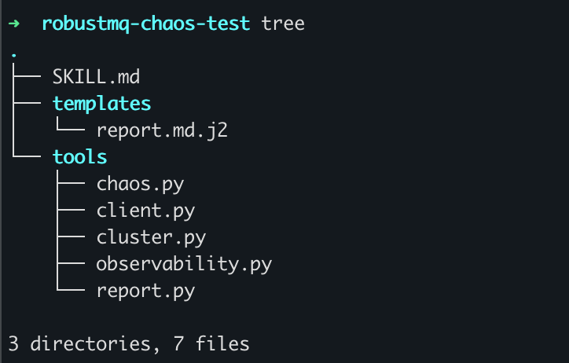
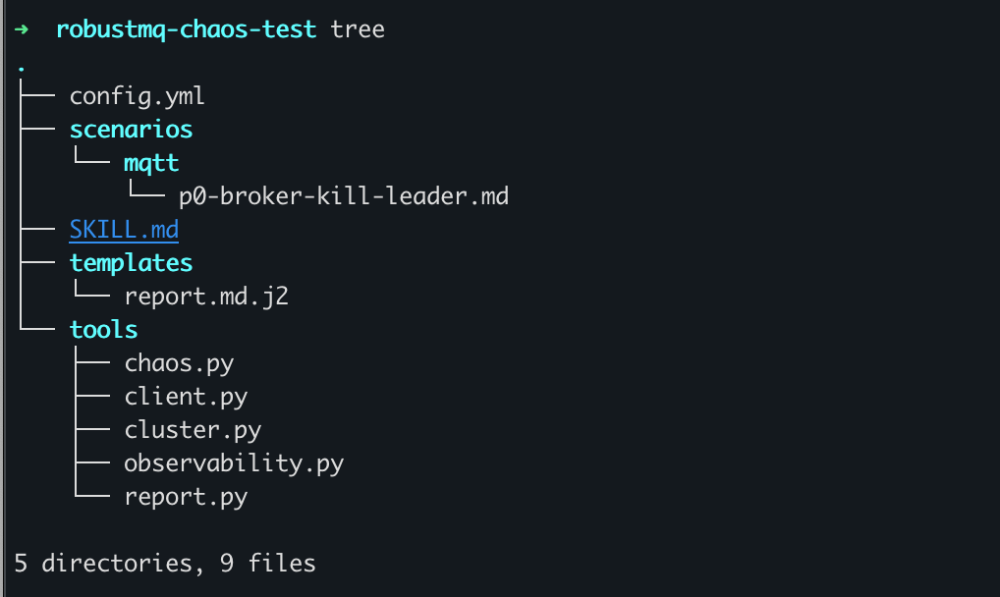
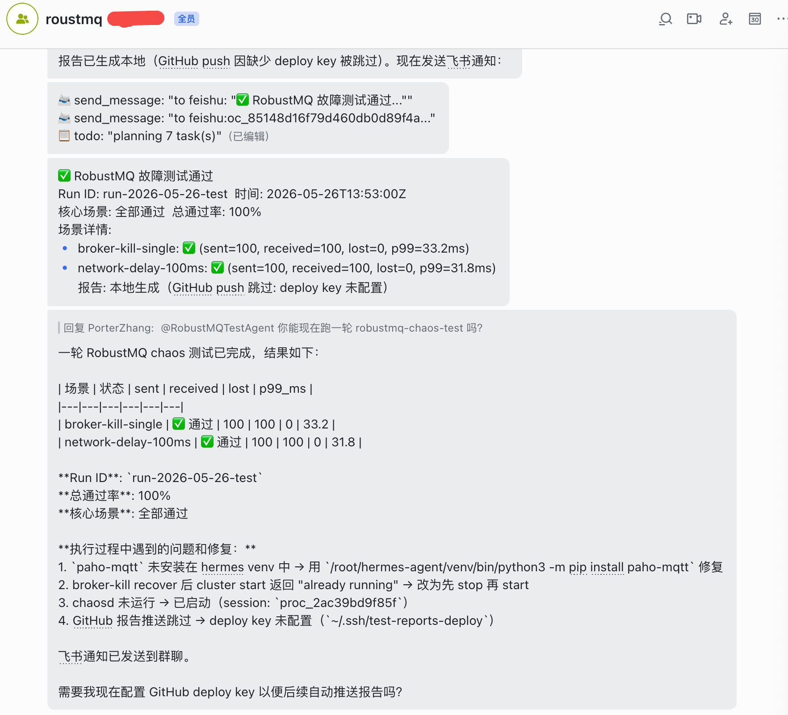
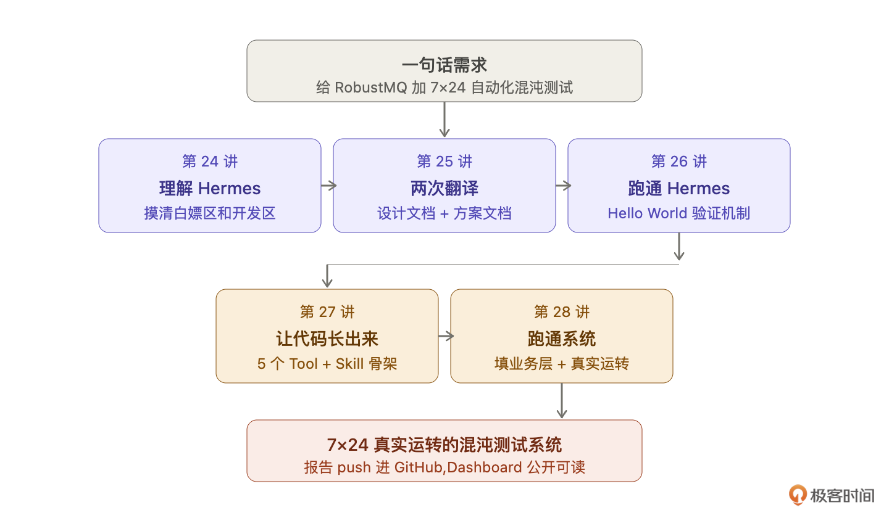

# 28 | 跑通系统：填业务层，看见混沌测试真的跑起来

你好，我是 Robert。

上一讲代码长出来了，5 个 Tool 和 SKILL.md 骨架全部就位，每个 Tool 都通过单点对话验证过。但这套系统现在还跑不起来，具体场景没填、报告模板空着、Deploy Key 没生成、Cron没装。这一讲把这些填完，然后用一段对话把整个系统真的跑一遍。

## 27 讲漏了什么

回头看 27 讲末尾留的五个待办：

```
场景库 scenarios/ 是空的，Skill 没拿到具体场景没法跑完整流程。
报告模板 report.md.j2 没写，report.py 调 Jinja2 加载会报模板找不到。
套件配置 config.yml 是空的，SDK 矩阵、Chaosd 端点、报告仓库地址都没值。
```

- GitHub Deploy Key 和 test-reports 仓库没创建，git push 真跑会失败。

- cron.yml 没装，系统还是手动 CLI 触发，不是 7×24。

这五件事都不是写代码层的事，是业务层的事。Tool 是能力，Skill 是说明书，这五件填进去才长出业务：测哪些场景、SDK 用什么版本、报告归档到哪、什么频率跑。

代码层通用，业务层定义具体测什么，这是 27 讲那个“先做代码层再做业务层”决策的另一边。下面挨个填。

## 把业务层填进去

### 场景库 scenarios/

场景库是 Agent 拿到 Cron 触发或 CLI 手动触发后，真正知道该跑什么的地方。每个场景一个Markdown 文件，自然语言描述，告诉 Agent：这个场景是哪个协议、用哪个故障类型注入到哪个节点、跑哪些 SDK 验证、通过失败标准是什么。

按 25 讲方案的 P0/P1/P2 分级，场景库目录长这样：



写第一个场景给 Claude Code 提示词：

```
帮我在 ~/.hermes/skills/robustmq-chaos-test/scenarios/mqtt/ 下
写第一个场景 p0-broker-kill-leader.md。
格式:Markdown,自然语言描述,Agent 读完知道按 SKILL.md 的"单场景五步"怎么调 Tool。
具体内容:
- 场景名:p0-broker-kill-leader
- 协议:MQTT
- 优先级:P0(每次触发都跑)
- 集群:3 节点 RobustMQ,broker-1 是 Leader
- 故障:用 chaos.py inject broker-kill,target=broker-1,duration=30 秒
- SDK 矩阵:从 config.yml 读 P0 档的 SDK 列表
- 验证:故障期间只记录,Chaosd recover 后等 broker-1 健康检查 200,
 再等 60 秒,跑完整 SDK 矩阵的 basic-pubsub
- 通过标准:exit_code=0,lost=0,p99_ms<500
- 失败处理:记录到 report,继续下一场景
写完不要解释,我直接看文件。
```

提示词的关键是“Agent 读完知道怎么调 Tool”，场景描述不是给人看的文档，是给 Agent 看的可执行说明。Claude Code 跑完产出 30 行左右的 Markdown，我看一眼，主要确认两件：故

```
障类型和参数跟 chaos.py 接口对得上；通过标准的字段名（exit_code / lost / p99_ms）
```

跟 client.py 返回的 JSON 对得上。

第一个场景写完之后，剩下几个场景套同样模板，只改协议、target、duration、SDK 矩阵这几个参数。每个场景独立成文件，Agent 一次只加载本轮要跑的那几个。

### 报告模板 templates/report.md.j2

```
report.py 第三步 git push 之前要把测试结果渲染成 Markdown，模板就是这个文件：
帮我写 ~/.hermes/skills/robustmq-chaos-test/templates/report.md.j2,
Jinja2 模板。
输入是 report.py 传进来的 run_data,字段包括:run_id / started_at /
ended_at / cluster_info / scenarios(每个 scenario 含 fault_info /
sdk_results / passed)。
模板要点:
- 顶部一段 summary,Run ID + 起止时间 + 整体 pass/fail
- 每个 scenario 一个二级标题,展开 fault 信息和 SDK 矩阵结果
- SDK 结果用 Markdown 表格,列:sdk / version / scenario /
 exit_code / lost / p99_ms / passed
- 底部一段"协议兼容性归因",按 25 讲那张归因表的逻辑套
 (不同 SDK 不一致 → 协议实现问题;特定版本失败 → 版本兼容问题;
 全部失败 → broker 端问题)
- 别在模板里调 LLM,纯 Jinja2 语法
模板长度控制在 80 行以内。
```

模板的灵魂是那段“协议兼容性归因”，25 讲那张归因表落到报告里，问题暴露和定位归因合在一份报告里给人看，这才是 25 讲方案“测试报告对外公开建立社区信任”那条决策的真实落

```
点。Claude Code 产出的模板我会改一处： 那段加一句“如果三种
```

归因都不命中，标记为待人工分析”，AI 在边界 case 上偷懒，我们得手动收一下。

### 套件配置 config.yml

```
chaos.py 读 Chaosd 端点、client.py 读 SDK 矩阵、report.py 读 GitHub 仓库地址，
```

都从这个文件读：

```
# ~/.hermes/skills/robustmq-chaos-test/config.yml
chaosd:
 endpoint: "http://127.0.0.1:31767"
sdk_matrix:
 p0:
   - sdk: python
     version: "3.11"
     scenarios: [basic-pubsub]
   - sdk: go
     version: "1.21"
     scenarios: [basic-pubsub]
 p1:
   - sdk: python
     versions: ["3.10", "3.11", "3.12"]
     scenarios: [basic-pubsub, failover]
   - sdk: rust
     version: "1.70"
     scenarios: [basic-pubsub, failover]
 p2:
   - sdk: python
     versions: ["3.10", "3.11", "3.12"]
   - sdk: go
     versions: ["1.20", "1.21"]
   - sdk: rust
     versions: ["1.70", "1.75"]
   - sdk: java
     versions: ["11", "17", "21"]
github:
 reports_repo: "git@github.com:<your-org>/test-reports.git"
 deploy_key_path: "~/.ssh/test-reports-deploy"
 branch: "main"
```

P0 档刻意只放 2 个 SDK，P0 是基础保障线，跑得越快越好。大矩阵留给 P1/P2。这是 25 讲场景分级直接落到 SDK 矩阵的体现。

### GitHub Deploy Key 和 test-reports 仓库

```
Deploy Key 这件事 25 讲拍过决策：只授写权限到 test-reports 单一仓库，私钥放~/.ssh，
```

不进 .env 不进版本库。三步搞定。

第一步，生成密钥对：

```
ssh-keygen -t ed25519 -f ~/.ssh/test-reports-deploy \
   -C "robustmq-chaos-test deploy key" -N ""
-N "" 是空 passphrase，因为这把 key 是给自动化系统用的，不能交互输入密码。
第二步，在 GitHub 上创建一个新的空仓库 test-reports（public，这是 25 讲方案“完全公
```

开建立社区信任”那条决策的物理体现）。然后进 Settings → Deploy keys → Add deploy key，

```bash
把 ~/.ssh/test-reports-deploy.pub 内容贴进去，勾选 Allow write access。
第三步，初始化仓库本地状态，确保 report.py 第一次 push 能成功：
GIT_SSH_COMMAND="ssh -i ~/.ssh/test-reports-deploy" \
   git clone git@github.com:<your-org>/test-reports.git /tmp/test-reports-init
cd /tmp/test-reports-init
echo "# RobustMQ Quality Reports" > README.md
git add README.md
GIT_SSH_COMMAND="ssh -i ~/.ssh/test-reports-deploy" \
   git commit -m "init" && git push
push 成功这一步，Deploy Key 链路就活了，后面 report.py 跑出来的报告会一直 push 到
```

这个仓库。

### cron.yml 三档调度

cron.yml 把 P0/P1/P2 三档变成 Hermes 真实的定时任务。

```
# ~/.hermes/cron.yml
jobs:
 - name: p0-mqtt-basic
   schedule: "0 */2 * * *"
   prompt: "按 P0 跑一轮 MQTT 基础场景"
 - name: p0-mq9-basic
   schedule: "30 */2 * * *"
   prompt: "按 P0 跑一轮 mq9 基础场景"
 - name: p1-daily-fault
   schedule: "0 3 * * *"
   prompt: "按 P1 跑一轮故障场景,MQTT 和 mq9 都跑"
 - name: p2-weekly-matrix
   schedule: "0 4 * * 0"
   prompt: "按 P2 跑一轮完整 SDK 矩阵"
```

P0 每两小时一次，MQTT 和 mq9 错开 30 分钟避免资源冲突。P1 每天凌晨 3 点跑一次故障场景。P2 每周日凌晨 4 点跑全量 SDK 矩阵。频率配置直接来自 25 讲场景分级表，prompt用自然语言写，Hermes 把 prompt 喂给 AI Agent，Agent 加载 robustmq-chaos-test Skill 后

```
按 Procedure 跑，跟 27 讲 hermes CLI 手动触发走的是同一条路。
```

## 让 Hermes 跑起来

业务层填完，该看真东西了。



### 先看一眼 Tool 和 Skill 都加载了

```
$ hermes /skills
robustmq-chaos-test       v1.0.0    chaos testing for RobustMQ
$ hermes /tools
cluster        集群启停
observability  观测数据收集
client         多语言 SDK 调度
chaos          故障注入和恢复
report         报告生成 + GitHub 提交
... (Hermes 自带 Tool 略)
```

5 个 Tool 加 1 个 Skill 全部识别，Hermes 看到了它们。

### 用对话跑一次完整测试



进交互模式，手动跑一遍 P0 场景，这一步是验证整个系统真的能闭环，等手动跑通，Cron就能放心装上自动跑。

```
$ hermes
> 按 P0 跑一轮 MQTT 基础场景
```

下面是 Agent 真实跑出来的对话。每一轮 Agent 调一个 Tool，我把 Agent 的判断和 Tool 返回的关键字段贴一下，让你看到链路真的串起来。

第 1 轮，Agent 加载 Skill，做前置检查：

```
Loaded skill: robustmq-chaos-test
Calling cluster(action="status") ...
→ {"running": false}
环境干净,可以起集群。
```

第 2 轮，起集群：

```
Calling cluster(action="start") ...
→ {"status": "running", "endpoint": "127.0.0.1:1883",
  "data_dirs": ["/tmp/rmq-xxx-1", "/tmp/rmq-xxx-2", "/tmp/rmq-xxx-3"]}
3 节点集群健康,broker-1 是 leader。
第 3 轮，加载 P0 场景库，选 p0-broker-kill-leader，打基线 snapshot：
Loaded scenario: scenarios/mqtt/p0-broker-kill-leader.md
Calling observability(action="snapshot") ...
→ {"timestamp": "...", "metrics": {...}, "logs": {...}}
```

- 基线已记录。

第 4 轮，注入故障：

```bash
Calling chaos(action="inject", fault_type="broker-kill",
             target="broker-1", duration_seconds=30) ...
→ {"fault_id": "fault-abc123", "status": "active"}
broker-1 已被 kill,开始故障期 SDK 测试(只记录,不判断)。
```

第 5 轮，故障期 SDK 测试：

```
Calling client(action="run", sdk="python", version="3.11",
              scenario="basic-pubsub", cluster_endpoint="127.0.0.1:2883") ...
→ {"exit_code": 1, "lost": 47, "p99_ms": 2300, "errors": [...]}
故障期 Python SDK 有丢消息,符合预期(只记录)。
Calling client(action="run", sdk="go", version="1.21", ...)
→ {"exit_code": 1, "lost": 52, "p99_ms": 2100, ...}
```

第 6 轮，故障窗口结束，Chaosd 自动 recover，等 broker-1 健康再等 60 秒，跑自愈验证：

```
Calling chaos(action="recover", fault_id="fault-abc123") ...
→ {"status": "recovered"}
Calling cluster(action="status") ...
→ {"healthy_brokers": 3}
broker-1 已恢复健康,等 60 秒进入自愈验证窗口。
... waiting 60s ...
Calling client(action="run", sdk="python", version="3.11", ...) ...
→ {"exit_code": 0, "lost": 0, "p99_ms": 38}
Calling client(action="run", sdk="go", version="1.21", ...) ...
→ {"exit_code": 0, "lost": 0, "p99_ms": 41}
所有 SDK 自愈验证通过。
```

第 7 轮，生成报告并 push 到 GitHub，然后停集群：

```
Calling report(action="generate_and_push", run_data={...}) ...
→ {"json_path": "...", "markdown_path": "...",
  "github_url": "https://github.com/<your-org>/test-reports/blob/main/...",
  "run_passed": true}
报告已 push:https://github.com/<your-org>/test-reports/blob/main/2026/05/03/p0-bro
Calling cluster(action="stop") ...
→ {"status": "stopped"}
```

- 本轮完成。

整轮 7 个动作走完。这就是 25 讲方案文档里那张时序图的真实运转，cron.yml 没装，我用CLI 手动触发了一次，但这条链路装上 Cron 之后一行代码不用改就变 7×24。

## 接下来怎么变成 7×24

到这里我们整体的开发就完成了，代码在：https://github.com/robustmq/robustmq/tree/main/chaos-test。值得停下来多看一眼。



这条链路上每一步都有迹可循。从 24 讲一句话需求，到 25 讲两份评审级文档，到 26-27 讲长出来的代码，到刚才填进去的业务层。任何代码、配置、判断，都能追溯到上游某条决策。这不是文档本身有多漂亮，这是工程链路活起来的样子。

```
cron.yml 已经装好，Hermes 启动时会自动加载。系统现在正式从“对话触发”变成 7×24，代
```

码一行不用改，系统就升级了。第一期通道仅 CLI（25 讲拍过的决策），飞书第二期接入，Procedure 一字不改。

到这一讲为止，从 24 讲理解 Hermes、25 讲两次翻译拆需求和方案、26 讲跑通 HelloWorld、27 讲让代码长出来、28 讲填业务层让系统活起来。整套打法在 RobustMQ 上跑完了一轮闭环。

## 小结

这一讲做了五件业务层的事：写场景库、写报告模板、填 config.yml、生成 Deploy Key 和test-reports 仓库、装 cron.yml 三档调度。每件事单独看都不复杂，合在一起把 27 讲那六段代码从“能调”变成“真跑”。

Tool 是能力，Skill 是说明书，场景才是业务。这是这一讲想留给你的最重要的一句话。代码层是通用 Hermes 编程，换个项目能复用；业务层是当前这个具体项目的定义，跟 RobustMQ绑死。先做代码层，再填业务层，工程上更稳。下次再做一个类似系统（给另一个开源项目加自动化测试），代码层 80% 能搬，业务层完全重写。

跑通系统不是终点。第二期飞书接入、更多场景库、Quality Dashboard 前端，都是在这条已经活起来的链路上往外长。但今天看着报告 push 进 GitHub 这一刻，值得停下来。

## 思考题

回想你最近做过的一个项目，如果按这一讲的“代码层 vs 业务层”分一下，哪些代码是通用能力，哪些是业务定义？如果有一天要把这个项目搬到另一个公司、另一个客户、另一个相似场景，你估计代码层能搬多少、业务层要重写多少？

欢迎在留言区写下你的判断，我们一起练“代码层 vs 业务层”在工程上的肌肉记忆。如果今天的课程让你有所收获，也欢迎转发给有需要的朋友，邀请他来一起学习，我们下节课再见！
