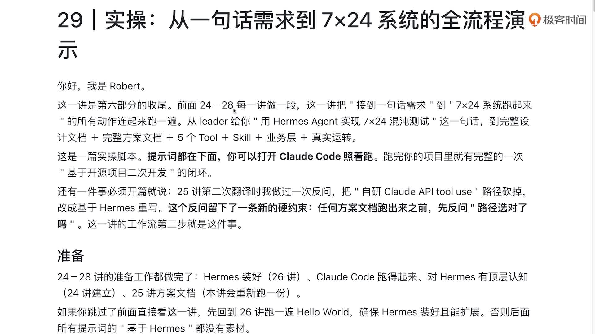

# 29 | 实操：从一句话需求到7×24系统的全流程演示

你好，我是 Robert。

这一讲是第六部分的收尾。前面 24-28 每一讲做一段，这一讲把“接到一句话需求”到“7×24 系统跑起来”的所有动作连起来跑一遍。从 leader 给你“用 Hermes Agent 实现 7×24 混沌测试”这一句话，到完整设计文档 ＋ 完整方案文档 ＋ 5 个 Tool ＋ Skill ＋ 业务层 ＋ 真实运转。

这是一节实操课，视频演示。提示词都在下面，你可以打开 Claude Code 照着跑。跑完你的项目里就有一次完整的“基于开源项目二次开发”的闭环。



还有一件事必须开篇就说：25 讲第二次翻译时我做过一次反问，把“自研 Claude API tooluse”路径砍掉，改成基于 Hermes 重写。这个反问留下了一条新的硬约束：任何方案文档跑出来之前，先反问“路径选对了吗”。这一讲的工作流第二步就是这件事。

## 准备

24-28 讲的准备工作都做完了：26 讲把 Hermes 装好了，Claude Code 跑起来，24 讲建立对Hermes 的顶层认知，25 讲完成方案文档（本讲会重新跑一份）。

如果你跳过了前面直接看这一讲，先回到 26 讲跑一遍 Hello World，确保 Hermes 装好且能扩展。否则后面所有提示词的“基于 Hermes”都没有素材。

```bash
# 进入 Hermes 仓库目录,所有提示词都在这里跑
cd hermes
```

## 场景一：第一次翻译，从一句话到完整设计文档

```
对应 25 讲。产出 docs/design.md（完整设计文档，与具体技术栈无关）。
```

提示词 1：把一句话需求展开成设计文档

```
帮我把这个一句话需求展开成完整的技术设计文档:用 AI Agent 给 RobustMQ
实现 7×24 不间断跑混沌测试的系统,自动起集群、注入故障、跑多语言 SDK、
```

- 收日志、出报告。

```
这一步先别谈具体技术框架,把＂为什么要做、做什么、不做什么、用什么思路、
```

- 覆盖什么场景、产出什么＂讲清楚。

```
有几个我自己一时拍不准的关键选择,你列出来给我看,每个给两三个选项和
影响,我来拍。
不要复述,要展开。
```

review 重点：六块都有内容（为什么／做什么／不做什么／思路／场景／产出），AI 列出来的“待我拍板的选择”至少 3 个，每个带选项和影响，不是空泛的“由你决定”。

提示词 2：反问补漏

跑完上面提示词，你会发现 AI 给的设计文档总有几处空洞，把空洞挑出来反问：

```
你这版有几处空洞:
1. 场景优先级没分。混沌测试持续跑,得有 P0/P1/P2 这种分级,
  按触发频率匹配。补一下。
2. 测试报告对内还是对外?这件事影响存储、Dashboard、脱敏一系列设计。
  给我两三个选项,我来拍。
3. SDK 矩阵不够系统。具体覆盖哪些语言、每种语言哪几个版本、
  怎么切换版本,展开。
别又冒新选择,把这版补完整。
```

review 重点：反问是“你这里漏了，补上”，不是追问。AI 不会主动告诉你它漏了什么，得你自己有一份“完整设计文档该长什么样”的预期，拿这份预期去比对它给的版本，差了什么就反问什么。预期从哪来？从你的工作经验里来。

提示词 3：整合成正式 PRD

```
基于前面两轮讨论,把所有产出整合成一份完整的技术设计文档,
```

- 能拿出去给社区评审的那种。

```
至少包括:
1. 背景和目标(为什么做)
2. 系统设计思路(全流程 AI 自动化)
3. 工具集清单(7 个工具函数,每个的签名和职责)
4. 场景库分级(P0/P1/P2)
5. SDK 矩阵(完整两张表:MQTT 和 mq9)
6. 协议兼容性归因表(测试发现问题→具体在哪里改)
7. 测试记录公开度决策
保存到 docs/design.md。
```

review 重点：协议兼容性归因表（不同 SDK 不一致 ／ 特定版本失败 ／ 全部失败 → 三种归因）有没有写进文档。这张表 28 讲报告模板会反复用。

跑完场景一，你手上有完整设计文档。这份文档跟具体技术栈无关。20-30 分钟。

## 场景二：跑通 Hermes 验证机制

对应 26 讲。这一步是动手命令，不是 AI 提示词。

```bash
# 安装 Hermes
curl -fsSL https://res1.hermesagent.org.cn/install.sh | bash
# 跟它聊一聊,感受手感
hermes
> 你能帮我做什么?
> 帮我看看磁盘空间占用,列出最大的 5 个目录
然后写一个最小 Skill 验证机制。在 ~/.hermes/skills/hello-world/ 下新建
```

SKILL.md，写一个返回当前时间的 Skill。跑通就行，这一步只是验证 Hermes 真的能扩展，不是这一讲的重点。

```
review 重点：hermes /skills 能看到 hello-world 出现在列表里，能看到说明 Hermes 加
```

载机制活着，后面正式项目就照同样的机制写。

跑完场景二，Hermes 验证完毕。20-30 分钟。

## 场景三：让代码长出来，5 个 Tool ＋ Skill 骨架

```
对应 27 讲。产出 ~/.hermes/skills/robustmq-chaos-test/ 下的 5 个 Tool ＋ 1 个
```

SKILL.md。

按 25 讲方案的依赖顺序：cluster → observability → client → chaos → report → SKILL。

提示词 4：cluster.py（完整模板）

```
帮我写 ~/.hermes/skills/robustmq-chaos-test/tools/cluster.py。
这是混沌测试 Skill 套件的第一个 Tool,负责在本地起停 RobustMQ 测试集群。
按 docs/solution.md 的决策:不引入 Docker,直接 spawn 多个 RobustMQ 进程。
action 支持 start / stop / status 三种。
start: 用 subprocess 拉起 3 个 RobustMQ broker 进程,每个用独立端口
(broker-1: 1883, broker-2: 2883, broker-3: 3883)和独立数据目录。
数据目录用 tempfile.mkdtemp 创建,记下来 stop 时清理。
启动后 curl http://127.0.0.1:1883/health 确认健康,失败立即 kill 全部
并返回 {"status": "failed"}。
成功返回 {"status": "running", "endpoint": "127.0.0.1:1883",
"data_dirs": [...]}。
stop: kill 所有 broker 进程,清理 data_dirs。
status: 返回当前运行的进程数和 endpoint。
RobustMQ 二进制路径通过 ROBUSTMQ_HOME 环境变量取,没设置就 fail-fast
返回 error,别用默认值兜底。
handler 函数签名 (args: dict, **_) -> str,失败返回 {"error": "..."}
别抛异常,Agent 循环见到异常会中断。
```

提示词的关键设计是三件事：接口签名、硬约束、已有依赖。

review 重点：不引入 Docker，ROBUSTMQ_HOME 没默认值是 fail-fast，临时目录 stop 时清理，失败返回 error 不抛异常。这四条任何一条没做到，回提示词补一句重跑。

提示词 5：observability.py

```
帮我写 ~/.hermes/skills/robustmq-chaos-test/tools/observability.py。
负责从 RobustMQ 集群收集观测数据,后面 chaos 故障注入和 client SDK
```

- 测试都会调它打快照。

```
action 支持 collect_logs / collect_metrics / snapshot 三种。
collect_logs 从 broker 进程的 log 文件抓最近 100 行,按节点返回。
collect_metrics 调 RobustMQ 的 /metrics 端点,返回 connections /
messages_in / messages_out / errors。
snapshot 一次性收 logs + metrics 加时间戳,用于故障前后对比。
```

提示词 6：client.py

```
帮我写 ~/.hermes/skills/robustmq-chaos-test/tools/client.py。
负责调度多语言 SDK 跑测试。按 solution.md 决策:不用 Docker 隔离,
用本地版本管理工具切换。服务器上预装了 pyenv / gvm / rustup /
sdkman / nvm。
action 是 run,参数 sdk(python/go/rust/java)、version、scenario、
cluster_endpoint。
内部:
1. 用版本管理工具切换到指定版本
2. 进入 sdk_clients/<sdk>/ 目录跑入口脚本
3. 入口脚本通过 CLUSTER_ENDPOINT 环境变量接收集群地址,stdout 最后
  一行必须输出约定 JSON({sent, received, lost, p99_ms, errors})
4. 解析最后一行 JSON,exit code 表示通过失败
注意:解析最后一行 JSON 失败,单独记 status=script_format_error,
```

- 别跟测试失败混在一起算。

```
不传 sdk 时,用 ThreadPoolExecutor 并发跑全部语言。并发逻辑放 Python 里,
别用 Hermes 的 delegate 机制。
```

提示词 7：chaos.py

```
帮我写 ~/.hermes/skills/robustmq-chaos-test/tools/chaos.py。
负责故障注入和恢复。按 solution.md 决策:Chaosd 主 + tc/kill 补。
action 支持 inject / recover。
inject: 接收 fault_type、target、duration_seconds 和具体参数,调
Chaosd HTTP API 注入。返回 {"fault_id": "...", "status": "active"}。
recover: 按 fault_id 撤销故障。
第一版只实现 broker-kill 和 network-delay 两种,其他先返回
not_implemented。
Chaosd 端点配置在 ~/.hermes/skills/robustmq-chaos-test/config.yml 里
读,don't hardcode。
```

提示词 8：report.py

```
帮我写 ~/.hermes/skills/robustmq-chaos-test/tools/report.py。
负责整合整轮测试结果,生成报告并提交到 GitHub。
action 是 generate_and_push,接收 run_data dict。
内部:
1. 用 Jinja2 模板渲染 Markdown 报告。模板路径 templates/report.md.j2,
  下一步会写。
2. 用 json.dumps 写 JSON 报告。绝对别调 LLM 生成 JSON。
3. git push 到 GitHub 公开仓库 test-reports。仓库地址从 config.yml 读。
  git push 用 Deploy Key,通过 GIT_SSH_COMMAND 指定 ~/.ssh/
  test-reports-deploy。
4. 返回 {"json_path", "markdown_path", "github_url", "run_passed"}。
run_passed 字段的逻辑:核心场景全过 + 非核心场景通过率 ≥ 75%。
写新报告时清理 30 天前的本地临时文件。
```

提示词 9：SKILL.md 骨架

```
帮我写 ~/.hermes/skills/robustmq-chaos-test/SKILL.md。
5 个 Tool 已经写好了,Skill 的任务是告诉 Agent 在 cron 触发或手动触发
时,按什么顺序调这些 Tool。
5 个 Tool 是 cluster / observability / client / chaos / report。每个
Tool 的接口签名见下面贴的接口表。直接照着调,别编不存在的字段。
骨架按这几节来:
- frontmatter,name=robustmq-chaos-test,requires_tools 列全 5 个
- When to Use,讲清 cron 触发("按 P0 跑一轮..." 这种)和手动 CLI 触发
 (hermes "按 P1 跑一轮 mq9 故障场景")各自怎么识别
- 测试前置检查,确认无残留进程
- 单场景执行五步:基线 snapshot → 注入故障 → 故障期间跑 SDK 测试
 (只记录不判断)→ 等故障窗口结束自动恢复 → 自愈验证(pass/fail
 唯一依据)
- 通过失败判断,exit_code=0 且 lost=0 且 p99_ms<500
- 报告归档,直接调 report 的 generate_and_push,它会处理 git push
- Pitfalls
具体场景(broker-kill 用什么 target、network-delay 多少毫秒之类)
这步先留白,下一步再用一个新提示词把场景填进去。
[贴 5 个 Tool parameters schema]
```

review 重点（这一段是 Skill 的灵魂）：Tool 接口完整喂给 AI。如果你不把 Tool 接口贴给AI，AI 会编出根本不存在的 Tool 调用，Skill 加载之后跑就报错。

这一步的代码没有写到这里，Claude Code 跑出来的真实代码我都放在 GitHub 仓库里。读到哪个 Tool 想看代码，直接去仓库对应文件看。

跑完场景三，5 个 Tool 加 1 个 Skill 骨架。每个 Tool 跑一次单点验证：

```
$ hermes
> 调用 cluster 起一个测试集群
```

Agent 真的去调了、返回结果回来，这个 Tool 就活着。某个 Tool 调不通也别慌，九成是description 没写清楚或 parameters schema 不合法，回提示词改两句重跑就行。

跑完场景三，代码层就齐了。1.5-2 小时。

## 场景四：填业务层

对应 28 讲。产出场景库、报告模板、config.yml、Deploy Key ＋ GitHub 仓库、cron.yml。

提示词 10：写第一个场景库文件

```
帮我在 ~/.hermes/skills/robustmq-chaos-test/scenarios/mqtt/ 下
写第一个场景 p0-broker-kill-leader.md。
格式:Markdown,自然语言描述,Agent 读完知道按 SKILL.md 的＂单场景五步＂
怎么调 Tool。
具体内容:
- 场景名:p0-broker-kill-leader
- 协议:MQTT
- 优先级:P0(每次触发都跑)
- 集群:3 节点 RobustMQ,broker-1 是 Leader
- 故障:用 chaos.py inject broker-kill,target=broker-1,duration=30 秒
- SDK 矩阵:从 config.yml 读 P0 档的 SDK 列表
- 验证:故障期间只记录,Chaosd recover 后等 broker-1 健康检查 200,
 再等 60 秒,跑完整 SDK 矩阵的 basic-pubsub
- 通过标准:exit_code=0,lost=0,p99_ms<500
- 失败处理:记录到 report,继续下一场景
写完不要解释,我直接看文件。
```

review 重点：故障类型和参数跟 chaos.py 接口对得上；通过标准的字段名（exit_code ／lost ／ p99_ms）跟 client.py 返回的 JSON 对得上。第一个场景写完套同样模板写其他场景。

提示词 11：报告 Jinja2 模板

```
帮我写 ~/.hermes/skills/robustmq-chaos-test/templates/report.md.j2,
Jinja2 模板。
输入是 report.py 传进来的 run_data,字段包括:run_id / started_at /
ended_at / cluster_info / scenarios(每个 scenario 含 fault_info /
sdk_results / passed)。
模板要点:
- 顶部一段 summary,Run ID + 起止时间 + 整体 pass/fail
- 每个 scenario 一个二级标题,展开 fault 信息和 SDK 矩阵结果
- SDK 结果用 Markdown 表格
- 底部一段＂协议兼容性归因＂,按 docs/design.md 那张归因表的逻辑套
 (不同 SDK 不一致 → 协议实现问题;特定版本失败 → 版本兼容问题;
 全部失败 → broker 端问题)
- 别在模板里调 LLM,纯 Jinja2 语法
模板长度控制在 80 行以内。
```

review 重点：底部那段“协议兼容性归因”是这一讲设计文档对应到报告的真实落点。如果三种归因都不命中，模板要标“待人工分析”，AI 在边界 case 上偷懒，这里要手动收一下。

提示词 12：套件配置 config.yml

直接抄（按 solution.md 决策填值）：

```
# ~/.hermes/skills/robustmq-chaos-test/config.yml
chaosd:
 endpoint: "http://127.0.0.1:31767"
sdk_matrix:
 p0:
   - {sdk: python, version: "3.11", scenarios: [basic-pubsub]}
   - {sdk: go,     version: "1.21", scenarios: [basic-pubsub]}
 p1:
   - {sdk: python, versions: ["3.10", "3.11", "3.12"],
      scenarios: [basic-pubsub, failover]}
   - {sdk: rust,   version: "1.70", scenarios: [basic-pubsub, failover]}
 p2:
   - {sdk: python, versions: ["3.10", "3.11", "3.12"]}
   - {sdk: go,     versions: ["1.20", "1.21"]}
   - {sdk: rust,   versions: ["1.70", "1.75"]}
   - {sdk: java,   versions: ["11", "17", "21"]}
github:
 reports_repo: "git@github.com:<your-org>/test-reports.git"
 deploy_key_path: "~/.ssh/test-reports-deploy"
 branch: "main"
```

review 重点：P0 档刻意只放 2 个 SDK，P0 是基础保障线，跑得越快越好，大矩阵留给 P1／P2。

提示词 13：GitHub Deploy Key ＋ test-reports 仓库

这一步是动手命令，不是 AI 提示词。三步搞定。

```bash
# 第一步:生成 ed25519 密钥对(空 passphrase 给自动化用)
ssh-keygen -t ed25519 -f ~/.ssh/test-reports-deploy \
   -C "robustmq-chaos-test deploy key" -N ""
# 第二步:在 GitHub 上创建 public 仓库 test-reports,然后:
# Settings → Deploy keys → Add deploy key
# 把 ~/.ssh/test-reports-deploy.pub 内容贴进去,勾 Allow write access
# 第三步:初始化仓库
GIT_SSH_COMMAND="ssh -i ~/.ssh/test-reports-deploy" \
   git clone git@github.com:<your-org>/test-reports.git /tmp/test-reports-init
cd /tmp/test-reports-init
echo "# RobustMQ Quality Reports" > README.md
git add README.md
GIT_SSH_COMMAND="ssh -i ~/.ssh/test-reports-deploy" \
   git commit -m "init" && git push
```

review 重点：勾 Allow write access 不能漏（默认是只读）。第三步 push 成功这一刻 DeployKey 链路就活了。

提示词 14：cron.yml 三档调度

直接抄：

```
# ~/.hermes/cron.yml
jobs:
 - name: p0-mqtt-basic
   schedule: "0 */2 * * *"
   prompt: "按 P0 跑一轮 MQTT 基础场景"
 - name: p0-mq9-basic
   schedule: "30 */2 * * *"
   prompt: "按 P0 跑一轮 mq9 基础场景"
 - name: p1-daily-fault
   schedule: "0 3 * * *"
   prompt: "按 P1 跑一轮故障场景,MQTT 和 mq9 都跑"
 - name: p2-weekly-matrix
   schedule: "0 4 * * 0"
   prompt: "按 P2 跑一轮完整 SDK 矩阵"
```

review 重点：P0 MQTT 和 mq9 错开 30 分钟避免资源冲突。频率配置直接来自 design.md的 P0／P1／P2 分级。

跑完场景四，业务层就位。1 小时。

## 一键跑完整流程：让 Claude Code 自主执行

前面四个场景一个个跑，是为了让你看清每一步的产出和 review 点。真正上手之后你会希望一次粘贴，Claude Code 自主跑完整流程，关键决策点停下来等你判断。

下面这段提示词就是干这个的。整段粘贴到 Claude Code，关键决策点会停下来等你输入。

注意：一键流程不管装 Hermes 和点 GitHub UI（这两件需要人动手）。它从“已经摸过Hermes、Hermes 已装好”这一步开始，跑到“5 个 Tool ＋ Skill ＋ 业务层全部就位”结束，最后停下来等你跑验证。

```
我刚拿到一个新需求:[把 leader 的一句话需求填这里,比如"用 Hermes Agent
实现一个 7×24 跑混沌测试的 AI 系统"]
完整跑通改造流程,全程自主推进,遇到关键决策点停下来等我,
不要每一步都问我。请按以下顺序执行:
第零步:第二次翻译反问(必做,不能跳)
- 这一步是这套工作流最关键的硬约束
- 等第一次翻译跑出方案文档之后,先停下来反问"路径选对了吗"
- 拿出我跑场景一时摸出来的 Hermes 认知,对比"自研"和"用 Hermes"
 两条路径,告诉我每条要做什么、工程量多大
- 等我反馈"按 Hermes 路径走"之后才能进第二次翻译
第一步:第一次翻译,从一句话到设计文档
- 把一句话需求展开成完整设计文档
- 列出待我拍板的关键选择(场景分级、报告公开度、SDK 矩阵)
- 停下来等我反馈
我反馈完后:
- 按反馈补完整,整合成正式 docs/design.md
第二步:执行第零步的反问
- 见第零步说明
我反馈"用 Hermes 路径"之后:
第三步:第二次翻译,基于 Hermes 重写方案
- 整体架构 + Skill 设计 + 7 个 Tool 实现要点 + 场景库 + 触发 +
 报告系统 + 关键决策记录 + 实施步骤
- 跑完后反问收紧:Skill 边界 / 故障注入选型 / GitHub 凭据
- 停下来等我审核 docs/solution.md 第 7 节决策记录
我反馈完后:
- 把决策落定到 solution.md
第四步:代码层,5 个 Tool + Skill 骨架
- 按依赖顺序:cluster → observability → client → chaos → report →
 SKILL.md
- 每个 Tool 写完跑一次单点验证 (hermes "调用 X")
- 任何 Tool 调不通,停下来报错给我
第五步:业务层
- 写第一个场景库文件,然后告诉我接下来要写哪些场景,等我反馈
- 写报告 Jinja2 模板
- 填 config.yml(SDK 矩阵根据需求决定档位)
- 提醒我手动生成 Deploy Key + 创建 GitHub 仓库(我自己做)
- 装 cron.yml 三档调度
第六步:跑通验证
- hermes /skills 和 /tools 看加载是否成功
- 用对话跑一次 P0 场景,7 轮调用全部展示给我
- 看 GitHub 仓库,确认报告 push 成功
自主原则:
- 每步跑完自己 review 输出质量,不合格自己重跑
- 失败自己 debug 自己修(除非连续 3 次同一错误)
- 接口签名 + 硬约束 + 已有依赖,提示词里都要交代
- Tool 提示词重传约束,Skill 提示词重喂 Tool 接口
- 结构化的东西用代码生成,JSON 别交给 LLM 写
- 关键决策点停下来等我,不要替我拍板
跑完输出 summary.md,列每个产出文件 + 我应该重点 review 的地方。
```

粘贴完等 Claude Code 跑。整个流程 4-5 小时（含你的几次 review）。你不在的时间它在跑，你回来的时间它停在那里等你判断。

为什么这段提示词这么写？

1. 第零步“路径反问”摆在第零位强制等待。这是这套工作流相比 21 讲护栏的最关键差异。21讲是“先点产品看现状”，这一讲是“第一次翻译跑完先反问路径”。两个第零步是一类硬约束，都来自一次真实翻车留下的工程教训。

2. 关键决策点显式让 AI 停下来。第一次翻译的关键选择（场景分级、报告公开度、SDK 矩阵）、路径选择（自研 vs Hermes）、第 7 节决策点 review、业务层场景库决策，这四个决策点 AI 不能替你拍。

3. 所有硬约束都明确写进提示词。接口签名 ＋ 硬约束 ＋ 已有依赖、Tool 提示词重传约束、Skill 提示词重喂接口、结构化的东西用代码生成不交给 LLM。这些约束散落在 24-28 讲，一键流程里要全部明确写出来。

4. summary.md 集中暴露 review 点。AI 不能完全替你思考，但可以把“我不确定的地方”集中到 summary 让你重点看。

## 小结

第六部分到这里结束。从 24 讲摸 Hermes、25 讲两次翻译、26 讲 Hello World、27 讲让代码长出来、28 讲填业务层让系统活起来，整套“基于开源项目二次开发”的方法论全部跑完。

这次跑完留下了一条最值钱的教训：第二次翻译之前，先反问“路径选对了吗”。AI 顺着你的提问给的方案不一定是最优的，你刚摸过的那个开源项目，可能已经把方案里 80% 的工程都做了，你不用自己撸。这条教训已经写进 25 讲方案文档，下次类似工作流 AI 会主动提醒你做。这一讲的提示词清单和一键工作流里“第零步反问”也是这条教训的产物。

整门课到这里也接近尾声。一个工程师在 AI 时代能交付的最值钱的东西，不是写代码的能力，是把方向定准、把约束讲清楚、把模糊变具体的能力。AI 给你一个 80 分的初稿，你要做的不是改成 95 分，是先判断初稿是不是建立在对的方向上。方向不对，改 100 遍也是错的。

## 思考题

跑完整套流程大约花了你多少时间？最卡你的是哪一步：摸 Hermes、第一次翻译、第二次翻译反问、代码层 Tool 编写、业务层场景库、还是跑通验证？

欢迎在留言区写下你的复盘，我们一起把“接到一句话需求 ＋ 基于开源项目二次开发”这件事磨成肌肉记忆。如果今天的课程让你有所收获，也欢迎转发给有需要的朋友，邀请他来一起学习，我们下节课再见！
