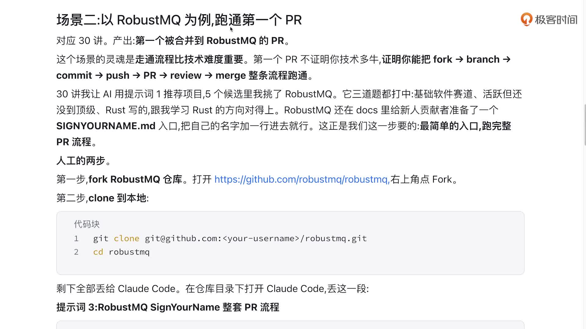

# 32 | 实操：挑战开源的全流程演示和我的开源经验

你好，我是 Robert。

这一讲是第七部分的收尾。前面 30、31 讲两个 PR、一个 issue 跑完了，这一讲把那两讲的所有动作连起来打包成一份可以反复用的清单，以后碰到任何项目都按这个清单跑。

这是一节实操课，视频演示。提示词都在下面，你可以打开 Claude Code 照着跑。跑完你就有了完整的“挑战开源”工作流。除此之外，这一讲还多一节，分享我这些年开源踩过的坑、看到的成长路径，补给你 30 和 31 讲学不到、只能靠时间踩出来的东西。



还有一件事必须开篇就说：30 讲那个“挑了排在最稳那一档的项目”的判断，后来我才意识到背后有几条 AI 推荐之外的隐性信号。这一讲后面的经验分享会把那几条讲清楚，找项目这件事，AI 帮你筛 80%，剩下 20% 是你的判断。

## 准备

GitHub 账号已注册、SSH key 配过、Claude Code 跑得起来、装了 gh CLI（真实开源工程师的工具栈）。

如果你跳过了前面直接看这一讲，先回到 30 讲跑一遍 SignYourName，确保你已经走通过完整的 fork → branch → commit → push → PR → merge 流程。否则后面所有提示词的“基于30 讲那套姿势”都没有素材。

下面我们承接 30、31 讲的内容，以 RobustMQ 作为具体示范项目。整个工作流跟项目无关，提示词改个项目名，就能复刻到任何项目上。

## 场景一：找到合适自己的项目

对应 30 讲前半段。产出：一个匹配你背景的候选项目、一个最简单的第一个 PR 入口。

这个场景的灵魂是心里没标准没关系，AI 帮你建标准。你只要把三道题告诉 AI，加上你的技术栈背景，AI 半小时给你 5 个候选。

第一步，让 AI 推荐项目。

打开 Claude Code，丢这一段:

提示词 1：三道题筛项目

```
我想开始给开源项目贡献代码,作为我的第一个开源 PR 的目标项目。
我的筛选标准是三道题:
1. 有真实技术含量,不是 demo 项目
2. 正在快速成长但还没到顶级(几百到几千 star、有持续 commit、
  有几个核心维护者,但还没到几万 star、没成为行业标准)
3. 跟我的技术栈或职业方向有关联
我的背景:[填你自己的方向,比如:做基础软件方向,熟悉 Java、Go、
Python,Rust 在学,对消息队列、数据库、Agent 框架这些方向感兴趣]
按这三道题给我推荐 5 个候选项目。每个项目说清楚:
- 项目定位
- star 数和最近一年的 commit 活跃度
- 维护者背景(独立团队还是大公司主导)
- 为什么适合我作为第一个 PR 目标
- 它的 good first issue 入口在哪
```

review 重点：5 个候选中的每一个都要满足三道题。如果有候选 star 数超 5 万或者最近 3 个月没 commit，这个候选要砍掉。AI 推荐之后还要靠你自己判断，后面经验分享有几条隐性信号要套。

第二步，让 AI 找最简单的 PR 入口。

```
挑好项目，先 git clone 下来，在仓库目录下打开 Claude Code。
```

提示词 2：扫仓库找 first PR 入口

```
我刚把这个项目的仓库 clone 下来了。我要做我的第一个开源 PR,
目标是走通完整流程,不追求技术难度。
请你扫一遍仓库的 README、CONTRIBUTING.md、docs/,看有没有专门
为新人设计的"first PR"入口。比如:
- 项目方贴心准备的简单贡献入口(签名墙、贡献者列表之类)
- good first issue 标签下的 typo 修订或文档补充
- 任何只需要改一行就能体验完整 PR 流程的入口
如果有,告诉我具体路径 + 怎么改 + 怎么提 PR。
```

review 重点：理想入口是项目方为新人专门设计的“签名”或“列表加自己”那种，改一行markdown 就行。如果没有，退而求其次找 typo 修订或文档补充。别选超过 50 行的 goodfirst issue，那不是真的 good for first。

跑完场景一，你手里有了一个匹配自己背景的项目、一个最简单的 PR 入口。下面场景二、三我们承接 30 讲的内容，以 RobustMQ 为例，继续把整个流程跑完。

## 场景二：以 RobustMQ 为例，跑通第一个 PR

对应 30 讲。产出：第一个被合并到 RobustMQ 的 PR。

这个场景的灵魂是走通流程比技术难度重要。第一个 PR 不证明你技术多牛，只是证明你能把fork → branch → commit → push → PR → review → merge 整条流程跑通了。

30 讲我让 AI 用提示词 1 推荐项目，5 个候选里我挑了 RobustMQ。是因为它三道题都打中：基础软件赛道、活跃但还没到顶级、Rust 写的，跟我学习 Rust 的方向对得上。RobustMQ 还在 docs 里给新人贡献者准备了一个 SIGNYOURNAME.md 入口，把自己的名字加一行进去就行。这正是我们这一步要的，最简单的入口，跑完整 PR 流程。

人工的两步。

第一步，fork RobustMQ 仓库。打开 https://github.com/robustmq/robustmq，右上角点Fork。

第二步，clone 到本地：

```bash
git clone git@github.com:<your-username>/robustmq.git
cd robustmq
```

剩下全部丢给 Claude Code。在仓库目录下打开 Claude Code，丢这一段：

提示词 3：RobustMQ SignYourName 整套 PR 流程

```
我刚 fork 并 clone 了 RobustMQ 仓库,要给 docs/SIGNYOURNAME.md
加一行我的信息,作为我的第一个开源 PR。
请你帮我把整套流程跑完。每一步执行前告诉我你要做什么,执行后告诉我结果。
任何报错立刻停下来问我,不要自己瞎修。
具体步骤:
1. 建一个新 branch,命名规范跟 RobustMQ 已有 branch 风格对齐
  (比如 feature/sign-your-name-<我的名字>)
2. 找到 docs/SIGNYOURNAME.md,先看一眼现有列表的格式,
  然后在合适的位置严格按同样格式加一行我的信息
3. 跑项目自带的代码格式检查或 lint。看 RobustMQ 的 CONTRIBUTING.md /
  pre-commit hook / Makefile,有什么用什么。别瞎跑 cargo build,
  这是个 markdown 改动,只跑相关检查就行。有报错就修,跑通为止。
4. 写一条 commit message,Conventional Commits 规范,subject
  不超过 50 字符。然后 git add 相关文件并 commit。
5. push 到我的 fork(remote 名是 origin)。
6. 给我写一个 PR 描述,3-5 行,说明这是我的第一个 PR、跟着
  SignYourName 入口跑通流程、表达对 RobustMQ 的好感、语气是
  普通工程师不是 LinkedIn 帖子。
7. 如果系统装了 gh CLI,直接 gh pr create 把 PR 提了。
  没装就把 PR 描述输出给我,我自己去 GitHub 点提交。
```

review 重点：三个护栏。每步执行前告知 + 报错立刻停（防 AI 瞎修）；别瞎跑 cargo build（防 AI 在 RobustMQ 这种大型 Rust 项目花几分钟编译 markdown 改动）；gh CLI 优先 +fallback 人工（真实工程师工具链）。

跑完场景二，第一个 PR 提了，等 RobustMQ 维护者 review。SignYourName 这种 PR 通常一天内被合并。30-60 分钟。

## 场景三：以 RobustMQ 为例，跑通第二个 PR

对应 31 讲。产出：第二个被合并到 RobustMQ 的 PR。

这个场景的灵魂是让 AI 当 Rust 助教。RobustMQ 是 Rust 写的消息中间件，代码量大、用了大量 async 和 tokio 生态。你 Rust 不熟没关系，AI 解释机制，你做判断。

第一个 PR 跑通流程之后，第二个 PR 要真有技术含量。走通三步：摸项目找方向、筛issue、实现 PR。

第一步，摸 RobustMQ 项目（针对找 issue 任务）。

提示词 4：四维度 RobustMQ 项目地图

```
我在 RobustMQ 项目仓库目录下。我已经成功提了第一个 SignYourName PR,
现在要做第二个 PR,目标是给 RobustMQ 提交一个有真实工程价值的小贡献。
请你按这四个维度给我一份针对"找 issue"任务的 RobustMQ 项目地图:
1. 模块划分。RobustMQ 的代码大致分成几块?每块负责什么?
  (重点关注 MQTT broker、存储引擎、journal server、common 工具等)
2. 测试组织。单测放在哪、集成测试放在哪、怎么跑?
3. 贡献热点。最近三个月哪几个模块改动最多?活跃 contributor 主要在
  哪些模块?(扫 git log 看)
4. 适合新人的入口。看 RobustMQ issues 里 good first issue /
  help wanted 标签下,有没有可以上手的方向?CONTRIBUTING.md
  有什么对新人的硬约束?
不要给我一份完整架构文档,只给我对找 issue 有帮助的那部分。
```

review 重点：带任务问。AI 不知道你要干嘛，会给一份干巴巴架构介绍。告诉 AI 你的目的，它会过滤出有用部分。这是 24 讲建立的姿势，在这一讲再用一次。

第二步，让 AI 帮你筛 issue。

提示词 5：三条标准筛 RobustMQ issue

```
基于刚才那份 RobustMQ 项目地图,帮我从 RobustMQ 的 issue 列表里筛 5 个
候选,作为我的第二个 PR 目标。
筛选标准:
1. 改动量不大,代码 + 测试加起来 50-200 行
2. 描述清楚,改动是局部的(单文件或单模块内)
3. 不需要深度业务理解,我能 review 得了 AI 写的代码
每个候选告诉我:
- issue 编号和标题
- 它在 RobustMQ 哪个模块(broker / journal / storage / common 等)
- 我做这个 PR 大概要干什么(一两句话)
- 为什么它符合上面三条标准
- 风险点在哪(比如有没有可能改完发现规模超出预期)
5 个候选给我排个优先级,从最稳到最有挑战。
```

review 重点：风险点必须列。AI 推荐 issue 时容易忽略“看起来 50 行实际改完发现是 500 行”的隐藏复杂度。每个候选必须显式说，“如果改起来比预期大要在哪一刻停下来”，这是新人最容易踩的坑。

第三步，实现 PR（长提示词）。

挑好 issue，在 fork 后的 RobustMQ 仓库目录打开 Claude Code。

提示词 6：RobustMQ 完整 PR 实现 + 测试 + 提交

```
我要给 RobustMQ 提一个 PR,实现 issue #XXX:[一句话需求描述]。
请你帮我把整套流程跑完。每一步执行前告诉我你要做什么,执行后告诉我结果。
任何报错或不确定的地方立刻停下来问我,不要自己瞎修。
具体步骤:
1. 先读 issue #XXX 的完整描述,然后读 RobustMQ 相关代码:这个 issue
  涉及的模块当前实现长什么样、它依赖哪些 API、上下游有哪些关键调用。
  读完给我一份"我要改什么"的简短 plan(3-5 条)。我审核 plan
  之后才能进下一步。
2. plan 我同意之后,建一个新 branch,命名跟 RobustMQ 风格对齐。
3. 按 plan 写代码。我 Rust 不熟,所以你写完之后:
  - 关键改动逐段告诉我"这里在做什么、为什么这么写"
  - 任何用到 Rust 特有机制的地方(lifetime / async trait /
    ownership / Send + Sync 等),简短解释
  - 不要为了炫技用复杂的 idiom,选最直白的写法
  - 如果有多种合理写法,选 RobustMQ 现有代码里最常用的那种风格
4. 看测试影响。这次改动相关的现有测试在哪?改完后会不会失败?
  失败的话怎么更新?需要新增测试覆盖什么场景?
5. 跑测试。看 RobustMQ 的 Makefile / CI 配置确认怎么跑这个 crate 的
  测试,不要用默认 cargo test 假设。跑通为止。
6. 跑 cargo clippy。所有 warning 都要清掉,不要留 #[allow(...)]
  绕过。
7. 写一条 commit message,Conventional Commits 规范。
  然后 git add + commit。
8. push 到我的 fork。
9. 写一个 PR 描述,包括:
  - 这个 PR 解决的 issue
  - 改动的高层描述(2-3 句)
  - 实现要点(3-5 条 bullet)
  - 测试覆盖了哪些场景
  - 有任何 trade-off 或后续可改进的点,显式说出来
10. 如果装了 gh CLI,直接 gh pr create 提交。没装就把 PR 描述
   输出给我,我自己去 GitHub 提。
```

review 重点：四件事。先 plan 后改（不能拿到 issue 闷头写）；关键改动逐段解释（AI 当Rust 助教）；不为炫技用复杂 idiom（防 AI 写出你 review 不了的高手风格 Rust）；所有warning 清掉不留 allow 绕过（RobustMQ 这种活跃项目对 PR 质量有硬要求）。

跑完场景三，第二个 PR 提了。1-1.5 小时。

## 场景四：以 RobustMQ 为例，提一个高质量 issue

对应 31 讲后半段。产出：第一个被 RobustMQ 维护者认真讨论的 issue。

第二个 PR 提了之后，接下来要做的不是马上提第三个 PR，而是提一个高质量 issue。原因有两个：

第一，issue 是比 PR 更难的开源贡献。PR 是我修好了这个问题，issue 是我发现了一个值得讨论的问题。后者需要你对项目有判断力，知道什么是真问题、什么是噪音。

第二，issue 是跟 Maintainer 建立连接的更好入口。一个高质量 issue 会吸引 Maintainer 来讨论，这种讨论比 PR review 的对话深度高得多。30 讲讲过“跟核心维护者建立连接”是开源最被低估的收益，issue 就是建立这种连接的最好方式。

第一步，扫 RobustMQ 找性能问题。

提示词 7：扫 RobustMQ 找性能问题

```
帮我扫一遍 RobustMQ 的代码,找潜在的性能问题。重点看:
1. 不必要的 .clone() 或 .to_owned(),特别是热路径上(MQTT 消息处理、
  存储读写、broker 转发)。
2. async 函数里持有同步 Mutex(应该用 tokio::sync::Mutex 或者
  重构掉)。
3. 锁的粒度太粗,把不该锁住的代码包进去了。
4. 在循环里反复分配 Vec / String / HashMap(可以预分配的场景)。
5. Stream / iterator 用法低效,比如 collect 之后又遍历的可以
  直接 chain。
不要找 clippy 已经能查出来的(RobustMQ CI 自己会跑)。
```

- 找那种需要看上下文才能发现的真问题。

```
给我 5 个候选,每个说清楚:
- 文件路径和行号
- 问题描述(具体哪段代码 + 为什么是问题)
- 影响范围(只有 corner case 才会触发,还是日常路径上)
- 修复思路(不要写代码,讲清楚改动方向就行)
```

review 重点：挑算法层面有改进的那一个，不是挑最简单的。“多余的 collect”、“多余的clone”那种 1 行就能改的代码风格问题，Maintainer 反应通常是“直接提 PR 删一行就行，提issue 干嘛”。算法层面有改进、修复需要讨论方向、需要测试验证的问题，才值得走 issue 流程。

第二步，让 AI 写一个高质量 RobustMQ issue。

提示词 8：高质量 RobustMQ issue

```
基于上面那个 [具体问题描述,比如 broker 转发热路径上的 O(n²) 过滤]
的性能问题,帮我写一个给 RobustMQ 提的 GitHub issue。
要求:
1. 标题简洁,一句话概括问题(<80 字符)
2. 正文按这几节:
  - Description:问题是什么,3-5 句话,讲清楚 [核心复杂度或机制
    问题]
  - Reproduction:怎么复现(具体条件 + 触发路径)
  - Impact:影响什么场景、严重程度,生产环境量化一下
  - Suggested fix:可能的修复方向(不要写代码,讲思路)
  - Environment:RobustMQ 版本、Rust 版本、OS
3. 语气是普通工程师,不是 LinkedIn 帖子,不是问问题,是报告问题
4. 显式说"我可以在确认方向后跟一个 PR",给 RobustMQ 维护者一个
  信号:我不只是路过的伸手党
```

review 重点：最后一条“我可以跟 PR”是高质量 issue 的标志。它告诉 Maintainer 你不是只想刷 contribution 数字，你愿意接着把这件事做完。很多时候 Maintainer 看到这一句就会主动来review 和讨论。

跑完场景四，第一个高质量 issue 也提了。30-45 分钟。

到这里，第一个 PR + 第二个 PR + 第一个 issue 全部跑完。GitHub 个人页面上有了RobustMQ 这个项目的真实贡献痕迹。

## 一键跑完整流程：让 Claude Code 自主执行

前面四个场景一个个跑，是为了让你看清每一步的产出和 review 点。真正上手之后，你会希望一次粘贴、Claude Code 自主跑完整流程、关键决策点停下来等你判断。

注意：一键流程不管 fork 这一步（GitHub 账号操作 AI 做不了），也不管挑哪个项目和挑哪个issue，这两个决策必须人来挑。它从已经选好项目，并 fork + clone 完这一步开始。

下面这段提示词的默认项目是 RobustMQ，你也可以换成你 AI 推荐出来的任何项目：

```
我要给开源项目持续贡献代码。当前已经 fork+clone 了 RobustMQ
(或者你换成自己的项目),本地仓库在当前目录。请按以下顺序执行,
```

- 关键决策点停下来等我。

```
第零步:摸项目(必做)
- 用四维度框架扫一遍仓库:模块划分 / 测试组织 / 贡献热点 / 新人入口
- 输出"针对找 issue 任务的项目地图"
- 不要给完整架构文档
第一步:第一个 PR(SignYourName 类入口)
- 找项目方为新人设计的"first PR"入口(签名墙 / 贡献者列表)
- 没有就找一个 typo 修订或文档补充
- 走通完整流程:branch / 改文件 / lint / commit / push / PR 描述 / 提 PR
- 跑完告诉我 PR 链接,然后停下来等 review
第一个 PR review 期间(等待时间),并行做:
第二步:筛第二个 PR 的 issue
- 按三条标准筛:改动量 50-200 行 / 局部改动 / 我能 review
- 给我 5 个候选 + 优先级排序
- 停下来等我挑
我挑完之后:
第三步:实现第二个 PR
- 先读 issue + 相关代码,给我一份 plan,等我审核
- plan 同意之后写代码,关键改动逐段解释
- 补测试,跑测试到通过
- 跑 lint(cargo clippy 之类),所有 warning 都清,不留 allow 注解
- commit / push / PR 描述 / 用 gh CLI 提 PR
第四步:扫漏洞,提高质量 issue
- 扫静态代码找性能问题(重点看不必要的 clone / async 锁 / 循环内分配 / iterator 低效用法)
- 排除 lint 能查出来的
- 给我 5 个候选,优先选算法层面有改进的(不是 1 行能改的代码风格)
- 我挑完之后,帮我写一个高质量 issue,显式带"我可以跟 PR"信号
自主原则:
- 每步跑完自己 review 输出质量,不合格自己重跑
- 失败自己 debug 自己修(除非连续 3 次同一错误)
- 任何"我能在 X 之内做完"的预估,如果实际超 1.5 倍,停下来报告
- 不要替我拍板 issue 的选择和修复方向
跑完输出 contributions.md,列每个产出 + 每个的 PR / issue 链接 +
我应该重点 review 的地方。
```

为什么这段提示词这么写？

1. 顺序里第一个 PR 期间并行做第二步筛 issue。第一个 PR 提了之后，等 review 通常要几小时到一天，这段空窗期最适合找下一件事。AI 不会主动并行做事，你要在提示词里显式告诉它什么时候开始下一步。

2. issue 的选择和修复方向显式让 AI 停下来等人。这两件事 AI 替你拍是最危险的，挑了一个写完才发现是个规模超预期的 issue，或者修复方向跟项目方向不一致，几小时白白浪费。

3. lint warning 不留 allow 注解，是开源协作的硬要求。新人最容易在这里偷懒，提示词里必须显式禁掉。

4. “超 1.5 倍预估时间停下来报告”是给 AI 装的护栏。AI 容易陷在某个细节上反复打磨，你要在提示词里告诉它“超时就停下来让我看”，而不是让它一直跑直到上下文耗尽。

## 经验分享：那些动作之外的事

到这里实操部分就结束了。但开源做久了，你会发现真正决定你能走多远的不是这些动作，是动作之外的几件事。这部分我来分享下自己这些年踩过的坑，补给你 30、31 讲学不到的东西。

1. 选项目还有 AI 推荐之外的隐性信号。

30 讲三道题筛出来是候选，但要进一步看三个东西：

- 项目 PR 列表里 review 速度，超过一周的项目对新人不友好。

- 维护者构成，只有 1-2 个核心维护者，你的 PR 完全靠他们的状态决定迭代速度。

- 最近 6 个月新增 contributor 数，新人持续进来意味着 onboarding 路径已经被走通过，你不是第一个吃螃蟹。

这三条信号合起来，能筛掉那种“星光闪闪但已经停滞”的僵尸项目。这些项目最坑新人，因为它们看起来活，实际上没人在 review。

2. PR 被 close 了别憋着。

我自己第一次 PR 被 close 时心里很不舒服，觉得 Maintainer 不识货。后来才明白，PR 被close 是开源里最常见的事，跟你写得好不好没关系，跟项目当下状态有关系。

被 close 之后做三件事：礼貌问原因（Could you help me understand which part is out ofscope？），把代码留在自己 fork 里（可能哪天项目方向变了就用上了），换一个 issue 继续。别把 PR 被 close 当成对你能力的判决，开源是协作不是考试。

3. 长期主义的复利。

开篇 30 讲我讲过 Kafka 那段经历：我提了两个 PR 就停了，跟我同期开始的另一个人坚持了四五年，成了 Kafka 的 PMC。那段差距让我想了很久，到底差在什么动作上。不差在技术，差在三件事。

- 第一件，他持续在那个项目上跑，每周都有 commit，即使是文档级的小 commit，频次比单次质量更重要。

- 第二件，他参与 review 别人的 PR，即使他还不是 Committer，review 别人是无声的能力证明，Maintainer 会逐渐把你当作自己人。

- 第三件，他在 mailing list 和 design doc 讨论里发声，即使有时只是问澄清性问题，这件事让他从写代码的工程师变成项目的 stakeholder。

把这三件事加起来，从 Contributor 到 Committer 1-2 年，从 Committer 到 PMC 3-5 年。差距不在某一个 PR 写得多牛，在你愿不愿意把开源当工作的一部分。

4. AI 时代的新红利和新门槛。

AI 让“开始”这件事变容易了，这是 30 讲讲的红利。但还有一个更隐性的变化，AI 让中等技术含量的 PR 数量爆炸，Maintainer 的注意力反而更稀缺。三年前一个写得清楚的 bug fix PR 提上去，Maintainer 多半会顺手 review。今天同样质量的 PR 排在一堆 AI 辅助生成的 PR 后面，review 速度反而慢了。

这意味着新人想脱颖而出，门槛反而高了。光会用 AI 提 PR 不够，你得展示 AI 替代不了的东西，包括：对项目方向的理解，对 trade-off 的判断，跟 Maintainer 沟通的体感。AI 让代码贬值，但对项目的判断力在升值。

我自己现在的工作姿势是：写代码这一段我大量用 AI（30/31 讲那些工作流我每天都在跑），但 review、讨论、长期跟踪 issue 这些动作我自己做。把省下来的写代码时间投到这些“人才能做的事”上。这才是 AI 时代工程师贡献开源的正确姿势：用 AI 加速产出，把时间投在 AI 替代不了的协作和判断上。

## 小结

第七部分到这里结束。30 讲第一个 PR 的心理胜利，31 讲第二个 PR + 第一个 issue 的真本事，这一讲把动作打包成可反复用的清单 + 经验分享。整套挑战开源的方法论全部跑完。

一起回顾下前面的内容。第一部分到第七部分，讲的是同一件事：AI 时代怎么做老项目改造。包含公司内的老项目，基于开源做需求，挑战开源给别人的项目贡献代码，这三种形式背后是同一套方法论：读懂陌生代码、找到改造点、用 AI 高效产出、保住质量。

这套方法论的核心不是某个具体项目的技巧，是 AI 时代工程师该有的工作姿势。写代码这件事 AI 让它贬值，但读代码、判断方向、跟人协作，这些事 AI 让它升值。整门课所有的动作都在训练后一类能力。

如果你只能从这部分记一句话，记这一句：开源不是技术比赛，是耐心比赛。AI 时代，这条更对。

挑一个你感兴趣的项目，按这一讲的清单跑通第一轮，然后每周回来一次，每次只做一个小改动。频次大于单次重量。3 个月后回头看，你的 GitHub 个人页面会变成另一个样子。不是因为你做了什么了不起的事，只是因为你没停下来。

## 思考题

1. 跑完整套流程大约花了你多少时间？最卡你的是哪一步，筛项目、筛 issue、实现 PR、扫漏洞、还是写 issue?

2. 如果让你给一个还没开始做开源的工程师推荐一件最值得做的事，你会推荐什么?

欢迎在留言区写下你的判断，从今天起，我们的留言区也会是一个已经走过这套流程的工程师互相分享开源经验的地方。如果今天的课程让你有所收获，也欢迎转发给有需要的朋友，邀请他来一起学习，我们下节课再见！
