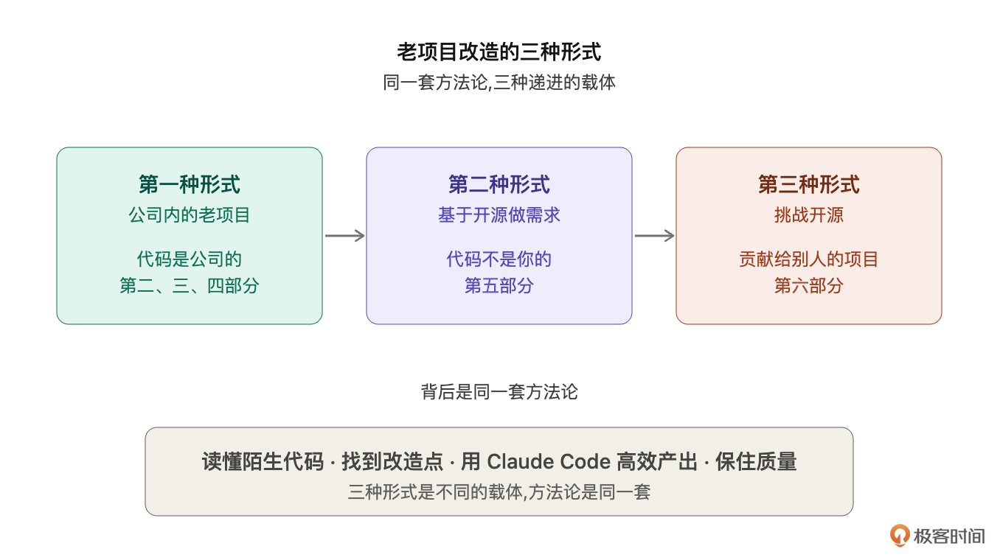
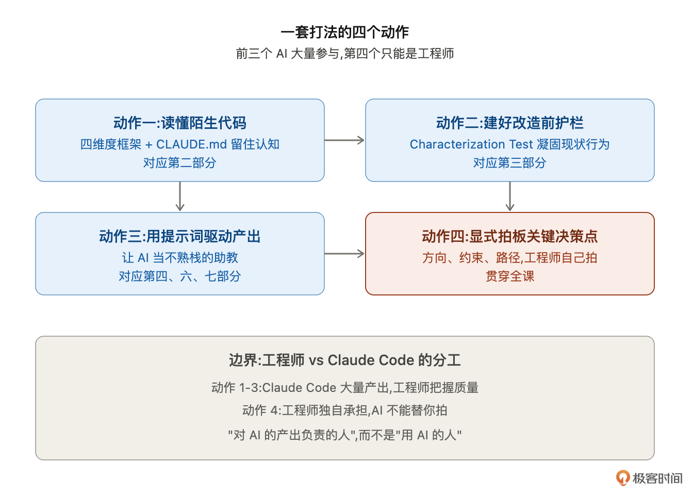
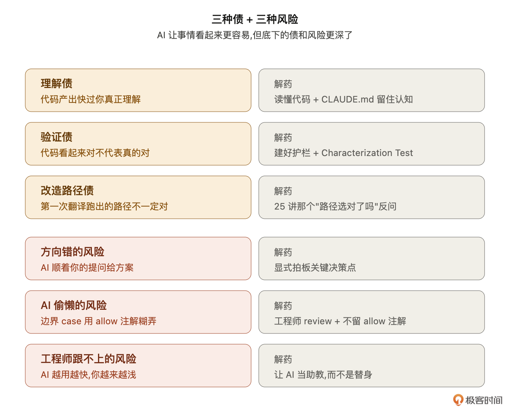
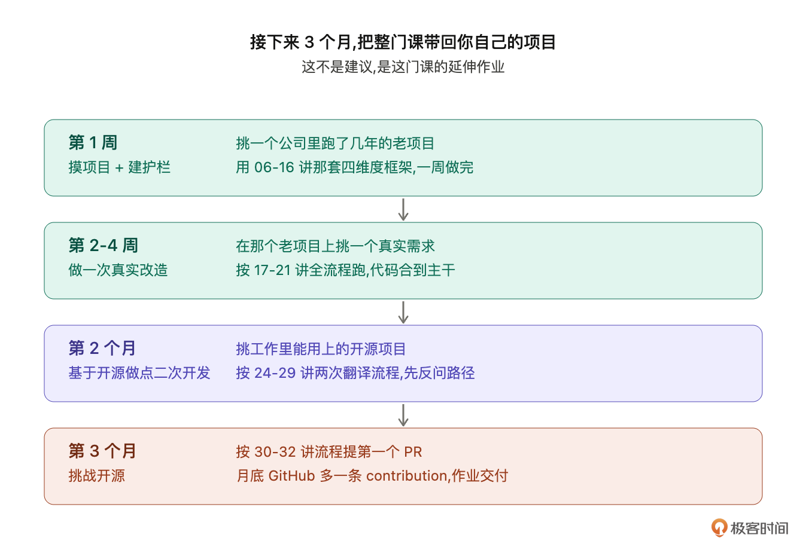

# 33 | 改造SOP：三种形式、一套打法，把整门课带回你自己的项目

你好，我是 Robert。

这一讲不教新东西。前面 32 节课，该讲的方法论、提示词、工作流、踩过的坑，都讲完了。这一讲要做的事是回头看，把整门课跑过的所有动作重新组织一遍，变成一份你能拎走的资产。知识可以忘，但工作姿势忘不了。

我们一起走的这一段，从开篇词那句“老项目改造，Claude Code 能做好吗”开始，跑过三个真实项目、写了一百多段提示词、踩过一堆坑、留下了一份提示词 SOP 文档。

整门课最终留给你的，不是这些产出物本身，是一种工作姿势——面对任何陌生老项目都能用同一套方法论走下来。这一讲就把这个姿势再强化一遍，用一份你能贴到墙上看的方法论地图作为收尾。

## 三种形式，一套打法

整门课所有内容沿着老项目改造的三种形式展开。这三种形式不是平行的三个练兵场，是同一件事的三种渐进难度。



第一种，公司内的老项目改造。代码是公司的、bug 是公司的、方向是业务定的。课程第二到第四部分以一个真实的 Java 后端项目为载体，带你完整跑过“摸项目 → 建护栏 → 拆需求 →跑通改造”这条全流程。这是大多数工程师日常面对的场景。走完这一段，你心里有了第一份“怎么用 AI 改老代码”的肌肉记忆。

第二种，基于开源做需求。代码不是你的，但用法是你的。课程第五部分基于一个开源 AIAgent 控制平面做二次开发，产出一个 7×24 不间断运行的真实自动化测试系统。这部分最大的收获是 25 讲那个反问：第一次翻译跑完之后，先停下来反问“路径选对了吗”。AI 顺着你的提问给的方案不一定是最优的，你刚摸过的那个开源项目可能已经把方案里 80% 的工程都做了，你不用自己撸。

第三种，挑战开源。代码不是你的，bug 也不是你的，你贡献回去。课程第六部分带你筛一个真实活跃的 Rust 开源项目，跑通两个 PR + 一个 issue，带回一个真实可点击验证的开源Contributor 身份。这部分最大的收获是 30 讲那个观点：在 AI 时代，开源 commit 反而比以前更值钱，因为它公开可验证、不可伪造、AI 写不出来。

三种形式背后是同一套方法论：读懂陌生代码、找到改造点、用 Claude Code 高效产出、保住质量。这套方法论不是某个具体项目的技巧，是 AI 时代工程师该有的通用工作姿势。整门课所有动作都在训练这套姿势，只是把它放在三种不同的载体上跑了三遍。

## 一套打法的四个动作

整门课的方法论可以压缩成四个动作。这四个动作互相支撑，缺一个都跑不通完整的改造闭环。



第一，读懂陌生代码。对应第二部分。任何老项目改造的第一步都是读懂，不是动手。给Claude Code 一份拆解框架（架构、模块、依赖、接口、数据模型），让它在你的框架下把项目快速展开，然后让它把跑出来的认知写成 CLAUDE.md 留住。这一步是整门课所有后续动作的地基。

第二，建好改造前护栏。对应第三部分。能跑起来才有底气改，有兜底测试才有底气提交。Characterization Test 不是单纯写测试，是把“这一刻系统的行为是什么”凝固成可执行代码，任何后续改动跑这套测试就知道有没有偏移。这一步在大多数 AI 编程课里被忽略，但在企业级老项目改造里是生死线。

第三，用提示词驱动产出。对应第四、六、七部分。具体动作分两层：普通工作场景下提示词驱动 Claude Code 写代码、跑测试、提 PR；不熟语言场景下让 Claude Code 当你的技术栈助教，它写代码，边写边解释关键机制（所有权、async、特定库的 idiom），你做判断。你不熟没关系，AI 解释机制，你做判断。这是这套打法在 AI 时代最值钱的部分。

第四，显式拍板关键决策点。这是贯穿整门课的姿势。Claude Code 给你一个 80 分初稿，你要做的不是改成 95 分，是先判断初稿是不是建立在对的方向上。25 讲那个“路径选对了吗”的反问、20 讲那个“先点产品看现状”的硬约束、31 讲那个“挑算法层面有改进的 issue 而不是一行能改的代码风格”的判断，本质上都是同一件事：关键决策点不能让 AI 替你拍。这一动作在工具层面看不见，但跑完整门课你会感受到自己跟 AI 协作的姿势变了。

四个动作合起来就是一套完整的“AI 时代企业级老项目改造方法论”。前三个动作 AI 大量参与产出，第四个动作只能是工程师自己。这条边界是这门课最重要的交付。

## 三种债和三种风险

整门课所有动作都在防一件事：AI 让事情看起来更容易了，但底下的债和风险其实更深了。

业界已经在认真讨论这件事。Addy Osmani 提了 Comprehension Debt（理解债），Sonar 调研了 Verification Debt（验证债），Anthropic 的 52 人对照实验显示 AI 辅助开发者的代码理解能力比对照组低 17%。这些不是营销术语，是真问题。

整门课跑下来，我把工程师在 AI 时代该警觉的事，压缩成三种债 + 三种风险。



三种债：

- 理解债：代码产出速度远超你真正理解代码的速度。AI 写得快，但你脑子里没跟上。这门课通过“读懂陌生代码 → 写 CLAUDE.md 留住认知”这条主线在还这条债。

- 验证债：代码看起来对，不代表它真的对。Sonar 调研显示 96% 开发者不完全信任 AI 产出，但只有 48% 每次都 review。这门课通过“建好改造前护栏 + Characterization Test”这条主线在还这条债。

- 改造路径债：第一次翻译跑出来的方案不一定是最优路径，如果你不停下来反问，后面所有动作都建立在错的地基上。这门课通过 25 讲那个“路径选对了吗”的反问在还这条债。

三种风险：

- 方向错的风险：AI 顺着你的提问给方案，但你的提问不一定问对了。显式拍板关键决策点是这条风险的解药。

```
AI 偷懒的风险：在边界 case、warning 处理、工程师不熟的栈上，AI 会偷偷用 #[allow]
```

- 或泛化兜底糊弄过去。工程师 review + 不留 allow 注解是这条风险的解药。

- 工程师跟不上的风险：AI 越用越快，工程师对代码的真实把握越来越浅，某天 AI 出了 bug你已经不知道怎么修了。让 AI 当助教，而不是写完就走的合伙人，是这条风险的解药。

把这三种债和三种风险加起来，工程师在 AI 时代真正的角色是：不是用 AI 的人，是对 AI 的产出负责的人。这门课所有的提示词、护栏、复盘、反问，本质上都是在训练这个角色。

## 把整门课带回你自己的项目

整门课结束，你工程师生涯接下来怎么走，才是这门课真正的考题。我给你一份具体可执行的3 个月路径。这不是建议，是这门课的延伸作业。



1. 摸项目 + 建护栏。挑一个公司里跑了几年、你正在维护的老项目，今天就开始跑摸项目流程。用 06-12 讲那套四维度框架，让 Claude Code 给你一份项目地图。然后跑 13-16 讲建一份能跑通的护栏。一周时间够，不需要熬夜。

2. 做一次真实改造。在那个老项目上接下来要做的真实需求里挑一个，按 17-21 讲那套“拆需求 → 拆方案 → 后端 → 前端”全流程跑一遍。用 21 讲那个一键流程的提示词，关键决策点停下来等你。三周做完一次需求改造，代码合到主干，这就是你给这门课交的第一份作业。

3. 基于开源做二次开发。挑你工作里能用上的开源项目（消息队列、Agent 框架、AI 工具链都行），按 24-29 讲那套“两次翻译”流程做点东西。记住第二次翻译之前先反问“路径选对了吗”。月底产出一份方案文档 + 一份能跑的实现，就算这件事最终没真正上线，你拿到的认知和方法论也值得。

4. 挑战开源。按 30-32 讲那套流程，给一个真实活跃的开源项目提第一个 PR。30 讲那个观点，“在 AI 时代开源 commit 依然是简历最值钱的资产”，你已经听过，这一步是把它兑现。月底如果你的 GitHub 个人页面上多了一条 contribution，这门课就给你交付了它最值钱的部分。

走完这个流程，你的工作姿势会变成另一个样子。不是因为你做了什么了不起的事，是因为你没停下来。频次大于单次重量，这是项目改造、开源贡献、甚至整个工程师生涯里最值钱的一条。

## 小结

整门课跑完，我留给你三句话作为这门课的重点。

第一句：AI 时代，工程师能交付的最值钱的东西不是写代码，是把方向定准、把约束讲清楚、把模糊变具体的能力。AI 给你一个 80 分初稿，你要做的不是改成 95 分，是先判断初稿建立在对的方向上。方向不对，改 100 遍也是错的。

第二句：让 Claude Code 加速产出，把时间投在它替代不了的协作和判断上。写代码这一段大量交给 AI，但 review、讨论、长期跟踪、跟人协作、判断方向，这些自己做。这是 AI 时代工程师的正确姿势。

第三句：开源不是技术比赛，是耐心比赛。AI 时代，这条更对。这门课最后一段教挑战开源，本质上是教你“把工程师生涯当长期事情来看”。3 个月、6 个月、1 年后回头看，你会感谢现在按这个节奏走的自己。

到这里，课程收尾。三个项目、三种形式、一套打法、一份 SOP 文档，全部交付给你。

如果今天的课程让你有所收获，也欢迎转发给有需要的朋友，邀请他来一起学习，我们下节课再见！
