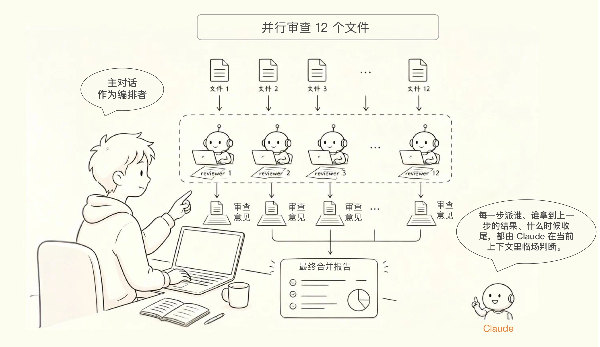
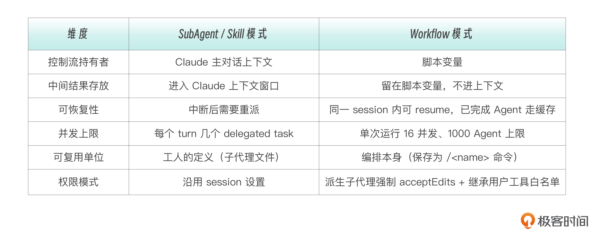
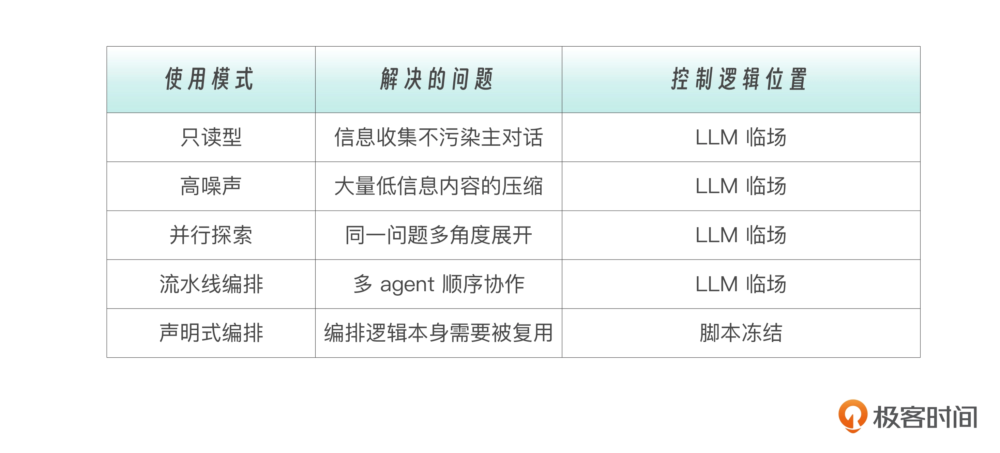

# 热点加餐 | Workflow：编排载体的第三种选择

你好，我是黄佳。

之前讲子代理，我们归纳出四种使用模式：只读型、高噪声、并行探索、流水线编排。这四种模式的共同前提是主对话作为编排者：每一步派谁、谁拿到上一步的结果、什么时候收尾，都由 Claude 在当前上下文里临场判断。

到了 Claude Code v2.1.154，第三种编排原语正式进入我们视野，它就是 Workflow。它和Sub-Agent、Skill 并列，目前是 research preview。

这篇加餐需要补充的内容是，Workflow 不是更强的 Sub-Agent，它把编排逻辑从对话搬到了脚本里，由此带来一套不同的契约。



说明：Workflow 还在 research preview 阶段，所以加餐里涉及的版本号、并发上限、命令名、目录路径都以官方文档为准，后续版本可能调整。

## 从放大规模的并行审查说起

延续我们前面 SubAgent 中的例子。我们配置过一个 code-reviewer 子代理，YAMLfrontmatter 里写好 description 和工具白名单，主对话把 PR diff 派给它，回来一份审查意见。它有独立的上下文窗口、限定的工具集、可复用的定义文件，在“一次派一个工人”的场景下表现稳定。

现在把这个例子放大一个量级。假设一个 PR 改了 12 个文件，你想让 12 个 reviewer 并行各看一份，最后合并成一份报告。

第 7 讲的并行编排能做到这件事，主对话发起 12 次 Task，等它们陆续返回，自己负责整合。整段编排在主对话里大致是这样：

```
1. 你（主对话）：起 12 个 Task 子代理，每个看一个文件
2. 12 个子代理并行跑，结果陆续回到主对话上下文
3. 你（主对话）：在被塞满的窗口里读完 12 份，自己合成最终报告
```

任务能跑，但当编排规模继续放大，就会出现三类痛点。

第一类痛点是中间结果都要回主对话上下文。12 份审查意见加上每个 reviewer 自己派生的中间产物，全部塞进当前会话窗口，而主对话还要在这个被塞满的窗口里做合并。

第二类痛点是中断后没有缓存机制。比如审到第 9 份的时候网络断了或者你想停下来看一眼，前面 8 份的产物会丢失，恢复时通常得从头再排一遍。

第三类痛点是无法复用编排逻辑。同事 fork 这条流程跑不出同一份报告。“先派 12 个reviewer，再让 summarizer 合并，最后让 critic 找漏审”这一整套编排逻辑写在你当时的prompt 里。下一次换一个人、换一个 PR、prompt 措辞略有不同，跑出来的结构就不一样。

这三类痛点都不是 Sub-Agent 本身的缺陷，而是编排逻辑活在对话里带来的副作用。当编排本身值得被命名、复用、版本化的时候，它需要从 prompt 搬到代码里。这就是 Workflow 想解决的问题。

## Workflow 的工程定义

官方文档对 Workflow 的定义可以总结为：一段 JavaScript 脚本，由 Claude 写，运行时在隔离环境后台执行，用来大规模编排子代理。在 Claude Code 的原语体系里，它和 Sub-agent、skill 并列，是第三种编排原语。

这里有一个反直觉的设计点要先澄清。Workflow 的脚本是 Claude 写的，不是用户写的。用户描述任务，模型生成编排代码，运行时去执行。这和普通 SDK 里“开发者写代码调用LLM”的关系反过来了——LLM 写代码、运行时跑代码、用户只看最终结果。

脚本本身是确定性的 JavaScript：循环的轮数、分支的走向、并行调度的数量，都由代码静态决定。脚本内部派生 Sub-Agent 去做实际工作，Sub-Agent 才是非确定性的部分。换句话说，Workflow 是包在非确定性 Agent 外面的确定性胶水。

中间结果存在脚本变量里，不进 Claude 的上下文。这是整段设计的核心。脚本可以跑几百个Agent、产生几百份中间产物，主对话窗口里只会看到最终汇总后的答案。后台隔离运行、上下文卸载、Agent 之间互不污染，这三项性质都从这个设计点派生出来。

触发 Workflow 有三种方式：

```
显式调用 /deep-research（目前自带的唯一 workflow 命令）
```

- 在普通 prompt 里包含“workflow”关键词强制走 workflow 模式

```
通过 /effort ultracode 让 Claude 把每一个实质性任务都自动编排成 workflow（一次
```

- 请求甚至可能串成多个 workflow：先理解代码、再做修改、再验证）。

```
组织级别禁用可以通过 disableWorkflows: true 设置或
CLAUDE_CODE_DISABLE_WORKFLOWS=1 环境变量。
```

## 控制流谁来持有

那 Workflow 和 Sub-Agent 模式的差别是什么？一句话概括，看控制流到底在哪里。

Sub-Agent 加 Skill 的模式下，控制流在 Claude 的上下文里。Claude 看到当前状态，决定下一步派谁；Sub-Agent 跑完把结果交回来；Claude 再看状态、再决策。每一步的“接下来怎么走”由模型在当前 turn 里临场判断，整段编排逻辑只存在于这一次会话里。

Workflow 模式下，控制流在脚本变量里。循环、分支、并行调度都在 JavaScript 代码中静态表达。Claude 不再逐步做编排决策，它只在最开始写一次脚本，然后看最终输出。运行时按脚本走，跑出来的路径是确定性的。

围绕这条核心区别，其余几乎所有可观察到的差异都可以推导出来：



下面是一段 Workflow 脚本骨架，方便你感受它的结构。

```
这是对 /deep-research 类编排的抽象示意，不是确切的 API——底层 SDK 原语是
AgentDefinition，包含 description / prompt / tools / model / effort / background /
```

permissionMode / maxTurns / skills / memory / mcpServers 等字段。

```javascript
// 示意伪代码，真实 API 见 AgentDefinition
const angles = ["security", "performance", "maintainability"];
// 阶段一：扇出。每个角度独立扫描，不同阶段可以路由到不同模型
const drafts = await Promise.all(
 angles.map(angle =>agent({
prompt: `Audit src/routes/ from a ${angle} perspective`,
model: "claude-haiku-4-5",  // 扫描类任务用更小的模型
 }))
);
// 阶段二：对抗审查。每份草稿被独立 agent 检查
const verified = await Promise.all(
 drafts.map(draft =>agent({
prompt: `Review this draft for claims that don't hold up: ${draft}`,
model: "claude-sonnet-4-5",
 }))
);
// 阶段三：合并。只有这一步的结果会回到主对话上下文
returnsynthesize(verified);
model 参数说明了 Workflow 自带的一项成本控制能力，不同阶段可以路由到不同大小的模
```

型，扫描类用小模型，合并类用大模型。

对照流水线编排能看清楚两种风格的差别。在第 7 课里，我们让主对话“先调 Locator 找出问题位置，再交给 Analyzer 分析根因，最后让 Fixer 改”，这是 prompt-driven 的编排，每一步走不走、走哪一支由主对话临场判断。

同一段流程，如果换成 Workflow 脚本就成了 schema-driven 的版本，控制流由 JavaScript 持有，跨 session 跑出来路径一致。两种方式都能完成这件事，区别在于编排逻辑是否需要被冻结和复用。

## 确定性换来的三项收益

把控制流从 Claude 的临场判断转移到脚本中，代价是灵活性下降，换得的是三项具体收益。

第一项是可重复性。同一份脚本跑十次走同一条路径。当你跑出一次满意的结果，可以在

```
/workflows 视图里按 s 把它保存成 /<name> 命令。存到 .claude/workflows/ 是项目
级，跟着 git 走全队共享；存到 ~/.claude/workflows/ 是用户级，跨项目可用。下一次
```

同事在他的机器上跑同一个命令，编排逻辑是同一份。

```
第二项是并行规模。主对话单点协调的并行能力是有上限的。对于 扫描 src/routes/ 下所
```

有 API endpoint 找出缺失的鉴权检查、对 500 个文件做批量迁移、跨整个 codebase 做一次结构化审计等高并发需求场景，从结构上就需要把编排外化。

第三项是会话内可恢复。运行时缓存每个完成 Agent 的产物，跑到一半暂停或终止了，再重启时已经完成的 Agent 直接走缓存，没跑完的接着跑。

除此之外，还有一项价值，不太直观但很关键，质量模式可以被固化在脚本里。Claude Code

```
目前自带的唯一 workflow 命令 /deep-research 内部就是这种组合：多角度扇出搜索、独
```

立 Agent 对彼此的发现做对抗审查、对每条 claim 投票、把没扛过检查验证的 claim 过滤掉、最后给出带引用的报告。

这种评审团风格的编排，靠 prompt 让一个 Sub-Agent 记得做自我检视，并不稳定。模型有时记得、有时忘了、有时自检查变成了附和自己。而写进脚本就能稳定下来：第二个 Agent 看到的就是第一个 Agent 的结论加上“你的任务是独立审查”的明确指令，这是契约而不是模型记忆。

## 灵活性的代价

把 Workflow 当作 Sub-Agent 升级版的看法是不准确的。灵活性相应的代价，我们使用前需要清楚。

首先，Workflow 不接受中途用户输入。跑起来就是一次性跑完，跑完才能下一轮。如果你的流程需要在 stage 之间人工确认（比如审完代码要等人确认才能改，改完要人确认才能verify），官方文档明确建议把每个 stage 拆成独立的 Workflow，跑完一个停一下、看一眼、再触发下一个，不要试图把多个步骤塞进单个 Workflow。

其次，脚本本身没有文件系统和 shell 权限。只有它派生的 Agent 能动磁盘、跑命令。这条约束是 Workflow 能安全在后台运行、会话仍然响应的前提，但它意味着如果你想让orchestrator 本身读写一个临时目录、追加一个日志文件、调一个 shell 工具，做不到。

第三，脚本生成本身也要消耗 token。Workflow 适合编排逻辑值得被冻结的场景，一次性的小任务直接让主对话起一两个 Sub-Agent 更经济。官方原话是 Workflow 可能比在对话里做同样的任务用掉显著更多 token。

第四，Workflow 不适合互动调试和目标不固定的探索性任务。它默认在后台执行，编排过程不会逐步反馈进展，用户只看得到最终答案和事后的 phase 视图。在你还在摸索“这件事到底该怎么拆”的阶段，留在 Sub-Agent 层靠主对话做 turn-by-turn 决策更合理。

## 什么时候用 Workflow

我们按课程前面判断用 Skill 还是 SubAgent 的决策思路，继续来看什么时候应该使用Workflow。这里可以从四个维度判断，每个维度都可以正反两面来看。

第一，流程是否已经稳定下来。

Workflow 最适合固化那些已经跑顺的流程。也就是说，你已经在主对话里手工跑过几次，知道第一步做什么、第二步做什么、什么时候分派 Agent、什么时候汇总结果、什么时候做审查。这个时候，把流程写成 Workflow，价值就很明显：它可以减少重复编排，让同一套节奏稳定复用。

反过来，如果流程还在变形，目标还不固定，或者你还需要一边探索一边调整方向，就不应该急着写 Workflow。因为这时候固化到脚本反而会变成负担。你可以在 prompt 里临时调整方向，但脚本不会自动跟着你的思路变化。探索性工作更适合留在主对话里完成，而不是提前变成 Workflow。

第二，这套编排是否需要跨会话、跨 PR、跨人复用。

这是 / 命令真正有价值的地方。如果这套流程只在当前 session 里跑一次，以后大概率不会再用，就没必要写成 Workflow。主对话临时协调一下就够了。

但如果它会在每个 PR 上跑、每周巡检跑、新同事入职时跑，或者团队里不同人都要复用同一套流程，那就很适合保存成项目级 Workflow。这个时候，Workflow 不只是一个脚本，而是把团队的工程经验沉淀成了可复用资产。

第三，任务规模是否已经超过主对话单点协调的舒适范围。

有些任务不是因为复杂，而是因为规模太大。比如全代码库范围扫描、500 个文件迁移、几十个 endpoint 的并发审计。这类任务需要同时调度大量 Agent，主对话单点协调很容易变得吃力。

一个粗略判断是：如果你估算下来需要的 Agent 数量超过十个，或者任务需要分批、分组、并发执行，就可以考虑 Workflow。Workflow 适合把这种大规模编排结构化下来。

反过来，如果只是一次性的小任务，或者几个 Agent 就能完成，没有必要为了“显得工程化”而写 Workflow。Workflow 的成本来自编排本身，任务太小的时候，这个成本反而不划算。

第四，是否需要把质量模式固化到流程里。

Workflow 不只是为了跑更多 Agent，也可以用来固化质量保障机制。比如你要求第一批 Agent负责生成方案，第二批独立 Agent 做对抗审查；或者要求多个角度分别起草，再由一个 judgeAgent 做权衡；或者要求每次执行都必须经过“生成—审查—修正—最终输出”的固定链路。

这类 panel-of-judges 风格的质量契约，如果只靠 prompt 维持，容易松动；如果写进Workflow，就稳定得多。也就是说，当你希望质量模式每次都被严格执行，而不是取决于当轮对话里模型有没有记住，Workflow 就很有价值。

但如果流程中每一步都需要人类逐步签批，或者 orchestrator 自己需要频繁做 IO、查外部状态、临时决定下一步，那就不一定适合写成 Workflow。因为这类流程的关键不在“固定编排”，而在“动态判断”。动态判断越多，Workflow 越容易变成束缚。

所以，总结起来，Workflow 适合四类情况：流程稳定、需要复用、规模较大、质量模式需要固化。不适合 Workflow 的情况也可以从这四点反推：流程还在探索、只是一次性小任务、规模不大、需要频繁人工签批或动态 IO。判断的核心不是“能不能写成脚本”，而是“这套编排值不值得被固定下来”。

## 与 Sub-Agent / Skill / Headless 的边界

SubAgent 加进 Workflow 以后，几个原语之间的关系值得简单梳理一下。

- Sub-Agent 是隔离上下文的工人，由主对话即兴调度；

- Skill 是声明式的步骤包，喂给单个 Agent 用，描述某种能力或某种流程的步骤；

- Workflow 是声明式编排，把多个 Agent 组装成可重复的流水线。

- Sub-Agent 和 Skill 解决“谁去做”和“怎么做”，Workflow 解决“多工人编排如何被复用”。

这里要单独说明一点，避免概念混淆：Workflow 和 Headless 是正交的。Headless 是

```
claude -p 非交互运行时，把会话从前台搬到后台的开关，让 Claude Code 能在 CI/CD、
```

GitHub Actions、pre-commit hook 里跑。Workflow 在交互模式下也能跑——在 REPL 里输入

```
/deep-research 就是交互模式下跑 Workflow。
```

两者放进 CI/CD 时通常配合使用，但它们处在不同层次。还要注意 GitHub Actions 的 YAML也叫“workflow”，那是 GitHub 的术语，和 Claude Code 的 Workflow 原语不是同一回事。

## 第五种使用模式

之前“量体裁衣”那节课中也给出过四种 Sub-Agent 使用模式：只读型、高噪声、并行探索、流水线编排。Workflow 在这张图里补上第五种——声明式编排。



Workflow 不是替代流水线编排，而是它的工程化形态。流水线编排在 Sub-Agent 层是prompt-driven 的，每一步走不走、走哪一支由主对话临场判断；同一个流水线放进 Workflow就是 schema-driven 的，控制流固化在 JavaScript 里，跨 session 一致。

回到开头那个 12 个文件并行审查的场景。在 Sub-Agent 层做，主对话亲自协调 12 个reviewer 加一个 summarizer，能跑但不稳定；在 Workflow 层做，把这套编排写成脚本保存

```
为 /review-pr-files，编排逻辑就从某一次 session 的 prompt 沉淀成了项目里的一份可
```

执行契约。下一次 PR 改了 50 个文件，跑同一个命令，编排不变，脚本内部并行起 50 个reviewer。

## 总结

好，我们来简单做个总结。

Workflow 和 Sub-Agent 不是替代关系，而是两种不同的“控制流位置”选择。临场判断的优势是灵活，能随会话调整方向，代价是不可重复、上下文压力大、跨人难以复现。冻结的契约反过来：可重复、可保存、可大规模并发、可固化质量模式，代价是不接受中途用户输入、orchestrator 本身没有 IO 权限、生成脚本本身也要花 token。

这两种位置不是优劣关系，而是不同的工程权衡。当编排还在不断变化的阶段，留在主对话里更合适；当编排稳定下来、值得被命名、需要被团队复用，把它从 prompt 搬到脚本里就是合理的下一步。

期待你在留言区和我交流互动，也欢迎你把今天的内容分享给有需要的朋友。

最后说个题外话，我的新专栏《Agent 设计模式之美》已经上线啦，《Claude Code 工程化实战》重在学以致用，《Agent 设计模式之美》重在加深设计内功。之前有同学提到，希望我能多聊一些 Claude 源码分析的内容（当然这门课里我也做过加餐聊这个），新专栏里我选了 8个代表性的 Harness Agent，其中就包括 Claude Code。不过不同于简单的源码分析，课程里我把它们作为研究切片，目的是学到源码背后的架构设计逻辑与工程实现的取舍，具体怎么分析的方法（逆向 5 步法），有兴趣的同学可以去看看新课 4、5 这两讲。
