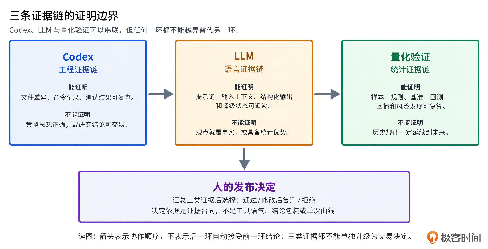
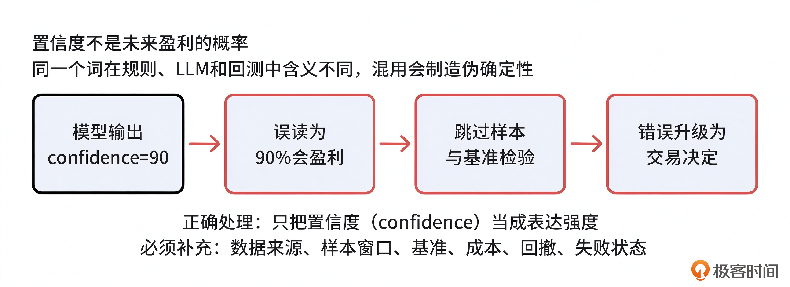
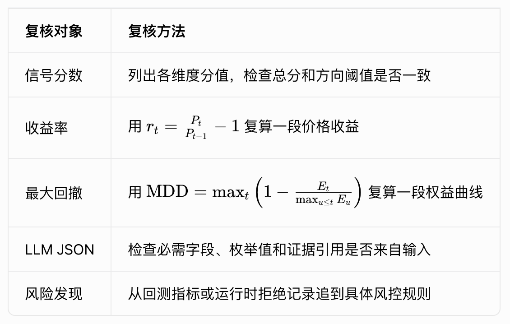
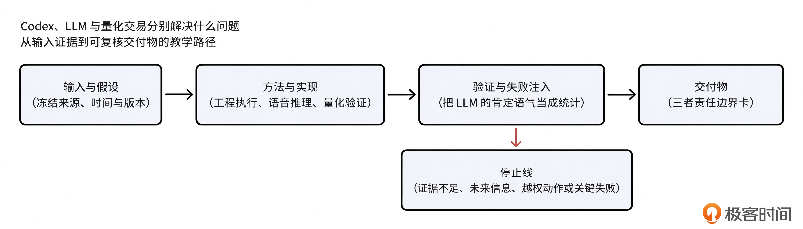

# 01 | AI量化研究的证据边界与责任分工

你好，我是袁从德。

在开篇词，我们已经划定了本课程最重要的边界：AI 可以帮助研究交易系统，但不能替任何人承担交易风险。本讲继续向前推进一步，讨论一个更容易被忽视的问题：

- 当 Codex 能写策略、LLM 能解释结论、回测能画出收益曲线时，它们究竟是在证明什么？

很多人第一次把大语言模型接进量化研究流程时，会被一种“完整感”迷惑：系统能读行情、写策略、生成信号、画图表，还能用自然语言解释结论。界面上什么都有了，人也就容易误以为研究已经完成。但交易研究不是看结果像不像答案，而是看它能不能被复查、被否定、被暂停：输入从哪里来，经过了什么处理，留下了什么记录，最后由谁决定继续或停止。

本讲是专栏的方法入口。我们先不展开回测、风控、评测或自动化，而是建立后面反复使用的共同语言：任何一个看似专业的 AI 交易结论，都必须能拆回“事实、解释、检验、决定”四层；拆不回去，就不能进入下一阶段。

## 1. 从专业化输出看见证据缺口

这一节先不急着定义工具，也不急着进入代码。我们从一段看似完整的交易信号开始。输出越像专业结论，越容易遮住它背后缺失的证据。

### 1.1 一段容易误判的交易信号

要分清“谁在证明什么”，不宜先从工具清单讲起，而应先看一个容易误判的输出。只有当一个结果足够像专业建议时，责任边界的问题才会真正暴露出来。

- 为避免后面反复解释，先统一几个会贯穿本讲的术语：过拟合：模型或策略在历史样本表现很好，但换到新行情后失效。

- 数据窥探：利用未来数据、事后调参或反复筛选，美化回测结果。

- 滚动回测：按时间分段验证策略，降低单一窗口偶然性的影响。

- 幻觉：LLM 编造不存在的行情、指标、来源或推理链。

假设系统对 BTC 生成了下面的结果：

```json
{
 "signal": "BUY",
 "confidence": 78,
 "summary": "趋势偏多，等待回踩后关注",
 "tradePlan": {
   "entryLow": 64120,
   "entryHigh": 64800,
   "stopLoss": 63200
 }
}
```

```
这段 JSON 很像一份专业交易建议：它有方向、有置信度（confidence），有入场区间，也
```

有止损位。如果再配上一段流畅解释，例如“多周期趋势共振，资金面转暖，建议等待回踩确认”，初学者很容易把它当成完整结论。

### 1.2 追问输出背后的证据

面对这类输出，真正重要的不是判断它“说得像不像”，而是追问它的来源、规则、样本和责任。严谨的研究者会先停下来逐条追问：

```
signal=BUY 来源于硬规则计算，还是 LLM 的主观输出？
confidence=78 是历史回测胜率、统计概率、规则得分缩放，还是模型话术包装？
stopLoss=63200 来自行情支撑位数据，还是 LLM 凭空生成的数字？
```

- 如果链上数据缺失，系统会承认缺失，还是继续讲一个完整故事？

- 如果这条信号进入回测，是否使用了未来信息？

- 如果回测盈利，它来自稳定规律，还是某个窗口、参数或筛选过程中的偶然结果？

这些问题不是吹毛求疵，而是交易研究的基本要求。金融 LLM 可能在事实、价格解释和结论边界上产生幻觉；回测也可能因为参数挑选、数据窥探和过拟合，把偶然结果包装成策略优势。承认这一点之后，下一步就不是讨论答案好不好听，而是划清各个角色的责任：谁能生成什么，谁能检验什么，谁必须承担最后判断。

## 2. 角色责任边界

上面我们梳理了交易信号的证据缺陷，现在我们要明确系统内四类主体的权责划分，区分信号生成、逻辑解读、量化校验、最终决策的责任归属。系统四大核心角色：Codex、LLM、量化验证、人，能力边界互不重叠。（汇总信息见表 1-1）

- Codex：工程执行工具，读写代码、运行脚本、修复程序，留存完整操作日志，仅负责落地，无法判断策略交易价值。

- LLM：信息解释工具，整合上下文生成信号与文本摘要，无客观行情数据源，无法证明策略统计优势。

- 量化验证：标准化回测校验工具，依托固定样本检验交易思路，仅能证明样本内具备研究意义，无法预判未来行情。

- 人：唯一决策主体，定义研究目标、筛选证据、确认结论，承担全部交易风险，工具不可分担责任。

角色

- 核心能力留存证据权责约束

Codex

- 代码编辑、脚本执行、故障修复代码变更、执行日志、测试结果不具备策

LLM

- 信息整理、信号生成、市场解读提示词、模型输出、上下文记录输出不具

- 样本回测、收益 / 风险指标校验

量化验证

- 数据区间、参数、回测交易记录历史表现

人

- 设定研究目标、终审结论、风险兜底研究方案、复核记录、决策文件风险与决

- 表 1-1　角色权责边界汇总

图 1-1 把三类工具画成三条证据链。人不与其他三者并列冒充证据，而是在证据汇总之后做发布决定。箭头表示协作顺序，不表示后一环自动接受前一环的结论。



- 图 1-1 三条证据链的证明边界

一个常见误区，是把“能生成”理解为“能证明”。Codex 能生成策略代码，只说明代码可以被写出来；LLM 能生成交易理由，只说明它能把上下文组织成语言；回测能生成收益曲线，只说明策略在某个样本和假设下产生了结果。只有当输入可追溯、规则可复算、失败可观察、结论不过度时，研究才开始接近可交付。

## 3. 仓库路径与第一条实践线

责任分清以后，还要能在仓库里找到证据链的位置。本节先建立代码地图，再用一个最短入口跑出结果，让前面的边界不只停留在概念上。

### 3.1 从责任分工落到仓库路径

概念上的分工必须能在仓库里找到对应模块。配套仓库已经把规则信号、LLM 包装、回测验证和风险复核分成不同目录。第 1 讲不要求逐个读完，只先建立地图。

### 3.1.1 仓库路径表

表 1-2 将第 1 讲涉及的真实仓库路径集中列出，你可以按这张表回到代码和测试里核对证据来源。

责任

- 仓库位置阅读重点

- 信号、得分、置信度和交src/dashboard/signal_analysis.py

规则信号

- 出来

- 表 1-2　对应的真实仓库路径

路径表说明“去哪看”，还需要一个粗粒度目录图说明“它们如何分布”。下面的代码块只承担导航作用，不要求你在第 1 讲就理解所有模块。

### 3.1.2 产品代码地图

产品代码大致分布如下：

```
src/
├── dashboard/        # 离线样本读取、规则信号、LLM 包装、Dashboard API
├── backtest/         # 策略回测与滚动验证
├── factor_mining/    # 因子搜索与评价
├── risk/             # 运行时与回测后风控
├── research/         # 研究事实与报告汇总
├── strategy_engine/  # 策略 DSL 与独立回测引擎
├── web/              # 前端研究/交易页面
└── config/           # 环境与上游配置
第 1 讲最小实践只走 dashboard/ 里的 signal_analysis.py 到 llm_signal.py。其
余目录在后续课程中按证据链逐步进入。完整工作区边界，含 data/、tests/、
vendor/，见第 3 讲。读这些文件时，不要用“代码多不多”判断完成度，而要追踪一条证据
```

链：输入从哪里来，经过什么转换，输出了什么字段，失败时怎样停下。

建议先运行一次仓库验证命令：

```
python scripts/course.py verify
```

这条命令通过，只说明仓库基础检查通过，不能证明任何交易结论成立；命令失败，也不意味着研究失败，而是说明证据链断在了某个位置。严谨的写法必须保留失败位置，是环境缺失、数据缺失、规则错误，还是测试没有覆盖关键语义。

### 3.2 观察规则输出、LLM 包装与降级回退

角色和路径清楚之后，可以进入第一条最短实践线。这里不追求完整交易系统，而是用一个可运行入口看见规则信号、LLM 包装、降级回退和输出边界。

### 3.2.1 主流程骨架

```
主流程集中在 run_llm_signal_analysis。下面是便于阅读的伪代码骨架，不是从源码
```

逐字摘录的可复制片段：

```python
def run_llm_signal_analysis(symbol: str = "BTC", *, model: str | None = None) ->
   baseline = run_signal_analysis(symbol)          # ① 规则基准
   if not baseline.get("ok"):
       return baseline
   if not llm_configured():                        # ② 无 API Key → 返回 baseline
       baseline["engineMeta"] = {..., "note": "未配置 OPENAI_API_KEY；..."}
       return baseline
   try:
       prompt = _build_prompt(symbol, baseline)    # ③ 压缩上下文
       llm_payload = _call_llm(prompt, model)
       return _merge_llm(baseline, llm_payload, model)
   except Exception as exc:                          # ④ 调用失败 → 回退 + note
       fallback = dict(baseline)
       fallback["engineMeta"] = {..., "note": f"LLM 调用失败，已回退规则引擎：{exc}"
       return fallback
```

读代码时抓住三个要点即可：

```
规则基准先行：baseline来自规则引擎，不是模型观点；没有基准，LLM 容易变成事实
```

- 来源。

- LLM 只组织解释：模型在已有证据之后参与，不能补造价格或缺省数据。

```
降级必须诚实：未配置 OPENAI_API_KEY 或调用失败时，系统保留规则输出并在 note
```

- 中说明，而不是静默假装 LLM 成功。

理解这条主流程后，再运行一次最小命令。这里的目的不是得到可交易信号，而是确认系统是否诚实标注了规则输出和 LLM 回退状态。

### 3.2.2 运行命令

在项目根目录执行下面的命令，只观察结果里的引擎、信号枚举和回退说明，不把它当成交易判断。

```python
$env:PYTHONPATH = "src"
python -c @"
from dashboard.llm_signal import run_llm_signal_analysis
import json
result = run_llm_signal_analysis('BTC')
print(json.dumps(result, ensure_ascii=False, indent=2))
"@
如果 Windows 环境没有 py 启动器，可以沿用上一段的替代方式，把命令里的 py 换成
python 或 .\.venv\Scripts\python。
输出中的具体 signal、confidence、价格和交易计划会随离线样本、环境变量和模型配置
变化。本讲只检查三个字段：engine 是否说明当前引擎，signal 是否仍来自允许枚举，
engineMeta.note 是否把未配置或调用失败说清楚。
```

片段类似下面这样：

```json
{
 "engine": "sandbox-rule-based",
 "signal": "WEAK_SELL",
 "confidence": 18.0,
 "summary": "偏空观望 · 置信度 18.0% · 得分 -15 多维证据尚未形成一致方向，保持观望。",
 "engineMeta": {
   "provider": "sandbox",
   "model": "deepseek-v4-pro",
   "note": "LLM 调用失败，已回退规则引擎：..."
 }
}
```

这段输出能证明：在当前输入和规则版本下，系统给出了某个方向和分数；它不能证明未来会涨跌，也不能证明 LLM 已经参与分析。

## 4. 结果解读、量化口径与停止线

跑出结果之后，重点转向“它能成立到什么程度”。本节把命令输出、信号分数与置信度的计算口径、人工复核和失败注入放在同一条证据链上，避免你把可运行结果误读成研究结论。

### 4.1 如何解读输出边界

命令能跑出结果，不等于结果已经被证明。四类输出的价值和边界不同。

### 4.1.1 四类输出的证明范围

表 1-3 用同一套问题记录四类结果的证明边界。

结果类型

- 能证明什么不能证明什么

规则信号

- 当前输入按显式规则得到某个方向和分数方向一定正确、未来一定盈利

LLM 信号

- 模型基于给定上下文形成了结构化解释解释是真实事实、语气代表统计优势

回测结论

- 策略在固定样本和假设下得到某组指标样本外有效、真实交易可用

风险复核

- 某些运行时或回测后风险被识别风险已经完全消失

- 表 1-3　四类结果的证明边界

以后看到任何“LLM + 量化”的系统，都可以先用这四列拆解。如果某个结果说不清自己能证明什么、不能证明什么，它就不是研究结论，只是候选输出。交易研究里最容易被误用的字段之一是置信度（confidence）。在普通产品中，置信度常被理解为“系统有多确定”；但在交易研究中，如果不说明计算方式，它几乎没有统计意义。规则引擎的置信度可能来自分数绝对值、指标一致性或风险折扣；LLM 的置信度可能来自模型自评分；回测中的胜率又是另一种统计量。三者都可能叫“置信度”，含义却完全不同。

### 4.1.2 置信度的误读风险

图 1-2 展示置信度被误读成未来盈利概率时，结论怎样一步步越界；红色路径跳过了样本、基准和成本检验。



- 图 1-2 置信度误读路径

图 1-2 说明高置信度应该触发复核，而不是触发下单；它不能说明置信度完全无用，只说明这个字段必须回到生成方式和验证口径中解释。严谨表述应区分「可说」与「不可说」。表 1-4给出三组对照：

可说

- 不可说

- 系统给出买入（BUY）

在当前输入和规则版本下

- 表 1-4　置信度与结论边界的可说 / 不可说对照

### 4.2 研究结论的可复核边界

量化严谨性不是把公式堆进书里，而是让每个结论都有可复算对象、样本窗口、指标和否定条件。

### 4.2.1 研究问题的六个边界

## H =

一次研究结论至少要说清六件事：

## (asset,  window,  signal_source,  benchmark,  metric,  reject_when)

- 。这个写法不是

数学炫技，而是提醒研究者不要只写结论，还要写清结论成立的边界。表 1-5 说明六个字段各自承担什么含义。

符号

- 含义

asset（研究对象）

- 如 BTC-USDT

window（样本窗口）

- 起止日期与 K 线频率

signal_source（信号来源）

- 必须写明来自规则引擎、LLM 还是回测

benchmark（对照基准）

- 如买入持有

metric（评价指标）

- 如累计收益、最大回撤

reject_when（否定条件）

- 满足哪条时必须停止或复核

- 表 1-5 研究结论六个边界字段

完整写法与范例见第 2 讲；这里先记住：任何结论都要能写成这六个字段。

### 4.2.2 可复算的基础指标

本讲只引入两个可手工复算的最小公式。

- 先约定符号：

## P

## t

- ：第 期收盘价（或你事先声明的价格口径）​t

## E

## t

## P

- ：第 期账户权益（含仓位与现金；不等于）​t​t

单期价格收益率——相邻两期价格的变化比例：

## P

- ​t​ −​ =

## 1

## r

- t

## P

- t−1​

公式解读：如果上一期收盘价是 100，本期收盘价是 103，那么单期收益率就是 3%。这里计算的是价格变化，不包含仓位、现金和交易成本。

最大回撤——权益曲线相对其历史峰值的最差回落幅度：

## max (

## )

## E

- ​t

## MDD =

## 1 −

## max

- ​ E​​tu≤tu​

公式解读：遍历全部交易时刻，对比当前权益与历史峰值的回落幅度，取最大值作为最大回撤。这个指标基于账户权益曲线计算，不能直接用标的价格跌幅替代。

任何结果都要写明样本窗口、数据频率、手续费或未建模成本、仓位规则和退出规则。如果本讲暂不计算真实交易成本，也要说“成本未建模”，不能写成“成本为零”。成本未建模意味着结论还不完整，成本为零则暗示世界没有交易摩擦。

### 4.2.3 人工复核对象

人工复核不是为了替代测试，而是确认测试检查的是正确语义。如表 1-6 所示，至少选择一项复核：



- 表 1-6　本讲最小人工复核对象

如果复核结果和程序输出不一致，不要急着改解释，先确认输入窗口、费用口径、百分号方向、正负号约定和字段名称是否一致。

### 4.3 失败注入：验证系统是否诚实

严谨研究不能只展示成功路径。LLM 与量化系统最危险的失败，不一定是程序报错，而是程序顺利给出一个过度自信的答案。研究者需要主动制造失败，观察系统是否会停下。

### 4.3.1 失败输入与合格表现

表 1-7 给出本讲的失败注入设计：

失败输入

- 实操复现方式期望系统表现

- 删除或注释本地 .env 中的 OPENAI_API_KEY

缺少接口密钥

- 回退规则引擎并写明

LLM 返回非法signal

- 在测试桩中返回signal="MUST BUY"回退到规则基准信号

- 表 1-7　本讲失败注入与合格表现

失败后的恢复动作不是删除失败证据，而是回到最早能够阻止错误的检查点。若 LLM 编造价格，就回到数据来源；若回测意外漂亮，就回到参数选择和样本划分；若风控规则没有触发，就回到风控阈值和测试断言。

### 4.3.2 停止线与证据卡

图 1-3 将本讲路径画成输入、方法、验证、停止线与结论表达五个节点。先沿正常证据链检查，再沿停止线检查失败是否会被阻断。



- 图 1-3 证据链与停止线路径

下面这个最小对象不是产品代码，而是帮助理解“三条证据链不能互相替代”：

```python
from dataclasses import dataclass
@dataclass(frozen=True)
class EvidenceBoundary:
   """三类工具证据与人工决定的分工卡片。"""
   codex_evidence: str      # Codex 留下的证据
   llm_evidence: str        # LLM 留下的证据
   quant_evidence: str      # 量化验证留下的证据
   human_decision: str      # 人工决定
card = EvidenceBoundary(
   codex_evidence="文件变更与验证命令记录",
   llm_evidence="基于给定上下文生成的结构化 JSON",
   quant_evidence="固定样本上的回测指标",
   human_decision="继续研究，不构成投资建议",
)
assert "不构成投资建议" in card.human_decision
如果把 human_decision 改成 "自动下单"，这个示例就违背了本讲边界。真实系统里，这
```

类越界应该被审批门、风控规则或人工复核拒绝。

本讲最后形成的不是交易建议，而是一段研究边界声明。更稳妥的写法不是“AI 判断 BTC 后续上涨概率较高”，而是：

- 在当前离线样本、规则版本和输入字段下，系统生成了一个偏多候选信号；该信号的

```
confidence 表示规则或模型输出中的匹配强度，不代表未来上涨概率。结论尚未完成样
```

- 本外检验、成本建模和人工复核，因此只能作为后续研究对象，不构成交易建议。

这段话不追求气势，而是把证据边界说清楚。专栏中的量化案例，我们也会优先采用这种可复查、可拒绝、不过度承诺的表达方式。

## 总结

本讲我们建立了后续课程都会复用的基础分工：Codex 负责工程执行，LLM 负责解释和结构化，量化验证负责检验主张，人负责最终取舍与风险责任。

真正的完成标准不是生成一个结果，而是能回答：输入如何形成，LLM 在哪里参与，量化验证如何否定它，风险控制在哪里停止它。下一讲会继续推进，把模糊交易想法改写成可证伪的研究假设。

学习完本讲后，你不需要掌握完整回测、风控或因子挖掘实现，但应该能完成三件事：用表 1-

```
1 说明四类角色的责任边界；运行一次 run_llm_signal_analysis('BTC') 并解释
engine、signal、confidence，在系统回退时说明 engineMeta.note；把任意一条 AI
```

交易信号改写成表 1-5 所示的六个边界字段。


## 思考与练习

1. 概念辨析：为什么“命令通过”不能自动证明研究结论成立？请分别说明 Codex 留下的工程证据、LLM 留下的解释证据、量化验证留下的样本证据。

```
证据分析：如果 LLM 输出 BUY 与 confidence=90，需要哪些额外证据，才能判断它是
```

- 否有研究价值？至少回答数据来源、信号规则、回测窗口、成本假设、风险复核五项。

3. 综合实践：任选一条你见过的 AI 交易信号，分别写出 Codex、LLM、量化验证和人能够承担的责任，以及它们各自不能证明的事项。建议用“可说 / 不可说”的方式组织答案。

期待你的分享。如果今天的课程让你有所收获，也欢迎转发给有需要的朋友，邀请他来一起学习，我们下节课再见！
