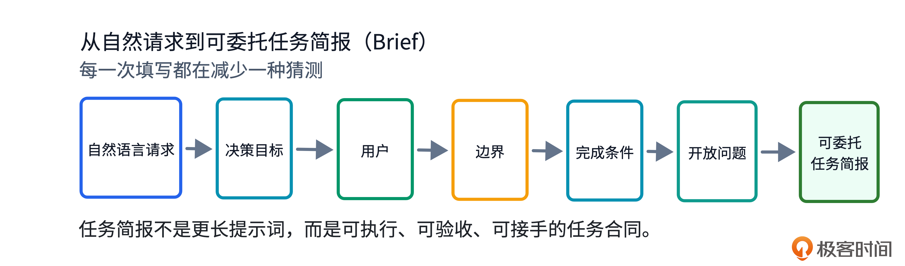
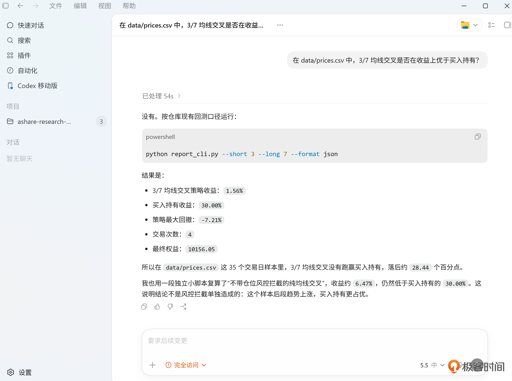
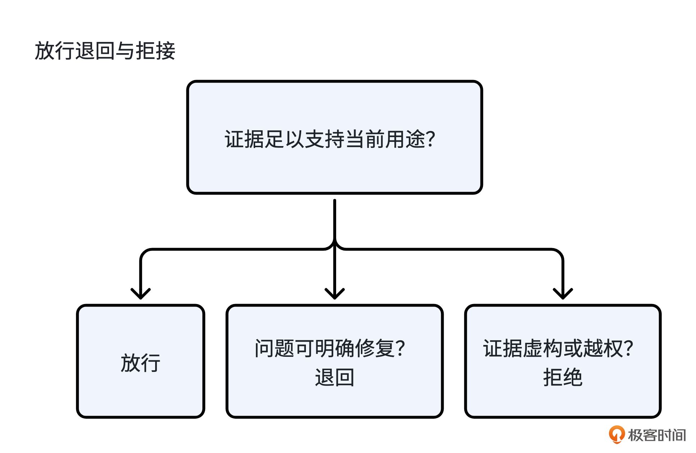

# 02 | LLM量化：从交易想法到可验证研究假设

你好，我是袁从德。

上一讲我们划分了量化研究四类权责边界：Codex 负责代码编写与命令执行、大模型负责文字整理润色、量化验证模块基于固定数据集完成客观校验，最终结论的取舍与判断责任完全归属研究者本人。

在实操过程中很多人都容易走入一个致命的误区：研究者尚未明确「本次究竟要验证什么」，就急于批量运行回测、拟合收益曲线，再依托模型输出反向拼凑逻辑。本讲旨在建立一套标准化前置流程：先完整、可证伪地写明研究命题，再使用固定样本开展数据校验。

日常讨论行情时，我们输出的大多是主观观点，例如“均线金叉具备实战价值”。这类表述仅代表主观倾向，经不起严谨追问：验证哪一段资产行情？以何种方案作为对照基准？收益、交易次数达到何种标准才算策略失效？

本讲核心方案为标准化研究假设卡：统一填写验证对象、对比基准、有效 / 失效判定标准、证据不足边界；随后以「3 日均线上穿 7 日均线」为示范规则，在固定价格样本中检验该信号能否长期跑赢简单买入持有策略。

这里需要你提前明确一个关键认知：本讲仅判断这个规则在指定历史区间内是否存在相对超额收益，不代表这个策略未来一定能稳定盈利。

## 1. 交易观点 ≠ 标准化研究假设

交易思路最初往往以一句主观判断呈现，如“均线金叉有用”“价格突破后延续上涨”“模型判断当前趋势偏多”。这类内容具备研究出发点，但不能直接作为可检验的研究假设，因为缺失验证标的、样本区间、对照基准、失效判定四大核心约束。这里我们严格区分“主观想法”与“标准化假设”，避免你在命题模糊的前提下盲目回测。

### 1.1 主观想法与可检验假设的核心差异

量化研究与行情闲聊的本质区别：是否在运行数据前，书面约定完整、客观的检验规则。

- 主观想法：“均线金叉有用”，仅有模糊方向，无任何检验边界，无法证伪。

```
标准化假设：基于数据集 data/prices.csv，检验 3/7 日均线交叉策略收益是否优于买
```

- 入持有；若策略收益低于基准则不支持假设，总交易次数不足 2 次则判定为证据不足。

这里面蕴藏着两个核心底层规则：

- 可证伪性：假设必须存在被样本数据推翻的可能。仅描述成功条件、不提前定义失效标准的命题，不具备量化检验价值。

- 零假设（本讲简化落地规则）：默认基准结论为「均线交叉策略无法跑赢买入持有」，只有足量样本回测证明该策略产生稳定正向超额时，才临时推翻默认立场。本讲不引入复杂统计模型，但强制要求在假设卡写明默认立场，杜绝将样本内偶然收益直接定义为“策略永久有效”。

本讲我们统一采用买入持有作为基础对照基准：样本资产期初收盘价 8.69，期末收盘价13.58，经计算买入持有基准收益为 56.27%。任何均线策略收益低于该数值，都可以判定在本历史区间无超额优势。

掌握基础概念后，我们来梳理四类典型不合格假设表述，直观识别命题漏洞。

### 1.2 常见的不合格假设

我在表 2-1 中列举了四类不合格表述，如果有这些缺陷，建议你按照右侧的方式改写。

表述

- 缺陷改写方向

验证 RSI 有没有用

- 固定样本中 RSI 低于 30 做多是否优于买入持缺基准、窗口、否定条件

- 先检验 3/7；改参数须另开假设卡

找最优均线参数

- 缺事先参数空间

- 须同时报告买入持有收益

收益为正即成功

- 缺基准

```
（buy_hold_return_pct）
```

回测好看即有效

- 缺否定条件先写不支持与证据不足标准

- 表 2-1　不合格假设与改写方向

注意，不要把调研记录中乐观的主观描述写入假设卡。多因子同步检验会抬升假阳性概率，多重检验校正规则我们会在第 20、21 讲详细讲解，这一讲我们只聚焦单信号、单假设卡的标准流程。

## 2. 六要素标准化研究假设卡

明确无效表述特征后，我们这一节来落地完整的可检验命题模板。假设卡并不是形式化的文档，而是数据运行前签署的研究合约：字段缺失则禁止启动回测；无预设否定条件，则数据结果无客观解读依据。

### 2.1 可检验假设的六大必填要素

表 2-2 是逐项可核对的标准化命题框架，六要素缺一不可。其中第六条，否定条件必须拆分“不支持假设”“证据不足” 两类，不能合并为模糊的“优化参数”。

- 不支持假设：策略收益低于对照基准。

```
证据不足：全样本内总交易次数小于 2 次（trade_count < 2）； 最大回撤仅作为客观
```

- 事实记录，若需将回撤纳入判定标准，必须在假设卡预先写明阈值。

要素

- 要回答什么坏写法好写法

```
WEB3-DEMO/USDT + data/pric
```

- 看 BTC 会不会涨

对象

- 哪种资产、哪份样本

- 3 日均线上穿 7 日均线

触发条件

- 什么事件后观察均线变好

观察窗口

- 观察多久后面一段至下一次下穿或样本结束

对照基准

- 和谁比收益高不高买入持有

```
策略收益（strategy_return_p
益（buy_hold_return_pct）、策
```

评价指标

- 事先看哪些数效果不错

```
（maximum_drawdown_pct）、交
（trade_count）
```

- 1️⃣ 不支持：不优于基准

否定条件

- 何时不支持、何时说不清尽量优化

```
2️⃣ 证据不足：交易数小于 2（trad
```

- 表 2-2　可验证研究假设的六要素

六大要素是第 1 讲「研究结论六大边界字段」的落地实现，两套框架一一对应： 资产标的→验证对象；观测区间→观察窗口；信号来源→触发条件；对比基准→对照基准；观测指标→评价指标；推翻条件→否定判定条件。

本讲额外将完整样本文件路径写入验证对象栏，目的是保障我们所有人可以完整复现同一套数据；单独拆分“证据不足”判定，是为了避免交易样本过少时，误以为策略具备稳定规律。

六要素全部填写完整后，我们就可以生成完整可执行的研究假设卡了。

### 2.2 从主观思路到标准假设卡完整流程

图 2-1 给出了整体填写逻辑，自上而下执行：对照表 2-2 补齐全部必填字段，撰写可检验问

```
句、拆分两类否定条件，确认无误后进入回测命令执行环节。文档分工说明：research-
brief.md 用于记录整体调研方向，假设卡用于承载可证伪的定量命题，两类文档用途不能混
```

淆。



- 图 2-1　想法→假设卡流程

按表 2-2 补齐六个研究要素后，完整填卡示范（3/7 均线交叉信号）如下：

```
验证对象：WEB3-DEMO/USDT 交易对，数据集 data/prices.csv（共 35 个交易日收
盘价，参数信息见 data/company.json）
```

2. 触发信号：3 日均线上穿 7 日均线

3. 观测窗口：持仓至均线下穿或样本结束

4. 对照基准：买入持有

5. 评价指标：策略收益、基准收益、最大回撤、总交易次数

6. 否定判定：不支持假设 = 策略收益≤56.27% 基准收益；证据不足 = 总交易次数＜2

可检验问句：

```
在 data/prices.csv 中，3/7 均线交叉是否在收益上优于买入持有？（见图 2-2）
```



- 图 2-2　查询 Codex 示例

完成填卡后，你应该已经有一条能被拒绝的主假设，而不是一句等待模型润色的行情判断。

### 2.3 填写假设阶段的人机权责边界

我们结合第一讲划定的四类责任，来明确工具与人工的硬性约束：

1. Codex 仅可协助假设卡排版、执行回测命令；

2. 大语言模型仅能润色调研记录文字；

3. 工具无权在看到回测输出结果后修改预设否定条件，也不能自主调整指标判定档位。

你在向大模型输入素材时，只传入已填写完成的六要素、标准检验问句，千万不要传入回测结果截图；如果模型主动建议更换均线参数、新增评价指标，按照表 2-6「未定义概念偏差」处理，必须新建独立假设卡，不能修改当前假设与既定结论。

## 3. 基于固定样本检验 3/7 均线假设

假设卡定稿后，本讲仅执行单一动作：使用固定数据集运行预设均线策略，输出可交叉复核的客观指标。本节不提前预判策略前景、不美化解读话术，对数据结果的规范解读我统一放在了第 4 节；如果计算出的基准收益与手算结果不符，立即核对文件路径与数据集版本，不要直接开展结论解读。

### 3.1 完整证据链路

```
我在表 2-3 列出本讲的基础证据链。当前样本首尾为 8.69 → 13.58，买入持有收益约
```

56.27%，可以手算复核。

文件

- 作用

```
data/prices.csv
```

- 固定样本

```
report_cli.py
```

- 双均线回测摘要

```
docs/samples/research-hypothesis-card.md
```

- 假设卡模板

- 表 2-3　本讲基础证据路径

链路核对完成后，严格按照「确认命题 → 运行回测 → 保存原始输出」三步执行。

### 3.2 标准化三步检验流程

### 步骤 1：回测前复核完整命题，规避 HARKing 偏差

HARKing（事后假设偏差）：指先查看回测结果，再反向编造验证规则，人为放大策略收益显著性，是量化研究核心大忌。运行代码前，必须对照表 2-2 逐项核对六要素完整度，禁止提前运行会泄露策略收益表现的调试命令；只允许提前读取样本数据、手动核算买入持有基准收益。

### 步骤 2：执行主假设，预设回测命令

否定条件一经确定不可修改，执行下面的脚本，所有输出只作为客观事实记录，禁止反向修改假设卡：

```
python report_cli.py --format summary
```

本讲回测统一简化假设：零交易手续费、零滑点，最终结论必须标注「模型未计入实际交易成本」。输出数据固定读取顺序：

```
买入持有基准收益 buy_hold_return_pct（标准值 56.27%）；
```

2. 策略收益，对比基准判断超额水平；

3. 策略最大回撤，仅做客观记录；

4. 总交易次数，匹配证据不足判定阈值。 脚本输出的全部警告文本，必须完整保留在事实记录中，不可删减。

### 步骤 3：完整保存原始回测输出

只基于当前主假设参数保存原始数据，完整复制指标数值与系统警告，禁止中途更换参数、新增评价指标、撰写实盘交易建议。你可以参考下面我给出的基础记录格式：

```
【主假设行】strategy_return_pct=…%  buy_hold_return_pct=…%  maximum_drawdown_pct=…%
```

- 【事实】（粘贴警告与四指标）

补充观测规则（可选）：可同步测试 5/10 均线作为辅助观察数据，但不得更改主假设判断；如果需要将 5/10 均线作为正式检验结论，必须新建独立假设卡。 辅助观测执行脚本：

```
python report_cli.py --format summary --short 5 --long 10
```

核心约束：最终结论只采信主假设预设参数输出；辅助观测数据不能将“不支持假设”修正为“策略具备观测价值”。

## 4. 回测结果标准化判读规则

获取数值后，最容易出现的研究偏差并不是计算错误，而是人为将数据解读为假设卡未定义的结论。本节统一规范三段式记录模板，明确事实段、解释段、行动段的书写边界，列明禁止使用的主观表述。

这可以帮助你区分“数据本身”和“你对数据的解读”，防止事后用主观理解给策略贴金，确保每一步都有据可依。

### 4.1 三类标准化判定档位

所有结果统一采用三段式记录：事实段粘贴原始数据与警告；解释段严格匹配表 2-4 三档结论；行动段仅填写继续观测、新建假设卡、终止测试三类指令。

档位

- 何时使用本讲示例

```
收益高于买入持有且交易数不少于 2（trade_count
```

支持

- 未触发两类否定标准

```
≥ 2）
```

不支持

- 触发「不支持」标准策略收益 ≤ 买入持有（本

```
未触发不支持，但交易数小于 2（trade_count <
```

证据不足

- 交易太少，不得写「规律稳

```
2）
```

- 表 2-4　解释段的三档判断

优先级规则：若同时满足“收益低于基准”“交易次数不足 2 次”，优先判定为不支持假设；即便策略绝对收益为正，但低于买入持有基准，解释段只能标注不支持，不能描述为“策略具备正向收益”。（见表 2-5）

输出

- 可作事实可谨慎解释

```
策略收益（strategy_return_pct）
```

- 当前参数下有 / 无正收样本内策略收益

```
买入持有收益（buy_hold_return_pct）
```

- 样本内买入持有收益作为基准供对照

```
策略最大回撤（maximum_drawdown_pct）
```

- 策略最大回撤与收益同段汇报

```
交易次数（trade_count）
```

- 交易次数过少则证据弱

- 表 2-5　命令输出的解读边界

统一三段式记录模板：

- 事实：完整粘贴脚本输出数值与警告原文，不做删减；

- 解释：严格对应表 2-4，仅填写支持 / 不支持 / 证据不足；

- 动作：仅写明继续观测、新建假设卡、终止测试，禁止私自修改假设条件。

### 4.2 完整合规记录示范

```
【可检验版本】三七均线在 data/prices.csv 中是否优于买入持有？
【否定条件】不支持：策略收益≤买入持有；证据不足：交易数小于 2（`trade_count < 2`）
【主假设行】strategy_return_pct=…%  buy_hold_return_pct=…%  maximum_drawdown_pct=…%
```

- 【事实】（粘贴警告与四指标）

```
【解释】收益低于 `56.27%` 基准→不支持；交易数不少于 2（`trade_count ≥ 2`）时不得误写证据不足
【动作】不放行「策略有效」；若正式检验5/10，另开新卡
```

### 4.3 解读阶段常见逻辑偷换与硬性约束

全部解读文字必须能够反向对应六要素或指标边界表，出现下述行为直接判定研究流程失效：

1. 判定逻辑优先级代码化规则：

```
if strategy_return_pct <= buy_hold_return_pct: reject_hypothesis  # 优先
elif trade_count < 2: insufficient_evidence  # 仅当未触发不支持
if reject_when is empty: reject_design
if metrics_fixed_after_seeing_output: invalid_design
```

2. 流程红线

- 假设卡缺失否定条件：命题设计无效，禁止解读

- 看到回测结果后新增、修改评价指标：研究流程作废

这里我补充一条重要的风险提示：本讲只基于单一资产、短期固定样本开展演示，样本内相对收益不能外推至未来行情。所有解读必须标注「回测未建模手续费、滑点等交易成本」。样本外校验、交易成本测算、组合风控将在第 16-22 讲展开。

手动复核仅校验收益计算口径统一，不代表策略具备实盘交易价值。若脚本输出基准收益与手算 56.27% 不符，优先核对数据集、代码分支、执行命令，禁止直接解读结果。本讲四大核心研究偏差及处理方案：HARKing 事后拟合、事后新增评价指标、缺失对照基准、大模型主观叙事越界的典型表现和处置办法你可以参看表 2-6。

偏差类型

- 典型表现处置

- 删词，改回表 2-4 三档

叙事越界

- 输出「建议买入」「可实盘」「策略有效」

事后合理化

- 「虽跑输基准但思路有价值」无对应否定指标，整句删除

未定义概念

- 「震荡市更适合」但未定义震荡判定触发新假设卡，不得升级旧结论

- 人工按表 2-4 重判

代行判断

- 模型直接写「支持」而未对照否定条件

- 表 2-6　LLM 产出常见偏差与处置

## 5. 交付可复现、可交接的标准假设卡

这一讲的最终交付物不是一条交易结论，而是一张别人能接手、能复跑、能拒绝的假设卡。它既要保留可执行命令，也要保留人工判读和放行状态。表 2-7 用于提交前复核，至少完成一行并附于卡末。

复核项

- 做法

```
核对 data/prices.csv 的收盘价（close）
```

样本

基准

- 手算买入持有收益并对照命令

否定条件

- 是否分写「不支持」与「证据不足」

- 完整标注 “本文内容仅作量化方法论教学，不构成任何投资建议”

安全边界

- 表 2-7　人工复核项目

如图 2-3 所示，复核后有三种处理结果：

- 放行：六要素完整、两类否定条件清晰、解读无主观越界，可进入样本外验证学习；放行不代表策略具备实盘价值。

- 退回：字段缺失、将辅助观测数据作为主结论，返回 2.2 节补齐假设卡，必要时重新执行回测。

- 拒绝：未完成检验就宣称可实盘、命题无法证伪，直接作废本次研究记录。



- 图 2-3　放行 / 退回 / 拒绝

## 总结

这一讲我们走完了完整的标准化研究主线四步流程：依据表 2-2 完善六要素假设卡 → 执行固定回测脚本 → 对照表 2-4 完成三档客观判定 → 复核文档后判定放行 / 退回。

研究全部流程完成后，需完成四项合规校验：第一，全部否定判定规则都在回测前预先定义；第二，核心结论仅依托主假设预设参数的输出数据；第三，结果解读严格限定三类标准化档位，不增加自定义主观评价；第四，假设卡具备完整自洽性，可供他人独立复现全部验证逻辑。

如果你学完能区分三句话，就说明本讲达到了目标：「我觉得均线有效」是观点；「我想验证均线」是任务意向；「固定样本中三七均线是否优于买入持有，若不优于则不支持、次数不足则证据不足」才是假设。


本讲交出的假设卡，只有自己能填、能判还不够。下一讲我们进入搭建可复现的量化研究工作区：检验换一台电脑、换一个人，能否找到同样的样本、跑通同样的检验、看到同样的数字和警告。

## 思考与练习

1. 假设卡检查：「均线上穿后会涨」缺表 2-1 中的哪些要素？请把它改写为可检验问句，并写出“不支持”和“证据不足”两类否定条件。

```
解释段检查：根据代码 python report_cli.py --format summary 的输出，按表
```

- 2-4 判断本轮属于支持、不支持还是证据不足；答案须引用策略收益、买入持有收益和交易次数三个字段。

期待你的分享。如果今天的课程让你有所收获，也欢迎转发给有需要的朋友，邀请他来一起学习，我们下节课再见！
