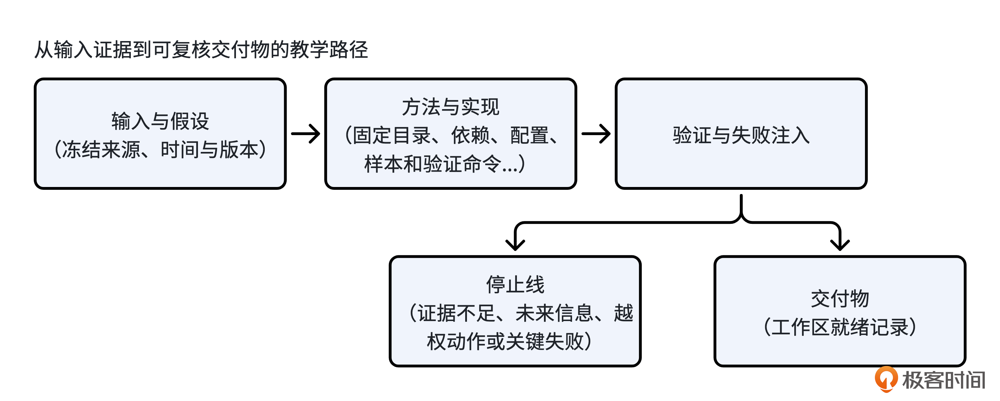
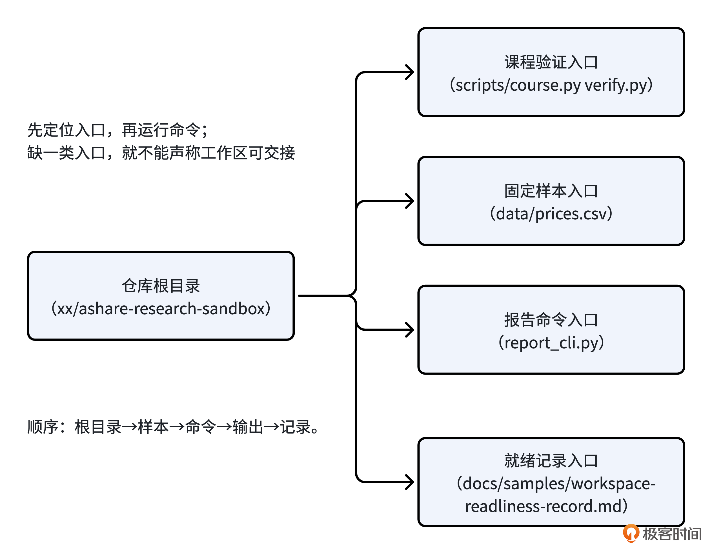
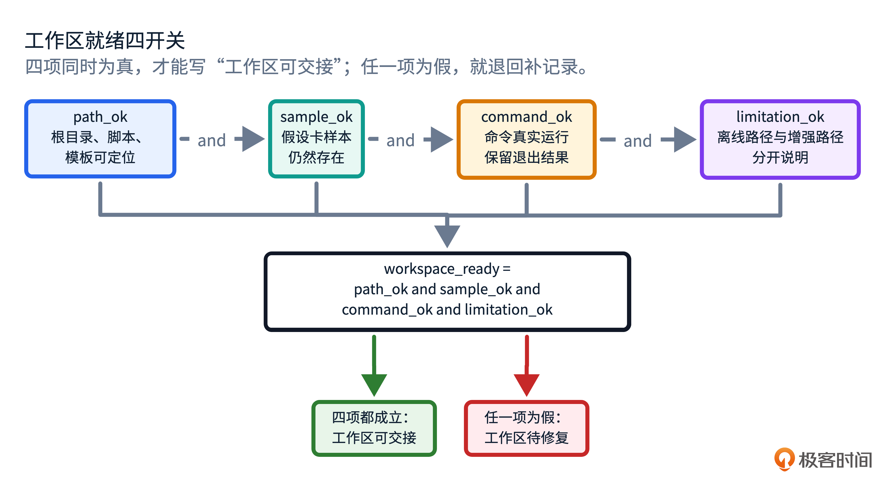

# 03 | LLM量化：搭建可复现的量化研究工作区

你好，我是袁从德。

第 2 讲我们把交易想法收束成研究假设卡：对象、样本、触发条件、对照基准和否定条件，都要在运行命令前写清楚。这节课我们继续向前一步，解决一个更基础的问题：这张卡离开作者电脑后，别人还能不能按同一目录、同一数据和同一命令复跑出相同结果。

本讲最终交付物是一份工作区就绪记录。它不评价策略是否有效，只记录路径、样本、命令、输出和限制条件是否足够清楚。后续每一次报告、回测或模型辅助总结，都要先回到这份记录，确认研究材料不是作者本机的偶然状态。

## 1. 为何本机能跑，不等于流程可复现

本节先区分两件事：作者本机能运行，和另一位复核者能够复现。前者只证明当前机器上存在一条可执行路径；后者要求仓库、样本、命令、输出和限制都能被交接复核者重新检查。

### 1.1 安装部署步骤 ≠ 标准化复现协议

“安装依赖并运行测试”不等于复现协议。复现协议至少还要说明四件事：用什么输入，期待什么输出，失败如何处理，哪些结果不能外推。

```
合格表述应接近这样：“在仓库根目录运行 python report_cli.py --format
summary，确认 data/prices.csv、docs/samples/research-hypothesis-
card.md 和 docs/samples/workspace-readiness-record.md 存在；如果缺少
OPENAI_API_KEY，只记录离线路径可用，不宣称 LLM 增强可用。”
```

工作区记录还要标出模型参与的位置。LLM 只总结日志，就不能把总结写成测试结果；LLM生成代码，就要记录需求、人工审查和测试命令。复现协议保护的不是“看起来能运行”，而是别人能沿着同一证据路径质疑和复核。

### 1.2 与第 2 讲假设卡的衔接

```
第 2 讲已经把主假设固定为：在 data/prices.csv 中检验 WEB3-DEMO/USDT 的 3/7 均线
交叉，观察它是否优于买入持有；主检验命令为 python report_cli.py --format
summary。
```

本讲不重新解释三档判断，只确认交接复核者在仓库根目录能否找到同一份样本、同一张假设

```
卡模板和同一条命令。建议把 docs/samples/research-hypothesis-card.md 与
docs/samples/workspace-readiness-record.md 连起来使用：先读就绪记录确认环
```

境，再读假设卡复跑主假设。

图 3-1 给出本讲证据链。读图时按输入、命令、输出、记录的顺序核对；只要某个节点缺少路径、退出结果或限制说明，就应先补齐记录，再继续解释研究结果。



- 图 3-1　证据链与停止线

## 2. 划定工作区边界

可复现工作区不是把目录全部读一遍，而是知道每类材料承担什么证据职责。本节先划出目录、数据、配置、命令和解释五个边界，再说明哪些情况必须停止。

### 2.1 五个边界

表 3-1 把本讲要求压成五类边界。阅读时重点看“必须停止的情况”，那就是工作区的停止线。

边界

- 本讲要求可以留下的证据

- 产品代码在 src/，讲稿在 docs/v2/，上游对照在AGENTS.md 说明仓库职责

目录边界

- vendor/

- data/ 与 fixture 可定位

数据边界

- 使用固定离线样本，外部数据须声明来源

- .env.example 只声明变量名，不提交密钥

配置边界

- 密钥为空或从环境注入

- verify.py、scripts/course.

命令边界

- 入口命令须给出明确成功或失败

- LLM 只解释已有证据，不补造环境事实

解释边界

- 输出区分事实、推断、建议

- 表 3-1　可复现工作区的五个边界

### 2.2 目录与能力边界

```
本讲把完整工作区边界明确为五类：src/ 放产品代码，docs/v2/ 放书稿正文，data/ 放
固定离线样本，tests/ 放可执行的验证用例，vendor/ 放只读上游对照。
这些目录能证明的事情不同。data/ 不是临时本机数据，tests/ 不是交易有效性证明，
vendor/ 不能被 src/ 直接导入。可复现工作区要固定的不是研究结论，而是路径、数据、
```

配置、命令和解释范围。

```
还要区分两类能力：仓库默认能够复跑的离线路径，以及依赖本机 .env、外部密钥或模型调
```

用的增强路径。作者电脑上有密钥，不代表项目默认支持 LLM 增强；保留一张验证截图，也不能替代命令、运行目录、提交版本和原始输出。

## 3. 找到样本、命令与记录入口

边界划清以后，要把它们落到真实仓库。本节围绕第 2 讲的研究假设卡，定位样本、命令、模板和验证入口。复核者不需要一开始读完所有源码，但必须知道入口在哪里、失败时停在哪一层。

本讲的仓库入口分成四类：项目验证入口、固定样本入口、报告命令入口和就绪记录入口。四类入口缺一不可。只有验证入口，没有样本说明，别人不知道复现对象是什么；只有样本说明，没有命令入口，别人无法判断输出是否来自同一流程；只有命令截图，没有记录模板，交接复核者就无法判断这次运行是否可复查。

表 3-2 汇总本讲要检查的真实入口。每一行都对应一个交接复核者会追问的问题。

入口

- 位置接手者要确认什么

```
scripts/course.py、verify.py
```

项目验证入口

- 命令是否从仓库根目录

- 表 3-2　可复现工作区的四类入口

图 3-2 把四类入口放回仓库根目录中。读图时不要把它当成目录截图，而要看每一类入口承担的交接责任：样本负责固定输入，命令负责生成输出，记录负责说明环境和限制。



- 图 3-2　仓库入口地图

## 4. 用窄口命令确认工作区

工作区验证应先走窄口，不要一开始就运行整套检查。窄口命令的价值在于快速回答“当前环境是否能进入研究流程”。如果窄口失败，问题还在路径、解释器、依赖或样本层，不应继续讨论策略表现。

### 4.1 入口验证命令

以下代码给出本讲用于定位验证入口的基础命令。它们不承诺所有功能都已完成，只确认复核者从仓库根目录可以找到项目脚本、固定样本和报告入口。

```
python report_cli.py --help
python report_cli.py --format summary
Test-Path data/prices.csv
Test-Path docs/samples/research-hypothesis-card.md
Test-Path docs/samples/workspace-readiness-record.md
```

这段命令有三个核心要点：

1. 命令必须写出真实入口，而不是只写“运行测试”。

2. 输出必须保留成功、失败和警告，不能把失败改写成“预计通过”。

3. 命令结果只说明工作区是否可进入，不负责替研究假设下结论。

### 4.2 四个就绪开关

窄口命令跑完后，可以用四个条件判断当前工作区是否具备交接资格：路径、样本、命令和限制。它们只判断工作区是否可交接，不判断策略是否有效。

本讲用一个简单条件表示工作区是否可以交接：

```
workspace_ready = path_ok and sample_ok and command_ok and limitation_ok
其中，path_ok 表示仓库根目录、脚本和记录模板可定位；sample_ok 表示第 2 讲假设卡
引用的样本仍然存在；command_ok 表示命令真实运行并保留退出结果；limitation_ok
```

表示记录明确说明哪些路径只是可选增强。四个变量都成立，才能写“工作区可交接”；任一变量为假，就只能写“工作区待修复”。

图 3-3 把四个变量画成开关。它强调的是“同时成立”：路径、样本、命令和限制只要有一项缺失，就不能把本机运行写成可交接工作区。



- 图 3-3　工作区就绪四开关

## 5. 写一份可交接的就绪记录

验证命令跑完以后，真正的交接材料不是终端截图，而是一份别人能读懂的就绪记录。本节先说明记录字段，再示范如何把本机运行改写成交接材料，最后给出就绪决定。

### 5.1 记录字段

工作区就绪记录至少包含五项：运行日期、解释器和命令入口、固定样本、关键输出、限制条件。运行日期用于判断结果是否过期；解释器和命令入口用于排查环境差异；固定样本用于连接第 2 讲假设卡；关键输出用于确认交接复核者能看到同一组字段；限制条件用于防止复核者把工作区验证误读成策略验证。

表 3-3 给出就绪记录的基础字段。正文引用这张表，是为了让复核者知道记录不是随手写一段感想，而是有明确交接责任的研究材料。

字段

- 合格写法不合格写法

- 写明操作系统、Python 入口和是否使用虚拟环境只写“本机通过”

运行环境

```
指向 data/prices.csv，说明来自固定示范样本
```

- 写“使用历史数据”但不给路径

输入样本

执行命令

- 逐行记录实际运行命令和退出结果只贴截图或口头说明

- 说明字段存在、警告存在、LLM 是否参与

输出边界

- 把命令通过写成研究结论

后续动作

- 标记下一步要检查或复核的材料不说明下一步

- 表 3-3　工作区就绪记录的基础字段

### 5.2 从本机运行到交接记录

```
假设作者在本机运行 python report_cli.py --format summary，报告入口可返回摘
要，但 .env 中没有外部模型密钥。如果只写“验证基本通过，后续可继续”，交接复核者无法
```

判断哪些能力来自仓库，哪些来自作者本机。

更清楚的记录方式是：固定样本存在，报告入口可定位；LLM 增强路径未配置，本讲只记录离线研究路径可复跑。这个案例的关键，不是把失败包装成成功，而是把失败放到正确层级。缺少密钥不是策略失败；样本路径不存在也不是模型失败；命令无法启动更不是市场假设失败。

这节课的内容最容易被轻视，因为它看起来只是“把环境搭好”。但在真实协作中，环境问题往

```
往比策略问题更早破坏证据链：解释器不同、当前目录不同、样本被本地替换、.env 状态没
```

有说明，都可能让同一条命令得到不同结果。工作区就绪记录的作用，就是把这些隐性信息改写成显性约定。

### 5.3 运行口径与失败记录

本讲只确认固定样本、命令入口和运行边界，不重新评估第 2 讲的策略判断。也就是说，

```
data/prices.csv 在本讲里的身份是“共同输入”，不是“结论来源”；report_cli.py 的输
```

出在本讲里的身份是“字段可见”，不是“策略解释”。若命令输出包含收益或回撤，本讲只把它们记为“已经出现的输出字段”。

```
本讲最常见的偏差，是把本机状态误写成项目状态。作者本机有 .env、缓存或一次成功截
```

图，都不能自动变成仓库默认能力。比如作者本机配置了模型密钥，就写成“系统默认支持LLM 总结”；作者曾经跑通过完整检查，就只保留一张截图；作者本地有一份临时数据文件，就把结果写成仓库固定样本产出。这些都不是复现证据，而是本机记忆。

处理这类偏差的方法很简单：不要解释，先补记录。缺路径就补路径，缺解释器就补解释器，缺命令退出结果就补原始输出，增强路径依赖密钥或网络就标为可选。只有当这些信息进入就绪记录，它们才从作者经验变成可交接材料。

### 5.4 就绪决定

就绪记录最后要给出明确决定：可交接、待修复，或拒绝进入下一步。判断时至少检查四项：路径是否从仓库根目录出发，样本是否仍指向第 2 讲假设卡，命令是否真实运行并保留失败信息，限制条件是否阻止复核者把工作区验证误读成研究结论。

以下代码给出工作区就绪记录的基础结构。它适合放进研究笔记或交接材料，帮助交接复核者逐项确认工作区是否可交接。

```
workspace_record = {"chapter": 3,"sample": "data/prices.csv","commands_recorded":
```

这也是本讲与普通安装说明最大的区别：安装说明追求尽快启动，工作区记录追求别人能够复查、质疑和继续推进。

## 总结

这节课我们没有急着评价策略，而是先把研究假设放进一个别人也能复跑的工作区。复核者需要记住三点：

1. 可复现不是“作者本机能跑”，而是路径、样本、命令、输出和限制都能被交接复核者复查；

2. 本讲只证明工作区可进入，不替第 2 讲重判假设；

3. 工作区就绪记录要保留失败和限制，因为它们决定交接复核者能否围绕同一份研究材料继续工作。


## 思考与练习

1. 入口核对：按表 3-2 找出本讲四类入口，并说明每一类入口缺失时会阻断哪一步交接。

```
记录核对：参照表 3-3，为一次 python report_cli.py --format summary 运行补
```

- 写工作区就绪记录，要求写清解释器、样本、命令结果和限制条件。

期待你的分享。如果今天的课程让你有所收获，也欢迎转发给有需要的朋友，邀请他来一起学习，我们下节课再见！
