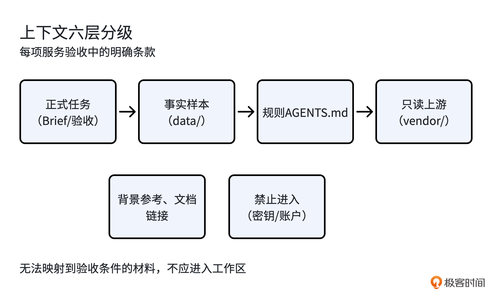
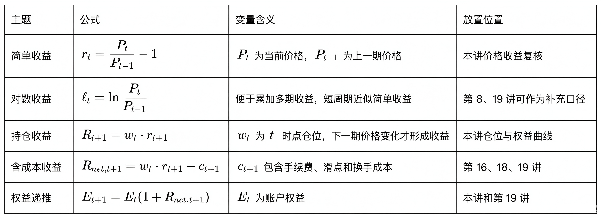
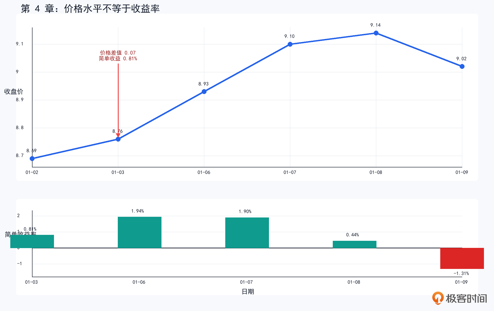
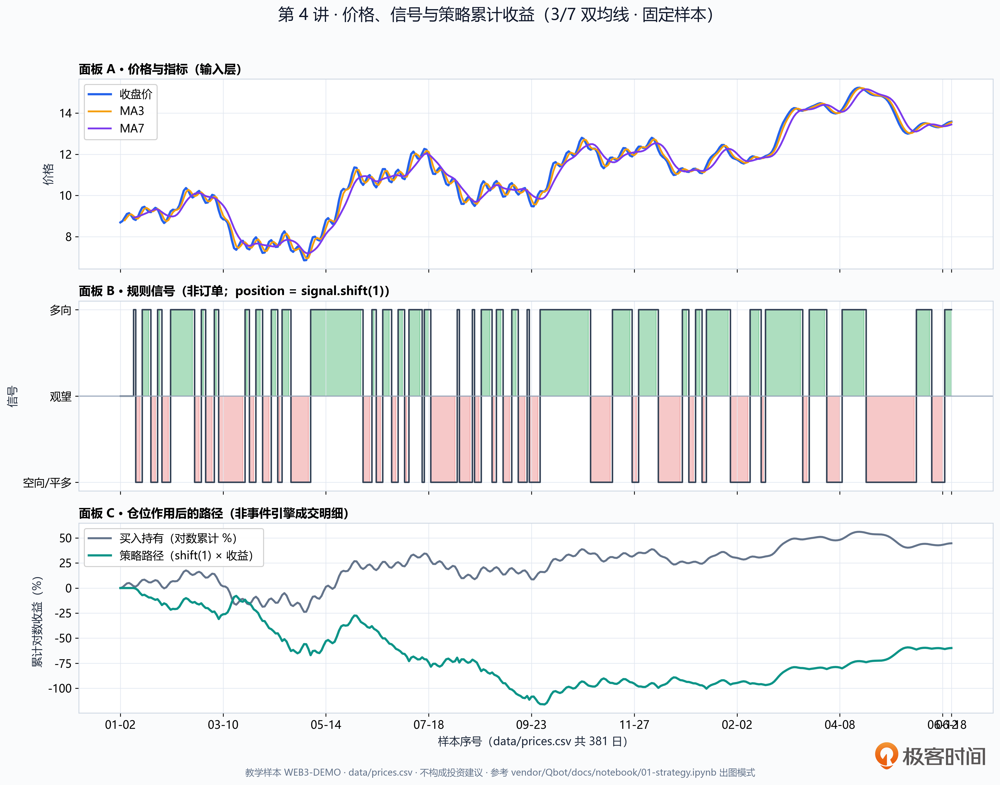
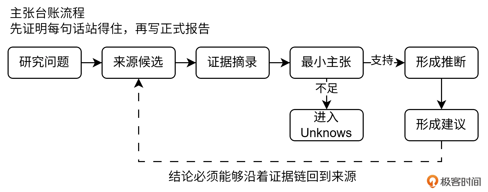
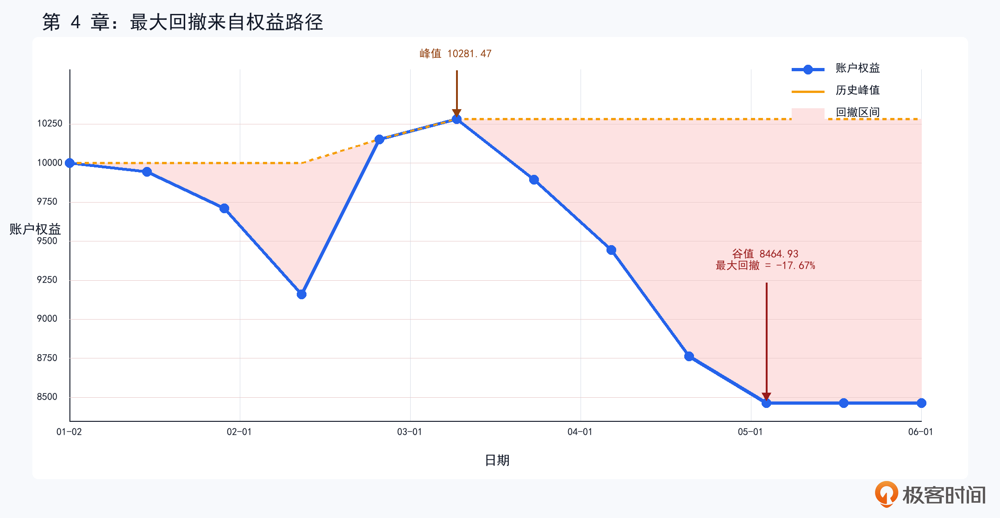

# 04 | 读懂价格、收益、信号与仓位

你好，我是袁从德。

第 3 讲搭好了可复现工作区，研究材料已经可以被别人找到、运行和复查。接下来要解决的是另一个更容易被忽视的问题：同一组数字，放在不同语义里，会得到完全不同的结论。

价格上涨，不等于策略赚钱；规则给出买入信号，不等于账户已经持仓；最终收益为正，也不代表中间风险可以忽略。量化研究最常见的错误，往往不是公式写错，而是把价格、收益、信号、仓位和权益曲线混成同一个说法。

本讲最终交付物是一份基础量化计算记录：写清原始价格、交易区间、权益路径、手工公式、程序输出和结论边界。读完后，你能手工复算一个价格收益、一次持仓收益和一段最大回撤，并解释这些数字分别能证明什么、不能证明什么。需要补齐量化背景时，可把导读那节课作为旁读材料；本讲正文只保留和仓库样本直接相关的复算口径。

## 1. 建立基础量化语言

第 2 讲回答“研究什么”，第 3 讲回答“在哪里复现”，本讲回答“怎样描述市场和策略”。如果这一层语言不清楚，后续复核者可能把价格上涨当成策略收益，把信号方向当成交易订单，把低回撤当成低风险。这些错误一旦进入回测内容，就会被复杂指标包装得很像专业结论。

本讲不提前讲完整组合管理，也不展开统计推断。它只建立课程中共用的五个对象：价格是某个时点的市场水平，收益是两个时点之间的相对变化，信号是规则对当前信息的判断，仓位是资金实际承担风险的状态，权益曲线是仓位和价格共同作用后的账户路径。只有把这五者分开，后面的策略、回测、风控、Web 展示和 LLM 解释才有共同语法。

量化语言从五个不能混用的对象开始，再对照完整系统反推基础公式。下面四段依次建立概念、说明必要性、画出地图并给出本讲公式。

### 1.1 五个对象的边界

表 4-1 为本讲核心参照表，表格内每一类对象均为全书反复复用的基础变量，完整标注存储位置与高频错误用法。

对象

- 含义本讲仓库位置常见错误

```
data/prices.csv 的 close
```

价格

- 某日期的收盘价水平把价格水

```
close_t / close_(t-1) - 1
```

收益

- 两个价格之间的相对变化只看上涨

- 3/7 日均线交叉

信号

- 规则产生的买入、卖出或观望判断把信号当

仓位

- 策略实际持有的风险暴露回测引擎的交易与权益忽略入场

```
curve[].equity
```

权益曲线

- 账户价值随时间变化的路径只看最终

- 表 4-1　价格、收益、信号、仓位与权益曲线的区别

这个表的价值在于阻断语义偷换。样本整体上涨，不代表策略在同一段时间里持续持仓；3/7

```
均线策略第一笔交易只是在 2025-01-10 买入、2025-01-13 卖出，收益反而为负。信号告
```

诉我们规则想做什么，仓位告诉我们资金实际做了什么，权益曲线告诉我们账户经历了什么。三者缺一不可。

图 4-1 把五个对象放进同一层次图。越往右，越接近可评价结果；越往左，越接近原始输入。



- 图 4-1　量化对象层次

五个对象分开之后，还要说明为什么混用它们会直接破坏后面的回测与风控解释。

### 1.2 基础概念为什么决定后续结论

很多人会觉得价格、收益、信号和仓位太基础，真正重要的是策略想法、模型选择和自动化。但在真实量化研究中，大量错误恰恰来自这些基础对象被混用。一个 LLM 生成的策略说明可能写得很完整，却把“看多”直接写成“买入”；一个回测页面可能显示收益为正，却没有暴露中间是否长时间空仓；一个研究报告可能引用价格涨幅，却没有说明策略实际持有了多久。这些错误在文字上都很顺，在结果上却会把研究带偏。

本讲的严格性会直接影响后续各讲。第 5 讲讨论投资建议边界时，需要知道“信号”还不是“订单”；第 6 讲拆解计划时，需要知道指标和研究记录分别对应哪一层对象；第 18 讲构建回测引擎时，需要知道仓位变化如何进入权益曲线；第 19 讲评估收益与回撤时，需要知道指标来自账户路径而非原始价格；第 21 讲比较多策略时，需要确保不同策略的收益口径一致。看似基础的五个对象，其实是全专栏后续严谨性的底层协议。

本讲延续前两讲的人机边界，但不再重复安全规则。这里新增的要求只有一个：解释时必须标注引用的是价格、信号、交易、仓位还是权益。

概念必要性的后面，我们用一张地图把价格、收益、信号和仓位放回完整系统里对照。

### 1.3 从完整系统拆回基础地图

开始接触开源量化平台时，初学者最容易被完整功能清单吸引：行情数据、策略库、回测、模拟交易、实盘交易、可视化、因子、机器学习和组合优化都放在同一个系统里，看起来像是一步到位的量化交易产品。我们专栏不能从这里直接跳到“做一个交易机器人”，而要先把完整系统拆成可学习的基础地图。

表 4-2 汇总本讲需要对照的关键口径：

系统层

- 解决的问题学什么

数据层

- 从行情、资金、链上或情绪来源得到时间序列价格、收益、数据质量、快照来源

- 均线、RSI、布林带、ATR、字段口径

指标层

- 把价格序列压缩成趋势、动量、波动等描述

- 把指标或 LLM 上下文转成候选方向

信号层

- 信号枚举、置信度来源、证据引用

- 均线交叉、MACD、RSI、技术信号策

策略层

- 定义入场、离场、仓位和参数

回测层

- 用历史样本模拟策略路径成交记录、权益曲线、回撤、基准比

```
MAX_POSITION_PCT、止损止盈、
```

风控层

- 限制仓位、止损、组合暴露和高风险动作

- K 线、回测页、风险中心、数据源面

展示层

- 让研究证据可检查、可复盘

- 表 4-2　从完整量化系统拆出的基础地图

这张表的作用是给出一个全局参照：量化交易不是“有一个买卖建议”这么简单，而是一条从数据到决策的证据链。Qbot 这样的项目可以帮助我们理解成熟系统会覆盖哪些模块，但专栏的顺序故意更慢：先把价格、收益、信号、仓位和权益曲线讲清楚，再进入指标、策略、回测、风险和 Web 应用。否则系统使用者会先学会调用功能，却不知道每个功能能证明什么、不能证明什么。

地图清楚之后，看一下本讲要用的基础公式口径，供后续手工复算。

### 1.4 基础收益公式标准化归档与适用边界

雪球等社区资料常把“价格涨跌、收益率、仓位、资金曲线”放在同一篇入门文章里讲。但我建议先不要急着把它们放到策略部分，而应落到这张基础公式表。原因很简单：后续所有技术指标、策略规则和回测评价，都依赖这里的变量定义。

表 4-3 汇总本讲需要对照的关键口径：



- 表 4-3　量化入门公式的归档位置

这张表也给出一个防错顺序：先算价格收益，再看仓位是否实际持有，最后才谈策略权益。如果一个分析直接从“价格上涨”跳到“策略赚钱”，就必须拆回这三步复核。

图 4-2 把同一段价格变化拆成上下两层：上层是价格水平，下层是相邻两天的简单收益。复核

```
时应特别注意，价格从 8.69 到 8.76 的差值是 0.07，但进入研究记录的收益率是相对变化
0.81%。
```



- 图 4-2　价格差值与简单收益率的区别

再补两条专业口径，用于把本讲和后面的绩效评价接起来。第一，简单收益适合解释单期变化；对数收益适合把多期路径相加：

- T

## P

## P

## ∑

- ​tT

## ln

## ℓ

- ​ =​ =​ln​1:T

## P

## P

- ​t−1​0t=1​

但这不表示对数收益天然“更高级”。若报告面向研究记录解释一笔交易，简单收益更直观；若比较连续路径、做波动率或回归，常先转为对数收益。第二，仓位收益必须使用上一期已经确定的仓位：

- ​ =​ ⋅

## R

## w

- t rt+1t+1​

## t + 1

## w

- 的价格后再决定，否则就是未来信息污染。后续第 18 讲事件驱动回

这里的

- 不能偷看​t

测会把这个约束落实为“信号在当前 K 线收盘后生成，下一根 K 线才可能成交”。本讲先记住一句话：收益属于未来价格变化，仓位必须在变化发生前确定。

最后，风险调整收益不是“收益越高越好”的同义词。Sharpe 的基础口径是：

## mean(R

- ​ −R​)tf

## Sharpe =

## N

## std(R

- ​ −R​)​​tf

```
是无风险收益或基准资金收益，示范样本里可暂时近似为 0；N 是年化期数。若样本很
```

## R

- ​f

短、交易次数很少，Sharpe 只能作为描述性指标，不能被写成统计显著优势。第 19 讲会正式展开绩效评价，本讲只需要知道：Sharpe、回撤、Calmar 都来自权益路径，不来自原始价格路径。

## 2. 在固定样本上复算三个数字

前面已经定义了价格、收益、信号和仓位的基本口径，接下来要把这些口径放进一个可复算的小练习。小节会先说明实践动作，再解释输出能证明什么。

概念清楚之后，用一段固定样本跑通读数路径，并练习三种不同的结果读法。

### 2.1 回测核心代码模块走读

```
src/backtest/runner.py核心逻辑拆解：
load_prices读取 CSV 内 date、close 字段，封装标准化 Price 数据对象；
moving_average函数仅在数据窗口长度达标时输出均线值，数据不足返回空值；
run_backtest将日线价格封装 K 线数据，送入事件驱动回测引擎与风控校验模块。代码
```

- 天然分层约束：价格数据 ≠ 策略信号，信号判定 ≠ 成交订单，订单下发仍需经过风控限额拦截。

```
src/backtest/metrics.py指标模块约束：
sharpe_ratio函数输入仅接受账户权益曲线，不可直接传入原始价格序列；先由相邻权
```

- 益差值计算每期账户收益，再完成均值、标准差、年化换算；

```
maximum_drawdown同步依赖权益曲线：持续更新账户历史峰值，记录当期权益相对历史
```

- 峰值的最大跌幅。 所有绩效评价指标，评价对象均为完整账户资金路径，而非单纯标的行情。

```
图 4-3 的三面板出图方式，用本仓库固定样本 data/prices.csv 把三层对象画在同一张图
```

里。面板 A 是价格与 3/7 均线；面板 B 是规则信号（注意这不是成交记录）；面板 C 是

```
signal.shift(1) 作用后的累计对数收益，并与买入持有对照。它说明「信号如何滞后一
```

根 K 线进入仓位」，但不能替代第 18 讲事件引擎里的成交、手续费与风控明细。



- 图 4-3 价格、信号与策略累计收益（3/7 双均线 · 固定样本）

图 4-3 能证明：在同一 CSV 上，价格、信号与路径可以分开可视化；不能证明：该简化向量

```
化路径等于 report_cli.py 的完整回测结果，更不能外推为实盘收益。
```

看清基础证据路径之后，再运行命令，让假设接受第一次数据反驳。

### 2.2 实战命令执行与手工逐层推演

标准回测执行命令（跨系统兼容）：

```
# 通用执行命令
python report_cli.py --format json --short 3 --long 7
# Windows虚拟环境执行命令
.\.venv\Scripts\python report_cli.py --format json --short 3 --long 7
如果团队约定使用虚拟环境，也可以运行 .\.venv\Scripts\python report_cli.py -
-format json --short 3 --long 7。无论使用哪一个 Python 入口，工作区就绪记录
```

里都要写清实际命令。

```
本次运行得到的关键结果是：买入持有收益 56.27%；3/7 均线策略收益 -15.35%；最大回
撤 -17.67%；Calmar -0.87；Sharpe -1.51；交易次数 14；最终权益 8464.93。交易记
录显示，第一笔在 2025-01-10 以 8.86 买入，2025-01-13 以 8.81 卖出；第二笔在
2025-01-16 以 9.41 买入，2025-01-22 以 9.19 卖出。风险规则随后因
MAX_DAILY_LOSS_PCT 拦截后续买入意图，报告中汇总为 176 笔。
接着做基础手工复算。data/prices.csv 前三行收盘价为 8.69、8.76、8.93。第一段
简单收益为 8.76 / 8.69 - 1 = 0.81%；第二段为 8.93 / 8.76 - 1 = 1.94%。这
```

说明收益是相邻价格的相对变化，不是价格差值本身。若只写“上涨 0.07”，就没有说明投入基数，也无法和其他资产比较。

```
再复算交易收益。第一笔交易从 8.86 到 8.81，收益约为 8.81 / 8.86 - 1 =
-0.56%；第二笔从 9.41 到 9.19，收益约为 -2.34%。这两笔交易的方向不同，持有区间
不同，不能用全样本 56.27% 买入持有收益替代。最后复算最大回撤的关键片段：权益从
10281.47 的局部峰值跌到 8464.93，回撤约为 8464.93 / 10281.47 - 1 =
-17.67%，与程序输出一致。
```

### 2.3 回测输出指标解读边界规范

表 4-4 把本讲输出拆成事实、解释和不能写成的结论。

输出

- 可以作为事实本讲关注的对象

```
buy_hold_return_pct=56.27
```

- 全样本收盘价从 8.69 到 13.58价格路径 / 基准收益

```
strategy_return_pct=-15.35
```

- 策略最终权益为 8464.93策略权益路径

```
maximum_drawdown_pct=-17.67
```

- 权益曲线出现 17.67% 峰谷回撤权益曲线风险

```
trade_count=14
```

- 样本中成交十四次交易记录

```
MAX_DAILY_LOSS_PCT 拦截 176 笔
```

- 风控阻止继续买入信号与订单的差异

- 表 4-4　输出的解释边界

图 4-4 用“主张账本”提示你：每一句结论都要能回到输入、计算和限制。没有计算来源的句子，只能算解释草稿。



- 图 4-4　主张账本

### 2.4 完整案例：同一段行情的三种读法

```
现在把本讲内容合成一个完整案例。假设有人看到样本从 2025-01-02 的 8.69 涨到 2026-
06-18 的 13.58，第一反应是：“价格上涨 56.27%，所以均线策略不错。” 这句话至少混淆了
```

三层对象：第一，它使用的是全样本买入持有收益；第二，它没有说明策略是否在起点买入并持有到终点；第三，它没有检查风控是否阻止了某些信号进入仓位。

```
第一层读法是价格读法。只看原始价格，全样本收益确实约为 13.58 / 8.69 - 1 =
56.27%。这是一条关于价格序列的事实，可以写入“市场样本描述”，但不能写入“策略收益”。
```

价格读法回答的是“如果从头买到尾，标的价格发生了什么”，不回答“策略什么时候承担风险”。

```
第二层读法是交易读法。策略第一笔交易在 2025-01-10 买入，价格是 8.86；在 2025-
01-13 卖出，价格是 8.81。这笔交易收益约为 -0.56%。若只看全样本涨幅，就会错过一个
事实：策略并没有从 8.69 买入，也没有在第一段里赚到全样本涨幅。第二笔交易从 9.41 到
9.19，收益约为 -2.34%，但它也不能代表全样本，因为它只覆盖策略实际持仓区间。
第三层读法是权益和风控读法。权益曲线显示账户从 10281.47 回落到 8464.93，形成约
-17.67% 的回撤。与此同时，后续若干买入意图被 MAX_DAILY_LOSS_PCT 拦截。也就是
```

说，后续价格继续上涨，并不意味着策略继续加仓；信号可能出现，订单可能被拒绝，仓位可能保持为空。这个案例把一句“价格涨了，所以策略好”拆成了三条可复核证据：价格涨幅、交易区间收益、权益路径与风控拦截。

这就是本讲的完整示例。它不要求记住某个结论，而是要求掌握一种拆解方法：任何看起来像策略评价的句子，都要追问它引用的是价格、信号、仓位还是权益；任何看起来像收益的数字，都要追问它的起点、终点、资金暴露和成本假设。

把这个案例交给交接复核者复查时，不应只问“数值对不对”。更好的问题是：他能否从 CSV找到价格输入，能否从交易记录找到买卖日期，能否从权益曲线定位峰谷，能否从风险拒绝列表解释为什么后续信号没有变成仓位。如果四件事都能完成，说明基础量化语言已经可以交接；如果只能复述最终收益，说明他还停留在看结果，而不是看证据链。

## 3. 把数字写成合格解释

本讲的难点不是公式复杂，而是同一个数字很容易被放进错误的语义里。价格涨幅、持仓收益、账户回撤和风控拦截都可能出现在同一份报告中，但它们回答的是不同问题。下面不再按固定复核清单展开，而是沿着三类常见误读，说明数字怎样进入解释，哪里必须停下。

### 3.1 三类核心公式的独立适用场景

本讲三类核心演算公式，各司其职，不可交叉替代：

1. P​ =​ −

## 1

## r

- 单期价格收益：，仅计算相邻两日标的涨跌幅；​ttPt−1​P​ =​ −

## 1

- exit

## r

- 单笔持仓收益：，仅计算单次开平仓区间盈亏；trade​Pentry​t ( max

## )

- E

## MDD = min

- ​ −1区间最大回撤：，仅描述账户资金全程最大回落幅度。​t​ E​u≤tu​

图 4-5 把最大回撤公式画成权益曲线、历史峰值线和峰谷阴影。公式里的分母不是初始本金，而是当前时点之前出现过的最高权益；因此同一个最终权益，在不同路径下可能对应完全不同的回撤。



- 图 4-5　权益峰值、谷值与最大回撤

```
注意本仓库里 maximum_drawdown 返回负值，报告中也用 -17.67% 表示回撤。以后如果某
```

些资料把最大回撤写成正数，需要先确认符号约定，再比较数值。量化研究里很多错误不是公式不会写，而是不同模块对同一指标的符号和单位约定不一致。

```
这三条公式不能互相替代。r_t 回答“两个价格之间涨跌多少”，r_trade 回答“某一笔实际持
仓赚亏多少”，MDD 回答“账户路径中经历过多大回落”。样本边界和零成本假设已经在第 2 讲
```

和第 3 讲交代，本讲只保留与复算有关的一点：任何收益字段都必须说明它来自价格路径、持仓路径还是权益路径。后续各讲加入手续费、滑点或成交失败时，改变的是成本和执行假设，不是这里的基础公式。

### 3.2 第一类误读：标的价格收益 ≠ 策略收益

```
第一类误读，是看见全样本价格涨 56.27%，就误以为策略也赚到了这段涨幅。价格收益只要
```

求两个价格点，策略收益还要求入场、离场、仓位、成本和风控状态。策略没有持仓的时间段，价格涨幅不能算进策略收益；策略被风控拒绝的时间段，信号也不能自动变成收益。

本讲可以主动构造一个反例：先用全样本价格收益声称“策略收益 56.27%”，再用交易记录和权益曲线推翻这个说法。这样，错误不是被口头纠正，而是被仓库证据纠正。解释段也因此只做一件事：把每句话绑定到字段。绑定不上价格、交易、权益或风控记录的句子，只能留在草稿里。

### 3.3 第二类误读：策略信号 ≠ 实际持仓仓位

第二类误读，是看见买入信号，就假设账户已经买入。信号只是规则判断，仓位才是实际风险暴露。中间还可能经过风险限额、资金约束、成本假设和执行失败。第 5 讲以后会继续强调安全边界，但在第 4 讲就要先养成习惯：只要还没有订单或仓位记录，就不能把信号写成“已经买入”。

```
本讲的仓位反例来自 MAX_DAILY_LOSS_PCT 风控拒绝记录。后续买入信号即使出现，也可
```

能因为风险规则被拒绝，最终仓位保持为空。这个反例提醒复核者：信号可以解释市场状态，仓位才决定账户承受的风险；二者之间的断点，必须在报告中说清楚。

### 3.4 第三类误读：仅参考期末权益，忽略全程资金路径

```
第三类误读，是只看最终收益，不看中间路径。账户权益从 10281.47 回落到 8464.93，形
成约 -17.67% 的回撤。这个数字不能被一句“最终还行”抹掉，因为它说明策略在路径中经历
```

过多大的风险暴露。后续讨论风险管理、止损和组合暴露时，都会回到这个问题：策略不是只在终点被评价，也在路径中被评价。

本讲至少完成三项手工复算：从 CSV 复算一段价格收益，从交易记录复算一笔持仓收益，从权益曲线复算一段最大回撤。复算时要写出原始数值、公式、手工结果、程序结果和差异解释。

还要记录舍入规则。程序输出的均线、权益和指标经过四位或两位小数舍入；手工计算若使用完整精度，可能得到略有差异的结果。差异很小并不一定说明程序错了，但必须说明差异来自舍入、输入口径还是公式不同。严谨案例不怕小数差异，怕的是不解释差异。

代码 4-1 给出一个基础复核对象。它提醒复核者：计算记录不仅要保存结果，还要保存输入和限制。

```python
from dataclasses import dataclass
@dataclass(frozen=True)
class ReturnCheck:
   formula: str
   inputs: tuple[float, float]
   manual_result_pct: float
   program_result_pct: float | None
   limitation: str
first_return = ReturnCheck(
   formula="P_t / P_(t-1) - 1",
   inputs=(8.69, 8.76),
   manual_result_pct=0.81,
   program_result_pct=None,
   limitation="price return, not strategy return",
)
assert first_return.limitation
```

- 代码 4-1　基础收益复核记录

### 3.5 交付一张基础量化计算记录

基础量化计算记录应包含表 4-5 中的字段。

字段

- 合格写法不合格写法

```
8.76 / 8.69 - 1 = 0.81%
```

- 价格涨了 0.07

价格收益

```
8.81 / 8.86 - 1 = -0.56%
```

持仓收益

- 第一笔亏了一点

```
8464.93 / 10281.47 - 1 = -17.67%
```

最大回撤

- 回撤不大

成本假设

- 本讲按既有教学假设复算忽略成本

```
MAX_DAILY_LOSS_PCT 拦截 176 笔买入
```

风控边界

- 后面没有买

结论边界

- 当前数字只说明字段关系策略可用

- 表 4-5　基础量化计算记录示例

## 总结

本讲完成的是后续策略与回测共享的基础量化语言。价格是输入，收益是变化，信号是规则判断，仓位是实际风险暴露，权益曲线是账户路径。把这五者混在一起，会让研究在一开始就得出错误结论；把它们分开，后续各讲才能讨论指标、回测、风控和 LLM 解释。

```
本讲使用真实仓库输出完成了三次复核：前两段价格收益约为 0.81% 和 1.94%，第一笔交易
收益约为 -0.56%，局部最大回撤约为 -17.67%。这些数值不是新的策略判断，而是训练从
```

数字回到生成过程的复核能力。下一讲将进入“研究系统的第一条安全边界”，继续使用本讲的计算记录。


## 思考与练习

1. 概念题：为什么买入持有收益 56.27% 不能直接写成策略收益？请同时说明价格、信号、仓位和权益曲线的区别。

```
计算题：使用 data/prices.csv 任意选取连续三行，手工计算两段简单收益，并说明它
```

- 们为什么不等于完整策略收益。

```
复核题：根据 report_cli.py --format json --short 3 --long 7 的输出，复
```

- 算一笔交易收益或一段最大回撤，写出公式、代入值、程序输出和结论边界。

期待你的分享。如果今天的课程让你有所收获，也欢迎转发给有需要的朋友，邀请他来一起学习，我们下节课再见！
