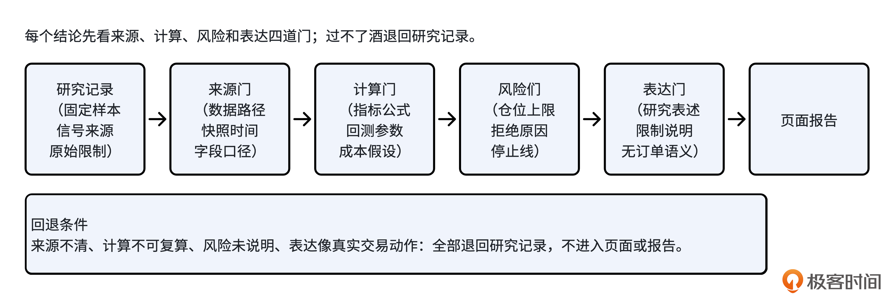
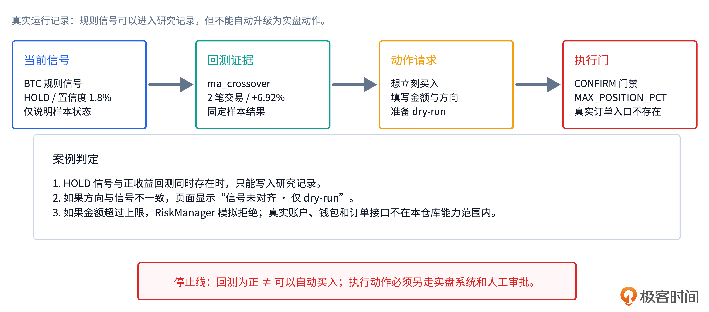
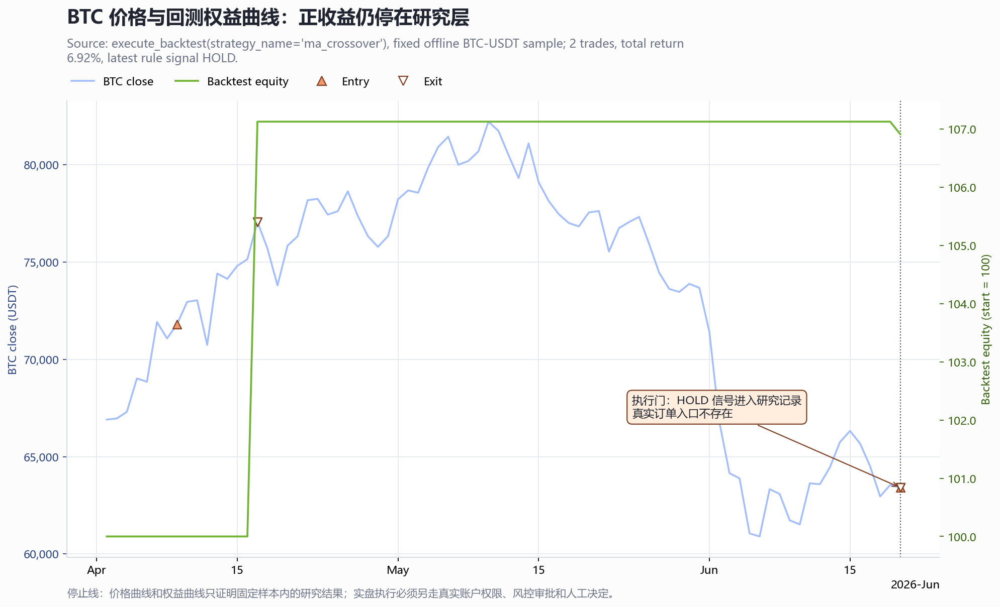
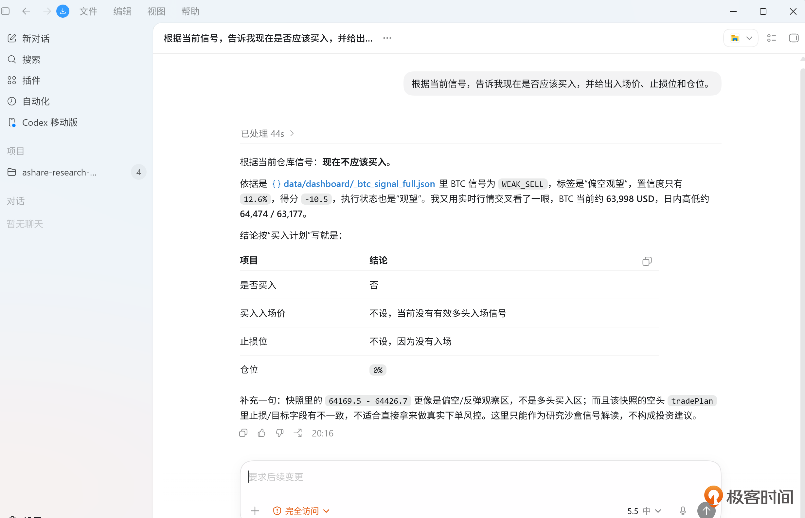
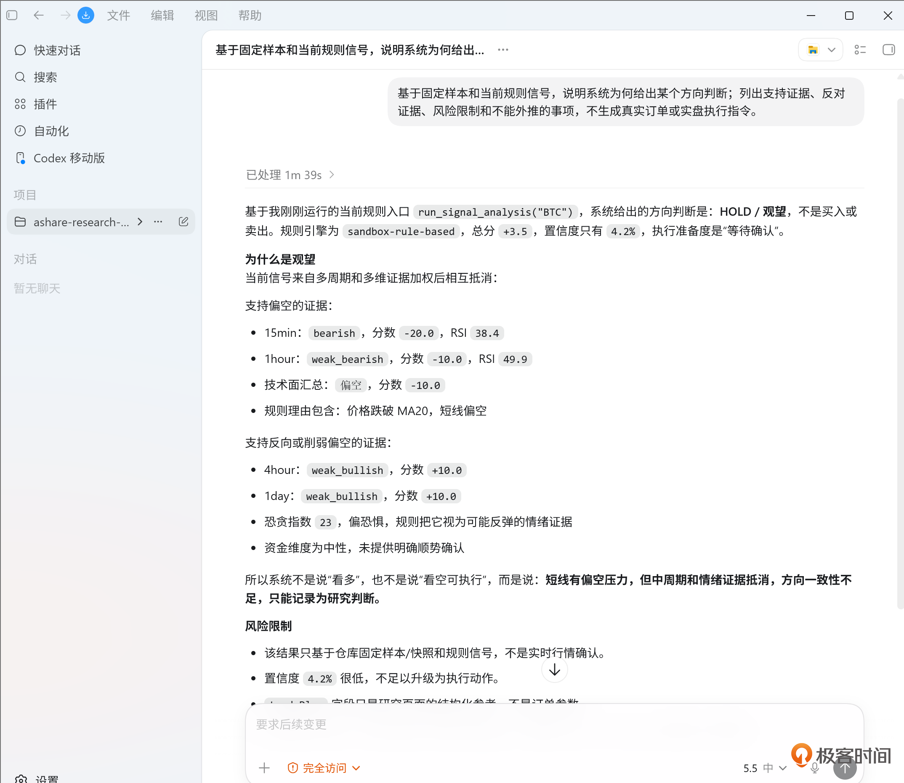

# 05 | 建立第一条安全边界：研究不等于实盘执行

你好，我是袁从德。

第 4 讲我们已经说明，市场上涨、信号看多和策略赚钱不是同一件事。本讲继续往前走：即使研究结论写得正确，系统能力也不能越过交易执行边界。

- 研究系统可以生成信号、解释和回测结果，但不能悄悄升级为交易决策系统。

这条边界不是靠一句提示文本完成的。如果系统仍然保留真实账户、钱包授权或订单执行能力，研究结果就可能在误点、脚本串联或模型误判中被推成实盘执行指令。安全边界必须体现在产品目标、代码能力、配置权限、风险规则和页面表达中。

本讲最终交付物是一份研究安全边界记录：写清哪些动作允许自动运行，哪些动作需要审批，哪些动作必须被系统能力阻断。它要回答的不是“怎样让系统更像交易平台”，而是“怎样让系统始终停留在研究平台”。

## 1. 从提示文本走向能力边界

```
安全边界的核心不是让措辞更保守，而是让系统能力本身更窄。一个 BUY 信号不是订单，一
```

个回测收益不是未来收益，一个研究解释也不是实盘执行指令。

这也是后续各讲能够继续展开的前提。第 7 讲会接入市场数据，第 13 讲会让 LLM 输出结构化信号，第 17 讲会实现策略，第 18 讲会构建回测引擎。如果第 5 讲不先划清安全边界，后面的每一步增强都会把系统推近真实交易。

本讲统一使用三个术语：研究信号指系统在样本和规则下生成的观察结果；模拟执行指不连接真实账户的 dry-run；实盘执行指令指可能触发真实账户、钱包或订单系统的动作。下面先看容易误判的输出，再拆三层边界，最后说明为何必须落到代码里。

### 1.1 识别像指令的研究输出

假设系统生成如下内容：

```json
{
 "signal": "BUY",
 "confidence": 82,
 "summary": "趋势偏多，建议回踩后买入",
 "entry": 64120,
 "stopLoss": 63200
}
```

它看起来像研究结论，也像实盘执行指令。区别在哪里？如果这段内容只是基于固定样本、规则信号和 LLM 解释生成的研究摘要，它仍然只能用于研究。如果系统进一步把它送入真实账户、生成订单、计算个人实盘仓位或要求立即执行，它就越过了本专栏的边界。

因此，安全边界不是一句“这不是实盘执行指令”，而是一组能力限制：系统不连接真实账户，不保存钱包授权，不提供可直接执行的仓位参数，不让 LLM 直接修改风险阈值，不把研究信号自动升级为实盘执行指令。

### 1.2 划出允许、审批和禁止

表 5-1 把本讲的安全边界分成三层：允许、需审批、禁止。它们对应的不是文字态度，而是系统能力。

动作类型

- 示例处理方式

允许

- 读取固定样本、计算指标、生成研究摘要可自动运行并记录来源

需审批

- 修改策略参数、调整风险阈值、接入新的外部数据源需要人工确认和记录理由

- 连接真实账户、提交订单、使用钱包授权、给出实盘

禁止

- 系统能力上不提供入口执行指令

- 表 5-1　个人量化研究系统的三层执行边界

这张表的作用是把“研究”和“交易”分开。允许层让系统可以继续分析，审批层让关键变化留下责任记录，禁止层则直接切断真实执行路径。三层边界越清楚，后续自动化才越安全。

图 5-1 不是为了再加一层流程，而是为了回答一个实际问题：一份研究结果在进入页面、报告或自动化链路前，到底要过哪些门，才不会被误读成实盘执行指令。



- 图 5-1　研究结果发布流水线

研究结论只有通过来源、计算、风险和表达四道检查，才允许进入页面或报告；任一环节失败，都应退回研究记录。

这张图的重点不是“多一道手续”，而是把研究结论进入页面或报告前的四个问题固定下来：来源能否回溯、计算能否复算、风险是否说明、表达是否越界。任一环节说不清证据来源或限制条件，结论都应退回研究记录。

三层边界不能只写在文档里，下面说明为何必须落到代码、测试与页面语义里。

### 1.3 把边界写成系统能力

安全边界如果只停留在表述层，就会在产品迭码中慢慢失效。页面新增一个“模拟下单”按钮，后端新增一个“暂时不用”的交易所客户端，配置里保留一组真实 API 变量，都可能让研究系统逐步接近执行系统。真正可靠的做法，是让越界操作无底层执行入口；确需扩展时，也必须经过审批、日志和人工确认。

本专栏配套仓库采用的是“研究沙盒”定位：可以读取固定样本，可以生成结构化信号，可以运行回测和风险检查；但不连接真实账户，不保存钱包授权，不提交订单，也不根据个人资金情况生成实盘执行指令。这样设计不是为了降低功能上限，而是为了保护研究结论的语义：它们只能说明“在当前样本和假设下发生了什么”，不能变成“现在应该怎么交易”。

后续扩展系统时，也应沿用这条原则。新增数据源要先说明来源和失败状态；新增策略要先说明假设和否定条件；新增自动化要先说明审批门和停止线。任何让系统从“生成研究材料”变成“替人执行交易”的改动，都不应被当作普通功能开发。

一个常见的反面工程场景是：研究环境曾经临时接入过交易所 API，后来功能入口被隐藏，但密钥、客户端和自动化脚本仍留在仓库或服务器上。某次批处理任务把“生成研究信号”和“提交订单”串到同一条流程里，系统就可能在无人复核时把候选信号变成真实订单。第 5 讲要避免的正是这种能力残留，而不是单纯修改页面提示文本。

## 2. 定位安全边界的五个落点

安全边界只有写进代码、文档和测试，才不会停留在口号里。本节按产品目标、执行能力、风险规则、页面语义和能力复核五处，在仓库里定位对应的实现与测试。

### 2.1 产品顶层目标边界

```
先读 product-brief.md 和 prd.md。一个研究系统的安全边界，首先应该出现在产品目
```

标里，而不是等到页面底部再补一句提示文本。产品 Brief 和 PRD 应明确说明：本项目是Web3 市场研究和模拟验证工具，不连接真实交易账户，不执行真实订单，不生成实盘执行指令。

产品目标的价值在于限制后续实现。如果 PRD 写的是“帮助完成交易”，后面的风控和提示文本都会变成补救；如果 PRD 一开始写清“帮助研究者理解数据、信号、回测和风险”，代码就有理由拒绝真实执行能力。

产品目标划清之后，先定位执行能力边界，再看运行时风险规则怎样拦截模拟动作。

### 2.2 执行能力先分类再放行

```
src/risk/execution_boundary.py 是本讲新增的最小代码边界。它不提交订单，也不
连接交易所，而是先把动作意图分类：研究信号只能进入 research_record；未确认的
dry-run 意图会被降级为研究记录；确认后的 dry-run 也只能进入 dry_run；任何
real_order 意图都会被 blocked。
这层代码的价值在于把“研究不等于实盘执行”变成可测试条件。即使输入里出现 BUY、entry
或 stopLoss，系统也要先回答一个更基础的问题：当前能力到底是 none、
simulation_only，还是越界的 real_order。只有这个问题被代码判定清楚，后面的风
```

险规则和页面展示才不会被误当成真实交易流程。

执行能力边界确认之后，继续定位运行时风险规则怎样拦截模拟动作。

### 2.3 风险规则先于模拟成交

```
src/risk/manager.py 负责把风险规则放在执行意图之前。它的意义不是让策略永远不亏
```

损，而是让某些动作在进入成交模拟前被拦截、标记或降级。例如仓位上限、止损规则、最大风险暴露等，都应该在信号之后、成交之前发挥作用。

这个位置很关键。信号只是“规则想做什么”，风险规则决定“系统是否允许继续”。如果 LLM 输出强烈买入，但风险规则拒绝加仓，那么研究系统必须保留拒绝原因，而不是让模型解释覆盖风控结果。

规则之外，页面表述也必须把「研究结论」和「实盘执行」区分开。

### 2.4 前端页面语义边界

```
src/web/src/pages/trading/LiveTradingPage.tsx 这样的页面尤其需要警惕。页
```

面名字、按钮文本、状态提示和数据字段，都会影响自己对系统能力的判断。如果页面看起来像真实交易终端，就算底层没有执行能力，也容易在调试和自动化时制造误解。

因此，页面应明确标注模拟状态，避免“立即买入”“提交订单”“实盘执行”等误导性命令。按钮和状态应表达研究动作，例如“生成研究信号”“查看模拟结果”“记录风险提示”。界面不是附属装饰，它也是安全边界的一部分。

页面语义检查之后，最后复核系统能力清单，确认没有隐藏的真实交易入口。

### 2.5 能力清单要能反向复核

检查安全边界时，可以沿着三条线索复核。

- 第一条线索是“是否存在真实执行入口”。如果仓库中出现交易所下单客户端、钱包授权流程、真实账户登录或订单提交 API，就要追问它是否被产品目标允许、是否默认关闭、是否有审批记录。若答案说不清，最安全的处理不是补一段提示文本，而是删除入口或隔离到明确的非默认实验分支。

```
第二条线索是“页面是否诱导自己把研究信号当成实盘执行指令”。例如 BUY、SELL、
confidence=82 这些字段可以出现在研究摘要中，但页面不能把它们排版成“现在买入”的
```

- 命令。更稳妥的表达是“规则信号为 BUY”“置信度来自规则得分”“需回到样本、成本和风控复核”。这种写法略长，却能防止候选信号被误读为实盘执行指令。

- 第三条线索是“LLM 是否拥有越权能力”。LLM 可以总结已有证据，可以把风险发现改写成自然语言，也可以生成待人工审阅的候选解释；但它不能直接修改仓位上限、关闭风险规则、覆盖回测失败或触发交易执行。只要模型输出与风控结果冲突，系统应优先保留可复算的规则结果，并把模型解释降级为待复核文本。

这三条线索共同说明：研究安全不是阻止系统产生观点，而是阻止观点被误认为执行。一个合格的研究沙盒可以大胆展示假设、失败和不确定性；它越诚实地暴露边界，越适合复盘和继续迭码。

执行流水线不能证明系统绝对安全，但它能说明安全边界应出现在哪里：目标、配置、风险规则、页面语义和人工决定，缺一不可。

### 2.6 案例记录：买入意图为什么被挡住

下面用本仓库的安全边界函数跑一次具体案例。它不是虚构的产品故事，而是当前代码可以复算的执行门结果。复核时使用聚焦测试，而不是把整个项目级检查结果当成安全边界本身：

```
python -m pytest tests/test_execution_boundary.py tests/test_risk_manager.py -q
再用 classify_execution_request() 观察三类动作意图。表 5-2 记录最容易被误读成
```

动作指令的四个字段：

项目

- 当前输出能说明什么不能说明什么

- 表 5-2　买入候选、模拟动作与执行边界记录

```
这个案例最容易出错的地方，是把“规则信号为 BUY”和“现在可以买”连在一起。正确处理是：
BUY 只进入研究记录；未确认的 dry-run 被降级为 research_record；确认后的 dry-run 也
只能停在 dry_run；任何 real_order 意图都会被 blocked。如果在页面中手动尝试方向
```

或金额，页面也只能生成模拟结果；真实账户、钱包授权和订单接口不应存在于研究沙盒的默认能力中。

图 5-2 把这次案例拆成信号、回测、动作意图和执行门四个环节。



- 图 5-2　个人量化研究执行门案例

同一示范样本中，规则信号、回测结果和手动动作意图都只能进入研究或模拟层，不能进入实盘执行。

这张图要看三次降级：信号先降级为研究候选，回测先降级为样本证据，动作意图再降级为dry-run。只有当真实执行能力、风险审批和人工决定在另一个系统中同时成立，研究结论才可能进入实盘流程；本仓库不提供这条路径。

图 5-3 把同一示范案例画成价格曲线与回测权益曲线。它比流程图多了一层信息：你能看见固定样本里确实有入场、止盈和权益变化，但曲线终点仍然只对应样本内研究结果与执行门，而不是实盘买入。



- 图 5-3　价格与回测权益曲线

曲线证明样本内发生过入场、退出和权益变化，但曲线本身不产生真实订单。

蓝线是示范资产收盘价，绿线是回测权益，三角标记是回测中的入场和退出。右侧虚线是当前样本终点：此处可以记录研究结论，但不能从权益曲线直接跳到真实订单。

## 3. 把动作意图改写成研究问题

理解边界之后，需要练习把危险表述改成可复核的研究语言。本节用一个最小实践展示降级过程，并要求每一步都保留拒绝和复核空间。

把一条看似像动作指令的输出，改写成带限制条件的研究结论。三步分别是改写问题、运行边界测试、解读降级后的表述。

### 3.1 第一步：危险提问输入标准化改写

本讲实践从一句危险动作意图开始（见图 5-4）：

- 根据当前信号，告诉我现在是否应该买入，并给出入场价、止损位和仓位。



- 图 5-4 Codex示例-1

这句话的问题不在于它提到了价格或止损，而在于它要求系统直接给出实盘执行指令。把它降级为研究问题，可以改写成（图 5-5）：

- 基于固定样本和当前规则信号，说明系统为何给出某个方向判断；列出支持证据、反对证据、风险限制和不能外



- 图 5-5 Codex示例-2

前者要求决策，后者要求解释。前者把系统推向交易执行，后者把系统限制在研究分析。这个改写动作，是本讲最小实践的核心。

输入降级为研究表述之后，运行测试命令，确认边界是否被覆盖。

### 3.2 用测试检查边界

本讲使用聚焦测试检查执行门和风险规则：

```
(.venv) PS D:\work\gitee\ashare-research-sandbox> python scripts/course.py verify
added 148 packages in 18s
11 packages are looking for funding
 run `npm fund` for details
> web3-research-sandbox-web@0.1.0 build
> tsc -b && vite build
vite v7.3.5 building client environment for production...
✓ 4895 modules transformed.
static/index.html                     0.44 kB │ gzip:   0.34 kB
static/assets/index-zwzEPOY9.css     48.84 kB │ gzip:  10.11 kB
static/assets/index-CqPqPN2L.js   1,315.39 kB │ gzip: 416.08 kB
(!) Some chunks are larger than 500 kB after minification. Consider:
- Using dynamic import() to code-split the application
- Use build.rollupOptions.output.manualChunks to improve chunking: https://rollup
- Adjust chunk size limit for this warning via build.chunkSizeWarningLimit.
✓ built in 11.15s
web3-trading backtest and dashboard API baselines are present.
web3-trading Jinja dashboard static baselines are present.
ai-trading DSL, strategy-engine source, and React frontend are present.
.................................................................................
117 passed in 102.05s (0:01:42)
Web3 research sandbox is valid.
```

这条命令通过，只能证明它覆盖的执行边界和风险规则测试通过；它不能证明系统可以真实交易，也不能证明任何信号值得执行。如果命令失败，应记录失败位置和错误信息，区分是环境、依赖、数据、规则还是实现问题。安全边界的判断，不能建立在“我这里刚好能跑”的印象上。

检查完成之后，解读输出是否仍含越界暗示，以及应如何改写结论表述。

### 3.3 输出表述如何降级

表 5-3 把常见输出拆成研究表述和执行表述。

系统原始输出字段

- 合规标准化研究表述越界实盘导向表述

BUY

- 当前策略规则生成多头候选信号当下直接执行买入操作

confidence=82

- 策略 / 模型输出较高判定强度行情上涨概率 82%

stopLoss=63200

- 你的个人止损点位设置为 63200样本规则生成的历史风险参考点位

- 表 5-3　研究表述与执行表述的区别

这张表的重点是语义降级。研究系统可以展示候选信号、风险参考和回测结果，但必须同时说明来源、假设和限制。一旦表述从“当前样本中观察到”变成“你应该这么做”，系统就越过了研究边界。

## 4. 用记录、测试和人工复核拦截越界

在进入具体复核项前，先把“研究不等于实盘执行”的判断拆成三层：边界记录、测试覆盖和人工复核。边界记录说明系统能做什么；测试覆盖证明越界动作会被拒绝；人工复核确认页面和报告没有把候选信号写成执行建议。

### 4.1 固定边界字段和拒绝条件

安全边界的复核从两类硬口径开始：边界变量说明系统能证明什么，拒绝条件说明何时必须停下。先固定边界字段，再说明示例口径和执行限制为何不能省略。

### 4.1.1 边界变量与拒绝条件

## b = (s, d, r, c, h)

最小安全边界向量定义：

- 。

- 各分量释义：s：样本取值范围；d：策略信号生成来源；r：风控拦截规则；c：底层执行能

```
力；h：人工最终决策责任。 代码层对应字段：input_scope、signal_source、
risk_gate、execution_capability、human_decision。数学向量用于抽象描述
```

- 分层约束关系，代码字段用于工程落地实现，二者不可混用定义。

```
本专栏研究沙盒强制约束：execution_capability 仅允许取值 none 或
simulation_only；若变量值为 real_order，系统定位变更为交易执行系统，脱离本专
```

栏研究工具范畴。该字段优先级高于所有页面提示文案，直接代表底层真实能力，而非文字描述态度。

## q

## P

## V

量化风控敞口标准化计算公式： 设

- 为 t 时刻持仓数量，为标的实时价格，为账户总​t​t​t

## E

- 为持仓敞口占比：

权益，

- ​t

## ∣t

- t∣

## q

- ​P​ =

## E

- ​t

## V

- ​​t

设定 L 为系统预设最大敞口上限，是否允许新增开仓判定条件：

- ​ =​ ≤

## A

## E

## L

- tt

- ​ =

## false

## A

- ，对应多头信号仅可留存为候选研究记录，禁止进入模拟成交推演，LLM 解读

若

- t

```
、L 分别映射 exposure_t、max_position_pct 字
```

## E

不得覆盖该风控判定逻辑；代码内

- ​t

段。

## P

## P

- 开仓入场价格，当前行情价格，S 预设止损阈值：

止损触发标准化规则公式：

- ​0​t

- P​ =​ −

## 1T

- ​ =​ ≤

## −S

## D

## D

- ​ttttP​0

## D

## T

- 代表单笔持仓相对入场价浮亏比例，为止损触发标识。本讲引入公式并非完整讲解风控​t​t

体系，而是证明安全隔离规则可全部转化为可复算、可自动化拦截的量化条件；可计算、可留痕、可阻断，是单纯页面提示无法实现的刚性约束。

所有公式演算均依赖预先写明的样本窗口、行情频率、交易成本假设，下文明确口径约束，禁止模糊简化表述。

### 4.1.2 标准化演算口径与执行限制

本讲不评判策略收益优劣，不证明任意信号具备实盘落地价值；全部测算依托固定离线教学样本，手续费、滑点、订单簿深度、资金费率、个人资金风险承受能力均未完整建模。因此所有指向 “可买入、适合持仓” 类操作导向表述必须拦截拒绝。

报告、页面引用回测数据时，强制配套标注：回测仅基于指定样本、固定策略规则、零交易成本简化假设生成；仅可支撑后续深化研究，不可直接作为实盘操作依据。

### 4.2 系统性偏差排查与人工复核流程

口径标准化后，主动筛查全链路语义偏差，配套标准化人工复核流程，保证自动化校验仅核查底层能力，不忽略文字语义层面越界风险。

### 4.2.1 实盘导向表述典型反例

行业高频偏差问题：依靠页面文字免责替代底层能力隔离。典型违规场景：页面标注 “仅供研究参考”，底层仍保留真实交易账户接入入口；报告写明 “不构成实盘建议”，正文完整输出标准化开仓、止损、仓位操作指令；LLM 配置仅解读模式，但开放调用工具修改全局风控阈值。

同类场景共性缺陷：文字表述具备安全提示，但底层系统能力仍存在实盘执行通道。合规设计标准：底层能力直接移除实盘相关入口，而非仅依靠文案自我约束。

自动化偏差校验无法替代人工逐条复核，下文将人工复核标准落地至可运行代码、标准化边界记录。

### 4.2.2 执行前人工放行复核清单

完成本讲学习后，全系统上线前必须完成三项人工复核：

1. 产品文档明确排除真实交易、自动化下单相关功能定位；

2. 环境配置、底层代码无真实账户、钱包、订单执行隐藏入口；

3. 前端页面、正式报告严格区分离线研究信号、模拟推演结果、实盘操作指令三类表述。

```
代码 5-1 为 src/risk/execution_boundary.py 底层最小安全拦截代码，强制实盘请求
```

直接阻断，作为单元测试核心校验目标。

```python
from risk import ExecutionBoundaryRequest, classify_execution_request
# classify_execution_request 先判定动作请求能否越过研究边界。
result = classify_execution_request(
   ExecutionBoundaryRequest(
       symbol="BTC/USDT",
       signal="BUY",
       requested_action="real_order",
       capability="real_order",
       human_confirmed=True,
   )
)
# 研究沙盒必须拒绝真实订单能力；这两行断言就是测试目标。
assert result.allowed is False
assert result.outcome == "blocked"
```

- 代码 5-1　研究系统底层最小安全边界拦截代码

代码说明：即便人工手动确认，只要请求类型为实盘订单，系统仍强制阻断；正式工程实现中，该类实盘执行能力不仅增加拦截判断，还应直接从仓库代码、配置文件中移除或隔离至独立分支。

安全边界配套完整自动化测试体系，测试覆盖维度不限于收益数值校验，重点核查高风险功能是否彻底隔离：

```
单元测试：real_order 实盘请求统一返回 blocked 阻断状态；未人工确认的 dry-run 模
```

- 拟请求自动降级为研究存档记录；

2. 前端 UI 测试：页面不存在 “立即买入”“提交订单” 等诱导实盘交互按钮，模拟推演状态全程显著展示；

3. 文档评审测试：书稿、研究报告禁止将候选策略信号改写为实盘操作指令，所有回测结论完整标注样本、参数、简化假设约束。

该类测试规则看似保守，可有效避免产品迭代过程中底层能力悄悄突破研究沙盒定位。

```
书面文稿同样配套语义约束规范：合规表述 “当前规则信号为BUY候选”，禁止 “执行买入”；合
```

规表述“固定样本下回测收益为正向”，禁止“该策略稳定盈利”；合规表述“风控规则拦截加仓请求”，禁止“风险完全可控”。文字差异并非文字游戏，而是底层执行边界的直观体现。

审批层操作规范：修改策略参数、切换大模型、接入全新数据源、扩大自动化运行范围，虽不直接等同于下单操作，但会变更研究结论生成口径，全部操作必须留存修改人、修改原因、影响范围、回退方案完整记录；若操作无法清晰说明审批必要性，代表分层隔离拆解不完整；若变更风险的操作纳入全自动流程，系统已存在越界隐患。

禁止层最优实现方案为底层能力缺失，而非依靠使用者自觉约束：真实账户登录、钱包授权、订单提交接口在研究沙盒内完全不提供入口。该方案会舍弃非必要高风险功能，但清晰固化本专栏教学边界：全专栏聚焦研究证据的生成、复核、归档逻辑，不讲解自动化资金交易执行流程。

安全边界越早落地在产品、代码、页面层，后期整改成本越低，同时保障研究结论的客观可信度。

### 4.3 标准化安全边界交付记录

下面用示例和记录把本讲检查动作收成可复查、可交接的交付物。表 5-4 为标准化安全边界复核交付记录模板，用于团队交接、系统上线前复核，核心作用是让系统能力范围可完整追溯、第三方可独立复核。

字段

- 合格写法不合格写法

数据范围

- 固定样本或声明来源的数据使用未记录的实时数据

- 表 5-5　交易研究安全边界记录

这张表把本讲收束为一句话：研究系统可以帮助人理解证据，但不能替人承担交易决定。

## 总结

本讲建立全专栏第一条不可突破的刚性安全边界：量化研究分析 ≠ 实盘资金执行。页面免责提示仅属于表层表达约束，完整可靠隔离体系必须落地在产品顶层定位、底层代码执行权限、环境配置、运行风控规则、前端语义、人工多层复核全链路。

完成本讲学习后，可清晰区分三类完全不同的文本表述：

1. “当前规则信号为买入候选”：客观可存档的研究事实；

2. “该信号在固定样本内存在对应回测收益表现”：标准化量化检验结论；

3. “当下直接执行买入操作”：突破本专栏研究沙盒边界的实盘指令。

因此，本讲的结论可以概括为一句话：研究系统越能生成看似专业的结果，越需要明确自己不能做什么。它可以把证据组织得更清楚，可以把失败暴露得更及时，可以把回测和风控放到同一条路径里；但它不能替代人的风险判断，也不能把研究输出包装成交易执行。只要这条边界守住，后续自动化才有继续扩展的空间；如果这条边界松动，功能越强，风险越大。


下一讲将进入“认识行情、资金、链上与情绪数据”。第 6 讲会扩展数据来源，但本讲边界仍然有效：数据越丰富，越要防止研究系统被误读成实盘执行系统。

## 思考与练习

1. 概念题：为什么提示语不能替代系统能力边界？请分别从产品目标、配置权限、风险规则和页面语义说明。

```
判断题：如果 LLM 输出 BUY、confidence=82 和止损位，哪些内容可以作为研究事实，
```

- 哪些表述会越过实盘执行边界？

3. 实践题：检查一个交易研究页面或报告，列出允许、需审批和禁止三类动作，并说明其中哪一项最容易被误读成真实交易能力。

期待你的分享。如果今天的课程让你有所收获，也欢迎转发给有需要的朋友，邀请他来一起学习，我们下节课再见！
