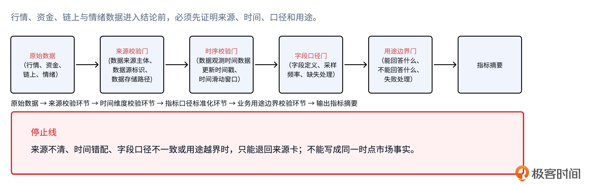
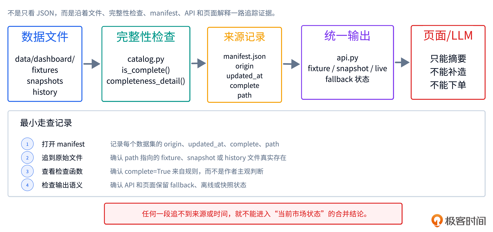
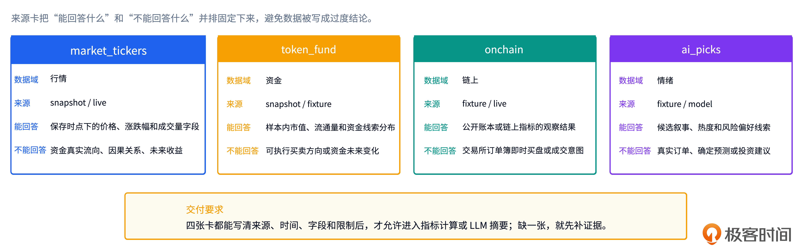
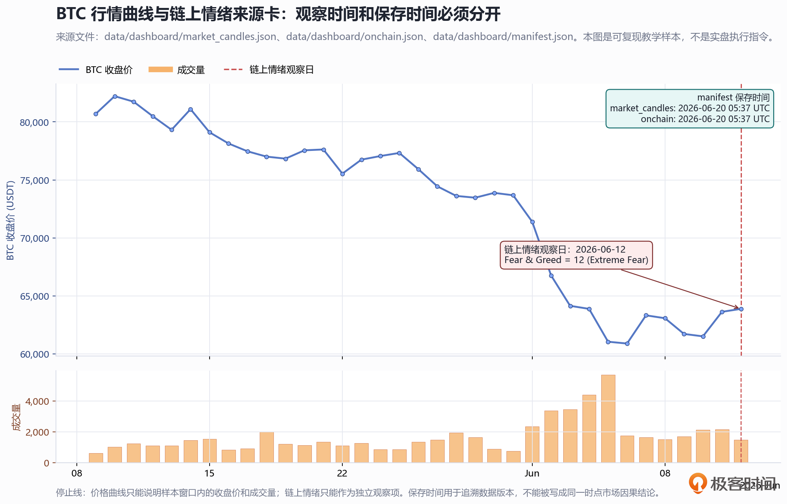
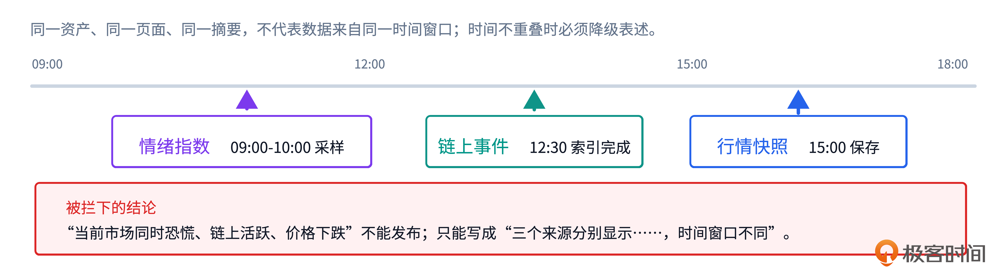

# 06 | 认识行情、资金、链上与情绪数据

你好，我是袁从德。

第 5 讲我们划清了“研究不等于实盘执行”的安全边界。这节课开始，我们进入数据证据层：在讨论任何信号、摘要或报告之前，先确认输入数据本身能证明什么。

行情、资金、链上和情绪数据都可能描述“市场”，但它们记录的不是同一类事实。行情多来自交易所成交结果；资金数据提供流向或市值线索；链上数据受区块确认和索引口径影响；情绪数据往往来自指数、文本或模型候选。把它们直接拼成一个“当前市场状态”，报告会显得完整，却可能已经混入时间错配、来源延迟和口径偷换。

本讲的目标不是判断市场方向，而是交付一张可复查的市场数据地图：每类数据从哪里来、记录哪个时间、字段口径是什么、能回答什么、不能回答什么。学习完后，你应能把行情、资金、链上和情绪数据分别写成来源卡，并判断哪些材料可以合并解释，哪些只能分别展示。

## 1. 区分四类市场数据

第 4 讲区分价格、收益率、量化信号、持仓仓位、权益曲线五层指标体系；第 5 讲划定研究输出不可直接转化为实盘指令。本节补充底层数据的证据约束边界，解决多源数据混用导致的逻辑误判。

### 1.1 典型数据误用反例

行业高频错误推导逻辑：BTC 现货行情价格下行、链上活跃地址数量抬升、恐惧贪婪指数落入恐慌区间，由此得出结论——市场正在恐慌性增持。该推导存在三重证据偷换：

1. 行情数据为分钟级实时成交快照，链上交易存在区块确认延迟，二者观测窗口天然错位。

2. 情绪指数更新周期、采样人群与交易所成交数据无时间同步机制。

3. 价格、链上地址活跃度、市场情绪三类指标无法直接推导用户真实增持行为。

因此本讲优先划定四类数据各自的有效证据范围，表 6-1 为第二章全流程实操基准规范。

数据类型

- 主要回答常见字段

```
last、close、volValue、changeRate
```

行情数据

- 价格、成交量、涨跌幅

```
tradeType、市值、流通量、资金相关字段
```

资金数据

- 资金分布、流入流出线索

链上数据

- 链上活动、地址或交易行为交易数、活跃地址、链上事件

- 恐惧贪婪、热度、AI picks

情绪数据

- 市场叙事、风险偏好、候选机会

- 表 6-1　行情、资金、链上与情绪数据的证据边界

- 对照信息:Last：Last Price（最新价）

- close：Close Price（收盘价）

- volValue：Trading Volume Value（成交额）

- changeRate：Price Change Rate（涨跌幅）

- tradeType：Trade Type（交易类型）

### 1.2 四层数据证据校验门

所有原始数据进入指标计算、大模型摘要生成流程前，必须依次通过四层校验门。只有四道门都能留下证据，才允许进入指标计算或 LLM 摘要；任一门失败，禁止流入下游分析链路，只能退回来源卡，重新核验。

1. 来源校验门：核验数据原始采集渠道合法性、数据分层（离线样本 / 快照 / 实时源）。

2. 时序校验门：区分观测时间、快照存储时间、复核系统时间，校验时序延迟阈值。

3. 字段口径门：核验指标统计规则、单位、筛选逻辑统一。

4. 用途边界门：核验待解答问题未超出该类数据的证据范围。

图 6-1 把四类数据进入结论前的检查门画出来。每一道门都表示：过不了，就不能继续解释。



- 图 6-1　数据证据门

## 2. 追溯数据来源路径

概念清楚之后，要回到仓库确认这些数据到底保存在哪里、由谁检查、从哪里进入页面或API。只有路径可追溯，后面的解释才不是空中楼阁。

### 2.1 找到来源、清单和接口

本讲主要读取五处内容。表 6-2 把这些位置和复核重点放在一起，便于从正文回到仓库。

位置

- 作用

```
data/dashboard/
```

- 保存教学固定样本（fixture）、快照和历史快照

```
data/dashboard/manifest.json
```

- 记录数据集状态、层级、来源和更新时间

```
src/dashboard/catalog.py
```

- 检查数据集完整性并维护清单（manifest）

```
src/dashboard/source_card.py
```

- 把清单条目转换成来源卡

- 把离线固定样本、快照和上游结果组织成接口（API）

```
src/dashboard/api.py
```

- 输出

- 表 6-2　本讲涉及的仓库位置与复核重点

阅读工程代码，禁止以文件数量评判系统成熟度，应沿固定链路追踪权责边界：原始输入文件→ catalog 完整性校验 → manifest 元数据写入 → API 标准化输出 → 前端面板 / LLM 文本摘要。

关键函数权责说明：

```
completeness_detail()：返回数据集完整度数值与校验失败明细。
offline_status()：汇总离线样本、归档快照、实时上游三类数据源运行状态。
source_card.py 自动生成结构化来源卡，强制写入数据适用边界，约束下游解读逻辑。
图 6-2 把这条走查路径画成实战图。你可以按图从 data/dashboard/ 一路追到页面或 LLM
```

摘要，检查每一步是否保留了来源、时间和失败状态。



- 图 6-2　市场数据地图实战路径

市场数据地图并非单纯文件目录清单，而是一套完整证据追溯链路；任意环节无法定位数据源、观测时间戳，则禁止参与多源数据合并分析。

### 2.2 复核来源记录

来源路径找到之后，还要确认这些路径在当前仓库中真实存在。代码 6-1 给出一组窄口复核命令，只检查本讲直接使用的数据清单、来源卡代码和接口代码。

```
Test-Path data/dashboard/manifest.json
Test-Path src/dashboard/catalog.py
Test-Path src/dashboard/source_card.py
Test-Path src/dashboard/api.py
```

- 代码 6-1　本讲来源记录的窄口复核命令

这些命令只能说明路径存在，不能证明数据适合交易，也不能证明某个信号应被执行。如果其

```
中某一项返回 False，应先补路径或修正文中引用，不能把缺失路径写成“预计可通过”。
```

```
命令之外，还应做一次只读走查。打开 data/dashboard/manifest.json 时，先看
datasets 下每个数据集的 origin、updated_at、complete 和 path。origin 说明
数据来自 fixture、live、test 还是其他层；updated_at 说明保存时间；complete 说明完整
性检查是否通过；path 说明可追溯文件在哪里。四个字段缺一项，都不应直接进入“市场正在
```

如何”的结论。

```
src/dashboard/api.py 的价值在于，把不同数据源组织成统一接口，但统一接口也会制
```

造一种错觉：既然 API 返回了同一种 JSON，就好像所有字段属于同一个时间点。复核时要反过来警惕这种整齐感。

一个合格的 API 输出不仅要有值，还要保留来源、失败状态和 fallback 过程。否则 LLM 或页面会把“为了可用性而降级的结果”误解成“高质量的实时事实”。这也是行业里的常见痛点：很多量化 AI 分析工具默认只展示结论字段，没有原生数据溯源字段，后续复核时很难判断结论来自实时源、快照源还是离线样本。

## 3. 写出可复查的来源卡

明确仓库溯源路径后，我们来写四类数据标准化来源卡。来源卡是指标计算、LLM 摘要、前端展示的准入门槛，不属于补充附录，是量化研究的标准化证据合同。

### 3.1 来源卡统一字段模板

表 6-3 给出我们的来源卡模板。它刻意把“能回答什么”和“不能回答什么”放在同一张表里，是为了防止只记录有利证据。

字段

- 合格写法不合格写法

- “市场数据”一笔带过

数据域

- 行情、资金、链上或情绪

- fixture、snapshot、live 或明确上游“系统返回”

来源

- 表 6-3　市场数据来源卡模板

图 6-3 是把表 6-3 落到四张卡片上。它不是要求每次都画图，而是提醒复核者：四类数据的边界要和用途一样显眼。



- 图 6-3　四类来源卡示例

四张卡都完整后，数据才有资格进入指标计算或 LLM 摘要。来源卡完成后，至少做一次交叉检查：比较同一资产在行情数据和情绪数据中的时间戳。如果时间窗口不同，正文只能写“两个来源分别显示……”，不能写“当前市场同时出现……”。

这一点尤其影响 LLM 摘要。模型很擅长把分散字段写成流畅段落，例如“价格下跌、链上活跃、情绪恐慌，显示市场承压”。如果没有来源卡，复核者很难看出这句话是否混用了不同时间窗口。

更稳妥的写法是：“行情 fixture 显示某一保存时间下的价格变化；情绪样本来自另一保存时间，只能作为独立线索，不能证明同一时点因果关系。”这句话不如前一句直观，但更符合研究证据。

我们的来源卡也要保留冲突。行情偏弱、链上偏强、情绪偏乐观，并不意味着系统出错，它可能意味着数据观察的是不同维度，也可能意味着其中一个来源有延迟或噪声。研究者应先保留冲突，再决定是否继续采集、降级解释或停止判断。把冲突强行改写成单一方向，是数据研究中最隐蔽的过度承诺。

### 3.2 四类数据地图示例

以 BTC 标的为例，标准化构建市场数据地图分为四步执行：

```
定位元数据：读取manifest.json内market_tickers、token_fund、onchain、
ai_picks数据集，逐条记录 origin、updated_at、complete、path 字段；区分快照层、离
```

- 线样本层，分层数据不可合并视为同一实时面板。

2. 提取核心字段：每类数据仅提取本次分析所需关键字段，完整原始 JSON 仅作归档素材，不写入来源卡。

- 行情：symbol、last、close、changeRate、volValue。

- 资金：marketCap、circulatingSupply、资金流入指标、更新时间戳。

- 链上：区块事件时间、公链标识、地址统计口径。

- 情绪：采集来源、AI 评分逻辑、模型输出时间戳。

3. 定义可解答边界：仅客观陈述数据记录的客观事实，不推导交易结论。

4. 明确不可外推范围：逐条写明指标无法证明的逻辑，覆盖因果、收益、实盘指令三类常见越界推导。

这个案例的交付物不是一段漂亮总结，而是一份别人能复查的记录。交接复核者拿到记录后，应能找到原始文件、确认保存时间、复算一个简单收益或覆盖率，并指出哪些句子只能算解释、哪些句子已经越过数据边界。如果做不到，说明记录还停留在作者视角，没有变成可交接证据。

表 6-4 是四类来源卡的完整填写范例。字段值来自当前仓库的示范样本和 manifest 结构，写法刻意保留边界，而不是把四类数据压成一个市场结论。

数据域

- 来源与保存时间关键字段

```
market_tickers；origin=live、
symbol、last、close、
layer=snapshot；updated_at=2026-06-
```

行情

```
volValue
21T16:33:21+00:00
token_fund；origin=live、
tradeType、tradeInflo
layer=snapshot；updated_at=2026-06-
```

资金

```
marketCap、updateTime
21T16:33:40+00:00
原始链上字段：symbol、t
onchain；origin=live、layer=snapshot；
valuescanChain；衍生情
```

链上

```
updated_at=2026-06-21T16:33:50+00:00
marketSentiment.fearG
ai_picks；origin=live、layer=snapshot；
chance、risk、score、
```

情绪

```
updated_at=2026-06-21T16:33:33+00:00
bearishRatio、updateT
```

- 表 6-4　四类来源卡完整填写范例

为了让案例不是停留在文字层，图 6-4 把 BTC 收盘价、成交量、链上情绪观察日和样本保存时间放到同一张图里。它的重点不是判断行情方向，而是区分样本窗口、观察时间和数据版本记录。



- 图 6-4　多源数据时间维度区分示意图

BTC 收盘价和成交量来自行情样本窗口，Fear & Greed 来自链上情绪观察日，manifest 记录的是数据保存时间。三者可以并列复核，但不能被写成同一时点因果结论。

### 3.3 用代码校验来源卡

表 6-5 给出一张来自示例 manifest 的来源卡。它不是实时市场判断，而是说明如何把数据集条目转换成可复核记录。

字段

- 示例

```
market_tickers
```

数据集

数据域

- 行情

- 表 6-5　market_tickers 来源卡示例

```
代码 6-2 对应 src/dashboard/source_card.py。它把“缺少来源、观察时间或合法价格
```

时必须拒绝”写成可测试条件。

```
from dashboard.source_card import source_card_from_manifest, validate_market_row
manifest = {
   "datasets": {
       "market_tickers": {
           "origin": "snapshot",
           "updated_at": "2026-06-20T02:54:22+00:00",
           "path": "data/dashboard/snapshots/market_tickers.json",
           "complete": True,
           "reason": "",
       }
   }
}
sample = {
   "source": "fixture",
   "observed_at": "2026-06-18T04:24:00+00:00",
   "close": 63572.9,
}
# 拒绝缺少 source、observed_at 或合法 close 的样本。
assert validate_market_row(sample) == []
# 固化 manifest 中的保存时间、来源层级和限制说明。
card = source_card_from_manifest("market_tickers", manifest)
assert "实盘执行指令" in card.cannot_answer
```

- 代码 6-2　市场数据合同验证示例

代码 6-2 的重点不是多写一个校验函数，而是把“能不能进入研究链”变成明确条件。LLM 可以

```
解释字段含义，但不能替系统补造 source 或 observed_at。
把这个示例迁移到真实仓库时，要检查现有路径是否已经表达同样的合同：catalog.py 是
否能说明数据不完整的原因，manifest.json 是否保留保存时间，API 是否把 fallback 结果
```

标明为离线或快照，页面是否避免把候选信号写成实盘执行指令。只要这些问题回答不清，数据地图就还没有完成。

最小测试清单包括三类：

```
单元测试：缺少 source、observed_at 或合法价格时，样本必须被拒绝；manifest 来
源卡必须保留 cannot_answer。
数据完整性测试：market_candles、market_tickers、onchain 等 fixture 或
snapshot 必须通过 is_complete()，失败原因要能从 completeness_detail() 读
```

- 到。

- 文档评审测试：报告不得把不同时间窗口的数据写成同一时点事实，也不得把来源不明的字段交给 LLM 补写。

## 4. 复核跨来源数据口径

数据来源卡不是表格填空。它必须能支撑最小复算、偏差识别和人工复核，否则就只是把不确定性换了一种格式保存。

### 4.1 固定三个复核口径

严谨数据分析流程遵循「固定变量定义→划定样本范围→核算统计指标」顺序，规避两类典型错误：公式逻辑自洽但变量统计口径不一致；样本表面完整但存在未记录数据筛选规则。

### 4.1.1 全局变量命名规范

## t

## t

1. 为数据观测时间，为复核 UTC 时间。时间类变量：小写字母搭配语义下标，obsnow​​

## L

2. 为允许最大时序延迟。阈值约束类变量：大写字母，max​

## n

3. 计数类变量：n 搭配语义下标，为有效样本记录数量。valid​

- ​ ←

## t

## t

## observed_at

- 取系统当前 UTC 时间

数学变量与工程代码标识符一一映射：

- ，obsnow​​ ←

```
。 关键区分：updated_at 仅代表快照落地存储时间，无上游声明
```

## L

## max_lag

戳，

- max

时不可等同于市场事件观测时间。

### 4.1.2 三大核心数据质量指标

① 数据覆盖率

- n

## C =

- valid​n​expected​

## n

- ：满足数据源、时序、关键字段全部校验规则的有效记录。valid​

## n

- ：对应研究问题所需标准样本数量。expected​​ ←​ ←

## n

## n

## valid_rows

## expected_rows

- 工程映射：，。validexpected

覆盖率判定需贴合研究场景，不可仅以文件读取行数作为评判标准；存在价格但缺失时间戳、存在链上交易但无标的映射的记录，均不计入有效样本。

② 数据新鲜度

时序延迟差值：

## Δt = t

- ​ −

## t

- nowobs​

新鲜度布尔判定：

## F = Δt ≤L

- max​

## Δt

```
 单位统一为秒，基于 UTC 时间戳差值计算；若仅存在快照存储时间updated_at，仅可
```

标注存储延迟，不得替代真实市场观测时间。

③ 多源窗口重叠校验

## s

## e

- 分别代表第 i 类数据源观测窗口起止时间：、

​i

- ​i

## A = max

- ​(s​) ≤

## min

- ​(e​)iiii

## A = True

- ：多源窗口存在交集，可限定窗口后对比分析。

## A = False

- ：窗口无重叠，禁止合并生成同步市场结论。​ ←​ ←

## A ←windows_overlap

## s

## e

## window_start

## window_end

- 工程映射：，，。ii

该公式从底层杜绝经典错误：混用早间情绪指数、午后行情快照、区块延迟链上数据，拼接为统一 “当前市场” 结论。

### 4.1.3 标的价格与缺失值约束

```
：t 观测时刻，同一标的、统一报价货币、统一采样周期的收盘价 close；last、估
```

## P

定义

- ​t

```
算撮合价格不可与 close 无差别混用。资金、情绪衍生评分的权重、阈值、缺失处置规则必
```

须完整归档；缺失字段禁止默认填充数值 0，0 为有效统计值，不可混淆未知状态。

### 4.1.4 样本与成本口径说明

本讲教学中的离线样本、快照仅用于流程复现，不还原真实交易场景：不包含滑点、手续费、订单簿深度、资金费率建模；若分析不涉及成交测算，需明确标注「本分析未建模交易成

```
本」，不可简化为交易成本等于 0。 快照存储时间 updated_at 与每条记录内部事件观测时
```

间强制分开标注；归档快照路径仅证明系统存储记录，无法证明上游数据源同步采集。本讲的时序、口径校验体系，为第 7 讲快照流程、第 12 讲 LLM 上下文构造、第 15 讲大模型信号评测提供底层约束，基础校验越严谨，下游自动化流程越难放大数据缺陷。

### 4.2 偏差控制与人工复核

自动化校验可拦截字段缺失、格式异常、基础完整性缺陷，但无法识别语义口径偷换、时序逻辑错位等人为偏差，必须配套人工复核机制。

### 4.2.1 四类高频时序偏差与反例

1. 时区错配偏差：多数据源混用 UTC、本地时区、毫秒时间戳，仅补充统一时区转换方可对比窗口；未标准化时区会制造数小时虚假时序重合。

```python
from datetime import datetime, timezone
from zoneinfo import ZoneInfo
utc_saved_at = datetime.fromisoformat("2026-06-21T16:33:21+00:00")
local_observed_at = datetime.fromisoformat("2026-06-22 00:33:21")
# 错误：把本地时间直接贴上 UTC，会制造一个不存在的 8 小时偏移。
wrong_observed_at = local_observed_at.replace(tzinfo=timezone.utc)
# 正确：先声明本地时区，再转换为 UTC 参与窗口比较。
right_observed_at = local_observed_at.replace(
   tzinfo=ZoneInfo("Asia/Shanghai")
).astimezone(timezone.utc)
assert wrong_observed_at != utc_saved_at
assert right_observed_at == utc_saved_at
```

2. 数据源延迟偏差：前端面板标注 “最新数据”，底层实际为离线样本、历史快照、兜底降级数据，无元数据标记则完全掩盖延迟缺陷。

3. 缺失值过度填充偏差：线性插值、历史回填让图表视觉连续，但掩盖原始数据空白，扭曲真实市场观测状态。

4. 历史快照覆盖偏差：旧快照被自动覆盖，丧失复盘原始观测数据的能力，研究结论不可复现。

人为构造行情、情绪数据时序无交集样本，调用分析链路生成市场汇总结论；合规系统必须自动降级，仅分开描述两类独立线索，禁止输出同步市场判断。图 6-5 展示这个失败样本。它的重点是让你看到：时间错配不是措辞问题，而是证据结构问题。



- 图 6-5　时间错配反例

情绪、链上和行情数据可能分别来自不同观察窗口；当窗口不重叠时，系统应拦下“当前市场同时……”这类合并结论，只允许分别描述。

### 4.2.2 人工复核与三级发布判定标准

完成全流程数据校验后，必须执行至少一项人工数值复核，复核记录归档要素：原始输入样本、代入校验公式、程序输出结果、结论边界约束。

复核可选方向：

```
行情收益率复核：读取同文件连续两条 close，统一标的与报价货币，代入收益率公式
```

- ​ =​/P​ −

## 1

## r

## P

- 。t−1tt

```
元数据复核：核验 manifest.json 数据集 origin 分层、complete 校验函数支撑、原
```

- 始文件物理路径存在。

```
API 接口复核：追溯 api.py 对应函数，区分实时上游、归档快照、离线样本三类兜底逻
```

- 辑。

人工复核核心目的：验证自动化校验规则匹配研究语义，程序仅能校验格式，无法判断指标是否适配研究问题；大模型仅能解读字段字面含义，无权忽略数据缺失、时序冲突缺陷。

基于复核结果划分三级发布判定，完整写入研究档案：

1. 直接通过：四类来源卡完整归档、所有关键字段可溯源、时序错配测试可触发降级逻辑、未将样本事实等价为实盘指令；仅代表数据证据合规，不代表市场预测有效。

2. 修改后复测：仓库路径完整，但存在字段无来源、时序口径模糊、校验规则仅文档标注未代码落地，补充修正后二次校验。

3. 直接拒绝：数据源无法追溯、历史快照覆盖丢失、LLM 自动补全缺失字段、面板将候选信号标注为实盘指令；及时拦截可避免下游回测、策略开发基于污染数据。

## 总结

本讲完整搭建市场数据地图标准化交付体系，核心要求：解读数据前完整核验来源、观测时序、统计口径、采集延迟、适用边界、异常处置六大维度。

区分三层不可混淆的表述层级：

```
客观事实：BTC-USDT 离线样本快照内 last 字段为指定数值。
```

2. 计算推导结论：该观测窗口内标的收盘价相对前一周期下行。

3. 越界交易指令：当前时点适合开仓交易（超出本讲数据证据边界，禁止输出）。

我们的核心学习目标，并非记忆四类数据名称，而是建立标准化校验思维：任何数据进入分析链路前，固定核验五问：数据采集渠道是什么？记录的市场观测时间？字段统计口径如何定义？能够支撑哪些客观判断？数据异常时系统如何终止下游流程？完成五重校验，原始素材方可转化为可采信研究证据。


下一讲将复用本节课的市场数据地图框架，把静态来源卡拓展为自动化、可降级、持久归档的全链路快照采集工程。

## 思考与练习

1. 概念题：为什么行情、资金、链上和情绪数据不能直接拼成同一时点事实？请分别说明至少两类数据的时间或口径差异。

```
复核题：选择 data/dashboard/manifest.json 中一个数据集，记录它的 origin、
updated_at、complete 和 path，说明它能支持什么判断、不能支持什么判断。
```

3. 实践题：为行情、资金、链上和情绪四类样本各写一张来源卡，并主动构造一个“来源不同或时间不同却被拼在一起”的反例，说明流程应继续、降级还是停止。

期待你的分享。如果今天的课程让你有所收获，也欢迎转发给有需要的朋友，邀请他来一起学习，我们下节课再见！
