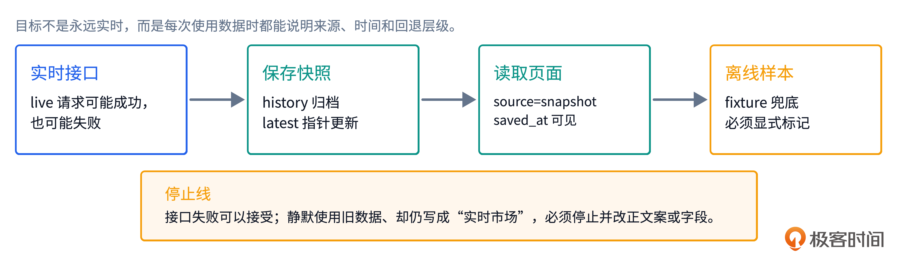
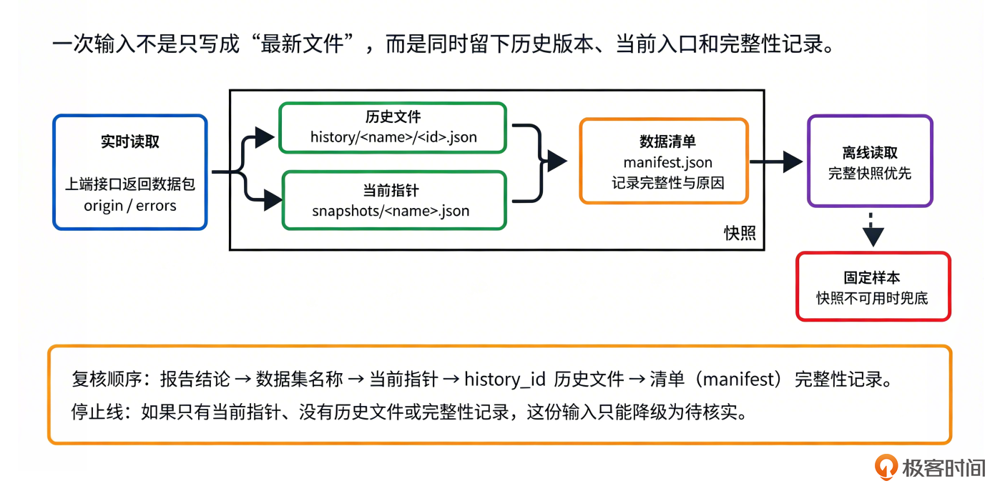
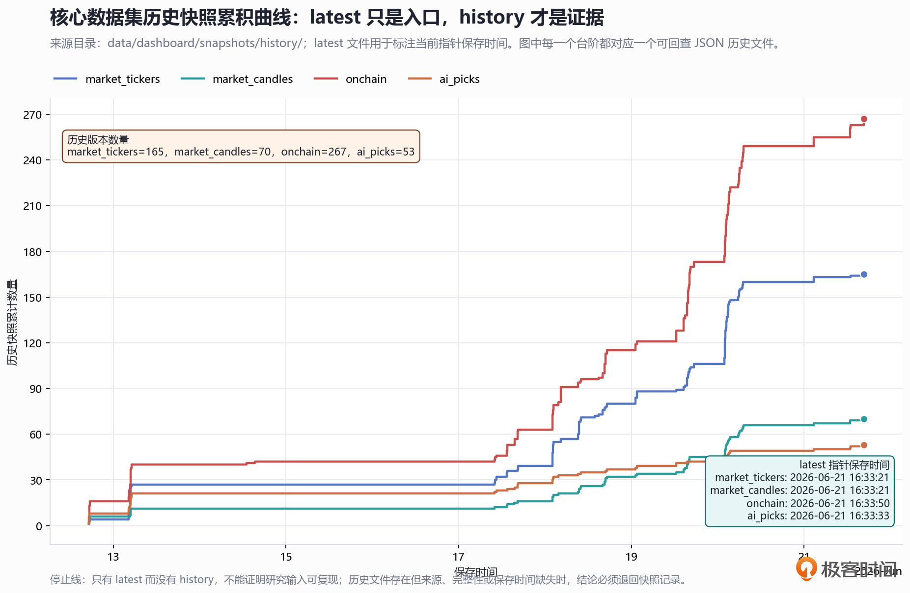
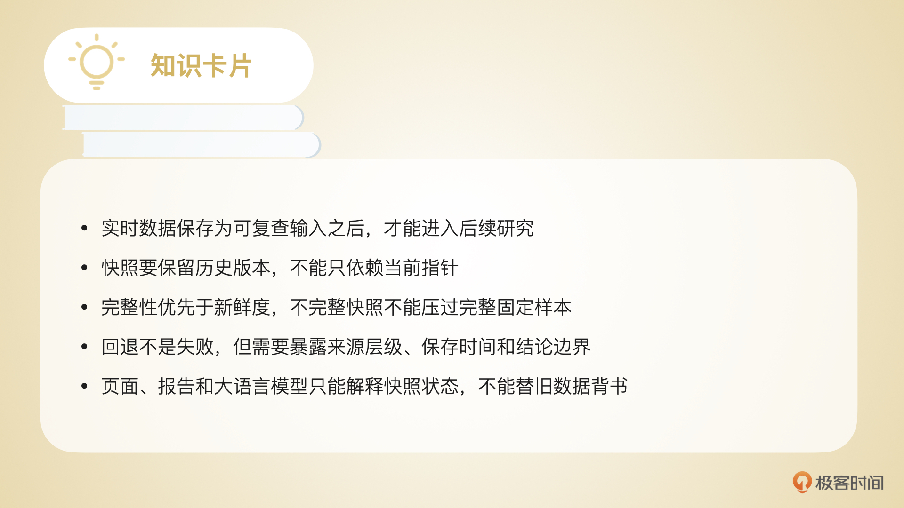

# 07 | 市场数据快照与回退机制

你好，我是袁从德。

第 6 讲我们建立了市场数据地图，这节课我们将进入数据管线层，解决一个更具体的问题：一次市场数据读取，怎样从“临时接口返回值”变成后续研究可以复查的输入证据。本讲主线只有一条：实时尝试、快照固化、离线回退、人工放行。接口可以失败，系统也可以回退，真正不能接受的是把旧数据静默包装成实时市场，否则后续研究会失去复查基础。

本讲的最终交付物是一份数据快照与回退记录：说明输入何时保存、来自哪里、是否完整、失败时回退到哪一层，以及这份输入允许支持什么结论。图 7-1 先把实时接口、快照、当前指针和固定样本兜底放进同一条路径，它们各自保留来源标记。



- 图7-1　市场数据快照与回退路径

## 1. 实时数据的复现风险

实时行情接口易形成“最新数据等价于真实数据”的认知偏差。对量化研究而言，无法复现的临时实时数据，风险远高于可控的历史固定样本：接口返回字段可能迭代变更、限流或网络故障会产生残缺数据集、原始响应数据在报告生成后无留存。量化研究系统接入实时数据，必须能够回答三项可审计问题：本次读取的原始数据完整内容、任意时间可复现同一批输入、异常降级场景不篡改结论时效口径。

典型风险场景：行情接口调用失败，系统自动降级读取前一日快照，前端页面仅展示“数据加载完成”，未标注数据来源；研究报告直接采用“当前市场行情显示”等表述，隐蔽替换数据时间维度，整条证据链失效。

基于此，我们不将回退机制定义为系统故障。标准化量化沙盒允许分层降级，但必须完整记录实时层异常状态、快照 / 固定样本取用版本、离线兜底启用标识，同步收缩研究结论的有效时效边界。附带完整异常日志的历史快照，严谨度远高于隐瞒故障、伪装正常实时加载的前端页面。

## 2. 核心知识：输入证据链与三层回退模型

快照存储体系的核心设计思路为分层隔离，划分为实时层、快照层、固定样本层，三层分别承载独立审计目标，混用分层逻辑会直接模糊研究结论的时间适用边界。

- 实时层：核验是否成功拉取上游最新原始数据。

- 快照层：固化单次研究所使用的完整原始输入，留存多版本历史用于复盘。

- 固定样本层：提供完全离线、零依赖网络的标准化数据集，支撑教学、自动化回归测试稳定复现。

表 7-1 固定本讲的三层回退结构。后续所有代码走读、测试和人工复核都围绕这张表展开。

层级

- 作用证据

```
src/dashboard/refresh.py 抓
```

实时层

- 尝试拉取上游接口或公网实时数据源字段（origin）

```
data/dashboard/snapshots/、
```

快照层

- 固化单次数据输入，留存多版本历史记录（history/）、数据清单（manifest）

```
data/dashboard/*.json 固定样
```

固定样本层

- 提供离线可复现的兜底数据支撑

- 表 7-1　实时层、快照层与固定样本层的分工

三层架构不存在优劣排序，仅依据量化研究语义划分时效等级：实时层时效性最优但稳定性最差；快照层可完整复盘，但存在明确时间窗口；固定样本层稳定性最高，时效性最弱。系统显性展示当前数据所属层级，是界定研究结论适用范围的基础。

- 分层设计的隐性核心价值：异常状态可审计。实时接口报错时，无需全局阻断页面加载，系统可降级至快照或固定样本，同时结构化标记输入来源。兼顾系统离线可用性，从根源规避回退数据伪装实时行情的问题。

若三层数据无隔离、无标识混合输出，所有研究判定将丧失严谨依据：页面展示价格无法区分来自实时接口还是历史快照；回测 K 线无法判定为静态样本或自动刷新缓存；大模型行情摘要无法定位原始数据采集时间。数据流边界模糊的系统，交互体验流畅，但完全不具备量化研究审计能力。

## 3. 快照存储、历史版本与离线读取闭环

接下来我们不会新增复杂业务逻辑，而是重点打通快照持久化、历史归档、当前指针、完整性校验、离线分级回退的完整闭环。闭环的标准化定义是：依托报告结论可逆向检索数据集，定位当前指针文件，追溯对应历史归档，并在元数据清单中调取完整性、异常记录。

接下来我们先结合源码梳理快照保存和离线数据选择规则，说明历史版本、当前指针和元数据清单为何缺一不可；再通过自动化校验用例，验证快照保存与离线回退路径没有退化。

### 3.1 快照证据工程落地规范

图 7-2 展示从实时读取、快照保存到离线回退和逆向复核的完整路径。实时读取成功后，同一份快照数据包分别写入历史文件和当前指针，数据清单同步登记完整性状态及原因；离线读取

```
优先使用完整快照，快照不可用时回退到固定样本，复核时则通过当前指针和 history_id
```

定位历史文件，再核对数据清单。



- 图 7-2　快照证据落地路径

```
对应仓库代码与存储目录规范：快照持久化逻辑 src/dashboard/snapshot.py，实时刷
新调度 src/dashboard/refresh.py；快照文件根目录
data/dashboard/snapshots/，完整性元数据统一写入
data/dashboard/manifest.json。全链路逆向追溯路径：研究报告→数据集名称→当前
```

指针→历史归档文件→元数据完整性记录。

```
核心函数 save_snapshot 执行逻辑：同一份原始数据包同步写入历史归档目录与当前指针
文件，写入核心元数据字段——保存时间 saved_at、上游数据源 origin、历史唯一编号
history_id、归档文件路径 history_path——四类元数据构成快照唯一身份标识。这是
```

因为，缺失保存时间无法判定时效，缺失数据源无法追溯上游，缺失历史编号与归档路径则失去复盘能力。

```
离线读取分层函数职责划分：load_snapshot 读取历史快照，load_fixture 读取静态固
定样本；统一入口 load_offline 设置优先级规则——完整快照优先、完整固定样本兜底、
```

残缺快照最低优先级。该规则将数据完整性置于新鲜度之上，杜绝残缺临时数据覆盖可靠静态样本。

自动化测试用例固化分层读取逻辑：

```
tests/test_dashboard_persist.py：校验历史版本不丢失、完整快照读取优先级、
```

- 接口异常缓存标记逻辑。

```
tests/test_dashboard_offline.py：校验静态样本完整性、残缺快照不得优先加
```

- 载。

两类用例不属于通用单元测试，核心作用是约束系统不得发生“无标记层级越界”行为。

### 3.2 回退机制退化验证标准

代码逻辑落地后，需通过标准化测试验证快照、回退逻辑无功能退化。代码 7-1 为快照体系专

```
用测试执行入口，采用 python 解释器，规避 Windows 系统启动器绑定异常；团队统一虚拟
```

环境时，复核记录替换为实际运行指令。

```
python -m pytest tests/test_dashboard_persist.py tests/test_dashboard_offline.py
```

- 代码 7-1　快照保存与离线回退测试入口

该指令仅校验快照持久化、离线分级读取、样本完整性逻辑正常，无法验证实时接口可用性，亦不能证明市场研究结论有效性。测试失败时，复核档案需留存用例名称、完整报错堆栈、关联数据文件；不得使用“接口偶发不稳定”替代明确故障证据。

```
本地环境缺失 pytest 属于依赖层报错，不代表快照业务逻辑异常。复核记录需完整留存执
```

行命令、解释器路径、报错信息、未执行测试范围及环境修复方案；虚拟环境标准执行指令

```
.venv\Scripts\python.exe -m pytest ...，仅实际执行输出可纳入审计档案。
```

## 4. 快照生成与回退标准化验证实践

本讲工程实践部分，将输出标准化快照审计记录，覆盖六大审计维度：数据存储内容、文件路径、上游数据源、完整性校验状态、异常分级回退策略、研究结论时效边界。前五项为工程数据审计依据，第六项为量化研究合规依据，二者缺一不可，共同构成完整可复核证据体系。

实践阶段无需对接真实交易所行情接口，依托仓库内置静态样本、快照目录、测试数据集完成闭环校验；机制合规验证通过后，再对接线上上游数据源。

### 4.1 标准化操作记录模板

为规避实践记录模糊、无溯源依据问题，我们要统一归档模板，同步留存执行指令、原始文件证据、人工合规判定，实现全流程可审计。表 7-2 规范归档字段，杜绝仅记录“执行成功”等无效描述。

步骤

- 记录内容有效证据

- 表 7-2　数据快照与回退记录模板

```
实操流程规范：选取小型测试数据集（如 ai_picks、opportunity_scan）执行快照保
存；校验历史目录新增归档文件、当前指针同步写入同一数据包；核对 manifest.json 完
整记录 complete、reason、latest_path、history_id；模拟实时接口离线 / 故障场
景，确认读取结果结构化标记 source，不伪装实时数据。
```

### 4.2 故障场景注入校验

下面设计两类典型异常场景用于机制校验：

1. 静默降级漏洞：接口调用失败后读取历史快照，但未标注数据来源。合规系统显性降级，并降低结论时效权重；缺陷系统前端、报告统一使用“当前市场”表述，证据链失真。测试优先使用临时目录、副本样本注入故障，禁止直接修改仓库标准静态样本。

```
残缺快照优先级漏洞：生成关键字段缺失的不完整快照，校验 load_offline 不会优先读
```

- 取残缺数据。若残缺快照优先级高于完整静态样本，因子计算、大模型行情摘要均会基于污染数据生成结论。该漏洞需记录影响范围：数据读取逻辑、前端状态展示、报告输出措辞，或全链路同时受影响。

### 4.3 快照记录示例

```
以 ai_picks 数据集为例，标准化复核流程分为四步：
读取静态固定样本，校验 chance、risk、funds 核心字段完整，核对来源标识
source。
执行快照持久化，校验归档目录 data/dashboard/snapshots/history/ai_picks/
生成历史文件，当前指针 ai_picks.json 同步更新。
解析快照数据包与元数据清单，确认 saved_at、origin、history_id、
history_path、complete、reason 全部存在。
模拟实时接口离线故障，校验返回数据 source 字段标注快照 / 固定样本，归档记录明确
```

- 区分非实时数据源。

最小可运行演示脚本（代码 7-2），调用原生快照函数生成测试快照，输出归档路径、来源标

```
识、历史版本数量、离线读取层级。该实验会修改 data/dashboard/snapshots/ 和
data/dashboard/manifest.json，仅应在可恢复的课堂环境或临时分支中运行；实验结
```

束后，应还原这些变更，避免演示数据混入正式数据记录。

```
$env:PYTHONPATH = "src"
python -c @"
from dashboard.snapshot import save_snapshot, load_snapshot, list_snapshot_histor
name = 'chapter07_demo'
sample = {'ok': True, 'chance': [{'symbol': 'BTC'}], 'risk': [], 'funds': []}
path = save_snapshot(name, sample, origin='chapter07-demo')
latest = load_snapshot(name)
print(path)
print(latest['source'], latest['snapshot']['origin'])
print(len(list_snapshot_history(name, limit=10)))
print(load_offline(name)['source'])
"@
代码 7-2　用真实 save_snapshot 路径保存一份演示快照
```

脚本输出随运行时间动态生成归档文件名，但必须包含四类固定信息：历史归档完整路径、数

```
据源标识 snapshot chapter07-demo、历史版本计数≥1、离线读取层级
snapshot/fixture。仅存在当前指针、无历史归档文件，代表快照闭环未生效。
```

案例核心不在于候选数据集业务逻辑，而在于证据链可交接、可逆向复核。复核人员依托归档记录定位原始归档文件，解析系统分层读取逻辑，明确快照仅用于研究复现、不可直接作为实盘交易依据。若脱离书面审计记录，则无法还原数据来源，代表归档标准不达标。

快照审计记录同时记录约束边界：机制仅负责数据溯源，不涉及实盘账户接入、钱包授权、订单提交、投资建议生成。这里延续第 5 讲安全边界规范：数据时效性提升，不代表放宽研究与实盘执行隔离标准；数据源越贴近线上真实行情，越需要严格区分研究推演与实盘交易。表 7-3 给出一份快照记录样例。字段不需要很长，但每个字段都要能被独立复核。

字段

- 示例写法复核方式

```
ai_picks
对照 data/dashboa
```

数据集

触发动作

- 保存一次快照，随后模拟实时失败查看命令记录和错误状

```
data/dashboard/snapshots/history/ai_pic
```

历史路径

- 文件存在且不可被当前

```
ks/<history_id>.json
data/dashboard/snapshots/ai_picks.json
```

当前指针路径

- 指向最近一次保存内容

```
source="snapshot"，origin="live" 或其他来
```

来源标记

- 对照数据包和数据清单源

```
complete=true 或记录 reason
对照 completeness
```

完整性

结论边界

- 可用于研究复现，不代表实时市场或交易机会不进入交易建议

- 表 7-3　快照记录样例

表 7-3 的核心价值是：将“已保存快照”转化为可落地复核依据。仅留存快照无归档文件，无法还原原始输入；仅保留当前指针，无法判定数据是否被后续运行覆盖；仅标注数据源无完整性校验，无法判断数据集是否可用于指标计算、大模型摘要生成。

```
复核交接统一采用逆向追溯流程：报告结论 → 数据集名称 → 当前指针 → history_id 历史
```

归档文件 →元数据完整性清单。任意环节链路断裂，对应研究结论标记为待核实。逆向复核是规避“运行正常、交付无法审计”问题的核心手段。

单条快照依托表格标准化归档，长期版本累积状态通过时序曲线校验。图 7-3 统计四类核心数

```
据集（market_tickers 行情标的、market_candles K 线、onchain 链上数据、
ai_picks 智能候选）历史版本累计数量，标注当前指针内快照保存时间
snapshot.saved_at，用于验证历史版本持续生成，不用于市场涨跌判定。
```



- 图 7-3　Python 快照历史累积曲线

曲线每一个台阶，都对应一个可回查的历史 JSON 数据文件。当前指针只是入口，只有历史

```
文件、保存时间 saved_at、上游来源 origin 和完整性记录同时存在，快照才具备研究复
```

现价值。

还有一种常见误区是把快照当成备份。备份关注数据是否还在，快照关注研究输入是否能被复现。备份可以只保存最新状态，快照需要保存历史版本；备份服务恢复，快照还服务解释和审计。因此，这节课我们说的快照不是运维意义上的备份，而是研究证据的一部分。缓存提高读取效率，备份降低丢失风险，快照固定研究输入，三者解决的是不同问题。

## 5. 快照证据可用性判定标准

快照存储机制，虽为工程实现方案，本质其实是服务量化研究严谨性。同一价格序列、因子信号、回测结果，若输入数据采集时间、所属层级变更，结论适用边界同步变更。这里我们不研判行情涨跌，仅定义快照数据准入标准，规避“文件存在即代表数据可用”的粗放判定逻辑。

### 5.1 新鲜度、完整性与一致性

快照准入设置三项可量化校验口径，通过标准化公式固化判定规则：

1. 快照新鲜度：

## age_seconds = max(0, now_utc −saved_at)

- 说明：快照新鲜度时长 age_seconds，等于当前协调世界时时间戳 now_utc 减去快照元数据自带持久化时间戳 saved_at，若计算结果为负数则统一取 0；其中 now_utc 代表校验指标瞬间的 UTC 秒级时间戳，统一全局时间口径，saved_at 是快照写入时留存的原生 UTC时间戳，仅取自快照内置元数据，禁止使用文件修改时间替代，max (0, 计算差值) 用于消除时钟回拨带来的负时长异常。

2. 完整性覆盖率：

## complete_datasets

## coverage =

## expected_datasets

- ​

- 说明：完整性覆盖率 coverage 的数值，等于通过关键字段校验的有效数据集数量complete_datasets，除以本轮全量刷新任务约定需要产出的全部预期数据集数量expected_datasets，coverage 的结果取值区间为 0 到 1。

3. 快照口径一致性：

## snapshot_window =

- ​(saved_at ) −

## max

- ​(saved_at​) ≤

## min

## Δ,

## i ∈snapshot_

- iiii

```
说明：快照采集窗口跨度 snapshot_window，取同批研究所用快照集合
```

## saved_at

```
snapshot_inputs 内各数据集原生 UTC 保存时间
```

- 的最大、最小值之差，该​i

## Δ

```
；多数据集可各自独立分配 history_id，无需统一编
```

- 差值不得超过管线预设窗口阈值号。若时间差不超阈值，数据时序口径统一可直接合并分析；若超出阈值，则属于跨窗口混合数据，报告必须标注分段采集时间。

这三个口径还要落回数据层级。固定样本适合教学复现和自动化测试，快照适合复查某一次实际输入，实时刷新适合生成新的市场候选，三者不能混成同一种证据。报告采用哪一层数据，结论边界就跟着哪一层数据变化。

还要明确一条边界：快照机制只解决研究输入的可复现性，不解决实盘交易的执行真实性。若快照进入后续回测，仍需另行说明手续费、滑点、盘口深度、资金费率等交易参数。数据合规不代表交易结论可以直接落地实盘。

### 5.2 回退偏差识别与人工复核规范

量化口径能帮助判断快照是否新鲜、完整和一致，但不能自动识别所有语义越界。尤其是页面、报告和摘要如何描述回退状态，仍需要人工复核。下面先看最常见的偏差，再给出发布前的复核口径。

### 旧快照冒充实时数据

这节课最容易出现四类偏差：旧快照冒充实时数据、当前指针覆盖历史、接口错误被吞掉、不完整快照优先于完整固定样本。其中最危险的是第一类，因为它会在未显式标注的情况下扩大结论时效性，把“某个保存时间的样本状态”误读成“当前市场状态”。

```
一个具体反例是：实时接口失败，系统回退到 source="snapshot" 快照来源，但页面或报
```

告仍显示“当前市场”。这时补一句免责声明并不能修复证据链，真正需要修正的是接口字段、页面状态或报告字段，让回退层级和保存时间成为结构化状态。

### 人工复核与发布判断

全流程完成后，必须针对单份快照执行完整人工复核，校验项清单：

1. 历史归档文件、当前指针物理存在。

```
快照数据包完整包含 saved_at、origin、history_id、history_path。
元数据清单记录 complete、reason、latest_path、history_id。
```

4. 分级读取顺序可完整解释：完整快照 / 完整固定样本 / 残缺快照三层优先级。

基于复核结果划分三类发布判定：

1. 通过：历史归档、来源标识完整，异常状态可记录，结论严格限定快照时间窗口；可进入第8 讲时序清洗标准化流程。

2. 修改后复测：快照持久化正常，但数据源标识缺失、异常状态未对外展示、测试仅覆盖成功场景；补全标注、扩充用例后重新校验。

3. 驳回：历史版本被覆盖、残缺快照优先读取、接口故障静默隐藏、报告伪装实时行情；禁止基于该数据流开展后续研究，避免污染全链路结论。

三级判定并非形式化流程。判定通过，代表证据链完整可复盘；复测，代表审计链路存在缺失；驳回，代表底层数据机制存在根本性缺陷。成熟量化研究系统允许接口异常，但必须完整暴露故障层级。

大模型行情摘要遵循同一套判定规则：输入为快照时，提示词与输出同步附带采集时间、归档路径、数据层级；输入为固定样本，摘要标注“静态样本数据”，禁用“当前市场”表述；实时接

```
口故障时，模型可解释降级状态，不得隐瞒异常。source、complete、reason 写入模型
上下文；saved_at、origin、history_id 绑定快照原始输入。
```

前端页面同步配套严谨状态标识：功能入口命名为“刷新快照”“查看离线样本”，规避“获取实时

```
交易机会”等误导性文案；状态栏展示快照精确时间戳 saved_at，替代模糊描述“已更新”。
```

页面状态文字是数据时效、来源的可视化审计载体，而非单纯 UI 装饰。

综上，人工复核需覆盖代码逻辑、前端展示、报告措辞三重维度。自动化测试仅校验

```
load_offline 读取优先级，无法替代输出语义人工检查。完整交付成果，需包含代码目
```

录、自动化测试报告、前端状态标识、人工合规判定四项材料，共同构成快照机制验收依据。

## 总结

本讲围绕市场数据快照与回退机制，建立了一条从实时读取到证据保存的路径。核心认识有三点：

1. 实时接口失败并不可怕，静默把旧数据伪装成实时市场才危险。

```
当前指针只是便捷入口，历史文件、保存时间 saved_at、上游来源 origin 和完整性记
```

- 录才构成可复查证据。

3. 页面、报告和大语言模型摘要都要暴露回退层级，避免把快照或固定样本包装成当前市场。

下一讲我们将学习如何清洗、标准化并验证时间序列数据。它会继承本讲留下的快照输入和复核记录，把验证范围从“输入能否复现”推进到“字段、时间序列和指标能否一致计算”。如果第 7讲没有留下清楚的快照证据，第 8 讲的清洗和标准化就会失去稳定输入。



## 思考与练习

1. 理解题：为什么实时接口返回成功，不等于研究输入已经具备可复现性？请你结合保存时间

```
saved_at、上游来源 origin 和历史路径说明。
```

2. 判断题：如果系统在实时接口失败后回退到旧快照，但页面仍显示“当前市场显示”，这属于可接受降级还是证据越界？请说明理由。

3. 实践题：选择一个数据集，记录它的当前指针路径、历史路径、数据清单记录、来源标记、完整性结果和回退层级，并说明这份快照能支持什么、不能支持什么。

期待你的分享。如果今天的课程让你有所收获，也欢迎转发给有需要的朋友，邀请他来一起学习，我们下节课再见！
