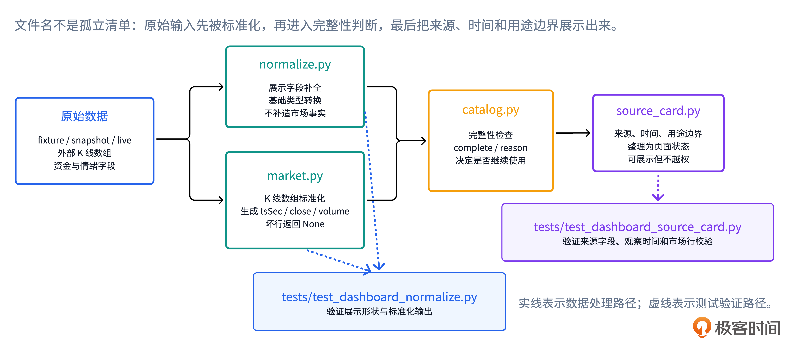
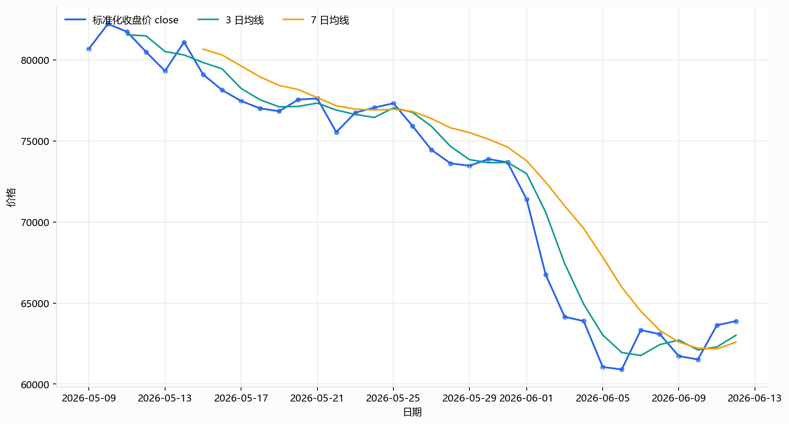
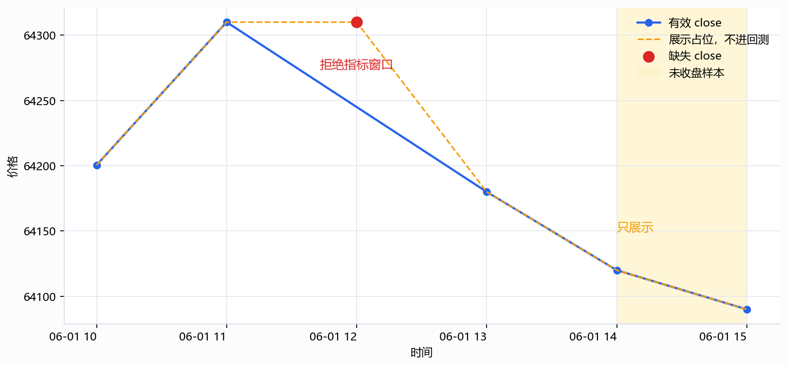

# 08 | 时间序列数据质量与标准化验证

你好，我是袁从德。

第 7 讲我们解决了“数据能不能复查”的问题，这节课我们将聚焦另一个问题：清洗如何防止错误数据被包装成可靠输入？缺失字段、乱序时间、重复时间戳和不可转换字符串，都必须被识别、记录和拦截，不能为了图表连续而静默补成正常值。

本讲的最终交付物是一份数据质量报告：说明字段转换规则、关键字段缺失处理、展示层 / 指标层 / 回测层的放行边界，以及污染样本验证结果。学完之后，你就能判断一份时间序列数据只是“能展示”，还是已经具备进入指标和回测的资格。

## 1. 数据清洗的目标与边界

初次清洗数据时，目标很容易被误解为“让表格没有空值、图表能画出来、模型能读进去”。量化研究中的清洗，不以视觉连续为目标，而以输入可解释为目标。

```
举个例子，假设一条资金数据缺少 netInflow24h。如果展示端为了连续呈现，把缺失值自
```

动填成 0，图表确实不会断，但会让人以为“资金净流入为 0”。真实含义可能是“上游没有返回该字段”。0 是事实，缺失是未知，二者不能互换。

因此，本讲采用一个基本原则：能解释的转换才做，不能解释的缺口记录为缺失。

```
src/dashboard/normalize.py 中的 _to_float 就体现了这个原则。它尝试把基础字符
串数值转成浮点数，如果遇到空值、类型错误或不可转换字符串，就返回 None。代码 8-1 给
```

出这个最小转换函数。

```python
def _to_float(value: Any) -> float | None:
   try:
       if value in (None, ""):
           return None
       return float(value)
   except (TypeError, ValueError):
       return None
代码 8-1　业务源码：_to_float 基础数值转换函数
这个函数只做基础类型校验："19.12" 可以进入数值计算，""、None、"N/A" 不会被硬编
成 0。千分位、百分号等业务格式，不在 _to_float 中处理。应由上层标准化函数，先写清
```

单位和预处理规则，再决定是否转换。外部数据工具也采用类似思路，例如 pandas 可以把无法转换的值降为缺失：

```python
import pandas as pd
pd.to_numeric(series, errors="coerce")
```

这类写法的含义是“无法解释的输入降为缺失”，不是“无法解释的输入变成 0”。

表 8-1 给出常见数值输入的处理口径。它的重点不是列举所有污染输入，而是把“可解释数值、缺失占位、业务格式文本、真实 0”区分开。

原始值

- 字段语义推荐处理可进入计算复核说明

```
"102.5"
转为 102.5
```

- 收盘价字符串是可解释数值

```
""
保留为 None
```

- 上游未返回，不等于 0空字符串否

```
"N/A"
保留为 None
```

- 非数值占位否必须记录不可转换

```
"3.2%"
明确去掉 % 后再转
```

- 百分比文本视规则而定需要说明单位是百分数还是比例

```
"1,024"
```

- 带千分位清理逗号后再转视规则而定需要记录清理规则

```
保留为 0
```

- 数值 0成交量可为 0，价格通常不可为视字段而定

- 表 8-1　数值字段转换审计示例

```
这张表区分的是可解释数值、缺失占位、业务格式文本和真实 0。0 对成交量可能合法，对收
盘价通常无效；"3.2%" 可以转成 3.2，也可能应该转成 0.032，取决于字段单位。
```

百分号和千分位可以用上层规则显式处理：

```
raw = str(value).replace(",", "")
number = float(raw[:-1]) / 100 if raw.endswith("%") else float(raw)
```

这段伪代码只说明规则位置，不要求所有字段都这样转换。价格、比例、成交量和资金流要分别定义单位。

## 2. 数据契约与转换规则

清洗数据之前，先定义数据契约。数据契约是输入字段的最小约定，说明字段从哪里来、类型是什么、缺失如何处理、范围是否合理、重复和乱序如何发现。没有契约的清洗，很容易变成事后修补。第 7 讲出现过的 Manifest 可以理解为数据清单，负责记录数据集、路径、来源和更新时间；快照则是把某一次实际输入固定下来，供后续复查。

本讲统一使用三层放行口径：

- 展示层只负责可读呈现，允许标注缺失。

- 指标层负责公式复算，关键字段缺失时应阻断或切断窗口。

- 回测层最严格，任何可能改变买卖点、收益或回撤的输入都不应放行。

后文均沿用这组三层术语。表 8-2 集中定义本讲使用的时间字段，避免秒 / 毫秒、观测时间和展示日期混用。

术语

- 含义使用边界

```
openTime
```

- 外部 K 线所属时间桶可参与唯一键，需确认单位

```
tsSec
```

- 标准化后的秒级 UTC 时间戳指标和回测优先使用

```
observed_at
```

- 系统观察到记录的时间用于判断数据可见性

```
updated_at
```

- 快照文件落盘或更新的时间用于复查样本版本

```
date
```

- 展示用日期字符串不单独作为唯一键

- 表 8-2　时间字段术语词典

配套项目的关键字段按用途分层：

```
K 线指标至少需要 tsSec 与 close。
进入来源卡片或跨来源比较时，还要有 source 或等价来源记录。
展示列表可降级显示 title、summary 的缺失。
涉及成交量、资金流或情绪比例时，还要记录 volume、netInflow24h、
sentiment.score 的来源字段和时间口径。
```

表 8-3 固定本讲的数据契约。后续代码说明、测试和人工复核都围绕这些维度展开。

检查维度

- 口径有效证据风险信号

```
_to_float 返回数值或 None
```

字段类型

- 数值字段可转换；无法转换时保留缺失把无效值

时间顺序

- 时间序列有可复核排序规则原始顺序或排序逻辑有记录乱序后

唯一性

- 同一时间点重复记录有处理规则重复处理规则明确重复值被

字段范围

- 价格、比例、分数有合理边界异常值进入复核异常值

```
complete 与 reason 可追踪
```

完整性

- 关键字段缺失时降级或拒绝缺字段仍

- 表 8-3　时间序列清洗与标准化的数据契约

技术指标、自动化摘要和回测都依赖输入字段。如果字段已经被不透明地填补，后面的结论再严谨，也只是在污染数据上精细计算。落到配套项目里，最小检查问题包括：

```
完整性：tsSec、close、source、observed_at 是否存在，缺失后进入哪一层。
```

- 有效性：价格是否大于 0，比例是否在合理区间，字符串能否按规则转换。

```
唯一性：是否用 exchange + symbol + interval + openTime 判断同一根 K 线，
```

- 而不是只看日期。

- 一致性：秒 / 毫秒、UTC / 本地时间、交易所来源是否混用。

- 及时性：当前 K 线是否已经收盘，样本是否在决策时可见。

- 可追溯性：输出字段是否能回到输入路径、转换函数和污染样本。

```
数据契约还要说明哪些转换只服务展示层。例如给智能候选 ai_picks 增加标题 title 和摘
要 summary，可以帮助阅读，但不是新的市场事实；把资金流字段整理成
netInflow24h，可以统一展示口径，但仍要记录原始字段。无法定位来源的字段只能作为
```

展示文本。

部分清洗动作在工程上成本很低，例如缺值填 0、重复取最后一条、乱序自动排序、非法百分比直接丢弃。它们都可能让程序更容易跑通，却会改变研究问题。因此，处理前应先判断：填补是否改变均值，去重是否丢掉交易时点，排序是否掩盖数据源错误，丢弃是否改变样本窗口。

时间字段尤其不能混用。一个 2026-06-24 10:00 的 1 小时 K 线，可能在 10:01 仍未收盘，也可能在 11:00 后才完整；如果把 10:01 的未收盘值拿去回测，就等于把盘中临时状态当成历史

```
定稿。秒和毫秒也要分清：1719201600 是秒级时间戳，1719201600000 是毫秒级时间
戳；对配套项目来说，normalize_candle 输出的 tsSec 是秒级 UTC 时间戳，date 只是
```

展示用日期，不应该单独作为唯一键。

## 3. 时间顺序约束与代码路径

```
本讲的代码入口围绕 src/dashboard/normalize.py、src/dashboard/market.py、
src/dashboard/catalog.py、src/dashboard/source_card.py 和
tests/test_dashboard_normalize.py 展开。
相关代码规模不大，但责任很关键：normalize.py 只做有限、可解释的展示字段补全和类
型转换；market.py 负责把外部 K 线行整理成统一字段；catalog.py 负责判断数据集完
整性；source_card.py 则把来源、时间和用途边界做成可展示状态。
```

图 8-1 给出本讲代码路径。原始数据先进入标准化层，随后由完整性检查判断能否继续使用，最后由来源卡片把数据状态展示给你；测试文件负责验证这些边界是否稳定。



- 图 8-1　时间序列标准化代码路径关系图

### 3.1 标准化函数

```
normalize_ai_picks 会遍历 chance、funds、risk 三类条目，为缺少标题和摘要的候
选补出展示字段。它补的是展示字段，不是补造市场事实。比如 percentChange24h 可转
```

换时进入摘要；不可转换时就不写这段，而不是编一个涨跌幅。

```
normalize_token_fund 会从资金、情绪和市值比例相关字段中，整理展示所需的结构。
它会尝试提取 netInflow24h、sentiment.score 和 fundMarketCapRatio.ratio，
```

但这些转换都有来源字段。若来源字段不存在，结果仍保留缺失，而不是假装数据完整。

```
K 线数据也有对应的标准化入口。src/dashboard/market.py 中的 normalize_candle
把交易所返回的一行数组转换成有名称的字段：tsSec、date、open、close、high、
low 和 volume。如果行长度不足或字段无法转换，就返回 None，不让坏行进入后续曲线。
```

代码 8-2 给出 K 线行标准化入口。

```python
def normalize_candle(row: list[Any]) -> dict[str, Any] | None:
   if not row or len(row) < 6:
       return None
   try:
       ts_sec = int(float(row[0]))
       return {
           "tsSec": ts_sec,
           "date": _ts_to_date(ts_sec),
           "open": float(row[1]),
           "close": float(row[2]),
           "high": float(row[3]),
           "low": float(row[4]),
           "volume": float(row[5]),
       }
   except (IndexError, ValueError, TypeError):
       return None
代码 8-2　业务源码：normalize_candle 外部 K 线行标准化入口
```

这段代码的重点不是“能画 K 线”，而是先把字段身份固定下来。进入第 9 讲的技术指标前，指标函数只应该看到已经有日期和收盘价的记录，而不是交易所原始数组。

### 3.2 完整性和来源校验

```
src/dashboard/catalog.py 的 completeness_detail 判断数据是否足以进入后续流
```

程。标准化让字段更一致，完整性检查决定数据能否继续进入指标层或回测层。

```
src/dashboard/source_card.py 还提供了一个市场行校验函数：
validate_market_row。它检查一行市场数据是否有来源 source、观察时间
observed_at 和正数收盘价 close。这对应本讲的三项底线：知道数据从哪里来、知道数
```

据是哪一刻的、价格字段可用于计算。代码 8-3 展示这个市场行校验函数。

```python
def validate_market_row(row: dict[str, Any]) -> list[str]:
   errors: list[str] = []
   if not row.get("source"):
       errors.append("missing source")
   if not row.get("observed_at"):
       errors.append("missing observed_at")
   if float(row.get("close") or 0) <= 0:
       errors.append("invalid close")
   return errors
```

- 代码 8-3　业务源码：市场行进入指标层前的来源、时间和价格检查

### 3.3 标准化测试入口

```
读 tests/test_dashboard_normalize.py 时，要注意它验证的是展示形状和关键字段
是否存在。test_normalize_ai_picks_adds_display_fields 检查候选条目有标题
和摘要；test_normalize_token_fund_adds_display_fields 检查资金、情绪和市
```

值比例字段能形成展示所需的结构；

```
test_api_ai_picks_returns_normalized_shape 则检查接口输出也符合展示层预
```

期。代码 8-4 是本讲最小测试入口，先给出 Linux / macOS 的 bash 写法。

```
$env:PYTHONPATH="src"
python -m pytest tests/test_dashboard_normalize.py tests/test_dashboard_source_ca
```

- 代码 8-4　测试命令：标准化展示字段、来源卡片与市场行校验入口

这条命令证明标准化展示字段、来源卡片和市场行校验相关测试通过；它不证明所有时间序列

```
都适合回测，也不证明市场方向成立。如果本地缺少 pytest 测试工具，复核记录保留环境
```

错误即可；那是运行环境问题，不是数据质量已经通过。

## 4. 污染样本与拒绝验证

本讲实践不是只跑一个成功样本，而是主动构造污染输入。只有系统能说明哪些输入被接受、哪些输入被降级、哪些输入被拒绝，数据质量报告才有价值。

### 4.1 污染样本设计

表 8-4 给出本讲建议注入的六类污染。每一类都对应真实研究中的常见问题。

污染类型

- 示例预期处理风险处理

重复时间戳

- 同一资产同一时间两条价格保留规则或拒绝原因明确静默覆盖

逆序记录

- 后一天排在前一天之前排序规则可复查直接计算收

```
close、source 或时间为空
```

- 自动填 0

缺失字段

- 降级或拒绝

```
"19.12"、""、"N/A"
可转则转，不可转为 None
```

字符串数值

- 全部当作有

- 表 8-4　时间序列污染样本与预期处理

质量验证不能只覆盖成功样本，还要证明系统会在错误输入前停下来。实践时复制一份小样本，先记录预期行为，再运行测试或手工调用标准化函数，避免看见结果后倒推解释。

下面，我们把污染样本写得更具体。假设固定样本里有 3 根 1 小时 K 线：

```json
[
 {"openTime": 1719201600, "close": "64200.5", "volume": "12.4"},
 {"openTime": 1719205200, "close": "64310.0", "volume": "9.8"},
 {"openTime": 1719208800, "close": "N/A", "volume": "0"}
]
```

这组样本里，第三根 K 线不是“价格为 0”，而是“收盘价不可转换”。展示最近行情时，可以标成“缺失”或“待复核”；计算 3 根 K 线收益率时应阻断窗口，因为收益率需要上一根和当前

```
close 都有效。成交量 0 也要依赖来源文档或采集日志解释，不能自动推导为“交易所无成
```

交”。

重复时间戳也要分情况处理。若两条记录完全相同，质量报告可以写“完全重复，保留第一

```
条，删除 1 条重复”；若同一 exchange + symbol + interval + openTime 下出现两
```

个不同收盘价，就不能静默取最后一条。表 8-5 给出重复和缺口的处理示例。

场景

- 样本现象展示层指标层

完全重复 K 线

- 两行所有字段一致可显示去重后结果记录后可用

冲突重复 K 线

- 同一 open time，不同 close标红待复核拒绝

中间缺一根 K 线

- 10:00 后直接到 12:00显示缺口视指标而定

当前未收盘 K 线

- 11:00 K 线在 11:03 采集可展示实时状态不进入指标

- 表 8-5　重复时间戳、缺口与未收盘 K 线处理示例

```
唯一键不能只写 date。对 K 线来说，更稳妥的唯一键是 exchange + symbol +
interval + openTime。同一天的日线和小时线不是同一条记录；同一时间的不同交易所
```

价格也不是重复记录。

```
资金和情绪字段也要写清来源。normalize_token_fund 可能把 bullishRatio=0.61
转成 sentiment.score=61.0，这个转换适合展示“看多占比”，但不能直接解释为“买入评
分 61”。netInflow24h 若有多个候选来源，也要在质量报告里记录优先级。表 8-6 给出一
```

条写法。

报告字段

- 示例记录

```
data/dashboard/token_fund.json，快照时间按 manifest 记录
```

输入版本

```
表 8-6　normalize_token_fund 数据质量报告示例
```

### 4.2 数据质量报告模板

表 8-7 是本讲交付物模板。它把清洗动作和结论边界放在一起，防止“清洗完成”变成一句空话。

字段

- 示例内容风险信号

- 只有“当前数据”

输入版本

- 固定样本、快照或临时污染样本路径

- 只有“统一格式”

转换规则

- 哪些字段转为浮点数，失败如何处理

- 缺失自动填 0

缺失处理

- 缺失保留、降级或拒绝

- 只有“异常已修复”

异常处理

- 重复、逆序、越界如何处理

- 只有“应该能通过”

测试结果

- 命令、退出码、失败信息

- 只有“数据可用”

结论边界

- 可进入展示、不可进入回测或需复测

- 表 8-7　数据质量报告模板

这份报告要能被独立复核。复核者不依赖外部口头说明，也能找到输入文件、理解转换规则、复现一个污染样本，并说明为什么某个字段被保留为缺失。

### 4.3 标准化记录示例

```
以 normalize_token_fund 为例，复核流程可以压缩为四步：
```

```
读取原始样本：用 load_offline("token_fund") 保存 fund、
fundMarketCapRatio 和 sentiment 三组字段。
运行转换函数：记录 fund.netInflow24h、sentiment.score 和
fundMarketCapRatio.ratio。
追溯来源字段：确认 netInflow24h、sentiment.score、ratio 分别来自哪一个原
```

- 始字段或候选字段。

```
构造污染样本：删除资金行或把 bullishRatio 改为 "N/A"，确认函数记录缺失，而不
```

- 是生成推测值。

```
再看 normalize_ai_picks。它对 chance、funds 和 risk 三类条目，采用同一套展示
```

补全逻辑，但三类频道不能合并成一个交易方向。标题和摘要统一只是为了阅读体验，不代表它们可以替代原始市场证据。

交接复核时，可以反向走一遍：先从展示字段找到接口输出，再从接口输出找到标准化函数，再从标准化函数找到原始字段。无法回到原始字段的内容，只能算展示文本，不能进入研究结论。质量报告还要记录未采用的清洗方案，例如没有用均值填补缺失、没有把非法百分比强制转成 0、没有在删除所有异常点后直接重算收益。

## 5. 标准化结果的质量验证

清洗和标准化最终要服务量化计算，所以本讲要明确哪些公式可以复算，哪些假设仍未覆盖。否则，标准化后的数据越整齐，越容易让你忽略它的边界。

### 5.1 指标定义与复算公式

本讲至少保留两个最小口径。第一个是有效字段覆盖率：

## valid_required_fields

## field_coverage =

## required_fields

第二个是缺失率：

## missing_required_fields

## missing_rate =

- ​

## required_fields

- 其中：required_fieldsrequired_fields 是当前研究问题、指标或回测窗口必须具备的字段数量，不是文件里所有字段的总数；valid_required_fieldsvalid_required_fields 是这些必需字段中已经通过类型、取值范围和时间语义检查的字段数量；missing_required_fieldsmissing_required_fields 是这些必需字段中缺失、为空、无法解析或不满足计算条件的字段数量。对展示层来说，标题缺失也许可以补；对回测层来说，价格和时间缺失会让样本失去计算资格。

```
例如，某根 K 线进入回测前要求 5 个字段：tsSec、open、high、low、close。如果
high、low、close 有效，tsSec 有效，但 open 缺失，则有效字段覆盖率为 4/5=80%，
```

缺失率为 1/5=20%。这不代表整份文件只有 20% 缺失，而是说明这个回测窗口所需字段中有一项缺失；若策略需要开盘价触发买卖点，该窗口就不能进入回测。

样本窗口也要重新说明。若清洗后删除了某些记录，覆盖率、收益率和后续指标都基于清洗后的窗口重新解释。不能用原始样本天数描述清洗后的结果，也不能把删除异常值后的表现与未删除时的表现混在一起比较。

这里包含两张 Python 示例图，分别展示字段排序和缺口门禁。图中的曲线来自固定样本或小型污染样本，用来帮助你理解数据质量边界。出版素材可由

```
scripts/generate_chapter08_figures.py 重新生成，脚本会同时输出 PNG 预览图
```

和 SVG 矢量图。

图 8-2 展示标准化后的收盘价与 3 日、7 日均线。注意，它只能证明字段可排序、可转换、可复算，不证明行情方向或交易机会。



- 图 8-2　K 线字段标准化后的收盘价与均线

图 8-3 用一个更贴近回测的例子展示缺口门禁：同一条曲线在展示层可以用虚线占位帮助阅读，但指标和回测层必须在缺失处切断窗口；未收盘样本也只能作为实时状态展示。



- 图 8-3　K 线缺口与未收盘样本门禁示例

### 5.2 偏差控制与人工复核

本讲最容易出现的偏差，是为了图表连续而自动填补所有缺失值。另一个常见偏差，是把字符串百分比、空字符串和 0 混为一类。它们在展示端都可能显示成数字，但研究含义完全不同。

```
完成本讲后，至少手工复核一项标准化结果。你可以选择 normalize_ai_picks 生成的
title 和 summary，确认每个片段都来自原始字段；也可以选择
normalize_token_fund 的 netInflow24h，追到 spotGoodsList 或
fundMarketCapRatio 的来源字段。复核记录只保留四项：原始字段、转换规则、标准化
```

输出和结论边界。

交付复核同样分三类：

- 第一类是“通过”：关键字段来源有记录，非法值不会被编造成 0，污染样本能触发降级或阻断。

- 第二类是“修改后复测”：展示字段基本可用，但缺失处理、异常范围或测试覆盖还不清楚。

- 第三类是“退回复核”：清洗过程会改变研究含义，例如自动填补所有缺失、静默去重、删除异常值却不更新样本窗口。

自动化摘要和展示端也要遵守复核结论。摘要可以把标准化字段转为自然语言，但不应根据上下文推测数值；字段缺失时，展示端应显示“缺失”“未返回”或“待复核”，不要为了美观显示 0 或空白占位。

从清洗进入指标前，还要做一次门禁判断：展示层可以容忍部分字段缺失；指标层要求关键字段可复算；回测层还要确认错误输入不会改变买卖点、收益和回撤。同一份标准化数据可以允许展示，但仍然不允许回测。

表 8-8 把这种用途边界写成放行矩阵。你完成本讲实践时，可以直接把自己的字段替换进去。

输入状态

- 展示层指标层回测层

```
缺 title 或 summary
```

- 可补展示文本不适用不适用

```
缺 close
```

- 显示缺失拒绝拒绝

```
close 为 "N/A"
```

- 显示待复核拒绝拒绝

```
缺 observed_at
```

- 降级展示拒绝拒绝

重复时间戳且值相同

- 记录后可展示记录后可用记录后可用

重复时间戳且值冲突

- 标红待复核拒绝拒绝

- 表 8-8　展示、指标与回测的放行矩阵

这也是第 8 讲和第 9 讲之间最重要的过渡。第 9 讲会讨论技术指标如何描述市场状态，但技术指标只会处理传入的数字，不会自动理解数字是否来自可靠时间序列。第 8 讲把输入质量守住，第 9 讲的指标才有解释资格。

## 总结

这节课我们把时间序列数据质量与标准化验证，收束为一份数据质量报告。报告不只说明程序能跑，还要说明字段从哪里来、怎样转换、缺失如何保留、污染样本如何处理，以及哪些结果只能展示、不能进入指标或回测。

清洗完成不代表数据已经可靠。它只代表当前输入在明确规则下被整理成了可解释形状。真正的交付判断仍要看字段来源、时间顺序、缺失处理和用途边界是否能被独立复核。

这节课我们不展开资产池构建，但质量报告应记录样本池口径：样本是“当前可见资产”，还是“按历史时点可见资产”。如果回测只使用今天仍存在、仍有数据的资产，就会漏掉历史上已经下架、停牌或失效的样本，从而抬高历史表现。这个问题会在第 20 讲讨论过拟合和数据窥探时继续展开。


下一讲我们将用技术指标描述市场状态。它会继承本讲留下的输入、代码和复核记录，把验证范围从“字段能否解释”推进到“指标是否具备解释资格”。如果标准化阶段没有保留字段来源、时间顺序和缺失状态，技术指标会把数据质量问题放大为市场解释问题。

## 思考与练习

1. 为什么把缺失数值自动填成 0 会改变研究含义？请分别说明它对展示层、指标层和回测层的影响。

```
选择 normalize_ai_picks 或 normalize_token_fund，写一条数据质量报告。报告
```

- 至少包含原始字段、转换规则、缺失处理、污染样本、测试命令和结论边界。

期待你的分享。如果今天的课程让你有所收获，也欢迎转发给有需要的朋友，邀请他来一起学习，我们下节课再见！
