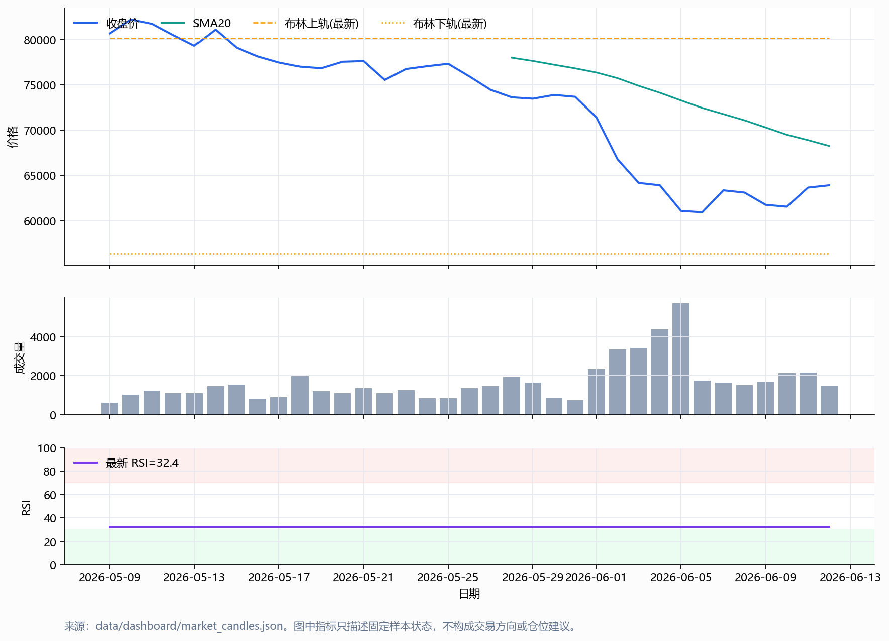
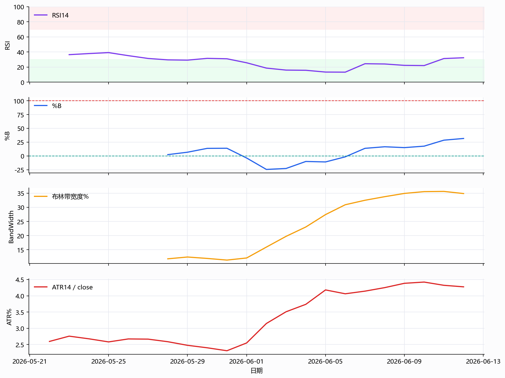
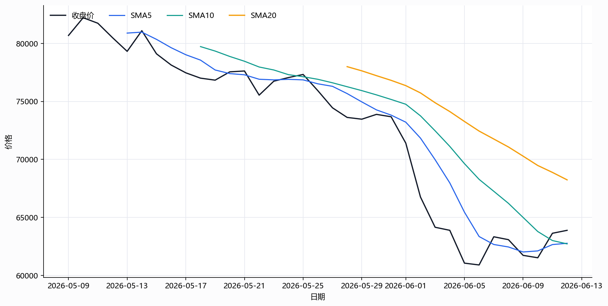

# 09 | 用技术指标描述市场状态

你好，我是袁从德。

看到一张价格走势图时，很多初学者会下意识问：“接下来会涨还是会跌？”技术指标最容易被误用的地方，正是把“现在看到了什么”直接写成“接下来一定会怎样”。

这节课我们先不讨论买入、卖出，也不讨论完整策略，而是完成一件基础工作：把价格样本里

```
的状态说清楚。例如，收盘价在均线之上，说明价格高于过去一段时间的平均水平；RSI 偏
```

高，说明近期上涨力量较强；价格接近布林带上轨，说明它处在近期波动区间的偏高位置。这些都只是观察结果，不是交易结论。

本讲的最终交付物是一张指标计算与解释卡。这张卡记录输入数据窗口、指标公式口径、指标读数、指标冲突、可采用的解释方式和应避免的越界表达。第 10 讲我们会把这些读数写入可追溯的市场研究报告；第 16 讲会把状态描述转化为可测试的策略规则；第 18 讲会把规则放入事件驱动回测。后续每一次引用指标，都要先回到这张卡，确认判断有数据来源。

## 1. 边界核心定义

技术指标进入研究报告前，先要划清语言边界。本节先区分状态描述、策略规则和交易动作，再把常用指标限定在各自能描述的维度内。

### 1.1 状态、规则与动作

本讲统一使用三层术语。表 9-1 说明三层术语各自回答的问题，以及本讲允许和不允许的表达边界。

层级

- 回答的问题本讲允许的写法

```
close < SMA20，RSI14 偏弱，ATR14 占比上
```

状态描述

- 固定样本当前呈现什么特征

```
第 16 讲会定义可测试规则，例如 close <= low
```

策略规则

- 何时触发入场、离场或观望

```
-> long_candidate
```

- 第 22 讲会结合仓位、止损和风险预算讨论执行边

交易动作

- 是否下单、下多少、怎样风控

- 表 9-1　三层术语与职责边界

```
技术指标是历史数据的压缩描述。SMA20 描述价格相对平滑基准的位置，RSI14 描述近期涨
跌动量，布林带描述价格相对波动通道的位置，ATR14 描述真实波幅尺度。它们可以提示你
```

继续观察哪些维度，但不能独立回答未来方向、收益概率、仓位大小或风险是否可控。

```
一个合规示例可以这样写：RSI14=78、bbPctB=91.5、atrPct=2.4% 同时出现时，解释
```

卡记录为“动量偏热、价格接近布林带上沿、波动尺度需要复核”。若系统同时给出

```
actionLabel，该字段只表示可视化聚合标签，没有统计胜率含义；是否进入策略规则，还
```

要另行验证。

- 专业术语注释

- SMA20：20 周期简单移动平均线

- RSI14：14 周期相对强弱指标

- bbPctB：布林带百分位（布林带位置指标）

- atrPct：ATR 相对波动百分比

- actionLabel：交易动作标签

- 解释卡记录：行情信号注释日志

- ART4：14 周期平均真实波幅

### 1.2 常用指标边界

表 9-2 把本讲常用指标，限定在各自的描述维度内，便于后续内容复用。

指标

- 描述维度可记录状态边界约束

```
SMA20 / SMA60
```

- 趋势位置收盘价相对均线的位置，短长窗口关系趋势线索不

```
RSI14
```

- 动量强弱动量偏强、偏弱或进入极端区超买不等于

```
%B、上轨、下轨、带宽
```

布林带

- 通道位置与波动区间上轨和下轨

```
ATR14
ATR 不是止
```

- 真实波幅波动尺度、跨样本风险环境

量比

- 成交活跃度突破是否伴随放量放量不保证

- 表 9-2　常用指标的描述边界

## 2. 指标维度与公式口径

边界明确之后，还要把公式口径固定下来。公式口径集中放在本节，避免在代码说明、图表解读和实践模板之间反复切换。

技术指标种类很多，本讲只保留后续内容会反复使用的四类维度：趋势、动量、波动和位置。我们会集中给出指标计算方式，最后说明参数如何备案。

### 2.1 趋势与动量公式

移动平均使用公式（9-1）：

- N−1

## 1

## ∑

- ​(t) =​P

## SMA

- t−iN

## N

- ​​i=0

## N = 20

## N = 60

```
 是第  根 K 线的收盘价。SMA20 取
，SMA60 取
```

## P

## t

其中，

- 。​t

```
RSI14 使用 Wilder 平滑口径，核心表达见公式（9-2）：
```

## 100

## RSI = 100 −

## 1 + RS

- ​

## RS

- 来自同一窗口内平均上涨幅度与平均下跌幅度的比值。配套代码实现位于

其中，

```
src/ta/core.py 的 rolling_rsi。
```

### 2.2 波动与位置公式

布林带使用公式（9-3）至公式（9-6）：

- ​ =​(t)

## middle

## SMA

- tN

- ​ =​ +

## k ⋅std(P

- ​, … , P​)

## upper

## middle

- t−N+1ttt

- ​ =​ −

## k ⋅std(P

- ​, … , P​)

## lower

## middle

- t−N+1ttt

- ​ −lower

## upper

- tt

## bb width =

## 100

## ×

- ​

```
布林带位置可用公式（9-7）表示，通常也称为 %B：
```

- ​ −lower

## P

- tt​ =​ ×

## 100

## pctB

- ​t​ −lower

## upper

- tt​

```
ATR14 先计算 True Range，见公式（9-8）：
```

- ​ =

## max(H

- ​ −​, ∣H​ −​∣, ∣L​ −​∣)

## L

## C

## C

## TR

- t−1t−1ttttt

```
跨资产或跨价格区间比较时，可使用公式（9-9）把 ATR14 转成百分比，即 atrPct：
```

## ATR

- ​t​ ×​ =

## 100

## ATR_pct

- t

## C

- ​t

表 9-3 汇总公式参数和工程入口，避免同名指标跨系统口径不一致。

指标

- 默认参数工程入口

```
SMA20 / SMA60
N=20、N=60
last_sma(closes, window)
RSI14
period=14
rsi(closes, 14)
window=20、mult=2.0
bollinger_bands(closes, 20, 2.0)
```

布林带

```
ATR14
period=14
atr(highs, lows, closes, 14)
rangePos
```

- 最近 20 根高低点

区间位置

- 表 9-3　本讲公式与工程入口

### 2.3 参数备案

教学默认参数用于可复现讲解；生产环境可以自定义参数，但必须先写入参数备案文档。备案文档至少包含研究问题、候选参数、选择理由、冻结时间、负责人、复核人、未采用参数的对

```
照结果和停止继续调参的规则。若先试 SMA5、SMA10、SMA20，再只展示最有利的一条，就
```

构成参数窥探。

生产环境参数备案可采用模板 9-1。模板的作用不是增加负担，而是把“先定参数、再看结果”的顺序固定下来。

字段

- 填写要求示例

研究问题

- 写清指标服务的研究问题判断短窗口价格是否偏离均线

```
SMA5、SMA10、SMA20
```

候选参数

- 列出所有候选值，保留完整记录

```
教学默认采用 SMA20，便于与布林带窗口一致
```

选择理由

- 说明选择依据

```
2026-06-12，解释卡 v1
```

冻结时间

- 记录参数冻结日期和版本

```
SMA5 更敏感，SMA20 更平滑
```

对照结果

- 保留未采用参数结果

停止规则

- 写明何时停止继续调参本轮不再增加均线窗口

责任人

- 记录填写、复核和批准人研究员、复核人、交付负责人

- 模板 9-1　生产环境参数备案文档

```
布林带候选规则也要停在策略输入层。例如，close <= lower -> long_candidate 只
```

能表示“价格接近下轨，可作为均值回归策略的候选输入”；它不是订单，也不是收益承诺。

- 参数介绍：Wilder 平滑 RSI 指 J. Welles Wilder 在 RSI 中使用的递推平均方法，常用于减弱单日涨跌对指标的突变影响。

```
%B 表示价格在布林带上下轨之间的相对位置，低于 0 表示跌破下轨，高于 100 表示突
```

- 破上轨。

```
atrPct 是 ATR 除以当前收盘价后的百分比形式，用于比较不同价格水平或不同标的的
```

- 波动尺度。

- 参数窥探指在看到结果后反复选择更有利的参数，并把这个事后选择包装成事前规则。

## 3. 指标复算与验证规范

指标解释先验证输入，再验证公式，最后验证语言。输入不足、公式不可复算或解释越界，任一项失败，都不能进入研究观测记录。

### 3.1 固定样本与手工复算

```
本讲固定样本是 data/dashboard/market_candles.json。当前样本包含 35 根 BTC-
USDT 日线 K 线，首日为 2026-05-09，末日为 2026-06-12。
35 根样本不足以计算 SMA60。这是刻意设计的示范案例，用来说明窗口不足时应返回空值并
写明原因，而不是补造长期趋势读数。复核 SMA20 时，取最后 20 个收盘价：
77059.0, 77325.9, 75932.5, 74451.7, 73621.9,
73469.0, 73884.5, 73678.0, 71404.5, 66760.9,
64150.0, 63887.0, 61056.5, 60899.3, 63329.8,
63080.4, 61727.2, 61519.2, 63632.1, 63885.8
这些收盘价求和为 1,364,755.2。按公式 9-1 除以 20，得到 SMA20=68,237.76。这只证
```

明输入窗口、排序和公式可以被独立复算，它不证明趋势会延续。

### 3.2 人工复核清单

表 9-4 给出人工复核检查清单，适合你在形成研究观测记录前逐项确认。

检查项

- 通过标准不通过处理

```
记录 symbol、周期、根数、来源、起止日期
```

输入窗口

- 补齐来源；无法补齐则不予采

```
K 线按 tsSec 升序进入计算
```

时间顺序

- 重新排序后复算

公式口径

- 正文公式编号与代码入口一致标注差异，避免跨口径比较

```
至少复核 SMA20、收益或评分来源中的一项
```

手工复算

- 修改解释卡后复测

```
保留均线、RSI14、布林带、ATR14 的不一致信号
```

冲突记录

- 保留不一致指标

```
actionLabel 仅解释为状态标签
```

输出标签

- 删除订单化、建议化措辞

- 表 9-4　人工复核标准化检查清单

### 3.3 图表复核

```
图 9-1 把收盘价、SMA20、成交量和 RSI14 放在同一面板中。阅读时先看上方面板的价格，
```

是否与均线共用同一时间轴，再看下方面板的成交量和动量是否同步变化。该图用于复核同窗计算，不用于裁定市场方向。



- 图 9-1　同窗复核：收盘价、SMA20、成交量与 RSI14

```
图 9-2 分别展示 RSI14、布林带 %B、布林带宽度和 ATR%。阅读时应把四条曲线看成四个维
```

度：动量、位置、通道宽度和真实波幅。若四者方向不一致，应记录冲突，而不是强行压缩为单一结论。



- 图 9-2　维度拆分：RSI14、布林带位置、带宽与 ATR%

```
图 9-3 展示 SMA5、SMA10 和 SMA20 的窗口敏感性。短窗口更贴近价格，长窗口更平滑，两
```

者都不是天然正确。该图的重点是：解释指标前必须先固定窗口参数，并保留未采用参数的对照。



- 图 9-3　参数敏感性：SMA5、SMA10 与 SMA20

## 4. 代码实现与校验

```
本节集中说明代码入口和最小可运行示例。指标函数由 src/ta/core.py 实现，并通过
src/dashboard/indicators.py 对外暴露；K 线状态分析由
src/dashboard/kline_analysis.py 的 analyze_candles、kline_verdict 和
run_kline_analysis 组织。
```

下面先看分析函数怎样处理窗口不足，再用固定样本脚本生成解释卡，最后用测试命令和边界校验函数确认输出没有越过研究观察范围。

### 4.1 分析入口

```
analyze_candles 是本讲进入指标计算的主入口。它接收已经标准化的 K 线序列，而不是
```

交易所原始数组。进入函数前，时间顺序、字段转换和缺失处理应已在第 8 讲完成。

这个函数至少需要 20 根 K 线。它会抽取开盘价、最高价、最低价、收盘价和成交量，计算

```
SMA20、SMA60、RSI14、布林带、ATR14、20 根支撑阻力、量比、区间位置和行情状态。
窗口不足时返回 None，这比补造一个看似完整的指标值更可靠。
本讲样本只有 35 根 K 线，足够计算 SMA20，但不足以计算 SMA60，正好保留了窗口不足的
边界案例。解释卡应如实写出 SMA60=None，而不是用短窗口指标替代长期趋势读数。
```

### 4.2 最小运行脚本

```
代码 9-1 是执行脚本。它设置 PYTHONPATH，调用
docs/samples/chapter09_indicator_card.py 读取固定样本，并输出解释卡字段。
$env:PYTHONPATH="src"
python docs/samples/chapter09_indicator_card.py
```

- 代码 9-1　执行脚本：生成第 9 讲指标解释卡

代码 9-2 是 Python 业务源码的核心内容。它使用离线固定样本，不依赖实时行情。你可以复现输入窗口和指标字段，并把输出填入第五部分的解释卡。

```python
import json
from pathlib import Path
from dashboard.kline_analysis import analyze_candles, kline_verdict
path = Path("data/dashboard/market_candles.json")
payload = json.loads(path.read_text(encoding="utf-8"))
candles = sorted(payload["candles"], key=lambda row: int(row["tsSec"]))
analysis = analyze_candles(candles)
verdict = kline_verdict(analysis)
card = {
   "input": {
       "symbol": payload["symbol"],
       "type": payload["type"],
       "source": payload["source"],
       "count": len(candles),
       "start": candles[0]["date"],
       "end": candles[-1]["date"],
   },
   "readings": {
       "close": analysis["close"],
       "sma20": round(analysis["sma20"], 2),
       "sma60": analysis["sma60"],
       "rsi14": analysis["rsi"],
       "bbPctB": analysis["bbPctB"],
       "bbWidth": analysis["bbWidth"],
       "atr14": analysis["atr"],
       "atrPct": analysis["atrPct"],
   },
   "label": verdict["actionLabel"],
   "reasons": verdict["reasons"],
   "allowed": "描述固定样本中的趋势、动量、位置和波动状态",
   "forbidden": "生成买入、卖出、仓位或止损建议",
}
print(json.dumps(card, ensure_ascii=False, indent=2))
```

- 代码 9-2　业务源码：读取固定样本并输出解释卡字段

### 4.3 测试命令

代码 9-3 是本讲对应的测试命令：

```
$env:PYTHONPATH="src"
python -m pytest tests/test_kline_analysis.py -q
```

- 代码 9-3　测试命令：K 线指标分析

该命令只证明指标计算、输出标签结构和离线样本路径通过测试，它不证明指标具有预测能力。若命令失败，应先修复输入路径、字段约定或指标函数，再修改研究观测记录。

```
kline_verdict 会把透明启发式规则，转换成 score、confidence、action、
actionLabel 和 reasons。其中 actionLabel 是可视化状态标签，score 是规则加减
分，confidence 是显示强度，三者都不是胜率、收益概率或订单建议。正式研究观测记录
```

应使用“指标解释”“状态复核”等表述，避免使用“跟随信号”这类执行性措辞。

正文和代码同步保留越界词列表：应该买入、应该卖出、必涨、必跌、马上回调、风险可控。这些表达属于越界措辞，形成研究观测记录前应删除或改写。

### 4.4 边界校验函数

代码 9-4 给出可复用边界校验函数，用于拦截缺字段、明显越界措辞和数值异常。数值异常包

```python
括：rsi14 不在 0 到 100 之间，atr14 为负数，atrPct 为负数，bbPctB 不是数值，或
close 小于等于 0。
FORBIDDEN_TERMS = ("应该买入", "应该卖出", "必涨", "必跌", "马上回调", "风险可控")
def validate_indicator_card(card: dict) -> list[str]:
   issues: list[str] = []
   required = ("input", "readings", "allowed", "forbidden")
   for key in required:
       if key not in card:
           issues.append(f"missing field: {key}")
   allowed = str(card.get("allowed", ""))
   for term in FORBIDDEN_TERMS:
       if term in allowed:
           issues.append(f"allowed text crosses boundary: {term}")
   readings = card.get("readings") or {}
   if readings.get("sma20") is None:
       issues.append("SMA20 is unavailable; explain insufficient window before p
   close = readings.get("close")
   rsi14 = readings.get("rsi14")
   atr14 = readings.get("atr14")
   atr_pct = readings.get("atrPct")
   bb_pct_b = readings.get("bbPctB")
   if close is not None and close <= 0:
       issues.append("close must be positive")
   if rsi14 is not None and not 0 <= rsi14 <= 100:
       issues.append("RSI14 must be between 0 and 100")
   if atr14 is not None and atr14 < 0:
       issues.append("ATR14 cannot be negative")
   if atr_pct is not None and atr_pct < 0:
       issues.append("atrPct cannot be negative")
   if bb_pct_b is not None and not isinstance(bb_pct_b, (int, float)):
       issues.append("bbPctB must be numeric when present")
   return issues
```

- 代码 9-4　Python 边界校验函数：拦截缺字段和越界措辞

代码 9-4 适合放进复核脚本或人工检查表。它不能替代你去做判断，但可以提前拦截明显的交易动作语言。

## 5. 指标冲突与解释卡案例

```
指标冲突不是异常，而是需要记录的研究事实。同一段样本可能同时出现价格低于 SMA20、
RSI14 接近低位、布林带宽度扩大、ATR14 占比上升。它们分别描述趋势、动量、通道位置
```

和波动尺度，不需要被压成一个方向。

本节用两个解释卡案例展示这种写法：先看固定样本如何形成合规描述，再看冲突样本如何保留不一致信息，最后用参数窥探反例说明研究流程风险。

### 5.1 固定样本解释卡

表 9-5 给出固定样本指标解释卡范例，你可以按同一结构填写自己的样本。

解释维度

- 固定样本读数解释口径

```
BTC-USDT、1day、35 根，2026-05-09 至
```

输入窗口

- 固定示范样本，可复算

```
2026-06-12
close=63885.8，SMA20=68237.76
收盘价低于 SMA20，短
```

趋势位置

- 表 9-5　固定样本指标解释卡范例

- 解释卡示范可以写为：

```
固定样本来自 data/dashboard/market_candles.json，覆盖 BTC-USDT 日线
2026-05-09 至 2026-06-12。最新收盘价低于 SMA20，短线趋势线索偏弱；SMA60 因
35 根示范样本窗口不足不可用；RSI14 为 32.4，动量偏弱但未进入极端超卖区；
bbPctB=31.7 且 bbWidth=34.87%，说明价格处于通道中下部且通道较宽；
atrPct=4.28%，波动尺度需要披露。输出标签“偏空观望”只表示可视化聚合状态，没有统
```

- 计胜率支撑，不构成做空或减仓建议。

### 5.2 冲突样本解释卡

为了训练冲突解释，本讲提供一组可复现的冲突样本：

```
docs/samples/chapter09_conflict_candles.json。这是一组教学用的合成日线数
```

据，专门呈现“趋势线索偏强，但动量、位置和波动同时偏热”的场景。运行代码 9-5，即可生成该样本的解释卡：

```
$env:PYTHONPATH="src"
python docs/samples/chapter09_indicator_card.py docs/samples/chapter09_conflict_c
```

- 命令 9-5　执行命令：生成冲突样本指标解释卡

```
该样本输出的核心读数为：close=131.5、SMA20=113.98、SMA60=None、
RSI14=86.3、bbPctB=96.1、bbWidth=33.38%、ATR14=6.071429、
atrPct=4.62%。这些读数可以支持“趋势线索偏强、动量偏热、价格接近布林带上沿、波动
```

尺度抬升”的研究观测记录，但不能删去动量和位置风险，只保留均线偏强这一项。

表 9-6 展示冲突样本解释卡范例，用于训练“保留冲突、不压成方向”的写法。

解释维度

- 冲突样本读数合规解释应避

```
close=131.5，SMA20=113.98
```

趋势位置

- 收盘价高于短均线，趋势线索偏强多头

```
SMA60=None
```

- 20 根示范样本不足 60 根

长周期口径

- 补写

```
RSI14=86.3
```

动量强弱

- 动量偏热，存在拥挤风险马上

```
bbPctB=96.1
```

通道位置

- 价格接近布林带上沿应当

```
atrPct=4.62%
```

波动尺度

- 波动环境需要复核风险

交付结论

- 多指标不一致保留冲突，进入策略验证或人工复核挑选

- 表 9-6　冲突样本解释卡范例

- 冲突样本的示范可以写为：

```
样本同时出现均线偏多、RSI14 超买、价格接近布林带上轨和 ATR14 抬升。合规结论
```

- 是：趋势线索偏多，但动量与位置提示追高拥挤，波动尺度需要纳入后续验证。该研究观测记录，可作为策略规则设计的输入，例如后续检验“高位拥挤后是否等待回落确认”，但不能直接写成买入、卖出或持仓建议。

### 5.3 参数窥探反例

表 9-7 给出参数窥探的反面范本。它不是计算错误，而是研究流程错误：你需要先观察多个窗口的结果，再选择最符合主观判断的一条，并把事后选择包装为事前规则。

项目

- 错误解释卡写法合规改写

```
试过 SMA5、SMA10、SMA20 后，只展示最有利的
```

- 先在参数备案文档中冻结

参数选择

```
SMA5
```

- 候选结果

```
SMA5 最贴近上涨，因此趋势确认
SMA5 对短期价格更敏感
```

解释方式

- 表 9-7　参数窥探的问题解释卡与合规改写

- 风险提示：本讲工具、样本、公式和代码仅用于研究观测与教学复现，不构成任何投资建议、收益承诺、交易信号或风险控制方案。固定样本和冲突样本均不能代表完整市场历史，也不能用于推断未来涨跌概率。

```
本讲中的 actionLabel、score、confidence 只属于解释卡字段。它们可以帮助你整
```

- 理观察维度，但不能替代策略规则、回测评估、风控审批或投资者适当性要求。任何把指标读数直接改写为买入、卖出、加仓、减仓、止损、止盈的行为，都超出了本讲工具的使用范围。

## 总结

这节课我们把技术指标交付收束为了三件事：

1. 术语分层：状态描述、策略规则和交易动作分开。

```
公式集中：SMA20、RSI14、布林带和 ATR14 的窗口、参数、公式编号与代码入口一致。
```

3. 实践可复核：固定样本、最小示例、解释卡、冲突样本和人工检查清单，共同说明指标读数来自哪里、能解释什么、不能推算出什么。

下一讲，我们将学习如何生成可追溯的市场研究报告。如果这节课没有留下输入窗口、公式口径和解释边界，下节课的报告就会把指标读数放大成过度结论。

## 思考与练习

```
为什么 RSI14 超买不能直接解释为“马上下跌”？回答时引用公式 9-2 的口径。
运行代码 9-1，为 data/dashboard/market_candles.json 生成一张指标解释卡。
完整固定样本见配套文件 data/dashboard/market_candles.json；冲突样本见
docs/samples/chapter09_conflict_candles.json。两份文件均采用标准 JSON
```

- 格式，可直接用于复算。

期待你的分享。如果今天的课程让你有所收获，也欢迎转发给有需要的朋友，邀请他来一起学习，我们下节课再见！
