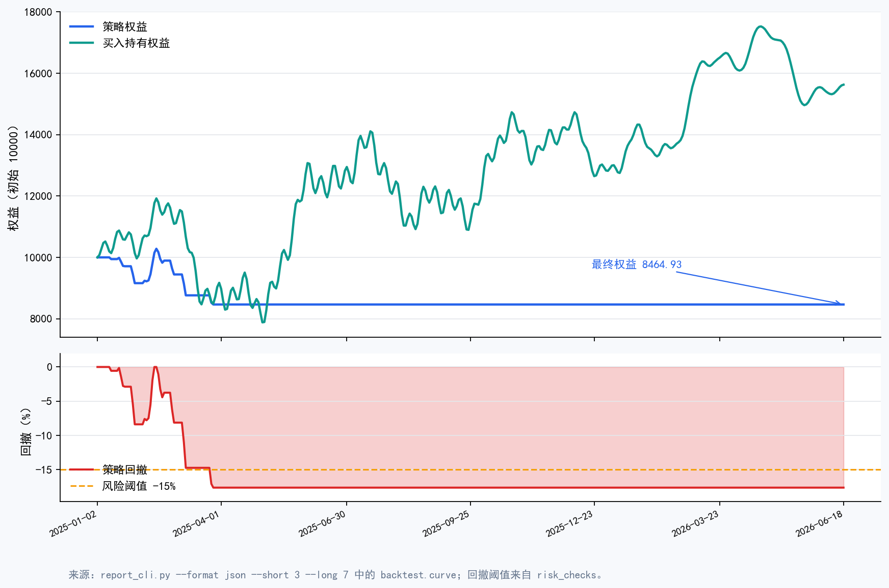
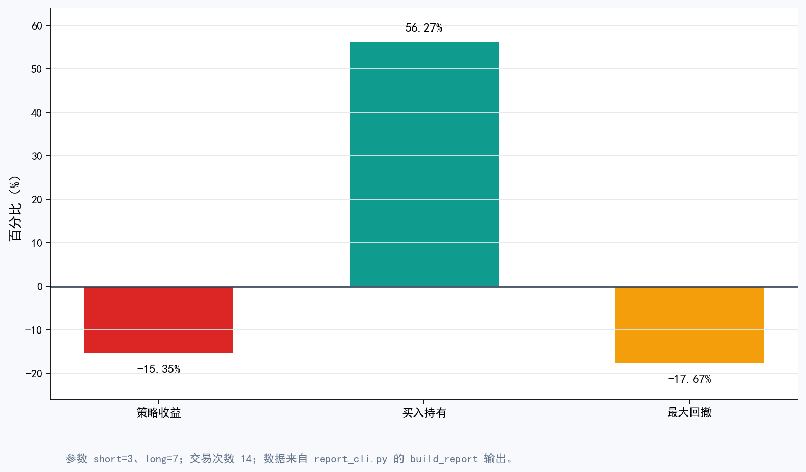

# 10 | 生成可追溯的市场研究报告

你好，我是袁从德。

读一份市场研究报告时，初学者常会先看结论：收益是多少、回撤是多少、风险大不大。其实真正需要训练的能力，是在看到一句结论后继续追问：这句话从哪里来？数字怎么算出来？有没有少说限制条件？

第 9 讲我们已经把技术指标限定为“观察到的市场状态”。这节课继续向前一步：把状态、回测结果和风险提示写成报告时，每个关键句子都要能找到来源。报告写得流畅、图表做得漂亮，只说明它便于阅读；只有能回到数据字段、输入文件、命令参数和计算口径，才说明它便于复核。

本讲的最终交付物是一份可追溯市场研究报告。它既能让你读懂主要发现，也能让你在复核时从每条关键主张回到证据位置（这节课所说的“主张”，统一指报告里需要你相信的关键句子，不等同于主观观点）。最低要求包括：一段带样本、参数和限制的报告结论；一份能反查字段的 JSON 输出；一张主张账本；至少一处手工数字复算；两类图表，分别展示路径和最终指标。缺少其中任一项，报告只能算草稿，不能算发布稿。

第 11 讲讨论自动生成文本参与研究时，会继续沿用本讲的主张账本：自动生成文本可以帮助组织表达，但不得补造来源。

## 1. 报告主张边界

可追溯报告，首先要处理语言边界。这里我们先把报告句子拆成事实、解释、信号、未知和来源五层，再用合规案例说明绩效数字怎样写才不会越界，最后给出主张分级和复核步骤。

### 1.1 报告句子的五层结构

市场研究报告最常见的问题，是把事实、解释、信号、未知和来源写成一个顺滑段落。你读起来不费力，复核者却找不到每句话的证据。表 10-1 把报告中的句子拆成五层，方便判断哪一部分来自输入，哪一部分来自计算，哪一部分只是谨慎解释。

层级

- 记录内容本讲示例

```
research.facts[].source_id=S1
```

事实

- 输入中真实存在的字段或记录

解释

- 基于事实的谨慎说明固定样本适合验证流程可重复性

```
backtest.metrics.strategy_return_pct=-1
```

信号

- 规则、回测或程序输出

```
5.35
```

未知

- 数据未覆盖的事项未覆盖滑点、资金费率、订单簿深度

```
data/company.json、data/prices.csv、
```

来源

- 可回查的文件、字段或命令

```
report_cli.py
```

- 表 10-1　市场研究报告的五层结构

这五层可以用一个问题来区分：这句话是在描述“数据中已经存在的内容”，还是在给出“基于数据的解释”？前者通常属于事实或信号，必须给出来源路径；后者通常属于解释，必须保留限制条件。未知项和来源不是附录材料，而是报告正文的一部分。

发布稿采用四条硬性规则：

- 事实要有来源。

- 方法要能解释。

- 表现数字要带样本区间、参数和对比口径。

- 风险和限制要和结论一起出现，而不是藏在页尾。

后面的命令、图表和主张账本，都是为了把这四条规则落实到配套项目的固定样本报告中。

- 合规提示：凡是收益、回撤、年化、胜率、交易次数等表现数字，都必须同时写明样本范围、参数口径、计算路径和不能外推的边界。没有这些信息的数字，不应进入正式报告摘要。

### 1.2 绩效数字的表达边界

市场研究中的许多误解，并不是从计算开始的，而是从表达开始的。同一组数字，写成“固定样本中的模拟结果”，会被理解为一条待复核的研究记录；写成“策略已经具备收益能力”，可能会被理解为更强的判断。

美国 SEC 在 2023 年处理过多起投资顾问展示“假设绩效”（hypothetical performance）的案例。这里的假设绩效，可以理解为模型组合、回测、模拟账户等，“如果当时这样做，结果会怎样”的表现数字。它可以用于研究讨论，但不能被写成已经发生的真实账户收益。

对本讲而言，这一点对应一个很具体的写作要求：不要把

```
backtest.metrics.strategy_return_pct=-15.35 写成“策略收益能力为
-15.35%”，而应写成“在固定示范样本、指定参数和当前代码实现下，模拟回测收益为
-15.35%”。
```

- 参见 SEC 新闻稿 2023-173《SEC Sweep Into Marketing Rule Violations Results inCharges Against Nine Investment Advisers》。

另一个值得注意的案例是 Titan Crypto。SEC 新闻稿 2023-153 提到，Titan 曾展示高达

```
2,700% 的年化假设绩效，但没有充分说明该预测假设最初三周的表现会持续一整年。这个案
```

例提醒我们：短样本可以描述短样本，不能直接冒充长期能力。即便以后报告中引入年化指标，也必须同时写明样本长度、年化公式、账户类型和不能外推的原因。

表现呈现还要避免只挑有利数字。CFA Institute 的 GIPS 标准，强调公平呈现和充分披露；IOSCO《Investor Education on Crypto-Assets》（FR06/2024）把投资者保护和透明市场放在

```
核心位置。放回本讲，就是不能只写“交易次数 14”，也不能只画一条看起来顺眼的曲线。策
```

略收益、买入持有对照、最大回撤和未覆盖风险，应当一起出现。

这些案例不要求你学习合规条文，而是给报告审稿建立一条规则：报告里的绩效数字，必须同时说明它是什么，以及它不是什么。可以使用下面的检查句式：

- 该数字来自【字段路径】，在【样本窗口】和【参数口径】下生成。

```
它不代表【真实账户 / 未来收益 / 投资建议 / 产品业绩】。
```

- 尚未覆盖【成本、流动性、滑点、资金费率、托管或链上执行风险】。

用这个句式对照本讲报告，合格写法应当是：

```
strategy_return_pct=-15.35% 来自
backtest.metrics.strategy_return_pct，在 2025-01-02 至 2026-06-18 的
固定离线样本和 short=3、long=7 参数下生成。它不代表真实账户收益、未来收益或投
```

- 资建议；报告尚未覆盖真实交易所深度、滑点、资金费率、托管和链上执行风险。

这段话不是保守措辞，而是证据边界。它同时交代字段、样本、参数、禁止外推事项和未覆盖风险，复核者才能判断这句话是否有资格进入摘要。

写报告时，可以先套用模板 10-1。模板不是为了统一文风，而是为了强制保留四类信息：样本范围、参数口径、来源路径和限制条件。

- 在【样本范围】和【参数口径】下，【策略或指标】输出为【核心数字】。该数字来自【字段路径或命令】，可用【复核命令】重新生成。本结论仅适用于【样本限制】，尚未覆盖【成本、流动性、执行或风险缺口】。

- 模板 10-1　可追溯报告段落模板

套用本讲样本，可以写成：

```
在 2025-01-02 至 2026-06-18 的虚构离线样本和 short=3、long=7 参数下，双均线
策略收益为 -15.35%。该数字来自 backtest.metrics.strategy_return_pct，可
用 python report_cli.py --format json --short 3 --long 7 重新生成。本
```

- 结论仅适用于固定示范样本，尚未覆盖真实交易所深度、滑点、资金费率或链上拥堵。

报告中的主张分为三类：可保留、需降级、不予采用。可保留主张必须能追到字段或计算；需降级主张有事实基础，但表达超过证据范围；不予采用的主张没有来源，或把固定样本结果包装成真实市场判断。审稿时不要把“需降级”当成措辞优化，它属于发布阻断项，必须改写后重新复核。

```
例如，“固定样本包含 381 个日线收盘价”可以追到 research.facts 和 sources.S1，可
保留。“策略收益为 -15.35%”可以追到 backtest.metrics.strategy_return_pct，
```

也可保留，但必须写明参数和样本。“策略表现稳定”需要更多窗口、更多样本和稳定性检验，当前报告只能降级为“当前样本不足以判断稳定性”。

总结来说，复核一条报告主张时，我们要按三步执行：先把句子拆成事实、计算、解释、未知和来源；再找到对应字段、命令或限制声明；最后决定保留、降级或不予采用。能走完三步的主张，才适合进入正式报告；走不完的主张，应补充证据、改写或删除。

## 2. 找到数字背后的字段

报告可追溯，首先要知道字段从哪里来。这部分我们会先说明报告的复核入口，再列出关键字段路径，最后用三组公式把主张、指标和限制声明的复核口径固定下来。

### 2.1 复核入口与关键字段

一份可追溯报告，首先要说清楚它从哪里生成，又能从哪里复核。本讲围绕

```
src/research/summary.py、src/research/report.py 和根目录的
report_cli.py 展开。summary.py 负责把 data/company.json 中的虚构教学资产，
整理成事实、解释、未知和来源；report.py 合并研究摘要、回测结果、风险检查和融合说
明；report_cli.py 提供摘要和 JSON 两种命令行输出。
```

正文中的字段、文件路径和命令参数都使用等宽体，例如

```
backtest.metrics.strategy_return_pct、report_cli.py、--short 3。复核指
```

## claim_traceability

标使用公式呈现，例如

- 。

表 10-2 汇总报告对象中的关键字段路径。写报告时，凡是出现在正文中的事实、数字或限制声明，都应能回到这张表中的某类路径。

- JSON 路径

报告内容

- 来源或计算入口

```
data/company
research.facts、research.sources
```

样本天数、起始价格

```
build_researc
backtest.metrics
build_report
```

策略收益、基准收益、回撤

```
backtest.trades
run_backtest
```

买卖记录

```
risk_checks
evaluate_back
```

风险检查

```
fusion
build_report
```

融合说明

```
warnings、research.unknowns
summary.py、r
```

警告和限制

- 表 10-2　可追溯报告字段路径

### 2.2 衡量可追溯性的三项指标

报告还要保留三个检查口径。公式（10-1）衡量关键主张可追溯率：

## traced_material_claims

## claim_traceability =

## total_material_claims

- ​

公式（10-2）衡量指标引用完整率：

## metrics_with_source

## metric_attribution =

## reported_metrics

- ​

公式（10-3）衡量限制声明覆盖率：

## stated_limitations

## limitation_coverage =

## required_limitations

- ​

这三项不是为了增加数学形式，而是把报告审稿从“读起来是否专业”改成“能否反向定位”。发

```
布前，重大主张可追溯率、指标引用完整率和限制声明覆盖率都应为 1.0；若任一项低于
1.0，报告不得发布，只能进入“修改后复测”。required_limitations 至少包括样本范
```

围、参数、成本假设、自动生成文本参与位置、失败路径和不能外推的边界。

表 10-3 对公式变量做统一释义：

符号

- 含义本讲判定标准

- 需要你据此判断策略表现、风

\mathrm{total\_material\_claims}

- 报告中的重大主张总数性的句子

\mathrm{traced\_material\_claims}

- 已标明来源的重大主张数同时给出字段路径、命令、输

- 收益、回撤、交易次数、阈值

\mathrm{reported\_metrics}

- 报告中出现的指标数量字

- 表 10-3　公式变量释义与判定标准

### 2.3 哪些句子必须追溯

如果这些公式看起来抽象，你可以先用大白话理解：

```
claim_traceability：报告里有多少关键句子能说清“证据在哪里”。
metric_attribution：报告里有多少数字能说清“怎么算出来”。
limitation_coverage：报告有没有把“还没覆盖什么”讲出来。
```

实际审报告时，不需要扩展成复杂评分系统，但每个表现数字都必须能标出来源路径。标不出来，就不能写进摘要。

另外，这里的“重大主张”，指满足任一条件的句子：包含表现数字；判断策略优劣、风险状态或样本代表性；暗示可执行、可发布或可外推；引用监管案例、行业标准或外部来源。普通过渡句、章节导航句和纯操作提示，均不计入重大主张。

还有两个概念，你需要先了解下，后面会涉及。注意，这两个概念在这里只作为限制提示出现，不能替代后续课程的完整检验。

- “样本外检验”指使用未参与参数选择、规则调试或解释筛选的数据窗口，重新评估策略表现。

- “滚动窗口”指用固定长度或固定步长的时间窗口，反复训练、评估或统计指标，以观察结果是否依赖单一时期。

## 3. 用命令生成报告

本节用两条命令生成报告：摘要命令帮助快速阅读，JSON 命令用于字段级复核。两种输出不能互相替代，摘要要保留限制，JSON 要能支撑主张账本。

### 3.1 摘要用于快速阅读

命令 10-1 生成市场研究报告摘要。它适合快速浏览关键数字，但不适合替代字段级复核。

```
python report_cli.py --format summary
```

- 命令 10-1　生成市场研究报告摘要

配套项目输出的关键内容如下：

```
示例协议（WEB3-DEMO/USDT）
warnings: 研究与模拟项目，不进入实盘执行。 · 仅使用虚构 Web3 资产与固定离线历史样本。 · 项目不
strategy_return_pct=-15.35% buy_hold_return_pct=56.27% maximum_drawdown_pct=-17.6
```

摘要输出已经包含警告、策略收益、买入持有收益、最大回撤和交易次数。审报告时，先做两件事：第一，把数字抄全；第二，把限制条件抄在同一段里。稳妥写法是：“在固定离线样本

```
和当前参数下，策略收益为 -15.35%，买入持有收益为 56.27%，最大回撤为 -17.67%，
交易次数为 14。” 你要避免写成“策略有效”或“风险已经可控”。
```

### 3.2 JSON 用于字段级复核

```
命令 10-2 生成 JSON 报告。它保留 research、backtest、risk_checks、fusion 和
warnings 等层级，适合填写主张账本。
python report_cli.py --format json --short 3 --long 7
```

- 命令 10-2　生成可反查字段的 JSON 报告

```
JSON 报告显示：research.sources.S1 说明样本包含 381 个日线收盘价，覆盖 2025-
01-02 至 2026-06-18；backtest.parameters 记录 short_window=3、
long_window=7；risk_checks 中 MAX_DAILY_LOSS_PCT 为 warning，提示权益相对峰
值下降 15.35%，超过 15.00% 阈值并累计拦截 176 笔。
```

下面我给一个案例，用于展示同一组输出如何从“问题报告段落”改写成“可追溯报告段落”。

问题写法：

- 双均线策略已经完成验证，系统识别出风险并控制住了损失。虽然短期回测为负，但样本显示该策略具备继续优化价值，后续可以作为交易策略候选。

这段话的问题有四个：第一，“完成验证”没有说明验证范围；第二，“控制住了损失”把 warning写成风控成功；第三，“具备继续优化价值”没有来源路径；第四，“交易策略候选”容易被理解成执行建议。

合格写法：

```
在虚构离线样本 2025-01-02 至 2026-06-18、参数 short=3、long=7 下，双均线回
测输出 strategy_return_pct=-15.35%，买入持有收益为 56.27%，最大回撤为
-17.67%，交易次数为 14。risk_checks[0] 记录 MAX_DAILY_LOSS_PCT 为
warning，说明权益相对峰值下降超过 15.00% 阈值。该结果只能说明当前样本和参数下的
```

- 模拟表现，不覆盖滑点、资金费率、订单簿深度，也不能外推到真实交易。

合格写法把样本、参数、字段、风险和限制放在同一段中，符合本讲“事实有来源、方法可解释、表现可比较、限制同页保留”的要求。

### 3.3 短样本年化的表达边界

上面提过的 Titan Crypto 案例，最适合训练“看到夸张数字先停一下”。SEC 指出，Titan 曾在

```
广告中展示高达 2,700% 的年化假设绩效。问题不只是数字大，而是没有充分说明：这些预
```

测假设最初三周的表现会持续一整年。这个案例和本讲固定样本有直接对应关系：只要把短样本、回测样本或模拟账户结果写成年化能力，报告就必须额外说明样本长度、年化公式、账户类型和不能外推的边界。

表 10-4 把 Titan Crypto 案例改写了，重点不是复述案例细节，而是训练短样本年化数字的表达边界。

问题写法

- 为什么有风险可追溯

- 在固定没有说明样本长度、年化公式、是否真实账户，也没

策略年化后具备显著收益潜力

- 时写出有说明回撤和成本模，并

- 把短期路径假设成全年持续，忽略波动、回撤、市场当前窗

当前三周表现可以代表全年

- 状态切换年，需

- 报告必把 hypothetical performance 写成真实账户表现

模拟账户表现等同策略能力

- 留字段

- 表 10-4　短样本年化数字的可追溯改写

配套项目当前不要求计算年化收益。若后续讲引入年化指标，报告至少要回答四个问题：样本多长，公式是什么，是模拟还是真实账户，为什么不能外推。对应到主张账本，就是新增四

```
列：period_length、annualization_formula、account_type、
non_extrapolation_note。没有这四列，年化数字只能留在实验记录里，不能进入正式
```

报告摘要。

### 3.4 用主张账本校验来源

表 10-5 给出一条完整主张账本记录。你在写报告时，不必为每个普通句子建账，但所有关键数字、风险判断和结论性表达都应进入账本。

字段

- 填写示例

```
在 short=3、long=7 下，策略收益为 -15.35%
```

报告句子

- 计算 / 信号

证据层级

```
backtest.metrics.strategy_return_pct、
```

来源路径

```
backtest.parameters
python report_cli.py --format json --short 3 --long 7
```

复核命令

处理方式

- 保留并注明参数

限制声明

- 固定虚构样本；不含真实交易所深度、滑点和资金费率

越界改写

- 策略已经验证有效；策略可以进入实盘

- 表 10-5　主张账本填写样例

代码 10-1 给出最小主张账本校验函数。它要求每条主张写明证据层级、来源路径和处理方式，并检查常见点号路径是否能在 JSON 报告中找到。

```python
REQUIRED_KEYS = ("claim", "evidence_layer", "source_path", "decision")
FORBIDDEN_DECISIONS = {"publish_without_source", "hide_limitations"}
def resolve_path(payload: dict, source_path: str) -> object:
   current: object = payload
   for part in source_path.split("."):
       if isinstance(current, dict) and part in current:
           current = current[part]
       else:
           raise KeyError(source_path)
   return current
def validate_claim_ledger(rows: list[dict], report_json: dict) -> list[str]:
   issues: list[str] = []
   for index, row in enumerate(rows, start=1):
       for key in REQUIRED_KEYS:
           if not row.get(key):
               issues.append(f"row {index} missing {key}")
       if row.get("decision") in FORBIDDEN_DECISIONS:
           issues.append(f"row {index} has forbidden decision")
       source_path = row.get("source_path")
       if source_path and "[]" not in source_path:
           try:
               resolve_path(report_json, source_path)
           except KeyError:
               issues.append(f"row {index} source_path not found: {source_path}"
   return issues
```

- 代码 10-1　主张账本校验函数：检查必填字段和来源路径

这段函数不能判断研究质量，但能拦截“只有结论、没有来源路径”的报告草稿。若路径中包含

```
列表筛选，例如 research.facts[].source_id=S1，团队可以在此基础上继续扩展列表
```

匹配逻辑。自动校验通过以后，仍需人工复核语言边界，因为程序只能确认路径存在，不能判断一句话是否把固定样本写成了真实市场结论。

## 4. 让图表支撑报告主张

下面我们把报告句子落到两类图上：第一类是曲线图，用来回答“路径如何发生”；第二类是指标图，用来回答“最终数字是多少”。只看最终数字，其实你不知道中间是否长期回撤；只看曲线，又不容易抓住关键指标。因此正式报告应把二者配合使用。

### 4.1 权益曲线与回撤

图 10-1 展示策略权益曲线、买入持有权益曲线和策略回撤曲线。阅读顺序是：先看上半部分

```
策略权益是否跑赢买入持有，再看下半部分回撤是否触及风险阈值，最后回到 risk_checks
```

确认 warning 的来源。该图能直接支撑两类报告句子：一类是“策略跑输买入持有”，另一类是“回撤触发风险提示”。



- 图 10-1　权益曲线与回撤复核

根据图 10-1 和 JSON 字段，可以写出一段合格的实战报告：

```
在虚构离线样本 2025-01-02 至 2026-06-18、参数 short=3、long=7 下，策略最终
权益为 8464.93，低于初始权益 10000；同区间买入持有权益上升至约 15627。策略回
撤曲线跌破 -15% 风险阈值，risk_checks[0] 记录 MAX_DAILY_LOSS_PCT 为
```

- warning。该结果说明当前样本和参数下策略路径较弱，并触发风险提示；它不能证明策略在真实市场中无效，也不能替代更多参数、成本和样本外检验。

```
这段话有四个证据点：backtest.metrics.final_equity 支撑最终权益，
backtest.curve 支撑路径，risk_checks[0] 支撑 warning，warnings 和
research.unknowns 支撑限制声明。你可以按这四个字段逐一复核。
```

表 10-6 给出曲线复核的四步操作。它是本讲最核心的实战动作：每次把图表写进报告，都要能从图回到字段，从字段回到句子。

复核步骤

- 查看位置可写入报告的句子

```
backtest.metrics.final_equity、图 10-1 上
```

比较最终权益

- 策略最终权益低于初始半部分

```
图 10-1 上半部分、backtest.curve.close
```

比较基准路径

- 同期买入持有路径明显

```
图 10-1 下半部分、risk_checks[0]
回撤跌破 -15% 阈值
```

检查回撤阈值

```
warnings、research.unknowns
```

保留限制条件

- 未覆盖滑点、资金费率

- 表 10-6　权益曲线与回撤曲线复核步骤

### 4.2 收益、基准与回撤同屏

```
图 10-2 把 build_report(short=3, long=7) 的关键指标画成柱状图。它解决的问题是
```

“报告中的收益、基准和回撤量级是否被同时展示”，而不是证明策略可用。阅读时要同时看策略收益、买入持有收益和最大回撤；只展示其中一个数字，都会改变你对报告的理解。



- 图 10-2　固定样本报告关键指标

```
图 10-2 的核心结论是：策略收益为 -15.35%，买入持有收益为 56.27%，最大回撤为
-17.67%。如果报告只写“完成回测”，信息不足；如果写“策略有效”，则超出证据。较准确的
写法是：在 short=3、long=7 和固定样本下，该策略跑输买入持有，并触发回撤相关风险
```

提示。

### 4.3 图表结论也要入账

表 10-7 是主张账本模板。每条报告句子都要标明证据层级、来源路径、处理方式和限制声明。

报告句子

- 证据层级来源路径

```
research.facts[].source_id=S
```

固定样本包含 381 个日线收盘价

- 事实

```
research.sources[].id=S1
策略收益为 -15.35%
backtest.metrics.strategy_re
```

- 信号 / 计算

```
最大回撤为 -17.67%
backtest.metrics.maximum_dra
```

- 计算

```
MAX_DAILY_LOSS_PCT 触发 warning
risk_checks[0]
```

- 风险检查

策略表现稳定

- 解释越界无充分来源

可以发布为投资结论

- 越界无来源且违反边界

- 表 10-7　市场研究报告主张账本模板

主张账本评审时，应保留三种处理结果：来源清楚，且限制保留的主张可以保留；来源不清或语言越界的主张要修改后复核；删除风险提示或把模拟结果包装成投资结论的主张，不予采用。

表 10-8 给出自然语言降级规则。它适合放在自动生成摘要之后使用，防止文本把固定样本和模拟回测包装成更强结论。

可发布表达

- 需要降级或删除的表达

固定样本中观察到

- 市场证明

当前规则输出为

- 系统建议

回测在该样本下为负

- 策略无价值或策略有效

风险检查触发 warning

- 风险可控

未覆盖滑点和资金费率

- 成本可以忽略

样本不代表真实资产

- 可以外推到真实交易

- 表 10-8　市场研究报告语言降级规则

## 5. 发布前复核与交付边界

报告生成之后，还要经过发布前复核，并同时交代复核资源和使用边界。本节把复核动作拆成清单、手工交易复算、发布决定和交付资源四部分，避免“报告能生成”被误认为“报告可发布”。

报告发布前要同时检查结构、数字、限制和语言。表 10-9 给出标准化复核清单，任一检查项不通过，都不得以“后续补充”为由发布。

检查项

- 通过标准不通过处理

- 表 10-9　发布前证据复核清单

```
清单之外，还应至少手工复核一个数字。本讲可以复核第一笔交易：2025-01-10 以 8.86
买入，2025-01-13 以 8.81 卖出，价格变化约为 8.81 / 8.86 - 1 = -0.56%。这个
```

复核只说明交易记录和价格变化可计算，不说明策略整体可靠。

完成复核后，再做发布决定：

- 第一类是“通过”：关键主张都有来源，至少一个数字被人工复核，警告和未知项保留。

- 第二类是“修改后复测”：报告能生成，但存在来源不清、语言越界或数字尚未复算。

- 第三类是“不予采用”：报告把固定样本包装成完整市场判断，把回测结果包装成未来收益，或删除必要限制声明。

报告通过发布前复核后，还要交代配套资源和使用边界。你可以用这些文件复算报告，但不能把它们解释为真实资产数据、真实账户记录或投资建议。表 10-10 列出本讲配套工程文件的核心入口。你复现本讲时，应优先使用表中的命令和文件，而不是从正文里手工拼接路径。

资源

- 文件或命令用途

```
src/、report_cli.py
```

完整代码仓库

- 生成研究摘要、回测结

```
data/company.json、data/prices.csv
```

示范样本数据

- 固定离线样本和虚构资

```
scripts/generate_chapter10_figures.py
```

- 生成图 10-1、图 10-2

图表生成脚本

```
python report_cli.py --format json --
```

复核命令

- 复现本讲字段路径和

```
short 3 --long 7
```

- 表 10-10　本讲配套资源与复核入口

- 本讲报告、命令、图表和样本均为教学复核材料，不构成投资建议、收益承诺、交易信号或

```
风控方案。发布时应保留样本来源、参数口径、warnings 和 unknowns，不得把固定样
```

- 本回测改写成真实市场结论。

## 总结

这节课我们把市场研究报告的交付标准，收束为主张账本。可追溯报告不只是能生成，更要能从每个关键句子回到来源字段、计算口径、命令参数、未知项和限制声明。

下一讲开始，我们将学习“大语言模型在交易研究中能做什么、不能做什么”。如果报告阶段，没有保留主张来源和未知项，自动生成文本参与后会更容易放大叙事偏差。

## 思考与练习

1. 理解题：为什么“报告结构完整”不等于“证据完整”？请用事实、解释、信号、未知和来源五层说明。

2. 实践题：运行命令 10-1 和命令 10-2，记录摘要输出中的关键数字，并从 JSON 中找出两个对应路径。

3. 改写题：从本讲报告中选择一句结论性表达，改写成“数字来源 + 样本参数 + 限制条件”都清楚的可追溯段落。

期待你的分享。如果今天的课程让你有所收获，也欢迎转发给有需要的朋友，邀请他来一起学习，我们下节课再见！
