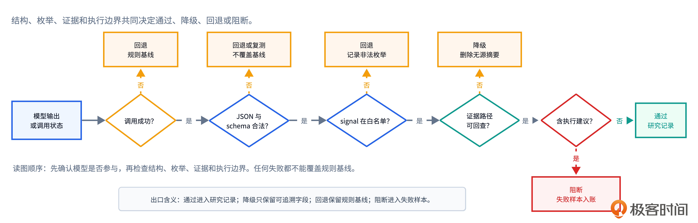
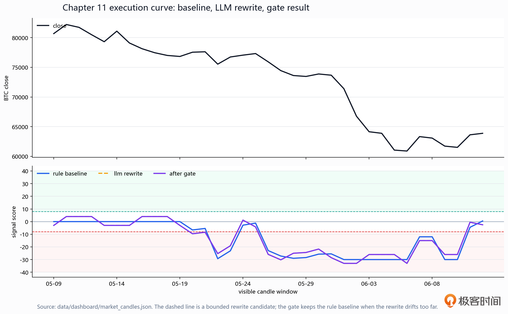

# 11 | LLM的交易研究边界

你好，我是袁从德。

第 10 讲我们讨论了研究报告中的主张如何追溯到证据。本讲继续收紧 LLM 在交易研究中的位置：模型可以组织已有证据，不能制造事实；可以改写研究解释，不能替代规则、回测、风控或下单决定。

在这一讲中，Codex 的角色不是替模型判断行情，而是把这条边界落实到仓库里：读取规则基线，检查模型合并逻辑，运行回退测试，并留下可以复核的命令结果。也就是说，LLM 负责生成解释，Codex 负责让解释受到代码和测试的约束。

本讲会把这条边界沉淀为一张 LLM 使用边界卡。它记录模型看到了哪些输入、允许改写哪些字段、输出必须满足哪些 schema 和枚举、失败时怎样回退、哪些结论必须人工复核。

正式研究记录不能只保存模型回答，至少要留下这些材料：规则基线输出、模型输出或回退说明、边界卡、结构化门禁样本、测试命令结果，以及对越界输出的处理记录。缺少规则基线或失败回退，模型摘要再流畅，也只能算一段未经确认的草稿。

## 1. 先把模型放回正确位置

LLM 最有价值的能力，是把分散字段组织成可读解释；最危险的误用，是把流畅语言误读成新增证据。表 11-1 固定本讲的任务边界。

- 可以交给 LLM

任务类型

- 必须由数据或规则提供

摘要整理

- 改写已有证据，压缩为研究语言输入字段、样本窗口、指标数值

```
signal、score、confidence、证据列表
```

信号解释

- 解释规则信号为何出现

- 按约定 JSON 字段返回

结构化输出

- 字段白名单、枚举范围、失败状态

风险提示

- 指出缺口、假设和不确定性数据来源、回测边界、风控阈值

交付复核

- 标出缺来源或越界句子主张账本、人工判断

- 表 11-1　LLM 在交易研究中的使用范围

```
在本讲框架中，LLM 位于证据之后、报告之前。它可以读取 market、kline、
evidence、onchainMetrics、tradePlan 和 ruleSignal 等上下文字段，并把它们组
```

织成解释；它不能凭常识补出实时价格、新闻、链上指标、成交量或未来走势。只要输出中出现来源不明的数字、未提供的价格区间或执行性建议，就应降级、回退或阻断。

## 2. 规则基线先于模型解释

```
run_llm_signal_analysis(symbol) 的关键设计，是始终先调用
run_signal_analysis(symbol) 生成规则基线。规则基线来自确定性规则和离线样本，
包含 signal、signalLabel、confidence、score、reasons、kline、
```

```
evidence、tradePlan 和 logicFlow。模型不是独立信号源，而是解释层。表 11-2 说明
```

规则基线与模型输出的职责分工。

- LLM 职责

环节

- 规则引擎职责验收

输入处理

- 读取样本、指标和证据字段不新增输入事实输入

```
生成基线 signal、score、confidence
```

信号生成

- 在合法枚举内改写候选表达非法

解释生成

- 提供可计算依据组织摘要、逻辑流和风险提示不越

```
eng
```

失败处理

- 保留规则结果调用失败时不覆盖基线

- 表 11-2　规则基线与模型输出职责分工

这种顺序可以约束两类风险。第一，模型不能在没有数据的情况下，凭语言常识补造事实。第二，密钥缺失、调用超时、JSON 解析失败或非法枚举时，系统仍能返回可复查的规则结果。这里我们把这种主路径失败后保留基线输出的处理称为回退。

模型边界卡应体现四类基本要求：结构可解析，输出经过白名单，失败有留痕，限制写清楚。

```
落实到本讲，就是检查 SIGNAL_KEYS、必填字段、数值范围、证据引用率、回退次数、模型
```

版本和提示词版本。任一检查项缺失，模型输出都不应覆盖规则基线。

## 3. 从代码看边界如何生效

```
本讲代码说明围绕 src/dashboard/signal_analysis.py 和
src/dashboard/llm_signal.py 展开。前者负责规则基线，后者负责模型配置、提示词
```

构造、调用、合并和回退。

### 3.1 只合并白名单字段

```
本专栏配套仓库的示例配置中，llm_signal.py 通过 DEFAULT_MODEL 指定模型名称；具
体模型版本以你手中的配套代码为准。SIGNAL_KEYS 允许的枚举只有 STRONG_BUY（强买
入）、BUY（买入）、WEAK_BUY（弱买入）、HOLD（观望）、WEAK_SELL（弱卖出）、SELL
（卖出）和 STRONG_SELL（强卖出）。枚举之外的模型信号不能进入最终结果。
```

代码 11-1 摘录模型输出合并的核心逻辑。它先复制基线，再读取模型信号；若模型信号不在

```sql
SIGNAL_KEYS 中，就恢复基线信号。完整实现还会合并 summary、reasons、analysis
和 logicFlow 等解释字段，但这些字段同样不能绕过基线和门禁。
def _merge_llm(baseline: dict[str, Any], llm: dict[str, Any], model: str) -> dict
   merged = dict(baseline)
   signal = str(llm.get("signal") or baseline.get("signal") or "HOLD").upper()
   if signal not in SIGNAL_KEYS:
       signal = str(baseline.get("signal") or "HOLD").upper()
   merged.update(
       {
           "ok": True,
           "engine": "llm",
           "engineMeta": {
               "provider": "deepseek",
               "model": model,
           },
           "signal": signal,
           "signalLabel": llm.get("signalLabel") or baseline.get("signalLabel"),
           "confidence": float(llm.get("confidence") or baseline.get("confidence
           "score": float(llm.get("score") if llm.get("score") is not None else
       }
   )
   return merged
```

- 代码 11-1　业务源码：模型输出只合并白名单字段

代码 11-2 展示未配置密钥时的回退路径。系统不会伪装成模型调用成功，而是在

```
engineMeta.note 中说明使用规则引擎。
if not configured_at_start:
   baseline = dict(baseline)
   baseline["engineMeta"] = {
       **(baseline.get("engineMeta") or {}),
       "model": "规则引擎（教学沙箱）",
       "note": "未配置 OPENAI_API_KEY；使用多维规则引擎生成信号。",
   }
   return baseline
```

- 代码 11-2　业务源码：未配置模型密钥时回到规则基线

### 3.2 用测试确认回退路径

代码 11-3 是本讲对应的测试入口。

```
$env:PYTHONPATH="src"
python -m pytest tests/test_llm_signal.py -q
```

- 代码 11-3　测试命令：验证模型信号合并与回退行为

在配套仓库的基准版本中，代码 11-3 应返回通过结果。无密钥场景下，

```
run_llm_signal_analysis("BTC") 返回规则基线：engine=sandbox-rule-
based，signal 和 signalLabel 以规则输入为准，并写入 engineMeta.note=未配置
OPENAI_API_KEY；使用多维规则引擎生成信号。 这些字段可能随快照或离线样本更新，不
```

能写成固定市场结论。

代码 11-4 给出一个可直接运行的字段检查示例，用于确认回退输出保留了逻辑流、交易计划和证据维度。

```
$env:PYTHONPATH="src"
@'
from dashboard.llm_signal import run_llm_signal_analysis
payload = run_llm_signal_analysis("BTC")
print(payload["engine"])
print(payload["signal"], payload["signalLabel"], payload["confidence"], payload["
print(payload["engineMeta"]["note"])
print(len(payload.get("logicFlow") or []), bool(payload.get("tradePlan")))
print(sorted((payload.get("evidence") or {}).keys()))
'@ | python -
```

- 代码 11-4　最小示例：读取无密钥回退结果

在配套样例数据下，代码 11-4 的输出示例如下：

```
sandbox-rule-based
WEAK_SELL 偏空观望 15.6 -13.0
未配置 OPENAI_API_KEY；使用多维规则引擎生成信号。
4 True
['capital', 'consensus', 'sentiment', 'technical']
这里的 WEAK_SELL、15.6 和 -13.0 来自样例离线数据，不是市场判断模板。它们只能说
```

明回退路径可复查，不能解释为实时行情结论。

## 4. 让模型输出经过门禁

图 11-1 展示模型输出进入研究记录前的门禁流程。它不是模型能力排名，而是说明结构、枚举、证据和执行边界如何决定通过、降级、回退或阻断。



- 图 11-1　模型输出门禁流程

图 11-2 把同一条边界放到一段可见 K 线窗口上：蓝线是规则基线分数，橙色虚线是模型改写候选分数，紫线是门禁后的结果。读图重点不是判断行情方向，而是检查模型候选是否只能在规则允许的范围内改写；一旦偏离过大，门禁结果应回到规则基线。



- 图 11-2　LLM 信号执行曲线与门禁结果

表 11-3 给出结构化模型输出门禁样本。它们可以直接放进边界卡，作为人工复核时的判断依据。

模型输出样本

- 主要问题门

```
signal="WEAK_BUY"，解释引用
```

- 枚举合法证据可回查通

- 表 11-3　结构化模型输出门禁样本

表 11-4 进一步把门禁样本放进五个接近正式复核的案例。它们都不要求真实模型在线调用，重点是判断哪些字段可以留下，哪些句子需要拦截。正式研究记录看的是关键失败是否为 0，而不是句子是否流畅。

案例

- 样本描述触发检查项

```
运行环境没有配置 OPENAI_API_KEY，系统返回
```

无密钥回退

- 调用未成功，但规则基线

```
engine=sandbox-rule-based
模型返回 signal="MUST_BUY"，但其他字段看起
signal 不在 SIGNAL_
```

非法枚举

- 来完整

- 模型写出“BTC 已突破 65000，应立即追多”

补造价格

- 引用未提供价格，并生成

```
JSON 合法，信号为 HOLD，但“链上资金明显流入”没
关键判断没有引用 onc
```

证据缺失

- 有字段路径

```
模型把 score、kline.1hour.rsi、
evidence.technical 和 tradePlan.risk 改写
```

合法改写

- 结构、枚举、证据路径和成研究语言

- 表 11-4　LLM 输出案例复核表

代码 11-5 把表 11-3 的边界写成一个最小门禁函数。它不替代仓库实现，只用于说明“合法枚举、证据引用、未补造事实”必须同时满足。

```python
ALLOWED_SIGNALS = {
   "STRONG_BUY", "BUY", "WEAK_BUY",
   "HOLD",
   "WEAK_SELL", "SELL", "STRONG_SELL",
}
def gate_llm_signal(result: dict) -> str:
   if result.get("signal") not in ALLOWED_SIGNALS:
       return "FALLBACK"
   if not result.get("evidence_refs"):
       return "STOP"
   if result.get("uses_unprovided_price"):
       return "STOP"
   return "RESEARCH_ONLY"
candidate = {
   "signal": "HOLD",
   "evidence_refs": ["ruleSignal.score", "evidence.technical"],
   "uses_unprovided_price": False,
}
assert gate_llm_signal(candidate) == "RESEARCH_ONLY"
```

- 代码 11-5　边界示例：结构化模型信号的最小门禁

## 5. 用边界卡留下复核证据

模型参与研究时，要把结果写进边界卡，而不是只保存模型回答。表 11-5 是边界卡模板。

检查项

- 记录内容通过条件不

- 表 11-5　LLM 使用边界卡模板

本讲至少记录三个检查指标。公式（11-1）是关键失败率：

## critical_failures

## failure_rate =

## tasks

- ​

```
critical_failures 包括补造未提供价格、引用不存在证据、生成执行性建议、覆盖失败
```

状态等。公式（11-2）是证据引用率：

## claims_with_refs

## evidence_ref_rate =

## total_key_claims

- ​

公式（11-3）是结构合法率：

## valid_json_outputs

## schema_pass_rate =

## total_model_outputs

- ​

这三个指标回答的是模型输出是否受控，不回答交易是否有效。进入正式研究记录的门槛是：

```
critical_failures=0，evidence_ref_rate=1.0，schema_pass_rate=1.0。即
使 schema_pass_rate=100%，也只能说明结构稳定，不能说明模型判断可靠。
```

至此，这节课我们已经把模型参与研究的路径，收束成一条清楚的分工线：数据和规则先给出可复查的基线，模型只负责把基线、证据和风险组织成更容易阅读的解释；解释再经过结构、证据和人工复核三道门，才能进入研究记录。这样的设计看起来保守，却能避免一个常见误区：把“会组织研究流程”误读成“能替代研究判断”。

## 总结

这节课我们把 LLM 固定在交易研究的解释层，而不是事实源、统计检验器或交易决策器。完成这一层设计后，至少要能回答三个问题：规则基线是否先生成，模型输出是否只覆盖白名单字段，失败和越界输出是否能回退、降级或阻断。

下一讲我们将学习“如何把市场数据转换成 LLM 可理解的上下文”。如果第 11 讲没有固定规则基线和失败回退，后续上下文工程会缺少可验证边界。

## 思考与练习

```
理解题：为什么 run_llm_signal_analysis 要先调用规则基线，再合并模型输出？为
什么 confidence 不是未来盈利概率？
```

2. 实践题：运行代码 11-3 和代码 11-4，记录测试结果，并填写一张表 11-5 格式的 LLM 使用边界卡。

期待你的分享。如果今天的课程让你有所收获，也欢迎转发给有需要的朋友，邀请他来一起学习，我们下节课再见！
