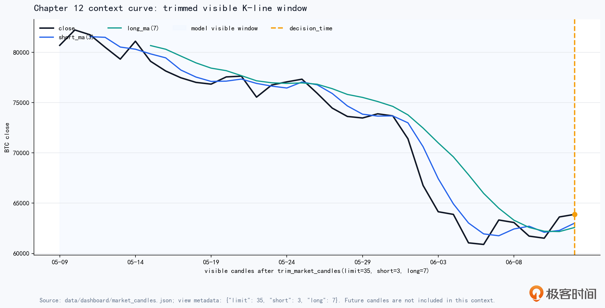
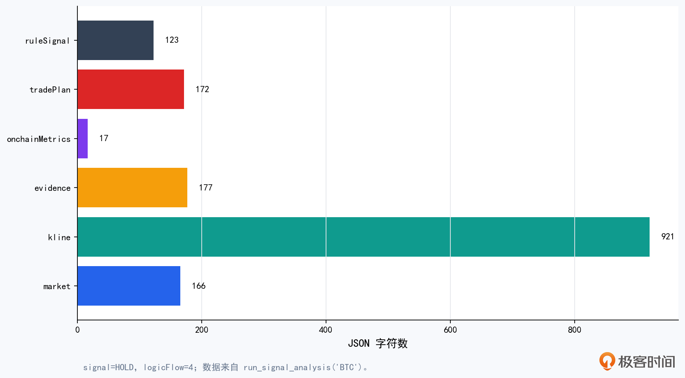

# 12 | 用Codex准备可追溯的市场上下文

你好，我是袁从德。

第 11 讲我们厘清了 LLM 在量化交易研究中的能力边界与适用禁区。本讲将进一步向前深挖：在大模型生成观点、输出结论前，输入上下文该如何标准化约束。上下文并非越多越好，可追溯性才是第一优先级；每一段送入提示词的数据字段，都必须明确标注数据来源、有效时间口径、字段业务含义与模型使用场景。

本讲中 Codex 的核心任务，并非简单封装提示词生成工具，而是把上下文预处理流程固化为一套可校验、可复现的代码执行链路：分层裁剪数据集视图、生成准入字段白名单、配套自动化测试用例、完整记录字段放行 / 拦截规则。LLM 仅能读取合约划定范围内的合规数据，Codex 则负责让这套数据准入规则在代码仓库中长效落地、可审计。

我会把提示词之前的准备工作沉淀为一份 LLM 上下文合同。这份合同定义可用字段、停止字段、时间口径、缺失表示、裁剪参数和复核指标。一份合格合同至少要满足五项要求：可见字段在白名单内，字段来源能回到代码路径或样本路径，时间口径不包含决策时不可见的信息，缺失字段用显式状态表示，测试与人工复核记录能够说明裁剪逻辑没有绕过边界。等到第 13讲，我们让模型输出结构化信号时，只使用这份合同列明的上下文。

## 1. 先划定模型的可视数据边界

量化研究使用的行情数据不同于通用文本。价格字段绑定精确时间戳、技术指标绑定固定计算窗口、信号结论必须可回溯原始样本。若缺少这类约束，模型极易出现三类典型偏差：将历史旧行情误判为实时盘面、把样本内拟合规律推演为未来确定性结论、自主脑补填充缺失数据。

表 12-1 为本讲上下文合约定义的六类标准字段，所有输入模型的数据必须归入以下类别之一。

字段类型

- 作用必须记录

市场事实

- 描述样本中的价格、成交量、涨跌幅来源、时间戳、交易对、单位

- 描述 K 线、均线、RSI 等状态

技术状态

- 周期、窗口、计算口径

证据列表

- 说明规则信号为何产生字段路径、方向、权重或分数

交易计划

- 描述观察位、止损位、失效条件来源规则、适用范围、研究用途

缺失状态

- 明确哪些数据没有进入上下文缺失字段、原因、影响

```
signal、score、confidence、reaso
```

规则信号

- 给出基线方向和分数

- 表 12-1　LLM 上下文合同字段类型

合格上下文需同时达成三个目标：信息量足以支撑完整研究推理、数据体量精简以过滤无关噪声、结构标准化便于程序校验与人工复盘。上下文工程不属于提示词优化技巧，而是量化数据工程与实验设计的核心组成部分。

上下文合约不能仅凭经验罗列字段，必须坚守四条底层治理原则：

1. 来源可溯源：不能仅标注 “BTC 行情数据”，需完整留存数据源路径、时序口径、字段释义与复核方式。即便模型输出结论逻辑通顺，无溯源链路也无法定位偏差源头。

2. 权限强隔离：上下文严禁混入钱包地址、私钥、账户信息、真实交易订单等权限类字段，同时拦截可篡改系统逻辑的外部指令。我们虽只聚焦研究沙箱环境，但所有敏感字段需在上下文入口统一拦截。

3. 参考数据受控：输入模型的素材，以白名单字段、证据路径、缺失标记为边界。模型仅能依托给定字段完成推理，禁止依靠自身常识脑补行情、价格、交易约束条件。

4. 时序可见性：决策时点无法获取的信息一律禁止入参。24h 未来收益、未来收盘价、事后标注标签、复盘总结均属于时序污染字段；时序样本必须严格按时间切片划分，杜绝未来信息提前泄露至当前上下文。

## 2. 原始行情分层裁剪，生成专属研究视图

```
市场数据第一层过滤逻辑位于 src/dashboard/dataset_views.py。该模块不调用大模
```

型，仅负责将全量原始数据集裁剪为单次研究任务专属视图；视图本质是单次模型调用可见的数据范围，例如限定观测标的数量、截取近期 K 线、筛选机会池前排标的等。

### 2.1 限定可见资产范围

```
代码 12-1 为标的裁剪核心函数 trim_market_tickers，用于限制加载标的总数，并写入
```

报价币种、视图参数等元数据，为后续复核提供资产覆盖范围凭证。

```python
def trim_market_tickers(payload: dict[str, Any], *, quote: str, limit: int) -> di
   trimmed = dict(payload)
   tickers = list(trimmed.get("tickers") or [])
   if limit > 0:
       tickers = _pin_major_tickers(tickers, limit=limit)
   trimmed["tickers"] = tickers
   trimmed["count"] = len(tickers)
   trimmed["quote"] = quote.upper()
   trimmed["view"] = {"limit": limit, "quote": quote.upper()}
   return trimmed
```

- 代码 12-1　ticker 视图裁剪

```
两处关键设计：一是内置 _pin_major_tickers 优先保留 BTC、ETH 等主流核心标的，避
免标的数量限制下关键资产被过滤；二是 view 并非前端展示字段，而是核心溯源凭证，完整
```

记录本次上下文加载的标的上限与计价单位。

### 2.2 重算可视 K 线指标窗口

代码 12-2 实现了 K 线数据裁剪逻辑，仅保留最新 N 根 K 线，并基于传入的短、长周期参数实时重算均线曲线。

```python
def trim_market_candles(
   payload: dict[str, Any],
   *,
   limit: int,
   short: int = 3,
   long: int = 7,
) -> dict[str, Any]:
   trimmed = dict(payload)
   candles = list(trimmed.get("candles") or [])
   if limit > 0 and candles:
       candles = candles[-limit:]
   curve = market.candles_to_curve(candles, short=short, long=long) if candles e
   trimmed["candles"] = candles
   trimmed["curve"] = curve
   trimmed["view"] = {"limit": limit, "short": short, "long": long}
   return trimmed
```

- 代码 12-2　K 线视图裁剪

该逻辑打通上下文工程与量化研究链路：模型读取的 K 线并非全量历史，而是限定长度的近期窗口；均线曲线不复用历史缓存，完全基于当前可视窗口实时计算。若模型输出提及 “短期

```
窗口”“长短均线”，可反向追溯 view.limit、view.short、view.long 三组参数核验口
```

径。

```
图 12-1 展示 trim_market_candles(limit=35, short=3, long=7) 处理后的可视均
```

线曲线：阴影区间为纳入上下文的 K 线窗口，虚线为决策时点；右侧未发生的未来 K 线不参与绘图，也严禁写入提示词。



- 图 12-1　模型可见 K 线窗口与重算均线

## 3. 基于白名单过滤，仅放行合规字段

```
第二层过滤位于 src/dashboard/llm_signal.py 内的 _build_prompt 方法。函数读
取规则基线数据，仅将白名单内字段组装为结构化 context 对象，作为单次 LLM 调用的标
```

准输入包。

```python
代码 12-3 展示合规上下文的固定字段结构，仅开放 symbol（交易标的）、market（市场概
况）、kline（K 线数据）、evidence（证据列表）、onchainMetrics（链上指标）、
tradePlan（交易计划）和 ruleSignal（规则信号）七大类信息。
def _build_prompt(symbol: str, baseline: dict[str, Any]) -> str:
   context = {
       "symbol": symbol,
       "market": baseline.get("market"),
       "kline": baseline.get("kline"),
       "evidence": baseline.get("evidence"),
       "onchainMetrics": baseline.get("onchainMetrics"),
       "tradePlan": baseline.get("tradePlan"),
       "ruleSignal": {
           "signal": baseline.get("signal"),
           "signalLabel": baseline.get("signalLabel"),
           "confidence": baseline.get("confidence"),
           "score": baseline.get("score"),
           "reasons": baseline.get("reasons"),
       },
   }
```

- 代码 12-3　模型可见的最小研究上下文

```
该实现延续第 11 讲划定的数据边界：规则信号由前置 run_signal_analysis 统一生成，
```

模型仅接收最终结果与推导证据，无权直接读取底层完整数据湖。账户信息、实盘订单、私钥权限、未来时序标签等数据全程隔离。

代码 12-4 为本节配套边界校验测试命令，覆盖数据视图裁剪逻辑与模型输入拦截边界。

```
$env:PYTHONPATH="src"
python -m pytest tests/test_valuescan_full.py tests/test_llm_signal.py -q
```

- 代码 12-4　测试命令：验证数据视图裁剪与模型回退边界

配套仓库基准版本执行后，测试用例应全部通过。这里需明确：测试通过仅代表数据裁剪、拦截逻辑符合合约规范，不代表量化策略具备盈利效果，模型输出结论不可直接用于实盘交易。

## 4. 自动化审计：排查上下文字段过载噪声

上下文治理不能依靠人工主观判断：字段过多，会引入无效噪声干扰模型推理；字段过少，则会缺失关键支撑证据。图 12-2 通过统计规则基线各字段 JSON 字符长度，直观识别体量过大、易挤占上下文空间的数据模块。



- 图 12-2　BTC 规则基线进入模型上下文的字段体量

该图表具备两层实用价值：一是直观体现上下文是标准化结构化数据包，而非零散自由文本；二是提示高体量字段必须配套完整裁剪口径与溯源说明，否则模型输出无法复现校验。若 K线、证据列表字段体量显著偏高，研究报告中必须明确标注窗口长度、指标参数、证据筛选规则。

代码 12-5 为可直接运行的字段体量统计脚本。输出结果随数据快照、规则基线动态变化，本节仅演示审计方法，不固化单次统计数值作为标准结论。

```python
$env:PYTHONPATH="src"
@'
import json
from dashboard.signal_analysis import run_signal_analysis
baseline = run_signal_analysis("BTC")
context = {
   "market": baseline.get("market"),
   "kline": baseline.get("kline"),
   "evidence": baseline.get("evidence"),
   "onchainMetrics": baseline.get("onchainMetrics"),
   "tradePlan": baseline.get("tradePlan"),
   "ruleSignal": {
       "signal": baseline.get("signal"),
       "signalLabel": baseline.get("signalLabel"),
       "confidence": baseline.get("confidence"),
       "score": baseline.get("score"),
       "reasons": baseline.get("reasons"),
   },
}
print(json.dumps({k: len(json.dumps(v, ensure_ascii=False)) for k, v in context.i
'@ | python -
```

- 代码 12-5　最小示例：统计上下文字段体量

单次 BTC 上下文审计，体量统计仅为基础步骤。一份可归档的研究上下文，还需完成三项校验：字段是否全部落在白名单、是否混入未来时序 / 交易权限类违禁字段、最大体量字段是否具备清晰裁剪口径。

代码 12-6 提供完整上下文自动化审计脚本。脚本不依赖提示词文本分词校验，直接复刻

```python
_build_prompt 使用的结构化字段，审计结果可直接存入复核归档记录。
$env:PYTHONPATH="src"
@'
import json
from dashboard.signal_analysis import run_signal_analysis
allowed = {"symbol", "market", "kline", "evidence", "onchainMetrics", "tradePlan"
forbidden_fragments = (
   "future",
   "next_return",
   "posthoc",
   "label_after",
   "real_order",
   "wallet",
   "private_key",
)
baseline = run_signal_analysis("BTC")
context = {
   "symbol": "BTC",
   "market": baseline.get("market"),
   "kline": baseline.get("kline"),
   "evidence": baseline.get("evidence"),
   "onchainMetrics": baseline.get("onchainMetrics"),
   "tradePlan": baseline.get("tradePlan"),
   "ruleSignal": {
       "signal": baseline.get("signal"),
       "signalLabel": baseline.get("signalLabel"),
       "confidence": baseline.get("confidence"),
       "score": baseline.get("score"),
       "reasons": baseline.get("reasons"),
   },
}
rows = []
for key in ["symbol", "market", "kline", "evidence", "onchainMetrics", "tradePlan
   value = context.get(key)
   rows.append({
       "field": key,
       "present": value is not None,
       "json_chars": len(json.dumps(value, ensure_ascii=False)),
       "type": type(value).__name__,
   })
keys = set(context)
print(json.dumps({
   "allowed_keys_only": keys <= allowed,
   "unexpected_keys": sorted(keys - allowed),
   "missing_keys": sorted(allowed - keys),
   "forbidden_key_hits": [
       key for key in context
       if any(token in key.lower() for token in forbidden_fragments)
   ],
   "largest_field": max(rows, key=lambda item: item["json_chars"])["field"],
   "rows": rows,
}, ensure_ascii=False, indent=2))
'@ | python -
```

- 代码 12-6　审计 BTC 上下文白名单、禁用字段和字段体量

```
合规审计输出需同时满足四项条件：allowed_keys_only=true、unexpected_keys=
[]、missing_keys=[]、forbidden_key_hits=[]。若体量最大字段为 K 线数据，复
```

核核心为 K 线窗口、指标周期、最后一根 K 线时间戳；若体量最大字段为证据列表，则重点核查是否完整留存多空双向证据，而非单边筛选利好信息。

表 12-2 可将审计脚本输出整理为标准化复核归档记录：

检查项

- 合格结果不合格时的动作

```
allowed_keys_only=true
```

白名单字段

- 删除或阻断未知字段，补充来源说明

```
missing_keys=[]
```

缺失字段

- 标注缺失影响，必要时降级为规则基线

```
forbidden_key_hits=[]
```

禁用字段

- 立即阻断，记录失败样本

最大字段

- 能解释裁剪口径补窗口、周期、样本来源和选择规则

- 表 12-2　BTC 上下文复核记录

这张表格的核心价值是：在模型输出任何结论前，研究者需完整掌握模型可视边界、数据禁区、结论偏差最高风险点。

## 5. 时序隔离：彻底拦截未来信息泄露

时序先后是量化上下文治理的第一道红线。生成信号解释时，仅允许纳入决策时点前已产生的数据；回测流程中，训练、筛选、评估数据集均严格按时间切片分割。大模型不具备天然时序认知，无法自主区分数据是否在决策时点可获取。

表 12-3 对比行业三类主流上下文构建方案的优劣与风险：

做法

- 看起来的好处量化风险处理方式

塞入完整历史

- 模型材料最多噪声、未来信息、不可复查停止

只给一句摘要

- 提示词最短证据丢失，无法复算仅作辅助说明

给结构化裁剪字段

- 可控、可查、可比较维护字段合同推荐

- 表 12-3　三种市场上下文做法的取舍

模型可视时序窗口统一由公式 (12-1) 约束：

## visible_at_decision = field_timestamp ≤decision_time

## (

## )

```
只有 visible_at_decision = true 的字段，才适合进入信号解释上下文。若上下文含
```

有未来收益、未来收盘价、后验标签或人工事后总结，即使输出 JSON 合法，也不能进入研究结论。

以下示例 JSON 结构完整，但存在严重时序污染，禁止送入模型：

```json
{
 "symbol": "BTC",
 "decision_time": "2024-01-10T00:00:00Z",
 "market": {"price": 46320, "observed_at": "2024-01-10T00:00:00Z"},
 "kline": {"window": "1h", "ma_short": 46110, "ma_long": 45840},
 "future_return_24h": 0.037,
 "posthoc_label": "breakout_success",
 "ruleSignal": {"signal": "bullish", "score": 0.72}
}
问题不在于数据结构，而在于时序可视性违规。future_return_24h、posthoc_label
```

属于决策完成后才能获取的信息；若模型读取此类字段后输出“突破上涨概率较高”，并非客观行情推理，而是提前泄露标准答案。

标准处置流程，并非简单删除字段继续运行，而是归档上下文异常记录：标注违规字段名称、泄露成因、数据源路径、拦截时间与处置人。仅重新生成无未来信息的合规上下文后，才可进入第 13 讲结构化信号输出流程。

表 12-4 将上下文质量转化为可量化复核指标：

指标

- 计算口径处理方式

- 完整核心字段数 / 核心字段总数

字段覆盖率

- 核心字段缺失时降级

- 有字段引用的判断数 / 关键判断总数

证据引用率

- 低于阈值则人工复核

- 等价上下文下信号方向一致次数/ 对照次数

方向稳定性

- 大幅波动时暂停使用

- 表 12-4　LLM 上下文质量的量化检查项

还可以记录上下文压缩率，见公式（12-2）：

## context_tokens

## compression_ratio =

## raw_input_tokens

- ​

压缩率不是越低越好。过低可能丢掉关键证据，过高可能保留大量无关噪声。合格上下文应在“足够回答问题”和“足够少以便复查”之间取得平衡。

## 6. 落地标准化、可执行的上下文合约

表 12-5 为可直接复用的上下文合约模板，统一归集字段、数据源、时序口径、使用场景、外推约束与复核动作。其中复核动作是合约具备执行效力的核心：仅罗列字段说明属于静态文档，绑定校验流程后才能形成数据准入门禁。

字段

- 来源路径时间口径

```
market price
run signal analysis() market price
```

- 样本快照或

- 表 12-5　LLM 上下文合同范例

本讲四类高频上下文偏差需重点防控：

1. 上下文过载：冗余数据过多，模型频繁引用无关行情。

2. 上下文过度压缩：证据大量删减，仅保留摘要无法反向复现。

3. 时序信息泄露：未来标签、后验收益提前入参，回测结论完全失真。

4. 字段选择偏差：刻意过滤反向证据，仅保留支撑单一多空方向的素材。

之后，我们还需人工抽检五类核心字段：市场事实、技术状态、证据条目、交易计划、缺失标记，逐项归档数据源路径、时序口径、业务用途与外推约束。

合约编写完成后，必须验证拦截逻辑真实生效。一套完整合规的上下文预处理流程，需同时满足四项标准：白名单字段边界清晰，配套可一键运行的自动化测试脚本，合约表完整记录全字段溯源链路，留存时序泄露拦截案例证明未来信息无法流入提示词。

仅编写提示词模板，缺少标准化合约与异常归档记录，不代表完成上下文工程治理。

我们的核心重点，不在于 “给模型投喂更多行情数据”，而是构建一套带强边界约束的标准化研究视图。数据源、时序窗口、字段路径、缺失标记共同定义模型可视范围；历史过期数据、未来时序标签、交易权限字段，构成硬性数据禁区。上下文长度与可信度无正相关，唯有可完整复核、分层裁剪、异常可拦截的结构化上下文，才能安全流入下一讲的结构化信号输出模块。

## 总结

这节课我们将提示词前置的数据预处理体系定义为上下文工程：分层裁剪原始数据、标准化构建提示词、自动化校验模型仅使用白名单合规证据。完整归档材料包含上下文合约、全字段溯源链路、时序窗口约束、缺失值标记、人工复核记录五大模块。

下一讲我们学习如何让 LLM 输出结构化交易信号。如果上下文阶段没有保留字段来源和时间窗口，结构化输出只会让错误更整齐。

## 思考与练习

1. 理解题：为什么不能把完整历史行情直接塞进模型提示词？为什么

```
tradePlan.stopLoss 不能写成真实止损订单？
```

2. 实践题：运行代码 12-4，记录测试结果；运行代码 12-5，记录六类上下文字段体量；运行

```
代码 12-6，记录白名单、缺失字段、禁用字段和最大字段；选择 _build_prompt 中五个
```

- 字段，按表 12-5 写一份上下文合同。

期待你的分享。如果今天的课程让你有所收获，也欢迎转发给有需要的朋友，邀请他来一起学习，我们下节课再见！
