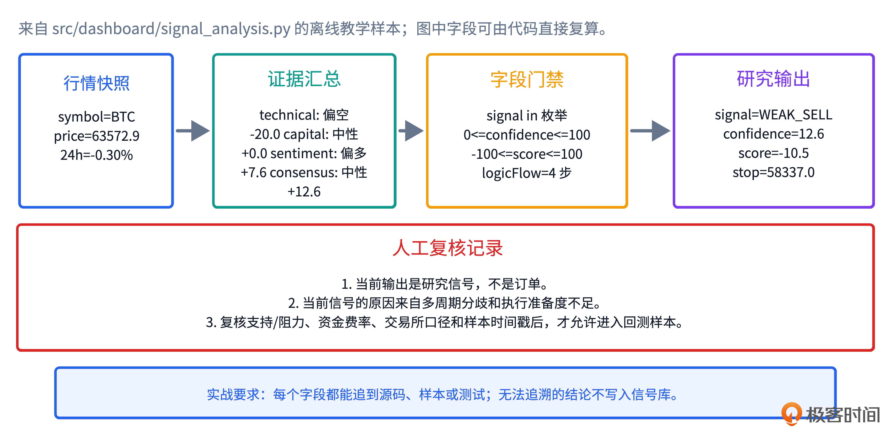
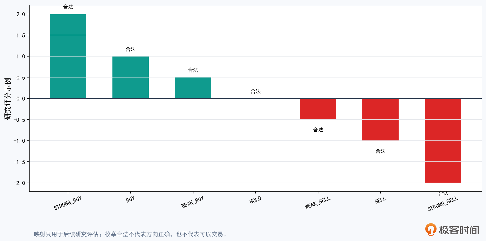
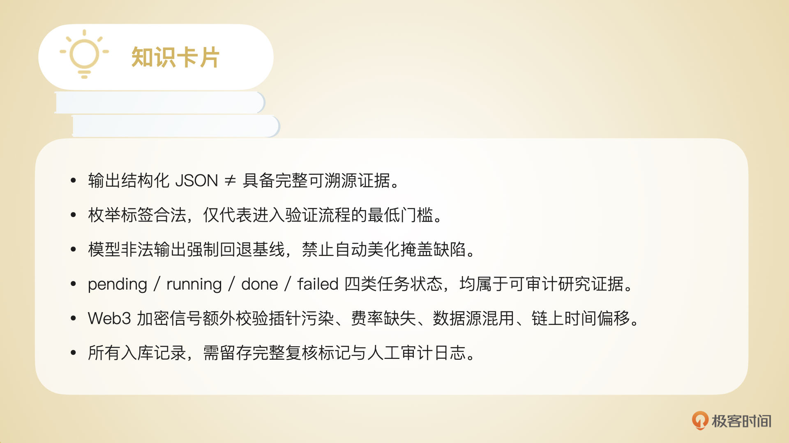

# 13 | 让LLM输出结构化交易信号

你好，我是袁从德。

第 12 讲我们完成了模型标准化输入搭建，这节课我们将聚焦模型输出层工程约束。市场上下文准备完成后，不能直接将“偏多”“谨慎观望”“可逢低关注” 这类自然语言定性结论作为标准化研究信号，所有模型判断必须收敛至固定枚举标签、有界数值分数、可溯源证据、任务状态、失败兜底逻辑、人工复核门禁六套可校验规则。

本讲 Codex 的核心职责，并非美化模型自然语言结论，而是把“LLM 合规输出标准”固化为可自动化校验的业务契约：读取信号生成逻辑、校验字段枚举与数据 Schema、执行结构化输出边界测试，并将非法字段、运行失败、人工复核标记完整落盘归档。LLM 仅负责产出候选信号，Codex 提供程序可强制执行的约束校验，证明候选信号具备标准化消费能力。

本讲的最终交付物为一套完整结构化信号契约，实现三大能力：程序全自动解析，研究员人工复核阻断，规则基线 / 风控流程 / 审稿流程多级拦截。一份合规入库信号契约必须同时覆盖：合法枚举集合、数值上下界、证据溯源链路、任务生命周期状态、异常回退策略、Web3 专属阻断规则、人工复核结论，任意一项缺失仅能标记为模型草稿，禁止写入正式研究库。

## 1. 先构建规则基线，再定义标准化契约

不要从零设计一套理想化信号格式。本讲复用仓库已有业务文件

```
src/dashboard/signal_analysis.py：该模块读取离线测试样本，聚合 K 线行情、市
```

场情绪、资金持仓、交易执行计划四大维度数据，输出一套可被 LLM 接管、异常时自动回退的标准化基线信号。

规则基线承担两层核心作用：

- 不依赖大模型密钥、完全可复现，提供无模型干扰的客观基准。

- 为 LLM 输出划定最低合规边界：模型可在证据充足时补充推理说明，但不得篡改基线预设字段、枚举值域、风控约束。

关键边界说明：基线输出仅为离线样本驱动的计算结果，不代表我们对实时行情的主观判断，更不构成价格涨跌预测。

代码 13-1 运行当前 BTC 离线样本的规则基线。先把真实输出拿到手，再讨论字段契约。

```
$env:PYTHONPATH="src"
$env:DASHBOARD_DATA_MODE="offline"
$env:DASHBOARD_OFFLINE_SOURCE="fixture"
@'
from dashboard.signal_analysis import run_signal_analysis
payload = run_signal_analysis("BTC")
print(payload["engine"])
print(payload["signal"], payload["signalLabel"])
print(payload["confidence"], payload["score"])
print(payload["summary"])
print(payload["tradePlan"]["stopLoss"])
print(len(payload["logicFlow"]))
'@ | python -
```

- 代码 13-1　 离线 BTC 样本生成规则基线信号（可直接运行）

执行离线教学样本后，实测输出示例：

```
sandbox-rule-based
WEAK_SELL 偏空观望
12.6 -10.5
偏空观望 · 置信度 12.6% · 得分 -10 多维证据尚未形成一致方向，保持观望。
58337.0
4
```

相较于模糊的自然语言判断，结构化输出一次性明确 6 项工程关键信息：计算来源、标准化信号标签、置信强度、方向量化分、止损失效阈值、完整推理链路；同时严格区分“研究观测信号”与“实盘交易指令”。

图 13-1 将代码输出拆解为五大标准化链路：行情快照采集、多维证据聚合、字段门禁校验、标准化研究输出、人工复核归档。



- 图 13-1　BTC 结构化信号实战路径

```
⚠️ 重点提醒：本条输出 WEAK_SELL 仅由当前离线 Fixture 样本计算得出，不代表中长期行
```

- 情判断。更换数据源、样本切片、模型权重后，信号会同步变动；只要执行命令、输入样本、字段契约保持可复现，专栏无需固化单一静态市场结论。

大模型擅长生成流畅文字解释，但量化研究禁止将自然语言直接作为信号。例如“短线偏多，

```
等待突破确认”，人可主观解读，程序无法映射至 BUY/WEAK_BUY/HOLD 任一合法枚举。字
```

段契约的核心价值，就是将模糊自然语言转化为机器可校验、可统计的标准化字段。

表 13-1 是本讲使用的最小字段契约。它不追求覆盖所有交易研究场景，而是先保证输出能被解析、复核和拒绝。

字段

- 作用合法范围失败处理

```
signal
STRONG_BUY 到 STRONG_SELL 的枚举
```

- 方向标签非法时回退规则基

```
signalLabel
与 signal 语义一致
```

- 中文显示标签缺失时使用基线

```
confidence
```

- 0 到 100输出强度越界时降级复核

```
score
```

- -100 到 100方向强弱越界时人工复核

```
summary
```

- 简短解释只引用已有证据补造事实则停止

```
logicFlow
```

- 推理路径固定步骤数组不完整时不进入结

- 表 13-1　结构化交易研究信号的最小字段契约

标准合法信号 JSON 模板：

```json
{
 "engine": "llm",
 "signal": "WEAK_SELL",
 "signalLabel": "偏空观望",
 "confidence": 12.6,
 "score": -10.5,
 "summary": "多维资金、K线、情绪指标未形成多头共识，维持观望",
 "logicFlow": [
   "1. 1h级别均线拐头向下",
   "2. 永续资金费率无多头支撑",
   "3. 市场恐慌情绪小幅抬升"
 ],
 "tradePlan": {
   "stopLoss": 58337.0
 },
 "reviewFlags": []
}
```

非法输出对照样例（系统自动拦截）：

```json
{
 "signal": "BUY_NOW",
 "confidence": 130,
 "summary": "未来3小时币价将大幅上涨"
}
```

处理逻辑：非法枚举回退基线、置信度超限标记复核、摘要包含未来信息直接阻断入库。

- 关键界定：结构化信号仅作为研究观测载体，必须经过复核、实验设计后，才可进入回测或

```
人工审稿流程，严禁对接实盘下单。confidence=80 不代表上涨概率 80%，该数值仅在
```

- 独立样本外校准后才可用于概率换算。

```
confidence 与 score 职责严格拆分：
```

- confidence：模型对当前推理结论的确信强度，非涨跌概率。

- score：多空方向量化编码，非预期收益预测。拆分两个字段，从根源规避“置信度高 = 预期收益高”的常见误读。

```
summary 字段强制绑定输入证据：摘要提及“资金大幅流入”，必须可追溯至快照时间、资金
```

指标字段、数据源；若新增原始输入不存在的事实，判定为模型幻觉，直接阻断结论生成。

## 2. 搭建 JSON 多层校验门禁，约束模型输出

```
文件 src/dashboard/llm_signal.py 中常量 SIGNAL_KEYS 固化 7 类唯一合法信号枚
举：STRONG_BUY、BUY、WEAK_BUY、HOLD、WEAK_SELL、SELL、STRONG_SELL。相
```

比无约束自由文本，固定枚举可实现批量统计、批量回测、自动化复核，完全适配量化工程体系。

### 2.1 清洗模型文本，安全提取 JSON 对象

```python
代码 13-2 展示 _extract_json。它处理模型常见输出：有时模型会把 JSON 包在
Markdown 代码块里，这里先清理外层代码块，再用 json.loads 解析。
import re
import json
from typing import Any, Dict
def _extract_json(text: str) -> Dict[str, Any]:
   try:
       cleaned = text.strip()
       # 剥离markdown json代码块标记
       if cleaned.startswith("```"):
           cleaned = re.sub(r"^```(?:json)?\s*", "", cleaned)
           cleaned = re.sub(r"\s*```$", "", cleaned)
       payload = json.loads(cleaned)
       return payload if isinstance(payload, dict) else {}
   except json.JSONDecodeError:
       # JSON解析失败，直接返回空字典，触发基线兜底
       return {}
```

- 代码 13-2　通用 JSON 提取工具（含异常捕获）

JSON 解析成功仅代表输出可读，不代表信号合规。我们需明确区分“可解析 JSON”与“合格入库信号”两个概念，避免概念混淆。

### 2.2 非法枚举、超限数值强制回退基线，留存复核标记

核心原则：不自动美化模型错误，所有异常完整留痕，便于后续模型缺陷统计。代码 13-3 展

```sql
示 _merge_llm 的门禁逻辑。如果模型给出非法 signal，代码回到规则基线信号；如果
confidence 或 score 越界，代码保留基线数值，并写入 reviewFlags，提醒人工复核。
from typing import Any, List, Dict
def _bounded_number(
   val: Any,
   default: float,
   low: float,
   high: float,
   flag: str,
   review_flags: List[str]
) -> float:
   """数值边界约束，超限写入复核标记并返回默认基线值"""
   if val is None:
       return default
   try:
       num = float(val)
       if low <= num <= high:
           return num
       review_flags.append(flag)
       return default
   except (ValueError, TypeError):
       review_flags.append(flag)
       return default
def _merge_llm(baseline: Dict[str, Any], llm: Dict[str, Any], model: str) -> Dict
   merged = dict(baseline)
   review_flags: List[str] = []
   # 校验信号枚举
   SIGNAL_KEYS = {"STRONG_BUY", "BUY", "WEAK_BUY", "HOLD", "WEAK_SELL", "SELL",
   signal = str(llm.get("signal") or baseline.get("signal") or "HOLD").upper()
   if signal not in SIGNAL_KEYS:
       signal = str(baseline.get("signal") or "HOLD").upper()
       review_flags.append("INVALID_SIGNAL_FALLBACK")
   # 约束置信度、方向得分值域
   confidence = _bounded_number(
       llm.get("confidence"),
       default=baseline.get("confidence") or 0,
       low=0, high=100,
       flag="CONFIDENCE_OUT_OF_RANGE",
       review_flags=review_flags,
   )
   score = _bounded_number(
       llm.get("score") if llm.get("score") is not None else baseline.get("score
       default=baseline.get("score") or 0,
       low=-100, high=100,
       flag="SCORE_OUT_OF_RANGE",
       review_flags=review_flags,
   )
   merged.update({
       "ok": True,
       "engine": "llm",
       "signal": signal,
       "signalLabel": llm.get("signalLabel") or baseline.get("signalLabel"),
       "confidence": confidence,
       "score": score,
       "summary": llm.get("summary") or baseline.get("summary"),
   })
   # 合并基线与新增复核标记
   if review_flags:
       merged["reviewFlags"] = [*(baseline.get("reviewFlags") or []), *review_fl
   return merged
```

- 代码 13-3　业务源码：非法信号和越界数值进入复核标记

```
若模型输出非法标签 BUY_NOW、超限置信度 130，系统不会自动修正美化，而是强制复用基
线数值，并写入 reviewFlags 作为可审计的研究证据。
```

复核标记是模型评估核心指标：评估模型版本时，除方向命中率外，必须统计非法枚举、数值越界、证据缺失的触发频次。频繁触发兜底回退的模型，不能判定为具备更强行情洞察力。

## 3. 让异步任务状态可解释

结构化约束不仅作用于信号字段，同样覆盖异步分析任务状态。文件

```
src/dashboard/signal_tasks.py 将 LLM 行情分析封装为后台异步任务，定义四类互
斥状态：pending、running、done、failed。
```

前端仅展示空数据，无法区分三类场景：任务未启动、计算中、模型执行报错。标准化状态将模糊区间完全拆分：未完成仅代表计算链路运行中，不等于无行情结论；任务失败代表链路异

```
常，仅 done 状态才可读取完整信号数据。
```

### 3.1 提交任务并轮询结果

```python
代码 13-4 是 submit_task 和 poll_task 的核心路径。submit_task 创建任务并启动后
台线程；poll_task 根据任务状态返回结果、错误或进行中状态。
import threading
from dashboard.task_store import create_task, get_task, _run_task
def submit_task(symbol: str, model: str) -> Dict[str, Any]:
   task_id = create_task(symbol, model)
   # 后台守护线程执行分析逻辑
   thread = threading.Thread(target=_run_task, args=(task_id, symbol, model), da
   thread.start()
   return {"ok": True, "taskId": task_id, "status": "pending"}
def poll_task(task_id: str) -> Dict[str, Any]:
   task = get_task(task_id)
   if not task:
       return {"ok": False, "message": "task not found"}
   status = task.get("status", "pending")
   if status == "done":
       return {"ok": True, "status": "done", "data": task.get("result") or {}}
   if status == "failed":
       return {"ok": False, "status": "failed", "message": task.get("error") or
   return {"ok": True, "status": status}
```

- 代码 13-4　任务创建与状态轮询

```
任务没有完成时返回 pending 或 running，它们表示链路正在工作，不表示模型没有结
论；任务失败时返回 failed 和错误信息；任务完成时才返回 done 和 data。
```

### 3.2 用窄口测试固定边界

代码 13-5 是一个窄口测试。它只覆盖结构化信号解析和任务状态，不覆盖未来收益有效性。

```
$env:PYTHONPATH="src"
$env:DASHBOARD_DATA_MODE="offline"
$env:DASHBOARD_OFFLINE_SOURCE="fixture"
python -m pytest tests/test_llm_signal.py tests/test_signal_tasks.py -q
```

- 代码 13-5　测试命令：验证结构化信号和任务状态

```
在当前配套环境中，代码 13-5 返回 7 passed。这只说明结构化路径在当前测试范围内可工
```

作，不说明交易信号有效。

### 3.3 跑一个最小异步示例

```
代码 13-6 给出一个最小任务示例。它提交任务并轮询到 done 或 failed，适合你用来观察
```

状态转换。离线样本分析可能需要二十多秒，所以这里给 35 秒窗口；如果只给 5 秒，我们很

```python
可能会看到 running。
$env:PYTHONPATH="src"
$env:DASHBOARD_DATA_MODE="offline"
$env:DASHBOARD_OFFLINE_SOURCE="fixture"
@'
import time
from dashboard.signal_tasks import poll_task, submit_task
payload = submit_task("BTC", "deepseek-v4-pro")
task_id = payload["taskId"]
result = {"status": payload["status"]}
deadline = time.time() + 35
while time.time() < deadline and result.get("status") not in {"done", "failed"}:
   time.sleep(0.1)
   result = poll_task(task_id)
print(result.get("status"))
print((result.get("data") or {}).get("signal"))
print((result.get("data") or {}).get("engine"))
'@ | python -
```

- 代码 13-6　最小示例：提交并轮询结构化信号任务

在当前离线教学环境中，运行代码 13-6 的一次示例输出如下：

```
done
WEAK_SELL
sandbox-rule-based
```

该结果仅证明异步任务链路可完整运行、结构化字段可正常解析，不代表信号具备行情预测价值。入库前仍需复核数据源快照、证据完整性、枚举合规性，搭配多期回测样本综合评估。

## 4. 五级失败阻断机制 + Web3 加密市场专属校验规则

将信号全链路异常划分为 5 类标准化失败，每类配套固定拦截动作，杜绝系统自动掩盖缺陷、美化输出。

### 4.1 五级失败阻断机制

表 13-2 定义五类失败各自的处理方式。

失败类型

- 例子系统应对

- 非 JSON、缺少字段

格式失败

- 解析失败，记录错误

```
signal="MAYBE_BUY"
```

- 回退 baseline

枚举失败

```
confidence=130
```

数值失败

- 降级并人工复核

证据失败

- 摘要引用未提供价格停止进入结论

状态失败

- 任务异常但无错误信息标记实现问题

- 表 13-2　结构化信号的失败类型与处理方式

```
图 13-2 读取 SIGNAL_KEYS，把合法枚举映射到研究评分轴上。它帮助你区分“输出结构合
```

法”和“信号可以进入交易”这两件事。



- 图 13-2　结构化信号枚举与研究评分映射

```
补充说明：枚举仅为量化统计编码，不等于下单指令。BUY 仅用于样本分组回测，不代表
```

- “买入开仓”实盘操作。

### 4.2 Web3 加密市场专属校验规则

加密 Web3 市场存在传统股票所不具备的特殊数据风险，即使基础字段全部合规，仍需执行一层专属阻断校验。表 13-3 给出建议保留的额外阻断条件。

Web3 额外边界

- 典型表现停止线或复核动作

- 表 13-3　Web3 结构化信号的额外阻断条件

Web3 数据源统一校验极简代码片段：

```python
def check_web3_data_source(snapshot: Dict[str, Any]) -> List[str]:
   flags = []
   source_list = [
       snapshot.get("price_source"),
       snapshot.get("volume_source"),
       snapshot.get("funding_source")
   ]
   unique_source = set([s for s in source_list if s])
   if len(unique_source) > 1:
       flags.append("STOP_SOURCE_MIX")
   # 校验资金费率字段存在
   if snapshot["contract_type"] == "perpetual" and "funding_rate" not in snapsho
       flags.append("REVIEW_COST_ASSUMPTION")
   return flags
```

### 4.3 收益与命中率评估公式（仅事后评估阶段使用）

如果要讨论枚举信号与未来收益的关系，只能在事后评估阶段计算公式（13-1）：

## P

- t+h​ −​ =

## 1

## r

- ​t,h

## P

- ​t

## r

这里的

- 不能出现在信号生成上下文里。若模型生成信号时看到了未来收益，结构化输出t,h​

再合法也已经污染。

方向命中率见公式（13-2）：

## correct_direction_count

## hit_rate =

## evaluated_signals

- ​

```
hit_rate 只在固定 horizon、固定成本、固定样本切分下有意义。短样本里的高命中率，不
```

能证明模型有稳定优势，更不能替代收益、回撤、换手和成本分析。

命中率不能替代风险解释。一个模型可能方向命中率较高，但每次错判都发生在大波动时；也可能命中率普通，但止损和仓位控制让回撤更低。因此第 13 讲只定义信号契约，第 19 讲才评估收益、回撤和风险调整表现。

## 5. 入库前置人工复核标准化清单 + 审计日志模板

判断信号能否入库的核心标准：全链路可复现、异常可审计、缺陷可拦截，而非主观“看起来合理”。任意环节无法追溯源码、样本快照，禁止写入正式研究库。表 13-4 是本仓库建议的最小复核清单。

检查项

- 通过条件不通过时

```
标记 STOP_SOURCE_U
```

- 能说清数据来自 snapshot、fixture、live 或上游代理

输入可追溯

```
signal 属于 SIGNAL_KEYS
回退规则基线并写 INV
```

枚举合法

```
confidence 在 0 到 100，score 在 -100 到 100
回退基线数值并写 rev
```

数值有界

```
evidence 至少解释技术面、资金 / 筹码、情绪或共
```

证据完整

- 不进入结论，只保留草稿识中的主要来源

```
tradePlan 有失效位、目标位或明确的观望理由
```

风控可执行

- 不进入回测

```
异步任务最终为 done 或 failed，失败时有错误信
```

状态可解释

- 标记实现问题息

- 表 13-4　结构化信号入库前的最小复核清单

这张表的价值在于，把“看起来合理”改成“可复算、可拒绝、可审计”。只要某一项不能追到源码、样本或测试，我们就不应把它写成确定结论。

一条合格记录至少写清四项：输入口径、结构化字段、触发的失败标记、人工复核结论。示例格式如下：

```
symbol=BTC
source=offline fixture
signal=WEAK_SELL
confidence=12.6
reviewFlags=[]
humanReview=通过结构化入库；不升级为交易建议，等待后续样本评估。
```

标准化日志统一归档所有复核信息，后续研究者可完整复现本次入库的全部校验条件与人工判断依据。

## 总结

这节课我们搭建了一套完整可落地的 LLM 交易信号标准化契约，核心边界：结构化仅解决程序读取问题，无法直接证明信号收益稳定、可直接实盘。一份合规入库信号必须同时覆盖：固定枚举、值域约束、证据溯源、异步任务状态、异常回退逻辑、Web3 专属阻断、人工复核结论。



下一讲我们学习如何让 Codex 识别幻觉、提示泄漏与未来信息污染。如果第 13 讲没有记录非法枚举、证据缺失和失败状态，第 14 讲就无法判断污染来自模型、上下文还是验证流程。

## 思考与练习

```
理解题：为什么结构化 JSON 输出不能直接等同于可交易信号？如果模型输出 BUY_NOW
或 confidence=130，系统应如何处理？
实践题：运行代码 13-1，记录 signal、confidence、score、stopLoss 和
logicFlow 长度；运行代码 13-5，记录测试结果；运行代码 13-6，观察任务状态最终是
done 还是 failed；写一份结构化信号契约，包含合法枚举、数值范围、证据引用和失败
```

- 处理。

期待你的分享。如果今天的课程让你有所收获，也欢迎转发给有需要的朋友，邀请他来一起学习，我们下节课再见！
