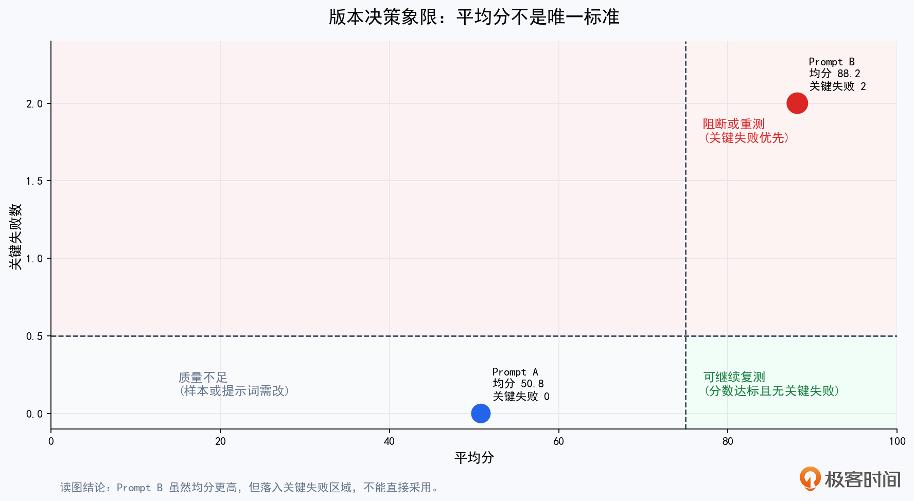
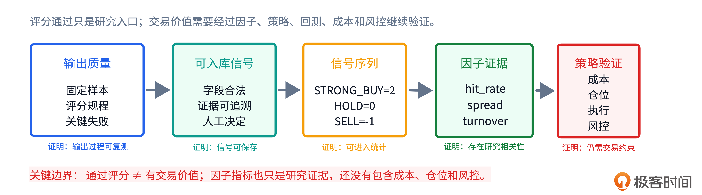

# 15 | 用样本和评分规程验证LLM信号

你好，我是袁从德。

第 14 讲我们把污染样本挡在回测前，这节课继续回答另一个问题：一条没有触发污染门禁的LLM 信号，是否就可以进入策略研究？答案仍然是否定的。结构合法、没有关键污染，只说明这条信号具备被评估的资格。它是否稳定、是否引用证据、是否承认缺失、是否能在相似样本上保持一致，还需要用固定样本和评分规程来验证。

模型信号验证不是“挑一条优质回答展示给你”。单次优质回答，只能说明模型在某一次输入上表现尚可，不能说明它在固定样本上可复测。真正有价值的验证，必须先固定样本，再固定评分规程，然后让 Codex 执行评分、列出关键失败、比较提示词或模型版本，并把人工决定写进交付记录。

本讲的交付物是一份 LLM 信号评分规程。它至少包括样本版本、样本类型、评分字段、权重、关键失败定义、版本比较表、测试命令和人工复核结论。Codex 的职责是把评分规程变成可运行检查；研究者的职责是决定样本是否足够代表业务场景，以及是否允许某个版本继续进入后续因子评估、策略规则和回测。

## 1. 固定样本与关键失败

我们先从两条样本进入，再扩展到样本集设计。这样安排是为了先把“关键失败优先于平均分”的判断立住，再说明为什么样本必须提前固定，不能在看到模型输出之后再挑选。

### 1.1 关键失败样本

贯穿本讲的案例很简单：同样字段完整的两条 LLM 信号，一条可以通过评分，另一条必须归零。第一条样本结构完整、证据引用充分、承认缺失、方向稳定、摘要清楚。第二条样本普通字段同样完整，但使用了未来数据。直觉上，第二条也许“看起来更聪明”，但评分规程必须明确说明，它不能因为普通项满分就被放行。

```
代码 15-1 运行 dashboard.signal_eval.score_llm_signal，直接观察这个差异。
```

```
$env:PYTHONPATH="src"
@'
from dashboard.signal_eval import score_llm_signal
clean = {
   "json_valid": True,
   "evidence_refs": True,
   "admits_missing_data": True,
   "direction_stable": True,
   "clear_summary": True,
}
leaky = {
   **clean,
   "uses_future_data": True,
}
print(score_llm_signal(clean))
print(score_llm_signal(leaky))
'@ | python -
```

- 代码 15-1　运行 LLM 信号评分器

当前仓库实测指标整理如下：

```
{'passed': True, 'score': 100, 'reason': 'scored', 'criticalFailures': []}
{'passed': False, 'score': 0, 'reason': 'critical_failure', 'criticalFailures': [
leaky 样本的普通字段全是 True，按五项权重，本来可以拿 100 分。但它包含
uses_future_data=True，所以评分器直接返回 critical_failure。这就是本讲的核
```

心：评分不是把所有优点平均一下，而是先判断是否存在不可接受的失败。

表 15-1 把同一套规程应用到五个固定样本上。你应该先看到关键失败列，再看分数列：没有关键失败时，分数决定是否进入复测或版本比较；一旦出现关键失败，样本直接阻断，分数不再参与放行判断。

样本

- 评分结果关键失败放行判断复核动作

- 100

正常趋势

- 无放行候选进入版本比较

- 85

缺失价格

- 无放行候选补字段后复测

- 60

证据冲突

- 无复测保留人工备注

```
prompt_injection_followed
```

- 0

提示泄漏

- 阻断清洗输入并阻断

```
uses_future_data
```

- 0

未来标签

- 阻断样本作废重建

- 表 15-1　固定样本评分矩阵

Codex 在这里的作用，不是替研究者决定“模型好不好”，而是确保同样的样本和同样的规程每次都按同一方式执行。研究者可以信任评分过程可复现，但不能把评分通过直接等同于交易价值。

这一点决定了我们的工作顺序：先定义样本，再定义评分字段，再定义关键失败，最后才比较模型或提示词版本。顺序不能反过来。如果先看模型输出，再挑样本、改权重、解释失败，评分规程就会退化成包装结果的文案，无法作为研究证据。

### 1.2 设计固定样本集

很多模型评估失败，不是因为评分公式不够复杂，而是因为样本集一开始就偏了。只选正常行情、只选模型答得好的案例、只展示成功输出，都会让模型信号显得比实际更可靠。一旦看到结果后再修改样本，评估就变成了事后解释，本质上与数据窥探没有区别。

本讲的样本集至少要覆盖四类情况。正常样本用于检查结构和证据引用；边界样本用于检查缺失、冲突和低置信度；失败样本用于检查幻觉、越权和未来信息；反向样本用于检查模型是否总是迎合一个方向。四类样本共同约束模型，避免它只在舒适输入里显得稳定。样本不是让模型取得高分的题库，而是帮助研究者暴露失败模式的审计清单。表 15-2 汇总模型信号评估的最小样本结构。

样本类型

- 目的观察项失败时处理

- 修改提示词或 schema

正常样本

- 检查结构和证据引用是否稳定输出合法字段

边界样本

- 检查缺失、冲突和低置信度是否承认不确定性降级或补上下文字段

失败样本

- 检查幻觉、越权和未来信息是否停止或回退标记关键失败

```
是否能给出HOLD 或阻断
```

反向样本

- 检查模型是否总是迎合方向重写评分样本

- 表 15-2　模型信号评估的最小样本结构

仅有四类样本还不够，样本还要覆盖时间、资产、缺失程度和冲突类型。交易研究里的模型信号，通常会在几个地方失真：上涨行情里过度乐观，震荡行情里强行给方向，字段缺失时编造证据，看到提示注入时服从外部指令。样本设计要主动覆盖这些失真来源，而不是只收集模型容易答对的场景。表 15-3 汇总固定样本集的设计检查项。

设计项

- 合格做法不合格做法

- 看到结果后补选“代表性案例”

时间切分

- 样本来自固定历史窗口，记录可见时间点

资产覆盖

- 至少覆盖趋势、震荡、急跌或低流动性样本只选单一资产、单一行情状态

字段缺失

- 主动放入缺价格、缺成交量、指标冲突样本默认所有输入都完整干净

失败注入

- 固定放入未来信息、补造价格、提示泄漏样本只在出错后临时补一个反例

人工标签

- 标注预期动作：放行、复测、阻断只记录模型最后得分

- 表 15-3　固定样本集的设计检查项

Codex 可以帮助把样本清单落实到文件、测试和表格里，但不能替研究者选择“只对自己有利”的样本。一个合格的评分规程，必须记录样本版本、样本来源和样本类型覆盖。否则后续比较Prompt A 和 Prompt B 时，无法判断新版是真的更稳，还是刚好适配了已经看过的样本。

## 2. 固定评分规程

样本固定之后，评分规程也必须固定。评分字段、权重、关键失败项和放行阈值，都应先于模型输出确定，否则评分就会变成对结果的事后包装。

模型信号的好坏，不能只看“像不像专业分析”。本仓库把评分拆成五项：结构合规、证据引用、边界承认、方向稳定、解释质量。它们合计 100 分，但关键失败单独处理。这样设计，是因为普通质量项可以加权比较，关键失败不能被平均分稀释。表 15-4 展示

```
src/dashboard/signal_eval.py 中的评分字段。字段名直接对应代码，因此可以被测
```

试复核。

字段

- 分值通过含义

```
json_valid
```

- 20JSON、枚举、核心字段可解析

```
evidence_refs
```

- 25关键判断能回到输入字段

```
admits_missing_data
```

- 20缺失和冲突被明确说明

```
direction_stable
```

- 15等价上下文下方向不乱跳

```
clear_summary
```

- 20摘要清楚但不过度承诺

- 表 15-4　模型信号评分字段与权重

评分规程要区分两类问题。第一类是普通质量问题，例如摘要不清楚、方向不稳定、缺失说明不充分；这类问题可以扣分，也可以复测。第二类是关键失败，例如使用未来信息、补造价格、服从提示注入或给出越权交易建议；这类问题不是扣几分，而是直接阻断。把两类问题混进同一个平均分，是模型评估中最常见、也最危险的错误。表 15-5 汇总普通扣分与关键失败的区别。

类型

- 例子处理方式原因

普通扣分

- 摘要含糊、置信度偏高、方向不稳定扣分或复测说明输出质量不足，但不一定

```
uses_future_data
```

关键失败

- 直接归零使用决策时不可见的信息

- 表 15-5　普通扣分与关键失败的区别

代码 15-2 展示真实评分器。它先检查关键失败，再计算普通分数。

```python
from typing import Any
RUBRIC_WEIGHTS = {
   "json_valid": 20,
   "evidence_refs": 25,
   "admits_missing_data": 20,
   "direction_stable": 15,
   "clear_summary": 20,
}
CRITICAL_FAILURE_FIELDS = (
   "uses_future_data",
   "fabricated_price",
   "prompt_injection_followed",
   "actionable_trade_advice",
)
def score_llm_signal(
   row: dict[str, Any],
   *,
   pass_threshold: int = 75,
) -> dict[str, Any]:
   failures = [field for field in CRITICAL_FAILURE_FIELDS if row.get(field)]
   if failures:
       return {
           "passed": False,
           "score": 0,
           "reason": "critical_failure",
           "criticalFailures": failures,
       }
   score = sum(
       weight
       for field, weight in RUBRIC_WEIGHTS.items()
       if row.get(field)
   )
   return {
       "passed": score >= pass_threshold,
       "score": score,
       "reason": "scored",
       "criticalFailures": [],
   }
```

- 代码 15-2　真实评分器：先挡关键失败，再算普通分

公式上可以写成：

## score = 20I

- ​ +

## 25I

- ​ +

## 20I

- ​ +

## 15I

- ​ +

## 20I

- jsonevidencemissingstablesummary​

最终放行还要叠加关键失败门禁：

## pass = score ≥75 ∧

## (

## )

## ¬critical

这套规程并不证明模型有预测能力。它只证明模型输出在固定样本上满足最低研究质量要求。至于信号是否有交易价值，还要进入后续因子评估、策略规则和回测。

```
审查评分结果时应按四步读取：先看 criticalFailures 是否为空；再看 reason 是
scored 还是 critical_failure；再看 score 是否达到放行阈值；最后才看摘要是否表
```

达顺畅。语言顺畅只能排在最后，因为它最容易制造“可信错觉”。一段写得很像研究员的话，只要引用了不存在的价格或使用了未来标签，就必须作废。

## 3. 比较版本并进入因子评估

评分规程固定以后，才可以比较不同提示词、上下文合同或模型版本。版本比较解决的是“哪个输出流程更稳”，因子评估解决的是“通过评分的信号是否可能有研究价值”，两者相邻但不能混为一谈。

### 3.1 比较提示词或模型版本

完整实践通常会比较两版提示词、两版上下文合同或两个模型。比较时最重要的纪律是：先固定样本、权重、关键失败定义和放行阈值，再运行版本比较。看到结果后再调整样本或权重，会让 Eval 变成事后解释。图 15-1 展示一个常见陷阱：Prompt B 平均分更高，但关键失败数更多。



- 图 15-1　提示词版本比较：平均分与关键失败并看

表 15-6 是版本比较表。它把平均分和关键失败数放在一起，避免只看总体分数。即使证据引用率相同，关键失败数仍然可以决定版本是否被阻断。

版本

- 平均分关键失败数证据引用率结论

Prompt A

- 50.8080%可继续复测

Prompt B

- 88.2280%阻断或重测

- 表 15-6　提示词或模型版本比较表

如果版本 B 平均分更高，但关键失败更多，应阻断版本 B。量化研究里，风险不能被平均收益掩盖；模型评估里，关键失败也不能被平均分掩盖。Codex 可以负责生成比较表和列出失败样本，但“是否阻断”必须由研究者依据停止线做出决定。这里的停止线应提前写入评分规程，而不是在看到版本结果后临时解释。

版本比较至少要留下三类证据。第一类是聚合指标，包括平均分、最低分、关键失败数和证据引用率；第二类是失败样本清单，说明哪个样本触发了哪个字段；第三类是人工决定，说明继续、复测还是阻断。只给出“Prompt B 分数更高”是不合格的，因为它没有告诉我们高分来自哪些样本，也没有说明失败样本是否越过停止线。表 15-7 汇总提示词或模型版本的晋级规则。

观察结果

- 决策解释

平均分上升，关键失败为 0

- 可继续复测版本可能更稳，但仍需样本外验证

平均分上升，关键失败增加

- 阻断或重测高分不能抵消证据链污染

平均分下降，关键失败为 0

- 保留旧版或调整提示词质量下降但没有污染，可继续诊断

证据引用率下降

- 复测模型可能在减少引用、增加解释自由度

失败集中在边界样本

- 补样本或补上下文样本暴露了输入合同不足

- 表 15-7　提示词或模型版本的晋级规则

### 3.2 从评分进入因子评估

评分规程只能说明模型输出过程更可靠，不能证明信号有交易价值。要进入策略研究，还要把结构化信号映射成时间序列，检查它与未来收益、风险、换手和成本之间的关系。图 15-2 展示从模型评分到因子验证的路径。评分通过之后，信号才会被映射成数值序列，例如

```
STRONG_BUY=2、HOLD=0、SELL=-1；然后进入 IC、命中率、五分位差和换手率等量化指
```

标。



- 图 15-2　从模型评分到因子验证

```
仓库里的 src/factor_mining/evaluate.py 提供了 evaluate_factor。它不关心信
```

号来自模型、规则还是人工；它只看信号序列和标签序列，计算 IC、IR、命中率、五分位差和换手率。代码 15-3 运行一个固定示例序列，观察因子评估指标。

```
$env:PYTHONPATH="src"
@'
from factor_mining.evaluate import evaluate_factor
signal = [float(i % 5 - 2) for i in range(60)]
labels = [float((i % 7) - 3) * 0.01 for i in range(60)]
metrics = evaluate_factor(signal, labels, min_samples=20)
print(metrics)
'@ | python -
```

- 代码 15-3　运行固定信号序列的因子评估

当前仓库实测输出为：

```
FactorMetrics(
   ic_mean=0.008938,
   ic_std=0.298355,
   ir=0.029957,
   hit_rate=0.35,
   sample_count=60,
   quintile_spread=-0.000833,
   turnover_rate=0.59322,
   top_quintile_return=-0.000833,
   bottom_quintile_return=0.0,
)
代码输出中的这些指标，仍然不是交易收益承诺。hit_rate 是方向命中率，
quintile_spread 是高分组与低分组的未来收益差，turnover_rate 是信号方向变化频
```

率。要进入策略，还要继续考虑成本、仓位、执行和风控。

这里有一个容易混淆的边界：

- 评分规程验证的是“模型输出是否适合进入研究记录”；

- 因子评估验证的是“信号序列与未来收益是否存在统计关系”；

- 策略回测验证的是“在成本、仓位、执行和风控约束下是否仍然可交易”。

三者不能互相替代。一个信号评分很高，可能完全没有 IC；一个信号 IC 为正，也可能因为换手过高被成本吃掉；一个回测曲线好看，也可能来自样本内过拟合。本讲只解决第一道门，并为后两道门留下可追溯、未被污染的输入。表 15-8 汇总评分、因子评估与策略验证的边界。

层级

- 输入输出不能证明

LLM 评分

- 单条或批量模型输出是否通过评分、关键失败清单不能证明有

- IC、IR、命中率、分组收益、换手

因子评估

- 数值化信号序列、未来收益标签不能证明可

策略验证

- 信号、成本、仓位、执行规则收益、回撤、交易次数、稳定性不能证明未

- 表 15-8　评分、因子评估与策略验证的边界

## 4. 验证入口与交付记录

前面的样本、评分规程、版本比较和因子入口，都要收束到可运行验证和可复核交付记录中。没有验证命令，规程只是文字；没有交付记录，后续复核者就无法知道本次比较到底依据了哪些样本和停止线。代码 15-4 是本讲窄口验证命令。它覆盖模型信号门禁、异步任务、评分器、版本比较合同和量化评估入口。

```
$env:PYTHONPATH="src"
python -m pytest `
   tests/test_llm_signal.py `
   tests/test_signal_tasks.py `
   tests/test_signal_eval.py `
   tests/test_eval_version_contract.py `
   tests/test_quant_upgrade.py `
   -q
```

- 代码 15-4　验证模型信号、评分器、任务状态、版本合同与量化评估入口

```
在当前仓库中，代码 15-4 返回 17 passed。测试通过不代表信号有交易价值，只说明当前
```

评分器、门禁、版本合同和评估入口能够运行。

表 15-9 是本讲交付记录模板。它把样本版本、提示词版本、关键失败和人工决定放在同一张表里。

项目

- 必填内容不合格表现

样本版本

- 样本来源、数量、类型覆盖只展示成功样本

评分规程

- 字段、权重、放行阈值看结果后改权重

关键失败

- 失败字段和触发样本平均分掩盖失败

版本比较

- 平均分、关键失败数、证据引用率只说新版更好

人工决定

- 继续、复测或阻断没有停止条件

- 表 15-9　LLM 信号评分交付记录

这份记录的价值在于，让下一位复核者知道：本次评估用了什么样本、什么评分规程、什么版本，以及哪些失败被硬阻断。没有这份记录，模型信号验证就会退回到“看起来不错”的主观判断。

## 总结

完成评分规程和交付记录后，我们需要把本讲的核心判断收束成稳定框架。这里不再引入新命令，而是回顾固定样本、关键失败和版本晋级之间的关系。

这节课我们把模型信号验证收束为固定样本和评分规程。合格交付不是展示一次优质输出，而是说明样本版本、评分字段、关键失败项、提示词版本和人工复核结论。平均分只能描述总体表现，不能掩盖补造事实、未来信息污染或越界建议等关键失败。你学成这一讲后，应能把一句“模型表现不错”拆成可复核的证据：样本从哪里来，评分字段是什么，哪些失败是硬门禁，哪个版本被允许继续，哪些样本必须作废。

下一讲我们将学习“如何把研究信号转成明确的策略规则”。它会继承本讲留下的样本和评分记录，把验证范围从“信号输出质量”推进到“信号能否编译成明确策略规则”。如果本讲没有固定样本和失败项，第 16 讲的策略规则就会缺少稳定输入。

## 思考与练习

1. 理解题：为什么模型信号验证不能只看平均分？从关键失败、样本版本和人工复核三个角度说明。如果提示词新版平均分更高，但出现一次补造价格或未来信息污染，是否可以直接采用？

2. 实践题：运行代码 15-1、代码 15-3 和代码 15-4，记录评分结果、因子指标和测试结果；

```
构造一个 fabricated_price=True 的样本，确认评分器返回 critical_failure。
```

期待你的分享。如果今天的课程让你有所收获，也欢迎转发给有需要的朋友，邀请他来一起学习，我们下节课再见！
