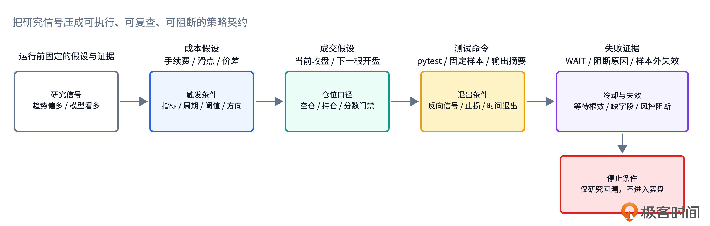
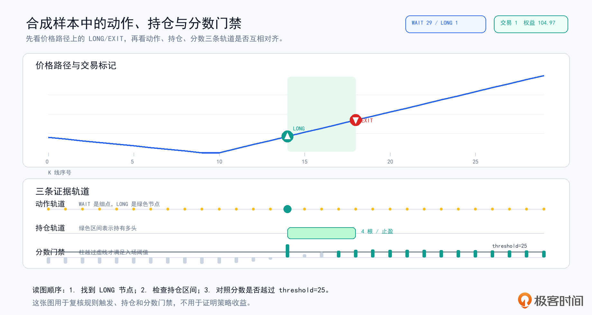
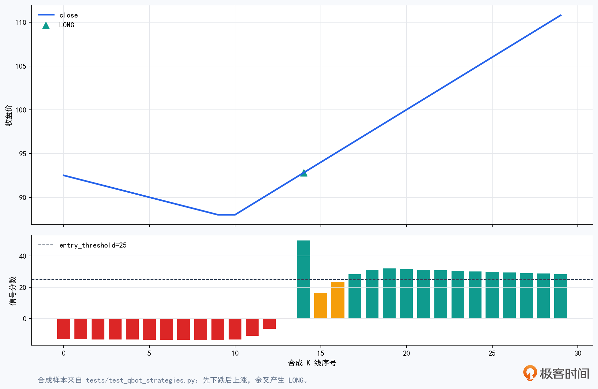
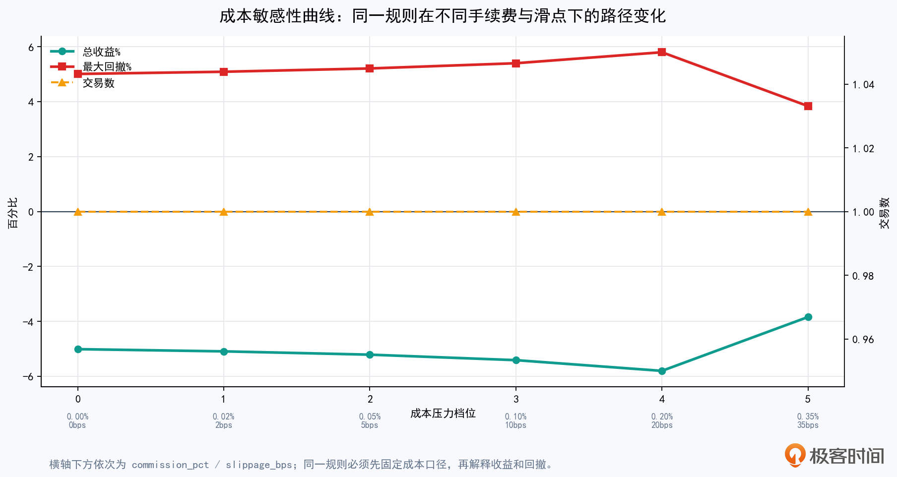

# 16 | 把研究信号写成明确的策略规则

你好，我是袁从德。

第 15 讲我们验证了信号是否干净、稳定、可复测。这节课继续追问：它能不能变成引擎逐根

```
执行的动作。“看多”不是 LONG，LONG 也不是已经成交。只有触发、仓位、退出、冷却、失
```

效、停止、成本和成交假设都写清楚，研究信号才真正进入策略层。

在这一步里，Codex 不替研究者发明策略，而是把自然语言信号收束成可执行规则：检查策略函数，补齐触发和停止条件，运行规则测试，并确认模型文字没有绕过成本、仓位和失败条件。LLM 可以提供候选解释，最终交付必须落成可复查的策略契约。

本讲会用两条交叉类策略做对照：一条从价格窗口计算均线，一条依赖指标序列生成 MACD金叉信号。两者的技术细节不同，但进入策略层前都要回答同一个问题：规则在每根 K 线上能不能给出一致、可复查、经得起失败检验的动作。

## 1. 策略规则卡：先把研究语言降成契约

从信号进入策略层，第一步不是讨论“模型看多怎么交易”，而是确认信号能否被写成确定条件。回测引擎需要在每根 K 线上回答：现在是否入场，入多少，何时退出，遇到异常是否停止。

```
本讲的代码包括 src/backtest/rolling/strategies/、
src/backtest/rolling/engine.py、tests/test_qbot_strategies.py 和
tests/test_project.py，这些文件会在正文中逐步展开。
```

表 16-1 先给出策略规则卡的最小内容，也为后续代码实现提供审查边界。

规则项

- 记录内容常见模糊表达可执行写法

```
prev_fast <= prev_slo
```

触发

- 指标、周期、阈值、交叉方向趋势较好就买

```
slow_ma
action=LONG 且分数达到阈
```

仓位

- 固定仓位、比例仓位或风险预算适当买一点

退出

- 止损、止盈、反向信号、时间退出不对就走死叉、止损或最大持仓根数

- N 根 K 线内不重复开仓

冷却

- 连续交易后的等待根数看情况再进

失效

- 数据缺失、异常波动、滑点过高市场异常时停缺字段或风险钩子阻断

停止条件

- 真实账户、自动下单、越权建议直接执行仅研究回测，不进入实盘

- 表 16-1　策略规则卡的最小内容

规则卡不是为了写得完整好看，而是为了让每一个模糊词都有落点。“趋势较好”必须落到某个指标、窗口和阈值；“适当买一点”必须落到动作和仓位口径；“不对就走”必须落到退出规则；“市场异常”必须落到失效或风险阻断。不能落到这些字段的句子，应留在研究假设里，不能进入回测实现。

### 1.1 可执行规则的审查口径

策略契约的关键不是字段数量，而是字段之间能不能闭合。触发条件要说明指标如何计算；仓位口径要说明当前空仓和已有持仓时如何处理；退出条件要说明是平仓、等待还是反手；冷却和失效条件要说明系统何时拒绝继续生成动作；停止条件要说明研究沙盒不能越界到真实交易。

审查问题

- 合格回答不合格回答

```
只使用 idx 及以前的价格、指标和状态
```

当前 K 线可见什么

- 用未来收益确认当前信号

动作从哪里来

- 由固定指标、阈值和交叉方向生成由模型解释临时判断

分数有什么用

- 只作为入场阈值或排序依据分数高就默认已经成交

```
新 LONG 重复开仓
```

已有持仓怎么办

- 继续持有、退出或阻断都有分支

```
返回 WAIT、阻断原因或审计记录
```

失败如何记录

- 跳过失败样本，只展示成功交

- 表 16-2　策略规则卡的审查表

研究报告里的常见词汇还要翻译成动作枚举，不能把解释性语言直接交给引擎。

研究语言

- 策略层翻译回测引擎实际需要

```
action="LONG" 或 WEAK_LONG
```

看多

- 动作枚举、分数、阈值

```
action="WAIT"
```

观望

- 不开仓、不加仓、可记录分数

转弱

- 死叉、负分或退出候选是否平仓、是否反手、是否等待

风险大

- 风险规则或钩子阻断阻断原因、规则编号、审计记录

暂停策略

- 停止条件或冷却期暂停范围、持续时间、恢复条件

- 表 16-3　研究语言到策略动作的翻译

成熟回测框架虽然接口不同，但对策略规则的约束很接近。QuantConnect 的 AlgorithmFramework 会把 insight、组合构建、执行和风控拆成不同模型；Backtrader 把策略逻辑放在

```
逐 bar 调用的 next() 里，再通过 broker、commission 和 slippage 模型处理成交现实；
```

Zipline / Zipline Reloaded 也把 commission 和 slippage 作为回测现实模型的一部分。把这些做法翻译到本专栏，就是三条硬规则：

1. 信号不越级。研究信号只能先变成策略信号，不能直接变成成交记录。

2. 执行另有模型。订单是否成交、以什么价格成交、承担多少成本，必须由成交和成本假设处理。

3. 风控独立验收。仓位、止损、暂停和阻断不能藏在一句“模型看多”里，要有独立字段和失败记录。

这些资料不是为了把本讲写成框架比较，而是提醒一个工程事实：越成熟的回测系统，越不允许把研究解释、交易动作、成交现实和风险控制混成一层。策略规则卡正是这条分层原则的课程化表达。

图 16-1 把规则卡画成从触发、仓位、退出、冷却到停止的路径。它提醒我们：策略不是只有入场，退出和停止同样是规则的一部分。



- 图 16-1　策略规则卡

图 16-1 的重点不是增加字段，而是补齐闭环。没有退出、等待、失效和停止条件的规则，只能作为研究想法，不能进入严肃回测。

### 1.2 ma_crossover 规则卡样例

一张合格规则卡还要写清“谁负责判断”。Codex 可以把规则项落到代码和测试，不能替研究者决定“均线窗口为什么用 5/10 而不是 10/20”；回测引擎可以按规则执行，不能替研究者解释收益是否稳健；LLM 可以生成候选逻辑，不能绕过规则卡直接生成交易动作。

```
代码 16-1 是一份可直接复用的 ma_crossover 规则卡样例。它不是策略结论，而是把研究
```

信号固定成回测前的契约。其他 LLM 信号也应先改写成同样格式，再进入实现或检查。

```
strategy_key: ma_crossover
research_signal: "短均线重新站上长均线，趋势由弱转强"
data_window:
 symbol: BTC teaching sample
 frequency: 1d
 visibility: "只能读取当前 K 线及以前"
parameters:
 fast_period: 5
 slow_period: 10
 entry_threshold: 25
entry_rule:
 condition: "prev_fast <= prev_slow and fast_ma > slow_ma"
 action: LONG
 extra_gate: "当前空仓且 score >= entry_threshold"
exit_rule:
 condition: "prev_fast >= prev_slow and fast_ma < slow_ma"
 action: WAIT
 meaning: "多头退出候选，不自动做空"
invalid_state:
 - "idx < slow_period -> WAIT"
 - "缺少 close -> 不生成交易动作"
execution_assumptions:
 commission_pct: "运行前固定"
 slippage_bps: "运行前固定"
 fill_timing: "不得使用未来 K 线确认当前成交"
tests:
 - "tests/test_qbot_strategies.py::test_ma_crossover_golden_cross_produces_long_
 - "tests/test_qbot_strategies.py::test_ma_crossover_boundary_does_not_read_last
 - "tests/test_project.py::test_event_driven_engine_uses_on_tick_strategy"
代码 16-1　ma_crossover 策略规则卡样例
```

这份规则卡有两个作用。对实现者来说，它限定了不能自由发挥的地方：死叉不能被解释成做空，窗口不足时不能补造信号。对复核者来说，它给出了检查入口：参数是否被改动，成交时点是否前视，成本假设是否和报告一致，测试是否覆盖触发条件。

规则卡没有写“预期收益”，这是刻意的。规则卡冻结的是研究动作，不是收益承诺；它回答“怎么执行”和“何时停止”，不回答“未来是否赚钱”。如果把收益目标写进规则卡，Codex 很容易被诱导去调窗口、改阈值或改样本，让规则适配目标结果。收益评估应留到回测和稳健性讲次，用固定规则去检验，而不是倒过来用收益改写规则。

```
macd_crossover 是同一思想的第二个案例。它不直接从 close 序列计算短长均线，而是
依赖 IndicatorSeries 中的 macd_line 和 macd_signal：当 MACD 线从下向上穿过
信号线时生成 LONG，从上向下穿过时生成 WAIT，没有可用指标或没有交叉时保持等待。这
```

个对照案例补充了三个判断点：

1. 数据来源不同，契约字段不变。均线案例的输入是价格窗口，MACD 案例的输入是预先计算的指标序列，但两者都必须写清触发、退出、窗口不足和停止条件。

```
共享规则不等于共享策略。long_only_cross_signal() 可以复用，但
ma_crossover 和 macd_crossover 的指标来源、参数空间和边界测试不同，不能只因
```

- 为都叫“金叉”就混成一个策略。

```
等待状态是有效动作。MACD 指标缺失、当前索引越界或没有交叉时返回 WAIT，这不是
```

- “没有结果”，而是策略明确拒绝交易。能说清什么时候不交易，是规则卡最容易被忽略的价值。

因此，本讲不是只教一条均线规则，而是借两类交叉策略说明同一个工程原则：研究语言先降成契约，契约再进入策略函数，随后才进入回测证据链。

## 2. 代码落点：把契约放进策略函数和状态机

规则卡写完后，我们进入代码层：确认每个字段都能在策略函数、引擎状态和测试里找到落

```
点。仓库中已有 ma_crossover、macd_crossover、boll_mean_reversion、
adx_macd_trend 等策略样本，它们都比“看多买入”更明确。这里重点查看共享规则、均线
```

策略入口和 rolling 引擎的状态判断。

### 2.1 共享规则函数

```python
代码 16-2 是 src/backtest/rolling/strategies/qbot_rules.py 中的共享规则。
crossed_up 和 crossed_down 是布尔条件，long_only_cross_signal 把条件转成
LONG 或 WAIT。
def crossed_up(prev_a: float, prev_b: float, cur_a: float, cur_b: float) -> bool:
   return prev_a <= prev_b and cur_a > cur_b
def crossed_down(prev_a: float, prev_b: float, cur_a: float, cur_b: float) -> boo
   return prev_a >= prev_b and cur_a < cur_b
def long_only_cross_signal(
   *,
   crossed_up_flag: bool,
   crossed_down_flag: bool,
   entry_score: float = 50.0,
   exit_score: float = -50.0,
) -> Signal | None:
   if crossed_up_flag:
       return Signal(action="LONG", score=entry_score)
   if crossed_down_flag:
       return Signal(action="WAIT", score=exit_score)
   return None
```

- 代码 16-2　Qbot 风格均线交叉规则

```
这里没有“看起来趋势不错”这样的自然语言。规则只有三种结果：金叉给 LONG，死叉给
WAIT，没有交叉就返回空，由策略入口继续处理。
这段共享规则还体现了一个重要边界：本仓库里的 ma_crossover 是 long-only 规则。金叉
进入多头，死叉回到等待或退出候选，并不自动做空。如果把“趋势转弱”直接写成 SHORT，就
```

已经改变了策略定义。策略规则卡必须记录这种方向边界，否则后续回测会把两个不同策略混在一起比较。

```
同一共享规则也被 macd_crossover 使用，但它的输入不是均线窗口，而是
macd_lines_at(indicators, idx) 返回的当前 MACD、当前 signal line、上一根
MACD 和上一根 signal line。这里有一个实战判断：如果 indicators is None，或者当前
索引拿不到完整 MACD 线，策略必须返回 WAIT，不能根据价格走势临时补一个方向。这个
```

分支看起来保守，却能防止“指标缺失时模型凭感觉补交易”的错误。

把两个案例并排看，规则卡还要多问三句：

```
指标是策略内部现算，还是由外部 IndicatorSeries 提供？
```

2. 指标不可用时是等待、报错，还是阻断整次回测？

3. 共用交叉函数后，策略自己的参数、阈值和测试是否仍然独立？

### 2.2 逐 K 线信号生成

共享规则只是第一层，真正进入回测前，还要确认它如何在每根 K 线上生成动作。代码 16-3

```
截取 src/backtest/rolling/strategies/ma_crossover.py 的核心逻辑：先处理窗
```

口不足，再只读取当前索引及以前的 K 线，最后把交叉条件交给共享规则。

```python
def generate_signal(self, candles, idx, params, indicators=None) -> Signal:
   fast_period = int(params.get("fast_period", 10))
   slow_period = int(params.get("slow_period", 30))
   if idx < slow_period:
       return Signal(action="WAIT", score=0.0)
   closes = [float(candles[i]["close"]) for i in range(idx - slow_period, idx +
   fast_ma = sma_at(closes, fast_period)
   slow_ma = sma_at(closes, slow_period)
   prev_closes = [float(candles[i]["close"]) for i in range(idx - slow_period, i
   prev_fast = sma_at(prev_closes, fast_period)
   prev_slow = sma_at(prev_closes, slow_period)
   cross_signal = long_only_cross_signal(
       crossed_up_flag=crossed_up(prev_fast, prev_slow, fast_ma, slow_ma),
       crossed_down_flag=crossed_down(prev_fast, prev_slow, fast_ma, slow_ma),
   )
   if cross_signal is not None:
       return cross_signal
   return Signal(
       action="WAIT",
       score=separation_score(fast_ma - slow_ma, slow_ma),
)
代码 16-3　ma_crossover 的逐 K 线信号生成
```

这段代码有三层边界：

```
idx < slow_period 时等待，避免指标窗口不足。
```

2. 只读取当前索引及以前的 K 线。

3. 交叉出现时才产生明确动作；没有交叉时，不靠语言解释补动作。

```
逐根 K 线执行的含义，是每一个 idx 只能看到 idx 及以前的数据。prev_closes 判断上一
根 K 线的均线关系，closes 判断当前 K 线的均线关系，两者共同构成交叉。这个写法看似
```

啰嗦，却正是策略可信的来源：规则不是事后看完整走势再解释，而是在每个时点用当时可见的信息作出动作。

```
macd_crossover 的逐 K 线流程更短，但审计点更集中：它先确认指标序列存在，再通过
macd_lines_at() 取得当前和上一根 MACD / 信号线，随后把交叉判断交给
macd_cross_flags() 和 long_only_cross_signal()。如果没有指标、索引越界或指
标值为空，策略返回 WAIT。这个案例说明，策略规则不一定都要自己计算指标，但必须说明
```

外部指标不可用时的处理方式。

两个案例的实战差异可以这样记：

```
ma_crossover 的风险主要在窗口边界，尤其是不能把最后一根 K 线误读成上一窗口。
macd_crossover 的风险主要在指标依赖，尤其是不能在指标缺失时补造交易方向。
```

- 两者共同的规则边界是 long-only：金叉是入场候选，死叉是等待或退出候选，不自动变成做空。

均线穿越可以表达为可检查的布尔条件：

## (

- long)

## (

- long)shortshort​ =​ ≤MA​ > MA

## ∧

## crossed_up

## MA

## MA

- t−1t−1ttt​​

对应的仓位动作依赖当前持仓：

## ⎧ENTER_LONG,

## ⎪

## position

- ​ = 0 ∧crossed_upt−1

## ⎨

- t​​ =

## action

## EXIT_LONG,

## position

- ​ > 0 ∧crossed_down

## ⎩

## ⎪

- tt−1t​​​​

## HOLD,

## otherwise

公式说明了交叉如何判断，表 16-4 继续把“趋势偏多”这类自然语言改写成可执行规则。LLM给出的方向判断，也应先降成条件、动作和停止条件。

自然语言信号

- 可执行条件动作停止条件

```
LONG
窗口不足时 WAIT
```

趋势偏多

- 短均线上穿长均线，分数大于阈值

```
WAIT 或退出候选
```

趋势转弱

- 短均线下穿长均线无持仓时不重复退出

```
WAIT
```

震荡不明

- 没有交叉或分数不足不补造交易动作

市场异常

- 缺价格、异常滑点、风险钩子阻断不交易记录失败原因

- 表 16-4　把自然语言信号改写成可执行规则

### 2.3 信号、持仓与交易记录

```
回测引擎还会把 generate_signal() 的输出继续放进状态机。generate_signal() 返
回的是 Signal(action, score)，它只说明“当前 K 线产生了什么候选意图”。rolling 引擎
```

随后会先记录 candle signal，便于审计；再检查已有持仓是否需要退出；最后才检查空仓时是否允许入场。

表 16-5 把引擎里的对象层级拆成四层。

层级

- 例子谁生成不能替代什么

- “趋势偏多”研究报告或 LLM 摘要

研究信号

- 不能替代策略

```
Signal(action="LONG", score=50)
```

策略信号

- 策略规则函数不能替代成交

持仓状态

- 空仓、持有多头、待退出回测引擎状态机不能替代收益

- 入场价、出场价、PnL、原因

交易记录

- 引擎和风控模块不能证明未来

- 表 16-5　从研究信号到交易记录的对象层级

```
很多回测错误都来自层级混写。比如把“模型看多”直接当成买入，把 LONG 直接当成已成交，
```

把死叉解释成做空，把没有持仓时的退出信号写成一笔卖出交易。这些错误在收益图上可能不明显，但会让策略语义失真。

```
图 16-2 展示同一合成样本里的动作、持仓和分数门禁。大多数 K 线是 WAIT，只有满足明确
触发条件时才出现 LONG；随后还要检查持仓区间、退出原因和分数是否达到入场阈值。
```



- 图 16-2　合成样本中的动作、持仓与分数门禁

```
从规则到持仓还要经过状态判断。没有持仓时，LONG 可以是开仓候选；已经持仓时，新的
LONG 可能只是继续持有；死叉时，如果没有持仓，就不能制造一笔“退出交易”。表 16-6 汇总
```

信号、持仓状态与引擎动作。

当前状态

- 新信号引擎动作说明

```
LONG 且分数达标
```

空仓

- 开仓候选仍需经过风险钩子

```
WAIT
```

空仓

- 继续等待不补造交易

```
LONG
```

持有多头

- 继续持有不重复开仓

持有多头

- 死叉或退出条件平仓候选由退出检查确认

任意状态

- 风险钩子阻断不交易或强制退出记录规则编号和原因

- 表 16-6　信号、持仓状态与引擎动作

这张表也解释了为什么第 16 讲必须先于第 17 讲。如果没有这张状态表，第 17 讲的实现就只能“跑起来”；有了状态表，复核者才能检查实现是否在空仓、持仓、退出、阻断四种路径上都保持了同一条规则语义。

## 3. Codex 实战：把模糊请求拆成可审计工作

策略规则一旦引入 Codex，委托边界要比普通开发任务更清楚。目标不是要求 Codex “优化策略”，而是让它在受限范围内完成可复查动作：读规则卡、定位代码、补测试、运行验证、交回证据。只要任务描述仍停留在“帮我把这个信号做成策略”，研究判断、实现细节和收益目标就容易混在一起。

### 3.1 一轮模糊请求拆成三轮工作

下面是一条不合格请求：

- 帮我把趋势偏多信号写成能赚钱的策略。

这句话至少有三个问题：没有固定触发条件，没有固定修改范围，也没有说明验证证据。更稳妥的做法是拆成三轮 Codex 工作。

1. 规则整理轮。要求 Codex 只阅读研究信号和现有策略文件，输出规则卡草案，不改代码，不新增策略结论。

```
实现定位轮。要求 Codex 只在 src/backtest/rolling/strategies/ 和对应测试文
```

- 件中找落点，说明哪些字段已经存在、哪些字段缺测试。

3. 验证收口轮。要求 Codex 补最小测试或文档证据，运行指定命令，并把命令、退出码和关键输出写回交付说明。

代码 16-4 给出一段可以照做的委托提示词。它限制了修改范围，也要求 Codex 输出验证证据。

```
请把下面的研究信号整理成 ma_crossover 的策略规则卡，并核对仓库实现。
```

- 范围：

```
- 只检查 docs/v2/16-把研究信号写成明确的策略规则.md
- 只读取 src/backtest/rolling/strategies/、src/backtest/rolling/engine.py、
 tests/test_qbot_strategies.py、tests/test_project.py
- 不修改 vendor/
- 不改变策略参数来追求收益
```

- 研究信号：短均线重新站上长均线，趋势由弱转强。

- 交付：

```
1. 输出触发、仓位、退出、冷却、失效、停止、成本、成交假设。
2. 标出每个规则项对应的代码或测试文件。
3. 如需改文档，只改本讲，不改代码。
4. 运行指定pytest 命令；未运行就明确写“未运行”。
```

- 代码 16-4　把模糊策略请求拆成可审计 Codex 委托

这段提示词的核心不是措辞，而是约束：它把“赚钱”从任务里拿掉，把交付改成规则、代码落点和验证证据。Codex 仍然可以建议缺口，但不能把收益目标倒灌进参数选择。

### 3.2 修改范围和证据输出

让 Codex 参与策略规则整理时，最容易失控的不是语法错误，而是范围漂移。一次合格委托应把下列边界写清楚：

- 只读范围。允许读取哪些策略、引擎、测试和文档文件。

- 可改范围。只改本讲文件，下一讲才进入代码实现。

```
禁止事项。不导入 vendor/，不新增真实交易动作，不为追求收益调参。
验证入口。指定窄口测试，例如 tests/test_qbot_strategies.py 和
tests/test_project.py::test_event_driven_engine_uses_on_tick_strat
egy。
```

- 证据格式。交付时写明命令、实际输出和没有覆盖的风险。

Codex 输出也应按证据链组织，而不是只给“已完成”。一个可接受的收口说明至少包括：改了哪些段落或文件；保留了哪些事实；运行了哪些命令；命令输出是什么；哪些结论仍不能声称。对策略课程而言，最后一项尤其重要：测试通过只说明规则接口和窗口边界正常，不能替代收益评估。

## 4. 执行假设与结果复核：先固定口径，再看图表

规则可以逐根生成动作，并不意味着已经可以解释收益。策略规则进入回测前，至少固定四类假设：数据窗口、交易成本、成交规则和风险规则。否则同一条信号可以被解释出很多不同结果。这里把假设、图像复核和成本敏感性放在一起，是为了防止“规则能跑”被误读成“规则可靠”。

### 4.1 回测前固定四类假设

表 16-7 汇总策略规则进入回测前的假设清单。它们最好和规则卡一起冻结，因为数据窗口、成本、成交和风险会互相影响。

假设

- 固定内容未固定的后果

数据窗口

- 起止时间、频率、缺失处理样本选择污染

成本

- 手续费、滑点、价差、资金费率收益被高估

- 开盘 / 收盘成交、下一根成交

成交

- 前视偏差

风险

- 最大仓位、止损、暂停条件回撤不可控

- 表 16-7　策略规则进入回测前的假设清单

成交规则尤其需要单独写明。很多初学者会把“本根 K 线收盘后得到信号”和“本根 K 线收盘价成交”混在一起。如果信号依赖本根收盘价，那么严格做法通常是下一根开盘或下一根可成交价执行。

成交口径

- 含义主要风险记

当前收盘成交

- 信号和成交都使用本根收盘价容易被误读为可实盘执行标

下一根开盘成交

- 本根收盘生成信号，下一根开盘成交更贴近可执行流程记

- 表 16-8　策略规则进入回测前的成交口径

成本、成交和风险假设，会改变同一条规则的执行路径。提高滑点可能改变止损触发，延迟成交可能改变持仓时间，风险钩子可能让某些高分信号不交易。只固定入场规则而不固定这些假设，回测就不是在检验策略，而是在检验一组未写明的执行口径。

### 4.2 图像复核和成本敏感性

代码 16-5 直接运行仓库里的均线交叉规则测试：它用合成 K 线构造“先下跌后上涨”的形态，

```
并断言金叉会产生 LONG 信号。
$env:PYTHONPATH="src"
python -m pytest tests/test_qbot_strategies.py::test_ma_crossover_golden_cross_pr
```

- 代码 16-5　验证金叉规则能产生 LONG 信号

本次实际运行结果为：

```
.                                                                        [100%]
1 passed in 0.07s
```

这条测试背后的规则，不是“价格看起来不错”。它先固定短均线和长均线，再判断短均线是否

```
从下向上穿过长均线，只有穿越成立且信号分数达到阈值，才生成 LONG。图 16-3 使用同一
组“合成样本”展示价格路径、LONG 触发点和信号分数。
```



- 图 16-3　合成样本中的金叉信号触发

图 16-3 的价值是，把自然语言拆成可复查证据：哪根 K 线触发、信号分数是多少、阈值在哪

```
里。测试验证的是规则语义，而不是策略收益，它只说明“金叉条件能够产生 LONG 信号”。
假设固定之后，才能讨论规则对执行条件是否敏感。图 16-4 展示同一 ma_crossover 规则
```

在不同成本假设下的路径变化。横轴是成本压力档位，档位越高，手续费和滑点越高。两条曲线分别展示总收益和最大回撤，虚线展示交易数。



- 图 16-4　同一规则在不同成本假设下的敏感性曲线

代码 16-6 用真实回测入口，复现图 16-4 背后的成本压力档位。这里不只比较“无成本”和“默认

```
成本”，而是连续提高 commission_pct 和 slippage_bps，观察总收益、最大回撤和交易
```

数如何变化。

```
$env:PYTHONPATH="src"
@'
from backtest.rolling.service import execute_backtest
for level, commission, slippage_bps in [
   (0, 0.00, 0.0),
   (1, 0.02, 2.0),
   (2, 0.05, 5.0),
   (3, 0.10, 10.0),
   (4, 0.20, 20.0),
   (5, 0.35, 35.0),
]:
   payload = execute_backtest(
       strategy_name="ma_crossover",
       limit=120,
       cost_preset=None,
       commission_pct=commission,
       slippage_bps=slippage_bps,
   )
   print(
       level,
       commission,
       slippage_bps,
       payload["total_return_pct"],
       payload["max_drawdown_pct"],
       payload["total_trades"],
   )
'@ | python -
代码 16-6　复现 ma_crossover 的成本敏感性曲线
```

本次实际运行输出为：

```
0 0.0 0.0 -5.01 5.01 1
1 0.02 2.0 -5.09 5.09 1
2 0.05 5.0 -5.21 5.21 1
3 0.1 10.0 -5.41 5.4 1
4 0.2 20.0 -5.8 5.8 1
5 0.35 35.0 -3.84 3.84 1
这组结果有两个读法。第一，成本从档位 0 提高到档位 4 时，总收益从 -5.01% 变为
-5.8%，说明这条规则在当前样本里没有覆盖成本压力。第二，档位 5 的亏损和回撤反而收
```

窄，说明成本会改变执行路径、止损止盈和回撤形态。成本敏感性不是画一条必然单调下降的线，而是检查规则在不同执行假设下是否稳定。

## 总结

这节课我们把研究信号转换为策略规则，核心是把模糊判断固定为可执行、可复核、可阻断的条件。合格规则说明入场、离场、持仓、冷却、成本和失败状态，不能只把“趋势偏多”“模型看多”这类研究语言直接交给回测。

更严格地说，这节课我们完成的是一次语义降噪：把 LLM 或研究者的自然语言，降成规则函数能够执行的枚举、阈值、状态和假设。这个过程不追求让策略显得聪明，而是追求让策略在每根 K 线上都可判断、在每次失败时都可解释、在每次版本比较时都可复现。


下一讲我们将用 Codex 实现第一条量化策略。它会继承本讲留下的策略规则和假设记录，把验证范围从“规则是否明确”推进到“代码实现是否保持规则语义”。如果本讲没有固定条件和边界，第 17 讲的实现就无法判断是否偏离研究意图。

## 思考与练习

本讲的复习重点不是背诵字段，而是能否把一句研究判断改写成可执行、可审计、能暴露失败分支的策略规则。完成练习时，应保留命令输出和失败分支，不要只记录最终收益。

1. 理解题：为什么“趋势偏多”不能直接进入回测？从入场条件、离场条件和持仓状态三个角度说明。如果策略规则能运行，但没有固定成本、成交和失败分支，是否可以进入回测结论？

```
实践题：运行代码 16-5、代码 16-6 和代码 16-7，记录测试结果；选择 ma_crossover 或
macd_crossover，写出入场、退出、等待和停止条件。
```

3. Codex 实战题：参照代码 16-4，把“趋势偏多就买入”拆成三轮 Codex 委托，要求每轮都写清读取范围、可改范围和验证证据。

期待你的分享。如果今天的课程让你有所收获，也欢迎转发给有需要的朋友，邀请他来一起学习，我们下节课再见！
