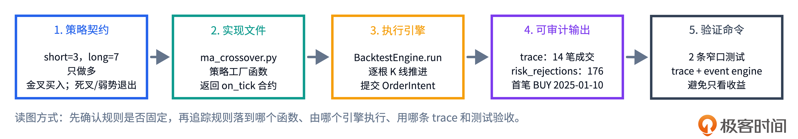
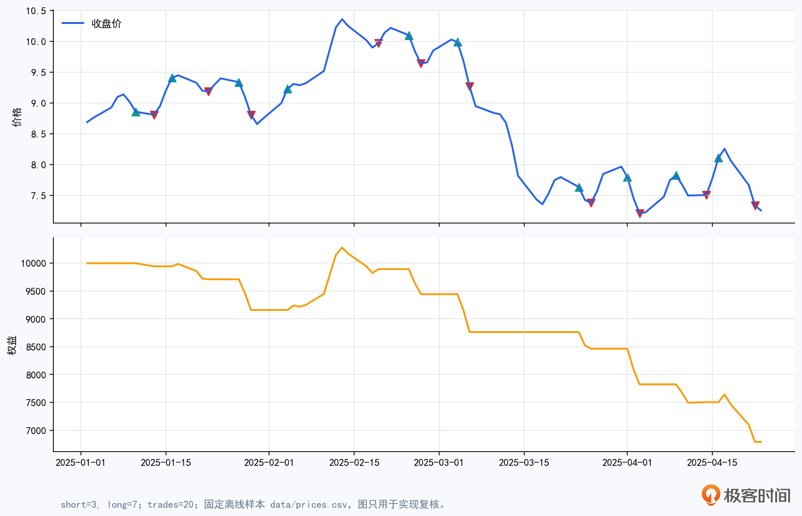
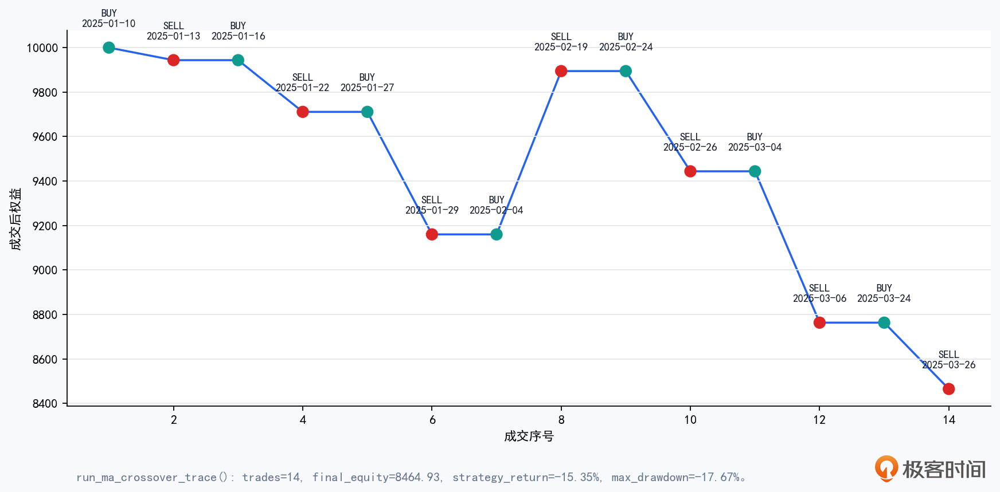

# 17 | 用Codex实现第一条量化策略

你好，我是袁从德。

第 16 讲我们把研究信号写成了明确策略规则，这节课我们把规则落成可运行代码。本讲的重点不是让 Codex “发明一个赚钱策略”，而是让它实现一个已经冻结的策略契约，并留下证据证明：代码按规则执行、样本固定、交易意图可追踪、失败分支可复核。

本讲使用仓库里真实存在的事件驱动回测路径，并以固定离线样本和固定均线参数完成演示。这样做不是为了追求一条好看的收益曲线，而是为了让策略从规则、代码、轨迹到测试都能被复核。这里检查的是实现忠实度：代码没有换样本、没有临时调参、没有把退出改成做空、没有绕过风险管理器，也没有把真实交易 API 混进研究沙盒。Codex 的角色是实现代理和审计助手，而不是策略发明器。

表 17-1 先划清 Codex 在本讲中的职责边界。后面的代码、trace 和图，都应回到这张表检查。

- Codex 应该做什么Codex 不应该做什么

环节

- 交付证据

仓库勘察

- 找到策略接口、引擎、样本和测试新建一套脱离项目的回测框架文件路径清

```
把规则卡落到 on_tick 分支
```

- 代码 diff 或

契约翻译

- 临时改变样本、参数或策略方向

- 加入交易所 API 或自动下单逻辑

安全边界

- 保持研究沙盒，不连接真实账户禁止事项记

- 只凭肉眼说“应该能跑”pytest 输出

验证执行

- 运行窄口测试和课程验证

- 输出 trace、首末交易、拒单数量

证据整理

- 只展示收益曲线审计字段和

- 表 17-1　Codex 在第一条策略实现中的职责边界

## 1. 冻结策略契约与 Codex 委托

合格的策略开发，不能以一句模糊指令“写一个双均线策略”作为起点。可复核工程交付必须提前锁定输入数据、交易规则、安全红线、验收标准，否则极易出现研究假设、样本筛选、参数寻优、代码实现互相混杂，破坏回测可信度。

本节先固化第一条策略完整契约，再转化为标准化、可直接投喂 Codex 的工单式委托。

- 本讲固定工程文件路径：

```
策略逻辑：src/strategy_engine/strategies/ma_crossover.py
回测引擎：src/strategy_engine/backtest/engine.py
回测运行入口：src/backtest/runner.py
执行轨迹记录：src/backtest/trace.py
固定离线数据源：data/prices.csv
```

- 固定参数：短期均线 3，长期均线 7

### 1.1 策略契约

表 17-2 汇总第一条策略实现前必须冻结的契约。

契约项

- 本讲固定值为什么必须固定

```
data/prices.csv 离线价格样本
```

数据样本

- 防止事后换样本

```
short=3, long=7
```

参数

- 防止临时调参制造好结果

入场

- 短均线高于长均线且当前无持仓时买入让买入分支可测试

出场

- 短均线不再高于长均线且当前有持仓时卖出让退出分支可测试

```
只返回 OrderIntent，不连接真实账户
```

执行边界

- 保持研究沙盒边界

- trace、交易图、窄口测试、失败分支清单

验收证据

- 避免只看收益曲线

- 表 17-2　第一条策略实现前必须冻结的契约

### 1.2 Codex 委托

契约可直接转化为结构化工程工单，指令越具象，AI 输出代码的可审查性越强；若仅下发模糊需求，极易出现篡改边界、私自调参、丢失风控逻辑等问题。

合格委托需明确修改范围、禁止行为、验收命令、证据输出要求，方便代码评审时判断 AI 是否忠实履约。代码 17-1 给出第一条策略的 Codex 实现委托。

- 请基于仓库现有事件驱动回测框架，完整实现多头双均线策略，约束如下：【固定输入】

```
1. 行情样本限定：data/prices.csv离线文件
2. 固定参数：short=3，long=7
3. 代码修改范围仅允许：src/strategy_engine/strategies/ma_crossover.py，复用现有Backtes
```

- 【硬性交易规则】

```
1. 历史K线窗口不足，不产生任何交易意图
2. 空仓状态 + short_ma > long_ma → 生成buy类型OrderIntent
3. 持有仓位 + short_ma <= long_ma → 生成sell类型OrderIntent
4. 策略函数仅返回OrderIntent或空值None，禁止引入交易所接口、实盘下单逻辑
```

- 【强制验收步骤】

```
1. 执行单元测试：tests/test_backtest_lab.py::test_ma_crossover_trace_is_auditable
2. 执行引擎接口测试：tests/test_project.py::test_event_driven_engine_uses_on_tick_st
3. 输出完整审计内容：轨迹内参数配置、首笔成交、末笔成交、风控拒单总量、期末账户权益
```

- 代码 17-1　第一条策略的 Codex 实现委托

反面错误委托示例（避坑对照）:

- 帮我写一个双均线赚钱策略，随便选行情数据，参数调好看点，尽量提高收益率，不用写测试代码。

### 1.3 三轮实战流程

不建议一次性下发“全部实现并完整讲解”的指令，建议分三轮递进约束，降低 AI 擅自修改工程架构的概率，每轮结束可校验合格性，异常则直接终止，重新生成。

### 第一轮：仓库边界勘察（仅输出路径，禁止修改代码）

- 请先不要修改代码。请在当前仓库中找出：

```
1. 双均线策略应该落在哪个策略接口；
2. 回测引擎如何调用策略；
3. 固定样本 data/prices.csv 在哪里被读取；
4. 哪些测试可以证明策略接入了事件驱动引擎。
```

- 请只输出文件路径、函数名和你建议修改的最小范围。

合格输出：仅罗列路径，不新增框架、不写完整策略代码；输出范围严格锁定前文指定 4 个核心文件。若 AI 提议新建独立回测脚本，判定为边界偏离，需重新生成。

### 第二轮：最小范围代码实现（仅忠实复现契约）

- 根据上一轮确认的修改范围实现策略，硬性约束：

```
1. 仅实现纯多头双均线逻辑
2. 函数返回 OrderIntent / None 两种结果
3. 不接入任何交易所 API，不增加参数寻优逻辑
4. 固定使用 data/prices.csv，不得变更样本口径 完成后逐条标注代码分支对应契约规则
```

- 完成后请说明每个分支对应哪条策略契约。

合格标准：代码简洁、分支清晰，仅实现窗口不足、买入、卖出、观望四类逻辑，无额外自定义交易逻辑。

### 第三轮：审计证据交付（从代码生成器转为审计助手）

- 执行本讲窄口测试，结构化输出以下审计信息：

```
1. pytest 用例执行结果（通过 / 失败）
2. 执行轨迹内记录的均线参数
3. 首笔、末笔完整成交记录
4. 风控拒单 risk_rejections 统计数量
5. 逐条说明该轨迹能够证明、无法证明的结论
```

合格标准：不能仅回复“测试通过”或单一收益数值，必须串联测试日志、交易轨迹、异常分支形成完整证据链。

### 全链路审计示意图说明

图 17-1 把契约、代码、引擎、trace 和测试串成一条实现链路。链路顺序：固化策略契约 →Codex 标准化工单 → 仓库边界勘察 → 最小代码实现 → 事件驱动引擎运行 → 生成 trace 执行轨迹 + 交易可视化 → 单元测试验收。

评审优先级：先复核全链路可追溯文件，最后查看收益指标；本讲验收核心为规则落地忠实度，策略盈亏仅作为教学演示，样本外回测、稳健性检验放在后续课程。



- 图 17-1　从策略契约到可审计实现的链路

本讲不采用从零搭建项目的方式，仓库已内置成熟引擎、策略标准协议、离线样本与测试体系。Codex 合规操作是嵌入现有架构，若脱离仓库接口独立编写收益计算脚本，即使可运行也判定交付不合格。

## 2. 将双均线规则落地 on_tick 标准接口

```
契约固化完成后，将交易规则绑定框架标准接口 on_tick(ctx, candle)。每一根 K 线推
```

送时，引擎自动调用该函数，函数仅允许输出订单意图或空值。该设计隔离研究信号逻辑与底层成交清算，为审计提供清晰边界。

代码 17-2 是本讲策略的核心实现，来自

```python
src/strategy_engine/strategies/ma_crossover.py。
def make_ma_crossover_strategy(short: int, long: int):
   """Long-only MA crossover using the same on_tick contract as live runtime."""
   def on_tick(ctx: StrategyContext, candle: Candle) -> OrderIntent | None:
       closes = [bar.close for bar in ctx.history]
       short_ma = _sma(closes, short)
       long_ma = _sma(closes, long)
       if short_ma is None or long_ma is None:
           return None
       position = ctx.position()
       should_hold = short_ma > long_ma
       if should_hold and position.qty == 0:
           if ctx.portfolio.cash <= 0 or candle.close <= 0:
               return None
           qty = ctx.portfolio.cash / candle.close
           return ctx.order_intent("buy", qty, type="market")
       if not should_hold and position.qty > 0:
           return ctx.order_intent("sell", position.qty, type="market")
       return None
return on tick
```

- 代码 17-2　事件驱动双均线策略实现

这段代码有四个关键点：

```
均线只从 ctx.history 读取，历史由引擎逐根 K 线推进。
窗口不足时返回 None，不会为了凑交易强行下单。
```

3. 买入前检查现金和价格，避免生成无效订单。

4. 策略只生成订单意图，真正成交、风控和权益记录由引擎处理。

审计时重点核查 AI 是否“多余实现”：

- 禁止读取未来 K 线、引入未来收益指标。

- 禁止对接外部实时行情接口。

- 禁止根据回测结果动态修改均线参数。

- 禁止策略内部直接修改账户持仓、权益数据。

多数新手策略代码可读性差，根源是将研究、交易、风控、报表逻辑耦合在同一函数。我刻意精简了策略主体代码，以保证每一条逻辑分支都可独立复核。表 17-3 把策略契约和真实代码路径一一对应，方便做人工 review。

契约问题

- 代码落点复核方式

```
load_prices(DATA_DIR / "prices.csv")
```

样本是否固定

- 检查命令不允许临时传

```
make_ma_crossover_strategy(3, 7)
trace 输出 short_win
```

参数是否固定

- 表 17-3　策略契约与真实代码路径对照

人工 review 时，还要看 Codex 有没有“多做”。多做通常比少做更危险：少做会让测试失败，多做可能让测试通过但语义变了。例如，Codex 如果在策略文件里加入“当收益不好时自动调窗口”，短期曲线可能更好，但它已经违反第 16 讲冻结的规则卡。又比如，Codex 如果把

```
sell 分支改成 short，代码仍然可能跑通，但策略已经从 long-only 双均线变成了另一个策
```

略。

表 17-4 给出实现忠实度 review 的检查点。它比“代码能跑吗”更严格，要求复核者逐项确认实现没有偷换契约。

Review 项

- 应检查什么不合格信号

```
仍使用 data/prices.csv 和固定参数
```

输入忠实度

- 新增外部行情、临时样本或搜索最优

```
策略只实现 on_tick(ctx, candle)
绕过 BacktestEngine 单独计算交
```

接口忠实度

```
只返回 buy、sell 或 None
```

动作忠实度

- 把退出改成做空、把观望改成加仓

```
根据 position.qty 判断空仓和持仓
```

状态忠实度

- 不看仓位状态，重复下单

```
风险拒单进入 risk_rejections
```

风控忠实度

- 拒单静默丢弃或被策略吞掉

- trace 可追到首末交易和权益

证据忠实度

- 只保留最终收益数字

- 表 17-4　Codex 实现忠实度 review 清单

## 3. 沿事件驱动引擎复核执行顺序

策略函数本身只说明“在某个时点想做什么”，还不能说明订单如何进入回测系统。真正地实现复核，必须继续进入引擎主循环，确认历史、策略、订单、成交、拒单和权益记录的顺序没有

```
被打乱。代码 17-3 截取自 src/strategy_engine/backtest/engine.py。它说明本讲
```

不是把信号表和收益表简单拼起来，而是按时间顺序推进挂单、历史、策略、成交和权益。

```
for candle in candles:
   self._settle_pending(candle, portfolio, trades, ctx)
   ctx.history.append(candle)
   intent = self.strategy_fn(ctx, candle)
   if intent is not None:
       self._submit(intent, candle, portfolio, trades, ctx)
   portfolio.record_equity(candle.ts, {symbol: candle.close})
   equity_curve.append((candle.ts, portfolio.equity({symbol: candle.close})))
```

- 代码 17-3　事件驱动回测主循环

```
这里最值得检查的是顺序：引擎先处理历史挂单，再把当前 K 线加入 ctx.history，然后
```

调用策略函数。也就是说，策略在第 N 根 K 线，只能看到第 N 根及以前的数据。如果实现里

```
出现 future_close、shift(-1) 或事后收益过滤，就应该退回第 14 讲的污染检查。
```

这个顺序也说明了为什么第 17 讲不能只验策略函数。策略函数只负责产生意图，成交、手续费、拒单、权益记录都由引擎处理。如果策略函数本身直接写成交结果，trace 就会失去审计价值；如果引擎没有记录拒单，失败分支就会在报告里消失。

Codex 在这里要把“代码执行顺序”翻译成可检查证据：

```
_settle_pending() 在策略之前运行，说明历史挂单先被处理。
ctx.history.append(candle) 决定策略可见数据边界。
_submit() 负责风险检查和成交。
portfolio.record_equity() 负责权益轨迹。
```

表 17-5 把主循环拆成可复核步骤。后续任何策略实现，只要沿用这个引擎，都可以按同一顺序检查。

- Codex 应留下的

顺序

- 引擎步骤证明什么

```
_settle_pending(candle, ...)
```

1

- 历史挂单先于新信号处理挂单成交或未成

```
ctx.history.append(candle)
```

2

- 策略只看到当前及以前 K 线禁止未来字段检

```
strategy_fn(ctx, candle)
OrderIntent
```

3

- 策略只生成订单意图

```
_submit(intent, ...)
trades 与 risk
```

4

- 风控和成交由引擎负责

```
record_equity(...)
```

5

- 每根 K 线都有权益检查点equity curve

- 表 17-5　事件驱动引擎主循环的审计步骤

## 4. 用图和 trace 审计交易轨迹

代码路径复核完成后，还需要把固定样本上的行为展示出来。图像适合检查交易点是否符合直觉，trace 适合留下可复制证据；两者结合，才能避免只展示一条收益曲线却无法解释交易从何而来。

### 4.1 可视化图表复核规范

```
两张图表统一由 scripts/generate_chapter17_figures.py 调用正式回测引擎生成，
```

图表标注规范如下：

1. 图 17-2：价格均线分层图

- 上层：标的收盘价、3 日均线、7 日均线，BUY / SELL 标记与 trace 成交日期一一对应。

- 下层：账户权益曲线。

- 复核规则：出现无规则支撑的交易点，优先回溯策略分支代码，禁止直接调整参数掩盖问题。



- 图 17-2　双均线策略的交易触发复核图

2. 图 17-3：逐笔成交事件轨迹图

```
每一个标记点对应 trace 内 trade_filled 事件，绑定成交时间、操作类型、成交后权益。
```



- 图 17-3　每笔成交对应的事件轨迹与权益检查点

本讲固定样本实测轨迹汇总：总成交 14 笔；首笔 2025-01-10 买入；末笔 2025-03-26 卖出；期末权益 8464.93；策略收益率 -15.35%；最大回撤 -17.67%。这里的曲线收益表现较差，但具备教学价值，我们要优先保证规则可解释、全程可复核，不用刻意美化回测结果。

### 4.2 Trace 结构化文本审计凭证

执行脚本直接输出标准化审计字段，将图表背后的底层数据固化为可复制文本记录。代码 17-4 直接打印 trace 的关键字段。它把图 17-2 和图 17-3 背后的证据变成可复制的文本记录。

```
$env:PYTHONPATH="src"
@'
from backtest.trace import run_ma_crossover_trace
trace = run_ma_crossover_trace()
print(trace["parameters"])
print(trace["metrics"])
print(trace["trail"][0])
print(trace["trail"][-1])
print(len(trace["risk_rejections"]))
print(trace["what_it_proves"])
'@ | python -
```

- 代码 17-4　打印双均线策略 trace 的审计字段

仓库标准输出示例：

```
【参数配置】 {'short_window': 3, 'long_window': 7}
【回测指标】 {'strategy_return_pct': -15.35, 'buy_hold_return_pct': 56.27, 'maximum
【首笔成交】 {'step': 1, 'date': '2025-01-10', 'event': 'trade_filled', 'action': '
【末笔成交】 {'step': 14, 'date': '2025-03-26', 'event': 'trade_filled', 'action':
【风控拒单总数】 176
【轨迹可证明结论】 ['策略在每根 K 线只看到当时及之前的history', '每笔成交可在trades与权益曲线
```

这段输出比一句“已实现双均线策略”有价值。它说明参数没有漂移，成交链路能定位到首末两笔，风控拒单没有被吞掉，并且明确列出 trace 能证明什么。从交付角度看，trace 是实现完成后的证据包，不是调试附属品。它把“我改了代码”变成“这段代码在固定样本上如何行动”的记录。

合格 trace 至少回答五个问题：

1. 用的是什么参数？

2. 第一笔交易何时发生？

3. 最后一笔交易何时结束？

4. 风险拒单有没有记录？

5. 最终指标是否能回到交易轨迹？

表 17-6 汇总本讲 trace 字段的审计含义，可作为实现第一条策略时的交付清单。

Trace 字段

- 本讲示例审计含义

```
parameters
short_window=3, long_window=7
```

- 参数没有在实现时漂移

```
metrics.trade_count
14
```

- 有完整交易路径，不是

```
trail[0]
2025-01-10 BUY
```

- 首笔成交能追到固定样

```
trail[-1]
2025-03-26 SELL
```

- 退出分支真实发生

```
risk_rejections
176
```

- 风控拒单被记录而非吞

```
what_it_proves
```

- 明确 trace 能证明什么三条证明边界

- 表 17-6　双均线 trace 字段的审计含义

## 5. 验收失败分支与验证入口

一条策略能跑通主路径，并不代表实现已经合格。真正能进入课程交付的策略实现，至少要说明什么情况下不交易、什么情况下退出、什么情况下留下拒单记录。这里我们把失败分支和验证命令放在一起，形成最后一道代码门禁。

### 5.1 失败分支验收

很多初学者只写“金叉买入”这一条 happy path，然后发现回测能跑就算完成。表 17-7 把本讲必须复核的失败分支转成验收动作。注意，这些动作不是为了让策略收益更好，而是为了让研究结论更可信。

分支

- 触发条件或证据应该看到什么

```
_sma(...) is None
返回 None
```

窗口不足

```
position.qty > 0 且仍满足持有条件
```

已经持仓

- 不重复买入

```
cash <= 0 或 close <= 0
```

现金或价格异常

- 拒绝买入

```
not should_hold and position.qty > 0
```

反向退出

- 生成卖出意图

```
写入 risk_rejectio
```

风控拒单

- 风险管理器拒绝订单

- 表 17-7　第一条策略实现的失败分支验收表

失败分支也是 Codex 最容易漏掉的地方。因为模型生成代码时，常常自然地补完 happypath，却没有主动构造异常输入。这里需要把验收要求说清楚：窗口不足不交易，已有持仓不能重复买，异常价格不能生成异常数量，风控拒单必须进记录。Codex 的任务是把这些要求变成测试、trace 或 review 清单，而不是只把主路径写顺。

### 5.2 验证入口

代码 17-5 是本讲的窄口验证命令。它只跑与本讲直接相关的 trace 和事件驱动策略测试。

```
$env:PYTHONPATH="src"
python -m pytest `
 tests/test_backtest_lab.py::test_ma_crossover_trace_is_auditable `
 tests/test_project.py::test_event_driven_engine_uses_on_tick_strategy `
 -q
```

- 代码 17-5　验证双均线 trace 与事件驱动接口

仓库标准输出：

```
2 passed
```

两条用例分工：

```
test_ma_crossover_trace_is_auditable：校验轨迹非空，存在完整成交，明确证
```

- 据边界。

```
test_event_driven_engine_uses_on_tick_strategy：校验引擎可正常加载固定
```

- 参数双均线策略，生成完整权益曲线。

AI 是否让所有异常和失败分支可视化、可复核：

- 仅输出收益曲线：仅完成脚本运行工作。

- 完整交付契约、代码路径、执行轨迹、异常分支、自动化测试命令：完成标准化可审计策略工程流程。

## 总结

这节课我们搭建了从标准化策略契约到可落地、可复核代码的最小工程闭环。第一条量化策略开发核心标准，不是收益优秀，而是全链路审计可信：规则固定、代码边界清晰、样本与参数不可篡改、交易轨迹全程追溯、异常分支完整留存、自动化测试可一键执行。

Codex 在链路中的核心定位：落地已冻结的交易规则、输出完整审计证据，不参与交易假设设计、不承诺正向收益、不将代码可运行等同于实盘可用。核心价值是保证策略实现全程一致性、可追溯。

## 思考与练习

1. 请说明策略契约、代码实现、trace 和测试分别承担什么证据职责。

2. 为你的第一条策略写一份实现记录，至少包含契约、代码路径、样本、trace、窄口测试和失败分支。

3. 写一段 Codex 委托，明确“允许修改什么、禁止修改什么、必须运行哪些测试、必须输出哪些 trace 字段”。

期待你的分享。如果今天的课程让你有所收获，也欢迎转发给有需要的朋友，邀请他来一起学习，我们下节课再见！
