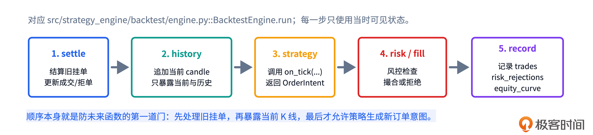
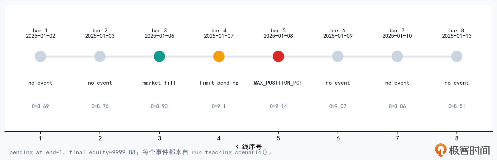
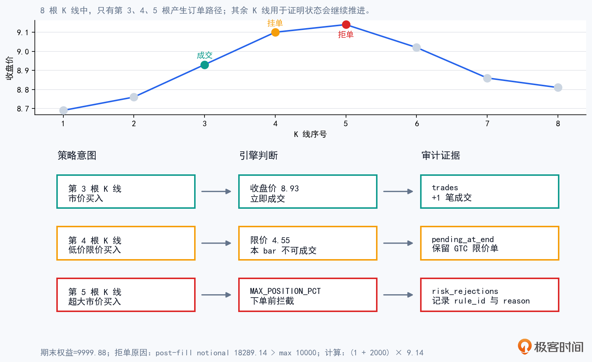
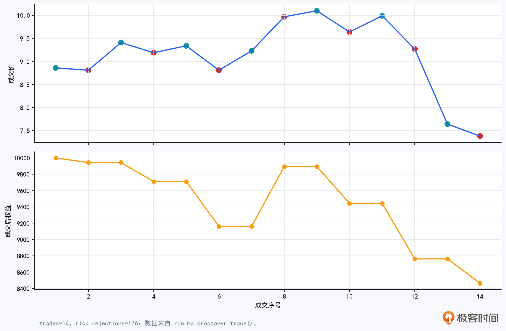
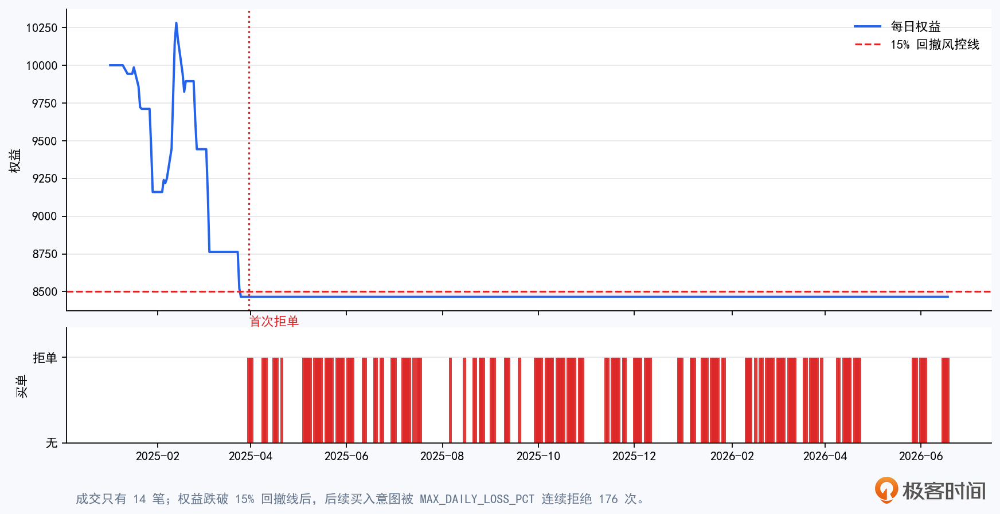
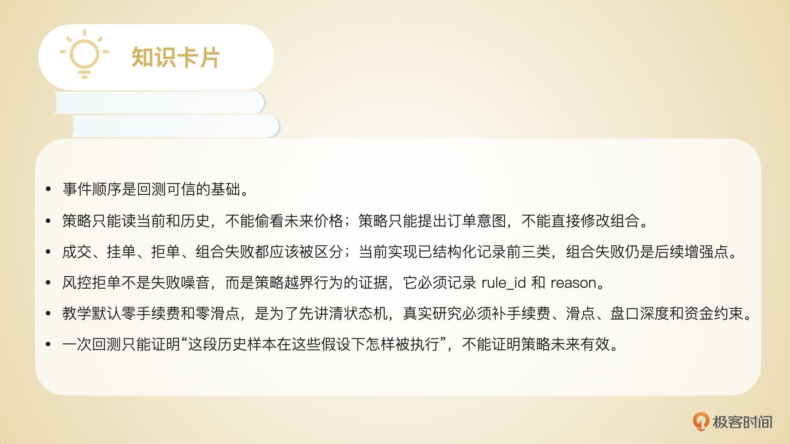

# 18 | 构建事件驱动回测引擎

你好，我是袁从德。

```
上一讲我们封装了策略核心接口 on_tick(ctx, candle)，实现了“每接收一根 K 线执行一
```

次策略判断”。这一讲我们暂时搁置收益率计算，先解决回测最底层的可信度问题：历史行情

```
逐根回放时，策略能获取哪些信息？策略生成的 OrderIntent（订单意图）如何流转？哪些
```

订单会撮合成交、哪些进入挂单队列、哪些被风控直接拦截？

很多人做回测只会输出一条收益曲线，但一套具备工程可信度的回测系统，必须严格按时间线完整复现市场行情、策略逻辑、订单生命周期、撮合规则、持仓组合、风控拦截全流程。如果省略中间流转状态，再美观的收益曲线都存在数据造假、未来函数、成交假设失真的隐患。

本讲基于仓库现有完整实现逐层拆解：

```
src/strategy_engine/backtest/engine.py：事件驱动回测主引擎
src/backtest/trace.py：教学轨迹生成工具，用于复现完整订单链路
data/prices.csv：固定离线行情样本
```

本讲核心交付物：标准化回测轨迹审计日志，完整留存每根 K 线输入、策略可见数据、订单流转结果，区分成交、挂单、风控拒单三类状态。这里要注意的是，仅保留成交记录会抹平大量系统约束，最终产出失真、无法复现校验的收益曲线。

## 1. 回测引擎的契约边界

事件驱动回测第一核心契约：每一轮循环仅能使用当前时间点可观测数据，模块间单向传递状态，无逆向数据读取。

### 1.1 回测最常见缺陷

轻量化简易回测最常见的缺陷：先批量计算全周期信号，再拼接未来行情收益，极易引入未来函数、错误成交假设、仓位计算偏差。这里我们不把引擎简单视作收益计算器，而是一套强约束分层契约系统。表 18-1 汇总事件驱动回测引擎的模块职责。

模块

- 本讲核心职责高频错误

- 严格按时间顺序输出 Candle

市场事件模块

- 行情乱序、提前读取未

- 基于 StrategyContext 输出订单意图 OrderIntent

策略函数

- 直接读取未来行情、强

- 区分市价 / 限价 / 止损单，处理即时成交与挂单队列

撮合执行模块

- 默认所有限价单均可即

组合状态模块

- 根据成交更新现金、持仓、权益曲线重复开平仓、收盘仓位

风控模块

- 订单提交前、挂单触发前拦截违规订单仅回测结束后补充风控

审计输出模块

- 持久化成交记录、权益曲线、风控拒单日志仅输出最终收益，丢失

- 表 18-1　事件驱动回测引擎模块职责与常见缺陷

### 1.2 回测引擎主循环

```
图 18-1 展示了 BacktestEngine.run() 的执行顺序：
```



- 图 18-1　事件驱动回测主循环的执行顺序

回测引擎（BacktestEngine） 主循环执行顺序，是抵御未来函数的第一道防线，完整时序如下：

- 遍历单根 K 线

- 结算上一轮未成交挂单

- 将当前 K 线写入历史上下文

- 调用策略生成订单意图

- 订单送入风控 + 撮合逻辑

- 根据当前收盘价记录组合实时权益

不过，单纯固定执行顺序还不足以保证回测可信，校验核心还要有个标准：每个模块仅持有对应时间切片的合法数据，状态单向流转，所有分支结果留存审计日志。总结一下，就是核心校验三问：行情是否时序正确、订单是否存在完整生命周期、全部分支结果是否可复核追溯。

### 1.3 回测引擎职责边界

事件驱动回测的第一件事，是把“价格变化”“策略判断”“订单生成”“撮合成交”“组合更新”和“风险拦截”分开。它们可以发生在同一轮循环里，但不能混成同一段逻辑。市场数据只负责按时间进入系统；策略只负责根据当时可见的信息给出意图；订单模块决定这份意图能不能成交、以什么价格成交、是否继续挂起；组合模块再根据成交结果更新现金、持仓和权益。

这个拆分不是为了让代码看起来“架构完整”，而是为了防止三个常见错误：

- 策略不能在看到当前 K 线收盘价后，又假装自己能用同一根 K 线的收盘价成交。

- 订单类型不能只是记录字段；市价单、限价单和止损单会改变成交时点、成交条件和成交价格。

- 收益结果不能只归因于策略信号；手续费、滑点、资金约束、仓位限制和风险拒单都会改变最终路径。

所以，我们在检查回测引擎时只抓五件事：事件是否按时间进入，订单是否有生命周期，成交假设是否显式，风险是否在执行前介入，结果是否留下可审计轨迹。后面的所有代码阅读、trace 输出和验收命令，都围绕这五件事展开。

- 延伸阅读可以参考 QuantStart 的事件驱动回测拆分、Backtrader 的订单执行说明，以及QuantConnect LEAN 关于成交、滑点、购买力和风险模型的文档。本讲不复述这些框架，而是把其中最重要的检查原则落到本仓库的真实代码上。

### 1.4 落到本仓库的检查点

表 18-2 把上面的五项检查落到本仓库里的具体文件、函数和字段。复核本讲时，不需要记住任何框架术语，只要确认这些职责在代码里有明确入口，并且 trace 能把执行结果留下来。

检查维度

- 本仓库对应物本讲检查点

```
Candle、prices_to_candles()
```

市场事件

- 固定样本是否按日期顺序

```
i k(
dl )
```

- 表 18-2　本仓库事件驱动回测的检查点

从这里开始，要把“回测引擎”看成一组合约，而不是一个收益计算函数。下面进入真实代码，先看主循环如何保证事件顺序，再看订单如何穿过撮合、挂单、风险和组合状态。

## 2. 代码完整执行链路

代码的价值在于，把抽象契约落成可检查顺序。每根 K 线到来时，引擎先处理历史挂单，再追加当前 K 线，然后调用策略，最后记录权益。这个顺序如果改变，成交、风控和权益曲线都可能改变。

```
代码 18-1 展示 BacktestEngine.run() 的事件推进顺序。
for candle in candles:
   # 1. 先结算上一轮遗留挂单
   self._settle_pending(candle, portfolio, trades, ctx)
   # 2. 当前K线写入历史上下文，策略仅能读取历史+当前K线
   ctx.history.append(candle)
   # 3. 执行策略回调，生成订单意图
   intent = self.strategy_fn(ctx, candle)
   if intent is not None:
       # 4. 订单送入风控校验+撮合逻辑
       self._submit(intent, candle, portfolio, trades, ctx)
   # 5. 基于当前收盘价记录实时权益
   portfolio.record_equity(candle.ts, {symbol: candle.close})
   equity_curve.append((candle.ts, portfolio.equity({symbol: candle.close})))
代码 18-1　BacktestEngine.run() 的事件推进顺序
```

这个顺序有两个关键点：

```
策略函数拿到的是已经追加当前 K 线后的 ctx.history，但没有未来 K 线。
```

- 挂单在本根 K 线策略运行前被结算，避免同一根 K 线里既生成新订单，又用后来的状态完成旧逻辑。

表 18-3 汇总主循环的五步证据链。

顺序

- 引擎动作证据字段错误写法

```
_pending、成交记录
```

1

- 处理上一轮 pending先生成新信号再结算旧挂单

```
ctx.history
```

2

- 追加当前 K 线策略读取完整未来样本

```
OrderIntent
```

3

- 调用策略函数策略直接写成交

```
trades、risk_rejections
```

4

- 提交给撮合与风控拒单不入结果

```
equity_curve
```

5

- 记录权益只记录最终收益

- 表 18-3　事件驱动主循环的五步证据链

代码 18-2 展示风险拒单如何进入结果。被风控挡下的订单不会静默丢弃，而是写入

```python
risk_rejections。
def _record_risk_block(
   self,
   intent: OrderIntent,
   candle: Candle,
   *,
   rule_id: str,
   reason: str,
) -> None:
   self._risk_rejections.append(
       RiskRejection(
           ts=candle.ts,
           symbol=intent.symbol,
           side=intent.side.value,
           rule_id=rule_id,
           reason=reason,
       )
   )
```

- 代码 18-2　风险拒单进入可审计回测结果

```
仅查看成交记录表，会完全忽略策略大量违规下单行为；risk_rejections 是回测核心审
```

计证据，而非无关日志。

### 2.1 完整订单生命周期

```
行业普遍误区：将 OrderIntent 等同于实际成交信号。实际订单意图只是执行链路起点，
```

提交后仍需多重校验：订单类型判定、价格触发条件、流动性撮合、风控校验、资金持仓约束。

```
BacktestEngine._submit() 为新订单统一入口，执行逻辑：
前置调用风控校验 _risk_allows()。
```

2. 根据订单类型分流执行：

- 市价单：结合滑点模型直接计算成交价，尝试即时成交；

- IOC / FOK 限价单：仅当前 K 线满足价格条件则成交，不满足直接失效，不进入挂单队列；

```
GTC 限价单、止损单、止损限价单存入 _pending 挂单队列，等待后续 K 线结算触
```

- 发。

所有订单最终只会归入六类流转分支，便于统一复核：

```
市价单正常成交：_submit → _fill_at_price → 存入 trades；风控拦截则写入
```

- risk_rejections。

2. IOC / FOK 限价单：当前 K 线无法触发直接失效，无挂单记录。

3. GTC 限价单：存入挂单队列，后续行情满足价格条件后撮合成交，期末可通过pending_orders_snapshot 查看未平仓挂单。

```
止损 / 止损限价单：存储至挂单队列，在每轮循环 _settle_pending 中校验触发条件。
风控拦截订单：_risk_allows 直接拦截，完整记录拦截规则 ID、拦截原因、交易方向。
```

6. 资金 / 持仓不足组合失败：撮合填充时 Portfolio 抛出异常，当前版本无结构化日志记录，为后续迭代优化点。

- 补充说明：教学样本未复现资金不足失败场景。合格审计体系必须区分四类行为：策略未生成订单、订单被风控拦截、资金不足无法成交、订单持续挂单等待触发。

### 2.2 风控为前置约束，非事后注释

风控模块介入两个关键节点：新订单提交瞬间、存量挂单行情触发准备成交瞬间。双重拦截覆盖两类风险场景：

- 当前行情下策略生成违规订单。

- 历史合规挂单，随行情波动触发风控阈值。

```
表 18-4 展开 src/risk/config.py 默认启用的五条 MVP 风险规则。
```

风险规则

- 拦截对象本讲教学意义

```
EMERGENCY_HALT
```

- 所有订单模拟人工停止线

```
MAX_POSITION_PCT
```

- 过大名义仓位防止单笔订单把组合推爆

```
MAX_DAILY_LOSS_PCT
```

- 回撤后继续买入展示亏损后禁止加仓

```
MAX_SLIPPAGE_PCT
```

- 高价差 K 线避免把异常波动当成可成交流动性

```
ABNORMAL_ORDERBOOK
```

- 零成交量、零振幅、异常跳价把脏数据挡在成交前

- 表 18-4　默认 MVP 风控规则执行逻辑

核心结论：策略信号必须经过订单类型、撮合模型、资产约束、双层风控校验，才会生成有效成交记录。后面我们会通过极简教学场景完整复现整条流转链路。

## 3. 教学场景与可审计轨迹体系

```
仅演示顺利成交场景，无法验证引擎完备性，src/backtest/trace.py 内置
run_teaching_scenario()，基于 8 根 K 线构建最小测试用例，覆盖三类核心分支：
```

- 第 3 根 K 线提交市价买单，即时撮合成交。

- 第 4 根 K 线提交低价 GTC 限价单，不满足价格条件，留存至挂单队列。

- 第 5 根 K 线超大金额市价单，触发 MAX_POSITION_PCT 风控规则被拦截。

代码 18-3 展示生成教学场景与双均线回测轨迹。

```
$env:PYTHONPATH="src"
@'
from backtest.trace import run_teaching_scenario, run_ma_crossover_trace
scenario = run_teaching_scenario()
print(
   scenario["engine"],
   scenario["scenario"],
   len(scenario["trades"]),
   len(scenario["risk_rejections"]),
   len(scenario["pending_at_end"]),
)
trace = run_ma_crossover_trace()
print(trace["engine"], len(trace["trail"]), len(trace["risk_rejections"]))
'@ | python -
```

- 代码 18-3　生成教学场景与双均线回测轨迹

脚本标准输出：

```
ai-trading/event-driven market_fill + pending_limit + risk_rejection 成交笔数：1 风
ai-trading/event-driven 完整轨迹节点数：14 风控拒单总数：176
```

数字本身无好坏之分，关键是每一条记录均可反向追溯对应代码执行分支。表 18-5 把三类事件按 K 线展开。它比最终收益更重要，因为它证明引擎同时保留了成交、挂单和拒单三种状态。

K 线

- 策略意图引擎处理轨迹证据

```
trades 增加 1 笔
```

第 3 根

- 市价买入立即成交

```
pending_at_end 保留限价单
```

第 4 根

- 当前 K 线不可成交，进入 pending低价限价买入

```
被 MAX_POSITION_PCT 拒绝
risk_rejections 增加 1 条
```

第 5 根

- 超大市价买入

- 表 18-5　教学场景中的成交、挂单与拒单

图 18-2 把教学场景的 8 根 K 线按时间线展开，便于检查事件顺序。



- 图 18-2　教学场景中的成交、挂单与拒单时间线

图 18-3 不再重复统计三类结果，而是把三条订单路径和它们留下的审计字段放在一起：市价

```
单进入 trades，不可成交限价单留在 pending_at_end，越界订单进入
risk_rejections。读图时要先看订单意图，再看引擎判断，最后回到可复核字段。
```



- 图 18-3　教学场景订单路径与审计字段

教学场景证明状态机能覆盖三种路径，双均线 trace 则把同一套引擎放到固定样本上运行。图

```
18-4 使用 run_ma_crossover_trace() 生成，展示双均线策略在固定样本上的成交价格
```

与成交后权益。



- 图 18-4　双均线策略的成交价与成交后权益检查点

这张图回答的是“每笔成交能不能和权益变化对上”，不是“策略能不能赚钱”。本次固定样本

```
里，双均线 trace 的最终权益是 8464.93，策略收益为 -15.35%，最大回撤为 -17.67%。
```

亏损结果同样必须公开，因为课程训练的是可审计研究流程。图 18-5 展示同一次 trace 里的权益路径、15% 回撤风控线和拒单发生区间。本样本中，176 条拒单全部来自

```
MAX_DAILY_LOSS_PCT，但更重要的是看见它们从什么时候开始出现。
```



- 图 18-5　双均线 trace 中的风险拒单时间线

如果只看成交表，会以为策略只是 14 次买卖；把拒单放回时间线上，才能看见权益跌破风控线之后，策略仍然继续产生买入意图，只是这些意图被风险模块持续挡住。它不能证明风控参数一定合理，但能证明拒单是回测状态机的一部分。

## 4. 回测假设标准化记录与 Codex 自动化审计

所有回测结果高度依赖底层假设，必须完整书面留存：市价单成交价选取规则、手续费与滑点口径、限价单挂单逻辑、风控介入时点、权益计算公式。这里我们会统一标准化假设记录表，并转化为可直接复用的 AI 审计委托规范。表 18-6 是本讲使用的假设记录表。

假设项

- 本讲实现影响

- 表 18-6　事件驱动回测假设记录表

组合权益至少要能还原到现金、持仓和价格：

## equity

- ​ =

## cash

- ​ +

## position

- ​ ×

## P

- t​ttt

净收益还要扣除手续费、滑点和其他交易成本：

- grossnet​ =​ −

## fee

- ​ −

## slippage

- ​ −

## funding

## r

## r

- ttt​tt

```
注意，本讲采用零手续费（ZeroFee）、零滑点（ZeroSlippage）仅用于教学，目的是剥离
```

成本干扰，清晰展示事件流转时序；实盘级回测必须叠加买卖手续费、盘口滑点、资金费率、部分成交规则，否则收益会系统性高估。

### 4.1 量化严谨性检查清单

事件驱动引擎的严谨性，不只看代码是否能运行。我们还要把变量、样本、成本、偏差、反例和人工复核写成检查清单。表 18-7 给出本讲的最低口径。

检查项

- 本讲口径不满足时的风险

```
equity = cash + position * close，净收益
```

变量定义

- 权益曲线无法解释仓位变需扣成本

```
data/prices.csv 固定离线样本，虚构 Web3 日
```

样本口径

- 不能外推到真实交易市场线

```
策略只能访问 ctx.history 当前及历史 K 线
```

时间可见性

- 未来函数抬高收益

- 表 18-7　事件驱动回测的量化严谨性检查清单

这张表也是给 Codex 的委托标准。不要只要求“跑一下回测”，而要要求它逐项回答：用的是什么样本，订单如何成交，哪些订单被拒绝，风险门在什么时点介入，最终权益能否由现金、仓位和价格还原。

### 4.2 Codex 委托：从模糊请求到证据报告

模糊请求通常长这样：“帮我看看这个回测有没有问题。” 这样的请求会让 Codex 很容易跳到改代码或解释收益上。更好的做法是把任务拆成多轮：先读代码和样本，后运行 trace，再输出证据报告，最后才决定是否修改。

代码 18-4 展示一段可以直接用于本仓库的审计委托。

```
请完成第18讲事件驱动回测全链路审计，全程禁止修改代码，仅输出标准化证据报告。
```

- 审计范围：

```
1. 读取源码：engine.py、trace.py、risk/manager.py
2. 运行两组轨迹：run_teaching_scenario()、run_ma_crossover_trace()
3. 校验三类订单流转分支是否完整留存审计日志：市价成交、限价挂单、风控拦截
```

- 报告强制包含内容：

```
1. 回测主循环标准执行时序；
2. 每类订单对应的结构化输出字段；
3. 成交总笔数、期末挂单数量、全部风控拦截总数；
4. 第一条风控拦截记录的rule_id与完整拦截原因；
5. 区分：仅能证明历史样本执行过程的结论、无法推导未来实盘有效性的结论。
```

- 约束要求：

```
1. 禁止修改src/、tests/、docs目录下任意代码；
2. 不得将回测收益作为投资参考结论；
3. 未实际运行脚本，不得宣称测试通过；
4. 不引用vendor第三方库作为核心运行依赖。
```

- 代码 18-4　复核事件驱动回测轨迹的 Codex 委托

若审计报告发现系统短板（如资金不足、无结构化日志），则下发第二轮定向优化委托，严格限定修改范围：

- 仅允许修改 src/backtest/trace.py 与配套单元测试，新增资金不足、订单失败结构化记录，不改动策略参数，输出代码 diff 与对应测试轨迹结果。

## 总结

这节课我们搭建了事件驱动回测最小可信证据链：行情按时序输入、策略仅输出订单意图、撮合模块区分即时成交与挂单、组合模块更新资产数据、风控前置拦截违规订单并留存完整日志。

回测可信度核心在于全流程可复现，而非最终收益数值高低。本讲核心贡献：将事件驱动回测从“收益计算工具”升级为“全链路可审计系统”。自研引擎分层设计通用标准：行情、策略、订单、撮合、资产、成本、风控解耦；本仓库通过 Candle、OrderIntent、Portfolio、RiskManager、trades、equity_curve、risk_rejections 完成工程落地。



## 思考与练习

```
请你打开 src/strategy_engine/backtest/engine.py，沿着一笔市价买单、一笔
GTC 限价买单和一笔被 MAX_POSITION_PCT 拒绝的买单，分别写出它们经过的函数、产
```

- 生的状态变化和最终证据字段。

2. 假设要把本讲从教学零成本模型升级到更接近真实交易的模型，请列出至少四项需要新增或修改的字段，并说明这些字段会影响成交、成本、风险还是绩效解释。

期待你的分享。如果今天的课程让你有所收获，也欢迎转发给有需要的朋友，邀请他来一起学习，我们下节课再见！
