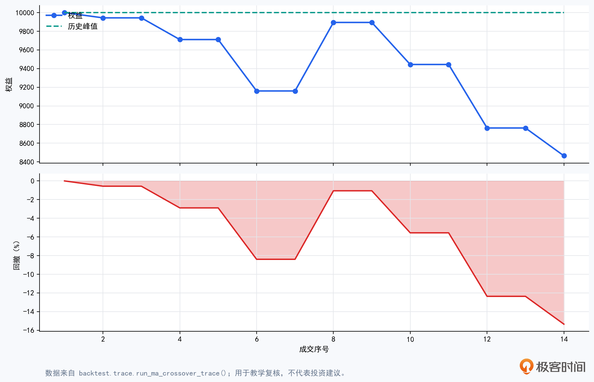
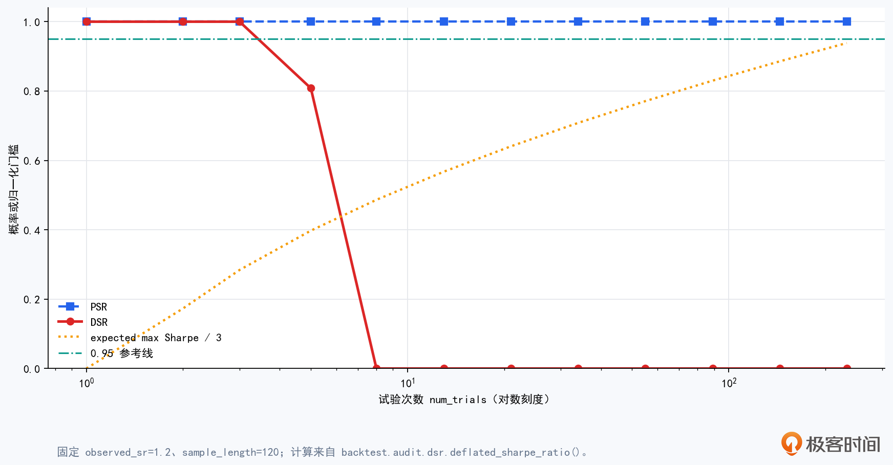
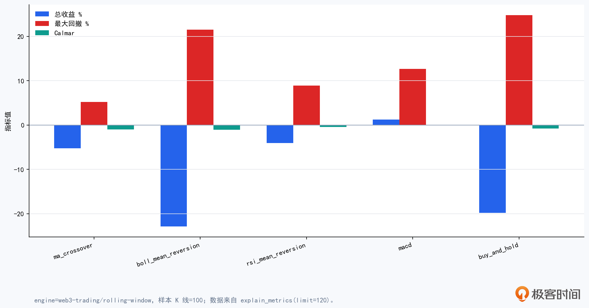
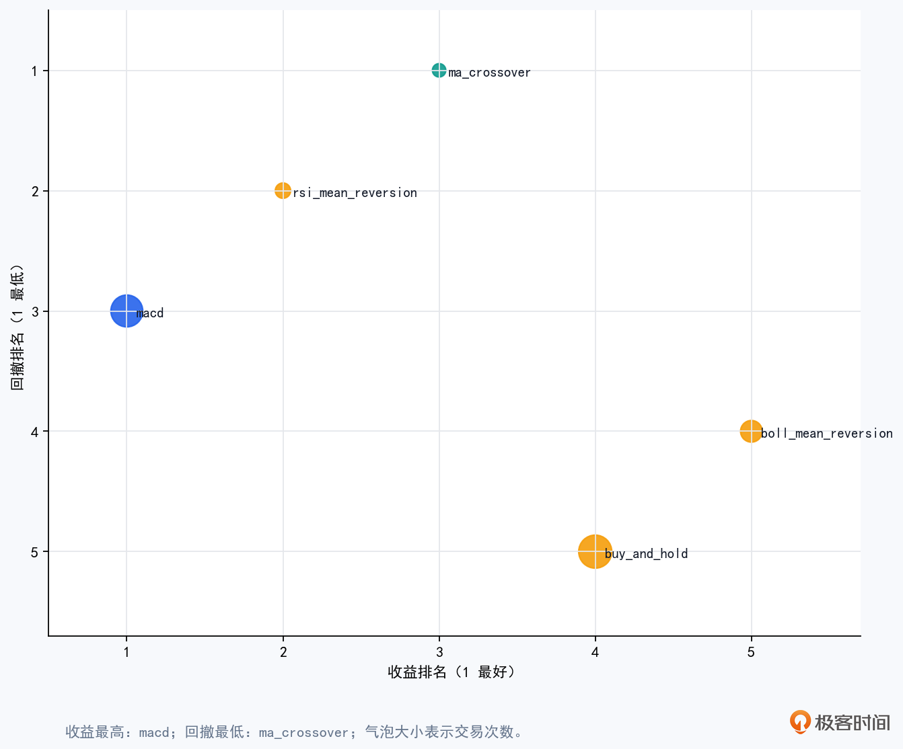

# 19 | 正确评估收益、回撤与风险调整表现

你好，我是袁从德。

第 18 讲我们已经得到了可重放的回测轨迹，这节课要回答一个更难的问题：这些数字能不能被相信。收益率最高不等于策略最好，所以我们的目标不是让 Codex 宣布“哪个策略最好”，而是让每个判断都能回到样本、计算口径、命令和输出。

一份合格的绩效解释，必须同时说明收益、回撤、风险调整和多次试验后的可信度。所以从这一讲开始，绩效评估不再是“看一个漂亮数字”，而是建立一套证据契约：先确认数据和路径，再解释指标，最后才比较策略。

需要注意的是，本讲使用固定的离线教学样本，复核收益、最大回撤、夏普比率（SharpeRatio）、卡玛比率（Calmar Ratio）、概率夏普比率（PSR）与修正夏普比率（DSR），所有结论都只针对离线教学样本，不代表未来收益。

## 1. 绩效评估的证据契约

绩效评估不能从排行榜开始，而要从证据边界开始。单独看收益率很容易误导：一条策略赚了30%，但中途经历 60% 最大回撤；另一条策略只赚 5%，但回撤显著更低。前者可能只是高波动或运气，后者可能更适合继续做稳健性检查。

外部资料提供的是口径，而不是装饰性术语。夏普比率强调单位风险上的超额收益；最大回撤强调从历史峰值到后续谷值的样本内路径损失；卡玛比率和 MAR 比率把收益放到最大回撤代价旁边阅读；修正夏普比率提醒多次试验和非正态收益会让漂亮的夏普比率偏乐观；回测过拟合概率（PBO）和组合对称交叉验证（CSCV）则把“挑冠军”本身当成需要审计的风险。

把这些口径落到本仓库，绩效解释要遵守四条硬规则：

- 任何绩效指标必须写清输入序列、时间频率、样本长度和成本假设。

- 任何收益结论必须同时报告最大回撤、交易次数和风险调整指标。

- 任何多策略或多参数比较必须报告试验次数，不能只展示被挑出来的冠军。

- 任何统计显著性表述都必须降级为“样本内证据”，不能写成未来收益承诺。

表 19-1 先把常用指标放回各自职责。指标的价值不在于听起来专业，而在于它究竟回答了哪个问题、不能回答哪个问题。

指标

- 回答的问题不能回答

总收益（Total return）

- 样本内最终赚亏多少收益是否

最大回撤（Maximum drawdown）

- 从历史高点跌到低点最深多少未来最大

夏普比率（Sharpe Ratio）

- 单位波动换来多少收益尾部风险

卡玛比率（Calmar Ratio）

- 收益相对最大回撤是否划算每笔交易

交易次数（Trade count）

- 样本厚度是否足够交易质量

概率 / 修正夏普比率（PSR / DSR）

- 夏普比率是否经得起显著性和多次试验审计策略是否

- 表 19-1 绩效指标的职责边界

这些指标分别压缩权益路径的不同侧面。总收益只关心起点和终点；最大回撤关心从历史峰值到后续低点的最坏路径；夏普比率把逐期收益均值和波动放到同一尺度；卡玛比率把收益与最大回撤直接相除；PSR / DSR 进一步追问“这个夏普比率是否经得起样本长度、非正态收益和多次试验的审计”。

因此，本讲的第一条规则是：指标必须按证据层级阅读，而不是按排名阅读。先确认权益路径是否由真实成交和成本假设生成，再从权益路径推导收益、回撤和逐期收益，最后才比较不同策略的排序。表 19-2 把这条规则落到仓库对象、可生成指标和 Codex 复核动作上。

证据层

- 仓库对象可生成的指标

```
data/prices.csv、离线行情快照
```

原始样本

- 买入持有收益、样本长度

```
run_backtest() 的成交与拒绝记录
```

策略执行

- 交易次数、胜率、换手、风

```
equity_curve
```

权益路径

- 总收益、最大回撤、卡玛比

逐期收益

- 权益曲线相邻点变化夏普比率、波动、下行风险

```
data/backtest_trials.jsonl 或参数试验记录
```

- PSR、DSR、试验次数

试验审计

- 表 19-2 绩效评估的证据层级

表 19-2 还隐含一个顺序：先证据，后指标，最后才是判断。很多策略报告出问题，不是因为公式算错，而是因为证据层级混在一起：用买入持有的价格路径解释策略权益，用日线数据套小时年化，用一次回测结果替代多次试验记录，或者把没有成本和滑点的教学样本写成可交易收益。为了避免这种混档，绩效段至少要回答表 19-3 的五个问题。

复核问题

- 不合格写法合格写法

```
data/prices.csv、日频、120 根 K 线、离线教学样
```

- 策略收益 20%

输入是什么

- 本

```
回撤来自同一条 equity_curve 的峰谷复算
```

路径从哪里来

- 回撤较低

```
日频收益按 periods_per_year=365 年化，未扣无风
```

- 夏普比率为 2.7

频率是否匹配

- 险收益

- 表 19-3 绩效解释的最低复核问题

## 2. 权益路径、回撤与卡玛比率

收益只告诉最终结果，权益路径才显示过程中的压力。下面我们会把绩效解释从“最终赚了多少”转向“中间经历了什么”：最大回撤、恢复时间和卡玛比率都来自同一条权益路径，不能从不同报告片段里拼接。

### 2.1 从权益曲线复算最大回撤

最大回撤和卡玛比率是最适合训练“路径复核”的两个指标。它们的计算并不复杂，却能立刻暴露很多报告问题：收益和回撤是否来自同一条权益曲线，回撤符号约定是否一致，图上的谷值

```python
是否能被函数复算出来。代码 19-1 展示 src/backtest/runner.py 中的最大回撤口径。
def maximum_drawdown(equity: list[float]) -> float:
   peak = equity[0]
   worst = 0.0
   for value in equity:
       peak = max(peak, value)
       worst = min(worst, value / peak - 1)
   return worst
```

- 代码 19-1 最大回撤复算逻辑

公式为：

## E

- ​t​ −

## drawdown

- ​ =

## 1

- t

## max(E

- ​, … , E​)0t

## MDD =

- ​drawdown

## min

- t​t

```
图 19-1 来自 run_ma_crossover_trace()。上半部分是成交后的权益路径，下半部分是
```

相对历史峰值复算出的回撤。



- 图 19-1 权益路径与最大回撤复核

这张图的重点是：回撤不是报告里孤立的一个数，它来自权益曲线逐点复算。先看路径，才能判断指标有没有解释力。

### 2.2 解释卡玛比率前先确认口径

代码 19-2 展示同一文件里的卡玛比率口径。课程中我们使用总收益百分比除以最大回撤百分比，便于和样本内报告保持一致。

```python
def calmar_ratio(total_return_pct: float, maximum_drawdown_pct: float) -> float:
   """Adapted from web3-trading's pure Calmar metric for negative drawdown."""
   if maximum_drawdown_pct == 0:
       return 0.0
   return total_return_pct / abs(maximum_drawdown_pct)
```

- 代码 19-2 卡玛比率的教学口径

卡玛比率的解释方式很直接：同样 10% 收益，最大回撤 5% 和最大回撤 25% 是两种完全不同的风险代价。但卡玛比率不能单独作为批准按钮：

- 课程中为了和当前样本报告保持一致，使用总收益除以最大回撤绝对值，但许多资产管理语境会使用年化收益除以最大回撤，跨系统比较时必须先写清口径。

- 最大回撤只记录样本内已经发生过的最坏峰谷差，不等于未来最大亏损上限。

- 最大回撤对路径非常敏感。两个策略最终收益相同，只要一个先涨后跌、另一个先跌后涨，最大回撤就可能完全不同。

最大回撤还要和“恢复时间”一起读。两个策略的最大回撤都可能是 20%，但一个三天后修复，另一个长期停留在水下，研究含义完全不同。本仓库当前没有单独实现水下持续时间（underwater duration），但可以在绩效卡里保留字段：峰值日期、谷值日期、恢复日期、未恢复标记。这样后续扩展时，不必重写绩效解释逻辑。

- 在本仓库里，Codex 复核卡玛比率时要做三件事。

```
先检查 maximum_drawdown_pct 的符号约定：报告里通常是正数百分比或负数跌幅，
进入 calmar_ratio() 时必须确认是否取绝对值。
```

- 再检查收益和回撤是否来自同一条权益曲线，不能把策略收益和买入持有回撤混用。

- 最后检查图 19-1 的回撤谷值是否能被公式复算出来，如果图和函数输出不一致，优先相信可复算路径。

最后，再强调一下容易被忽略的细节：卡玛比率、回撤收益比（Return over MaximumDrawdown, RoMaD）、MAR 比率这类指标，都把收益和最大回撤放在同一个框架里，但分子不一定相同。有的用总收益，有的用年化收益，有的用三年窗口，有的用成立以来窗口。因此本讲只允许说“教学口径下的卡玛比率”，不能把它和外部基金报告里的卡玛比率直接比较。跨系统比较前，必须先补齐三项口径：收益是否年化、回撤窗口多长、最大回撤以正数还是负数记录。

## 3. 夏普比率、PSR 与 DSR 审计

风险调整指标的作用，是把收益放回波动、样本长度和试验次数中阅读。

### 3.1 夏普比率的输入与边界

夏普比率把收益和波动放到同一口径里。它的共同前提是收益序列、样本长度和年化频率必须

```python
清楚，否则再精致的比率也只是漂亮数字。代码 19-3 来自 src/backtest/metrics.py：
它先从权益序列计算逐期收益，再用日频 sqrt(365) 年化。
def sharpe_ratio(
   equity_values: list[float],
   *,
   periods_per_year: int = 365,
) -> float:
   if len(equity_values) < 2:
       return 0.0
   returns = [
       equity_values[index] / equity_values[index - 1] - 1
       for index in range(1, len(equity_values))
   ]
   if len(returns) < 2:
       return 0.0
   mean_r = sum(returns) / len(returns)
   variance = sum((value - mean_r) ** 2 for value in returns) / (len(returns) -
   std_r = math.sqrt(variance) if variance > 0 else 0.0
   if std_r == 0:
       return 0.0
   return (mean_r / std_r) * math.sqrt(periods_per_year)
```

- 代码 19-3 从权益曲线计算夏普比率

在本仓库的最小实现里，示范样本暂时没有引入显式无风险收益，所以代码使用逐期权益收益

```
的均值除以样本标准差，再按 periods_per_year 年化。这个简化适合我们的教学复核，
```

但报告必须说明它的边界：如果数据频率是日线却按小时年化，夏普比率会被放大；如果收益序列存在极端尾部、非对称分布或连续缺口，标准差并不能完整代表风险；如果策略很少交易，夏普比率可能主要由少数持仓日决定。解释夏普比率时，至少要绑定表 19-4 中的辅助字段。

辅助字段

- 为什么必须一起看本讲判断方式

```
periods_per_year
日频示范使用 365，跨市场需改
```

- 年化倍数直接影响夏普比率

```
total_trades
```

- 少数交易会让均值和波动不稳定少于十几笔时只写描述，不写稳

```
max_drawdown_pct
```

- 波动低不代表峰谷损失低夏普比率高但回撤深，需要解释

```
num_trials
```

- 进入 PSR/DSR 审计，而不是直多次调参会抬高被选中的夏普比率

- 表 19-4 夏普比率解释必须绑定的辅助字段

夏普比率的优点是简洁，缺点也来自简洁。它默认用标准差代表风险，因此上行波动和下行波动都被放进同一个分母；它对样本长度和极端值敏感；它还会被年化倍数放大。实务上常见的补充指标包括索提诺比率（Sortino Ratio）、欧米伽比率（Omega Ratio）、风险价值（Valueat Risk, VaR）、预期损失（Expected Shortfall）以及收益偏度和峰度。

- 本仓库为了保持教学最小实现，没有在第 19 讲引入这些指标，但报告中应写明“未覆盖下行半方差和尾部损失”。这不是自曝短板，而是防止把夏普比率误读成完整风险审计。

### 3.2 用 PSR 与 DSR 处理显著性和多次试验

概率夏普比率（Probabilistic Sharpe Ratio，PSR）估计“真实夏普比率高于某个基准”的概率。修正夏普比率（Deflated Sharpe Ratio，DSR）进一步考虑多次试验和非正态收益，惩罚

```
回测过拟合和选择偏差。代码 19-4 展示 src/backtest/audit/dsr.py 的核心路径：先
```

算 PSR，再估计多次试验后可能出现的最高夏普比率，最后用这个更高基准复算 DSR。

```
psr = probabilistic_sharpe_ratio(
   observed_sr,
   benchmark_sr,
   sample_length,
   skewness=skewness,
   excess_kurtosis=excess_kurtosis,
)
e_max = expected_max_sharpe(num_trials, variance_of_trials)
dsr = probabilistic_sharpe_ratio(
   observed_sr,
   e_max,
   sample_length,
   skewness=skewness,
   excess_kurtosis=excess_kurtosis,
)
```

- 代码 19-4 概率夏普比率（PSR）与修正夏普比率（DSR）的核心计算路径

这里的关键差别是：PSR 主要审计单条策略；DSR 审计“多次试验后挑出来的冠军”。如果研究者试了很多参数、很多规则、很多样本切法，被选出来的最高夏普比率本来就更容易偏高，因此基准夏普比率不能再固定为 0 或某个简单门槛，而要提高到“多次试验后本来就可能看到的最高夏普比率”。表 19-5 给出 PSR / DSR 在报告中可以写与不能写的边界。

- 表 19-5 PSR / DSR 的报告边界

```
图 19-2 固定 observed_sr=1.2、sample_length=120，只改变试验次数。蓝线 PSR 基
```

本保持在高位，红线 DSR 随试验次数增加快速下降。



- 图 19-2 多次试验会降低 DSR 的显著性判断

```
刚才用当前仓库运行 deflated_sharpe_ratio(1.2, 120, num_trials) 可以得到同
样的警示：当 num_trials=1 时，DSR 为 1.0；当 num_trials=5 时，DSR 降到
0.8081；当 num_trials=21 或 100 时，DSR 已经接近 0.0。历史夏普比率没变，但“试
```

了很多次以后仍然显著”的门槛提高了。这也是第 19 讲和第 20 讲的连接点：本讲先看见多次试验会压低显著性，下一讲再系统处理过拟合、前视偏差和数据窥探。

DSR 不是让研究停止的红灯，而是让结论降级的刹车。若 DSR 很低，可以继续做研究，但写法要从“策略有效”改为“样本内出现值得复查的现象”；下一步不是继续加参数，而是补试验日志、做滚动窗口、检查成本敏感性，并把第 20 讲的回测过拟合概率（PBO）和组合对称交叉验证（CSCV）审计接上。这样第 19 讲负责解释绩效，第 20 讲负责审计污染，两讲之间形成自然闭环。

## 4. 多策略比较：从排名转向权衡

单策略指标只能回答“这条路径如何”，多策略比较才会暴露“不同目标之间如何取舍”。比较的目标不是挑出一个“最好”的名字，而是在同一样本、同一成本口径下，同时看收益冠军、回撤冠军和风险调整后的权衡。

### 4.1 固定样本、成本口径和比较入口

多策略比较最容易滑向“收益排行”。本讲的实战目标不是选出冠军，而是训练一种写法：收益冠军、回撤冠军、交易次数和风险调整指标要一起解释。代码 19-5 展示

```
src/backtest/metrics_explain.py 的比较入口。这里应显式传入 symbol="WEB3-
DEMO/USDT"，让多条策略固定在 data/prices.csv 的同一离线样本和同一成本口径下比
```

较。

```
payload = compare_strategies(
   symbol=symbol,
   limit=limit,
   stop_loss_pct=stop_loss_pct,
   take_profit_pct=take_profit_pct,
)
rows = payload["strategies"]
by_return = sorted(rows, key=lambda item: item["total_return_pct"], reverse=True)
by_drawdown = sorted(rows, key=lambda item: item["max_drawdown_pct"])
```

- 代码 19-5 多策略指标比较入口

```
图 19-3 是 explain_metrics(symbol="WEB3-DEMO/USDT", limit=120) 的结果，展
```

示总收益、最大回撤和卡玛比率。



- 图 19-3 多策略绩效指标比较

图 19-4 把收益排名和回撤排名放在同一张散点图里，气泡大小表示交易次数。



- 图 19-4 收益排名与回撤排名不是同一个问题

代码 19-6 用真实入口打印图 19-3 和图 19-4 背后的策略指标。

```
$env:PYTHONPATH="src"
@'
from backtest.metrics_explain import explain_metrics
payload = explain_metrics(symbol="WEB3-DEMO/USDT", limit=120)
print(payload["symbol"], payload["kline_type"], payload["total_candles"])
for row in payload["strategies"]:
   print(
       row["strategy_key"],
       row["total_return_pct"],
       row["max_drawdown_pct"],
       row["sharpe_ratio"],
       row["calmar_ratio"],
       row["total_trades"],
   )
print("highest_return", payload["highest_return"])
print("lowest_drawdown", payload["lowest_drawdown"])
'@ | python -
```

- 代码 19-6 打印多策略绩效比较的原始指标

### 4.2 读懂收益冠军、回撤冠军和权衡榜

本次在当前仓库中实际运行，输出为：

```
WEB3-DEMO/USDT 1day 120
ma_crossover -8.09 12.68 -7.19 -0.64 4
boll_mean_reversion -5.82 11.47 -5.06 -0.51 4
rsi_mean_reversion -11.7 17.85 -4.66 -0.66 9
macd 19.78 25.62 2.53 0.77 30
buy_and_hold 20.16 32.77 2.7 0.62 27
highest_return buy_and_hold
lowest_drawdown boll_mean_reversion
这段输出有两个直接结论：收益冠军是 buy_and_hold，回撤最低的是
boll_mean_reversion，二者不是同一个策略。buy_and_hold 在当前样本中的总收益为
20.16%，最大回撤为 32.77%，夏普比率为 2.7，卡玛比率为 0.62，交易次数为 27；
boll_mean_reversion 的最大回撤为 11.47%，但总收益为 -5.82%，夏普比率为
-5.06。因此不能简单写“买入持有最好”或“布林均值回归最好”，而要写成权衡：
buy_and_hold 是固定教学样本的收益冠军，但承受了更深回撤；boll_mean_reversion
```

回撤较低，却没有给出正收益。

```
这个案例还可以再读深一层。macd 的收益为 19.78%，略低于 buy_and_hold 的
20.16%，但最大回撤为 25.62%，低于 buy_and_hold 的 32.77%，卡玛比率反而更高。
```

这说明“收益冠军”和“更好的收益 / 回撤权衡”也不是同一个问题。如果作为教学演示，

```
buy_and_hold 可以作为基准；如果是继续开发策略，macd 可能比单纯收益冠军更值得进
入滚动窗口和成本敏感性检查；如果是控制回撤，boll_mean_reversion 虽然回撤最低，
```

但负收益意味着还不能进入正向策略候选。

多策略比较至少要给出三个榜单：

榜单

- 排序字段解释方式

```
total_return_pct 降序
```

收益榜

- 谁在样本内赚得最多

```
max_drawdown_pct 升序
```

回撤榜

- 谁在样本内路径承压最小

```
calmar_ratio 或夏普比率
```

权衡榜

- 谁的收益与风险代价更协调

- 表 19-6 多策略比较不能只保留一个榜单

## 总结

这节课我们把绩效评估从收益排行升级为路径复核。收益说明结果，最大回撤说明代价，夏普比率和卡玛比率说明风险调整后的效率，交易次数说明样本厚度，PSR / DSR 说明多次试验后的显著性。


下一讲进入研究污染与过拟合审计。绩效卡完成后，还要继续检查这些数字是否来自干净的研究流程。

## 思考与练习

1. 为什么收益最高的策略，不一定最值得继续研究？

```
用一组权益序列手工复算最大回撤，再和 maximum_drawdown() 输出比较。
```

期待你的分享。如果今天的课程让你有所收获，也欢迎转发给有需要的朋友，邀请他来一起学习，我们下节课再见！
