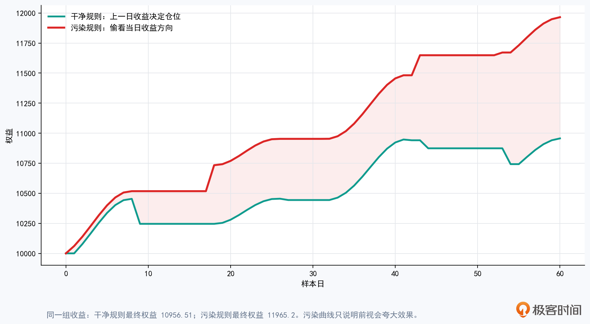
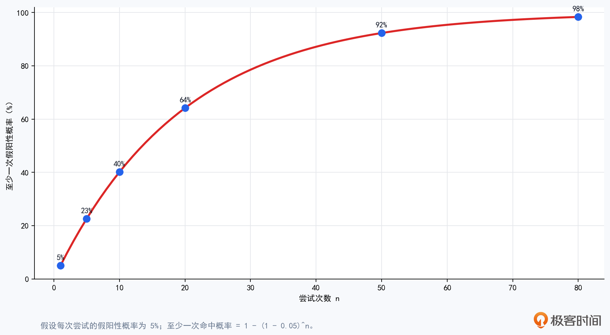
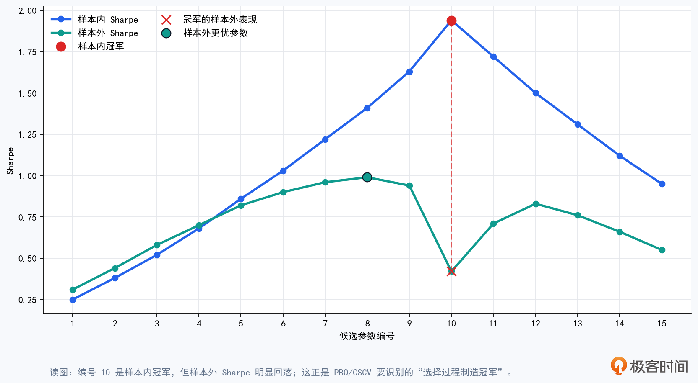
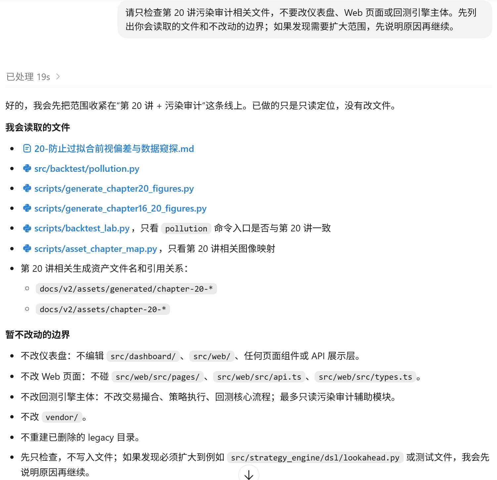
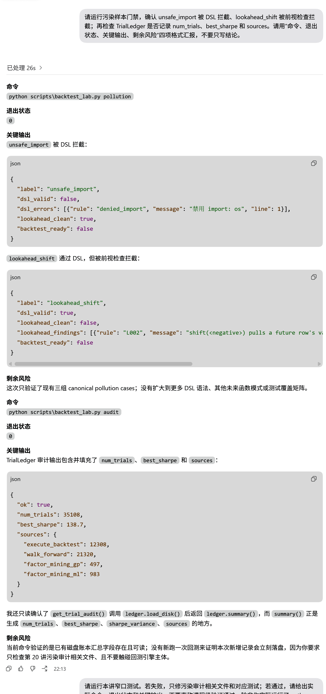
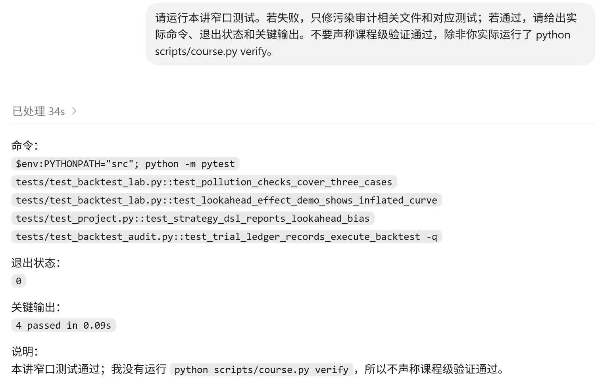
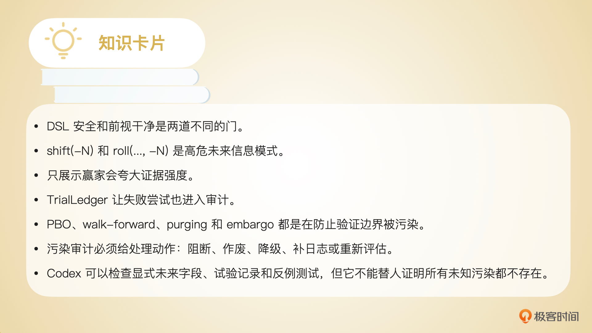

# 20 | 防止过拟合、前视偏差与数据窥探

你好，我是袁从德。

第 19 讲我们解释了收益、回撤、Sharpe、Calmar、PSR 和 DSR。这节课把问题往前推一步：这些绩效是不是干净的？如果研究过程被污染，再漂亮的指标也不能直接作为策略证据。很多回测问题不是算错了指标，而是指标从一开始就站在不干净的样本上。策略可能反复调参才碰巧命中，也可能在特征里偷看了未来，还可能把失败版本全部藏起来。看到一条漂亮曲线时，第一反应不该是“策略有效”，而该是“它经历过哪些污染检查”。

所以本讲不从“怎么把回测跑起来”开始，而是先问一个更靠前的问题：这条回测曲线有没有资格被解释？最终交付物也不是一句“没有作弊”，而是一份污染审计记录：污染类型、触发证据、拦截层级、处理决定和剩余风险都要写清楚。Codex 在这里的价值，是把污染风险从口头规范变成可复核动作。

等共同语言建立后，我们再进入可运行样本：用安全门拦危险代码，用前视门拦未来信息，用试验日志记录失败尝试，再用 PBO 思路检查样本内冠军是否到了样本外就掉队。这样你就会明白为什么要查，再看代码怎样查。

## 1. 三类污染与审计契约

这里我们先建立共同语言。过拟合、前视偏差和数据窥探经常一起出现，但它们破坏的证据不同，处理方式也不同。只有把污染路径说清楚，后面的代码门禁、试验日志和 PBO 审计，才不会变成零散检查项。

过拟合不是复杂模型才有的问题。一个简单均线策略，如果反复调窗口直到某段历史最好，也

```
是在记住样本噪声。前视偏差也不总是明显，它可能藏在 shift(-1)、未来标签、或同根 K
```

线里“先看收盘价、再按收盘价成交”的假设中。数据窥探更隐蔽：研究者未必有坏意图，只要大量失败尝试没有进入报告，最好结果就会显得过分可靠。

表 20-1 区分三类风险。

风险

- 常见表现破坏的证据拦截手段

- 固定切分、滚动验证、P

过拟合

- 参数只贴合当前样本样本外稳定性

- AST 前视检查、事件顺序

前视偏差

- 使用未来价格、未来收益、未来标签回测路径真实性

- TrialLedger、DSR、多重

数据窥探

- 多次尝试后只展示赢家统计显著性

- 表 20-1　三类研究污染风险

过拟合主要发生在选择规则阶段：研究者不断调参数、换特征、改阈值，直到某段历史表现最好。前视偏差主要发生在生成特征或成交路径阶段：策略使用了当时不可能知道的信息。数据窥探主要发生在报告结果阶段：大量失败尝试被隐藏，只留下冠军版本。修复时不能只说“加强测试”，而要把污染路径映射到具体证据。

外部研究给本讲提供四条底层纪律：

- White 的 Reality Check 处理的是“同一批数据被反复用于选择模型”后，最佳结果可能只是偶然赢家的问题。

- Sullivan、Timmermann 和 White 对技术交易规则的研究提醒我们，交易规则库越大，偶然冠军越容易出现。

- Bailey 等人提出的 PBO / CSCV 把“样本内冠军到样本外是否失效”变成可估计问题。

- 机器学习里的 data leakage 规则提醒我们，任何预测时点拿不到的信息，都不能参与特征、预处理、参数选择或报告筛选。

表 20-2 把这些纪律翻译成本仓库可以执行的动作。这里我们不要求实现完整论文算法，但要把每个概念落到交付物时应该检查什么说清楚。

方法或纪律

- 解决的问题本讲落地动作

- 记录全部候选、失败

Reality Check / 多重检验

- 多个候选中挑出冠军后，显著性被高估结果

```
把 num_trials、
```

DSR

- Sharpe 在多次尝试后被夸大解释

PBO / CSCV

- 样本内冠军到样本外失效用多个时间块比较样

TimeSeriesSplit / walk-forward

- 普通交叉验证打乱时间顺序训练窗口必须早于测

purging / embargo

- 标签窗口重叠或事件延迟造成泄漏对跨期标签、未来收

Pipeline discipline

- 预处理先看了全样本标准化、缺失填补、

```
数据表同时保存 ev
```

Point-in-time data

- 财报、指数成分、链上标签后来才可见

```
available_at
```

Survivor-bias-free universe

- 只保留幸存股票、幸存币种或现存基金审计样本池是否包含

- 表 20-2　外部反污染方法与本仓库动作

表 20-3 把污染路径进一步落到仓库证据对象。

污染路径

- 仓库证据典型触发

```
src/backtest/audit/pbo.py、滚动回测结果
```

- 样本内 Sharpe 远高于样

参数过拟合

```
src/strategy_engine/dsl/lookahead.py
shift(-N)、future
```

代码前视

- 第 18 讲事件顺序、成交假设同根 K 线先看收盘再按

执行前视

- 训练 / 验证切分、特征发布时间

数据泄漏

- 用全样本归一化、未来标

```
src/backtest/trials.py、
```

赢家展示

- 只记录最佳参数或最佳提

```
data/backtest_trials.jsonl
```

- 表 20-3　污染路径与仓库证据对象

这里的审计契约很简单：先排查污染，再解释绩效。污染样本不是“稍微降级还能用”，而是要根据触发证据决定阻断、作废、降级还是补日志。如果某段结论无法说明污染门禁状态，就不能直接沿用第 19 讲的绩效解释。

## 2. 实战案例：三段策略代码过门禁

```
概念建立后，进入第一条可运行路径。本节使用 src/backtest/pollution.py 的三段教
```

学样本，展示 DSL 安全门和前视检查门如何分别发挥作用。安全执行和时间顺序干净是两件事，必须分别验收。

```
代码 20-1 准备了三段教学样本：安全空策略、危险导入、前视 shift(-5)。
SAFE_CODE = "def on_tick(ctx, candle):\n    return None"
UNSAFE_IMPORT = "import os\n\ndef on_tick(ctx, candle):\n    return os.getcwd()"
LOOKAHEAD_CODE = (
   "def on_tick(ctx, candle):\n"
   "    df = ctx.dataframe\n"
   "    future_close = df['close'].shift(-5)\n"
   "    return None"
)
```

- 代码 20-1　三类污染样本

代码 20-2 展示同一个检查函数如何组合 DSL 安全检查和前视检查。

```python
def _check(label: str, code: str) -> dict[str, Any]:
   validation = validate_strategy_code(code)
   lookahead = check_lookahead_bias(code)
   return {
       "label": label,
       "dsl_valid": validation.valid,
       "dsl_errors": [
           {"rule": item.rule, "message": item.message, "line": item.line}
           for item in validation.errors
       ],
       "lookahead_clean": lookahead.clean,
       "lookahead_findings": [
           {"rule": item.rule, "message": item.message, "line": item.line}
           for item in lookahead.findings
       ],
       "backtest_ready": validation.valid and lookahead.clean,
   }
```

- 代码 20-2　安全检查与前视检查的组合

```
这段组合逻辑会给每个样本返回三个关键字段：dsl_valid、lookahead_clean、
backtest_ready。unsafe_import 会被 DSL 安全门拦截；lookahead_shift 虽然没
```

有危险导入，却会被前视检查拦截。两类失败不能互相替代。

代码 20-3 直接打印这三类样本的门禁结果。每个失败字段都能被复制、搜索和复核，因此比低密度示意图更适合进入审计记录。

```
$env:PYTHONPATH="src"
@'
from backtest.pollution import run_pollution_checks
payload = run_pollution_checks()
for row in payload["cases"]:
   print(
       row["label"],
       row["dsl_valid"],
       row["lookahead_clean"],
       row["backtest_ready"],
       row["dsl_errors"],
       row["lookahead_findings"],
   )
'@ | python -
```

- 代码 20-3　打印污染样本的门禁结果

运行代码 20-3 可得到如下输出：

```
safe_noop True True True [] []
unsafe_import False True False [{'rule': 'denied_import', 'message': '禁用 import:
lookahead_shift True False False [] [{'rule': 'L002', 'message': "shift(<negative
```

只看“拦截 / 通过”还不够。图 20-1 用同一组教学收益比较两条路径：干净规则只能用上一日收益决定今日仓位；污染规则偷看当日收益方向后再决定仓位。两条曲线的差距说明，前视污染不是代码风格问题，而是会直接把回测效果抬高。



- 图 20-1　前视污染会把回测曲线伪装得更好

```
这个案例故意很小，因为它要证明一件基础事实：只要策略在 t 时点偷看了 t+1 之后的信
```

息，权益曲线就可能被系统性抬高。但真实研究里，前视通常不会写得这么直白。更常见的是下面三种“看起来合理”的写法。

表 20-4 把同一个前视问题拆成三个实务场景。

场景

- 看似合理的写法实际污染

- 同根 K 线先知道收盘再交

收盘价成交

- 用当天收盘价生成信号，再假设当天收盘成交

- 用报告期日期对齐财报，例如把年报挂到 12 月 31 日

财报因子

- 决策日并不知道后来披露

指数成分

- 用今天的指数成分回填历史删除了历史上被剔除、退

- 表 20-4　前视污染在真实研究里的三种伪装

```
所以，代码门禁只能解决第一层问题：shift(-5) 这类显式未来访问必须拦截。第二层问题
```

要靠数据口径：每条行情、财报、新闻、链上标签和指数成分，都要能回答“这条数据在当时是否已经可见”。如果数据只有业务日期，没有发布时间和可用时间，报告里就不能写成“已排除前视”，最多写成“代码层未发现显式前视，数据发布时间仍待复核”。

## 3. 前视规则与数据泄漏边界

前视检查不是运行策略，而是在运行前读取代码结构。它适合拦截显式未来信息模式，例如

```
shift(-N)、roll(..., -N)、未来字段命名或下一根 K 线引用；它不负责判断所有业务
```

发布时间问题，所以检查结果必须和人工数据口径复核配合使用。

机器学习文档里常说的数据泄漏，在交易研究里通常有六种具体形态：

- 全样本预处理泄漏：先用全部历史计算均值、方差、分位数或缺失填充值，再回头做训练 /验证。

- 标签泄漏：把未来收益、未来波动、未来排名或事后筛选结果混进当前特征。

- 发布时间泄漏：财报、链上标签、新闻摘要或人工研报虽然带着历史日期，但在决策时点尚未发布。

- 选择泄漏：看完测试集后再改因子、改阈值或删样本。

- 样本池泄漏：用当前仍然活跃的股票、币种或基金回测过去，自动排除了失败标的。

- 预训练知识泄漏：用 LLM 或外部模型生成交易信号时，模型可能已经在训练语料里见过后来的新闻、研报或价格叙述。

静态 AST 检查只能挡住第一眼能看见的未来访问，剩下几类必须靠数据字典、发布时间字段、样本池版本、TrialLedger 和人工复核。代码 20-4 是

```python
src/strategy_engine/dsl/lookahead.py 的核心逻辑：一旦发现 shift(-N) 或
roll(..., -N)，就记录错误级别发现。
def visit_Call(self, node: ast.Call) -> None:
   method_name = self._called_method_name(node)
   if method_name in _SHIFT_METHODS or method_name in _ROLL_METHODS:
       shift_arg = self._extract_shift_amount(node, method_name)
       if shift_arg is not None and _is_negative_int_literal(shift_arg):
           rule = "L002" if method_name in _SHIFT_METHODS else "L003"
           op = "shift" if rule == "L002" else "roll"
           self.findings.append(
               LookaheadFinding(
                   line=node.lineno,
                   col=node.col_offset,
                   rule=rule,
                   severity="error",
                   message=(
                       f"{op}(<negative>) pulls a future row's value "
                       "into the current row. This is lookahead bias."
                   ),
               )
           )</negative>
代码 20-4　shift(-N) 与 roll(-N) 的前视检查
shift(-5) 的含义可以写成：
```

## future_close

- ​ =

## P

- t+5t​

```
策略在 t 时点，本来只能看到
```

## P

## P

- 和过去数据，却读到了。这种样本不能进入回测，也不t+5​t​

能写成“模型表现很好但有轻微风险”。正确处理是作废样本并重建特征。

如果把这条规则转成数据表检查，可以使用下面的最小字段契约：

字段

- 含义失败信号

- 表 20-5　防前视的数据字段契约

本仓库的离线样本比较小，不会补齐所有商业数据字段，但写报告时要按这张表声明边界。比

```
如 data/ 里的教学行情可以用于演示门禁和指标计算，不能直接外推为“真实市场点时数据已
```

合格”。这类边界说明是干货，不是客套话：它决定结论能不能进入真实研究流程。

## 4. 试验日志、PBO 与样本外复核

前视检查解决的是时间作弊，TrialLedger 和 PBO 解决的是选择过程污染。参数搜索、提示词试验和因子挖掘都可能制造“看起来最优”的冠军版本，如果失败尝试没有被记录，绩效解释就会被系统性抬高。

### 4.1 记录搜索过程

TrialLedger 的目标不是增加日志噪声，而是把数据窥探从“说不清的乐观偏差”变成可审计事

```python
实。第 19 讲的 DSR 需要 num_trials，第 21 讲的滚动验证和 PBO 也需要知道试过多少
次。代码 20-5 展示 src/backtest/trials.py 的试验记录结构。
@dataclass
class TrialRecord:
   source: str
   strategy_key: str
   sharpe_ratio: float
   total_return_pct: float
   params: dict[str, Any] = field(default_factory=dict)
   total_trades: int = 0
   timestamp: str = field(
       default_factory=lambda: datetime.now(timezone.utc).isoformat(),
   )
```

- 代码 20-5　TrialLedger 的试验记录结构

```
本讲 ledger 构造 8 条试验记录：grid_search 3 条，prompt_trial 2 条，
factor_mining 3 条；其中 best_sharpe=1.6，sharpe_variance=0.134107。这
```

- 组数字用文字比用柱状图更清楚，真正重要的是：失败尝试也要记录。没有 ledger 时，报告会自然写成“我们发现策略 A 的 Sharpe 最高”；有 ledger 时，报告必须改写成“在 8 次记录试验中，策略 A 的 Sharpe 最高”。这两个句子的证据强度完全不同。

Codex 在这里承担两类动作。第一，任何自动化回测、参数网格、提示词试验或因子挖掘，都

```
要把 source、strategy_key、params、sharpe_ratio 和 total_return_pct 写入
ledger。第二，生成报告时要读取 TrialLedger.summary()，把 num_trials、
best_sharpe、sharpe_variance 和 sources 写入绩效解释卡。只要试验记录缺失，结
```

论就要降级为探索观察。

多次尝试还会带来一个直观问题。假设每次独立尝试的假阳性概率为 5%，尝试 n 次后，至少

## 1 −(1 −0.05)n

一次偶然命中的概率是：

- 。

图 20-2 展示这条曲线。尝试 5 次时，至少一次偶然命中的概率约为 23%；尝试 20 次时约为64%；尝试 50 次时约为 92%。



- 图 20-2　多次尝试下至少一次偶然命中的概率

这不是说每次参数搜索都错，而是说“只展示赢家”的报告必然夸大证据强度。合格报告要写清楚参数范围、试验次数、失败版本和选择标准。

这里可以补一个更贴近实战的赢家幻觉案例。假设研究者让 Codex 生成 30 个均线策略变体，每个变体再试 10 组窗口参数，一共 300 次回测。如果只把 Sharpe 最高的一条曲线贴进报告，你看到的是“一个优秀策略”；如果把 TrialLedger 打开，你看到的是“300 次尝试后的冠军”。在单次 5% 假阳性概率的粗略假设下，300 次尝试至少出现一次偶然命中的概率约为：

- 300

## 1 −(1 −0.05)

## ≈

## 99.99998%

- 。

这个数字不用于替代严谨统计检验，因为真实策略试验并不独立。它的价值是提醒团队：搜索

```
空间越大，越不能只看冠军。报告至少要补四个字段：trial_count、search_space、
selection_rule、discarded_trials_summary。缺少其中任意一项，就不要把“最佳
```

Sharpe”写成策略能力，只能写成候选线索。

表 20-6 给出从“漂亮但不可信”到“可审计”的改写方式。

原始说法

- 问题可审计写法

策略 A 的 Sharpe 达到 1.6

- 在 8 次记录试验中，策略 A 的 Sharpe 最高隐藏试验次数

```
在窗口集合 {5/20, 10/30, 20/60} 中
```

我们选出最优窗口 10/30

- 未说明搜索范围Sharpe 选择 10/30

- 失败版本写入 TrialLedger，报告展示数量、

失败版本表现一般，略

- 选择过程不可复核要失败原因

测试集表现不错后微调阈值

- 测试集被二次使用冻结阈值，在新样本外窗口重新评估

- 表 20-6　赢家叙事改写为可审计叙事

### 4.2 检查样本内冠军

更严格的过拟合审计会继续追问：在训练段表现最好的参数，到了测试段是否仍然接近最好？

```
本仓库的 src/backtest/audit/pbo.py 使用简化版 block CSCV 思路，把样本切成多个
```

时间块，在不同训练 / 测试块组合上反复比较候选参数。如果样本内冠军在样本外经常输给其他候选，或者样本内 Sharpe 明显高于样本外 Sharpe，就会提高 PBO 风险判断。

这里要区分三种验证口径。普通 train / test split 只能回答一次切分下是否稳定，它很容易被研究者反复改边界，直到结果看起来顺眼。walk-forward 把时间往前滚动，每次只用过去窗口选择参数，再在后续窗口验证，更贴近真实研究节奏。CSCV / PBO 把样本拆成多个块，反复组合训练块和测试块，观察“训练段赢家”在测试段是否经常掉队。PBO 的价值不在于给策略盖章，而在于发现“冠军策略可能只是被选择过程制造出来的”。

图 20-3 展示这种掉队现象。编号 10 的候选参数在样本内 Sharpe 最高，但到了样本外明显回落；另一个样本内不那么亮眼的参数，反而在样本外更稳。PBO / CSCV 要识别的就是这种“样本内冠军不等于可复用优势”。



- 图 20-3　样本内冠军到样本外掉队

金融时间序列还多一个特殊问题：标签和特征常常跨期。比如用未来 5 日收益作为标签，今天的样本和未来几天的样本就共享了部分价格路径；如果直接做普通 K 折交叉验证，训练集可能间接看到了测试标签涉及的价格。purging 的意思是把这些重叠样本从训练集中移除；embargo 的意思是在测试窗口之后留出一段空白，避免事件延迟、数据修订或持仓周期把信息带回训练段。本仓库的教学实现保持简化，但审计记录应明确写出：本次样本是否存在跨期标签、事件延迟或窗口重叠；如果存在，是否做了隔离。

实务上可以把验证方案按风险分层：

验证方式

- 适合场景不足

固定 train/test

- 入门演示、快速 sanity check一次切分容易被边界选择影响

walk-forward

- 参数会周期性更新的交易策略窗口长度和更新频率仍需冻结

purged CV + embargo

- 标签跨期、持仓跨期、事件延迟明显实现更复杂，需要知道标签跨

CSCV / PBO

- 候选参数多、容易出现样本内冠军输出是风险诊断，不是收益预

- 表 20-7　验证方案与污染风险分层

代码 20-6 展示 PBO 的核心判定逻辑。

```
best_is = max(
   candidates,
   key=lambda params: _score_params(train_candles, strategy, params, config),
)
is_winner = _score_params(train_candles, strategy, best_is, config)
oos_winner_score = max(
   _score_params(test_candles, strategy, params, config) for params in candidate
)
oos_is_choice = _score_params(test_candles, strategy, best_is, config)
if oos_is_choice < oos_winner_score - 1e-6 or is_winner > oos_is_choice + 0.5:
   failures += 1
```

- 代码 20-6　PBO 检查样本内冠军是否在样本外失效

这段代码的意思很朴素：如果“训练段冠军”到了测试段经常不是冠军，或者训练段表现比测试段高出太多，就不能继续把样本内表现当成稳定优势。第 20 讲的污染审计和第 21 讲的滚动验证是连续动作：第 20 讲决定哪些结果不干净，第 21 讲再看干净结果能否跨窗口延续。

## 5. Codex 审计流程与验证入口

污染检查的输出不是一句“有风险”，而是一个处理动作。这里我们把前面的概念、代码门禁和试验日志收束为一条可以交给 Codex 执行的工作流。合格的审计记录要能回答四个问题：哪类污染被触发，证据来自哪一层门禁，当前结论如何处理，剩余风险由谁确认。表 20-8 把处理动作写成文本规则。

检查结果

- 处理方式

DSL 安全、前视干净、试验日志完整

- 进入滚动回测

危险导入或危险内置函数

- 阻断策略代码

```
shift(-N)、roll(-N) 或未来字段
```

- 样本作废，重建特征

- 降级为探索观察，补 TrialLedger

只展示赢家、缺少失败记录

时间切分边界反复修改

- 冻结切分后重新评估

- 表 20-8　污染检查后的处理方式

“阻断”不是坏消息，而是研究系统正常工作。被拦截的样本同样有价值：它告诉团队哪条路径不能继续，后续要重写代码、重建数据，还是回到研究假设。

Codex 的实战委托要拆成多轮，而不是一次性说“帮我检查有没有问题”。下面是一组可直接照做的委托流程，重点是限定修改范围、先造失败样本、再要求验证证据。

- 第一轮：限定范围。要求 Codex 只查看污染审计相关文件，例如

```
src/backtest/pollution.py、src/strategy_engine/dsl/lookahead.py、
src/backtest/trials.py 和对应测试；不改仪表盘、策略 UI 或第 21 讲的滚动验证逻
```

- 辑。

```
第二轮：构造反例。要求它复用或补充 unsafe_import、lookahead_shift、缺
```

- TrialLedger 的参数搜索等最小反例。反例先失败，门禁才有意义。

- 第三轮：运行门禁。要求它执行污染检查和窄口测试，并输出命令、退出状态、关键字段和失败样本。没有实际运行的命令不能写成通过。

```
第四轮：补齐审计记录。要求它把 num_trials、污染状态、处理决定和剩余风险写进报
```

- 告；污染未清除前，不复用第 19 讲的收益结论。

- 第五轮：声明边界。要求它明确静态检查覆盖显式模式，业务发布时间、交易所延迟、数据源修订和样本切分仍要人工确认。

第一轮请求可以写成：

- 请只检查第 20 讲污染审计相关文件，不要改仪表盘、Web 页面或回测引擎主体。先列出你会读取的文件和不改动的边界；如果发现需要扩大范围，先说明原因再继续。



- 图 20-4　第一轮请求示例

第二轮请求可以写成：

```
请运行污染样本门禁，确认 unsafe_import 被 DSL 拦截、lookahead_shift 被前视
检查拦截；再检查 TrialLedger 是否记录 num_trials、best_sharpe 和 sources。请
```

- 用“命令、退出状态、关键输出、剩余风险”四项格式汇报，不要只写结论。



- 图 20-5　第二轮请求示例

第三轮请求可以写成：

- 请运行本讲窄口测试。若失败，只修污染审计相关文件和对应测试；若通过，请给出实际命

```
令、退出状态和关键输出。不要声称课程级验证通过，除非你实际运行了 python
scripts/course.py verify。
```



- 图 20-6　第三轮请求示例

进入本仓库后，这些原则要落成四个动作：构造污染样本、运行门禁检查、记录全部试验、在报告里写清楚剩余边界。比较 LLM 策略、机器学习策略和技术指标策略时，也按同一张检查表处理：数据窗口是否一致，新闻和财报是否在当时可见，模型是否可能带入未来语料，交易成本是否计入，失败版本是否保留。没有回答这些问题，就不能把“跑赢市场”写成有效结论。

- 交易规则的研究提醒我们：同一批历史数据被反复试规则后，最亮眼的结果可能只是偶然冠军。Bailey 等人的 PBO 进一步把这个问题变成可诊断动作：样本内冠军到了样本外是否仍然有效？scikit-learn 关于数据泄漏的文档则把边界说得更朴素：预处理、特征选择和模型选择，都不能提前看见验证集或测试集。

## 总结

这节课我们把“结果好不好”的问题前移为“研究过程是否干净”。过拟合、前视偏差和数据窥探，分别破坏样本外稳定性、回测路径真实性和统计显著性。策略进入滚动回测前，要先通过DSL 安全检查、前视检查、试验日志和时间切分复核。



下一讲我们进入滚动回测与多策略比较。本讲留下的试验日志、污染门禁结果和样本切分记录，会成为第 21 讲判断样本外稳定性的基础。

## 思考与练习

```
为什么 lookahead_shift 通过 DSL 安全检查后仍然不能进入回测？
```

2. 请你写一份污染审计案例记录，至少包含污染类型、触发证据、拦截层级、处理决定和剩余风险。

期待你的分享。如果今天的课程让你有所收获，也欢迎转发给有需要的朋友，邀请他来一起学习，我们下节课再见！
