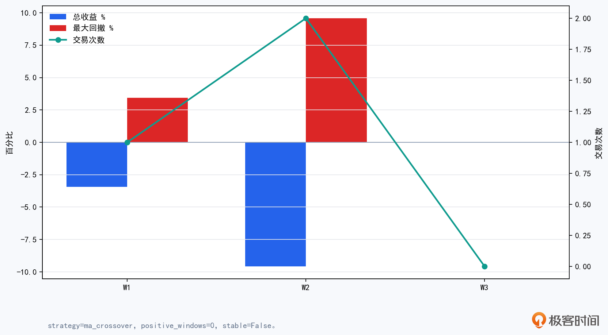
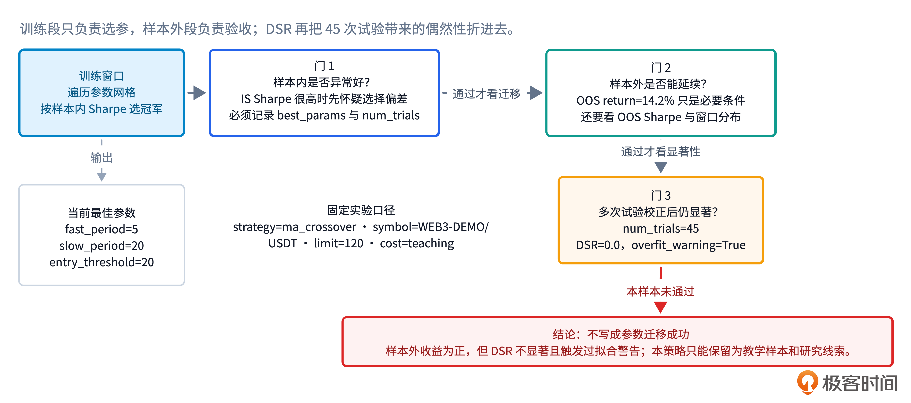
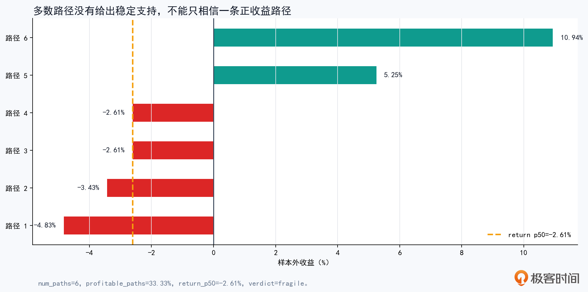
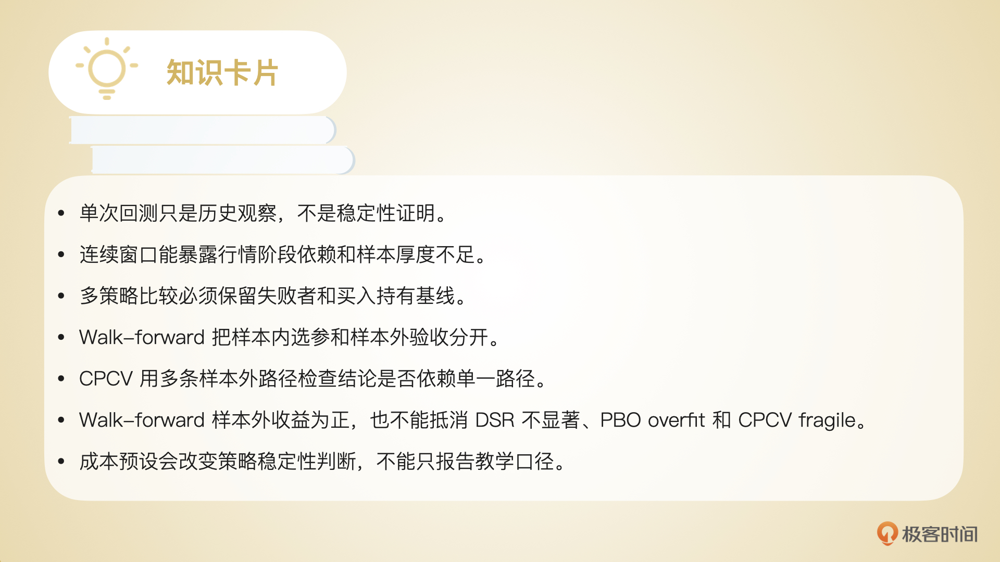

# 21 | 从单次回测走向滚动回测与多策略比较

你好，我是袁从德。

第 20 讲我们排查研究污染，这节课继续追问一个更实际的问题：污染尽量控制之后，一次回测结果是否足够稳定。单次回测表现好，只能说明某个策略在某段历史、某套参数、某种成本假设下表现不错；它还不能说明策略可靠、可迁移、可复用。

很多策略研究误判，正是发生在“第一张权益曲线很好看”的时刻。所以我们先不急着选“冠军策略”，而是把单次结果扩展为跨窗口、跨策略、跨参数、跨成本和多条样本外路径的稳定性审计。

最重要的边界是：不要问“哪条策略赢了”，先问“赢法是否能迁移”。如果样本外验证、过拟合审计或保守成本给出脆弱信号，单次冠军就只能降级为研究线索。

## 1. 稳定性审计的证据契约

第 19 讲回答“绩效如何解释”，第 20 讲回答“研究过程是否干净”，第 21 讲回答“结果是否稳定”。三层合在一起，才构成可继续推进的策略证据。顺序不能反过来：污染未清除时，滚动验证只是把污染重复多次；绩效口径不清楚时，多策略比较只是把不可比数字排成榜单。

下面会反复出现一些英文名词，我们先放到中文语境里对齐一遍。

- Walk-forward 是“滚动向前验证”，用过去窗口选参数，再用后续窗口验收；

- DSR 是“去偏夏普比率”，用来扣掉多次试验带来的偶然高 Sharpe；

- CPCV 是“组合式净化交叉验证”，用多条样本外路径检查结论是否依赖幸运切分；

- PBO 是“回测过拟合概率”，估计样本内冠军在样本外掉队的比例；

- 成本预设指手续费、滑点、资金费率等成交假设。

表 21-1 只保留主审计顺序。越往下，结论越接近“可以继续研究”，但仍然不是实盘证明。

审计层级

- 回答的问题主要风险

连续窗口

- 不同时间段是否一致只适合单一行情

多策略比较

- 复杂策略是否优于简单基线排行榜幻觉

- Walk-forward 和 CPCV 是否支持同一结论

样本外验证

- 参数选择过拟合、单一路径偶

- PBO、参数扰动、成本变保守后是否仍站得住

稳健性与成本

- 尖峰参数、理想成交幻觉

- 表 21-1　滚动回测的审计层级

写审计记录时，不需要把所有字段都摊成大表，但每一层都要交代三件事：输入口径是否固

```
定，输出字段是什么，不能从这一步推出什么。本讲固定使用 symbol=WEB3-DEMO/USDT、
limit=120 和 cost_preset=teaching。当前样本中，ma_crossover 的连续窗口不稳
定，Walk-forward 虽然有正的样本外收益，但 DSR 不显著，CPCV 结论为 fragile，PBO
给出 overfit 警告，所以只能写成“证据混合且偏脆弱”。
```

## 2. 连续窗口与多策略比较

稳定性审计，先从最容易复核的两步开始：同一策略跨连续窗口是否仍然工作；复杂策略是否在同一窗口下优于简单基线。这两步不解决参数迁移问题，但能快速暴露阶段依赖和排行榜幻觉。

### 2.1 连续窗口暴露阶段依赖

```
代码 21-1 是 src/backtest/rolling/service.py 中的连续窗口入口。它不做参数重
```

选，只按时间切样本，用同一策略复跑。

```python
def compare_windows(
   *,
   strategy_name: str = "ma_crossover",
   num_windows: int = 3,
   symbol: str | None = None,
   limit: int = 120,
   stop_loss_pct: float = 3.0,
   take_profit_pct: float = 5.0,
   cost_preset: str | None = "teaching",
) -> dict[str, Any]:
   """Split the sample into consecutive windows and rerun one strategy."""
   pair, kline_type, candles, meta = load_candles(
       symbol=symbol,
       limit=max(60, min(1500, limit)),
   )
```

- 代码 21-1　连续窗口比较入口

```
图 21-1 来自 compare_windows(strategy_name="ma_crossover",
symbol="WEB3-DEMO/USDT", num_windows=3, limit=120)。
```



- 图 21-1　同一策略在连续窗口中的表现

```
当前代码运行结果为：3 个窗口里没有正收益窗口，stable=False。第 1 窗口收益
-3.43%、回撤 3.43%、1 笔交易；第 2 窗口收益 -9.58%、回撤 9.58%、2 笔交易；第 3
```

窗口没有交易。这不是稳定策略证据，而是阶段依赖与样本厚度不足的信号。

### 2.2 多策略比较不是冠军榜

跨策略比较不是为了马上选冠军，而是为了检查复杂策略是否稳定超过简单基线。在本仓库的

```
固定样本里，compare_strategies(symbol="WEB3-DEMO/USDT", limit=120) 返回
```

5 条策略：均线交叉、布林均值回归、RSI 均值回归、MACD 和买入持有。表 21-2 是多策略比较最少要保留的字段。

字段

- 用途

- 策略注册名保证可复跑表 21-2　多策略比较的最低记录字段

```
当前样本中，买入持有收益最高，为 20.16%，但最大回撤为 32.77%、交易 27 笔；macd
收益为 19.78%，最大回撤为 25.62%、交易 30 笔；ma_crossover 收益为 -8.09%，最
大回撤为 12.68%、交易 4 笔。这些数字说明固定窗口里存在强趋势基线，复杂策略即使接近
```

买入持有，也不能直接证明它更稳定。真正的公平比较至少要满足四个条件：相同数据窗口、相同成本预设、相同风控规则、相同指标解释。

整理多策略表时，要保留失败者，而不是只保留领先策略。失败者有两个作用：一是构成基线，防止复杂策略用更高自由度换来虚假优势；二是帮助解释行情状态。例如买入持有和MACD 都明显为正，而均线交叉为负，可能说明样本里有趋势、但策略触发和退出规则不匹配，而不是 MACD 已经具有普遍优势。

## 3. Walk-forward 与 CPCV：样本外证据链

连续窗口和多策略比较之后，审计要进入样本外层面。Walk-forward 检查“训练段选出的参数能否迁移到未来窗口”，CPCV 检查“多条样本外路径是否支持同一结论”。两者都比单次排行榜更保守，也更接近研究验收。

### 3.1 Walk-forward：训练段选参，样本外验收

```python
代码 21-2 展示 src/backtest/rolling/service.py 中的 Walk-forward 入口。
def run_walk_forward(
   *,
   strategy_name: str = "ma_crossover",
   num_windows: int = 3,
   symbol: str | None = None,
   limit: int = 120,
   cost_preset: str | None = "teaching",
) -> dict[str, Any]:
   """Walk-forward param search: fit on train, score on OOS per window."""
   from backtest.rolling.optimization.walk_forward import walk_forward_optimize
```

- 代码 21-2　Walk-forward 参数搜索入口

图 21-2 把 Walk-forward 的三道判断门放在一起：样本内是否异常好、样本外是否能延续、经过多次试验校正后是否仍然显著。



- 图 21-2　Walk-forward 的三道稳定性判断门

```
当前运行结果为：best_params={"fast_period": 5, "slow_period": 20,
"entry_threshold": 20}，样本外收益 14.2%，num_trials=45，DSR=0.0，
overfit_warning=True。关键不在于样本外收益为正，而在于样本内 Sharpe 与样本外
```

- Sharpe 的差距过大，且 DSR 在 45 次试验校正后不显著，所以不能写成“参数迁移成功”。

Walk-forward 的关键不是“多跑几段”，而是把角色分清楚：训练段用于选择参数，样本外段用

```
于验收选择。仓库实现里，walk_forward_optimize() 会从策略的 param_grid() 生成
参数组合，用训练段 Sharpe 选择当前窗口最佳参数，再用 start_from=train_end 让样
```

本外段形成验收收益；每次训练段尝试还会写入 TrialLedger。这样，第 19 讲的 DSR 才能知

```
道 num_trials，第 20 讲的数据窥探审计才不会丢失失败尝试。
```

Walk-forward 也有边界：窗口数少时，样本外结果仍可能被单个窗口主导；参数网格如果是看过结果后不断扩展，仍会引入数据窥探；训练段和测试段相邻时，某些标签或特征可能跨边界

```
泄漏。因此报告中要同时写明 best_params、num_trials、
out_of_sample_return_pct、dsr 和 overfit_warning。
```

### 3.2 CPCV：不要只相信一条样本外路径

CPCV（Combinatorial Purged Cross-Validation）构造多条样本外路径，并在相邻样本之间留出 embargo，降低相邻 K 线泄漏风险。图 21-3 来自

```
run_cpcv_service(strategy_name="ma_crossover", symbol="WEB3-
DEMO/USDT", limit=120)。
```



- 图 21-3　CPCV 多条样本外路径的成败分布

```
当前结果为：num_paths=6，盈利路径占比 33.33%，return_p50=-2.61%，
sharpe_p50=-4.52，结论为 fragile。这比单条 Walk-forward 更保守，也更接近“多数路
```

径是否支持同一结论”的问题。

CPCV 和 Walk-forward 的问题不同。Walk-forward 更像时间推进中的“训练后验收”；CPCV更像把样本外路径组合起来，检查结论是否依赖某一条幸运路径。金融时间序列里，样本相邻、标签重叠、信号持有期交叉都会制造泄漏风险，所以 López de Prado 提出 purging 和

```
embargo 的思想。本仓库是教学尺度实现，run_cpcv_service() 标注的是 “Teaching-
```

scale CPCV with embargo bars”，并不是完整标签重叠清除，报告中要保留这一边界。

## 4. 稳健性、成本与处理决定

样本外证据之后，还要检查两个容易被忽视的分支：参数附近是否稳定，成交成本是否会吞掉收益。PBO、参数敏感性和成本预设不能互相抵消，它们分别指出不同类型的风险。

### 4.1 PBO 与参数敏感性

PBO（Probability of Backtest Overfitting）估计“样本内最优参数在样本外失败”的比例。代码

```python
21-3 展示 src/backtest/audit/pbo.py 的入口。
def probability_of_backtest_overfitting(
   candles: list[dict[str, Any]],
   strategy: Strategy,
   *,
   num_blocks: int = 6,
   config: BacktestConfig,
   max_candidates: int = 12,
) -> dict[str, Any]:
   """Fraction of train/test splits where IS-best params fail OOS."""
```

- 代码 21-3　PBO 审计入口

```
当前运行结果为：PBO 为 0.55，verdict=overfit；参数扰动测试的
stability_score=0.6667，整体稳健性 verdict=warn。这说明默认参数附近已有明显
漂移，块级 PBO 也给出过拟合风险信号；它和 CPCV fragile 一起，足以把本策略降级为
```

研究线索。写报告时可用表 21-3 联合解释，而不是用一个平均分把风险抹平。

PBO

- 参数敏感性可写结论

低

- 稳定进入更长样本与组合角色评估

低

- 不稳定保留观察扩大参数邻域和样本表 21-3　PBO 与参数敏感性的联合解释

### 4.2 成本预设改变稳定性判断

教学成本容易让策略看起来更好。三种成本预设的差异并不复杂，表 21-4 列出了当前代码下的成本敏感性结果。

- Sharpe

成本预设

- 总收益最大回撤说明

```
teaching
-8.09%
12.68%
-7.19
```

- 零滑点教学口径

```
realistic
-8.61%
13.05%
-7.70
```

- 动态滑点

```
perp
-8.89%
13.27%
-7.70
```

- 动态滑点 + 资金费率

- 表 21-4　成本预设敏感性

三种成本预设没有改变方向，但会进一步压低收益并抬高回撤。此时不要急着调参，先把“在教学成本下已经为负，保守成本进一步恶化”写进审计结论。

### 4.3 滚动审计决策表

表 21-5 把本讲所有审计结果压缩成一张处理表。核心不是视觉流程，而是每条证据是否支持“继续推进”。

审计项

- 当前结果处理含义

```
stable=False
```

连续窗口

- 阶段稳定性不足

```
OOS 收益为正，但 DSR=0.0、
```

Walk-forward

- 参数迁移证据不

```
overfit_warning=True
verdict=fragile，多数样本外路径不支持
```

CPCV

- 不能依赖单条幸

```
pbo=0.55、verdict=overfit、
```

PBO 与参数敏感性

- 存在过拟合和参

- 表 21-5　滚动审计后的处理决定

```
样本的合理结论是：ma_crossover 可作为教学样本和研究线索，但不能写成稳定策略。理
由是连续窗口不稳定、Walk-forward 的 DSR 不显著且 overfit_warning=True、CPCV
为 fragile、PBO 为 overfit，且成本变保守后收益继续恶化。即使某个样本外窗口收益
```

为正，也不能抵消多数审计证据。

## 5. Codex 委托、验证入口与代码门禁

滚动回测和多策略比较很适合交给 Codex，因为它们不是灵感型任务，而是重复、严格、容易漏字段的证据整理任务。关键不是“让 Codex 找出最好策略”，而是把修改范围、运行范围、输出证据和停止线说清楚。

### 5.1 把模糊请求拆成多轮工作

不合格请求通常是：“帮我看看哪条策略最好。” 这句话会诱导 Codex 追逐排行榜。合格委托应拆成三轮：

```
固定口径：只读取 src/backtest/rolling/、src/backtest/audit/、
scripts/backtest_lab.py 和相关测试；确认 symbol=WEB3-DEMO/USDT、
limit=120、cost_preset=teaching、窗口数和策略集合；不要修改 vendor/，不
```

- 要新增数据文件。

2. 执行审计：运行连续窗口、多策略、Walk-forward、CPCV、PBO、参数敏感性和三种成本预设；每一步输出命令、关键字段和失败分支，不只保留最佳策略。

3. 输出证据包：给出“继续推进、降级观察、停止研究”的判断，逐条引用 stable、OOSreturn、DSR、CPCV verdict、PBO、stability_score 和成本敏感性；如命令失败，保留失败输出，不改写成通过。

可以使用下面这段 Codex 委托语：

```
请在不修改 vendor/ 和数据快照的前提下，复核第 21 讲滚动审计。范围限制在
src/backtest/rolling/、src/backtest/audit/、
scripts/backtest_lab.py、tests/test_backtest_lab.py、
tests/test_quant_upgrade.py、tests/test_backtest_audit.py 和
docs/v2/21-从单次回测走向滚动回测与多策略比较.md。请运行连续窗口、Walk-
```

- forward、CPCV、稳健性审计与成本预设比较，输出实际命令和关键字段；如果测试失败，不要改写为通过。

### 5.2 审计摘要命令

代码 21-4 直接打印滚动审计摘要。它不是替代 JSON，而是把最重要的判断字段压缩到四行，方便对照正文、图表和测试结果。

```
$env:PYTHONPATH="src"
@'
from backtest.rolling.service import (
   compare_windows,
   run_cpcv_service,
   run_robustness_audit,
   run_walk_forward,
)
from backtest.trials import reset_ledger_for_tests
SYMBOL = "WEB3-DEMO/USDT"
win = compare_windows(strategy_name="ma_crossover", symbol=SYMBOL, num_windows=3,
print(
   "windows",
   win["stable"],
   [(w["window"], w["total_return_pct"], w["max_drawdown_pct"], w["total_trades"
)
reset_ledger_for_tests()
wf = run_walk_forward(strategy_name="ma_crossover", symbol=SYMBOL, num_windows=3,
print("walk", wf["best_params"], wf["out_of_sample_return_pct"], wf["dsr"], wf["o
cpcv = run_cpcv_service(strategy_name="ma_crossover", symbol=SYMBOL, limit=120)["
print("cpcv", cpcv["num_paths"], cpcv["profitable_paths_pct"], cpcv["return_p50"]
robust = run_robustness_audit(strategy_name="ma_crossover", symbol=SYMBOL, limit=
print("robust", robust["pbo"]["pbo"], robust["pbo"]["verdict"], robust["parameter
'@ | python -
```

- 代码 21-4　打印滚动审计摘要

按代码 21-4 运行，当前输出如下：

```
windows False [(1, -3.43, 3.43, 1), (2, -9.58, 9.58, 2), (3, 0.0, 0.0, 0)]
walk {'fast_period': 5, 'slow_period': 20, 'entry_threshold': 20} 14.2 0.0 True 4
cpcv 6 33.33 -2.61 -4.52 fragile
robust 0.55 overfit 0.6667 warn
```

这四行输出已经足够形成滚动审计记录：连续窗口不稳定，Walk-forward 样本外收益为正、但DSR 不显著且触发过拟合警告，CPCV 中位路径为负且结论脆弱，PBO 与参数敏感性给出

```
warn。所以这里的判断不是“稳健性审计通过”，而是“证据不足以支持稳定策略，只能降级为
```

研究线索”。

## 总结

这节课我们把单次回测推进为滚动审计。连续窗口检查阶段稳定性，多策略比较检查复杂策略是否优于基线，Walk-forward 检查参数能否迁移到样本外，CPCV 检查多条样本外路径，PBO 和参数敏感性检查过拟合风险，成本预设检查成交假设是否脆弱。



下一讲我们进入仓位、止损与组合风险控制。第 21 讲形成的窗口表现、样本外表现和过拟合风险，会成为风险预算与停止线设计的输入。

## 思考与练习

1. 为什么一次回测的冠军不能直接作为稳定策略？

2. 请你写一份滚动审计案例记录，明确结论是“继续推进”“降级观察”还是“停止研究”。

期待你的分享。如果今天的课程让你有所收获，也欢迎转发给有需要的朋友，邀请他来一起学习，我们下节课再见！
