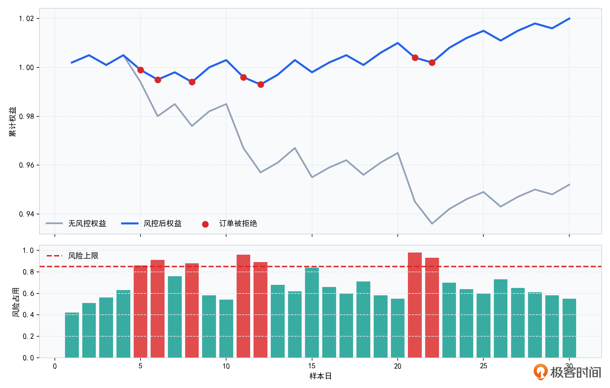
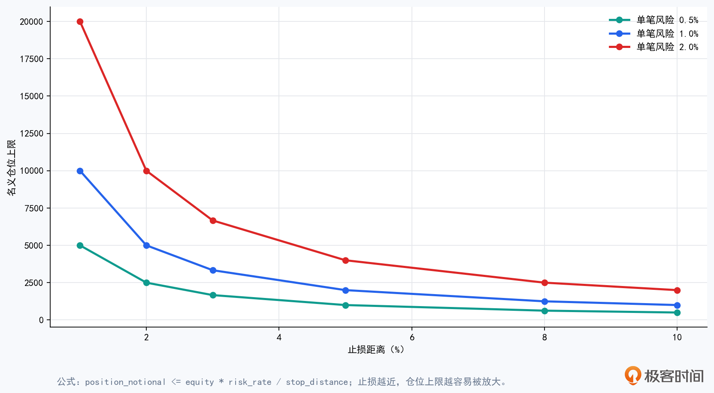
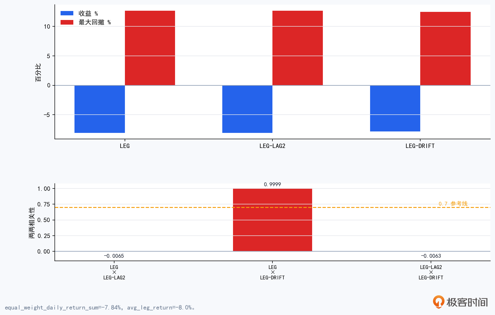

# 22 | 建立仓位、止损与组合风险控制

你好，我是袁从德。

第 21 讲我们已经说明：单次回测好看，不等于策略稳定。这节课再往前推一步：即使策略有研究价值，系统也要知道什么时候不能下单。真正危险的不是亏损本身，而是亏损、滑点、脏数据或系统事故已经出现时，交易链路还把新订单送进成交层。

这一讲要建立一条判断纪律：信号只产生订单意图，仓位、止损、滑点、异常行情、组合暴露和急停状态拥有成交前否决权。学完后，你应该能看着一条订单记录说清楚：它想买多少，账户还能承受多少，哪条规则允许或拒绝，拒绝后应该继续推进、降级观察还是停止研究。

本讲的交付物是一份风险规则与阻断记录。它不追求把收益调好看，而是回答七个可复核问题：单笔最多亏多少、单笔最多持有多少、账户总风险上限是多少、止损距离如何换算仓位、滑点多大就不交易、什么样的 K 线视为异常、急停状态如何让所有新订单失效。

这一讲先不从流程图或规则清单切入，而是把问题放回交易链路里：策略看见机会，只能提交“我想买或卖”的意图；系统是否允许它继续向成交层移动，必须由另一套更硬的规则判断。只有把这个位置说清楚，后面的表、图、代码和测试才不是装饰，而是审计证据。

## 1. 风控契约：下单前否决权

很多策略文档把风控写在最后：回撤太大就“降低仓位”，行情异常就“暂停交易”。这种写法没

```
有工程约束。合格的风控必须在下单前执行，并且留下可复查的 rule_id 和原因。
```

表 22-1 列出我们使用的真实模块。风险控制不是绩效解释的一部分，而是订单执行之前的否决权；收益指标描述“历史上赚亏多少”，风控规则回答“当前这笔意图是否允许继续”。

目标

- 对应文件

```
src/risk/manager.py
```

风险规则与管理器

```
src/risk/config.py
```

风险配置

```
src/strategy_engine/backtest/engine.py
```

回测内下单前门禁

```
src/risk/simulation.py
```

回测风险报告

```
src/backtest/rolling/portfolio.py
```

组合三腿比较

```
tests/test_risk_manager.py、
tests/test_backtest_lab.py、
```

风控测试样本

```
tests/test_quant_upgrade.py、
tests/test_project.py
```

- 表 22-1　本讲用到的真实代码入口

图 22-1 给出本讲的基本结构：策略只产生订单意图，真正进入成交前，要同时读取组合状态

```
和市场状态，再由 RiskManager 决定放行还是阻断。
```



- 图 22-1　订单从信号到成交前必须经过风险门禁

表 22-2 是本讲使用的最小规则集。它们不是收益优化器，而是订单否决权。

规则

- 仓库中的规则标识阻断对象实战含义

```
MAX_POSITION_PCT
```

最大仓位

- 超过账户暴露上限的订单防止一个信号把账户打满

```
MAX_DAILY_LOSS_PCT
```

最大回撤

- 回撤后继续加仓净值路径恶化时先停手

```
MAX_SLIPPAGE_PCT
```

最大滑点

- 高低价差过宽的成交防止在流动性差时被动成交

```
ABNORMAL_ORDERBOOK
```

异常 K 线

- 跳变、零价差等异常样本防止脏数据或插针驱动订单

```
EMERGENCY_HALT
```

紧急停止

- 所有新订单系统级事件下全局停机

- 表 22-2　最小风险规则集合

风控触发后，策略收益下降不一定是坏事。风控本来就会放弃一部分机会，换取回撤、尾部损失和操作事故的可控性。评价风控时不能只看最终收益，还要看阻断是否发生在正确的位置。

这五条规则覆盖五种失败模式，不能互相替代。最大仓位限制暴露规模，最大回撤限制账户状态，最大滑点限制成交质量，异常 K 线限制数据可信度，急停限制系统级状态。真实系统更

```
稳妥的做法是分层短路：只要任一关键规则返回 BLOCK，订单就停止向成交层移动。
这一讲的贯穿案例，是同一条 ma_crossover 回测在风险门禁前后的两种读法。错误读法是
```

只看绩效终点：策略最终权益 8464.93、收益 -15.35%、最大回撤 -17.67%，于是得出“收益不好、回撤偏大”的笼统结论，然后继续调短均线、长均线或止盈止损。这个动作很诱人，也很危险，因为它把风控失败当成参数问题。

正确读法要追到第一笔被拦截的订单。仓库当前固定样本显示，2025-03-31 系统仍想提交

```
BUY 意图，但账户权益已经从峰值 10000 回落到 8464.93，触发 MAX_DAILY_LOSS_PCT，
```

后续 176 笔新开仓意图都被阻断。这条证据会改变处理动作：不是继续调参追收益，而是先降级观察，确认回撤暂停、仓位上限、滑点和异常行情门禁都在成交前工作；只有这些证据成立，才讨论策略是否值得进入下一轮样本外测试。

表 22-3 把风险门禁拆成证据层级。每一层都要能被代码或记录复核，不能只停留在口头原则。

风险层

- 问题本讲字段或规则复核动作

```
OrderIntent.qty、side、symbol
```

订单意图

- 这笔订单想买卖多少记录原始

```
Portfolio.equity()、positions
```

账户状态

- 当前权益、现金和持仓是多少复算下单

- 当前 K 线是否可交易high、low、close、volume

市场状态

- 构造宽价

```
RiskManager.rules、rule_id
```

规则栈

- 哪条规则先命中检查首条

```
risk_rejections
```

审计记录

- 为什么拒绝，何时拒绝保存原因

- 表 22-3　风险门禁的证据层级

## 2. 实战案例：五类订单阻断

风险规则只有在反例里才能看出是否可靠。本节用仓库中的真实规则构造五类阻断样本：超仓、回撤后加仓、宽价差成交、异常 K 线和急停状态。它们都应在成交前被拦截，而不是在回测结束后补一句“风险较高”。

这里有一个常见误区：看到阻断变多，就以为系统“错过机会”。本讲反过来看，阻断记录越清

```
楚，越能区分两件事：策略没有 alpha，还是交易意图在错误状态下被正确拒绝。前者需要
```

停止或重做策略假设，后者需要保留门禁并继续观察。

### 2.1 规则阻断样本

代码 22-1 展示用真实规则构造一条超仓阻断样本。真实工程里不要只保存“订单失败”，要保存订单意图、组合状态、行情状态、触发规则和拒绝原因。

```python
from datetime import datetime, timezone
from decimal import Decimal
from risk import MaxPositionRule
from strategy_engine.backtest.candles import Candle
from strategy_engine.backtest.engine import StrategyContext
from strategy_engine.backtest.portfolio import Portfolio
from strategy_engine.backtest.protocol import OrderIntent, OrderSide, OrderType
rule = MaxPositionRule(max_notional_usd=Decimal("100"))
portfolio = Portfolio(initial_cash=Decimal("1000"))
ctx = StrategyContext(symbol="BTC/USDT", timeframe="1m", portfolio=portfolio)
candle = Candle(
   exchange="test",
   symbol="BTC/USDT",
   timeframe="1m",
   ts=datetime(2026, 5, 16, tzinfo=timezone.utc),
   open=Decimal("100"),
   high=Decimal("100.1"),
   low=Decimal("99.9"),
   close=Decimal("100"),
   volume=Decimal("1"),
)
intent = OrderIntent(
   symbol="BTC/USDT",
   side=OrderSide.BUY,
   type=OrderType.MARKET,
   qty=Decimal("2.0"),
)
result = rule.check(intent, ctx=ctx, portfolio=portfolio, candle=candle)
assert not result.allowed
assert result.rule_id == "MAX_POSITION_PCT"
print(result.reason)
```

- 代码 22-1　用真实规则构造一条超仓阻断样本

这个样本故意让订单名义金额为 200，而账户最大仓位只有 100。结果应该是阻断，而不是缩小成“看起来合理”的订单。风险管理器的职责是判定边界，是否改仓位要由策略或执行层显式处理。

### 2.2 回测阻断记录

风控如果只出现在回测结束后的报告里，就已经太晚了。

```
src/strategy_engine/backtest/engine.py 会在订单进入成交逻辑前调用风险检
查，并把拒绝结果写入 risk_rejections。src/risk/simulation.py 再把运行期阻断
```

和回测后检查合并成报告。

代码 22-2 展示从回测报告读取风险规则和阻断记录的入口。它是本讲最窄的复核路径：不需要启动 Web 应用，也不需要重生成所有图，只看固定样本下风险规则是否真的写入报告。

```
from src.research.report import build_report
report = build_report(short=3, long=7)
print(report["fusion"]["risk_rules"])
print(len(report["backtest"]["risk_rejections"]))
print(report["risk_checks"][0])
print(report["backtest"]["risk_rejections"][0])
```

- 代码 22-2　从回测报告读取风险规则和阻断记录

```
当前样本的真实结果是：运行期 MAX_DAILY_LOSS_PCT 阻断 176 笔；第一条阻断发生在
2025-03-31 的 BUY 意图上，原因是权益 8464.93 已经比峰值 10000 低 15.35%，超过 15%
```

的最大允许回撤。这个数字很重要，因为它说明风控不是一句“注意回撤”，而是在具体日期、具体订单、具体阈值上做出了否决。

```
这条记录也给出一个边界场景：回撤门禁在 MaxDrawdownRule 中只拦截 BUY，不拦截
SELL。原因很朴素，亏损后继续开新仓会放大路径依赖，退出或减仓则可能是降低风险。复
核时要看 side 字段，不能把所有订单拒绝都当成安全，也不能把允许卖出误读成风控失效。
读这条记录时要看四个字段。date 告诉你阻断发生在路径上的哪一天，避免只看终点；
side 告诉你被拦的是继续买入还是退出动作；rule_id 告诉你是哪条规则生效，方便回到
测试样本复核；reason 则保留权益、峰值和阈值。如果只有“风险过高”四个字，没有这些字
```

段，就不能支撑继续推进或停止研究的判断。

表 22-4 把这类审计信息压成可复核摘要：哪些规则启用、阻断多少笔、组合三腿是否真的分散、下一步如何处理。它比图片更适合放进交付物，因为每一项都可以回到报告字段或测试样本复查。

- 表 22-4　风控审计摘要必须保留可复查阻断

## 3. 仓位与止损：先预算，再下单

仓位管理最常见的错误，是先决定“买多少”，再给它配一个止损。正确顺序应该反过来：先决定单笔最多亏多少，再用止损距离反推名义仓位上限。

表 22-5 给出本讲采用的两个风险预算口径。它们都属于人类风险偏好和产品边界，不应由工具自动猜测。这里第一次出现的“风险预算”，指的是允许一笔交易或一组持仓在触发止损时最多损失多少账户权益；它判断的不是收益潜力，而是亏损上限。

口径

- 含义示例

- 权益 10000，单笔风险 1%，最多亏

单笔交易风险预算

- 本笔交易最多允许亏损的账户比例

账户总风险上限

- 所有未平仓止损风险的合计上限所有持仓触发止损时，合计亏损不超

- 表 22-5　风险预算先于仓位数量

### 3.1 仓位上限公式

单笔风险预算写成：

- ​ =

## risk_budget

## E ×

## r

- ttradetrade​

## d

如果止损距离是

- ，名义仓位上限就是：stop​

## risk_budget

- trade

## position_notional ≤

- ​

## d

- ​stop​

图 22-2 展示这个公式的副作用：止损越近，公式给出的仓位上限越大。比如权益 10000、单笔风险 1% 时，3% 止损对应名义仓位约 3333.33；1% 止损会放大到 10000。也就是说，紧止损不是天然保守，它可能把仓位推得更大。



- 图 22-2　止损越近，按风险预算反推的仓位上限越容易放大

止损不是一个独立按钮，它和仓位是一组联立约束：止损越远，单位仓位亏损越大，仓位上限应下降；止损越近，公式允许更大名义仓位，但也更容易被噪声扫出，并且可能放大滑点和手续费影响。因此仓位上限还必须再经过最大仓位、最大总风险、最小流动性和最大滑点规则。单笔风险预算给的是第一道上限，不是最终下单数量。

一个常见误区是把“止损设得更紧”当成降低风险。按上面的公式，权益 10000、单笔风险 100时，止损距离从 5% 缩到 1%，名义仓位上限会从 2000 放大到 10000；如果交易品种流动性一般，1% 的噪声波动、手续费和滑点反而可能更快吞掉预算。

```
看到这种结果，处理动作不是机械下单，而是把仓位裁剪到 MAX_POSITION_PCT 以内，并
```

要求滑点、最小成交量和异常 K 线检查同时通过。若这些字段缺失，本次研究只能标为“需要补口径”，不能进入执行讨论。

表 22-6 汇总可复核的仓位记录字段。

字段

- 含义本讲检查

```
equity
```

- 当前账户权益风险预算的基数

```
risk_per_trade_pct
```

- 单笔最多亏损比例人类设定，不由工具猜测

```
stop_distance_pct
```

- 入场到止损的距离决定名义仓位上限

```
max_position_notional
不能超过 MAX_POSITION_PCT
```

- 最大名义仓位

```
aggregate_open_risk
```

- 未平仓止损风险合计不能突破组合风险上限

```
liquidity/slippage
```

- 成交质量约束宽价差或异常样本直接拒绝

- 表 22-6　仓位计算必须保留的字段

### 3.2 分数 Kelly 的边界

分数 Kelly 可以作为仓位参考，但不能覆盖硬约束。Kelly 的基础形式是：

## 1 −p

- ∗

## f =

## p −

## b

- ​

实际使用时还要乘以折扣系数：

- ∗​ =

## αf ,

## 0 <

## α ≤1

## f

- used

表 22-7 给出更稳妥的写法。

项目

- 合格写法问题写法

- 本笔最多亏损不超过权益 1%

单笔风险

- 机会好就多买

- 未平仓止损风险合计不超过权益 6%

总风险

- 每个信号单独满仓

- 表 22-7　分数 Kelly 只能作为仓位输入，不能替代风控规则

```
Kelly 公式第一次出现时要先说清用途：它用胜率 p 和盈亏比 b 估算重复下注下理论资金比
```

例，判断的是“如果输入可靠，长期对数增长偏好会支持多大仓位”。Kelly 原始论文讨论的是，重复下注下最大化资本对数增长率，这个背景能解释它为什么会给出“最优比例”，也提醒我们：输入概率一旦估错，最优比例会迅速变成过度下注。

本专栏的离线教学样本里，胜率和盈亏比都不稳定；如果用样本内胜率直接推仓位，很容易把第 20 讲和第 21 讲刚刚识别出的过拟合风险重新放大成真实风险。因此课程里只能把 Kelly 写成参考输入，并且要经过分数折扣和硬风控裁剪。自动化工具可以复算 Kelly 数字，但不能替

```
人决定 alpha、单笔风险比例或账户总风险上限。
```

## 4. 组合风险：不要把高相关腿当作分散

单个策略腿被风控限制以后，还要检查组合层面的风险。很多“多策略组合”只是同一信号的轻微变体，相关性很高时，三条腿并不会自动分散风险。

```
代码 22-3 使用仓库里的 compare_portfolio() 做三腿比较。
from src.backtest.rolling.portfolio import compare_portfolio
summary = compare_portfolio(strategy_name="ma_crossover", limit=120)
for leg in summary["legs"]:
   print(
       leg["symbol"],
       leg["total_return_pct"],
       leg["max_drawdown_pct"],
       leg["total_trades"],
       leg["sharpe_ratio"],
   )
print(summary["pair_correlations"])
print(summary["equal_weight_daily_return_sum_pct"])
print(summary["equal_weight_leg_avg_return_pct"])
```

- 代码 22-3　用三腿组合检查风险是否真的被分散

```
当前样本结果并不好看，但很适合教学：WEB3-DEMO/USDT 收益 -8.09%、最大回撤
12.68%、交易 4 笔；WEB3-DEMO-LAG2/USDT 基本相同；WEB3-DEMO-DRIFT/USDT 收益
```

-7.82%、最大回撤 12.47%、交易 4 笔。等权组合日收益合计为 -7.84%，平均单腿收益为-8.0%。

图 22-3 把三条组合腿的收益和最大回撤放在一起，帮助你看清“名字不同”和“风险独立”不是一回事。更关键的是相关性：基础腿与 drift 腿相关性约 0.9999。它们几乎是同一个风险来源，不能当成两条独立策略来提高组合风险预算。基础腿与 lag2 腿在这个短样本里的相关性接近

```
0，也不能直接宣布“已经分散”：两条腿来自同一份 data/prices.csv 派生序列、同一套均
```

线规则，交易次数也都只有 4 笔，样本厚度不足。正确动作是把它们标为教学对照腿，继续补样本或换独立数据源，而不是提高实盘风险预算。



- 图 22-3　三腿收益、回撤与两两相关性对照

这就是组合案例里的对比：榜单式读法会说“三条腿里 drift 亏得少，是候选冠军”；风险读法会说“三条腿都为负，且一条几乎复制基础腿，另一条样本太薄”。前者会推动加仓，后者要求停止提高组合风险预算，只保留为组合审计字段演示。

组合风控至少要做三件事：

1. 单腿风险预算不能直接相加，相关性高的腿要合并看风险。

2. 同方向、同标的、同信号来源的暴露要设总上限。

3. 回测报告要同时展示收益、最大回撤、相关性和阻断记录。

组合风险的核心不是“持有更多名字”，而是“持有更多不同风险来源”。如果三条腿都来自同一份价格序列、同一套均线信号和相近的进出场逻辑，它们在压力场景里很可能一起亏。相关性接近 1 时，等权组合只是把同一个风险复制了三遍。这时提高组合风险预算，相当于对同一风险源加杠杆。

表 22-8 汇总组合风险记录的最低字段。

项目

- 为什么重要本讲样本的启发

单腿收益与回撤

- 看每条腿自己的风险路径三腿收益都为负

单腿交易次数

- 判断是否只是样本太薄交易少时解释要降级

- 相关性约 0.9999，不能算分散

两两相关性

- 判断风险是否独立

等权组合收益

- 检查组合后是否改善等权结果仍为负

暴露来源

- 看是否同标的、同信号、同周期派生腿不是独立市场

- 表 22-8　组合风险记录的最低字段

```
组合部分最容易犯的错，是把 legs=3 写成“完成分散”。正确写法应该是：本讲三腿只是教学
```

组合，且高度相关；它用于演示组合审计字段，不证明组合风险已经分散。

组合结论要落到动作上：如果相关性接近 1，合并风险预算或停止增加同源腿；如果相关性看似很低，但交易次数只有个位数，降级为“证据不足”，补更长窗口和更多市场状态；只有当收益路径、回撤路径、交易次数、相关性和数据来源都支持不同风险来源时，才讨论提高组合层面的风险预算。

## 5. 验收与复核入口

一份合格的仓位、止损与组合风险控制设计，不是写几条原则，而是能通过检查、复算和审计。验收时要证明每条风险边界在哪里生效、失败时在哪里停下、哪些阈值仍需人类确认。表22-9 汇总本讲的验收清单。

检查项

- 通过标准

```
订单成交前调用 RiskManager.check()
```

下单前门禁

```
每条拒绝有 rule_id、时间、订单意图和原因
```

阻断记录

仓位公式

- 用风险预算和止损距离反推仓位上限

回撤暂停

- 达到阈值后停止新开仓或进入保护模式

- 表 22-9　仓位、止损与组合风控验收清单

本讲核心结论可以用两条窄口命令复核。第一条检查风险规则、回测阻断和组合比较仍然可用。

```
$env:PYTHONPATH="src"
python -m pytest tests/test_risk_manager.py tests/test_backtest_lab.py::test_teac
```

第二条直接输出组合三腿证据，复核收益、回撤、交易次数和相关性。

```
python scripts/backtest_lab.py portfolio --strategy ma_crossover --limit 120
```

- 输出：

```json
{
 "ok": true,
 "strategy_key": "ma_crossover",
 "legs": [
   {
     "symbol": "WEB3-DEMO/USDT",
     "weight": 0.3333,
     "total_return_pct": -8.09,
     "max_drawdown_pct": 12.68,
     "sharpe_ratio": -7.19,
     "total_trades": 4
   },
   {
     "symbol": "WEB3-DEMO-LAG2/USDT",
     "weight": 0.3333,
     "total_return_pct": -8.09,
     "max_drawdown_pct": 12.68,
     "sharpe_ratio": -7.19,
     "total_trades": 4
   },
   {
     "symbol": "WEB3-DEMO-DRIFT/USDT",
     "weight": 0.3333,
     "total_return_pct": -7.82,
     "max_drawdown_pct": 12.47,
     "sharpe_ratio": -6.93,
     "total_trades": 4
   }
 ],
 "pair_correlations": [
   {
     "a": "WEB3-DEMO/USDT",
     "b": "WEB3-DEMO-LAG2/USDT",
     "correlation": -0.0065
   },
   {
     "a": "WEB3-DEMO/USDT",
     "b": "WEB3-DEMO-DRIFT/USDT",
     "correlation": 0.9999
   },
   {
     "a": "WEB3-DEMO-LAG2/USDT",
     "b": "WEB3-DEMO-DRIFT/USDT",
     "correlation": -0.0063
   }
 ],
 "equal_weight_daily_return_sum_pct": -7.84,
 "equal_weight_leg_avg_return_pct": -8.0,
 "diversification_hint": "pair correlation < 0.7 suggests legs are not identical
 "assumptions": [
   "Three legs derived from data/prices.csv (base, 2-bar lag, mild drift).",
   "Equal weight rebalance implicit in daily return average.",
   "No cross-leg margin or funding — teaching aggregation only."
 ]
}
```

- 外部资料只用于建立口径，不能替代本仓库的验证。Kelly criterion 原始论文说明该方法关注重复下注下的对数资本增长，适合解释“为什么仓位比例依赖胜率和赔率”，但不能替代本讲的硬风控。QuantConnect LEAN 文档也把 Risk Management 放在 Portfolio

- Construction 之后、Execution 之前：风险模型先调整目标仓位，执行模型再负责下单；同时，Buying Power、Fee、Slippage 等现实约束在 LEAN 中另有模型化入口。这与本讲“成交前门禁”的工程位置一致，但本讲结论仍以仓库中的测试、报告和阻断记录为准。

## 总结

这节课开头的问题是：策略有研究价值时，系统是否知道什么时候不能下单。答案不靠口号，而靠成交前否决权。合格的风控，不是回测结束后的绩效解释，而是订单进入成交层之前的硬契约。

到这里，策略研究已经有了绩效、稳定性和风控三类证据。下一讲要解决的是呈现问题：怎样把收益、回撤、阻断、组合暴露和人工处理动作放进同一个信息架构里，让你一眼看出系统现在是继续推进、降级观察，还是应该停止研究。

## 思考与练习

```
概念复核：说明 MAX_POSITION_PCT、MAX_DAILY_LOSS_PCT、
MAX_SLIPPAGE_PCT、ABNORMAL_ORDERBOOK 和 EMERGENCY_HALT 各自拦截的风险。
```

2. 公式复核：权益 20000、单笔风险 0.5%、止损距离 4% 时，名义仓位上限是多少？

3. 实践复核：构造一条超仓订单和一条异常 K 线订单，记录订单意图、组合状态、触发规则、阻断原因和后续处理决定。

期待你的分享。如果今天的课程让你有所收获，也欢迎转发给有需要的朋友，邀请他来一起学习，我们下节课再见！
