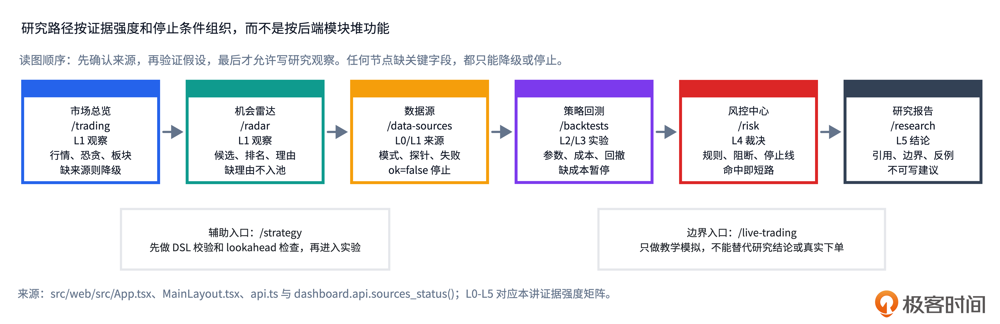
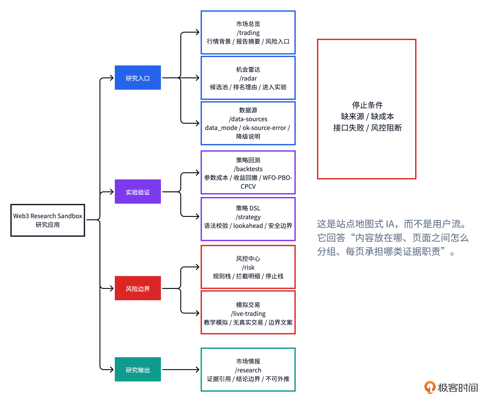
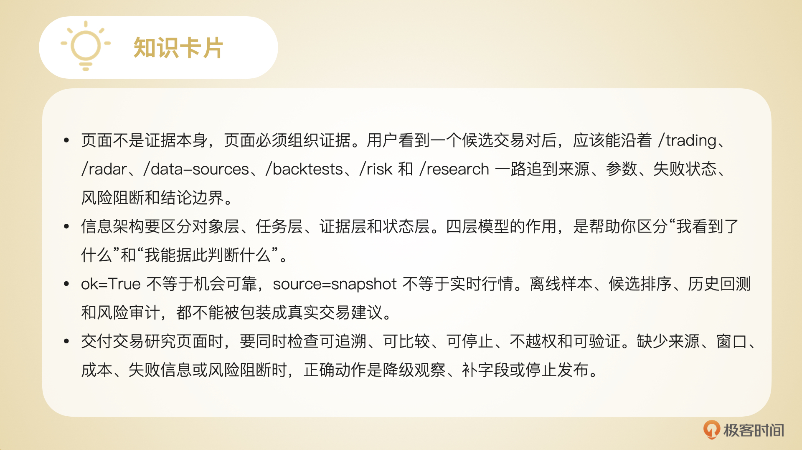

# 23 | 设计交易研究应用的信息架构

你好，我是袁从德。

第 22 讲我们把风险门禁放到下单前，这一讲把研究流程放进 Web 应用。真正危险的界面，是把“离线样本”“候选观察”“历史回测”和“风险阻断”包装成同一种确定结论。本讲要解决的问题是：用户看到一个候选交易对时，能不能沿着页面一路追到来源、参数、失败状态、风险边界和研究结论。

带走的判断纪律很简单：页面不是证据本身，页面必须组织证据。任何无法追溯、无法比较、无法停止、无法说明边界的卡片，都只能降级为提示，不能写成结论。

下面我们不会讨论页面好不好看，而是讨论页面怎样组织研究证据。一个合格的交易研究界面，应该能看清楚自己正在阅读哪一类证据、证据来自哪里、结论最多能推进到哪一步，以及什么时候必须停下。后面的图和表都围绕这条证据路径展开。

## 1. 研究应用的信息架构框架

信息架构（Information Architecture，简称 IA）不是给页面换一个漂亮目录，而是组织内容、标签和导航，让用户能找到信息，并理解信息之间的关系。NN/g 的 IA 指南强调，IA 与导航相关，但不等同于导航。

放到交易研究应用里，这句话可以翻译成：菜单能点开只是第一步，用户还要知道每个页面在证据链里承担什么职责。

### 1.1 从路由排出研究路径

图 23-1 展示交易研究应用的证据路径。它不只画页面顺序，还把每一步能支持的证据等级和停止条件放在一起：市场总览不是终点，而是把用户带到候选、来源、回测、风控和研究结论的入口。



- 图 23-1　交易研究应用的证据路径与停止点

为了让这条路径可复核，本讲只使用仓库中的真实文件作为样本。前端路由来自

```
src/web/src/App.tsx，导航来自 src/web/src/layouts/MainLayout.tsx，API
封装来自 src/web/src/api.ts，后端数据源状态来自 src/dashboard/api.py。
```

表 23-1 汇总本讲用到的代码入口。下面凡是提到页面、命令和字段，都要能回到这些文件。

目标

- 对应文件本讲看什么

```
src/web/src/App.tsx
```

前端路由

- 路径是否真实

```
src/web/src/layouts/MainLayout.tsx
```

左侧导航

- 页面顺序、命

```
src/web/src/api.ts
```

前端 API 封装

- 页面依赖哪些

```
src/dashboard/api.py
```

Dashboard 数据入口

- 来源状态和探

```
src/risk/simulation.py、
```

风险和报告上下文

- 风险阻断和研

```
src/research/report.py
```

- 表 23-1　本讲用到的真实代码入口

```
本仓库当前前端实际注册了 8 个研究相关路由。/live-trading 名字里有 trading，但在本
仓库里是教学模拟入口；/strategy 是策略 DSL 校验入口，服务于回测前的安全边界。表
```

23-2 把真实路由压成一条研究路径。你复核时不要先问“页面够不够多”，而要问“结论能不能从入口一路追下去”。

路由

- 页面职责必须看见

```
/trading
```

- 市场总览和跨页入口市场背景、样本来源、回测摘要、风险入口

```
/radar
```

- 候选扫描候选理由、排名口径、扫描状态

```
/data-sources
```

- 来源审计运行模式、来源层级、失败信息

```
/backtests
```

- 实验验证策略参数、成本口径、收益、回撤、稳健性指标

```
/risk
```

- 风控审计规则栈、阻断明细、停止线

```
/strategy
```

- 策略 DSL 校验validation errors、lookahead findings

```
/research
```

- 市场情报证据引用、结论边界、不可外推说明

```
/live-trading
```

- 教学 / 模拟 / 无真实交易边界教学模拟

- 表 23-2　真实路由与页面职责

这里有两个常见误区：

```
把后端模块当成页面，例如把 /api/dashboard/backtest/cpcv 单独做成一个页面。
```

- 用户关心的是“回测实验是否稳健”，不是后端函数名。

```
把高风险入口塞进普通研究流。/live-trading 必须持续显示教学、模拟、无真实交易
```

- 边界，不能因为导航里有“交易”二字就暗示可以实盘执行。

### 1.2 用四层模型补足信息架构

外部 IA 资料常把信息架构拆成组织系统、标签系统、导航系统和搜索系统。直接照搬到交易研究应用里会太泛，本讲把它翻译成四层研究模型：对象层、任务层、证据层、状态层。

对象层回答“用户正在看什么”，任务层回答“用户要做什么判断”，证据层回答“这个判断依赖什么材料”，状态层回答“什么时候必须降级或停止”。

四层模型可以这样落到当前仓库：

- 对象层：研究对象可能是交易对、候选、策略、风险规则或报告；页面要同时显示

```
symbol、strategy、rule_id、source_id 这类机器 ID 和你能理解的中文标签。
```

- 任务层：用户是在观察、比较、验证、审计还是模

```
拟；/radar、/backtests、/risk、/live-trading 的标题和主动作不能混在一
```

- 起。

- 证据层：结论来自样本、快照、实时 API、回测还是风险报告；必须保留来源、参数、窗口、成本和失败原因。

```
状态层：当前证据可推进、需降级、需补字段还是必须停止；ok、source、error、
overfit_warning、risk_rejections 必须变成用户看得见的文本状态。
```

图 23-2 按常见 IA 画法把应用画成站点地图：先分出研究入口、实验验证、风险边界和研究输出，再在每个页面节点里标出你必须看见的证据对象。



- 图 23-2　交易研究应用的信息架构图

这四层就是本讲的骨架。视觉稿可以变，组件可以换，但四层问题不能丢。比如

```
/backtests 页面如果只展示收益曲线，它只覆盖了对象层和一部分证据层。只有同时展示
strategy、样本窗口、成本预设、最大回撤、交易明细、Walk-forward、PBO/CPCV 和“假
```

设与限制”，它才更接近一个研究工作台。

```
当前 BacktestsPage.tsx 已经把 costPreset、data_source、
data_from/data_through、walkForward.overfit_warning、robustness.pbo
和 cpcv 放进页面路径。这些字段不只是工程细节，而是研究结论能否继续推进的状态阀门。
```

进一步说，交易研究应用的 IA 不能只追求“找得到页面”，还要追求“找得到停止理由”。

```
RiskPage.tsx 里的 risk_rejections、risk_checks、rule_id 和“运行时拦截 / 回
```

测后复核”分区，就是状态层的核心。它们告诉你研究什么时候被规则短路，而不是等到报告结尾才补一句风险提示。

### 1.3 把证据强度写进页面层级

量化研究最容易被界面放大的问题，是把不同强度的证据排成同一种卡片。离线快照、实时API、单次回测、样本外验证、风险阻断和人工研究结论，不能用同一种“成功态”呈现。

- Bailey、Borwein、López de Prado 和 Zhu 关于回测过拟合的论文提醒我们：大量试验后的漂亮回测结果本身可能是数据挖掘产物。López de Prado 的 Deflated Sharpe Ratio 与CPCV 思路也在强调同一件事：研究结论要把试验次数、样本外表现和过拟合概率纳入解释。

表 23-3 可以直接作为页面评审表。L0/L1 证据只能给“可读、可观察、可复现”的语言；L2 证据要绑定成本、窗口和风险；L3 证据要把失败路径也展示出来；L4 证据必须允许它打断用户继续推进。换句话说，信息架构不是把所有信息放上去，而是规定每类信息最高只能支持什么话。

证据等级

- 示例页面可写成

```
.env、ok=True、API 可返回
```

L0 配置 / 连通

- 来源可用或样本可读

```
source=snapshot、候选列表、新闻摘要
```

L1 观察样本

- 离线样本观察

L2 单次实验

- 单次 rolling backtest、收益曲线某组假设下的历史模

- Walk-forward、窗口比较、PBO（回测过拟合概率）、

L3 稳健性证据

- 样本外 / 过拟合复核CPCV（组合清洗交叉验证）、DSR（修正夏普比率）

```
risk_rejections、KillSwitch、回测后复核
```

L4 风险裁决

- 通过、阻断或停止研

```
/research 汇总、报告边界
```

L5 研究结论

- 研究观察和课程结论

- 表 23-3　证据强度矩阵

## 2. 贯穿案例：快照数据不能被写成实时机会

先看一个容易误判的场景：机会雷达显示候选列表，数据源页也显示“接入状态正常”。如果页面只给绿色状态，你很可能得出“当前实时机会可用”的结论。这个结论在当前仓库样本下不成

```
立。本地数据源探针显示的是 snapshot，它适合复现教学，不等于实时行情。
```

### 2.1 先复核数据源状态

我在本地运行了下面的窄口命令，只读取后端数据源状态入口：

```
$env:PYTHONPATH='src'
python -c "from dashboard.api import sources_status; payload=sources_status(); pr
```

- 代码 23-1　复核数据源状态的窄口命令

当前输出摘要如下：

```
env.data_mode= auto
web3_news Web3 news ok= True source= snapshot detail= None
web3_exchange web3交易所 行情 ok= True source= snapshot detail= None
valuescan ValueScan ok= True source= snapshot detail= None
dexscan DexScan ok= True source= snapshot detail= None
feargreed 恐贪指数 ok= True source= snapshot detail= None
radar 机会雷达 ok= True source= snapshot detail= None
```

- 代码 23-2　当前数据源探针输出摘要

```
这个案例的判断不在于“全部 ok，所以可以推进”，而在于 ok=True 和 source=snapshot
```

要同时解释。

错误写法是：机会雷达接入正常，可以继续研究当前机会。正确写法是：离线快照可用于复现课程路径，可以继续做界面和证据链复核，但不能把候选解释成实时市场机会。

```
如果输出变成 source=live，结论也不能自动升级为可交易。页面还要继续呈现扫描时间、
```

回测参数、成本、风险阻断和研究边界。把这段输出放进页面叙事里，会得到两种完全不同的产品判断。错误路径只看绿色状态，于是把“候选可显示”误读成“机会正在发生”。正确路径先

```
确认 data_mode 和 source，再把结论降级为“样本观察”。
```

这个降级不是保守措辞，而是防止三类误判：把旧快照当实时行情，把接口可用当结论可靠，把候选排序当买卖建议。此时可以继续推进的是页面证据链复核，而不是交易研究结论升级。

### 2.2 把数据源状态读成降级规则

这里不需要再画一张“全是 OK 和 snapshot”的图。真正有用的是把状态组合翻译成页面判断，让你知道什么能继续、什么必须降级、什么必须停止。表 23-4 把数据源探针的几个常见返回

```
组合，整理成页面写法规则。读这张表时，不要只看 ok，而要把 ok、source、更新时间和
```

失败文本放在一起判断。

状态组合

- 页面可以写成页面不能写成下一

```
ok=True 且 source=snapshot
```

- 离线样本可复现当前实时机会可用继续

```
ok=True 且 source=live
```

- 接口当前返回实时数据可以直接交易或推荐补扫

```
ok=False 且有 error/message
```

- 来源失败，原因可见暂时无数据但不影响判断停止

```
缺 source 或缺更新时间
```

- 证据状态不完整数据可信或已经刷新补字

- 表 23-4　数据源状态组合与页面降级规则

合格读法是：数据源可用于复现课程路径，但结论要降级为样本观察。不合格读法是：看到所有探针都是绿色，就把它写成实时市场机会。

这个案例需要你盯住六个判断点：

```
env.data_mode=auto 说明系统会按配置在实时与离线之间选择，页面不能只写“已连
```

- 接”。

```
web3_news 探针说明新闻摘要也是证据来源，不是装饰内容。
ok=True 只表示探针当前能返回 payload，不能单独推出结论强度。
source=snapshot 表示当前证据来自固定快照，只能写成样本观察。
error 或 message 必须显示给你，不能被空白卡片吞掉。
```

- 扫描时间或更新时间缺失时，结论就要降级为观察或补字段。

```
这个案例会贯穿后面的页面设计：/data-sources 要显示 source、ok 和失败文本；候选
页面可以展示理由，但要把候选的来源和扫描状态带出来；/backtests 要把候选进入实验
后的参数、成本、收益和回撤讲清楚；/risk 要说明哪些规则会让研究停止。
你看到 source=snapshot 时，合格结论是“继续做复现和界面复核”；看到 ok=False
时，合格结论是“停止研究并修复来源”；看到 source=live 但缺扫描时间或成本口径时，
```

- 合格结论也只是“补字段后再判断”。

## 3. 页面合同、数据源状态与验收

前面两部分我们建立了路径和案例，这一节把路径落到可检查的交付标准上。你需要同时看三件事：页面是否说清自己的证据职责，API 是否把失败和降级状态局部呈现出来，数据源与浏览器验收是否能证明页面没有越过研究边界。

下面先从页面、API 和证据源之间的合同讲起，再收束到数据源状态和交付验收。

### 3.1 页面、API 和证据源要签同一张合同

页面不是证据源，页面只是证据的阅读界面。真正的证据来自离线样本、快照文件、后端API、回测结果、风险报告和测试命令。表 23-5 把页面、API 和证据源串成一张合同表。

- 前端 API

页面

- 后端或数据源

```
/trading
fetchMarketCandles()、fetchReport()
data/prices.
/radar
fetchOpportunityScan()
```

- dashboard snap

```
/data-sources
fetchDashboardSources()
dashboard.ap
runRollingBacktest()、
/backtests
```

- rolling backtest s

```
fetchBacktestWalkForward()
```

- 表 23-5　页面到 API 到证据源的合同

这张合同表要按“字段是否能追溯”来验收，而不是按“页面是否好看”来验收。

```
DataSourcesPage.tsx 的 detail = probe.error || probe.source || ...
```

- 是一个合格的最小做法，因为它把失败文本和来源层级放进了用户可见区域。

```
BacktestsPage.tsx 的 chartRangeLabel 把 data_from、data_through、
data_source、data_saved_at 和 warmup_bars 拼成图表说明，这比只写“最近 120
```

- 根 K 线”更接近研究语境。

```
RiskPage.tsx 把 risk_rejections 做成可筛选表格，说明风险不是报告页脚，而是
```

- 可以阻断路径的主证据。

合同表还要反过来约束产品文案。凡是 API 没有返回的字段，页面和章节都不能编出来。例如

```
当前 sources_status() 的探针，只有 id/name/ok/source/error，没有每个探针独
立的 updated_at。所以本讲可以要求“后续应补更新时间”，但不能说当前页面已经完成时间
```

新鲜度审计。

完整实践从一个问题开始：系统使用者看到候选交易对后，如何一路追到风险结论？合格路径至少包含六步：

```
在 /trading 确认市场背景、数据模式和主图来源。
在 /radar 查看候选进入列表的理由、排名和扫描时间。
在 /data-sources 确认来源是 snapshot、live、上游代理还是降级数据。
在 /backtests 查看策略参数、成本口径、收益和最大回撤。
在 /risk 查看 RiskManager 规则栈、运行时阻断和回测后复核。
在 /research 输出研究观察，并保留“不是投资建议”的边界。
```

代码 23-3 给出一条可复查的路径记录模板。这个模板不是业务配置，而是审计页面证据链时可以复制填写的最小记录。

```
research_path = {
   "entry": "/trading",
   "candidate_source": "/radar",
   "source_check": "/data-sources",
   "experiment": "/backtests",
   "risk_review": "/risk",
   "conclusion": "/research",
   "boundary": "研究观察，不是真实下单建议",
}
```

- 代码 23-3　交易研究应用路径记录模板

```
判断表的用法也要具体：如果路径能追到 snapshot、参数和风险阻断，可以继续做教学复
```

现；如果只看到排名，没有来源和扫描时间，降级观察；如果回测页不展示成本或最大回撤，暂停结论；如果风险页隐藏拒单或急停状态，停止推进界面发布。

### 3.2 API 分层决定失败状态能否局部呈现

```
src/web/src/api.ts 已经把前端证据拆成多类 fetch 函数：市场背景、行情 /K 线、回测
```

实验、信号 / 策略、来源状态等。信息架构设计时，不只要画页面框图，还要画数据入口。代码 23-4 展示三个典型前端 API 入口。它们分别服务数据源审计、机会候选和回测实验，页面展示字段必须能追到这些调用的 payload。

```
fetchDashboardSources()       // /api/dashboard/sources/status
fetchOpportunityScan(...)     // /api/dashboard/opportunity-scan
fetchBacktestWalkForward(...) // /api/dashboard/backtest/walk-forward
```

- 代码 23-4　前端 API 入口要对应页面证据职责

API 分层的价值，是让页面能按证据粒度失败。市场行情失败，不应该让风险规则也消失；LLM 信号失败，不应该影响规则基线；CPCV 失败，不应该覆盖单次回测的原始结果。复核页面时，优先回答三个问题：这个页面依赖哪些 fetch 函数；每个 fetch 失败时用户看见什么；展示字段能否追到对应 payload、后端函数或数据文件。

这里还要补一个可访问性边界。W3C WCAG 2.2 对错误识别和状态消息的要求，都指向同一个产品原则：系统发生错误、等待、完成或结果变化时，我们应能通过文本理解发生了什么。

```
交易研究应用里的 ok=false、error、snapshot、fallback 不只是工程字段，也是
你判断证据强度的状态消息。如果某个接口返回 message，它也应该进入同一套文本呈现
```

- 口径。

### 3.3 每个页面都要有固定信息框架

为了避免页面越做越散，可以给研究应用规定一个固定信息框架：页面标题说明任务，顶部状态说明证据等级，中部主体展示可比较材料，侧边或底部展示失败、假设和下一步。这个框架比单纯的组件库更重要，因为它保证你进入任何页面都能用同一种方式复核证据。

市场总览要在顶部交代当前标的、数据模式和样本窗口，主体放价格 / 指标、候选入口和报告摘要，底部或侧边保留来源、刷新状态和风险入口。机会雷达要交代候选池范围、排名口径和扫描状态，主体放候选列表、分数、理由和风险标签，后续动作只能是进入回测配置，不能是下单。

```
数据源页要把 data_mode 和每个探针的 ok/source/error 放出来。回测页要把策略、样
```

本、成本、预热窗口、收益、回撤、交易明细、Walk-forward、PBO/CPCV 和假设限制串起来。风控页要把规则栈、运行阶段、拦截明细和停止线放在主路径里。研究报告页则负责把研究问题、证据路径、观察、反例和不可外推说明收束起来。这套框架可以直接检查当前代码。

```
MainLayout.tsx 的左侧导航，已经把研究路径分成市场总览、深度分析、策略回测、模拟
```

交易、数据源、风控中心、策略 DSL、市场情报，但导航顺序本身不等于 IA 完成。

真正要检查的是：每个页面顶部有没有交代任务，主体有没有展示可比较证据，底部有没有给

```
出失败、假设或下一步。当前 /live-trading 放在“策略回测”和“数据源”之间，导航上足够
```

显眼，所以它更需要持续显示“模拟交易”和“教学 / 无真实交易”边界，避免被误读成研究路径的自然终点。

### 3.4 数据源页要暴露来源，而不是制造安心感

交易研究应用会同时面对离线样本、直连公开 API、上游代理和本地缓存。用户必须知道当前看到的结果来自哪里。否则同一个指标，在“离线样本”和“实时接口”下会被误读成同一种事实。

```
代码 23-5 是后端状态入口。页面不需要理解每个数据供应商的细节，但必须把当前 probes
里的 ok、source、error 暴露出来。data_mode 位于 env 下，用来解释系统为何可能返
```

回离线快照。

```
如果后续 payload 增加 message 或更新时间，也要进入同一套展示口径。
from dashboard.api import sources_status
payload = sources_status()
for probe in payload["probes"]:
   print(probe["name"], probe["ok"], probe.get("source") or probe.get("error"))
```

- 代码 23-5　后端数据源状态入口

数据源页面的最低出版要求很简单：

```
必须显示 source，用来区分 snapshot、live 和 web3-trading-upstream。
必须显示 ok，让用户知道当前来源是否可用。
必须显示 error 或后续可能增加的 message，避免接口失败时只剩空白。
必须显示 data_mode，说明当前是离线优先、实时优先还是自动选择。
updated_at 或扫描时间，暂时不是当前探针统一提供的字段，但它是后续应补的关键字
段，因为它能避免旧快照被误认为实时状态。这里的判断线很硬，但理由很朴素：snapshot
支持复现教学；live 支持观察当前状态；fallback 只支持有限结论。页面若不显示这些状
```

态，我们很可能会把三种不同证据强度误读成同一种事实。

```
当前 DataSourcesPage.tsx 会把探针映射为 id/name/ok/detail，其中 detail 来自
probe.error || probe.source，这能让你看到 snapshot 或错误文本。它还没有把每
```

个探针的更新时间单独展示出来，因此这里只能把当前页面评价为“来源状态可见，时间新鲜度仍需人工复核或后续补字段”，不能夸大成完整实时审计。

### 3.5 边界与浏览器验证

交易研究界面不是越炫越好。它要支持比较、追溯、失败可见和停止。页面可以分工，但整条导航路径必须覆盖来源、更新时间、候选理由、参数、风险状态和失败信息；同时，模拟交易入口必须和研究结论保持清晰边界。表 23-6 给出信息架构验收标准。

要求

- 通过条件不通过时怎么处理

可追溯

- 每个信号能回到数据源、扫描时间和候选理由缺来源就降级为观察

可比较

- 策略、窗口、成本和风险指标能并排比较缺成本或窗口就暂停结论

可停止

- 风险状态、阻断记录和失败状态可见风险不可见就停止发布

不越权

- 页面不把研究观察写成真实交易建议改写为样本观察或模拟说明

- 路由、API、测试和截图能复现

可验证

- 补命令、截图或文件依据

- 表 23-6　交易研究应用信息架构验收标准

一个实用的判断方法是：删掉所有装饰色和大标题后，页面还能不能告诉你“我为什么看到这个结论”？如果不能，说明信息架构没有承担证据组织职责。失败状态也要进入同一套验收：数据源不可用、LLM 降级、策略校验失败、CPCV 复核不稳健、风险拒单、急停触发，都不能被空白区域或成功态卡片覆盖。

```
研究入口和模拟入口的边界也要写进页面：/trading 可以展示市场背景、回测摘要和风险
入口，但不能暗示当前结果可直接交易；/radar 可以展示候选、分数和理由，但不能写成买
入建议；/backtests 可以展示实验结果和假设，但不能把历史模拟收益写成未来收益。
/risk 可以展示规则、阻断和停止线，而且不能隐藏阻断来美化结果；/live-trading 只
```

能做教学模拟和状态演示，不能连接真实账户或下真实订单。

浏览器验证之所以放在本讲，是因为 IA 不是只看 Markdown 能完成的工作。文档可以声称

```
/risk 展示拒单，但只有打开页面或检查组件，才能知道拒单是否真的出现在用户路径里。
```

第 27 讲会专门做完整浏览器验证，本讲先定义验收口径。

浏览器验收先不展开成完整测试脚本，只保留五个检查动作：

```
打开 /trading、/radar、/data-sources、/backtests、/risk，确认路由可
```

- 达。

2. 检查来源、更新时间、候选理由、参数和风险状态是否可见。

```
模拟接口失败，或读取 sources_status() 的失败字段。
```

4. 确认教学、模拟、无真实交易文案存在。

5. 保存关键页面截图，作为第 27 讲浏览器验证材料

## 总结

这节课我们把交易研究流程转化为页面结构。信息架构的价值，不是让页面看起来“功能很多”，而是把市场状态、候选来源、数据源、回测假设、风险状态和研究结论连成可追溯路径。



下一讲我们进入行情总览、机会雷达与数据源面板。本讲定义的研究路径，会落到第一个核心页面组合中：市场总览负责入口，机会雷达负责候选，数据源面板负责证据来源。

## 思考与练习

1. 边界判断：如果页面能展示候选数据但无法回到数据源和失败状态，是否满足研究应用的信息架构要求？说明理由。

```
实践复核：运行代码 23-1 的窄口命令，记录 data_mode、每个探针的 ok 和 source，
```

- 并写出“继续推进、降级观察、停止研究、需要补字段”中的一个判断。

期待你的分享。如果今天的课程让你有所收获，也欢迎转发给有需要的朋友，邀请他来一起学习，我们下节课再见！
