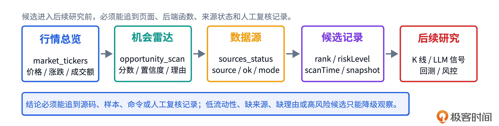
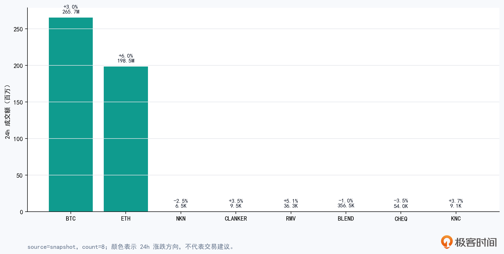
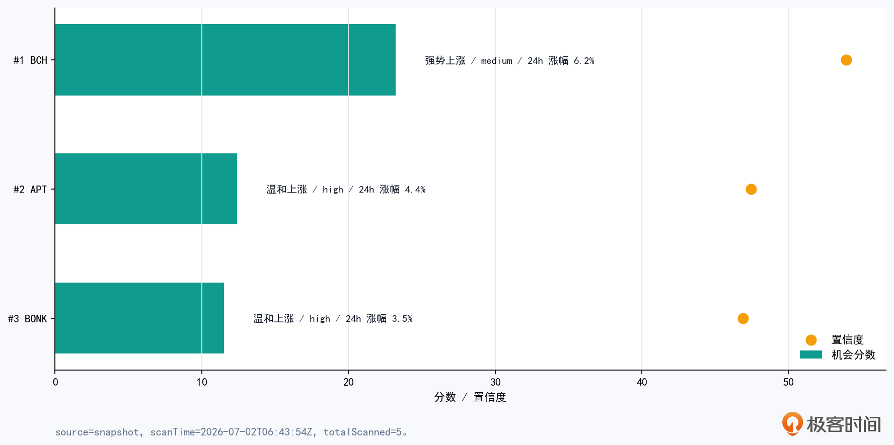
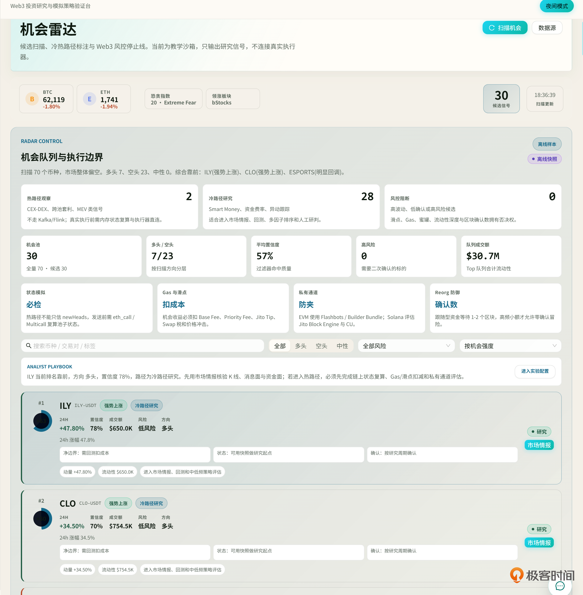
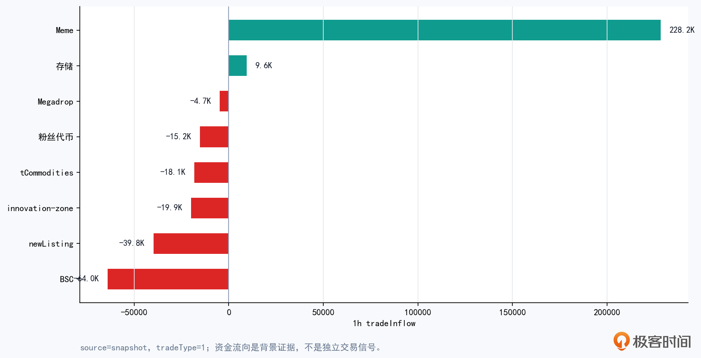
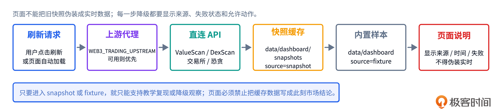
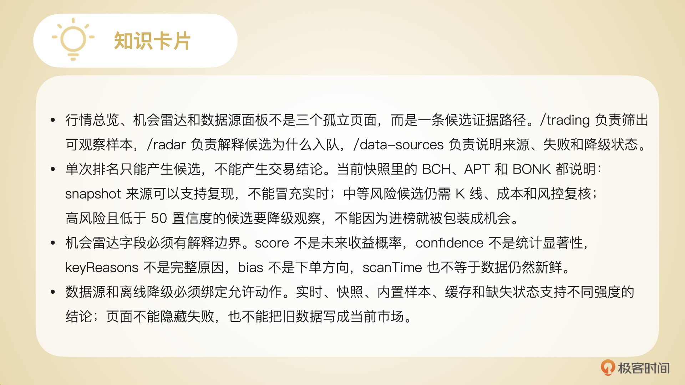

# 24 | 构建行情总览、机会雷达与数据源面板

你好，我是袁从德。

交易研究应用最容易在入口处误导人：一个币涨得快、排在榜首、颜色很醒目，你就会下意识把它当成“机会”。这一讲要解决的不是怎样做一个更热闹的行情页，而是怎样让行情入口先回答三个问题：数据从哪里来，候选为什么出现，证据够不够进入下一步研究。

学完这一讲，你应带走一条判断纪律：行情总览只负责筛出可观察样本，机会雷达只负责给出可解释候选，数据源面板负责说明证据的新鲜度和降级状态。任何一个环节缺少来源、时间、理由或风险标签，候选都只能降级观察，不能进入 K 线信号、回测或推荐语气。

本讲沿用仓库里的真实页面、后端接口和离线快照，但开篇先不堆函数名。你只要先记住一个反例：如果页面把“24h 涨幅最大”写成“最佳机会”，却没有显示成交额、来源、扫描时间和风险标签，那这不是研究入口，而是排行榜幻觉。

## 1. 入口证据合同：先防止排行榜幻觉

```
行情入口在产品上分成三个页面，在研究语义上是一条证据链：/trading 负责回答“市场样
本能不能看”，/radar 负责回答“哪些候选值得排队研究”，/data-sources 负责回答“当前
```

证据能不能相信”。图 24-1 把这条链路画成候选进入后续研究的路径。



- 图 24-1　行情总览、机会雷达与数据源面板的候选路径

### 1.1 先固定候选路径的真实入口

表 24-1 是本讲的真实代码入口索引。后文所有排名、分数、来源状态和样本数字，都必须能回到这些文件、函数或固定样本。

目标

- 对应文件或入口

```
src/web/src/pages/trading/DashboardPage.tsx
```

行情总览页面

```
src/web/src/pages/trading/RadarPage.tsx
```

机会雷达页面

```
src/web/src/pages/trading/DataSourcesPage.tsx
```

数据源面板

```
src/web/src/api.ts
```

前端 API 封装

```
src/dashboard/api.py
```

Dashboard 后端入口

```
src/dashboard/opportunity.py
```

机会扫描规则

```
data/dashboard/、data/dashboard/snapshots/
```

离线样本与快照

- 表 24-1　本讲使用的真实代码入口

你复核时不要先问页面是否好看，而要沿这张表从页面追到 API、规则函数和离线样本：页面展示了什么，API 返回了什么，规则如何生成候选，样本到底来自 snapshot 还是 fixture。

### 1.2 字段合同决定候选能走多远

这条入口合同可以压缩成四类字段：

链路对象

- 必看字段为什么看

```
symbol、last、changeRate、volValue、
```

行情总览

- 确认交易对、价格、涨

```
source
rank、score、confidence、keyReasons、
```

机会雷达

- 确认排名理由、规则强

```
riskLevel、scanTime
ok、source、data_mode、message/error、快
```

数据源面板

- 确认实时、快照、内置照时间

- candidate pair、source、risk约束 K 线、LLM 信号

后续研究入口

- 表 24-2　行情入口的证据合同

```
这里有两个术语需要在第一次出现时说清楚。source 是数据来源标签，用来区分实时接口、
上游代理、落盘快照和内置样本；data_mode 是运行模式，用来说明当前系统偏向实时、自
```

动降级还是离线优先。它们不只是工程状态，而是研究结论能否成立的边界。为了避免和仓库行为脱节，本讲只引用真实后端入口。代码 24-1 展示行情入口最小复核路径。

```python
from dashboard import api
tickers = api.market_tickers(limit=8)
scan = api.opportunity_scan(top_k=5, max_symbols=30)
sources = api.sources_status()
```

- 代码 24-1　行情入口使用的三个真实数据函数

```
当前固定快照下，一次只读探针显示：market_tickers(limit=8) 的前两大成交额样本
为 BTC-USDT 和 ETH-USDT；opportunity_scan(top_k=5, max_symbols=30) 来自
snapshot，返回 BCH、APT、BONK 三个候选；sources_status() 中 Web3 交易所行
情、ValueScan、DexScan、恐贪指数和机会雷达均可用，来源为 snapshot。这些名字不是
```

永久结论，只说明当前快照能复现这一组候选。

## 2. 从候选到样本：排名不能直接变成机会

```
这一节用同一批快照候选贯穿三个页面：先看排名第一的 BCH 为什么仍然不能直接升级成机
```

会确认，再看行情总览怎样用流动性过滤样本，最后看机会雷达怎样解释排名。主线只有一条：候选可以进入研究队列，但不能直接变成交易结论。

### 2.1 第一名为什么不能直接叫机会

```
当前机会雷达把 BCH 排在第一，分数为 23.2，置信度为 53.932，风险标签为 medium，
理由是 24h 涨幅 6.2%。错误写法会把这行数据改写成：“BCH 今日机会最高，建议重点关
```

注。”这句话的问题不在语气，而在证据越界：它只取了排名和涨幅，绕过了来源、流动性、风险和后续验证。

正确读法要分三步：

```
看 source=snapshot，说明这不是此刻实时市场，只能作为可复现教学样本。
看 riskLevel=medium 和 confidence=53.932，说明规则给出了较强候选，但还没有
```

- 达到可以越过复核的程度。

```
看 keyReasons 只有一条涨幅原因，说明它解释了入榜触发，却没有覆盖 K 线结构、成
```

- 本、滑点、回测和风控。

```
同一批候选里还有一个更好的反例：APT 排名第二，score=12.4、
confidence=47.428、riskLevel=high，入榜理由是 24h 涨幅 4.4%。如果页面只按
```

“榜单第二”展示醒目卡片，你会误以为它和第一名处于同一可信层级；如果页面把

```
confidence、riskLevel 和理由一起显示，结论就会变成“这是一个高风险、低于 50 置信
```

度的偏多候选，需要先观察，不应推进到推荐语气”。

如表 24-3 所示，当前三条候选的可执行判断如下：

候选

- 当前证据处理结论

```
snapshot 来源，涨幅触发，
BCH
```

- 可进入 K 线复核，但不能写成

```
riskLevel=medium，置信度约 54
APT
涨幅触发，riskLevel=high，置信度不足 50
```

- 降级观察，先补充流动性、K

```
BONK
涨幅触发，riskLevel=high，置信度不足 50
```

- 降级观察，不因进入前三就提

- 表 24-3　当前快照候选的判断动作

这张表比“谁排第一”更重要。它把候选从单次排名变成可执行动作：继续推进、降级观察、停止研究、需要补证据。你要形成这种判断，而不是记住某个快照里的币名。

### 2.2 行情总览先看流动性

行情总览不是让你追涨，而是先判断样本是否具备进入研究的最低条件。

```
DashboardPage.tsx 会调用 fetchMarketCandles()、fetchOnchain()、
fetchSectorFund()、fetchAiPicks() 等入口，把主图、恐贪指数、板块和候选数量放
```

在同一页。页面顺序应先服务研究判断，再服务视觉热闹。

```
图 24-2 使用 market_tickers(limit=8) 画出 24h 成交额，并先按 volValue 重新排
序。横轴使用对数刻度，是为了让 BTC-USDT、ETH-USDT 和低流动性样本能放在同一张图
里比较；虚线给出 100K 观察线和 1M 研究线。颜色表示 24h 涨跌方向，不代表买卖方向。
```



- 图 24-2　行情总览应先看流动性，再看涨跌方向

```
这一页最容易发生的误判，是把涨幅当成优先级。当前快照中，BTC-USDT 和 ETH-USDT 是
前两大成交额样本；NKN-USDT 虽然也在前 8 行里出现，但 24h 成交额只有约 6484.28。如
果只看涨跌颜色，你会把它和高流动性交易对放在同一层；如果先看 volValue，它就应被
```

降级为低流动性观察样本。

行情总览的窄口判断规则可以这样写：

```
先看 source 和 data_mode。snapshot 适合复现，不适合写成此刻行情；fixture 主
要服务离线演示；live 才能支持当前市场观察，但仍要看失败状态。
再看 volValue。成交额太低时，价格跳动、滑点和盘口深度会放大指标噪声，后续 K 线
```

- 和回测容易失真。

```
再看 changeRate。它只能说明 24h 背景，不能替代信号、成本和风控。
```

4. 最后才进入 K 线、LLM 信号、回测或风险页。

Codex 复核这个页面时，重点不是“页面好不好看”，而是检查排序、卡片文案和入口按钮是否

```
让 source、volValue、changeRate 的关系可见。低流动性、高涨幅标的可以展示，但
```

不能被包装成高可信机会。

### 2.3 机会雷达要解释排名

```
机会雷达的价值不在复杂模型，而在透明规则。src/dashboard/opportunity.py 会先
按 24h 成交额过滤，再根据涨跌幅和成交额生成 signal、score、confidence、
keyReasons、riskLevel 和 bias。confidence 在这里是规则输出的内部强弱，不是统
计显著性；score 是候选强度，不是未来收益概率。
```

如果把机会雷达放到真实 Web3 量化系统里，它确实更像系统的“眼睛”：从 CEX 行情、DEX池子、链上地址、mempool、借贷协议和衍生品市场里捕捉异常事件，再把事件压成标准化信号（见表 24-4）。需要注意的是，本仓库只实现教学沙箱里的候选扫描，不实现低延迟交易雷

```
达。也就是说，下面这张表描述的是生产级机会雷达的目标谱系，当前 /radar 只取其中最
```

安全、最可复现的一小段作为课程入口。

生产级雷达模块

- 要捕捉的事件关键字段

```
venue_a、v
```

跨币种 / 跨场套利

- CEX-DEX、DEX-DEX、跨链池价差

```
gas_cost、
wallet、as
```

链上大额异动

- 聪明钱地址买卖、交易所大额充提、稳定币流入流出

```
tx_time、s
chain、tx_
```

Mempool/MEV 与清算

- 未确认交易、三明治风险、借贷协议健康因子触发

```
health_fac
funding_ra
```

衍生品与资金费率

- 资金费率倒挂、多空爆仓、挤压行情

```
liquidatio
```

- 表 24-4　机会雷达模块

生产级架构也会更重。常见路径是：RPC、CEX WebSocket 和链上日志先进入事件总线，再进入流处理引擎做滑动窗口、异常检测和去重，最后交给风控过滤与人工审批。可以抽象成：

```
RPC / CEX WebSocket / DEX logs
 -> event bus
 -> stream processing
 -> normalization
 -> risk filters
 -> research signal store
 -> review / backtest / simulation
```

这条架构还必须补一条重要修正：生产级 Web3 雷达，不能把 CEX 低延迟架构和链上分布式架构混成同一条流水线。CEX 抢的是毫秒级订单簿变化，链上抢的是区块结构、状态模拟、Gas 或 tip 竞价和私有 relay 可达性。把所有事件都塞进 Kafka / Flink 再输出，适合中低频研究信号，不适合链上跨池套利、CEX-DEX 瞬时价差或 MEV 热路径。

如表 24-5 所示，更合理的设计是冷热流分离：

路径

- 适用场景架构口径

- Go/Rust 常驻进程直接订阅节链上跨池套利、CEX-DEX 瞬时价差、MEV/ 清算类秒

热路径

- 态，在内存中计算池子状态、级事件率

- Smart Money 跟踪、大额转账、多因子选币、资金费RPC/CEX WS/ 日志 -> even

冷路径

- processing -> normalization率趋势、板块资金轮动

- 表 24-5　冷热流分离设计

链上热路径还有几类传统量化不会遇到的计算陷阱。

```
第一是状态滞后：只监听 newHeads 看到的是上一个区块结束后的状态，而当前区块内
```

pending 交易可能已经改变了池子。真正的 DEX 雷达在发交易前要做状态模拟，例如用

```
eth_call、Multicall、Lens Contract 或本地节点复算 getReserves()、price impact 和可
```

成交路径，而不是只相信推送行情。

第二是多链差异：EVM 链要考虑 pending transactions、Flashbots / builder bundle 和避免公共 RPC 暴露；Solana 没有同样形态的公开 mempool，常见做法会转向 Jito Block Engine、accountSubscribe、Compute Budget 和动态 Jito tip。

```
第三是 reorg 风险：链上异动信号应带 block_number、block_hash、confirmations
```

和可回滚标记。高频小额策略可以选择零确认风险，大资金跟随或研究结论至少要等待确认数达到阈值后再激活。

这里我们刻意不把这条链路直接接到交易执行器，原因很简单：真实机会雷达看到的是“可能存在的瞬时边”，不是已经可以交易的利润。套利必须扣除 gas、手续费、滑点、价格冲击和失败重试成本；链上新币必须先过 honeypot、黑名单、税费和可卖出模拟；低 TVL 池子要按

```
x * y = k 估计最大可吞吐量；MEV 和清算还要建模区块确认、竞争者延迟和私有 relay 可
```

达性。任何一个成本或安全字段缺失，页面都只能写成“异常观察”，不能写成“机会确认”。

```
因此，当前 RadarPage.tsx 更适合被理解为机会雷达的 L1 训练形态：它展示候选池、排
```

名、分数、置信度、成交额、风险标签和入榜理由，并把用户引到市场情报、K 线、回测和风控路径。将来若扩展到生产级雷达，UI 可以增加高信息密度的信号流、板块热力图、事件类型标签、生存时间、净收益扣减和来源健康状态；但按钮语义仍应优先是“复核”“进入实验”“记录样本”，而不是“一键执行”。

代码 24-2 展示一个最小复核入口。它不依赖前端页面，能直接检查候选是否带出排名理由和风险标签。

```python
from dashboard import api
scan = api.opportunity_scan(top_k=5, max_symbols=30)
for item in scan["opportunities"]:
   print(
       item["rank"],
       item["symbol"],
       item["score"],
       item["confidence"],
       item["riskLevel"],
       item["bias"],
       item["keyReasons"],
)
```

- 代码 24-2　机会雷达候选必须带分数、置信度、方向和理由

图 24-3 展示当前快照中的候选分数。一次扫描里，候选可能同时包含偏多、偏空和高风险标签，它们都不是推荐，只是进入后续研究的样本。



- 图 24-3　机会雷达排名必须带理由和风险标签

页面层还要把这些字段组织成可读路径，而不是只给一张榜单。下图 24-4 的机会雷达截图，展示了一个合格方向：页面同时给出候选池数量、多空分层、平均置信度、高风险数量、队列成交额、离线样本标签、搜索筛选和“进入实验配置”入口。它的作用是让你知道“接下来要复核什么”，不是让你跳过 K 线、回测和风控。



- 图 24-4　机会雷达页面要展示候选理由、风险状态和下一步研究入口

机会雷达字段的解释边界，要写进页面文案和 LLM 提示词，见表 24-6。

字段

- 可以说明不能说明

```
score
```

- 当前规则下的候选强度未来收益概率

```
confidence
```

- 规则输出的内部强弱统计显著性

```
keyReasons
```

- 入榜原因可解释原因充分完整

- 表 24-6　机会雷达字段的解释边界

这里可以借鉴 Timnit Gebru 等人，在 Datasheets for Datasets 中强调的数据说明思路：数据集应说明来源、采集过程、用途和限制。这里我们不需要把论文方法完整搬进页面，但要吸收它的边界意识：候选数据不是裸数字，必须带着来源、时间、用途和限制一起出现。

```
仓库里的 skills/web3-news-signal/SKILL.md ，可以作为后续扩展机会雷达的消息面
```

模板，但它不改变本讲的边界。新闻、RSS、GDELT、公告、安全事件和治理讨论应先被规

```
范成 source、published_at、assets、topics、sentiment、risk_event 等事件
行，再聚合为 news_heat_24h、risk_event_count_24h、
positive_news_ratio_24h 这类弱特征。
```

这些字段可以解释候选为什么值得观察，不能把候选直接升级成买入或卖出建议。

```
asset_mention_count_24h 不能等同于资金流入，risk_event_count_24h 不能自动
触发做空结论，positive_news_ratio_24h 不能当成未来收益概率，published_at 只
```

能用于时间对齐，不能把未来新闻灌入历史 K 线。

## 3. 数据源、降级与页面验收

前面我们解决了“候选为什么出现”，这部分来解决“候选还能不能继续用”。数据源面板、离线降级和委托 Codex 的方式，都要服务同一个验收目标：页面必须说清来源、失败状态和允许动作。

### 3.1 数据源面板决定候选可信度

```
数据源面板不是开发调试页，而是研究证据的一部分。DataSourcesPage.tsx 会展示接入
```

状态、运行模式、恐贪指数、领涨板块、USDT 交易对数量、AI 机会、资金异动、风险回避、DEX trending 和板块资金轮动。候选能不能继续研究，取决于这些信息是否清楚说明了来源和状态。

```
表 24-7 调用 sources_status()，但它不应只是六个 OK 的状态清单。更有价值的读法，
```

是把每个探针转成页面验收问题：它支撑哪类证据，当前返回来自哪里，页面必须暴露什么，

```
失效时哪一步必须停。当前环境的 data_mode 为 auto，ValueScan 和 DexScan 配置存
在；实际返回仍来自 snapshot。这正是入口页要同时显示“配置存在”和“当前使用快照”的原
```

因。

探针

- 支撑的证据当前返回页面必须暴露

```
OK，snapshot
```

Web3 news

- 消息面背景、风险事件、资产提及发布时间、来

```
symbol、l
OK，snapshot
```

web3 交易所 行情

- 价格、涨跌、成交额和流动性筛选时间

```
OK，snapshot
```

ValueScan

- AI 候选、资金异动、板块资金线索候选数量、资

```
OK，snapshot
```

DexScan

- 链上 trending、池子热度和高波动样本chain、value

```
OK，snapshot
```

恐贪指数

- 市场情绪背景指数值、更新

```
rank、sco
OK，snapshot
```

机会雷达

- 候选排序、分数、置信度、理由和风险

```
riskLevel
```

- 表 24-7　数据源探针要转成页面验收问题

```
表 24-8 汇总 DataSourcesPage 中几个关键面板的当前快照载荷。这些数字来自当前固定
```

样本，不应写成实时保证；它们的作用是，说明候选证据从哪些面板来、最多能支持什么动作。

面板字段

- 当前快照载荷候选可信度含义允许动作

```
source=snapshot
```

运行模式

- 当前页面可复现，但不是实时行情写明快照来源和保

```
7 条
```

AI 机会

- 候选入口，不能直接等同买入建议继续检查理由、风

```
4 条
```

资金异动

- 解释资金线索，不能单独确认方向作为背景证据记录

```
1 条
```

风险回避

- 风险候选必须显式标记降级观察或停止推

```
5 条
检查 riskLevel
```

DEX trending

- 链上热度高，不等于流动性安全

```
26 个板块
```

板块资金

- 说明短窗口资金轮动背景辅助解释候选所属

- 表 24-8　数据源面板的内容是候选可信度证据

数据源状态要和允许动作绑定：

数据状态

- 页面写法允许动作禁止动作

```
live
```

- 标注实时或上游来源与刷新时间做当前市场观察忽略接口错误

```
snapshot
```

- 标注快照与保存时间做可复现教学研究写成实时行情

```
fixture
```

- 演示流程和 UI标注内置样本生成当前市场

```
live_error + cached
```

- 标注失败和缓存降级观察隐藏失败继续

missing/incomplete

- 显示缺失原因停止后续结论用空白当作正

- 表 24-9　数据状态与允许动作

W3C WCAG 2.2 对状态消息和错误识别的要求，放在本讲里可以转化成一条产品规则：数据刷新、降级、失败不能只靠颜色或空白表达，页面要让你知道发生了什么、哪里失败、下一步还能不能继续。这不是生搬硬套无障碍规范，而是研究可信度的基本条件。

板块资金和 DEX trending 容易让页面显得“信息量很大”，但它们在研究流程里只能作为背景证

```
据。图 24-5 使用 sector_fund(1) 提取 1h tradeInflow，展示板块资金轮动；正流入说
```

明短窗口资金进入该板块，负流入说明资金流出，两者都不能单独决定交易方向。



- 图 24-5　板块资金轮动帮助解释候选背景

一个常见误区是，把板块资金或 DEX 热度当成“二次确认”。更稳妥的读法是：板块

```
tradeInflow 可以解释候选背景，不能证明某个币一定上涨；DEX value 可以说明链上活
```

跃度，不能证明流动性足够安全；恐贪指数可以说明市场情绪背景，不能给出单个标的买卖点。

### 3.2 离线降级：旧数据可以教学，不能冒充实时

研究沙箱不应因为无法联网就变成空白，也不应把旧快照伪装成实时数据。图 24-6 展示后端的降级路径：优先尝试上游代理和直连 API；失败后读取快照缓存；再失败才使用内置样本。页面必须把来源和失败状态讲清楚。



- 图 24-6　实时数据断开后页面必须解释降级路径

离线降级验收不是看页面有没有数据，而是看页面有没有说清数据为什么还能用、不能用到哪里。代码 24-3 给出一份验收记录结构。

```
offline_acceptance = {
   "scenario": "实时行情不可用",
   "expected": "页面展示离线快照、来源、更新时间和降级说明",
   "stop_boundary": "不得把缓存数据标成实时数据",
   "decision": "继续教学复现、降级观察或停止研究",
}
```

- 代码 24-3　行情页面离线降级验收模板

触发以下条件时（见表 24-10），行情入口可以保留观察信息，但不应继续生成信号解释或推荐语气。

停止条件

- 原因页面应显示

```
候选缺少 source
```

- 无法追溯来源停止进入信号分析

```
候选缺少 keyReasons
```

- 排名不可解释降级为观察列表

```
数据源 ok=false 且无缓存
```

- 证据不可用显示错误，不生成候选

- 标注 stale 或停止

快照过旧但未标注

- 新鲜度误导

```
高风险候选无 riskLevel
```

- 风险不可见不允许进入推荐语气

- 表 24-10　行情入口停止条件

这张表给你的是判断动作，而不是工程压力。截图只能证明页面渲染，不能证明证据可信；验收记录还要包含来源、时间、失败路径和继续研究的人工决定。

### 3.3 怎样委托 Codex，而不是让它“优化页面”

把这个任务交给 Codex 时，最危险的委托语是“优化行情页”。它范围太大，容易让模型为了视觉完整而补文案、改规则、甚至扩大数据源。更稳的委托要同时写清范围、输入、输出证据、失败分支和禁止越界。

```
第 1 轮：只读盘点
请只读取 src/dashboard/api.py、src/dashboard/opportunity.py、
src/web/src/pages/trading/DashboardPage.tsx、RadarPage.tsx、DataSourcesPage.tsx
和 src/web/src/api.ts。列出行情总览、机会雷达和数据源面板当前展示的
source、scanTime、score、confidence、riskLevel、keyReasons、data_mode
```

- 和错误状态。不要改文件。

```
第 2 轮：限制修改
只允许修改三个页面和 src/web/src/api.ts。目标是让候选排名、来源、快照时间、
风险标签、离线/错误状态可见。不要修改后端规则，不要新增数据源，
不要把 snapshot 或 fixture 写成实时行情。
第 3 轮：输出证据
运行 dashboard 相关测试；如果无法运行前端构建，说明原因。
```

- 最终回复必须列出修改文件、候选字段验收结果、离线降级验收结果、实际命令输出摘要，以及哪些候选只能降级观察。

- 代码 24-4　Codex 多轮委托示例

这样委托能减少误判，是因为它把 Codex 的自由度限制在证据呈现上，而不是让它重新发明研究结论。Codex 可以帮你查字段、补状态、跑测试、整理验收；是否继续推进某个候选，仍要由人根据来源、样本厚度、风险和后续验证决定。

## 总结

这节课要回答的核心问题，是行情入口如何避免把榜单做成推荐。答案不是多放几个卡片，而是把候选、来源、时间、理由、风险和降级状态放在同一条证据链里。



下一讲我们进入 K 线分析与 LLM 信号页面，本讲的字段合同就是后续解释的输入边界。

## 思考与练习

1. 边界判断：如果候选排名可见但来源、更新时间或风险标签缺失，是否可以进入 K 线信号分析？说明理由。

```
实践复核：选择 BCH、APT 或 BONK 中任一候选，记录它的数据来源、快照时间、排名依
```

- 据、风险标签和处理结论。

期待你的分享。如果今天的课程让你有所收获，也欢迎转发给有需要的朋友，邀请他来一起学习，我们下节课再见！
