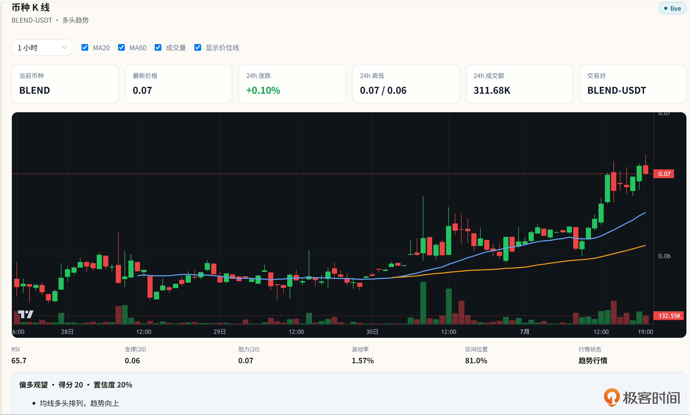
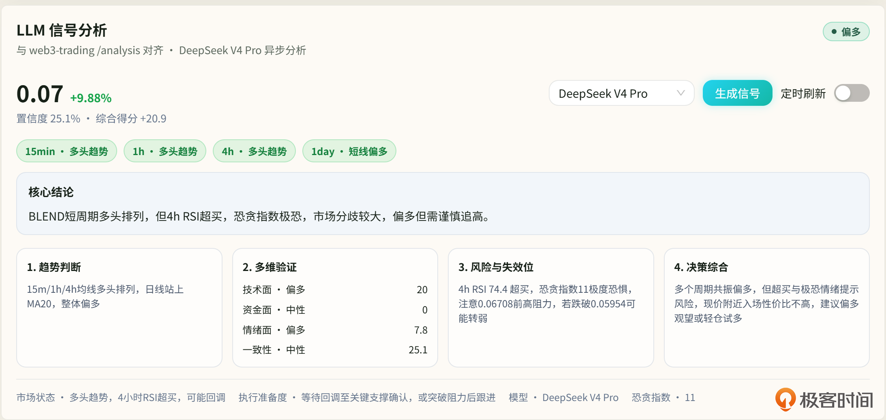
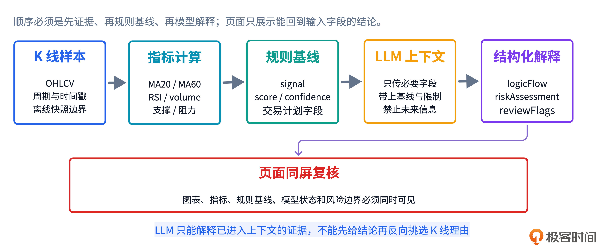
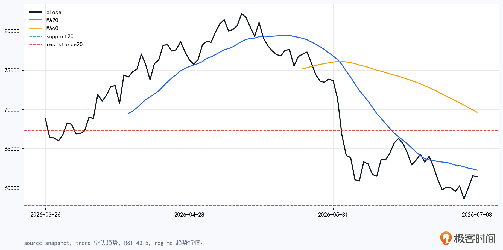
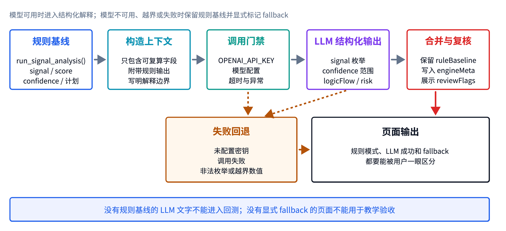
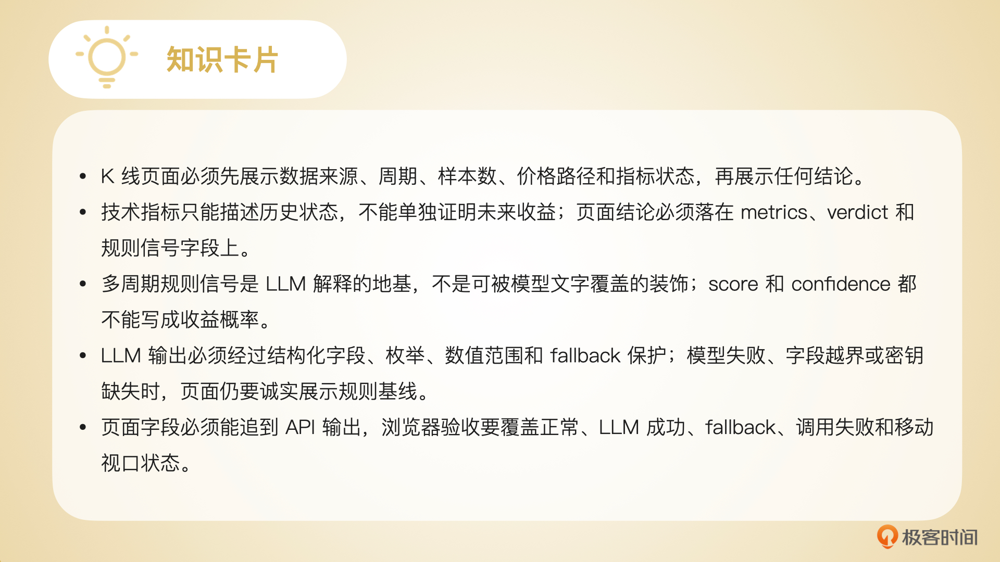

# 25 | 构建K线分析与LLM信号页面

你好，我是袁从德。

第 24 讲我们把全市场候选压缩成可以继续研究的对象，这节课进入单个交易对的证据页。候选进入本页以后，还不能直接变成买卖建议；它必须先经过 K 线样本、指标、规则信号、模型状态、fallback 说明和人工边界的共同约束。

本讲只完成一件事：把“LLM 信号页”做成证据绑定页，而不是荐币页。K 线展示历史价格路径，指标提供可复算状态，规则引擎给出确定性基线，LLM 只在这些字段之上组织解释。只要模型解释无法回到图表、指标和规则字段，就不能进入下一讲的回测与风险中心。

我们先来看一个常见误区：把语言模型的流畅解释误当成交易信号本身。Codex 的职责不是替人判断 BTC 能不能买，而是把页面、API、后端规则、模型输出和测试连成一条可验证数据链，让每一句结论都有证据来源，也有明确的停止边界。

本讲的交付物是一份单币种证据页验收记录：记录输入币种、K 线样本窗口、指标字段、规则信号、LLM 状态、fallback 说明、API 字段映射、页面截图和停止条件。

## 1. 证据页的核心契约

单币种研究页的阅读顺序应是：先看数据来源和 K 线窗口，再看指标，再看规则信号，最后看 LLM 是否在解释这些证据。若顺序反过来，流畅语言会掩盖证据缺口。金融和交易场景里，LLM 的最大风险不是“不会写分析”，而是把不完整、过期或不一致的数据包装成确定性很强的叙述。

先用两张页面图固定验收对象。图 25-1 是本讲最终要验收的单币种 K 线页面。读图时不要只看红绿蜡烛，而要同时看周期选择、均线、成交量、价位线、指标卡和页面结论是否能回到同一份 K 线样本。



- 图 25-1　币种 K 线页面

图 25-2 是对应的 LLM 信号分析页面。读图时不要只看结论文字，而要同时看模型状态、规则基线、证据字段、风险提示和人工复核入口是否同屏出现。



- 图 25-2　LLM 信号分析页面

明确页面形态以后，再回到代码入口。表 25-1 汇总本讲使用的真实文件，课程中的页面、字段和命令必须和这些文件一致。

目标

- 对应文件本讲关注点

```
src/web/src/pages/research/ResearchPage
```

- 页面加载 K 线、

单币种研究页

```
t
```

- 态

- 表 25-1　本讲用到的真实代码入口

你复核时不要从 LLM 结论开始，而要沿表 25-1 反向追溯：页面展示了什么字段，前端调用了哪个 API，后端由哪个函数计算，测试是否锁住异常分支。只要其中一环无法定位，就不能把页面文字送入回测或风险中心。图 25-3 展示 K 线证据与 LLM 信号解释之间的绑定关系。顺序不能反过来：先有 K 线、指标和规则基线，再有模型解释。



- 图 25-3　K 线证据与 LLM 信号解释绑定

本页的信息层级可以用一句话概括：先说明样本从哪里来，再用图表展示价格路径，用指标提

```
供可复算状态，用规则信号给出确定性基线，最后让 LLM 只解释这些证据。engineMeta、
任务状态、fallback note 和 reviewFlags 则负责说明这段解释来自哪里、是否降级、是否需
```

要人工复核。任何一层缺失，都不能把页面文字送进回测。

```
当前页面实现也遵守这个顺序：ResearchPage 会先调用 fetchKlineAnalysis(pair,
klineType) 加载图表和指标，再调用 submitLlmSignalAnalysis(symbol, model)
```

提交 LLM 信号任务。若 LLM 没配置或调用失败，后端仍会保留规则基线，并通过

```
engineMeta.note 或任务状态说明 fallback。也就是说，页面不是先问模型“怎么看”，再找
```

图表附会；而是先形成可复算证据，再让模型解释证据。

## 2. K 线与规则信号的代码落点

K 线图不是背景装饰。用户看到“偏多”“观望”“等待回踩”这样的结论时，必须能回到图上的价格路径、均线、支撑阻力和指标字段。技术指标本质上是历史价格和成交量的变换，它们可以描述状态，但不自动产生未来收益。

### 2.1 K 线指标字段

```
K 线分析入口是 run_kline_analysis()。它会取得标准化 K 线，按时间升序计算
```

MA20、MA60、RSI、布林带、ATR、支撑阻力、量比、区间位置和行情状态；样本少于 20

```
根时返回 insufficient_candles，而不是补造指标。代码 25-1 使用本讲真实后端函数生
```

成 K 线分析和规则信号。

```
from dashboard.kline_analysis import run_kline_analysis
from dashboard.signal_analysis import run_signal_analysis
kline = run_kline_analysis("BTC-USDT", kline_type="1hour", limit=120)
signal = run_signal_analysis("BTC")
print(kline["source"], kline["metrics"]["rsi"], kline["verdict"])
print(signal["engine"], signal["signalLabel"], signal["score"], signal["confidenc
```

- 代码 25-1　用真实后端函数生成 K 线和规则信号

```
一次可复核输出中，核心字段位于 metrics 和 verdict：metrics.latestClose、
metrics.rsi、metrics.sma20、metrics.sma60、metrics.support20、
metrics.resistance20 和 verdict.actionLabel。如果本地 .env 将
DASHBOARD_DATA_MODE 设为 auto 或 live，数值可能随实时行情变化；真正要固定的
```

- 是字段路径、计算窗口和解释边界，不能脱离 API 字段凭空改写。

```
图 25-4 使用 run_kline_analysis("BTC-USDT", kline_type="1hour",
limit=120) 的离线快照画出 close、MA20、MA60、support20 和 resistance20。
```



- 图 25-4　K 线图要能追到 close、MA20、MA60 和支撑阻力

表 25-2 汇总 K 线指标字段。表中“页面用途”比样本值更重要，因为样本值会随快照变化。

- API 字段

页面元素

- 计算来源页面用途

```
metrics.latestClose
```

- 最新 candle close

最新价

- 当前相对

- 表 25-2　K 线指标字段、计算来源与解释边界

K 线页面的验收重点可以压缩成三条停止线：最新价必须等于最后一根 K 线的 close；均线、

```
RSI、支撑阻力和行情状态必须来自 metrics，不能由 LLM 生成；页面结论必须引用
verdict.reasons，且保持“观察 / 复核”语气，不能写成确定买卖建议。
```

### 2.2 多周期规则信号

```
src/dashboard/signal_analysis.py 会把 15min、1hour、4hour 和 1day 的 K 线状态
```

合成规则信号。这个规则信号是 LLM 的地基，不是 LLM 的竞争对手。没有规则基线，LLM的文字很容易变成“看起来完整、实际不可复算”的判断。代码 25-2 展示多周期字段。

```
from dashboard.signal_analysis import run_signal_analysis
signal = run_signal_analysis("BTC")
for timeframe, row in signal["kline"].items():
   print(timeframe, row["trend"], row["score"], row["rsi"])
```

- 代码 25-2　多周期规则信号字段

表 25-3 给出多周期规则信号的结构。

字段

- 当前代码来源含义

```
timeframe_weights
signal_analysis.py
```

- 15min、1hour、4hour、

```
kline[tf].trendKey
run_kline_analysis()
```

- 单周期趋势状态

```
kline[tf].score
kline_verdict()
```

- 单周期规则分

```
score
```

- 多周期加权 + 情绪 / 资金项综合规则分

```
confidence
abs(score) * 1.2 上限截断
```

- 规则一致性强弱

- 表 25-3　多周期规则信号字段合同

```
当前离线样本的规则输出为 WEAK_SELL、score=-15.0、confidence=18.0，四个周期
```

都显示空头趋势；这仍然只是教学规则基线，不是做空建议。页面至少要暴露每个周期的

```
trendKey、score、rsi，并说明 confidence 是规则强弱，不是胜率。若方向标签与分
```

数符号冲突、少于两个周期可见、或交易计划缺少止损来源，就应停止 LLM 解释。

```
如果当前样本生成了偏空或偏多的交易计划字段 tradePlan，它也只具有教学价值。这个
```

- 计划还没有经过第 26 讲的回测、成本、滑点、最大回撤、仓位和组合风险复核，不能直接写成“应该做多”或“应该做空”。

## 3. LLM 门禁与降级回退路径

本节检查两种状态：未配置 LLM 时的规则引擎输出，配置 LLM 后的模型解释输出。页面必须明确标注来源，不能把降级回退（fallback）当成模型成功，也不能把模型成功当成结论正确。

### 3.1 结构化输出边界

```
src/dashboard/llm_signal.py 的关键设计，是先生成规则基线，再把有限上下文字段
```

交给模型。模型返回后，系统只接受 schema 允许的字段、枚举和数值范围，越界内容必须回退并留下复核标记。

规则基线和 LLM 输出要同屏比较。页面至少要回答四个问题：用户能否区分规则模式和模型

```
成功；LLM 是否改变了 signal、score 或 confidence 并留下痕迹；解释是否引用
evidence、reasons 和多周期字段；fallback note、reviewFlags、signalError 是否
```

清楚可见。

```
代码 25-3 展示 LLM 信号入口。注意：如果本机环境里存在 OPENAI_API_KEY，这段代码可
```

能真的发起外部模型调用；我们复核 fallback 时，应先清除密钥或使用测试里的monkeypatch，避免把网络状态混进离线样本。

```
from dashboard.llm_signal import run_llm_signal_analysis
payload = run_llm_signal_analysis("BTC", model="deepseek-v4-pro")
print(payload["engine"])
print(payload["engineMeta"])
print(payload["signalLabel"], payload["score"], payload["confidence"])
```

- 代码 25-3　LLM 信号入口必须返回 engineMeta

代码 25-4 给出未配置模型时的 fallback 复核命令，可以在 PowerShell 中显式移除密钥：

```
Remove-Item Env:OPENAI_API_KEY -ErrorAction SilentlyContinue
$env:DASHBOARD_DATA_MODE = "offline"
python -c "from dashboard.llm_signal import run_llm_signal_analysis; p=run_llm_si
```

- 代码 25-4　离线复核 LLM fallback 状态

```
src/dashboard/llm_signal.py 有四条关键保护线：
先调用 run_signal_analysis() 生成规则基线。
prompt 只把 market、kline、evidence、onchainMetrics、tradePlan 和
ruleSignal 交给模型。
未配置 OPENAI_API_KEY 时，返回规则引擎结果，并在 engineMeta.note 说明
```

- fallback。

```
LLM 返回后，_merge_llm() 校验 signal、confidence 和 score；非法信号或越界
数字会回退到规则基线，并写入 reviewFlags。
```

表 25-4 给出 LLM 输出字段边界。

LLM 字段

- 允许做什么不允许做什么当前保

```
signal
输出 BUY_NOW、ALL_IN 等越界动作
SIGN
```

- 在枚举内表达方向

```
confidence
```

- 0-100表示模型解释强弱写成胜率或收益概率

```
score
```

- 表达 -100 到 100 的综合倾向覆盖规则分且不留痕越界回

```
summary
```

- prom压缩证据结论补造未提供价格、新闻、链上事实

```
analysis
```

- 补充市场状态和执行准备度生成真实下单建议页面和

```
logicFlow
```

- 隐藏规则基线或 fallback解释证据链同屏展

- 表 25-4　LLM 输出字段边界

结构化输出不能消除幻觉，但能让越界字段、缺失字段和异常数值更容易被测试发现。FINSABER 把 LLM Agent 放入统一回测比较，Chat2Trade 把固收 RFQ 文本解析成结构化交易参数。二者共同说明，金融大模型的落点不是“写得像交易员”，而是把非结构化语言压成可

```
验证字段。因此要求页面展示 engineMeta、fallback、规则基线和 reviewFlags：模型可
```

以解释证据，但不能跳过 schema、成本、回测和风险中心。

### 3.2 降级回退状态验收

LLM 信号页面最重要的不是“模型一定成功”，而是“模型失败时页面仍然诚实”。在真实产品里，密钥缺失、API 超时、模型返回非法 JSON、字段越界、任务轮询失败都很常见。可靠的研究页应该把这些状态显出来，而不是用默认文案遮住。

图 25-5 展示从规则基线到 LLM / fallback 的路径。



- 图 25-5　LLM 信号必须有规则基线和失败回退

表 25-5 给出 fallback 状态表。它的价值不是枚举异常名，而是规定页面在每种状态下还能做什么、必须停止什么。

场景

- 后端可识别信号页面必须暴露

```
规则引擎名称、score
engine=sandbox-rule-based
```

规则模式

```
tradePlan
```

- 表 25-5　LLM/fallback 状态要绑定允许动作和停止线

## 4. 页面字段追溯与浏览器验收

页面上的每个关键字段，都要能回到 API 输出。字段追溯不是形式检查，而是回测前的入口条件：回测需要明确的规则输入，而不是一段无法复算的自然语言。表 25-6 给出字段追溯矩阵。K 线图、均线、RSI、信号标签、置信度、交易计划、模型状态和失败说明，都必须有对应字段。

- matched_fields

## field_trace_rate =

字段追溯率可以写成：

- required_fields​

- API 字段

页面元素

- 检查方式

- 表 25-6　页面字段必须能回到 API 输出

- 浏览器验收不再另列成表，只保留一组必查项：规则模式要能看到 K 线、规则信号和证据字段；LLM 成功时要能看到模型名、结构化字段和证据引用；fallback 或调用失败时要能看

```
到降级说明、规则基线、signalError 或 engineMeta.note；移动视口下图表、指标
```

- 卡和文字不能重叠。

代码 25-5 给出页面验收记录模板。

```
acceptance = {
   "input": "BTC",
   "kline_window": {"pair": "BTC-USDT", "type": "1hour", "limit": 120},
   "rule_output": ["signal", "score", "confidence", "evidence", "tradePlan"],
   "llm_status": "success | fallback | failed",
   "trace_fields": ["source", "engineMeta", "evidence", "reviewFlags", "failure_
   "stop_boundary": "不得把 LLM 解释写成投资建议",
}
```

- 代码 25-5　K 线与 LLM 信号页面验收模板

## 5. Codex 实战与验证入口

Codex 在本讲里扮演“证据链工程师”和“验收员”，不是交易顾问。模糊请求通常长这样：“帮我把 BTC 的 LLM 信号页做好。”这个请求太大，也容易诱导代理直接改页面文案。更稳妥的做法是拆成三轮，把修改范围、证据要求和停止条件说清楚。

第一轮用于读代码和固定范围：

```
读取 ResearchPage.tsx、api.ts、kline_analysis.py、
signal_analysis.py、llm_signal.py。
```

2. 只总结字段链路和缺口，不修改代码。

3. 输出页面字段、API 字段、后端来源和缺失状态。

第二轮用于小范围实现：

```
只允许改 ResearchPage.tsx、KlineAnalysisChart.tsx 或必要的 API 类型定义。
保留规则基线、engineMeta、fallback note 和 reviewFlags 的可见展示。
不新增交易建议措辞，不把 confidence 写成胜率。
```

第三轮用于验证和写回课程：

1. 运行与本讲相关的窄口测试。

2. 如涉及图形脚本，再运行第 25 讲图形生成命令。

3. 在回复中列出实际运行的命令、结果摘要和未验证项。

4. 把字段、命令、边界和失败状态写回本讲，而不是只给原则。

```
本讲的交付流程可以压缩为四步：先读 ResearchPage.tsx、api.ts、
kline_analysis.py、signal_analysis.py 和 llm_signal.py；再固定
metrics、verdict、signal、tradePlan、engineMeta 的字段合同；随后用离线
```

snapshot 构造 BTC/USDT 样本，检查 LLM 枚举、分数、置信度、fallback 和

```
reviewFlags；最后运行窄口测试与 python scripts/course.py verify，把字段、
```

命令、边界和失败状态写回讲义。

## 总结

这节课我们把单个交易页面整理为证据优先的分析界面。核心不是让 LLM 写出更像研究员的文字，而是让页面上的每一句判断都能回到 K 线样本、指标字段、规则基线、模型状态和失败记录。



因此，K 线、指标、规则信号、LLM 解释和模型状态必须彼此绑定。LLM 能帮助组织解释，但不能创造证据、替代规则、绕过回测或发出真实交易建议。

下一讲进入策略回测与风险中心。本讲形成的信号证据，将成为回测假设和风险复核的输入。

## 思考与练习

1. 边界判断：如果页面只显示 LLM 结论，但不显示规则基线和 fallback 状态，是否可以进入回测判断？说明理由。

```
代码复核：在 ResearchPage.tsx 中找出 fetchKlineAnalysis、
submitLlmSignalAnalysis 和 pollLlmSignalAnalysis 的调用位置。
```

期待你的分享。如果今天的课程让你有所收获，也欢迎转发给有需要的朋友，邀请他来一起学习，我们下节课再见！
